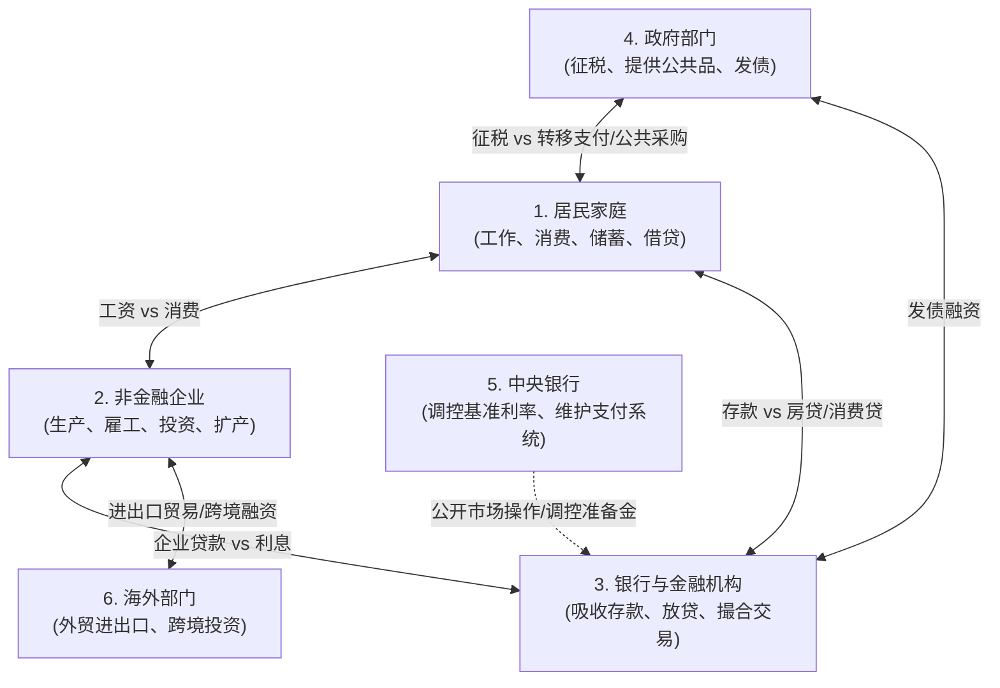
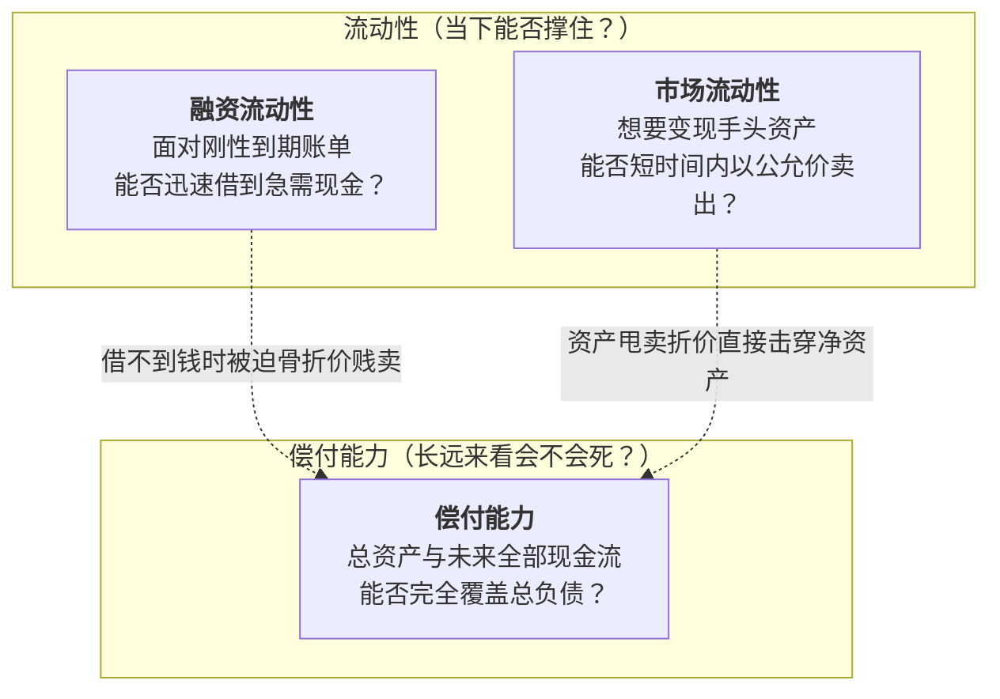
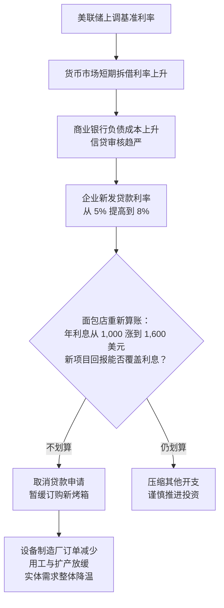
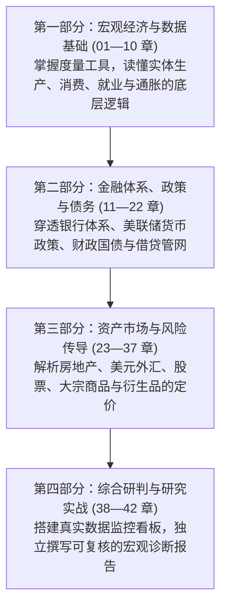

# 01 经济地图：生产、收入、支出与融资

[目录](./) · [下一章](02-measurement.md)


> 本章是全书的“认知地图”。建议分三次学习：第 1—2 节理清实体经济与部门循环；第 3—4 节掌握资产负债表与金融传导；第 5—7 节理解指标形成并完成实战练习。除明确注明的历史官方报告外，数值均为教学假设。

---

## 本章要解决什么问题

假设同一天，你在财经新闻里读到三条消息：
1. “本月居民消费支出创历史新高”
2. “全国居民总负债同步刷新历史纪录”
3. “股市遭遇重挫，三大股指全线大跌”

此时，经济究竟是在变好，还是在变坏？

如果你只抓着其中一条消息看，很容易得出完全相反的结论。但现实中，**这三条消息完全可以同时成立，并且指向同一个正在运行的经济现实**：
- 消费增加，说的是一段时间内的**支出流量**；
- 债务创新高，说的是某一个时点上的**负债存量**；
- 股市下跌，不仅反映当下，更包含了全市场对未来的**折现与预期**。

它们就像体温计、血压计和心电图，测的是同一个人的不同维度，不能靠“两票对一票”来简单表决经济的好坏。

本章的任务不是让你一次性背完后面几十个复杂的指标，而是**为你画一张能安放所有指标的“经济全景地图”**。你不需要会计或高深的高数基础，只需基础的四则运算。

读完本章，你将能够：
- 顺着钱与货的流动，说清一笔支出如何变成另一方的收入，理解为什么 GDP 必须算“增加值”；
- 区分**流量**（如收入）、**存量**（如债务与财富）与**市场价格**（如利率与股价）；
- 明白为什么“借到钱”不等于“赚了钱”，“账面变富”不等于“兜里有现金”；
- 理解我们每天在屏幕上看到的宏观数据究竟从何而来，避免最常见的因果混淆。

---

## 1. 从一家面包店开始：实体经济的流转回路

### 1.1 先看发生了什么，而不是先背公式

宏观经济听起来很宏大，但它本质上就是无数个家庭、企业和机构日常交易的汇总。

我们先从一个极其简化的世界开始：这个经济体里只有**居民（家庭）**和两家企业——**面粉厂**与**面包店**。
- 每月面粉厂生产面粉，以 3,000 美元卖给面包店；
- 面包店消耗这些面粉做成面包，以 10,000 美元全部卖给居民；
- 假定原料当月全部用完，没有存货滞留，面粉厂没有向其他厂商购买原料。暂不考虑税收与折旧。

我们把这两家企业做的事情列成一张账单：

| 企业 | 销售收入 | 购入并耗用的中间投入 | 本企业新创造的价值（增加值） | 支付员工工资 | 留在企业的简化利润 |
| :--- | ---: | ---: | ---: | ---: | ---: |
| **面粉厂** | 3,000 美元 | 0 美元 | **3,000 美元** | 2,000 美元 | 1,000 美元 |
| **面包店** | 10,000 美元 | 3,000 美元 | **7,000 美元** | 5,000 美元 | 2,000 美元 |
| **合计** | 13,000 美元 | 3,000 美元 | **10,000 美元** | 7,000 美元 | 3,000 美元 |

现在请思考一个核心问题：**这个月，整个经济体新创造了多少价值？**

是两家企业销售额相加的 13,000 美元吗？
**绝对不是。**

因为面包店卖的 10,000 美元面包里，已经包含了那批 3,000 美元的面粉成本。如果你把 3,000 和 10,000 直接相加，那批面粉就被你重复算了两次！

为了避免重复计算，统计上提出了**增加值**（Value Added）的概念：

$$
\text{增加值} = \text{总销售产出} - \text{生产中消耗的外购中间投入}
$$

- 面粉厂从无到有磨出面粉，增加了 3,000 美元价值；
- 面包店把面粉加工成面包，增加了 $10,000 - 3,000 = 7,000$ 美元价值；
- 全社会新创造的总价值，恰好是：$3,000 + 7,000 = 10,000$ 美元。


这就是观察宏观经济的第一条铁律——**三种入口，衡量的是同一件事**：
1. **从最终用途（支出侧）看**：居民一共买了多少最终消费品？答案是 **10,000 美元**。
2. **从生产环节（生产侧）看**：各企业新创造的增加值之和是多少？$3,000 + 7,000 =$ **10,000 美元**。
3. **从收入分配（收入侧）看**：这笔财富分给了谁？员工拿走工资 7,000 美元，老板留下利润 3,000 美元，合计也是 **10,000 美元**。

> **国内生产总值（GDP）**，就是在一定时期内，一个国家或地区所生产的**全部最终产品和服务的市场价值**。它测量的必须是“新创造的增加值”，绝不能把所有交易流水胡乱加总。

---

### 1.2 宏观经济的“六大部门”

真实世界当然不止面粉厂和居民。为了把现代经济中的借款、税收、进出口和央行政策全部放进视野，我们先把参与者划分为六大核心部门：



| 部门 | 它在做什么决定？ | 它受什么主要约束？ | 它如何与外部连接？ |
| :--- | :--- | :--- | :--- |
| **居民家庭** | 工作多久、消费多少、存多少钱、借不借房贷 | 收入水平、现有债务、财富、生活刚性开支 | 向企业提供劳动赚工资，向企业购买消费品，向银行借贷与储蓄 |
| **非金融企业** | 生产什么、招不招人、卖什么价、要不要借钱建新厂 | 市场订单、原材料成本、现有产能、融资成本 | 付工资给居民，采购供应商原料，向银行借款或发债 |
| **银行与金融机构** | 给谁放贷、买什么债券、承担多大风险 | 资本充足率、流动性、监管规则、还款违约率 | 连接储蓄者与借款人，提供日常支付清算渠道 |
| **政府部门** | 征多少税、在基建/国防/社保上花多少钱、发多少国债 | 法律预算授权、财政赤字与长期偿债负担 | 征税减少私人资金，政府采购创造企业订单，转移支付补贴居民 |
| **中央银行** | 提高还是降低政策利率、如何调整资产负债表 | 法定政策目标（充分就业与物价稳定） | 影响银行间借贷成本与金融条件，不直接给普通居民发工资 |
| **海外部门** | 买不买美国产品、借不借美元、投不投美债 | 他国经济状况、汇率波动、地缘政治与贸易规则 | 向国内出售商品（进口），购买国内产品（出口），跨境资金流动 |

> [!IMPORTANT]
> **分析宏观经济时，必须形成一个条件反射式的追问**：
> 当新闻报道“发生了一笔巨额资金变动”时，永远先问四个问题：
> **这是谁的收入？谁的支出？谁的资产？谁的负债？**
> 任何一笔交易，必定有人付出，有人接收；你的资产往往是对别人的权利，你的负债则是别人手里的资产。

---

### 1.3 四种极其容易混淆的“花钱”

在日常生活中，我们把买面包、买设备、买旧房、买股票都叫“花了钱”。但在经济统计中，它们属于完全不同的抽屉：

1. **中间投入 vs 固定投资**：
   - 面包店当月买的面粉，当月就做成面包卖掉了，这叫**中间投入**，不能单计入 GDP；
   - 面包店花 2 万美元买了一台可以使用 10 年的新烤箱，这叫**固定资产投资（I）**。新机器本期被生产出来了，并且未来持续提供生产能力，因此计入当期 GDP。
2. **购买新产品 vs 购买二手资产/股票**：
   - 家庭花 100 美元买新烤箱是投资或消费；
   - 投资者花 100 万美元买隔壁老张手里的二手旧房，或者买市场上流通的苹果公司旧股票，**只是已有资产在不同人之间换了主人，并没有凭空创造出新的产出**。这笔本金交易绝不能算进当期 GDP（但期间房产中介收取的佣金、券商手续费属于本期提供的劳务，算当期 GDP）。
3. **政府采购 vs 转移支付**：
   - 政府出资修建一条新公路、雇佣公立学校老师，政府真金白银购买了工程服务与劳务，计入 GDP 的**政府购买（G）**；
   - 政府向失业人员发放 1,000 美元救济金，并没有换取任何当期商品或劳务，这叫**转移支付**，不计入 GDP。只有当失业人员拿着这笔钱去超市买了面包时，才会在**个人消费（C）**中被统计一次。如果发放救济金算一次 GDP，买面包又算一次，那就重复计算了。
4. **进口在公式里带负号，不代表“进口让经济亏损”**：
   - 经典支出法公式是：$\text{GDP} = C + I + G + X - M$（其中 $X$ 是出口，$M$ 是进口）。
   - 很多初学者看到 $-M$ 就以为“进口有害经济，每进口 100 块经济就损失 100 块”。**这是完全错误的记账误读。**
   - 真实原因在于：当你在国内商场买了一台 1,000 美元的进口咖啡机时，商场收银台把它记入了国内消费 $C$（+1,000 美元）。但既然这台咖啡机是在海外工厂制造的，它显然不属于“美国国内生产的价值”，所以必须在末尾扣除进口 $M$（-1,000 美元）。一加一减，净效应为 0。**减去进口只是为了校正统计边界，剔除非本国生产的部分。**

---

## 2. 观察同一家企业：三种必不可少的视角

现在我们把视角聚焦到微观主体上。如果一位投资人想了解这家面包店，只看它的月度流水够吗？不够。

我们必须熟练切换**三种观察视角**：
1. **期间活动（流量）**：这段时间发生了多少生产与交易？
2. **时点状态（存量）**：此时此刻到底拥有什么、欠别人什么？
3. **市场条件与定价**：如果现在想去融资或转让，外界给出的价格是多少？

| 视角 | 核心问题 | 面包店的例子 | 宏观经济的对应指标 |
| :--- | :--- | :--- | :--- |
| **期间活动（流量）** | 过去这一个月/这一个季度，发生多少交易？ | 本月总营业额、付了多少工资、利润多少 | GDP、个人可支配收入、季度财政赤字 |
| **时点状态（存量）** | 截至 12 月 31 日这一刻，底子有多厚？欠多少外债？ | 银行存款余额、烤箱设备价值、贷款欠款余额 | 国家总债务规模、居民净财富、央行准备金余额 |
| **市场条件与价格** | 现在做交易或借钱，外部环境有多苛刻？ | 银行新批贷款的年利率、转让股权的估值倍数 | 国债收益率、股票市盈率、企业信用利差 |

### 2.1 资产负债表：借钱买设备，绝不等于变富

为了说清存量，我们必须看**资产负债表**。它的核心恒等式只有一行：

$$
\text{资产} = \text{负债} + \text{净资产} \iff \text{净资产} = \text{资产} - \text{负债}
$$

- **资产**：你掌控的经济资源或对他人的权利（存款、机器、房产、别人欠你的货款）；
- **负债**：你承诺必须偿还的债务（银行贷款、欠供应商的货款、应付未付的账单）；
- **净资产（财富）**：真正完完全全属于你自己的剩余部分。

假设面包店起初的底子是：账户里有现金存款 20,000 美元，拥有一套价值 80,000 美元的烤箱设备，欠银行贷款 30,000 美元。
此时：
- 资产合计 = $20,000 + 80,000 = 100,000$ 美元
- 净资产 = $100,000 - 30,000 = 70,000$ 美元

现在，老板雄心勃勃打算扩产，向银行申请借入 20,000 美元贷款，并用这笔贷款新添置了一台价值 20,000 美元的高级烤箱。我们来看看这期间两步交易的资产负债表变化：

| 阶段 | 存款 | 机器设备 | **资产总额** | 银行贷款 | **净资产** | 发生了什么？ |
| :--- | ---: | ---: | ---: | ---: | ---: | :--- |
| **起初状态** | 20,000 美元 | 80,000 美元 | **100,000 美元** | 30,000 美元 | **70,000 美元** | 原有经营底子 |
| **步骤 1：贷款到账** | 40,000 美元 | 80,000 美元 | **120,000 美元** | 50,000 美元 | **70,000 美元** | 存款多 2 万，负债也多 2 万，**净资产完全没变** |
| **步骤 2：付款买下烤箱** | 20,000 美元 | 100,000 美元 | **120,000 美元** | 50,000 美元 | **70,000 美元** | 存款资产变成设备资产，**净资产依然是 7 万** |

> [!WARNING]
> **请死死记住这一张表所揭示的常识**：
> 1. 银行贷款 2 万到账，企业账上确实多了 2 万现金，但**这绝不是营业收入，更不代表企业变富了**。因为负债端同样增加了 2 万元的还款枷锁。
> 2. 买下烤箱，只是把一种资产（流动现金）换成了另一种资产（固定设备），**没有凭空创造任何一分钱净资产**。
> 3. 未来这台烤箱到底能不能多烤面包、多赚利润来偿还本息，才是决定这笔投资是“扩大生产”还是“滑向破产”的关键。

同理，当企业未来拿出 5,000 美元去**偿还贷款本金**时：
- 存款减少 5,000 美元，银行贷款负债也减少 5,000 美元；
- 资产和负债同时缩减，**这绝不是企业当月亏损了 5,000 美元**。只有借钱所产生的**利息**支出，才是侵蚀当期收益的费用。本金归还与利息支出性质完全不同。

---

### 2.2 账面涨价不等于“真金白银流进来”

很多财经媒体常有这类惊悚标题：“某科技股大涨，今天全市场涌入千亿美元资金！”

这是典型的存量重估误读。
假设你持有某公司 1,000 股股票，昨天的收盘价是 10 美元/股，你持仓市值是 10,000 美元。
今天早盘开盘，有一位买家愿意以 12 美元/股的价格成交了 10 股。
此时，按照最新成交价计算，你手里的 1,000 股股票账面市值瞬间变成了 12,000 美元。
你的账面财富增加了 2,000 美元。

但是，**有 2,000 美元的现金打到你的银行卡上了吗？**
没有。市场上有人为了你持有的这 1,000 股向你付过一分钱吗？没有。

$$
\text{期末资产价值} = \text{期初价值} + \text{净新增交易额} + \text{市场估值变动（重估）}
$$

边际上几笔小额交易拉高了报价，就可以让整个市场的总市值膨胀几十亿美元。这并不需要成百上千亿美元的真实钞票“流进市场”。把股价上涨说成“万亿资金涌入”，是混淆了**成交报价变动**与**真实资金沉淀**。

---

### 2.3 有钱、能付款与能还债：三个不同的维度

再看一个更残酷的情景：
面包店目前拥有价值 100,000 美元的烤箱，欠银行 50,000 美元贷款，净资产高达 50,000 美元。看起来财务挺健康，对吧？
但是，老板打开银行账户，发现里面**只有 1,000 美元活期存款**。
而明天一早，必须给员工发放刚性工资 5,000 美元。

明天会发生什么？
**面包店可能直接因为发不出工资引发罢工停业，甚至面临违约倒闭。**

哪怕你的净资产再高，只要你拿不出明天要用的即时现金，你就会陷入危机。在金融和宏观分析中，我们必须把这三者分清：



- **偿付能力（Solvency）**：长远来看，你手里的资产和未来的总营收，能不能盖过总债务？如果资不抵债（净资产为负），长期必死无疑。
- **融资流动性（Funding Liquidity）**：当下这一刻，当你需要现金周转时，你能否及时以正常成本借到钱？
- **市场流动性（Market Liquidity）**：当你着急用钱、想要把资产卖掉时，能不能迅速卖出去？会不会因为挂牌甩卖而让价格直接腰斩？（如果一台 10 万的烤箱急着明天卖只能贱卖 2 万，流动性危机就会立刻转化为实质性的破产）。

以后再听到“市场流动性充裕”或“流动性吃紧”，切记多问一句：**到底是谁的流动性？是银行手里有超额准备金，还是股市好做大单交易，还是实体小企业能轻松借到钱？** 这完全是三码事。

---

## 3. 金融怎样接入实体：贷款、传导与滞后

### 3.1 银行放贷的真相：贷款创造存款

在传统直觉里，很多人以为银行的运转模式是：老张存入 100 块 → 银行锁进金库 → 银行再从金库拿出 100 块借给老李。

现代银行体系的实际运行并非如此。
当面包店向商业银行申请一笔 20,000 美元的扩产贷款，银行信贷部门审核批准后，柜员在电脑系统上敲击键盘：
- 在资产端，银行新增了一笔**对面包店的贷款债权（+20,000 美元）**；
- 在负债端，银行在面包店的企业存款账户里，直接输入一个数字**（+20,000 美元）**。

```text
面包店的账本：
  资产端：银行活期存款 +20,000 美元
  负债端：应还银行贷款 +20,000 美元

商业银行的账本：
  资产端：应收企业贷款 +20,000 美元
  负债端：客户活期存款 +20,000 美元
```

在这个瞬间，这 20,000 美元的全新购买力凭空诞生了。它不需要等待某位储户把钞票抱进银行，**商业银行通过发放贷款，内生性地创造了匹配的银行存款**。

但请注意：**这绝不意味着银行可以无法无天、无限放贷。**
- 贷款客户可能会违约不还；
- 当面包店要把这 2 万美元转账给外地设备厂时，若设备厂使用的是另一家银行，两家银行之间必须通过中央银行账户里的**准备金**来完成清算交割；
- 银行必须时刻受制于资本充足率、流动性监管要求以及经营利润的硬约束。

---

### 3.2 利率变化是怎样一步步影响现实的？

中央银行（如美联储）在调整基准利率时，它并没有权力直接下达行政命令去修改面包店的售价，也没有下令让面包店停止扩产。
政策传导是通过**改变借钱的性价比与资金约束**，层层渗透进实体经济的：



#### 为什么政策的影响不会在明天立刻显现？（传导滞后）
很多初学者常问：“为什么美联储加息好几个月了，物价和就业还没怎么跌？”
核心原因在于**合同的锁定与传导滞后**：
- 如果面包店在两年前借的贷款是**固定利率**（Fixed Rate），那么无论今天市场利率涨到多高，只要这笔借款还没到期，面包店每个月要还的利息一分钱都不会变；
- 只有当旧贷款到期需要“借新还旧”（再融资），或者面包店想要申请新增贷款时，8% 的高利率才会狠狠咬它一口；
- 同样，居民的 30 年期固定利率房贷，只要不换房，利率就一直锁死在过去的低点。

从央行调整政策，到全社会金融条件收紧，再到企业和家庭真实削减开支，中间隔着数月乃至数年的合同滚动期。**“滞后”不是统计学的误差，而是真实商业合同排期所决定的物理现实。**

---

## 4. 屏幕上的数据是怎么来的：辨认指标的“四种血统”

我们在彭博终端、财经网站或政府公报上看到的各种宏观数据，并不是一台神圣仪器直接测量出来的温度。每一个数字都有它特定的生成逻辑：

| 形成机制 | 它是怎么被制造出来的？ | 典型代表 | 必须警惕的陷阱 |
| :--- | :--- | :--- | :--- |
| **抽样调查与统计编制** | 向一部分选定的人群或企业发问卷，再按统计学加权推算全国总体。 | 非农就业人数、失业率、CPI 物价指数 | **绝不是对全美每个人的全面普查**；存在抽样误差、问卷回收不齐与后续例行修正。 |
| **市场交易与公开撮合** | 无数买家和卖家根据各自的预期、流动性和风险偏好，在交易所持续报盘、下单撮合成交。 | 10 年期美债收益率、标普 500 指数、原油期货价格 | **不代表官方预言**；它反映的是边际交易者的预期，经常包含过激的情绪、恐慌或流动性踩踏。 |
| **行政设定与法定规则** | 由特定法定机构（如美联储 FOMC 委员会）开会讨论后，投票决定并对外公布的基准目标。 | 联邦基金利率目标区间、法定存款准备金率 | **行政目标不等于民间实际借贷成本**；央行宣布降息，不保证高风险小企业能立刻以低息借到钱。 |
| **模型推算与派生指标** | 基于某些经济学理论或统计假设，把直接测出的基础数据喂进数学模型估算出来的影子。 | 期限溢价（Term Premium）、自然失业率、潜在产出增长率 | **模型自带强烈假设**；不同经济学家的模型算出来的结果可能大相径庭，绝非客观物理常数。 |

### 4.1 预期差：为什么数据“变好了”，股市反而大跌？

初入市场的学习者最困惑的场景莫过于：
新闻公布“某月新增非农就业 20 万人”，比上个月的 15 万人明显增加，实体经济明显在好转，结果当天股票债券全线暴跌。为什么？

因为金融市场是在**以预期为基准进行交易**的：
- 如果在数据公布前，全市场普遍预期会新增 30 万人，并且资产价格已经按照 30 万的乐观预期涨过一轮了；
- 那么实际公布的 20 万人，虽然比上月高，但在市场上却是一场**“负向意外”（数据不及预期）**；
- 又或者，如果当时市场最担心的是通胀过热促使央行加息，那么“就业强劲”反而会被解读为“央行加息悬念未决、借贷成本将更高”，从而重创估值。

$$
\text{市场意外值（Surprise）} = \text{实际官方公布值} - \text{事前市场一致预期（Consensus）}
$$

判断一个数据的当下市场影响，永远不能只看它比上一期变大了还是变小了，必须同时看它站在了预期的哪一边。

---

## 5. 常见推理陷阱：别把相关当因果，别让均值掩盖撕裂

在宏观分析中，错误的直觉比没有直觉更可怕。以下三条逻辑陷阱，在日常研报和财经新闻中比比皆是：

### 陷阱 1：看到降息就说是“降息导致了危机”（反向因果）
如果你统计过去几十年的历史数据，会发现一个极强的相关性：**每次美联储大幅降息之后不久，往往伴随着经济大衰退或失业率飙升。**
如果据此得出结论：“降息是有害的，是降息把经济拖入了深渊”，那就是典型的**反向因果**。

真实的情况是：经济由于内部失衡或外部黑天鹅（如疫情、金融危机）已经提前出现衰退苗头，央行看到危机信号才紧急启动降息救市。**降息是应对火灾的消防栓，而不是纵火犯。**


### 陷阱 2：供求性质搞混——“价格上涨”一定代表“需求旺盛”吗？
很多人只要看到商品涨价，就认为是大家有钱在疯狂抢购。
请看以下两个完全不同的现实情景：
- **情景 A（需求拉动）**：居民口袋有钱，进店吃面包的人排起长队，老板把面包从 5 块涨到 6 块，每天销量翻倍，企业利润大增，连夜多招两名学徒。
- **情景 B（成本推动 / 供给受损）**：小麦产地大旱，面粉进货价飙升 100%。老板被迫把面包从 5 块提价到 6 块，顾客抱怨昂贵纷纷离开，销量暴跌一半，老板苦不堪言打算关门裁员。

在这两个案例里，**面包价格都上涨了 20%**。
但 A 的背后是经济繁荣与需求强劲；B 的背后却是供给破坏与实际生活水平的倒退。只盯着单一价格上涨就武断判定“经济过热”，会彻底判错大势。

### 陷阱 3：平均数陷阱——“全国人均收入增长 5%”代表大家都好过吗？
假设一个由 10 户家庭组成的小区：
- 去年：9 户工薪家庭每户年入 10 万，1 户富豪年入 100 万，全小区总收入 190 万，平均每户 19 万元；
- 今年：遇到经济放缓，9 户工薪家庭遭遇降薪，每户收入滑落到 8 万；但富豪投资大赚，年入暴增至 300 万。
- 此时全小区总收入变成：$9 \times 8 + 300 = 372$ 万元。**平均家庭年收入从 19 万暴增到了 37.2 万，增幅近 100%！**

但真实的社会图景是：全小区 90% 的普通家庭正在紧衣缩食、不敢消费。宏观总量和平均数的攀升，完全可能掩盖微观结构上的撕裂。看宏观数据时，永远要结合**中位数、分阶层数据与债务分布**，不能被一张光鲜的总量平均数遮蔽双眼。

---

## 6. 实战带读：如何第一眼看懂官方报告

现在，我们把所学知识带入真实的战场。
请看美国商务部经济分析局（BEA）于 **2024 年 7 月 25 日** 发布的这篇著名历史报告：
[BEA 官方新闻稿：2024 年第二季度 GDP 初值（Advance Estimate）](https://www.bea.gov/news/2024/gross-domestic-product-second-quarter-2024-advance-estimate)

拿到这份全英文的官方报告，专业研究员的第一眼会看哪里？

```text
U.S. Bureau of Economic Analysis
FOR WIRE TRANSMISSION: 8:30 A.M. EDT, THURSDAY, JULY 25, 2024
Gross Domestic Product, Second Quarter 2024 (Advance Estimate)

Real gross domestic product (GDP) increased at an annual rate of 2.8 percent 
in the second quarter of 2024... In the first quarter, real GDP increased 1.4 percent.
Current-dollar GDP increased 5.2 percent at an annual rate...
```

我们按照三个标准步骤来进行“数据身份核对”：

### 第一步：锁定元数据三要素（防范张冠李戴）
1. **观察期是什么？** 标题写着 *Second Quarter 2024*（2024 年 4 月至 6 月），这是对第二季度三个月活动的总结，不是发布当天（7 月 25 日）发生的事。
2. **这是哪个版本？** 赫然写着 *(Advance Estimate)*，这是“初估值”。当时还有很多底层的进出口、库存和财报数据没有送达统计局，官方是依靠部分推测和已知样本做出的第一次估算，**未来一定会被例行修订**。
3. **区分名义与实际**：
   - 扣除通胀影响后的 **实际 GDP（Real GDP）** 增速是 **2.8%**；
   - 包含价格上涨的 **名义 GDP（Current-dollar GDP）** 增速是 **5.2%**。
   - 实际增速 2.8% 描述的是商品与服务数量的真实扩张；名义增速 5.2% 则是全社会交易金额的膨胀。两者之间 2.4 个百分点的差距，大致折射出整体经济平减指数的涨幅。

### 第二步：识别统计口径（解剖 annual rate）
新闻稿中的 2.8% 后面紧跟着 *at an annual rate*（年化率）。
很多初学者以为第二季度比第一季度直接增长了 2.8%，这是误读。
- 年化率的意思是：“**如果按照这三个月奔跑的速度一直持续跑满整整一年（四个季度），全年的增长会达到 2.8%**。”
- 真实的单季度环比增长，大约只有四分之一左右（约 0.69%）。这个换算技巧我们将在[第 2 章](02-measurement.md)详细展开。

### 第三步：划定推论的边界
根据这篇报告，你可以自信地写下：
> “2024 年第二季度初估数据显示，美国实际经济产出保持稳健扩张，初值年化增速从一季度的 1.4% 回升至 2.8%。”

但你**绝对不能**在报告里写：
> “2024 年 7 月 25 日当天美国经济一片大好，居民全部实现增收，股市必然迎来大涨。”

因为这份报告描述的是过去三个月、存在后续修订可能、且未剔除收入分配不均与物价压力。守住证据的边界，是迈向专业经济分析的第一道门槛。

---

## 7. 全书导航：搭建你的宏观探索阶梯

全书后续共分为四大板块，每一部分都为你解答经济地图中的一个核心疑问：



- 在**第一部分**（第 1—10 章），我们将彻底掌握增长率、基数效应、劳动力非农调查与 CPI 价格指数的真实生成过程；
- 在**第二部分**（第 11—22 章），我们将深入现代金融系统的深水区，拆解商业银行准备金、回购市场（SOFR）、国债拍卖机制与美联储资产负债表；
- 在**第三部分**（第 23—37 章），我们将打通房地产按揭证券化（MBS）、全球离岸美元系统、股票估值传导与大宗商品周期的内在脉络；
- 在**第四部分**（第 38—42 章），我们将教你如何避开前视偏差，搭建自己的指标监控库，完成一份专业级宏观研报。

---

## 8. 课后练习：检验你的地图绘制能力

做完以下 6 道精选题，并结合折叠区域展开对照，是巩固本章认知的最佳方式：

### 练习 1：增加值与重复计算防范
一家养牛场当期生产原皮，以 100 美元卖给制革厂；制革厂加工成优质皮革，以 300 美元卖给皮鞋厂；皮鞋厂制成皮鞋，以 700 美元卖给商场；商场最终以 1,000 美元卖给顾客。
1. 请算出这四家企业各自创造的增加值；
2. 整个链条对当期 GDP 的贡献是多少？如果直接把四家企业的营业收入相加是多少？
3. 如果一位顾客把自己去年买的一双旧皮鞋以 400 美元转卖给邻居，这笔交易应该计入当期的 GDP 吗？

<details>
<summary>点击查看参考答案与推理</summary>

1. **各企业增加值**：
   - 养牛场：$100 - 0 = 100$ 美元
   - 制革厂：$300 - 100 = 200$ 美元
   - 皮鞋厂：$700 - 300 = 400$ 美元
   - 商场（流通服务）：$1,000 - 700 = 300$ 美元
2. **总增加值**：$100 + 200 + 400 + 300 = 1,000$ 美元，恰好等于最终顾客支付的金额（1,000 美元）。
   若直接加总销售流水：$100 + 300 + 700 + 1,000 = 2,100$ 美元，其中 1,100 美元是重复计算的中间投入。
3. **旧鞋转卖**：不计入当期 GDP。因为旧皮鞋是去年生产出来的产品，其价值已在去年的 GDP 中核算过。这笔二手交易只是存量资产在不同居民间的换手，当期并未生产出任何新的鞋子。
</details>

---

### 练习 2：借债与企业资产负债表
某企业拥有银行活期存款 50 万、厂房 200 万，欠银行抵押贷款 100 万。
1. 该企业当前的资产总额与净资产分别是多少？
2. 该企业从银行新借入了一笔 50 万元的无抵押信用贷款，并暂存在活期账户中。此时企业的资产、负债和净资产分别是多少？企业净财富变多了吗？
3. 该企业随后用活期账户里的 50 万元现款，偿还了过去欠下的 50 万元抵押贷款本金。此时企业的资产和负债如何变化？这属于该企业的“亏损”吗？

<details>
<summary>点击查看参考答案与推理</summary>

1. **初始状态**：
   - 总资产 = $50 + 200 = 250$ 万元；
   - 净资产 = $250 - 100 = 150$ 万元。
2. **新借入 50 万后**：
   - 资产端：存款变成 100 万，总资产扩张到 300 万；
   - 负债端：贷款变成 150 万；
   - 净资产 = $300 - 150 = 150$ 万元。**净资产完全没有变，企业并没有变富**。借债只是资产负债表的同步膨胀。
3. **偿还 50 万本金后**：
   - 资产端：存款减少 50 万（回到 50 万），总资产收缩回 250 万；
   - 负债端：贷款减少 50 万（回到 100 万）；
   - 净资产依然是 150 万元。**还本金绝不是亏损**，只是资产和负债同时收缩的存量结算。
</details>

---

### 练习 3：辨析流动性危机与资不抵债
一位拥有 3 套市区房产的个人，房产总市值为 3,000 万元，银行按揭剩余本金 1,000 万元。但他目前处于失业状态，银行活期账户仅存 5,000 元。三天后，他必须向银行支付 8 万元当期按揭月供，否则将被起诉并冻结名下房产。
1. 他当前具有偿付能力（Solvent）吗？为什么？
2. 他当前面临的是什么危机？
3. 如果他打算在三天之内把其中一套市值 1,000 万的房产变现，他可能会遭遇什么？这如何体现“市场流动性”与“偿付能力”的交织？

<details>
<summary>点击查看参考答案与推理</summary>

1. **偿付能力**：他具备极强的理论偿付能力。因为净资产高达 $3,000 - 1,000 = 2,000$ 万元，资产远大于负债。
2. **危机类型**：他面临的是极度危险的**流动性危机（Funding Liquidity Crisis）**。当期需要兑现的 8 万元刚性现金流断裂，虽然名下房产价值连城，但远水解不了近渴。
3. **资产变现与流动性**：房产是一种“市场流动性”较差的资产，正常买卖挂牌周期需要数月。如果要在 72 小时内强制套现，他可能必须以 5 折（500 万元）的骨折价甩卖给专门的接盘机构。这种因流动性匮乏而导致的甩卖折价，会实质性侵蚀他 500 万元的净资产，使流动性问题最终反噬其长期财富。
</details>

---

### 练习 4：同样的物价上涨，截然相反的宏观诊断
两座海滨城市 A 和 B，当地的咖啡馆本月不约而同地把一杯拿铁的价格从 20 元上调至 25 元（涨价 25%）。
- 调查发现：A 城市是因为近期大型科技园区入驻，年轻消费者蜂拥而至，咖啡馆天天满座排队，员工工时与新招聘大幅增加；
- B 城市则是因为通往外界的港口发生持续海啸破坏，进口咖啡豆货源断绝，进货成本飙涨两倍，咖啡馆门可罗雀，当月总销量萎缩 40%。
请分析两座城市涨价背后的不同冲击性质，并说明为什么地方央行不能采取完全相同的货币政策。

<details>
<summary>点击查看参考答案与推理</summary>

- **A 城市：需求拉动型上涨（Demand-pull）**。总需求旺盛，超过了现有服务供给能力。此时企业量价齐升、就业增加，经济处于繁荣过热状态。若政策旨在平抑过热，适当收紧融资和加息能够有效降温需求。
- **B 城市：供给破坏 / 成本推动型上涨（Cost-push）**。涨价完全由原材料供应链中断引起。此时需求本身疲软，销量大跌，企业面临倒闭裁员风险。如果地方盲目加息收紧信贷，不仅不能变出咖啡豆，反而会使本就苦苦支撑的企业融资更难，加速经济陷入“高通胀与低产出并存”的滞胀泥潭。
</details>

---

### 练习 5：纠正金融新闻中的因果与概念错误
请挑出以下财经快讯中的**三处硬伤**并进行纠正：
> “本周四美联储宣布降息 25 个基点。盘后数据显示，全美投资者向股市大举注资 5,000 亿美元，推动标普 500 指数大涨 2%。这无可辩驳地证明：美联储降息会直接给每个家庭的银行账户发钱，推动大家入市买股票；因此下周只要继续降息，股市必然继续无风险上涨。”

<details>
<summary>点击查看参考答案与推理</summary>

1. **硬伤 1：把“市值变动”误解为“真实资金净流入”**。股票价格上涨 2% 使得总市值增加 5,000 亿美元，这主要是因为买卖双方挂牌撮合的成交价格中枢上移（资产重估），根本不代表有 5,000 亿美元真实新现款“流入”了股市。
2. **硬伤 2：把货币政策利率混同为财政转移支付**。美联储降息是调整金融机构在货币市场的拆借基准利率，绝不会“直接给每个家庭账户发钱”。
3. **硬伤 3：把短期历史相关上升为无条件必然预测**。股票价格受未来现金流、贴现率、宏观经济预期和企业盈利等多重因素支配。若降息是因为经济正在爆发严重衰退，市场恐慌情绪完全可能盖过降息利好，导致股市暴跌。不能把单次因果直接包装为必然的未来规律。
</details>

---

### 练习 6：识读真实官方报告
请再次查阅第 6 节引用的 BEA 2024 年第二季度 GDP 初值报告：
1. 实际 GDP 年化增速 2.8% 是指这三个月实际商品产出比上一季度直接多出了 2.8% 吗？
2. 如果明年公布的年度历史基准校准（Benchmark Revision）将这一个季度的增速修正为 2.5%，这说明统计局去年在故意发布虚假数据欺骗大众吗？请给出你的专业解释。

<details>
<summary>点击查看参考答案与推理</summary>

1. **年化率口径**：不是。2.8% 是年化复合增长率（Annual Rate），表示如果把第二季度的单季扩张速度连续维持一整年，全年产出才会增长 2.8%。单季度的实际增长大约仅在 0.69% 左右。
2. **修订机制的本质**：绝对不是欺诈。初估值（Advance Estimate）是在季度刚结束不到一个月内发布的，其核心价值在于“及时性”，以便决策者尽早研判经济拐点。由于发布时全美部分小企业税务记录、跨国公司最终财报尚未全部汇集，统计局必须采用成熟的模型插补未到齐样本。后续随着更完整的年度税收数据、更全面的普查资料到齐，官方对旧数据进行理性修正，这是现代统计科学公开透明、精益求精的标准做法。
</details>

---

## 本章小结

- **实体经济是流动的闭环**：支出等于收入，生产创造价值。GDP 只计算扣除中间投入后的“增加值”，避免在总流水中重复核算。
- **牢记三种视角**：
  - 期间流量（GDP、利润、消费）
  - 时点存量（资产、负债、净资产）
  - 市场条件（利率、价格、估值与预期）
- **借钱不等于发财，涨价不等于收到现金**：贷款带来负债，资产账面升值没有伴随真实现金流入；时刻区分“有资产”与“能付款（流动性）”。
- **宏观数字有其特定生命期**：带着预期差去读市场，带着时间戳与版本去读官方报告。

现在，你手里已经握有了这张清晰的“经济全景地图”。在[第 02 章：数字、增长率与统计口径](02-measurement.md)中，我们将戴上放大镜，亲手学习环比、同比、基数效应与季节调整的精密计算法则！

---

[目录](./) · [下一章](02-measurement.md)
