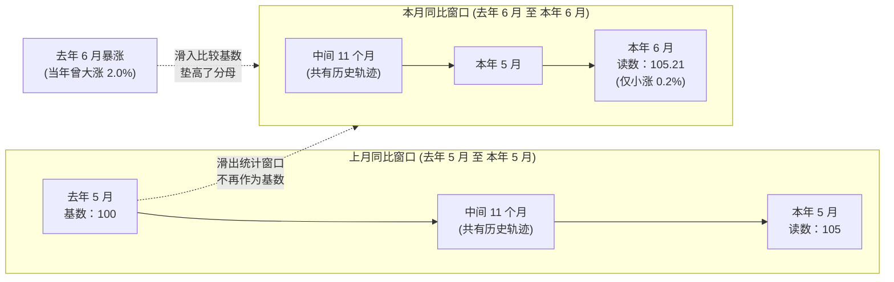
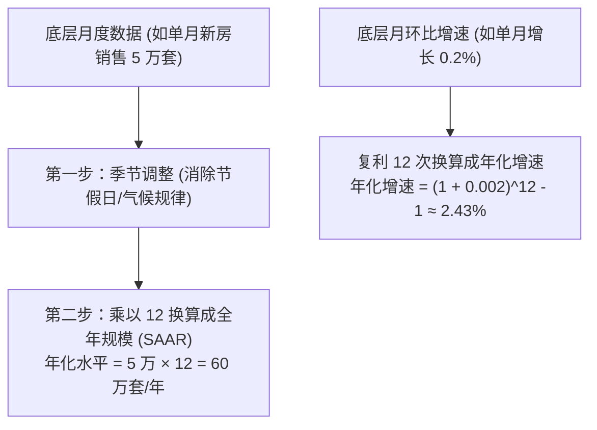
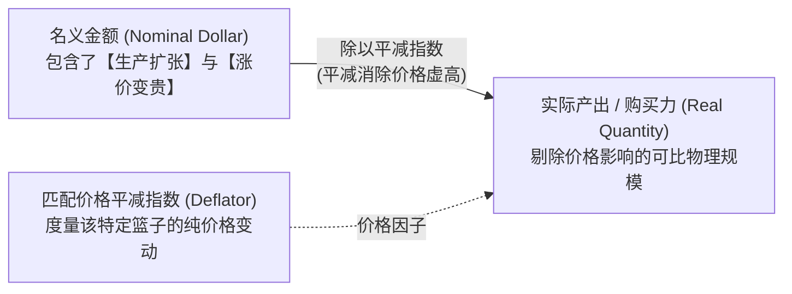

# 02 数字、增长率与统计口径

[上一章](01-economic-map.md) · [目录](./) · [下一章](03-releases-and-vintages.md)


> 建议分三次学习：第 1—3 节掌握比较基准与时间窗口；第 4—6 节理解数据加工（季调、平减与加权）；第 7—10 节练习官方报告阅读与独立审计。除明确标注的历史报告外，算例数字均为教学假设。

## 学习目标：算对一个数字，更要弄清它回答了什么

在财经新闻和研报中，你每天都会被海量数字轰炸：
- “零售额环比增长 $0.4\%$”
- “通胀率降到了 $3.0\%$”
- “两年期美债利率飙升了 $25\text{ bp}$”
- “二季度 GDP 折年率增长 $4.0\%$”

初学者常常直接把这四个百分数拿来横向对比，然而它们回答的问题截然不同：有的是名义金额的变动，有的是物价上涨速度的放缓，有的是利率水平的绝对差值，还有的是把单季度的冲劲假设外推一整年的结果。

本章承接上一章的宏观经济地图，带你拆解从底层数据到分析读数的**加工流水线**。我们的核心关切不是统计局怎么发问卷，而是：**选了什么作分母？拿哪段时间在比？做了哪些统计滤镜？这些选择为何会彻底逆转你的判断？**

读完本章，你将能熟练运用初等数学玩转宏观变换，一眼看穿统计口径陷阱，从容读懂美国劳工统计局（BLS）和经济分析局（BEA）的原版数据表头。

---

## 1. 动计算器之前，先核查数据的“身份证”

### 1.1 一个孤立的数字毫无意义

想象你在街角经营一家面包店。月底店长兴冲冲跑来报喜：“老板，我们这个月增长了 $10\%$！”

你先别急着发奖金，因为你根本不知道究竟发生了什么：
- 是销售额从 10 万美元涨到 11 万，还是卖出的面包从 1,000 个变成了 1,100 个？
- 如果销售额涨了 $10\%$，但面粉价格暴涨导致每个面包涨价 $15\%$，面包店的实际销量到底是扩张还是收缩？
- 这个月比的是上个月（上月刚好是春节淡季），还是比去年同期？
- 这个月有 31 天且包含了 5 个周末，上个月只有 28 天，多卖一点难道不是理所应当？

宏观经济数据也是如此。任何一个脱离上下文的孤立数字都是危险的。一个合格的宏观观察值，必须配备一张完整的**元数据“身份证”**：

| 身份证字段 | 核心回答的问题 | 经典情景与陷阱 |
| :--- | :--- | :--- |
| **统计对象与边界** | 到底测的是谁？排除了什么？ | 是“全社会所有商品零售”，还是“剔除了汽车和加油站的核心零售”？ |
| **单位与量级缩放** | 是美元、人数、点数还是百分比？ | 表头标着 `in thousands` 时，读数 $200$ 代表 $20$ 万人，千万别漏乘一千倍。 |
| **观察期 vs 发布日** | 描述哪一时段的活动？ | 7 月初公布的“新增非农就业”，记录的是 6 月的用工状况，绝非 7 月。 |
| **流量 vs 存量** | 是期间累计发生，还是时点余额？ | 当月新增联邦赤字（流量）与当前国债总余额（存量）不可混为一谈。 |
| **价格口径** | 是名义货币金额，还是剔除物价的实际量？ | 名义 GDP 暴增可能是通胀推升的幻觉，实际 GDP 增加才是真金白银的产出扩张。 |
| **统计调整状态** | 是否经过季节调整？是否已折算为年率？ | 季调后环比（SA）反映近期边际动能；未经季调（NSA）同比反映跨年跨度。 |
| **来源与版本** | 哪家机构在什么版本里发布的？ | 初次公布值（Advance/Preliminary）往往会在次月被大幅修订。 |

元数据（Metadata）就是“解释数据的数据”。两组看似相似的时间序列，往往因为单位、统计边界或调整口径不同，绝对不能直接拼接或相减。

---

### 1.2 水平、变化量、变化率：三套完全不同的问题

我们来看一组简化的就业统计数据。假设某经济体连续三个月的就业岗位总数如下：
- 1 月：$1{,}000$ 万个
- 2 月：$1{,}010$ 万个
- 3 月：$1{,}018$ 万个

把它们输入分析流程：

$$
\begin{aligned}
\text{2 月就业水平 (Level)} &: 1{,}010 \text{ 万个岗位} \\
\text{2 月变化量 (Change, } \Delta X_t \text{)} &: 1{,}010 - 1{,}000 = +10 \text{ 万个岗位} \\
\text{2 月变化率 (Growth Rate, } g_t \text{)} &: \frac{10}{1{,}000} = +1.0\% \\
\text{3 月新增岗位 (Change, } \Delta X_t \text{)} &: 1{,}018 - 1{,}010 = +8 \text{ 万个岗位} \\
\text{3 月就业增速 (Growth Rate, } g_t \text{)} &: \frac{8}{1{,}010} \approx +0.792\%
\end{aligned}
$$

这时，财经头条很可能会赫然写道：“3 月新增就业大幅缩水 $20\%$，劳动力市场急剧降温！”

读者很容易被吓一跳，以为全社会净减少了岗位。但仔细审查分母就会发现：
- 岗位的**水平总量**从 $1{,}010$ 万增加到了 $1{,}018$ 万，净增加了 8 万个工作机会；
- 缩水 $20\%$ 的是**新增量本身**：$\frac{8 - 10}{10} = -20\%$。新增量变小，代表岗位增长的**步伐放慢了**（二阶导数变缓），而不是岗位在**净流失**（一阶导数依然为正）。

用标准数学语言表达：设 $X_t$ 为本期水平，$X_{t-1}$ 为上期水平，则：

$$\Delta X_t = X_t - X_{t-1}$$

$$g_t = \frac{X_t - X_{t-1}}{X_{t-1}} = \frac{X_t}{X_{t-1}} - 1$$

> [!WARNING] 分母的经济学意义
> 算增长率必须警惕分母的性质。如果一家企业的净利润从上一期的 $-10$ 变成了本期的 $+5$，用公式生搬硬套算出来是 $\frac{5 - (-10)}{-10} = -150\%$——原本扭亏为盈的大好局面，居然算出了一个巨大的负增长！
> 当分母跨越零、非常接近零、或者经济指标本身就是以百分数表达时（如利差、利润率），应当直接汇报**变化量**（“扭亏增盈 15 单位”），而不是强行计算没有物理意义的相对百分比。

---

### 1.3 百分比、百分点与基点（Basis Points）

这是财经对话中最容易发生鸡同鸭讲的重灾区：

假设某国失业率从 $4\%$ 上升到了 $5\%$：
1. **当前水平**：失业率为 $5\%$。
2. **百分点变化（Percentage Points）**：$5\% - 4\% = 1\text{ 个百分点}$。
3. **相对变化率（Percentage Change）**：$\frac{5\% - 4\%}{4\%} = +25\%$。

如果你说“失业率上升了 $1\%$”，别人根本无法判断失业率是变成了 $4.04\%$（相对上升 $1\%$）还是 $5\%$（绝对上升 1 个百分点）。在描述已经带有百分号的指标时，务必使用**百分点**。

在利率、国债收益率和利差分析中，即使是 0.1 个百分点的波动也是极大的风浪，因此金融市场普遍使用更精细的单位——**基点（Basis Point，简写为 bp）**：

$$1\text{ 个百分点} = 100\text{ bp}$$

$$1\text{ bp} = 0.01\text{ 个百分点} = 0.0001$$

```text
联邦基金利率从 5.25% 调升至 5.50%：
上升了 0.25 个百分点 = 加息 25 个基点 (25 bp)
```

在利差（Spread）分析中，例如 10 年期与 2 年期国债收益率之差：
$$\text{利差} = Y_{10\text{Y}} - Y_{2\text{Y}}$$

如果利差从 $-0.30\%$（即 $-30\text{ bp}$，处于倒挂状态）回升至 $-0.10\%$（$-10\text{ bp}$），利差上升了 $20\text{ bp}$。这叫“倒挂收窄”，但仍然处于负区间。千万不要因为加了绝对值，把“负债减少”算成了“恶化”。

---

## 2. 时间窗口的魔法：环比、同比与基数效应

### 2.1 环比（MoM / QoQ）看当期冲劲，同比（YoY）看跨年跨度

- **月度环比（Month-over-Month, MoM）**：将本月与紧挨着的上个月比较。
- **月度同比（Year-over-Year, YoY）**：将本月与去年同一个月份比较。
- **季度环比（Quarter-over-Quarter, QoQ）**：将本季度与上一个季度比较。
- **季度同比（Year-over-Year, YoY）**：将本季度与去年同季度比较。

$$g_{\text{MoM}} = \frac{X_t}{X_{t-1}} - 1$$

$$g_{\text{YoY}} = \frac{X_t}{X_{t-12}} - 1$$

我们来看一个生动的价格指数案例。假设基期设为 100：

| 观察月份 | 去年 5 月 | 去年 6 月 | 本年 5 月 | 本年 6 月 |
| :--- | :---: | :---: | :---: | :---: |
| **可比价格指数** | $100.00$ | $102.00$ | $105.00$ | $105.21$ |

我们分别计算本年 5 月和 6 月的指标：
- **本年 5 月同比**：$\frac{105.00}{100.00} - 1 = +5.0\%$
- **本年 6 月环比**：$\frac{105.21}{105.00} - 1 = +0.2\%$
- **本年 6 月同比**：$\frac{105.21}{102.00} - 1 \approx +3.15\%$

你会发现一个看似矛盾的现象：**本年 6 月的物价比 5 月进一步上涨了（环比 $+0.2\%$），但同比通胀率却从 $5.0\%$ 剧烈跳水到 $3.15\%$！**

难道物价降下来了吗？完全没有。原因出在“比对的基准”上——去年的 6 月，价格曾发生过一次 $+2.0\%$ 的暴涨。

---

### 2.2 彻底拆解“基数效应”（Base Effect）

在同一个口径下，本月同比与上月同比存在着严密的代数递推关系：

$$1 + g_{\text{YoY}, t} = (1 + g_{\text{YoY}, t-1}) \times \frac{1 + g_{\text{MoM}, t}}{1 + g_{\text{MoM}, t-11}}$$

代入刚才的数据验证：
$$1 + g_{\text{YoY}, \text{6月}} = (1 + 0.05) \times \frac{1 + 0.002}{1 + 0.02} = 1.05 \times \frac{1.002}{1.02} \approx 1.03147 \implies 3.15\%$$

这就是所谓的**基数效应**。同比指标衡量的是一个**固定为 12 个月的滚动窗口**。当时间从 5 月走到 6 月时，窗口往前平移了一格：



在这个过程中，一年前那个高达 $+2.0\%$ 的异常暴涨月份从窗口的“尾端”被踢出了比较基准，换成了最新这个仅涨 $+0.2\%$ 的温和月份。分母被显著垫高，同比读数自然大幅滑落。

> [!NOTE] 认知要点：通胀放缓 $\neq$ 价格下跌
> - **通胀放缓（Disinflation）**：物价上涨的速度变慢了（例如同比从 $5\%$ 降至 $3\%$，环比从 $+0.8\%$ 降至 $+0.1\%$）。此时价格依然在上涨，消费者的账单还在增加，只是变贵的速度没那么快了。
> - **通货紧缩（Deflation）**：物价水平的绝对下跌（环比为负，或者同比跌破零）。只有在负增长时，物价才真正回落。

---

### 2.3 多期增长的复利法则：为什么不能直接相加？

如果一块面包的价格在 1 月上涨了 $10\%$，紧接着在 2 月下跌了 $10\%$，它的价格是回到了原点吗？
- 初始价格：$100$ 元
- 1 月上涨 $10\%$：$100 \times (1 + 0.10) = 110$ 元
- 2 月下跌 $10\%$：$110 \times (1 - 0.10) = 99$ 元！

价格累计净下跌了 $1\%$。因为第二阶段的下跌是在已经变大了的基数（$110$）上计算的。

因此，多期连续增长率的累计计算必须**相乘，而非相加**：

$$1 + g_{0 \to T} = (1 + g_1) \times (1 + g_2) \times \dots \times (1 + g_T)$$

如果某季度连续三个月的环比增速分别为 $0.2\%$、$0.3\%$、$0.4\%$：
$$g_{\text{季度累计}} = (1 + 0.002) \times (1 + 0.003) \times (1 + 0.004) - 1 \approx 0.9026\%$$

虽然直接相加 $0.2\% + 0.3\% + 0.4\% = 0.9\%$ 在数值很小时差异极小（一阶泰勒近似），但在波动巨大或周期拉长时，复利效应会导致严重的误差。

---

## 3. 年化（Annualization）：对齐在同一速度计上

### 3.1 年化增长率：把短跑速度折算成“马拉松时速”

当你开车看到仪表盘显示“时速 120 公里”时，并不意味着你接下来真的要持续开一整小时、跑满 120 公里。它只代表**你此时此刻的瞬间冲劲，如果保持一小时能走多远**。

美国官方数据（如 BEA 发布的季度 GDP 增速）极度偏爱使用**折年率（Annualized Rate）**：

- **月环比折年率**（假设该月冲劲持续重复 12 个月）：
  $$\text{月环比年化} = (1 + g_{\text{MoM}})^{12} - 1$$

- **季环比折年率**（假设该季度冲劲持续重复 4 个季度）：
  $$\text{季环比年化} = (1 + g_{\text{QoQ}})^4 - 1$$

- **三个月累计折年率**（一年有 4 个“三个月”）：
  $$\text{三个月年化} = (1 + g_{\text{3M}})^4 - 1$$

#### 算例对比
- 如果某月季调环比增长 $0.2\%$：
  $$\text{年化增速} = (1 + 0.002)^{12} - 1 \approx 2.43\%$$
- 如果第二季度单季增长了 $1.0\%$：
  $$\text{年化增速} = (1 + 0.01)^4 - 1 \approx 4.06\%$$

> [!IMPORTANT] 国际比较陷阱：撤销年化
> 如果你看到美国二季度 GDP 报告写着“增长 $4.0\%$”，而欧洲统计局报告欧洲二季度 GDP“增长 $1.0\%$”，千万不要得出“美国增速是欧洲 4 倍”的荒谬结论！
> - 美国公布的是**季环比年化（QoQ Annualized）**：其实际单季增速仅为 $(1 + 0.04)^{1/4} - 1 \approx 0.985\%$。
> - 欧洲公布的大多是**未年化的纯单季环比（QoQ）**：其实际单季增速是 $1.0\%$。
> 还原到相同尺度后，两者的增长动能几乎完全一样。

---

### 3.2 辨析：“年化增速” vs “季调年率水平（SAAR）”

这是极易混淆的一对孪生概念：



1. **季调年率水平（Seasonally Adjusted Annual Rate, SAAR）**：
   描述的是**绝对规模（Level）**。比如 5 月新屋销售经季调为 5 万套，普查局乘以 12 报出“年率 60 万套”。这绝不是预测未来一年一定卖出 60 万套，而是说明“如果全年的节奏都像这一个月，一年将卖出 60 万套”。
2. **年化增长率（Annualized Growth Rate）**：
   描述的是**速度（Rate of Change）**，运用的是**指数幂复利运算**。

---

## 4. 季节调整（Seasonal Adjustment）：剥离“每年如期而至”的规律

### 4.1 为什么未经调整的数据会说谎？

每年 12 月圣诞假期，百货商场和玩具店的销售额都会暴增；而到了次年 1 月和 2 月，客流量又会断崖式下滑。
如果直接拿着 1 月未经调整的数据去和 12 月对比，你会看到一个极其恐怖的惨跌——但这能说明经济步入大萧条了吗？显然不能，因为每一年冬天都是如此。

**季节调整（Seasonal Adjustment）**的目的，就是用时间序列算法（如美国人口普查局的 X-13ARIMA-SEATS）把这种每年重复发生的季节性日历效应滤除，让真正的**底层周期趋势与突发冲击**浮出水面。

我们用一个极简的乘法模型来理解其数学逻辑：

| 月份 | 未季调实际销售额 (NSA) | 历史估算的季节因子 | 季调后销售额 (SA) = NSA / 因子 |
| :--- | :---: | :---: | :---: |
| **12 月 (圣诞旺季)** | $120$ 万元 | $1.20$ (通常高出正常水平 20%) | $\frac{120}{1.20} = 100$ 万元 |
| **1 月 (节后淡季)** | $88$ 万元 | $0.80$ (通常低于正常水平 20%) | $\frac{88}{0.80} = 110$ 万元 |

对比计算结果：
- **未季调环比（NSA）**：$\frac{88 - 120}{120} = -26.67\%$（看似崩溃）
- **季调后环比（SA）**：$\frac{110 - 100}{100} = +10.0\%$（实际上强劲扩张！）

虽然 1 月实打实的现金进账少了，但它比历史上任何一个寻常的 1 月都要卖得好。这就是季调数据的威力。

> [!CAUTION] 季调的局限性
> 季调滤镜不是万灵药。它无法区分**常规气候**与**极端天气灾难**（例如一场罕见的世纪暴风雪会导致当月季调数据异常暴跌）；季调因子本身也是统计估计值，每年新增的历史数据都会导致过去的季调因子被例行重估与修订。

---

## 5. 名义与实际：你拥有的是更多纸币，还是更多面包？

### 5.1 从面包世界的微积分推导平减过程

假设面包店上个月卖了 $100$ 个面包，每个售价 $10$ 美元；这个月卖了 $105$ 个面包，每个售价 $11$ 美元（品质完全一致）：

$$
\begin{aligned}
\text{上月销售名义总额} &= 100 \times 10 = 1{,}000 \text{ 美元} \\
\text{本月销售名义总额} &= 105 \times 11 = 1{,}155 \text{ 美元} \\
\text{名义销售额增长率} &= \frac{1{,}155 - 1{,}000}{1{,}000} = +15.5\% \\
\text{物理产出增长率 (实际数量)} &= \frac{105 - 100}{100} = +5.0\% \\
\text{单价上涨率 (纯价格通胀)} &= \frac{11 - 10}{10} = +10.0\%
\end{aligned}
$$

注意到：名义增长率（$15.5\%$）并不等于实际增长率（$5\%$）与价格涨幅（$10\%$）的简单相加，因为涨价的 1 美元同时也作用在了新增的 5 个面包上（交叉项 $0.05 \times 0.10 = 0.5\%$）。

三者之间存在着严格的乘积关系：

$$1 + g_{\text{名义}} = (1 + g_{\text{实际}}) \times (1 + g_{\text{价格}})$$

$$g_{\text{实际}} = \frac{1 + g_{\text{名义}}}{1 + g_{\text{价格}}} - 1$$

代入本例验证：
$$g_{\text{实际}} = \frac{1.155}{1.10} - 1 = 1.05 - 1 = +5.0\%$$

利用物价指标将名义金额剔除通胀、还原为可比实物量的过程，在宏观核算中被称为**平减（Deflating）**，对应的价格指标称为**平减指数（Deflator）**。



---

### 5.2 绝不能见到美元金额就随意除以 CPI

很多初学者容易犯一个严重错误：看到企业设备投资额、国防军工采购额，顺手就除以 CPI 来算“实际增长”。

这是完全错误的。**CPI 仅度量居民消费品的价格变动**。
- 如果你要衡量老百姓可支配收入的实际购买力，除以消费相关的价格指数（CPI 或 PCE）是正确的；
- 但如果要平减企业采购的数控机床、半导体光刻机，必须使用生产者出厂价格指数（PPI）中的对应资本品分项；
- 如果要平减全社会所有最终产出，必须使用包含全经济维度的**GDP 平减指数（GDP Deflator）**。

---

## 6. 指数合成、权重与结构效应

### 6.1 指数重设基期：换个基准，不会改变斜率

统计机构有时会将指数的基期从“2015年=100”更新为“2020年=100”。
如果原序列是 $50$、$55$、$60$，选择第一期为 100 时序列变为 $100$、$110$、$120$。
如果改选第二期为 100，整条序列均除以 55 并乘以 100，得到 $90.91$、$100.00$、$109.09$。

检查从第二期到第三期的增速：
$$\frac{109.09 - 100.00}{100.00} \approx 9.09\% \quad \Longleftrightarrow \quad \frac{60 - 55}{55} \approx 9.09\%$$

**重设基期纯粹是坐标轴尺度的线性平移，它绝不会改变任何一期的环比或同比增速。** 指数读数为 300，只代表它是基期的 3 倍，绝不代表通胀率高达 $300\%$。

---

### 6.2 增速最快，不等于拉动最大（分项贡献度）

很多财经自媒体常犯的一个错误是把“谁涨得最凶”当成“谁在主导大局”。

假设某经济体的总销售额仅由 A、B 两类商品组成：

| 分项类别 | 上期金额 | 本期金额 | 自身增长率 | 占上期总额比重 (权重) | 对总增长的拉动贡献 |
| :--- | :---: | :---: | :---: | :---: | :---: |
| **A 类 (高权重成熟行业)** | $\$80$ | $\$84$ | $+5.0\%$ | $\frac{80}{100} = 80\%$ | $80\% \times 5\% = +4.0\text{ 个百分点}$ |
| **B 类 (低权重先锋行业)** | $\$20$ | $\$24$ | $+20.0\%$ | $\frac{20}{100} = 20\%$ | $20\% \times 20\% = +4.0\text{ 个百分点}$ |
| **总计** | $\mathbf{\$100}$ | $\mathbf{\$108}$ | $\mathbf{+8.0\%}$ | $\mathbf{100\%}$ | $\mathbf{+8.0\text{ 个百分点}}$ |

B 类商品的增速（$+20\%$）是 A 类商品（$+5\%$）的整整四倍！但由于 A 类的体量庞大，两者对总体经济增长的贡献**完全一样**，各自拉动了总产出增长 $4$ 个百分点：

$$\text{分项 } i \text{ 对总增长的贡献度} = w_{i, t-1} \times g_{i, t} = \frac{X_{i, t-1}}{Y_{t-1}} \times \frac{\Delta X_{i, t}}{X_{i, t-1}} = \frac{\Delta X_{i, t}}{Y_{t-1}}$$

分项贡献度的分母是**全社会总量**；而分项自身增速的分母仅是**分项自己**。

---

### 6.3 辛普森悖论与构成效应：人人没加薪，平均工资却涨了

想象一家科技公司原有 10 名员工：
- 5 名资深架构师，时薪 $\$30$；
- 5 名初级实习生，时薪 $\$10$。
- 全员平均时薪：$\frac{5 \times 30 + 5 \times 10}{10} = \$20$。

遭遇行业周期，公司裁掉了 4 名初级实习生，所有留下员工的工资一分钱都没涨。
我们来看看此时的新平均时薪：
- 5 名架构师（时薪 $\$30$）+ 1 名实习生（时薪 $\$10$）。
- 新平均时薪：$\frac{5 \times 30 + 1 \times 10}{6} \approx \$26.67$！

平均时薪从 $\$20$ 暴涨到了 $\$26.67$，增幅高达 $+33.3\%$！
如果一个宏观分析师单看平均时薪报告，就会得出“劳动力市场过热、薪资螺旋式上升”的荒唐结论。这就是经典的**群体构成效应（Composition Effect）**。这也是为什么美联储更倾向于观察**就业成本指数（ECI）**，因为 ECI 固定了工种岗位权重，剔除了人员换茬带来的虚假均值波动。

---

## 7. 数据加工中的图形与时间陷阱

### 7.1 频度转换：求和、平均还是期末截面？

将高频数据（如月度）转换为低频数据（如季度）时，必须严格依据经济学本质选择算子：

| 变量性质 | 典型经济指标 | 转换到季度的正统算法 | 绝对禁止的错误操作 |
| :--- | :--- | :--- | :--- |
| **流量（Flow）** | 零售总额、进出口、产出 | 三个月金额**求和（Sum）** | 拿最后一个月冒充整季，或将年率直接相加 |
| **存量（Stock）** | 国债余额、资产负债表规模 | 取第三个月末的**截面余额（End of Period）** | 将三个月的月末债务简单相加（重复累计） |
| **价格与状态（Price/Rate）** | CPI 指数、利率、汇率 | 三个月**算术或时间加权平均（Average）** | 把三个月利率相加（$5\%+5\%+5\%=15\%$ 没有任何金融意义） |

---

### 7.2 移动平均（Moving Average）：平滑了噪音，也推迟了转折

宏观分析常用“3 个月移动平均（3MMA）”来过滤月度抽样噪音。
假设连续四个月数据为：$100$、$100$、$100$、$130$。
第 4 个月的 3MMA 为 $\frac{100 + 100 + 130}{3} = 110$。

此时真实经济已经发生了剧烈转折（最新边际读数已冲至 130），但移动平均值却滞后显示在 110，因为它拖着过去几个月的记忆。实时监控系统必须同时展现**原始边际值**与**平滑趋势线**。

---

## 8. 官方报告带读：BLS CPI 报告的第一行

打开劳工统计局（BLS）经典的 CPI 报告 Table A，很多初学者一打开就被密密麻麻的数字弄晕。我们截取 2024 年 7 月 11 日发布的 6 月 CPI 历史报告核心行：

| 统计分项 (Expenditure Category) | 季调后环比变更 (2024 年 6 月) | 未经季调同比变动 (截至 2024 年 6 月) |
| :--- | :---: | :---: |
| **全品类总体 CPI (All items)** | **$-0.1\%$** | **$+3.0\%$** |
| **食品类 (Food)** | $+0.2\%$ | $+2.2\%$ |
| **能源类 (Energy)** | $-2.0\%$ | $+1.0\%$ |
| **核心 CPI (All items less food & energy)** | **$+0.1\%$** | **$+3.3\%$** |

### 关键数据读解与避坑指南
1. **看清表头列**：左侧是**季调后月度环比（SA MoM）**，右侧最末一列是**未经季调 12 个月同比（NSA YoY）**。两列不仅时间跨度完全不同，季调属性也完全不同！
2. **正确陈述事实**：
   - 合格表述：“2024 年 6 月，总体 CPI 经季调较上月微跌 $0.1\%$；但与去年 6 月相比，未季调全社会物价水平仍高出 $3.0\%$。”
   - 严重错误：“上月物价下跌了 $0.1\%$，所以今年一整年通胀为负”；或者“为什么核心涨 $0.1\%$ 总体跌 $0.1\%$，官方数据前后矛盾”。（核心剔除了高波动的能源，而能源当月大跌了 $2.0\%$）。

---

## 9. 综合实践：构建一套可复核的分析流

假设你正在编写监控程序，输入了一条同版本季调价格指数：

| 月份 | 去年 6 月 | 本年 3 月 | 本年 4 月 | 本年 5 月 | 本年 6 月 |
| :--- | :---: | :---: | :---: | :---: | :---: |
| **指数值** | $97.9637$ | $100.0000$ | $100.2000$ | $100.5006$ | $100.9026$ |

执行标准变换运算：
1. **最新月环比（6 月 MoM）**：
   $$\frac{100.9026}{100.5006} - 1 = +0.40\%$$
2. **近三个月累计涨幅（3 月至 6 月）**：
   $$\frac{100.9026}{100.0000} - 1 \approx +0.9026\%$$
3. **近三个月年化增速（3M Annualized）**：
   $$\left(\frac{100.9026}{100.0000}\right)^4 - 1 \approx +3.66\%$$
4. **同口径同比增速（YoY）**：
   $$\frac{100.9026}{97.9637} - 1 \approx +3.00\%$$

### 诊断评估范例
> “数据显示，6 月价格环比上升 $0.40\%$，较 4 月（$+0.20\%$）与 5 月（$+0.30\%$）呈现边际提速；近三个月年化增速攀升至 $3.66\%$，明显高出过去一年 $3.00\%$ 的平均轨道。这表明近期物价动能出现局部再通胀迹象。下一步应下钻核心服务分项与大宗品库存，排查是否受到一次性异常因素扰动。”

---

## 10. 练习与参考答案

### 练习 1：岗位增加了还是减少了？
某经济体就业总人数连续三个月为：$500$ 万、$506$ 万、$510$ 万。第三个月岗位总数环比增速是多少？为什么新闻说“就业新增量暴跌三分之一”并不代表经济裁员？

<details>
<summary>参考答案与推理</summary>

1. 第三个月新增岗位 $\Delta X_3 = 510 - 506 = +4$ 万个；
2. 岗位总数环比增速为 $\frac{4}{506} \approx +0.791\%$；
3. 上月新增量为 $506 - 500 = +6$ 万个，本月新增量由 6 万降为 4 万，新增量变动为 $\frac{4 - 6}{6} = -\frac{1}{3} \approx -33.3\%$。新增量确实缩水了三分之一，但这代表“扩张步伐放慢”，全社会总就业人数依然净增加了 4 万人，绝非净裁员。

</details>

---

### 练习 2：基点与跨零利差
某高收益企业债信用利差从 $3.20\%$ 扩大到 $3.55\%$，扩大了多少基点？若底层数据库存的是小数 $0.0320$ 和 $0.0355$，计算公式是什么？若 10Y-2Y 国债利差从 $-40\text{ bp}$ 变为 $+10\text{ bp}$，应如何专业描述？

<details>
<summary>参考答案与推理</summary>

1. 利差扩大了 $3.55\% - 3.20\% = 0.35\text{ 个百分点} = 35\text{ bp}$；
2. 小数形式运算公式为 $(0.0355 - 0.0320) \times 10{,}000 = 35\text{ bp}$；
3. 国债利差上升了 $50\text{ bp}$，由倒挂 $40\text{ bp}$ 转为正向陡峭化 $10\text{ bp}$。绝不能用相对百分比来计算跨越零轴的指标变动。

</details>

---

### 练习 3：复算基数效应
去年 5、6 月价格指数为 $100$、$104$；今年 5、6 月为 $108$、$109.08$。计算今年 5 月同比、6 月同比与 6 月环比，并用代数递推式验证基数效应。

<details>
<summary>参考答案与推理</summary>

1. 5 月同比：$\frac{108}{100} - 1 = +8.0\%$；
2. 6 月环比：$\frac{109.08}{108} - 1 = +1.0\%$；
3. 6 月同比：$\frac{109.08}{104} - 1 = +4.885\%$；
4. 验证递推公式：$(1 + 0.08) \times \frac{1 + 0.01}{1 + 0.04} = 1.08 \times \frac{1.01}{1.04} \approx 1.04885$。
可见，尽管 6 月单月环比仍上涨了 $1.0\%$，但由于去年同期的基数暴涨了 $4.0\%$，滚动窗口剔除了去年的大基数，导致今年 6 月同比骤降了逾 3.1 个百分点。

</details>

---

### 练习 4：两种年化换算
某价格指数三个月前为 $120.0$，当前为 $121.2$。这三个月的累计涨幅是多少？折合年化增速是多少？若某月新房销售汇报为 $72$ 万套 SAAR，当月实际大约录得多少套经季调销售？

<details>
<summary>参考答案与推理</summary>

1. 三个月累计增长率：$\frac{121.2}{120.0} - 1 = +1.0\%$；
2. 三个月年化增速：$(1 + 0.01)^4 - 1 \approx +4.06\%$；
3. SAAR 是将单月季调销量乘以 12 的年率水平，因此当月季调销售节奏为 $\frac{72}{12} = 6$ 万套。未经季调的真实销量还需视该月份的淡旺季因子而定。

</details>

---

### 练习 5：分项贡献度核算
全社会名义总支出由 A、B 两大项构成。基期 A 为 $\$90$ 亿、B 为 $\$10$ 亿；报告期 A 增至 $\$99$ 亿、B 增至 $\$12$ 亿。请问谁的增速更快？谁对总支出增长的拉动贡献更大？

<details>
<summary>参考答案与推理</summary>

1. A 的自身增速为 $\frac{99 - 90}{90} = +10.0\%$；B 的自身增速为 $\frac{12 - 10}{10} = +20.0\%$。B 类增速显著快于 A 类；
2. 基期总支出为 $90 + 10 = \$100$ 亿；
3. A 的拉动贡献：$\frac{99 - 90}{100} = +9.0\text{ 个百分点}$；B 的拉动贡献：$\frac{12 - 10}{100} = +2.0\text{ 个百分点}$；
4. 结论：虽然小行业 B 爆发式狂飙（$+20\%$），但大支柱 A 凭借庞大的存量份额，贡献了全社会总增量的绝大部分（9 个百分点）。

</details>

---

## 本章小结与原始资料延伸

- **比较先看身份证**：没有明确对象、单位、时限、存流量与调整状态的数字是危险的。
- **窗口决定视界**：环比看最新冲劲，同比看一年累积；同比的跳水往往来自一年前的高基数。
- **年化要按规则来**：增速年化用复利指数幂，流量年化用乘数倍率；做跨国比较时务必统一尺度。
- **贡献不等于增速**：大块头的温和增长，对宏观经济的拉动远胜于小品类的剧烈爆发。

### 官方方法论与原始资料
- [BEA 季度增速年化说明](https://www.bea.gov/help/faq/122)：掌握 BEA 折年率计算的正规指引。
- [美国人口普查局：季调与年率说明](https://www.census.gov/construction/c30/seasonal_adj_ques.html)：理解建筑与房产数据的 SAAR 加工原理。
- [BLS CPI 季调方法问答](https://www.bls.gov/cpi/seasonal-adjustment/questions-and-answers.htm)：透视季节调整模型的估计特性与重估生命期。
- [2024 年 6 月 CPI 官方新闻稿](https://www.bls.gov/news.release/archives/cpi_07112024.htm)：原汁原味演练官方报告的表头与多维度数据结构。

[上一章](01-economic-map.md) · [目录](./) · [下一章](03-releases-and-vintages.md)
