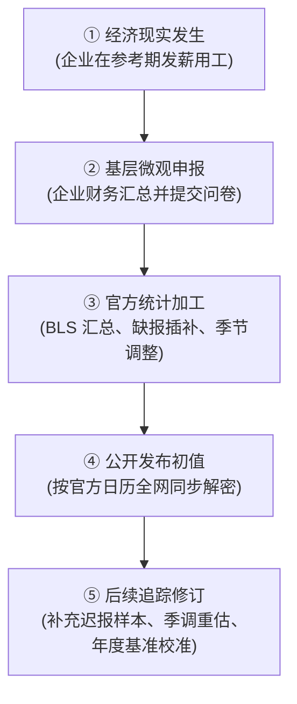
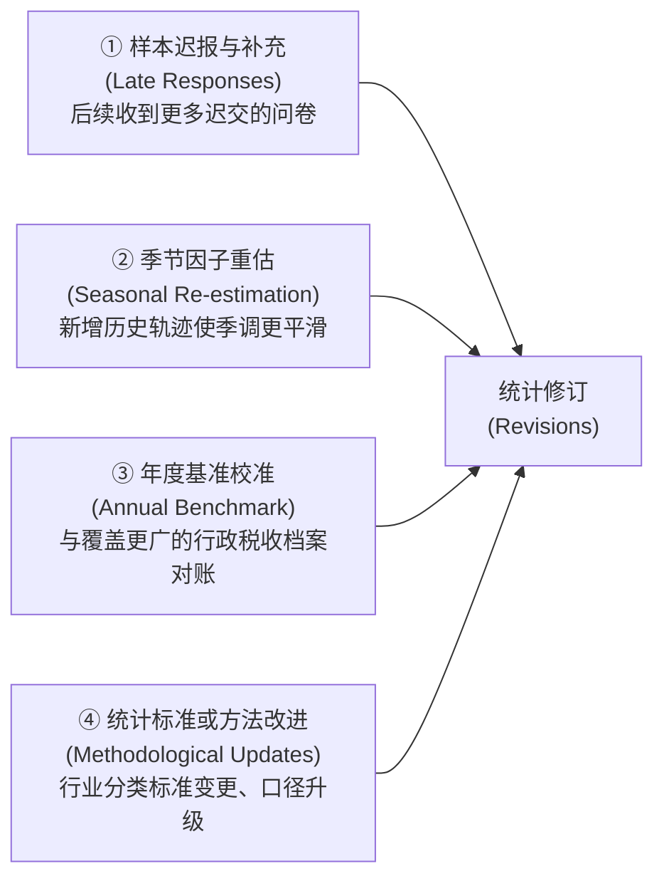
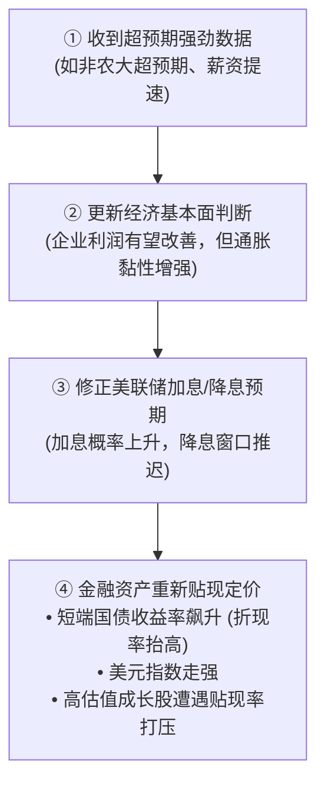
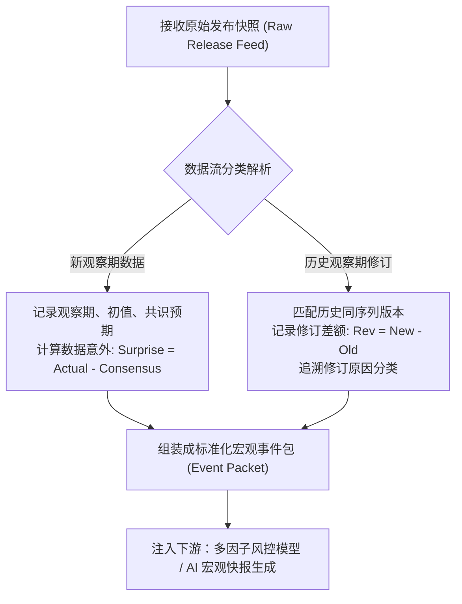

# 03 数据发布、市场预期与历史修订

[上一章](02-measurement.md) · [目录](./) · [下一章](04-gdp.md)


> 建议分三次学习：第 1—3 节理解数据生产流水线与修订生命期；第 4—6 节理解市场预期、数据意外与不确定性；第 7—10 节演练历史版本（Vintage）带读与实时监控流程。除明确标注的历史事实外，案例中的行情与预测均为教学假设。

## 学习目标：站在当时，而不是站在今天解释过去

设想周五早晨 8:30，你打开彭博终端或财经网站，头条新闻闪现：
> “美国上月非农新增就业 $18$ 万人，前值由 $20$ 万人大幅下修至 $14$ 万人；此前彭博经济学家预期中值 $25$ 万人。”

此时，市场上会同时涌现三种截然不同的声音：
1. **乐观看客**：“就业依然强劲增长！全社会净增了 $18$ 万个饭碗，经济底色稳健。”
2. **环比分析师**：“用工需求明显提速！本月新增 $18$ 万，比上月那惨淡的 $14$ 万大幅加快了 $4$ 万。”
3. **交易员与债市策略师**：“大爆冷门！实际表现比华尔街预期的 $25$ 万整整少了 $7$ 万，且前值惨烈下修，美联储降息概率陡增！”

这三种观点在**各自的前提下全部成立**。但如果你缺乏版本与时间边界意识，就会陷入混乱：为什么上月原本光鲜的 20 万会突然变成 14 万？多出来的 4 万究竟是经济真正提速了，还是今天才知道上个月其实很差？

上一章我们厘清了“数字是怎么算出来的”，本章我们将引入最关键的维度——**时间与信息集边界**。学完本章，你将能熟练搭建历史版本（Vintage）数据矩阵，正确剥离“当期新增”与“历史修订”，定量计算市场意外，并在量化回测中杜绝灾难性的“未来信息泄漏”。

---

## 1. 为什么一条经济数据会有“三只时钟”？

### 1.1 从工厂发薪水，到你屏幕上的闪烁读数

现实中的宏观经济活动是亿万居民与企业的分散行为：工厂签约新工人、超市排班发工资、家庭刷卡消费。统计机构（如劳工统计局 BLS、经济分析局 BEA）不可能在每一笔交易发生的瞬间装上监控摄像头。

以备受全球瞩目的**美国非农就业报告（CES, Current Employment Statistics）**为例：
- 它并不是挨家挨户敲门普查全国所有居民，而是向约 12 万家企业（涵盖约 67 万个工作场所）发放问卷抽样调查；
- 它统计的不是整个自然月任意一天的零工，而是**包含每月 12 日在内的那个发薪周期（Pay Period）**内获得报酬的在职岗位数量；
- 企业需要时间做账、寄回问卷；统计局需要时间清洗异常数据、填补缺报、运行季调模型、生成报告。

这一漫长的生产链条意味着：**统计数据的生成与发布，存在天然的时间滞后。**



---

### 1.2 辨析“三只时钟”：信息集的严格边界

假设在 2024 年 9 月 6 日美东时间上午 08:30:00，BLS 公布了 8 月份的就业报告；你的高频抓取爬虫在 08:32:15 解析入库。这里同时滴答作响着三只完全不同的时钟：

| 时钟类型 | 本案例对应时间 | 严密回答的核心问题 | 常见认知误区 |
| :--- | :--- | :--- | :--- |
| **时钟 A：经济观察期<br/>(Reference Period)** | 2024 年 8 月中旬 | 数据描述的是**哪一时段**的经济活动？ | 误以为 9 月 6 日发布的报告反映了 9 月第一周的经济状况。 |
| **时钟 B：官方发布时点<br/>(Release Timestamp)** | 2024-09-06 08:30:00 ET | **全市场公共信息集**最早在何时被更新？ | 误以为数据库里标注“2024-08-01”的数据在 8 月初就已被市场掌握。 |
| **时钟 C：系统可得时点<br/>(Knowledge Timestamp)** | 2024-09-06 08:32:15 ET | **你的算法或决策模型**何时真正握有该数据？ | 在量化回测中假装自己的程序在 08:30:01 就已经完成了交易决策。 |

> [!CAUTION] 时区与夏令时陷阱
> 华尔街重大数据发布时间通常标注为美东时间（ET）。美国实行夏令时（EDT, UTC-4）与冬令时（EST, UTC-5）。千万不要在代码中粗暴地硬编码“北京时间 20:30”或固定的 UTC 偏移量，必须依赖标准时区数据库（如 IANA Time Zone Database）。

---

## 2. 初值为什么必须修订：精度与时效的永恒拉锯

### 2.1 统计机构的权衡取舍

如果统计局追求 $100\%$ 的完美精确，就必须等待全美所有企业把账本完全报齐。这样算出来的 GDP 或就业数据或许毫无瑕疵，但很可能要拖延半年甚至一年。到那时，经济早就陷入了深重衰退，迟到的“完美数据”对救市政策毫无意义。

因此，现代宏观统计体系普遍采取**“先发初值（及时救急），后发修订（持续逼近真实）”**的分步策略。

---

### 2.2 数据修订的“四大源头”

当下修或上修发生时，千万不要阴谋论地认为“统计局在操纵数据”。每一次数值变动背后，都有清晰的技术原因：



1. **样本迟报与补充（Late-arriving Source Data）**：
   在初次公布时，CES 企业调查的问卷回收率通常在 $60\%$ 至 $70\%$ 左右。后续数周内，剩余的迟报企业陆续补发问卷。如果迟报企业偏偏集中在招聘乏力的行业，初值就会被系统性下修。
2. **季节因子重估（Seasonal Adjustment Updates）**：
   上一章讲过，季调因子是依靠多年历史时序动态估算出来的。当最新一个月的数据加入时序后，算法对过去数月甚至过去一两年的“常规季节性规律”有了更准确的把握，过去的季调数据因此发生联动微调。
3. **全面基准校准（Comprehensive Benchmarking）**：
   以非农就业为例，BLS 每年 3 月会使用全美失业保险税收记录档案（QCEW, Quarterly Census of Employment and Wages）对过去的非农样本估计进行“超级对账”。QCEW 覆盖全美超过 $95\%$ 的在职岗位，是几乎接近全量普查的行政档案。当抽样调查与这本“真实大账本”比对时，往往会出现几万甚至几十万岗位的年度基准校正。
4. **统计口径与方法重构（Methodology Changes）**：
   例如更新北美行业分类系统（NAICS）、调整通胀权重更新频次、或是更正个别历史录入失误。

---

### 2.3 典型宏观指标的“修订生命期”

并不是所有经济指标都会在后续被例行修改。不同指标遵循各自独特的生命周期：

| 指标族群 | 典型代表 | 官方发布节奏与修订安排 | 关键警示 |
| :--- | :--- | :--- | :--- |
| **月度劳动力调查** | BLS 非农新增就业 (CES) | 每月首个周五公布初值；接下来两个月例行修订前值；次年年初做年度基准校准与季调重估。 | 绝不能把连续两次月度修订当作终点，年度基准校准往往有更大调整。 |
| **国民核算体系** | BEA 季度 GDP 增长率 | 单季度分三次发布：初值（Advance） $\to$ 二读修正值（Second） $\to$ 三读终值（Third）；随后每年 7—9 月进行年度综合更新。 | 所谓的“Third Release（终值）”仅仅是季内终值，绝非永不更改的历史碑铭。 |
| **未经季调物价指数** | BLS CPI-U 未经季调指数 (NSA) | **一旦公布，通常绝不进行常规迟报修订**（除非出现极罕见的统计错误重大更正）。 | “不例行修订”只代表制度上锁定读数，绝不等于其测量精度已经达到 $100\%$ 无误差。 |
| **季调后物价指数** | BLS CPI 季调后环比 (SA) | 每年 2 月初在发布 1 月数据前，BLS 会例行对过去 5 年的季调因子进行重估与历史重算。 | 即使未季调历史指数不动，季调后的历史环比读数每年都会变。 |

---

## 3. 历史版本矩阵（Vintage Matrix）：穿越时间的二维图景

### 3.1 什么是历史版本（Vintage）？

在真实宏观分析中，时间有两个维度：
- **横轴（$t$）**：**观察期（Reference Time）**，即经济行为发生的月份（5 月、6 月、7 月……）。
- **纵轴（$v$）**：**版本发布时点（Vintage Time）**，即你站在哪一天的日历上去回望历史。

我们用一个纯教学假设的矩阵（单位：千人）来观察这幅历史演化的二维图景：

| 经济观察期 | 2024 年 6 月初发布版<br/>(Vintage: 2024-06) | 2024 年 7 月初发布版<br/>(Vintage: 2024-07) | 2024 年 8 月初发布版<br/>(Vintage: 2024-08) |
| :--- | :---: | :---: | :---: |
| **5 月新增就业** | $\mathbf{200}$ | $180$（下修 20） | $170$（进一步下修 10） |
| **6 月新增就业** | *尚未发生/未发布* | $\mathbf{220}$ | $190$（大幅下修 30） |
| **7 月新增就业** | *尚未发生/未发布* | *尚未发布* | $\mathbf{180}$（初值登场） |

#### 怎么读这张矩阵？
- **横向看（行）**：展示的是**同一个月份如何被岁月修正**。5 月新增就业在刚公布时是乐观的 20 万，两个月后沉淀为更可信的 17 万。
- **纵向看（列）**：展示的是**特定历史时点上，人们眼前拥有的全部信息集合（Information Set）**。

> [!IMPORTANT] 量化研究的头号大忌：前视偏差（Look-ahead Bias）
> 如果你今天从美联储 FRED 数据库下载最新的历史数据，你下载到的全部是“右侧最终修订列”。
> 如果你用这套“事后诸葛亮”的数据去回测 2024 年 6 月的交易策略，你的模型就会在 6 月初悄悄用上了当时全世界谁都不知道的“5 月就业仅 17 万”的情报！这种由使用未来修订数据造成的虚假超额收益，就是典型的**前视偏差**。
> 进行真实宏观回测，必须调用**ALFRED（ArchivaL Federal Reserve Economic Data）**等提供 Point-in-time（历史快照）的实时版本数据库。

---

### 3.2 拆解一次发布：当期初值 vs 历史净修订

回到 8 月初发布的那个早晨。当天发布的综合信息实际上由两部分拼合而成：
1. **7 月当期初值**：$+180$ 千人。
2. **过去月份的净修订额**：
   - 5 月变动：$170 - 180 = -10$ 千人
   - 6 月变动：$190 - 220 = -30$ 千人
   - 过去两月合计净修订：$(-10) + (-30) = -40$ 千人。

有些财经博主会直接把它们相减：$180 - 40 = 140$ 千人，并宣称“7 月实际只新增了 14 万”。

这是不严谨的口径混淆。我们用严格的累计存量来透视其代数本质：
- 站在 7 月发布版回看，5 至 6 月累计贡献就业为：$180 + 220 = 400$ 千人；
- 站在 8 月发布版回看，5 至 7 月累计贡献就业为：$170 + 190 + 180 = 540$ 千人；
- 本次发布为全社会劳动力市场贡献的**边际新增净信息存量**确实是：
  $$540 - 400 = 140 \text{ 千人}$$

这里的 $140$ 衡量的是**“新发布为总体就业水平带来的累计信息净推进”**，而 7 月当月自身的单月新增依然是 $180$。

---

## 4. 市场预期与数据意外（Data Surprise）

### 4.1 “市场预期”到底是什么？

宏观数据在发布前，各大财经通讯社（Bloomberg、Reuters、Dow Jones）会向几十位华尔街投行、智库的首席经济学家收集预测，并计算汇总统计量：

$$\text{数据意外 (Surprise)} = \text{实际公布值 (Actual)} - \text{事前市场预期值 (Consensus)}$$

#### 算例与概念辨析
假设上月新增非农经修订为 $14$ 万人，本月公布 $18$ 万人，发布前彭博共识中值为 $25$ 万人：
- **相对于上月的经济动能变动**：$18 - 14 = +4\text{ 万人}$（边际在提速）；
- **相对于事前市场预期的意外**：$18 - 25 = -7\text{ 万人}$（显著不及预期！）。

资产价格在数据发布瞬间的剧烈震荡，**主要对数据意外起反应，而不是对环比变动起反应**。因为如果所有人都早就料到会公布 25 万，那 25 万的利好早就被买入股票或卖出国债的价格提前透支了（Priced in）。


---

### 4.2 标准化意外指数（Standardized Surprise）

不同宏观指标的计量单位各不相同：非农就业动辄几万人，CPI 环比是零点几个百分点，贸易逆差是几十亿美元。我们如何判断今天这一批数据里“哪一个爆出的雷更大”？

量化宏观常用**历史预测误差标准差**来进行无量纲标准化（类似于花旗经济意外指数 Citi Economic Surprise Index 的底层逻辑）：

$$Z = \frac{\text{实际公布值} - \text{事前预期值}}{\sigma_{\text{历史预测误差}}}$$

假设：
- 本次非农意外为 $-7$ 万人，过去三年间华尔街对非农预测误差的标准差 $\sigma$ 为 $5$ 万人，则非农意外得分为：
  $$Z_{\text{非农}} = \frac{-7}{5} = -1.40$$
- 本次核心 CPI 意外高出预期 $+0.2\text{ 个百分点}$，历史误差标准差为 $0.1\text{ 个百分点}$，则核心 CPI 意外得分为：
  $$Z_{\text{CPI}} = \frac{+0.2}{0.1} = +2.00$$

此时一目了然：核心 CPI 的上行意外（$+2.0\sigma$）在统计学和历史经验上，远比非农就业的下行意外（$-1.4\sigma$）更为罕见和剧烈。

---

## 5. 预期传导到金融资产：机制与反身性

### 5.1 数据不会直接拨动行情，交易员的认知调整才会

宏观数据本身只是一张纸，它必须通过以下**三层认知传导链**重塑资产价格：



#### 双向对冲的逻辑
强于预期的数据往往具有双重属性：
1. **现金流效应（Cashflow Effect）**：经济强劲意味着企业营收更乐观，利好顺周期股票；
2. **无风险利率与折现率效应（Discount Rate Effect）**：经济过热引发美联储更激进紧缩，推高美债收益率，从而严厉惩罚高估值资产（如科技股、黄金）。

在不同的宏观叙事周期中，两者的主导权完全不同：
- 在“衰退恐慌”主导的熊市中，“好数据就是好消息”（Good news is good news，经济有救了，美股大涨）；
- 在“通胀抗击”主导的加息周期中，“好数据反而是坏消息”（Good news is bad news，经济太热逼央行痛下杀手，美股暴跌）。

---

## 6. 统计抽样误差与置信区间

### 6.1 读懂 BLS 的置信区间：永远不要神化点估计

宏观统计不是上帝视角的数人头。BLS 在每期就业报告的附录中都会坦诚公布**$90\%$ 置信区间**。

以 CES 非农月度变化为例，BLS 抽样调查的标准误差通常在 11 万人左右，对应的 $90\%$ 置信区间跨度约为：

$$\pm 1.645 \times 11 \approx \pm 18 \text{ 万人}$$

这意味着什么？
如果 BLS 头条公布“本月非农新增 $+5$ 万人”，初学者会惊呼“还在扩张！”
但专业分析师明白，其实际置信区间是：
$$[5 - 18, 5 + 18] = [-13 \text{ 万人}, +23 \text{ 万人}]$$

区间明显跨越了零轴！在严格的统计学意义上，你甚至无法以 $90\%$ 的把握断言全美岗位在这个月到底是增加还是净减少。因此，**单个月份的小幅波动极可能是抽样噪音，研判趋势必须依赖连续 3 个月以上的移动均值**。

---

## 7. 真实历史报告带读：2024 年夏天的非农大变脸

我们调取美国劳工统计局（BLS）两份真实的历史新闻稿归档：
- **报告 1**：2024 年 7 月 5 日发布的 6 月非农报告；
- **报告 2**：2024 年 8 月 2 日发布的 7 月非农报告。

我们还原当时真实公布在公报正文第一页的数据（单位：千人）：

| 观察月份 | 7 月 5 日版初见（Vintage A） | 8 月 2 日版修正（Vintage B） | 该期修订变动量 |
| :--- | :---: | :---: | :---: |
| **2024 年 5 月** | $218$ | $216$ | $-2$ |
| **2024 年 6 月** | **$206$** | **$179$** | **$-27$** |
| **2024 年 7 月** | *未发布* | **$114$**（初读） | *当期新登场* |

### 带读解析
1. **历史修订的真实冲击**：
   在 7 月 5 日刚看到 6 月数据时，全市场欢呼 20.6 万的强劲表现；但仅仅一个月后，该数值就被无情挤压了近 3 万人，变成 17.9 万。
2. **同版本 3 个月移动均值的正确算例**：
   站在 8 月 2 日的最新信息集下，真实的 5—7 月 3 个月均值为：
   $$\frac{216 + 179 + 114}{3} \approx 169.7 \text{ 千人}$$
   如果一个粗心的分析师错误地拼凑了 7 月 5 日版的前两月数据（$218$ 与 $206$）加上 7 月新值（$114$），他算出的虚假均值将是 $\frac{218+206+114}{3} \approx 179.3$ 千人，高出整整近 1 万个岗位！这种版本杂交（Vintage Blending）是量化清洗中必须严加杜绝的低级错误。

---

## 8. 经济指标的“领先、同步与滞后”

在搭建宏观监控看板时，我们根据指标对实体经济转折点的敏感度，将它们分为三类队列：


- **领先指标（Leading）**：反映的是**经济意图与契约前端**（例如申请建筑许可、开立生产订单）；
- **同步指标（Coincident）**：反映的是**当下正在运转的齿轮速度**（当前正在发薪的人数、工厂流水线的耗电量）；
- **滞后指标（Lagging）**：反映的是**不可逆的结果沉淀与事后确认**（企业倒闭坏账清算、合同补涨）。

> [!TIP] 警惕“因果关系的伪领先”
> 金融资产价格（如股市急跌、美债利差倒挂）往往领先于实体经济数据数月爆发。这并不代表金融市场“制造”了经济衰退，而是无数聪明的交易者在根据前线微观线索提前重构预期。

---

## 9. 监控系统架构实战：如何规范写入一份宏观事件包

一个合格的宏观量化或研报生成系统，在截获任何一份宏观报告时，必须严格执行标准化解析流水线：



### 规范输出范例：2024 年 8 月非农解密包
```json
{
  "event_id": "BLS_CES_20240802",
  "series_id": "PAYEMS",
  "reference_period": "2024-07",
  "release_timestamp_et": "2024-08-02 08:30:00",
  "current_vintage": {
    "headline_actual": 114,
    "consensus_median": 175,
    "surprise": -61,
    "surprise_standardized": -1.22
  },
  "historical_revisions": [
    {"reference_period": "2024-05", "old_val": 218, "new_val": 216, "revision": -2},
    {"reference_period": "2024-06", "old_val": 206, "new_val": 179, "revision": -27}
  ],
  "net_historical_revision": -29,
  "trend_3mma_current_vintage": 169.67
}
```

---

## 10. 练习与参考答案

### 练习 1：信息集截止时刻
某宏观数据记录 5 月经济状况，于 6 月 7 日美东时间 08:30:00 正式公布，量化系统抓取入库的时间戳为 08:31:20。请问：
1. 6 月 1 日该数据能否进入宏观择时模型？
2. 在做回测时，若策略指令发出时间戳为 6 月 7 日 08:30:15，使用该数据是否构成前视偏差？

<details>
<summary>参考答案与推理</summary>

1. 绝对不能。5 月自然月虽然在 5 月 31 日已经结束，但全社会公共信息集在 6 月 7 日 08:30 之前对该指标一无所知；
2. 构成前视偏差。虽然公共信息在 08:30:00 已经发布，但本机构系统的物理入库时间戳是 08:31:20。在 08:30:15 时，你的系统在物理世界中尚未接收到数据包，强行撮合属于典型的未来信息穿越。

</details>

---

### 练习 2：水平下修与新增量上修的悖论
某就业指标在旧版本中：4 月水平为 $1{,}000$ 千人，5 月水平为 $1{,}020$ 千人。
在新版本中，两月水平被分别修正为：4 月 $990$ 千人，5 月 $1{,}015$ 千人。
请问：5 月就业水平是上修还是下修？5 月的新增就业量（$\Delta X$）是上修还是下修？

<details>
<summary>参考答案与推理</summary>

1. **5 月水平变动**：从 $1{,}020$ 变为 $1{,}015$，**绝对水平下修了 5 千人**；
2. **5 月新增量变动**：
   - 旧版本 5 月新增量：$1{,}020 - 1{,}000 = +20$ 千人；
   - 新版本 5 月新增量：$1{,}015 - 990 = +25$ 千人；
   - **新增量不仅没有下修，反而上修了 $+5$ 千人！**
3. 核心机制：$\Delta \text{新增量修订} = \text{本月水平修订} - \text{上月水平修订} = (-5) - (-10) = +5$ 千人。因为基准月份（4 月）被下修得更多，两期一做差，当月的边际增速反而显得更强劲了。

</details>

---

### 练习 3：当期意外与旧月修订的区分
本月非农初次公布新增 $+160$ 千人，此前市场共识预期为 $+190$ 千人；同时，前两个月数据合计下修了 $-40$ 千人。请正确计算本月当期意外、净修订以及同版本边际存量增加，并纠正“本月实际只增加了 120 千人”的错误说法。

<details>
<summary>参考答案与推理</summary>

1. 本月当期数据意外：$160 - 190 = -30$ 千人（弱于预期）；
2. 历史月份净修订：$-40$ 千人；
3. 本月经济中真实新增的岗位依然是 $160$ 千人，绝非 $120$ 千人；
4. $160 + (-40) = 120$ 千人所衡量的是“本期发布较上一期发布为全社会累计就业存量带来的净增量”，绝不能把前两个月被挤干的水分扣在当月的头上。

</details>

---

### 练习 4：跨越零轴的置信区间
某月私人部门新增调查点估计值为 $+3.5$ 万人，其 $90\%$ 置信区间为 $[-4.0 \text{ 万人}, +11.0 \text{ 万人}]$。下月官方根据迟报样本将其下修至 $-1.0$ 万人。请评判两句话的真伪：
- 话术甲：“初值区间跨越零轴，说明初值发布已经证明了劳动力市场陷入衰退。”
- 话术乙：“后来下修了 4.5 万，说明当初估计的置信区间毫无用处。”

<details>
<summary>参考答案与推理</summary>

两句话全部是伪命题：
1. 话术甲错误：置信区间跨越零轴，在统计学上仅表示“在 $90\%$ 的显著性水平下，我们无法拒绝岗位变化为零的原假设”，即**无法确定方向**，绝不等于“证明了衰退”（点估计依然是 $+3.5$ 万）；
2. 话术乙错误：置信区间衡量的是**当期抽样方案的抽样方差**；而后续修订主要来自**新增样本迟报与未响应插补的替代**。后来修订为 $-1.0$ 万人，依然完全落在当初 $[-4.0, +11.0]$ 的置信区间之内，恰恰证明了最初的置信区间成功包络了不确定性。

</details>

---

## 本章小结与原始资料延伸

- **三只时钟定乾坤**：观察期属于历史，发布时点属于市场，系统时间属于自身代码。
- **初值重在速度，修订重在逼真**：理解四大修订来源，不对例行技术修正做政治化阴谋论解读。
- **市场对“意外”定价**：学会计算标准差无量纲得分，识别宏观预期差对金融资产的重定价驱动。
- **坚守 Point-in-time 底线**：永远不在历史回测中引入未经隔离的未来修订数据。

### 官方方法论与原始资料
- [BLS CES 调查方法与修订原理问答](https://www.bls.gov/web/empsit/cesfaq.htm)：权威解读非农调查、基准校对与季节重估机制。
- [BEA 早期 GDP 估计与后续修订说明](https://www.bea.gov/help/faq/1000)：掌握美国 GDP Advance、Second、Third 发布的严谨流程。
- [美联储 ALFRED 实时数据库架构指南](https://fred.stlouisfed.org/docs/api/fred/realtime_period.html)：构建宏观历史版本数据库的行业黄金标准。
- [BLS 2024 年 8 月 2 日官方就业新闻稿](https://www.bls.gov/news.release/archives/empsit_08022024.htm)：亲自查阅置信区间与前值修订的原始公报版式。

[上一章](02-measurement.md) · [目录](./) · [下一章](04-gdp.md)
