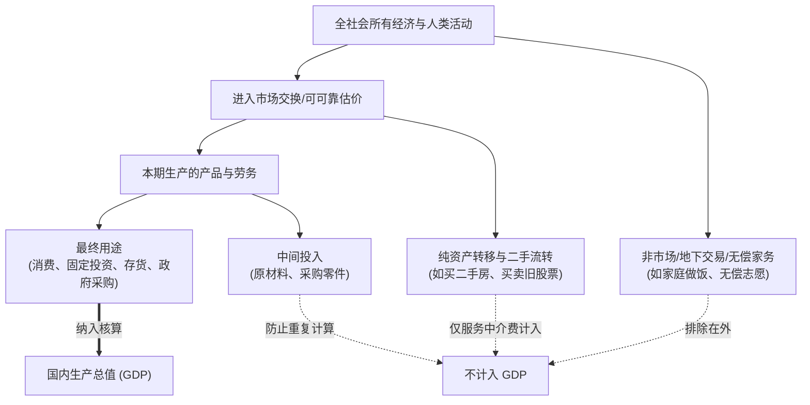
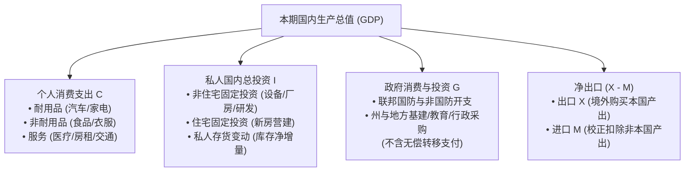
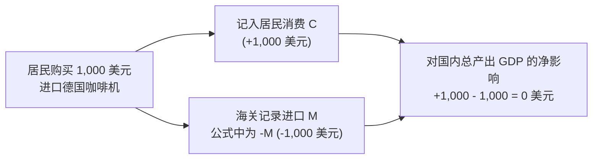
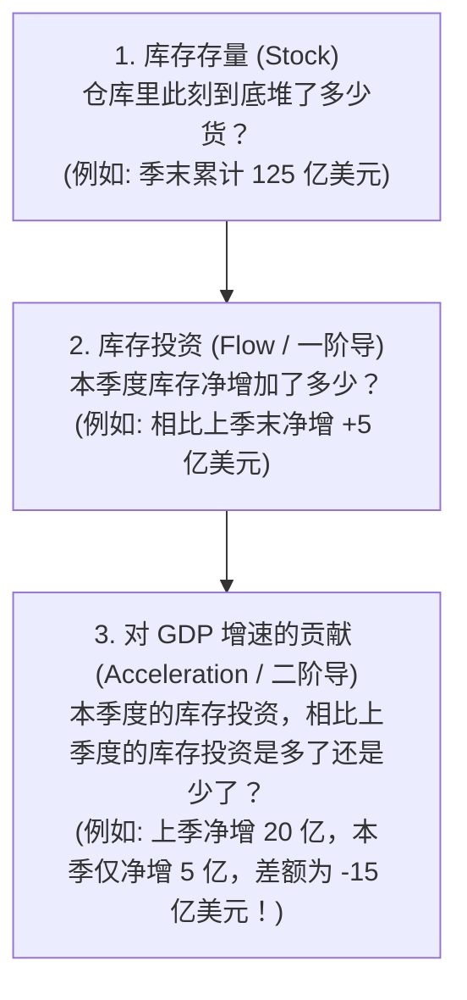
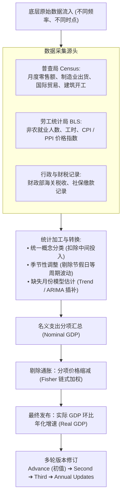
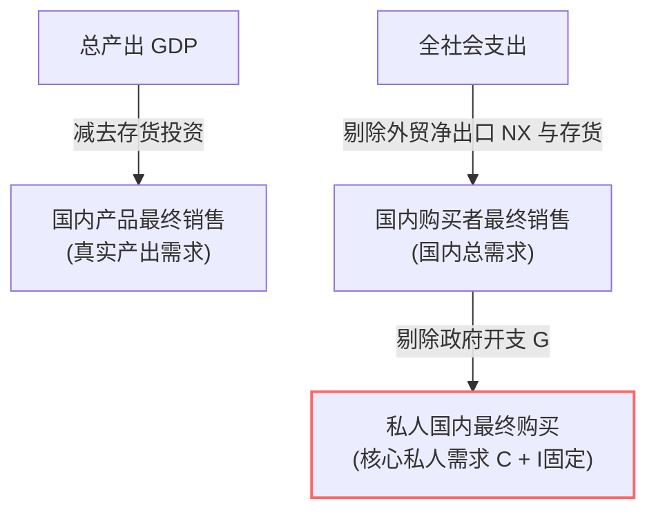
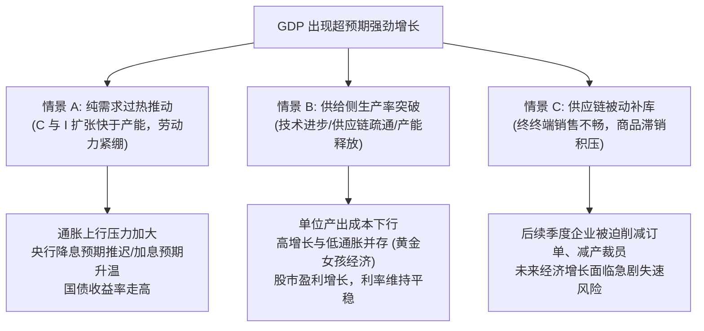

# 04 GDP 与经济增长来源

[上一章](03-releases-and-vintages.md) · [目录](./) · [下一章](05-consumption.md)

> 本章是理解宏观总量的奠基之作。建议分三次学习：第 1—3 节理清 GDP 的定义边界与支出法构成；第 4—6 节掌握真实数据生产流水线与物价拆解（链式加权）；第 7—10 节带读美国经济分析局（BEA）真实报告并完成实战练习。除明确注明的历史官方报告外，数值均为教学假设。

---

## 本章要解决什么问题

假设你在最新的财经新闻中看到这样几段报道：
- “某国工厂开足马力生产，大批商品堆在仓库还没卖掉，统计局却宣布 GDP 创下历史新高；”
- “居民抢购外国进口名牌汽车，生活品质显著改善，经济学家却提醒：在 GDP 公式里，进口带有负号，会压低 GDP；”
- “商务部发布报告称：二季度实际 GDP 增长 2.8%，其中个人消费仅增长 2.3%，但消费对 GDP 增长的贡献高达 1.57 个百分点。”

这不免让人产生困惑：
- 堆在仓库里的滞销品，也能算作“经济增长”吗？
- 进口商品明明是国内居民花钱买来的，为什么在 GDP 里要“减去”？难道买外国商品是在拖累国家经济吗？
- 增长率只有 2.3% 的消费，怎么能对总共 2.8% 的增长贡献出 1.57 个百分点？这三个数字是如何同时成立的？

GDP（国内生产总值）绝不是对“社会整体幸福感”的主观问卷评分，而是一套严密、自洽的现代宏观会计核算体系。它将全社会的**生产环节**、**购买行为**和**收入分配**无缝拼接起来。

读完本章，你将能够：
- 顺着“增加值”与“最终支出”的链条，彻底搞懂为什么没卖出去的商品也算 GDP；
- 掌握支出法五大支柱（$C, I, G, X, M$），消除关于“进口负号”的经典误解；
- 拆解库存投资的“加速度效应”，明白为什么“库存还在增加，经济增速却被拖累”；
- 理解从名义金额到实际增长的链式加权（Fisher Index）过程，明白为什么实际 GDP 的分项不能直接相加；
- 独立读懂美国经济分析局（BEA）的官方 GDP 季度新闻公报（News Release）。

---

## 1. 从一批家具开始：GDP 到底在数什么？

### 1.1 为什么不能把所有销售流水直接相加？

很多初学者容易把宏观经济想象成“所有企业收款机的流水总和”。我们通过一个极简的教学模型，看看这样做会发生什么灾难性的错误。

假设一个封闭经济体里只有两家企业：**森林木材厂**与**精工家具厂**。所有交易在同一个季度内完成，没有税费，物价恒定：
1. 木材厂伐木并初加工，把一批木材以 $300$ 美元卖给家具厂。木材厂无需从外部购买原料；
2. 家具厂消耗这些木材，加工成 100 件精美家具，以每件 $10$ 美元的价格全部卖出，总产值 $1,000$ 美元。

把两家企业的账单并排展示：

| 企业名称 | 本期总产出销售 | 消耗的外购中间投入 | 本企业新创造的价值（增加值） |
| :--- | ---: | ---: | ---: |
| **森林木材厂** | $300$ 美元 | $0$ 美元 | **$300$ 美元** |
| **精工家具厂** | $1,000$ 美元 | $300$ 美元 | **$700$ 美元** |
| **直接加总（错误）** | **$1,300$ 美元** | **$300$ 美元** | **$1,000$ 美元（真实 GDP）** |

如果统计局把所有企业的销售收入直接相加（$300 + 1,000 = 1,300$ 美元），就犯了极其荒谬的**重复计算（Double Counting）**错误：因为家具厂卖出的 $1,000$ 美元家具里，早已包含了那批 $300$ 美元的木材价值！

为了精准衡量本期新创造的财富，统计核算引入了**增加值（Value Added）**的核心定义：

$$
\text{企业增加值} = \text{本期总产出} - \text{生产中消耗的外购中间投入}
$$

- 木材厂从无到有创造了 $300$ 美元的价值；
- 家具厂在木材的基础上进行设计、组装和打磨，创造了 $1,000 - 300 = 700$ 美元的新价值；
- 全社会本期新创造的总价值，恰好是：$300 + 700 = 1,000$ 美元。

> [!NOTE]
> **增加值不等于企业利润！** 家具厂创造的 $700$ 美元增加值，并没有全部装进老板的口袋。它需要用来支付工人的工资、缴纳生产税费、计提厂房机器折旧，最后剩余的才是经营净利润。即使一家企业微利甚至亏损，只要它的产出大于耗用的原材料，它就在为全社会的 GDP 做贡献。

---

### 1.2 拆解 GDP 定义中的每一个严格限定

现代国民经济核算体系对**国内生产总值（Gross Domestic Product, GDP）**给出了经典定义：

> **GDP 是一定时期内，一个国家或地区境内所生产的全部最终产品和服务的市场价值。**

这个定义中的每一个词，都是一道精密的统计防火墙：

1. **“一定时期内”（Flow, 流量而非存量）**：
   GDP 衡量的是一个季度或一年内“新创造的流量”。它不是测算全国在某一天拥有多少历史累积财富。一辆 5 年前生产的二手车在今天被交易，不会让今天的 GDP 凭空增加一辆车的产值。
2. **“国内”（Domestic, 地理边界而非所有权）**：
   GDP 遵循属地原则。外资企业在美国本土工厂生产的芯片，计入美国 GDP；相反，美国苹果公司在海外代工厂组装的手机，不能仅因为母公司是美国企业就计入美国本土 GDP。
3. **“生产”（Production, 生产而非单纯销售）**：
   必须是本期实际发生的生产活动。如果这批 100 件家具中，居民只买走了 80 件，剩下的 20 件整齐码放在仓库里，本期的 GDP 依然是 $1,000$ 美元！没卖掉的 20 件（价值 $200$ 美元）在统计上被记为**企业的存货投资（Inventory Investment）**——相当于企业自己向自己“买下”了这批产出。
4. **“最终”（Final, 区分用途而非物理形态）**：
   一件产品是最终品还是中间品，取决于买家的**最终使用目的**，而不是产品本身的物理外观。家庭买一袋面粉回家烤面包，是最终消费品（$C$）；面包店买同一袋面粉用于烘焙出售，则是中间投入，其价值在面包最终售出时体现。
5. **“总值”（Gross, 未扣除机器设备的老化磨损）**：
   “总（Gross）”意味着尚未扣除固定资本消耗（即厂房设备的折旧）。如果从 GDP 中扣除折旧，得到的指标叫做**国内生产净值（Net Domestic Product, NDP）**：

$$
\text{NDP} = \text{GDP} - \text{固定资本折旧}
$$

---

### 1.3 核算边界：什么能进，什么不能进？

很多人习惯把 GDP 当作“社会整体福祉”的代名词，但实际上 GDP 只是一套权衡了测量可行性的会计工具箱：

- **二手资产与金融交易**：你花了 100 万美元买下邻居的二手旧房，或者在二级市场上买了苹果公司的股票，这笔本金交易**完全不计入当期 GDP**，因为没有任何新的建筑或新工厂被生产出来，只是已有资产换了主人。但在交易过程中，地产中介收取的佣金、券商收取的交易手续费，属于本期提供的劳务，计入当期 GDP。
- **自有住房的虚拟租金（Imputed Rent）**：如果全社会租房住的人全部自己买了房，国民经济中的住房服务产出难道就清零了吗？为了保证核算的连贯性，BEA 会估算自有住房在市场上如果出租所能产生的“等价租金”，并计入 GDP。
- **家务与非市场劳动**：全职父母在家做饭、洗衣、带孩子，创造了巨大的真实价值，但由于没有公开市场交易和发票记录，出于统计稳健性，通常被排除在 GDP 边界之外。

---

## 2. 把最终购买归类：支出法五大支柱

在宏观会计中，生产出来的全部最终产品，必定被某个部门买下或暂时储存。**支出法（Expenditure Approach）**将总产出拆解为五大核心项：

$$
\text{GDP} = C + I + G + (X - M)
$$

其中：
- $C$（Personal Consumption Expenditures, 个人消费支出）
- $I$（Gross Private Domestic Investment, 私人国内总投资）
- $G$（Government Consumption & Investment, 政府消费与总投资）
- $X$（Exports, 出口）
- $M$（Imports, 进口）

### 2.1 个人消费支出 $C$：不仅是日常逛街刷卡

$C$ 是美国经济体量最大的压舱石，长期占到 GDP 的近 $70\%$。它涵盖三个子领域：
1. **耐用品（Durable Goods）**：预期使用寿命在 3 年以上的实物商品，如轿车、洗衣机、电脑。这部分极易受利率和居民信心影响；
2. **非耐用品（Nondurable Goods）**：快速消耗的生活物资，如食品、燃气、药品；
3. **服务（Services）**：医疗看护、住房与公用事业、交通旅行、金融中介等。现代经济中，服务消费占比已超过消费总额的 $60\%$。

> [!TIP]
> 很多消费是由雇主或政府医疗保险代为支付的（例如雇主为你缴纳的健康险直接支付了医疗账单）。在 BEA 的核算中，这笔支出依然全额记在居民消费 $C$ 的“医疗服务”项下。

---

### 2.2 私人国内总投资 $I$：绝非炒股买基金

金融界说的“投资”（买股票、炒外汇）在宏观经济学中属于**金融资产配置**，绝不能填进 $I$。宏观统计中的“投资”必须对应**实体资本的形成**：
- **非住宅固定投资（Nonresidential Fixed Investment）**：企业购买的数控机床、建造的工业厂房、购置的服务器，以及企业投入的软件开发与研发专利（知识产权产品）；
- **住宅固定投资（Residential Fixed Investment）**：新商品房的建设、房屋的大规模结构改造以及产权转移相关的交易成本；
- **存货变动（Change in Private Inventories）**：即库存的净变动。

---

### 2.3 政府消费与投资 $G$：不等于财政总预算！

这是初学者极易踩坑的盲区。**政府花掉的钱，并不都属于 $G$**：
- **计入 $G$ 的购买**：政府出资采购战斗机、修建州际公路、聘用公立学校教师和消防员。这些行为直接占用了社会的生产要素与劳务；
- **不计入 $G$ 的转移支付（Transfer Payments）**：政府发放的失业救济金、联邦养老金、退伍军人补贴、给居民寄送的纾困支票。**这只是把购买力从纳税人手中无偿转移给另一群人，政府在发放时并未换取任何当期商品或劳务。** 如果救济金算一次 $G$，领到钱的失业者去买面包又算一次 $C$，GDP 就会被严重双算！

---

### 2.4 净出口 $(X - M)$：彻底终结“进口负号”的迷思

在经典公式 $\text{GDP} = C + I + G + X - M$ 中，很多初学者看到 $-M$ 就下意识得出结论：“进口伤害了经济增长，只要限制进口，GDP 就能飞涨”。**这是严重的记账误解！**

我们通过一个生活实例彻底讲透记账原理：
假设你走进商场，花 $1,000$ 美元全款买下一台在德国组装生产的进口高端咖啡机：
1. 商场的收银台记录了一笔 $1,000$ 美元的个人耐用品消费，统计局在汇总个人消费支出时，令 $C$ 增加了 $+1,000$ 美元；
2. 但仔细一想：这台咖啡机是德国工人制造的，消耗的是德国的生产要素，它根本不属于“美国本土新创造的增加值”；
3. 统计局不可能深入每家每户去翻看你买的咖啡机是不是国产。为了从宏观总账中剔除非本土产出，最优雅的会计处理是在末尾的进口项 $M$ 处记上 $+1,000$ 美元；
4. 最终带入公式计算对美国 GDP 的净贡献：

$$
\Delta \text{GDP} = \Delta C - \Delta M = (+1,000) - (+1,000) = 0
$$

> [!IMPORTANT]
> **进口带负号，从来不是因为“进口让国家亏钱”，而是为了校正统计口径！** 
> 因为在统计 $C$、$I$ 和 $G$ 时，我们已经把所有买来的东西（无论国产还是进口）全部加进去了；所以在末尾必须减去 $M$，把属于外国生产的部分冲销掉。如果真的一刀切禁止进口，国内居民失去了产品供给，相关消费与产业链投资同样会急剧萎缩。

---

## 3. 库存投资：三个截然不同的数字

在所有 GDP 组成部分中，**存货变动（Change in Private Inventories，常称库存投资）**是波动最剧烈、最容易引发误读的分项。

### 3.1 卖掉旧库存，不属于本季新生产

回到家具厂的算例：
- **第 1 季度**：家具厂生产 100 件家具，市场需求平淡，居民只买走 80 件。剩余 20 件进入仓库。
  - 最终消费 $C = 80 \times 10 = 800$ 美元；
  - 库存投资 $I_{\text{库存}} = +20 \times 10 = +200$ 美元；
  - 第 1 季 GDP $= 800 + 200 = 1,000$ 美元。
- **第 2 季度**：家具厂减产，仅生产 90 件。但市场突然爆发，居民买走了 100 件家具（其中 10 件来自上季的仓库旧存货）：
  - 最终消费 $C = 100 \times 10 = 1,000$ 美元（消费环比大涨 $25\%$！）；
  - 库存投资 $I_{\text{库存}} = -10 \times 10 = -100$ 美元（库存被抽水消耗）；
  - 第 2 季实际生产 GDP $= 1,000 + (-100) = 900$ 美元（生产实际萎缩 $10\%$！）。

| 核算项目 | 第 1 季度（生产旺盛，需求平缓） | 第 2 季度（消费激增，减产清库） |
| :--- | ---: | ---: |
| 当期实际生产数量 | 100 件 | 90 件 |
| 居民购买消费数量 | 80 件 | 100 件 |
| 库存净变动数量 | $+20$ 件 | **$-10$ 件** |
| 个人消费支出 $C$ | $800$ 美元 | $1,000$ 美元 |
| 私人库存投资 $I_{\text{库存}}$ | $+200$ 美元 | **$-100$ 美元** |
| **最终 GDP 总值** | **$1,000$ 美元** | **$900$ 美元** |

这个简单的对比揭示了极为深刻的经济现实：**消费激增的同时，GDP 却完全可能下滑！** 因为第二季度多卖出的商品是在消耗过去的存量，本期真实创造的生产活动反而在缩减。

---

### 3.2 为什么“库存还在增加，经济增长却被拖累”？

在专业财经公报中，你常会听到分析师说：“本季度企业仍在积极补库，但库存投资拖累了 GDP 增长 $1.5$ 个百分点”。

**这怎么可能呢？明明库存增加了，怎么反倒成了“负拖累”？**

要解开这个谜题，必须彻底分清三个层次的概念：

看下面的不变价格教学案例：

$$
\begin{aligned}
\text{第 0 季末库存存量} &= 100 \\
\text{第 1 季末库存存量} &= 120 \implies I_{\text{库存}, 1} = 120 - 100 = \mathbf{+20} \\
\text{第 2 季末库存存量} &= 125 \implies I_{\text{库存}, 2} = 125 - 120 = \mathbf{+5}
\end{aligned}
$$

假定这两个季度社会的最终销售（$C + I_{\text{固定}} + G + NX$）稳定在 $980$：
- 第 1 季度的总 GDP $= 980 + 20 = \mathbf{1,000}$；
- 第 2 季度的总 GDP $= 980 + 5 = \mathbf{985}$。

两个季度相比，GDP 净减少了 $15$（$985 - 1,000 = -15$）。
尽管在第 2 季度末，仓库里的存货总额创下了 $125$ 的历史新高（存量增加），当季也确实新积攒了 $5$ 的库存（库存投资为正），**但是由于本季补库存的力度远远弱于上季度（从 $+20$ 骤降到 $+5$），它对 GDP 环比增长的净拉动是负的！**

$$
\text{库存对产出变动的拉动} = I_{\text{库存}, t} - I_{\text{库存}, t-1} = 5 - 20 = -15
$$

> [!WARNING]
> **库存投资是宏观产出的“二阶导”！** 判断库存对经济增速的影响，不是看仓库里的货是多是少，而是看企业生产囤货的**加速度**是在加快还是在减缓。

---

## 4. GDP 数据流水线：不是全国搞一次普查问卷

宏观统计不是魔术，美国经济分析局（BEA）并不直接派人去全国千家万户查账。

### 4.1 缺失月份是如何处理的？

季度初值（Advance Estimate）通常在季度结束后的第 4 周末公布。此时，季度第 3 个月的很多关键调查（如完整的国际贸易、零售库存）根本还没有收齐！

BEA 绝不会把缺失的数据直接填零，而是依赖经济计量学模型、行业高频工时与行业咨询数据进行严谨的**统计插补（Imputation）**。
例如在 2024 年第二季度 GDP 初值中，6 月份的医疗服务支出即主要参考了 BLS 的医疗行业受雇工时与薪水变动进行推算。

这就解释了为什么 GDP 会不断经历“初值（Advance） $\to$ 第二次修正（Second） $\to$ 第三次修正（Third） $\to$ 年度基准修订”。**修正不是因为统计人员算错了账，而是因为后续真实的财务凭证取代了前期的模型插补。**

---

## 5. 剔除价格干扰：链式 Fisher 指数与增长分解

### 5.1 价格与数量的初步拆解

假设一个经济体只生产标准面包：
- 去年生产 100 块，单价 $10$ 美元，名义产值 $= 1,000$ 美元；
- 今年生产 110 块，由于通货膨胀，单价涨到 $12$ 美元，名义产值 $= 110 \times 12 = 1,320$ 美元。

名义 GDP 增速高达：

$$
\frac{1,320 - 1,000}{1,000} = 32\%
$$

但全社会的物质生活真的改善了 $32\%$ 吗？显然没有！真实生产的面包只增加了 $10\%$（从 100 块到 110 块），其余 $20\%$ 全是物价上涨带来的“账面幻觉”：

$$
\begin{aligned}
\text{数量增长乘数} &= \frac{110}{100} = 1.10 \implies +10\% \\
\text{价格上涨乘数} &= \frac{12}{10} = 1.20 \implies +20\% \\
\text{名义产值乘数} &= 1.10 \times 1.20 = 1.32 \implies +32\%
\end{aligned}
$$

---

### 5.2 为什么不能使用固定基期价格？

现实中有成千上万种商品。如果像过去那样永远用某一年（比如 2000 年）的固定价格计算实际 GDP，会引发严重的**基期替代偏差（Substitution Bias）**：
- 20 年前一台笨重电脑售价 3,000 美元，如今算力提升百倍的电脑只要 800 美元；
- 如果继续用 2000 年的固定高价给如今海量生产的电脑记账，高科技产品的实际产值会被无限夸大，导致官方实际 GDP 严重虚高。

为了解决这个问题，现代国民核算（包括 BEA）全面转向了**链式 Fisher 理想指数（Chained Fisher Index）**。
它在计算相邻两期的增长时，同时计算两种加权比率：

1. **拉氏数量比率（Laspeyres, 用期初老价格加权）**：
   $$
   L = \frac{\sum P_{t-1} Q_t}{\sum P_{t-1} Q_{t-1}}
   $$
2. **帕氏数量比率（Paasche, 用期末新价格加权）**：
   $$
   P = \frac{\sum P_t Q_t}{\sum P_t Q_{t-1}}
   $$
3. **Fisher 数量比率（两者几何平均）**：
   $$
   F = \sqrt{L \times P}
   $$

实际 GDP 的增速正是通过 $F - 1$ 计算，并将各个季度的指数逐环链接（Chained）而成。

> [!CAUTION]
> **链式实际金额（Chained Dollars）不可简单直接相加！**
> 很多投资者会从数据库里下载“实际消费”和“实际投资”的链式美元数字，发现加起来并不等于“实际总 GDP”。这是由于几何平均加权造成的数学特性。
> **牢记原则**：要看各个部门占经济的体量比重，必须用**名义金额**；要看各个部门对经济增长的拉动程度，必须直接查看官方的**增长贡献度（Contributions to Percent Change）**！

---

### 5.3 增速、份额与百分点贡献

在官方分析中，我们最常看到的是各分项对实际 GDP 增速的**拉动贡献（Percentage Point Contribution）**。在小幅度变动且不考虑复杂链式残差的简化直觉下：

$$
\text{分项对 GDP 增速的贡献（百分点）} \approx \text{该分项占 GDP 的名义份额} \times \text{该分项自身的实际增速}
$$

例如：
- 个人消费支出占美国经济的约 $70\%$（份额 $= 0.70$）；
- 如果当期个人消费自身实际增长了 $2.0\%$；
- 那么消费对 GDP 整体增速的贡献大约为：$0.70 \times 2.0\% = 1.40$ 个百分点。

这就解释了引言中的疑问：为什么消费自身只增长 $2.3\%$，却能贡献 $1.57$ 个百分点？因为消费体量太庞大了，它轻微的跳动就会对整个经济总量产生巨大的推力。

---

## 6. GDP 之外，不可忽视的总量指标

为了从不同切面透视经济真相，宏观分析师常借助几个关键变体指标：

| 指标中文名称 | 英文官方名称 | 核心公式（名义口径） | 分析师用它看什么？ |
| :--- | :--- | :--- | :--- |
| **国内产品最终销售** | Final Sales of Domestic Product | $\text{GDP} - I_{\text{库存}}$ | 剔除存货剧烈波动后，国内真实产出的终端吸纳能力 |
| **国内购买者最终销售** | Final Sales to Domestic Purchasers | $C + I_{\text{固定}} + G$ | 剔除库存与外贸波动，观察美国国内全部购买者的真实开支意愿 |
| **私人国内最终购买** | Final Sales to Private Domestic Purchasers | $C + I_{\text{固定}}$ | **宏观经济的“核心发动机”**！完全聚焦私人部门自主消费与投资活力 |
| **国内总收入** | Gross Domestic Income (GDI) | 工资薪酬 + 营业盈余 + 生产税净额 + 折旧 | **从收入分配端核算产出**。理论上等于 GDP，两者差额为统计误差 |

> [!NOTE]
> **GDP vs GDI 剪刀差**：理论上，生产创造的价值必定转化为某人的收入，因此 $\text{GDP} \equiv \text{GDI}$。但在实际统计中，GDP 采用企业销售与海关等支出资料，GDI 采用国税局与公司财报等收入资料，二者必然出现**统计差额（Statistical Discrepancy）**。当 GDP 异常强劲而 GDI 持续萎靡时，通常意味着经济增长的可持续性存在隐忧。

---

## 7. 真实报告带读：2024 年第二季度 GDP 初值

我们打开 **2024 年 7 月 25 日 BEA 官方发布的 2024 Q2 GDP Advance Estimate 新闻公报**，进行一次身临其境的实战复盘。

### 7.1 表 1：识别数据口径与标题数字

在报告第 7 页的 Table 1 中，核心指标如下（数据均为**经季节调整的环比折年率，SAAR, %**）：

| 核心统计序列 | 2024 Q1 | 2024 Q2 (初值) | 读数解读与分析重点 |
| :--- | ---: | ---: | :--- |
| **实际 GDP (Real GDP)** | **$1.4\%$** | **$2.8\%$** | 标题增速大幅反弹，经济看似强劲提速 |
| 个人消费支出 ($C$) | $1.5\%$ | $2.3\%$ | 居民消费温和回暖，依然保持韧性 |
| 私人国内最终购买 | **$2.6\%$** | **$2.6\%$** | **关键细节！私人核心自主需求两季度完全持平！** |

> [!IMPORTANT]
> **学会将环比年化（Annualized Rate）还原为单季环比**：
> 报告中公布的 $2.8\%$ 是假设这一季度的增长势头持续一整年的结果。单季度的实际环比增长率为：
> 
> $$
> (1 + 0.028)^{1/4} - 1 \approx 0.693\%
> $$
> 
> 切勿把 $2.8\%$ 误读为“相比去年同期增长了 $2.8\%$（那是同比）”，更不能误以为“全年已经稳赚 $2.8\%$ 的增长”。

---

### 7.2 表 2：拆解增长贡献百分点

转到报告第 8 页的 Table 2，我们来看这 $2.8\%$ 是如何由各个分项拼装而成的（单位：拉动 GDP 增长的百分点）：

| 支出分项 | 2024 Q1 贡献 | 2024 Q2 贡献 | 贡献的变化量（加速或拖累） |
| :--- | ---: | ---: | :--- |
| **个人消费支出 ($C$)** | $+0.98$ | $+1.57$ | 加速 $+0.59$ 个百分点 |
| **非住宅与住宅固定投资 ($I_{\text{固定}}$)** | $+1.19$ | $+0.64$ | **减速 $-0.55$ 个百分点**（高利率压制地产业） |
| **私人存货变动 ($I_{\text{库存}}$)** | $-0.42$ | **$+0.82$** | **剧烈提速 $+1.24$ 个百分点！** |
| 净出口 ($X - M$) | $-0.65$ | $-0.72$ | 进口强劲使外贸产生负拉动 |
| 政府消费与投资 ($G$) | $+0.31$ | $+0.53$ | 财政支出保持温和扩张 |
| **实际 GDP 环比年化合计** | **$+1.4\%$** | **$+2.8\%$** | 总增速提升 $+1.4$ 个百分点 |

### 7.3 专业分析师的诊断结论

阅读完这两张表，一份专业、深度的宏观简报呼之欲出：
1. **标题靓丽但推手特殊**：GDP 增速从 $1.4\%$ 跃升至 $2.8\%$，表面上加速了整整 $1.4$ 个百分点。但这 $1.4$ 个百分点的提速中，**有足足 $1.24$ 个百分点是由存货投资波动贡献的**（从上季的 $-0.42$ 逆转为 $+0.82$）；
2. **私人核心需求未加速**：被誉为内生动力晴雨表的“私人国内最终购买”增速连续两季锁定在 $2.6\%$，没有任何实质性提速；
3. **固定资产投资出现疲态**：固定投资贡献从 $+1.19$ 骤降至 $+0.64$。
4. **结论**：本季度强劲的增长读数并不代表全美实体需求进入狂热扩张，很大程度上是企业补库节奏异动的结果，未来两个季度的持续性仍需画上问号。

---

## 8. 经济增长的情景与政策含义

在宏观决策与资产定价中，同样的 GDP 高增长，其政策含义和市场影响可能完全相反：

1. **情景 A：需求拉动型过热**
   居民与企业借贷旺盛，需求增速大幅超过了经济潜在产能。企业订单爆满，开足马力加班招人，招工难推高工资，供不应求引发商品涨价。
   - **政策与市场反馈**：美联储担心通胀死灰复燃，往往会维持高利率甚至重启紧缩；美债收益率上升，借贷成本增加。
2. **情景 B：供给驱动型繁荣**
   技术突破（如 AI 广泛应用、自动化升级）或供应链彻底恢复，企业生产率显著提升。社会可以在不增加额外通胀压力的前提下生产出更多产品。
   - **政策与市场反馈**：高增长与温和物价共存，央行无需急于加息压制经济，资本市场迎来盈利与估值双击。
3. **情景 C：被动积压型虚高**
   正如前文所述，由于消费者意愿退坡，终端卖不掉的商品全部囤在仓库，统计上变成了“高额库存投资”，推高了当期 GDP 读数。
   - **政策与市场反馈**：这种虚高是暂时的，接下来几个季度企业必将面临深度的“去库存”，伴随而来的往往是砍订单、削减工时甚至裁员降薪。

---

## 9. 宏观监控指南：如何搭建你的 GDP 跟踪卡

作为一名专业学习者或投资分析师，建议按照以下五步工作流监控 GDP 数据：

在非 GDP 发布日，不要将过时的季度数据反复当作新闻炒作。此时应跟踪高频指标来推演当季走向：
- **亚特兰大联储 GDPNow**：著名的即时预测模型（Nowcast），它会随着最新公布的月度零售、制造业出货、国际贸易等数据动态更新当季 GDP 估计。
- **牢记边界**：GDPNow 是机械算法模型对官方分项的拟合推算，**绝不代表美联储 FOMC 的官方政策预测**。

---

## 10. 练习与参考答案

### 练习 1：概念归属与辨析
判断以下五项交易是否计入当期美国 GDP？如果计入，主要归属于哪一个支出分项？
1. 美国家庭花 3 万美元购买一台底特律工厂本月新下线的福特纯电动汽车；
2. 某硅谷科技公司耗资 5,000 万美元采购一批最新生产的国产 AI 计算芯片；
3. 一位投资者在纽交所二级市场斥资 10 万美元购入特斯拉公司的流通老股票；
4. 联邦政府向符合条件的家庭发放每人 1,200 美元的现金紧急纾困补贴；
5. 一对新婚夫妇花费 80 万美元买下建于 1990 年的二手独立屋，并向房产中介支付了 4 万美元服务佣金。

点击查看参考答案与详细解析

1. **计入 GDP，归属于个人消费支出（$C$）**中的耐用品消费。这是本期新生产的最终产品，供家庭日常生活使用。
2. **计入 GDP，归属于私人固定投资（$I$）**中的非住宅知识产权/设备投资。芯片是作为生产要素在未来持续提供运算服务。
3. **完全不计入 GDP**。这只是金融资产所有权在不同投资者之间的转移，并没有凭空创造出任何新的商品或劳务。
4. **发放时不直接计入 GDP**。这属于政府的无偿转移支付。只有当领到补贴的居民将这笔钱花出去购买商品或服务时，才会在将来的个人消费支出（$C$）中体现。
5. **分情况处理**：80 万美元的旧房屋买卖本身**不计入当期 GDP**，因为该房屋是 1990 年生产的历史资产；但向地产中介支付的 4 万美元中介佣金**计入当期 GDP**，属于住宅固定投资（$I$）中的所有权转移服务劳务。

---

### 练习 2：计算两季库存与 GDP
在一个价格恒定的极简模型中，社会只有一家消费品企业，且没有进出口与政府部门。已知：
- 期初库存存量为 $50$；
- 第 1 季度居民消费支出 $C = 500$，期末库存盘点为 $80$；
- 第 2 季度居民消费支出增加到 $C = 520$，期末库存盘点为 $90$。

**请计算**：
1. 第 1 季度和第 2 季度的私人库存投资各是多少？
2. 第 1 季度和第 2 季度的总 GDP 各是多少？第 2 季度的产出环比增速是多少？
3. 分别计算第 2 季度中，消费和库存投资对 GDP 增速拉动的百分点贡献。

点击查看参考答案与详细解析

**第 1 步：计算库存投资**
- 第 1 季库存投资 $I_{\text{库存}, 1} = 80 - 50 = +30$；
- 第 2 季库存投资 $I_{\text{库存}, 2} = 90 - 80 = +10$。

**第 2 步：计算各季度总 GDP 与增速**
- 第 1 季总 GDP $= C_1 + I_{\text{库存}, 1} = 500 + 30 = \mathbf{530}$；
- 第 2 季总 GDP $= C_2 + I_{\text{库存}, 2} = 520 + 10 = \mathbf{530}$；
- 第 2 季实际产出环比增速 $= (530 - 530) / 530 = \mathbf{0\%}$。

**第 3 步：计算增长贡献度**
- 消费带来的产出变动量 $= 520 - 500 = +20$；
  消费对 GDP 增长的拉动贡献 $= (20 / 530) \times 100 \approx \mathbf{+3.77}$ 个百分点；
- 库存投资带来的产出变动量 $= 10 - 30 = -20$；
  库存对 GDP 增长的拉动贡献 $= (-20 / 530) \times 100 \approx \mathbf{-3.77}$ 个百分点；
- 两者相加：$+3.77\% + (-3.77\%) = 0.00\%$，完美解释了为什么消费上升但经济整体零增长！

---

### 练习 3：进口记账实验
某跨国商贸企业在本季度从国外进口了价值 $100$ 万美元的成套精密仪器，暂时全部存放在自营保税仓库中尚未销售。假设国内物价不变，该企业没有其他经营投入。
1. 在本季度的 GDP 支出法核算中，私人库存投资 $I_{\text{库存}}$、进口 $M$ 以及对当期国内 GDP 的净拉动分别是多少？
2. 到了下一季度，该企业将仓库里的这批仪器以 $130$ 万美元全部卖给了一家本土医院（其中 $30$ 万美元为该商贸公司提供的本土分销服务与合理利润）。请写出下一季度的个人/企业消费、库存投资、进口以及对下一季 GDP 的净拉动。

点击查看参考答案与详细解析

**第 1 季度**：
- 仓库增加了库存：$I_{\text{库存}} = +100$ 万美元；
- 海关记录了进口：$M = +100$ 万美元（在净出口公式中带负号，即 $-M = -100$ 万美元）；
- 对当期美国 GDP 的净影响为：
  
$$
\Delta \text{GDP} = \Delta I_{\text{库存}} - \Delta M = 100 - 100 = \mathbf{0}
$$

这完全符合事实，因为这批仪器本季尚未创造任何本土生产增加值。

**第 2 季度**：
- 医院购买了新设备，计入固定资产投资 $I = +130$ 万美元；
- 仪器出库清仓，库存投资净减少：$I_{\text{库存}} = -100$ 万美元；
- 本季度没有发生新的跨国进口报关，$M = 0$（切勿在第二季度重复扣除进口！）；
- 对下一季度 GDP 的净贡献为：
  
$$
\Delta \text{GDP} = \Delta I + \Delta I_{\text{库存}} = 130 + (-100) = \mathbf{+30 \text{ 万美元}}
$$

这正好精确反映了本土商贸企业创造的 $30$ 万美元分销增加值！

---

## 本章小结与下一步学习

在这一章中，我们穿透了宏观经济的第一大指标：
- GDP 绝不是流水账的堆砌，而是以**增加值**为核心尺度的本期最终产出总和；
- 支出法公式 $\text{GDP} = C + I + G + (X - M)$ 中，各分项各司其职，**进口带负号仅仅是口径校正**；
- 存货投资具有“加速度”属性，往往是经济拐点处的扰动主力；
- 读报告要紧扣**私人国内最终购买**与**贡献度**，辨明是真实需求提速还是库存统计波动。

产出最终要转化为千家万户的钱包与餐桌。在下一章中，我们将深入居民部门的资产负债表与微观收支：[消费、收入与家庭现金流](05-consumption.md)。

---

[上一章](03-releases-and-vintages.md) · [目录](./) · [下一章](05-consumption.md)
