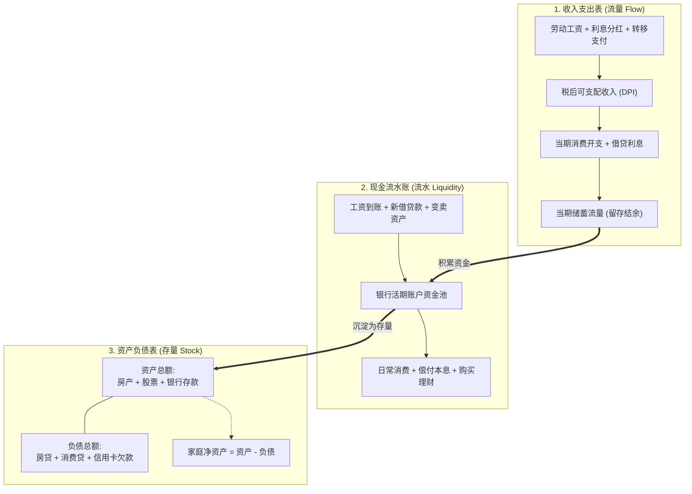
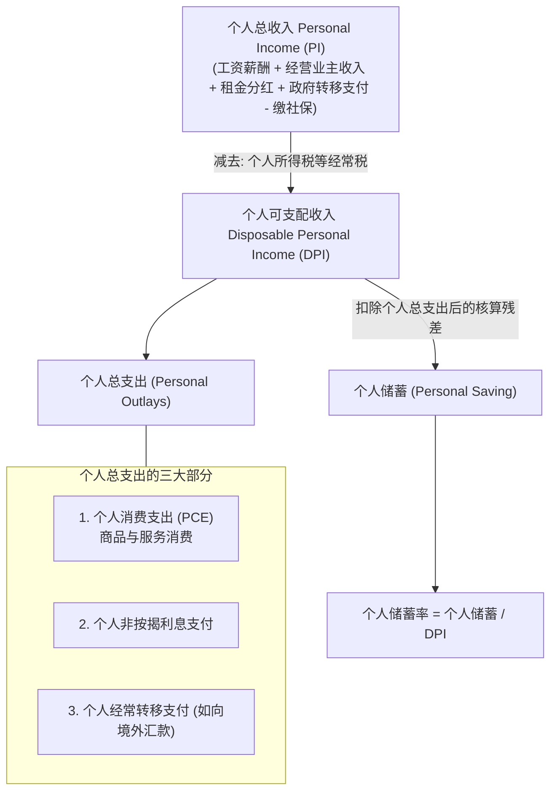
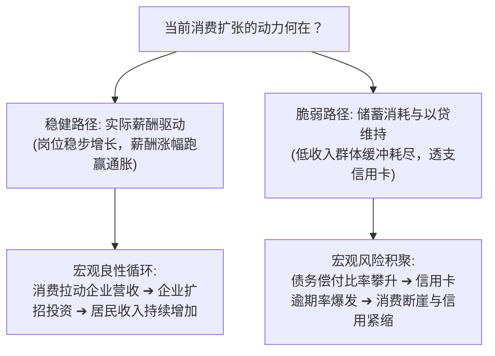

# 05 消费、收入与家庭现金流

[上一章](04-gdp.md) · [目录](./) · [下一章](06-labor.md)

> 本章深入美国经济最庞大的引擎——居民部门。建议分三次学习：第 1—3 节理清家庭“三本账”与宏观收入支出的核算恒等式；第 4—6 节辨析普查局零售数据与 BEA 个人消费支出（PCE）的生产机制及真实报告复盘；第 7—10 节透视超额储蓄、家庭债务风险与宏观监控卡构建。除明确注明的历史官方报告外，数值均为教学假设。

---

## 本章要解决什么问题

在财经媒体上，你常常看到自相矛盾的标题轮番轰炸：
- “零售销售数据环比零增长，消费寒冬将至？”
- “居民个人消费支出（PCE）环比逆势增长 0.2%，展现惊人韧性！”
- “全美信用卡违约率与借贷余额双双创下历史新高，家庭资产负债表濒临破裂？”
- “储蓄率跌至历史低位，老百姓把存款花光后，经济必将悬崖式衰退？”

这引出了一系列直击宏观本质的疑问：
- 为什么零售销售纹丝不动，实际消费却还能继续增加？它们测的不是同一件事吗？
- 消费增长，是因为大家收入真的变多了，还是因为大家不存钱了？
- 储蓄率跌到历史低谷，是否意味着居民银行账户里的存款余额马上要清零了？
- 刷爆信用卡究竟是“消费欲望高涨”的景气信号，还是“入不敷出、饮鸩止渴”的危机前兆？

宏观消费不是一个抽象的百分比，而是千家万户在**当期收入**、**银行存款**、**未来负债**与**还款压力**之间权衡的结果。

读完本章，你将能够：
- 熟练穿透家庭的**收入表**、**现金流水账**与**资产负债表**，彻底分清“储蓄流量”与“存款存量”；
- 搞懂可支配收入（DPI）、个人消费支出（PCE）与储蓄率的官方核算公式；
- 明晰普查局（Census）零售数据与经济分析局（BEA）PCE 的巨大口径差异，一眼识破“数据打架”背后的真相；
- 掌握美联储债务负担比率（DSR）与信贷数据的分析方法，准确判断消费繁荣背后的成色与风险。

---

## 1. 家庭有三本账：收入、现金流与资产负债

要理解宏观总量的消费，最清晰的起点不是背诵政府部门的定义，而是站在一个普通家庭的账本前。

很多初学者容易把“收入”、“存款”和“财富”混为一谈。实际上，任何一个家庭的财务健康都由**三本截然不同的账簿**共同决定：



---

### 1.1 消费增加，可能只是“少存了一点”

假设一个极简的教学家庭，每月税后现金收入稳定在 $5,000$ 美元，每月支付固定非住房贷款利息 $100$ 美元。家庭没有投资，也没有资产价格波动：

| 财务月份 | 税后可支配收入 | 当期消费支出 | 贷款利息支出 | 本月结余储蓄 | 个人储蓄率 |
| :--- | ---: | ---: | ---: | ---: | ---: |
| **第 1 个月** | $5,000$ 美元 | $4,500$ 美元 | $100$ 美元 | **$400$ 美元** | $400 / 5,000 = \mathbf{8\%}$ |
| **第 2 个月** | $5,000$ 美元 | $4,800$ 美元 | $100$ 美元 | **$100$ 美元** | $100 / 5,000 = \mathbf{2\%}$ |

仔细观察第 2 个月发生的变化：
- 消费支出从 $4,500$ 飙升至 $4,800$，消费环比增长高达：
  $$
  \frac{4,800 - 4,500}{4,500} \approx +6.67\%
  $$
- 但是，家庭的收入并没有增加一分钱！
- 储蓄率从 $8\%$ 急剧跌至 $2\%$，下跌了整整 6 个百分点。

> [!IMPORTANT]
> **储蓄率暴跌，不等于存款变少！**
> 很多财经博主一看到“储蓄率降至历史低点”，就惊呼“老百姓把存款花光了”。这是极其低级的存量与流量混淆！
> 在上面的例子中，第 2 个月结余储蓄依然为 $+100$ 美元。只要储蓄大于 0，这个家庭在银行里的总存款就**又增加了 $100$ 美元**，存款存量创出了新高，只是增加的速度放慢了而已。

---

### 1.2 借钱到账不是收入，还本金也不是消费

到了第 3 个月，这个家庭看中了一台高级电器，决定大笔消费：
- 税后收入依然是 $5,000$ 美元，利息支出 $100$ 美元；
- 当月消费狂飙到 $5,300$ 美元（消费超过了当月收入！）；
- 资金缺口如何弥补？家庭向银行申请了 $500$ 美元消费贷，同时按期偿还了旧贷款本金 $200$ 美元。

我们来看看现金账户里到底发生了什么：

$$
\begin{aligned}
\text{银行存款净变动} &= \text{流入资金} - \text{流出资金} \\
&= (\text{收入} + \text{新借款}) - (\text{消费} + \text{利息} + \text{偿还本金}) \\
&= (5,000 + 500) - (5,300 + 100 + 200) \\
&= 5,500 - 5,600 = \mathbf{-100 \text{ 美元}}
\end{aligned}
$$

再看宏观核算层面的定义：
- **当期储蓄（流量）**：
  $$
  \text{储蓄} = \text{收入} - \text{消费} - \text{利息} = 5,000 - 5,300 - 100 = \mathbf{-400 \text{ 美元}}
  $$
- **债务净变动（存量变动）**：
  $$
  \Delta \text{债务} = \text{新借款} - \text{偿还本金} = 500 - 200 = \mathbf{+300 \text{ 美元}}
  $$
- **净资产变动**：
  $$
  \Delta \text{净资产} = \Delta \text{存款} - \Delta \text{债务} = (-100) - (+300) = \mathbf{-400 \text{ 美元}}
  $$

净资产减少的 $-400$ 美元，与当期负储蓄 $-400$ 美元严丝合缝！

> [!WARNING]
> **记账防火墙**：
> 1. **借款绝不是收入**：借到 $500$ 美元只是现金增加了，但同时背上了 $500$ 美元的负债，净资产没有增加；
> 2. **偿还本金绝不是消费**：还本金 $200$ 美元只是把现金资产转化为负债的削减，并没有购买任何当期商品或劳务。如果在算消费时把每月的信用卡还款总额也加进去，就会与刷卡买东西时产生极其严重的重复计算！

---

## 2. 官方个人账户体系：从 PI 到 DPI 再到储蓄

美国经济分析局（BEA）在编制每月《个人收入与支出》（Personal Income and Outlays）报告时，使用的正是这套会计恒等式。



### 2.1 核心核算公式组

在宏观经济公报中，以下四个公式是必须刻入脑海的标准逻辑：

$$
\begin{aligned}
\text{DPI} &= \text{PI} - \text{个人经常税（Personal Current Taxes）} \\
\text{个人支出} &= \text{PCE} + \text{非房贷利息支付} + \text{对政府或海外转移支付} \\
\text{个人储蓄} &= \text{DPI} - \text{个人支出} \\
\text{个人储蓄率} &= \frac{\text{个人储蓄}}{\text{DPI}} \times 100\%
\end{aligned}
$$

> [!NOTE]
> **房贷利息去哪儿了？**
> 细心的读者会发现，公式中的“利息支付”特指信用卡、汽车贷款、学生贷款等消费负债利息，**并不包含住房抵押贷款利息**。因为在 BEA 核算中，住房被视作一项生产性资产，房贷利息已经在业主租金收入核算中作为经营成本扣除了。

---

### 2.2 拆解收入来源：工资 vs 转移支付

同样是可支配收入（DPI）增长 $3\%$，其经济成色可能天差地别：
1. **就业与薪资驱动型**：企业招聘扩张，每周工时饱满，工人时薪稳步提升。这种收入增长具有强大的内生造血能力；
2. **财政补贴驱动型**：政府发放一次性纾困支票，或者减税降费。这种增长是外生政策注入，一旦财政红利退潮，居民收入便会迅速失速。

为了精准看清不依赖政府救济的真实居民购买力，专业分析师一定会盯紧一个衍生指标：**扣除政府转移支付的实际个人收入（Real Personal Income less Transfer Receipts）**。

---

## 3. 个人消费支出 PCE：它到底在衡量什么？

在美联储的货币政策决策中，**PCE（Personal Consumption Expenditures）**享有至高无上的地位，美联储的法定通胀目标盯准的正是 PCE 物价指数。

### 3.1 PCE 的三大维度：名义、实际与价格

当新闻中出现“PCE”这个词时，必须立刻在脑海中建立三道坐标：

| 序列名称 | 它回答了什么问题？ | 常见单位与表达式 |
| :--- | :--- | :--- |
| **名义 PCE (Nominal PCE)** | 这个月全美居民一共刷卡花掉了多少美元？ | 经季节调整的折年率金额（SAAR），或月环比（%） |
| **实际 PCE (Real PCE)** | 剔除物价涨跌后，居民真实买到手的商品与服务物理数量变多了还是变少了？ | 链式 2017 年美元，或实际月环比（%） |
| **PCE 价格指数 (PCE Price Index)** | 居民消费篮子的整体价格水平变动了多少？ | 价格指数点位，或环比/同比通胀率（%） |

三者之间的换算关系遵循经典缩减公式：

$$
1 + g_{\text{实际}} = \frac{1 + g_{\text{名义}}}{1 + \pi_{\text{PCE}}}
$$

如果某月居民的名义消费金额增长了 $0.5\%$，而当月消费物价指数上涨了 $0.2\%$，那么全社会实际消费量的真实增长大约为：

$$
\frac{1 + 0.005}{1 + 0.002} - 1 \approx +0.30\%
$$

---

### 3.2 为什么银行卡流水不能代表整个宏观消费？

很多人认为，搞消费统计只要把维萨（Visa）、万事达（Mastercard）或者各大银行的借记卡刷卡流水汇总一下就行了。**这是对宏观消费的巨大误解！**

PCE 衡量的是居民实际享用的全部产品与服务，其中有很大一部分**根本不需要居民自己刷银行卡**：
- **第三方代付的医疗保障**：如果你因病住院花费了 10,000 美元，商业健康保险和联邦医疗补助替你直接向医院结算了 9,000 美元，你自付 1,000 美元。在 PCE 的核算中，计入居民消费的医疗服务是整整 **10,000 美元**，而不是你信用卡账单上的 1,000 美元！
- **雇主代付的福利**：雇主为你缴纳的团体意外险、提供的补充养老储蓄，都通过各种核算渠道最终进入消费与收入体系；
- **自有住房虚拟租金**：全美数千万拥有产权房屋的家庭，每个月享受着居住空间带来的生活效用，这部分虚拟租金构成了 PCE 服务消费的庞大板块。

---

## 4. 零售销售（Retail Sales）：更及时但更狭窄的哨兵

每月月中，美国普查局（Census Bureau）会公布俗称“恐怖数据”的**零售销售（Retail Sales）**，外汇与股票市场往往为其剧烈波动。

### 4.1 零售销售 vs 个人消费支出（PCE）的核心差异

```mermaid
flowchart TD
    PCE["BEA: 个人消费支出 PCE<br/>(占 GDP 近 70% 的全景消费)"]
    Retail["Census: 零售销售 Retail Sales<br/>(每月月中抢先出炉的局部哨兵)"]
    
    subgraph CoverageComparison["覆盖范围对比"]
        Goods["商品消费 (Goods)<br/>汽车、家电、食品、服装"]
        Services["服务消费 (Services)<br/>医疗看护、住房租金、教育娱乐、交通航空"]
        FoodDining["餐饮服务 (Food Services & Drinking)"]
    end
    
    Retail --> Goods
    Retail --> FoodDining
    Retail -.->|绝大部分排除| Services
    
    PCE --> Goods
    PCE --> FoodDining
    PCE ==>|全额覆盖 (占比超60%)| Services
```

| 维度 | 普查局零售销售 (Retail Sales) | 经济分析局个人消费支出 (PCE) |
| :--- | :--- | :--- |
| **调查对象** | 零售商与餐馆企业（按商店行业分类，如“百货商店”） | 居民最终消费者（按产品功能分类，如“服装”） |
| **商品覆盖** | 几乎覆盖所有实体零售商品 | 全面覆盖耐用品与非耐用品 |
| **服务覆盖** | **仅覆盖餐饮外食服务**，几乎完全排除其他庞大服务业 | **全面覆盖所有服务业**（医疗、房租、金融、公共交通等） |
| **价格属性** | **名义金额**（未剔除价格变化，涨价也会推高零售读数） | **同步发布名义值与实际值（Real PCE）** |
| **发布时间** | 次月中旬（通常每月 15 日前后，极为迅速） | 次月末（通常每月倒数第 2 个工作日，相对滞后） |

> [!TIP]
> **如何看待“核心零售销售（Retail Control Group）”？**
> 分析师常关注所谓“零售控制组”，它在总零售额中剔除了汽车经销商、加油站、建材商店和餐饮店。剔除这些极端易受汽油价格和天气干扰的波动项后，控制组的数据直接被 BEA 用作测算 GDP 中相关商品消费的核心输入变量。

---

## 5. 真实报告带读：2024 年 6 月消费数据的“神仙打架”

为了让你掌握专业分析师的实战直觉，我们复盘 **2024 年 6 月** 发生的一次经典数据碰撞。

### 5.1 7 月 16 日：普查局发布 6 月零售数据

2024 年 7 月 16 日，美国普查局发布了 6 月份的零售销售初值报告：
- **标题数据**：6 月零售与餐饮销售额约为 $7,043$ 亿美元，**季调环比增速为 $0.0\%$（完全持平）**；
- **市场哗然**：部分财经媒体纷纷刊发快讯：“美国消费者终于精疲力竭，零售引擎彻底熄火”。

但资深研究员在阅读报告时，立刻捕捉到了关键细节：
1. **抽样误差**：初值的误差区间在 $\pm 0.5\%$ 之间，统计上与零无显著差异；
2. **未剔除价格**：6 月份由于国际油价大跌，全美加油站销售额大幅下挫，直接压低了名义零售总额；
3. **更重要的是**：这份报告根本无法反映占美国经济大头的**医疗、旅游、房租等服务业消费**！

---

### 5.2 7 月 26 日：BEA 发布 6 月个人收入与消费报告

十天后，BEA 公布了包含全部服务业的官方收支报告：

| 核心指标序列 | 2024 年 6 月读数 | 统计口径说明 |
| :--- | ---: | :--- |
| **名义个人可支配收入 (DPI)** | $+0.2\%$ | 季调月环比，名义金额 |
| **实际个人可支配收入 (Real DPI)** | $+0.1\%$ | 季调月环比，剔除通胀后的实际购买力 |
| **名义个人消费支出 (Nominal PCE)** | $+0.3\%$ | 季调月环比，涵盖全社会商品与服务花费 |
| **实际个人消费支出 (Real PCE)** | **$+0.2\%$** | **季调月环比，剔除通胀后居民真实消费量依然扩张！** |
| **个人储蓄率 (Personal Saving Rate)** | **$3.4\%$** | 储蓄流量占 DPI 的比重，处于历史偏低区间 |

### 5.3 亲自复算官方储蓄金额与储蓄率

我们翻开该报告 PDF 的 Table 1（第 6 页），亲自核对这笔账（单位：十亿美元，折年率 SAAR）：

$$
\begin{aligned}
\text{可支配收入 DPI} &= 20,932.0 \\
\text{减去：个人消费支出 PCE} &= 19,444.0 \\
\text{减去：非房贷利息支出} &= 531.1 \\
\text{减去：经常转移支付} &= 253.9 \\
\hline
\text{个人支出总计} &= 19,444.0 + 531.1 + 253.9 = \mathbf{20,229.0} \\
\text{个人储蓄总结余} &= 20,932.0 - 20,229.0 = \mathbf{703.0} \\
\text{官方个人储蓄率} &= \frac{703.0}{20,932.0} \times 100\% \approx \mathbf{3.36\%} \quad (\text{报告四舍五入记为 } 3.4\%)
\end{aligned}
$$

> [!NOTE]
> **神仙打架的谜底揭晓**：
> 普查局的“零售 0.0%”与 BEA 的“实际消费 +0.2%”不仅不矛盾，而且完美互补！由于汽油价格下跌，居民在加油站的花销减少，并将省下来的钱花在了暑期旅行、航空交通与医疗娱乐等服务消费上。只看零售的人被局部表象蒙蔽，唯有穿透 PCE 全局才能看清消费的韧性底色。

---

## 6. 债务、财富与消费韧性：家庭究竟还能撑多久？

当储蓄率跌至 $3.4\%$ 这样的历史低位时，市场最关心的核心命题变成了：**这种消费扩张到底靠不靠谱？家庭还能支撑多久？**



### 6.1 超额储蓄（Excess Savings）的神话与现实

在疫情期间，由于巨额政府救济支票的发放以及线下消费场景的冻结，全美居民积累了数万亿美元超出历史趋势的**超额储蓄**。
然而在分析“超额储蓄何时耗尽”时，必须警惕三个认知误区：
1. **它不是一个具体的银行存款账户**：它只是经济学家设定的“反事实基准路径”与实际累计储蓄的数学差额；
2. **它早已被转化为各种资产存量**：很多家庭拿到多余资金后，提前偿还了房贷、购买了股票或购置了耐用品，并不以随时待命的现金形式躺在银行里；
3. **分配严重极化**：超额储蓄的绝大部分沉淀在高净值家庭手中，而边际消费倾向最高的中低收入家庭，其现金缓冲往往早已捉襟见肘。

---

### 6.2 美联储家庭偿债比率（DSR）与信贷风险

要判断家庭债务风险是否到了临界点，单看“信用卡余额创新高”是没有意义的（因为通货膨胀和人口增长必然推高绝对名义金额）。真正具决定性的是**偿债负担率**：

$$
\text{家庭偿债比率 (Debt Service Ratio, DSR)} = \frac{\text{家庭必须支付的按揭与消费贷本息}}{\text{个人可支配收入 (DPI)}} \times 100\%
$$

- 如果居民收入与借贷成本同步上升，DSR 可以保持平稳；
- 但如果浮动利率上升、低息存量债务逐步到期，而就业市场出现松动，DSR 就会急剧攀升，迫使家庭剧烈压缩自主消费；
- 紧盯**纽约联储消费者信用报告（NY Fed Household Debt and Credit Report）**中的“新转入 30 天/90 天逾期率”，尤其是汽车贷款与信用卡的逾期曲线，是捕捉家庭财务裂缝的最灵敏探针。

---

## 7. 消费监控实战：构建你的每日跟踪卡

建立一套对居民消费的专业追踪闭环，建议采用以下结构化指标矩阵：

| 监控维度 | 优先观察指标 | 发布机构与更新频率 | 关键分析陷阱防范 |
| :--- | :--- | :--- | :--- |
| **消费总量** | 实际 PCE 环比（Real PCE MoM） | BEA（月度末） | 区分商品与服务，避免只看名义花费 |
| **收入支撑** | 实际 DPI、扣除转移支付后的实际工资 | BEA（月度末） | 必须剔除一次性财政补贴与通胀干扰 |
| **领先哨兵** | 零售销售初值、核心零售控制组 | Census（月中） | 牢记其仅代表部分商品，不包含主流服务 |
| **现金缓冲** | 个人储蓄率（Saving Rate） | BEA（月度末） | 牢记这是流量结余占比，绝非银行账户存款存量 |
| **负债压力** | 美联储 DSR、纽约联储借贷逾期率 | Fed（季度） | 区分不同收入群体的结构性分化，不以均值掩盖局部危机 |

---

## 8. 练习与参考答案

### 练习 1：家庭储蓄与存款存量辨析
一个双薪家庭每月税后现金收入固定为 $7,000$ 美元。
- 第 1 个月：日常商品与服务消费开销 $5,500$ 美元，支付汽车贷款利息 $200$ 美元，无其他支出；
- 第 2 个月：全家出国度假，消费开销激增至 $6,400$ 美元，车贷利息仍为 $200$ 美元。
假定剩余资金全部留在活期存款账户中，且无其他投资或借贷。

**请计算**：
1. 两个月的储蓄金额及个人储蓄率各是多少？
2. 第 2 个月消费环比增长了百分之几？
3. 针对“第 2 个月储蓄率腰斩，说明该家庭的银行存款正在大幅缩水”这一言论，请给出专业批驳。

<details>
<summary>点击查看参考答案与详细解析</summary>

1. **计算储蓄与储蓄率**：
   - 第 1 个月：储蓄 $= 7,000 - 5,500 - 200 = \mathbf{1,300 \text{ 美元}}$；储蓄率 $= 1,300 / 7,000 \approx \mathbf{18.57\%}$；
   - 第 2 个月：储蓄 $= 7,000 - 6,400 - 200 = \mathbf{400 \text{ 美元}}$；储蓄率 $= 400 / 7,000 \approx \mathbf{5.71\%}$。
2. **消费环比增速**：
   $$
   \frac{6,400 - 5,500}{5,500} \times 100\% \approx \mathbf{+16.36\%}
   $$
3. **专业批驳**：
   该言论混淆了**流量（Flow）**与**存量（Stock）**。储蓄率虽然从 $18.57\%$ 暴跌至 $5.71\%$，但第 2 个月的储蓄金额仍为正数（$+400$ 美元）。这意味着该家庭在银行里的总存款余额不仅没有缩水，反而在第 1 个月净增 $1,300$ 美元的基础上，又**净增加了 $400$ 美元**！存款存量持续上升，只是积累的速度放缓了而已。
</details>

---

### 练习 2：名义销售与实际购买力拆解
假设某月全美加油站零售额环比大幅上涨了 $10\%$。经过核对劳工统计局（BLS）数据，当月车用汽油的价格指数在同期内环比暴涨了 $15\%$。
1. 在假定消费者购买的汽油标号结构不变的前提下，计算居民当月实际加注的汽油物理升数（实际购买量）环比变动了百分之几？
2. 这一现象对居民在其他可选消费品（如餐饮娱乐、服装购买）上的开支可能产生何种挤出效应？

<details>
<summary>点击查看参考答案与详细解析</summary>

1. **计算实际购买量变动**：
   $$
   1 + g_{\text{实际}} = \frac{1 + g_{\text{名义}}}{1 + \pi_{\text{价格}}} = \frac{1 + 0.10}{1 + 0.15} \approx 0.9565
   $$
   实际购买量环比变化率为：
   $$
   0.9565 - 1 = \mathbf{-4.35\%}
   $$
   虽然账面多花了 $10\%$ 的钱，但由于油价飞涨，实际买到的汽油物理数量反而下降了约 $4.35\%$！
2. **挤出效应分析**：
   汽油属于生活刚性需求，价格弹性较低。由于居民被迫在加油上多花费 $10\%$ 的名义资金，在可支配收入短期内无法同步激增的前提下，家庭的即期现金流被刚性支出挤占，往往会导致居民减少在非必需品（如餐馆就餐、商场买衣服、观影旅游）上的可选消费。
</details>

---

### 练习 3：复算宏观个人可支配收入与储蓄率
假定某季度全美宏观个人账户公布了如下经季节调整的年率数据（单位：十亿美元）：
- 个人总收入（Personal Income, PI）$= 24,000$；
- 个人经常税（Personal Current Taxes）$= 3,000$；
- 个人消费支出（PCE）$= 19,500$；
- 个人非按揭利息支付 $= 600$；
- 个人经常转移支付 $= 400$。

**请计算**：
1. 个人可支配收入（DPI）是多少？
2. 个人总支出（Personal Outlays）是多少？
3. 官方个人储蓄金额以及个人储蓄率各是多少？
4. 如果某分析师直接用 $\text{DPI} - \text{PCE}$ 计算储蓄，他会多算出多少虚假储蓄？

<details>
<summary>点击查看参考答案与详细解析</summary>

1. **计算 DPI**：
   $$
   \text{DPI} = \text{PI} - \text{个人经常税} = 24,000 - 3,000 = \mathbf{21,000 \text{ 亿美元}}
   $$
2. **计算个人总支出**：
   $$
   \text{个人总支出} = \text{PCE} + \text{利息支付} + \text{转移支付} = 19,500 + 600 + 400 = \mathbf{20,500 \text{ 亿美元}}
   $$
3. **计算储蓄与储蓄率**：
   $$
   \text{个人储蓄} = \text{DPI} - \text{个人总支出} = 21,000 - 20,500 = \mathbf{500 \text{ 亿美元}}
   $$
   $$
   \text{个人储蓄率} = \frac{500}{21,000} \times 100\% \approx \mathbf{2.38\%}
   $$
4. **分析错误算法**：
   如果错误地使用 $\text{DPI} - \text{PCE}$，计算结果为 $21,000 - 19,500 = 1,500$ 亿美元。这样会完全遗漏利息支出（$600$ 亿）与转移支出（$400$ 亿），导致计算出的虚假储蓄整整高出 **$1,000$ 亿美元**，储蓄率会被严重虚夸至 $7.14\%$！
</details>

---

## 本章小结与下一步学习

在这一章中，我们穿透了家庭部门的真实脉动：
- 消费由**收入**、**资产存量**与**信贷约束**共同决定，储蓄率下降体现的是当期结余占比变薄，绝不能直接等同于存款被掏空；
- **零售销售**只覆盖大部分商品和餐饮，是一份快速的名义哨兵；**PCE** 则是覆盖全谱系商品与巨额服务业的宏观全景图；
- 监控消费韧性，关键在于观察实际薪酬能否战胜通胀，以及债务负担比率（DSR）与逾期率是否恶化。

家庭能花多少钱，归根结底取决于千千万万普通劳动者能不能找到工作、每周能上多少小时班、能拿多少工资。在下一章中，我们将聚焦全美最具轰动效应的重磅数据：[就业、失业与工资](06-labor.md)。

---

[上一章](04-gdp.md) · [目录](./) · [下一章](06-labor.md)
