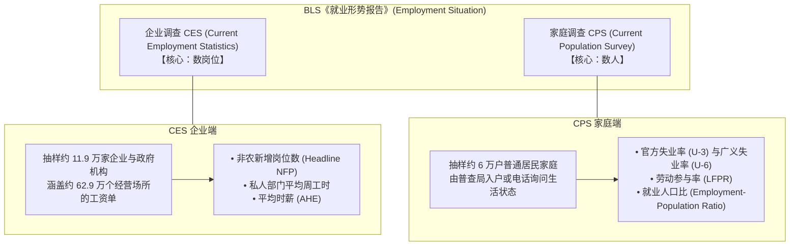
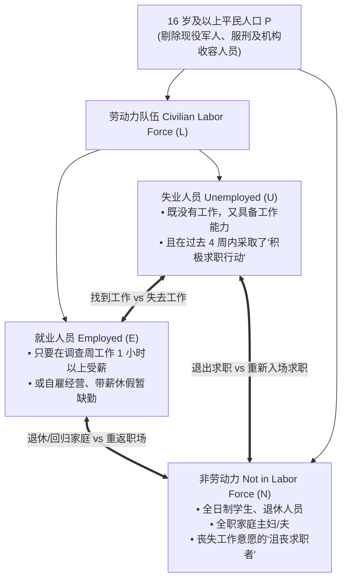
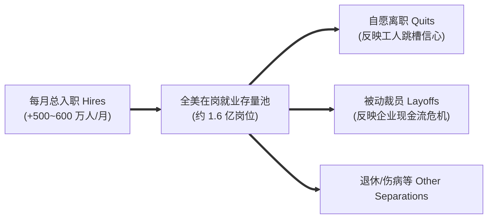
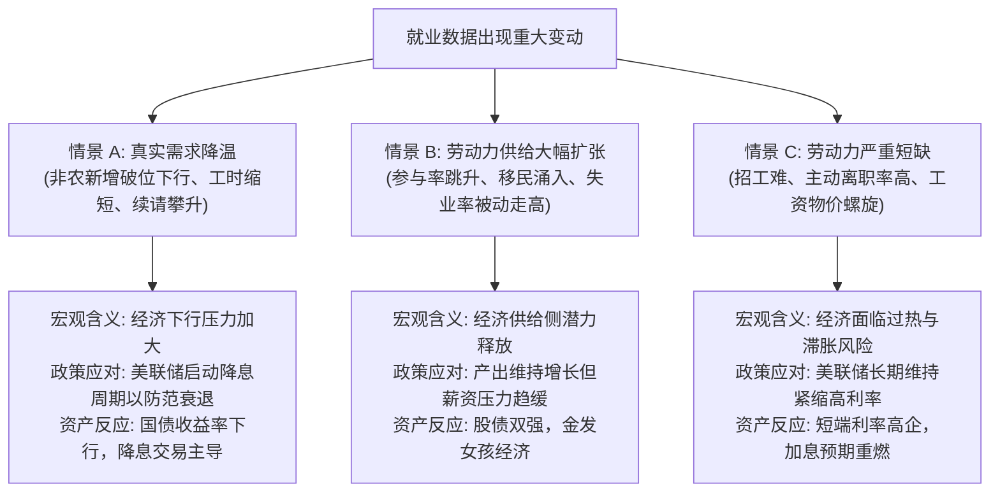

# 06 就业、失业与工资

[上一章](05-consumption.md) · [目录](./) · [下一章](07-business-activity.md)

> 本章是全书最具震撼力、金融市场波动最剧烈的核心章节。建议分三次学习：第 1—3 节理清“数岗位”与“数人”的本质鸿沟（CES 与 CPS 两大调查）；第 4—6 节掌握失业率计算陷阱、广义利用不足（U-6）与周度初请失业金的领先信号；第 7—10 节拆解薪资构成的“幸存者偏差”，精读 2024 年 7 月真实非农报告并完成实战练习。除明确注明的历史官方报告外，数值均为教学假设。

---

## 本章要解决什么问题

每月第一个星期五美东时间上午 8:30，全球金融机构的交易员都会屏住呼吸，紧盯屏幕上跳出的**美国劳工统计局（BLS）非农就业形势报告（Employment Situation）**。

伴随这份报告，财经新闻中常常充斥着令人眼花缭乱的矛盾信号：
- “非农新增就业暴增 25 万人，大超华尔街预期，然而失业率却从 3.8% 攀升至 4.0%！”
- “失业率创下两年来新低，但经济学家却警示劳动力市场正在急剧恶化；”
- “平均时薪同比激增 5%，老板叫苦不迭，但普通打工人的实际周薪购买力却在缩水；”
- “两个月前公布的‘大好数据’，在这次报告中被悄悄大幅下修了 10 万个岗位。”

这些怪象引发了一系列深层疑问：
- 为什么就业岗位增加了，失业率反而在上升？
- 失业率下降，难道不代表经济繁荣吗？它怎么可能是坏消息？
- 平均时薪上涨，真的代表每个打工人都加薪了吗？
- 为什么非农数据总是面临大规模的后续修订？初值到底可不可靠？

就业绝不是一个冰冷的孤立数字。它是**企业用工需求**、**居民求职意愿**、**每周劳动工时**与**劳动报酬**相互交织的综合生态。

读完本章，你将能够：
- 区分**企业调查（CES，数岗位）**与**家庭调查（CPS，数人）**，彻底看懂两项调查为什么会产生“数据打架”；
- 熟练运用劳动力人口状态流转图，看穿失业率下降背后的“沮丧求职者陷阱”；
- 拆解平均时薪中的“构成效应（Composition Effect）”，明白为什么大裁员时平均时薪反而会暴涨；
- 穿透初请与续请失业金的周度领先信号，建立观察劳动力市场的完整高频雷达。

---

## 1. 先分清本质：在数岗位，还是在数人？

要读懂美国就业报告，第一道也是最重要的认知防火墙，就是搞清**非农报告是由两张完全独立的底表拼装而成的**。

很多人以为 BLS 每月只是做了一次普查，其实它是左手调查企业、右手调查家庭：

### 1.1 一个人的变动，在两张表里截然不同

通过三个真实生活场景，你就能立刻体会两者的微妙差异：

1. **打两份工的小林**：
   小林白天在软件公司上班，晚上为了多赚些外快，在超市兼职打工，两家雇主都依法为他报税发放工资。
   - **在 CES（数岗位）眼里**：两家企业都上报了小林的受薪记录，在非农就业岗位中贡献了 **$+2$ 个岗位**；
   - **在 CPS（数人）眼里**：调查员给小林家打电话，小林回答“我是在职人员”，在就业总人口中只计为 **$+1$ 个就业者**。
2. **辞职单干自雇的小周**：
   小周辞去了设计院的职务，在自家客厅做独立自由设计师，未注册正规公司。
   - **在 CES 眼里**：企业受薪名录上少了一个人，非农岗位 **$-1$ 个**；
   - **在 CPS 眼里**：小周依然在靠自己的劳动换取收入，家庭调查中依然算作 **就业者**（属于非公司制自雇人员）。
3. **刚毕业找工作的小陈**：
   小陈刚从大学毕业，向各大公司投递了数十份简历，正在焦虑等待面试。
   - **在 CES 眼里**：没有任何企业为小陈发工资，CES 报表中完全没有小陈的痕迹；
   - **在 CPS 眼里**：小陈没有工作，但正在积极寻找并能立即上岗，被正式计为 **$+1$ 个失业者**！

| 比较维度 | 企业调查 (CES) | 家庭调查 (CPS) |
| :--- | :--- | :--- |
| **统计核心** | **数非农工资岗位（Jobs）** | **数劳动年龄人口（Persons）** |
| **一人多职** | 一个人打三份工，算 **3 个岗位** | 一个人打十份工，也只算 **1 个就业者** |
| **农业与自雇** | 严格排除农业、家庭佣工与无雇员自雇 | 全面覆盖农业、自主创业自雇与家庭帮工 |
| **主要产出** | 非农新增岗位、平均每周工时、平均时薪 | 官方失业率（U-3）、劳动参与率、就业人口比 |
| **参考时间** | 包含当月 12 日的**发薪周期（Pay Period）** | 包含当月 12 日的**那一周（Calendar Week）** |

> [!IMPORTANT]
> **绝对不能把 A 表减去 B 表！**
> 新闻里常有人把家庭调查的就业人数与企业调查的非农岗位直接相减，并惊呼“发现了数百万隐形失业”。这是极其业余的统计笑话，两者的抽样对象、口径定义和覆盖人群截然不同，短期背离是常态，绝不能直接相减。

---

## 2. 非农新增岗位如何产生：样本推算与模型补足

财经头条里写着“本月非农新增 20 万人”，这 20 万绝不是统计局把全美所有工人的身份证清点了一遍。

### 2.1 匹配样本与加权比率法

为了在每月月初迅速发布数据，BLS 采用严密的**分层抽样加权推算（Link-Relative Estimator）**：
统计局在细分行业中，对比连续两个月都完整提交了工资单的同一批样本企业，计算这批企业的受雇岗位变动乘数，再乘以上个月该行业的全社会总估计数。

看一个简化的教学算例：

| 样本企业 | 抽样权重（代表多少家同类企业） | 上月实际上报岗位 | 本月实际上报岗位 | 本月加权受雇岗位 |
| :--- | ---: | ---: | ---: | ---: |
| **企业 A** | 2 | 100 | 105 | $2 \times 105 = 210$ |
| **企业 B** | 4 | 50 | 50 | $4 \times 50 = 200$ |
| **合计** | - | **上月加权 $= 400$** | - | **本月加权 $= 410$** |

$$
\text{样本变动乘数} = \frac{410}{400} = 1.025 \implies +2.5\%
$$

如果该行业上个月全社会估算的总岗位数为 $10,000$ 个，那么本月推算出的新岗位总数就是：

$$
10,000 \times 1.025 = 10,250 \text{ 个}
$$

虽然样本里只新增了 5 个人，但通过统计权重放大后，全行业推算新增了 $250$ 个岗位。

---

### 2.2 企业出生—死亡模型（Net Birth-Death Model）

真实世界中，每天都有新科技公司、新餐馆诞生（创造岗位），每天也有店铺破产倒闭（消灭岗位）。
然而，新诞生的企业还没来得及录入政府工商抽样名录，倒闭破产的企业则根本不会再回复统计局的问卷。如果只跟踪老牌样本企业，就会产生极其严重的系统性偏差。

为了弥补这一盲区，BLS 引入了**净出生—死亡时间序列模型**，根据历史经济规律，估算每月新开企业减去倒闭企业后，应在全社会补足的净岗位。

> [!WARNING]
> **切勿把出生—死亡模型当成“人口生死”！**
> 很多阴谋论文章会宣称：“本月非农增加了 15 万，但模型虚构了 12 万，所以真实就业只有 3 万”。
> 这种说法完全忽视了模型的统计职能：该模型是在补足抽样名录漏网的实体小微企业。但在经济发生剧烈拐点（如突发衰退企业集中倒闭）时，依赖历史平稳期训练的模型确实容易出现滞后高估，这也是后续基准修订（Benchmark Revision）重点纠偏的领域。

---

## 3. 失业率是怎么算出来的？三态流转漏斗

家庭调查（CPS）将全美 **16 岁及以上平民非机构化人口（Civilian Noninstitutional Population, $P$）** 严格划分为互不重叠的三大阵营：

### 3.1 核心公式体系

在失业率的核算中，分母不是全国总人口，而是**真正参与劳动力市场的人口总和**：

$$
\begin{aligned}
\text{平民人口总数 } P &= E + U + N \\
\text{平民劳动力总量 } L &= E + U \\
\text{官方失业率 (U-3)} &= \frac{U}{L} \times 100\% = \frac{U}{E + U} \times 100\% \\
\text{劳动参与率 (LFPR)} &= \frac{L}{P} \times 100\% = \frac{E + U}{P} \times 100\% \\
\text{就业人口比率} &= \frac{E}{P} \times 100\%
\end{aligned}
$$

---

### 3.2 失业率下降的经典“陷阱”

很多人下意识认为：“失业率下降 $= 100\%$ 是经济变好的喜事”。我们来看下面两个戏剧性的对比情景（假设总人口 $P = 1,000$ 恒定）：

| 情景状态 | 就业人数 $E$ | 失业人数 $U$ | 非劳动力 $N$ | 劳动力总量 $L$ | 官方失业率 (U-3) | 劳动参与率 | 真实经济含义诊断 |
| :--- | ---: | ---: | ---: | ---: | ---: | ---: | :--- |
| **基准状态** | $600$ | $40$ | $360$ | $640$ | $\frac{40}{640} = \mathbf{6.25\%}$ | $64.0\%$ | 劳动力市场处于常态 |
| **情景 1：求职者彻底绝望** | $600$ | **$30$** | **$370$** | $630$ | $\frac{30}{630} = \mathbf{4.76\%}$ | $\mathbf{63.0\%}$ | **失业率暴跌！但没有一个人找到新工作，只是 10 个人放弃找工退出了劳动力！** |
| **情景 2：就业市场吸引力大增** | **$610$** | **$50$** | **$340$** | $660$ | $\frac{50}{660} = \mathbf{7.58\%}$ | $\mathbf{66.0\%}$ | **失业率飙升！但实际上社会多创造了 10 个就业，并吸引了 20 个人重新出来找工作！** |

> [!CAUTION]
> **看失业率必须同时看参与率！**
> - 在情景 1 中，全社会的就业岗位没有增加一个，仅仅因为 10 个长期失业者心灰意冷停止投递简历，他们被直接踢出了“劳动力分母”，导致官方失业率从 $6.25\%$ 虚假改善至 $4.76\%$。**这是典型的劳动力萎缩型悲剧！**
> - 在情景 2 中，由于经济向好、工资上升，吸引了全职太太和退休人员重返职场求职，失业率看似跳升到 $7.58\%$，其实是劳动力供给大幅扩张的健康表现。

---

### 3.3 广义失业率 U-6：透视隐形闲置

官方公布的失业率是 **U-3**。为了全面摸清劳动力闲置的严重程度，BLS 还公布了更具穿透力的 **U-6 广义失业率**：

$$
\text{U-6 失业率} = \frac{U + M_{\text{边缘依附人员}} + T_{\text{因经济原因兼职人员}}}{L + M_{\text{边缘依附人员}}} \times 100\%
$$

其中：
- **边缘依附人员（Marginally Attached, $M$）**：主观想工作，但过去 4 周未找工作（包括因觉得“根本找不到好工作”而放弃的**沮丧求职者 Discouraged Workers**）；
- **因经济原因兼职人员（Part-Time for Economic Reasons, $T$）**：自身极其渴望全职工作，但由于雇主订单缩减、业务清淡，被迫只能每周工作 10~20 小时的打工人（属于“不充分就业”）。

当经济初现疲态时，企业通常不会立刻大规模裁员，而是先缩短工时、把全职转为兼职。因此，**U-6 指标往往比 U-3 更早异动**。

---

## 4. JOLTS 与劳动力流动：存量净增背后的汹涌暗流

很多初学者容易以为，净增 15 万岗位意味着全美企业一共只招了 15 万人。
其实，宏观劳动力市场就像一个大浴缸：左边水龙头在以每月数百万人的规模狂涌注水（招聘），右边出水口在以相似的规模疯狂排水（离职与裁员）。

在 BLS 的**职位空缺与劳动力流动调查（JOLTS）**中，以下三个指标构成了美联储主席鲍威尔极为看重的微观指针：

1. **职位空缺数（Job Openings）**：月末全社会尚未招满、且正在积极对外招聘的岗位存量。**空缺数除以失业人数的比率（$V/U$ 比例）**，曾是衡量劳动力市场紧张程度的黄金指标；
2. **主动离职率（Quits Rate）**：员工主动辞职往往意味着“我能在市场上轻松找到薪水更高的下家”。主动离职率骤降，是就业市场冷风吹拂的极为可靠的先兆；
3. **裁员解雇率（Layoffs & Discharges Rate）**：企业强制砍掉员工的比例。

---

## 5. 每周初请失业金：速度最快的高频警报器

非农报告一个月才发布一次，而美国劳工部（DOL）每周四早晨公布的**初次申请失业救济金人数（Initial Jobless Claims）**，是全市场频率最高、最具实效性的实体领先指标。

| 监控指标 | 统计口径与时间属性 | 分析师观察的核心逻辑 |
| :--- | :--- | :--- |
| **初请失业金人数 (Initial Claims)** | 上周新向各州政府失业救济系统提交初审申请的打工人数 | **反映企业“新增裁员断崖”的最前沿脉搏**。通常关注其 **4 周移动平均值（4-Week Moving Average）** 以平滑单周噪音 |
| **续请失业金人数 (Continuing Claims)** | 已经完成初审，本周继续领取救济金的在册失业总人数（滞后初请一周） | **反映失业者“找到新工作的难度”**。如果初请不高但续请持续走高，说明企业虽然没大规模裁员，但已经全面冻结招聘，失业者再就业极其艰难！ |

---

## 6. 平均时薪的陷阱：令人啼笑皆非的“幸存者偏差”

财经媒体上最容易误导公众的指标莫过于**平均时薪（Average Hourly Earnings, AHE）**。

### 6.1 经典假象：为什么大裁员时时薪反而飙升？

假设一家连锁零售企业原本有 10 名员工：
- 5 名是商场初级收银员，时薪 $10$ 美元，每周工作 40 小时；
- 5 名是高级店长与工程师，时薪 $30$ 美元，每周工作 40 小时。

我们来算一算该企业的平均时薪：

$$
\text{基期平均时薪} = \frac{5 \times 10 + 5 \times 30}{10} = \frac{50 + 150}{10} = \mathbf{20 \text{ 美元/小时}}
$$

突然遭遇经济危机，公司决定缩减开支，**一口气把 4 名低薪收银员全部解雇裁掉**！剩下的所有人一分钱工资都没涨：
- 此时公司只剩 1 名收银员（时薪 $10$ 美元）和 5 名高管（时薪 $30$ 美元）；
- 我们重新计算当期平均时薪：

$$
\text{危机后平均时薪} = \frac{1 \times 10 + 5 \times 30}{6} = \frac{10 + 150}{6} = \frac{160}{6} \approx \mathbf{26.67 \text{ 美元/小时}}
$$

时薪居然从 $20$ 美元**暴涨 $33.3\%$ 至 $26.67$ 美元**！

> [!CAUTION]
> **构成效应（Composition Effect）！**
> 没有一个打工人获得加薪，甚至有 40% 的员工失去了饭碗，但统计报表上的平均时薪却出现了繁荣暴涨。这是因为低薪岗位被大量清洗出局后，高薪员工在样本中的权重被动放大了。
> 2020 年疫情初期，美国失业率暴增至 14.7%，但当月的平均时薪同比增速却一度飙升至历史罕见的 8% 以上，正是这种构成效应在作祟。

---

### 6.2 如何捕捉纯粹的加薪？ECI 与亚特兰大联储追踪器

为了彻底剔除行业和人员构成变化的污染，专业研究必须交叉参考两项“纯净”指标：

1. **就业成本指数（Employment Cost Index, ECI）**：
   BLS 季度发布。它**固定了全社会的职业与行业结构权重**，衡量雇主雇佣同类型岗位所承担的纯工资与福利成本增长。美联储在研判“工资—物价螺旋”时，对 ECI 的信任度远高于月度平均时薪；
2. **亚特兰大联储工资增长追踪器（Wage Growth Tracker）**：
   利用 CPS 微观数据，专门跟踪连续 12 个月都能在样本中匹配到的**同一个人的实际时薪涨幅**，并取其中位数，完美避开了跨行业换人带来的统计扭曲。

---

## 7. 真实报告带读：2024 年 7 月就业报告实战

我们翻开 **2024 年 8 月 2 日发布的 2024 年 7 月《就业形势报告》原始公报**。这份报告公布后，曾直接引发了全球金融市场的剧烈动荡（所谓“萨姆规则衰退交易”）。

### 7.1 表 A：家庭调查核心读数（千人）

| 统计指标 | 2024 年 6 月 | 2024 年 7 月 | 环比变化量 | 经济诊断要点 |
| :--- | ---: | ---: | ---: | :--- |
| **民用劳动力 (Labor Force)** | $168,009$ | $168,429$ | $+420$ | 劳动力队伍大幅扩容 |
| **就业总人数 (Employed)** | $161,199$ | $161,266$ | $+67$ | 就业仅微幅增加，吸纳能力不足 |
| **失业总人数 (Unemployed)** | $6,811$ | $7,163$ | **$+352$** | 失业人数单月大幅跳增 |
| **官方失业率 (U-3)** | **$4.1\%$** | **$4.3\%$** | **$+0.2$ 百分点** | **触发了著名的萨姆规则（Sahm Rule）阈值** |

亲自复算 7 月官方失业率：

$$
\text{失业率} = \frac{7,163}{168,429} \times 100\% \approx 4.2528\% \implies \text{四舍五入公布为 } \mathbf{4.3\%}
$$

---

### 7.2 表 B：企业调查核心读数

| 统计指标 | 2024 年 6 月 | 2024 年 7 月 | 环比变化与修订 | 经济诊断要点 |
| :--- | ---: | ---: | :--- | :--- |
| **非农新增岗位 (NFP)** | $+179$ 千人 (下修前为 206) | **$+114$ 千人** | 大幅降速，且前两月累计大幅下修 | 岗位新增动能明显放缓 |
| **平均每周工时** | $34.3$ 小时 | **$34.2$ 小时** | 减少 $0.1$ 小时 | **极其关键的隐蔽降温信号！** |
| **平均时薪 (AHE)** | $\$34.99$ | $\$35.07$ | 环比仅增 $+0.2\%$ | 薪资通胀压力大幅缓解 |

我们来算一算每个工人的平均周薪变动：
- 6 月平均每周收入 $= 34.3 \times 34.99 = \mathbf{1,200.16 \text{ 美元}}$；
- 7 月平均每周收入 $= 34.2 \times 35.07 = \mathbf{1,199.39 \text{ 美元}}$。

> [!NOTE]
> **工时虽小，威力巨大！**
> 尽管平均时薪从 $34.99$ 涨到了 $35.07$，但由于每周工时被砍掉了 0.1 小时（相当于缩减了约 $0.29\%$ 的工作时长），工人拿到手的周薪毛收入反而下降了！在全美 1.6 亿打工人的规模下，工时减少 0.1 小时相当于凭空蒸发了数十万个全职岗位的劳动投入。

---

## 8. 劳动力市场传导：三大典型情景

在评估就业数据对宏观经济与美联储决策的影响时，不能孤立背诵口诀，必须带入具体的经济情景：

---

## 9. 宏观监控看板与实战流程

构建一套专业的就业监控体系，建议按照以下优先级整合数据流水线：

| 观察模块 | 核心观察序列 | 调查源头 | 领先/滞后属性 | 关键逻辑防线 |
| :--- | :--- | :--- | :--- | :--- |
| **边际前沿** | 4 周初请失业金、续请人数 | 劳工部 DOL（周度） | 极其敏锐的领先信号 | 观察企业裁员脉搏与再就业阻力 |
| **增量强度** | 非农新增岗位（NFP）、前值修正 | BLS CES（月度） | 同步指标 | 警惕企业出生—死亡模型与后续修订 |
| **闲置广度** | 官方 U-3、广义 U-6、劳动参与率 | BLS CPS（月度） | 同步指标 | 穿透是真实创造工作还是求职者退出 |
| **劳动投入** | 私人非农平均工时、周薪总额 | BLS CES（月度） | 同步且偏领先 | 砍工时往往发生在裁员之前 |
| **流动活力** | JOLTS 职位空缺率、自愿离职率 | BLS JOLTS（月度，滞后） | 滞后确认指标 | 确认工人信心与岗位供需缺口 |
| **薪酬成本** | ECI 季调环比、时薪构成 | BLS ECI（季度） | 核心决策指针 | 固定权重，剔除构成效应污染 |

---

## 10. 练习与参考答案

### 练习 1：两份调查的归属诊断
请分析以下四位居民的活动，分别在劳工统计局的 **CES 企业调查** 和 **CPS 家庭调查** 中如何被记录？
1. 张先生原本全职在某制造厂上班，本月在周末兼职开优步（Uber，未注册公司，按个人自雇接单）；
2. 李女士辞去了全职行政工作，全心全意在家抚养两个新生婴儿，未寻找任何外界工作；
3. 王先生由于公司效益不佳上周被通知临时解雇（Layoff），但他明确被告知在 30 天后会被原厂召回重新上岗，因此他在过去一周没有向任何其他公司投递简历；
4. 赵同学是大四在读学生，每周在大学图书馆有偿兼职工作 8 小时。

点击查看参考答案与详细解析

1. **张先生**：
   - **CES**：原全职制造厂贡献 **$+1$ 个非农岗位**；开优步属于非公司制个人自雇，不在 CES 企业工资单覆盖范围内。CES 合计记为 **$+1$ 个岗位**；
   - **CPS**：张先生是一位正在工作的自然人，在家庭调查中记为 **$+1$ 个就业人员（Employed）**。
2. **李女士**：
   - **CES**：企业工资名录上不再有其名字，企业调查中记为 **$-1$ 个岗位**；
   - **CPS**：李女士未参与受薪劳动，且没有主动求职，归属于 **非劳动力（Not in Labor Force）**。
3. **王先生**：
   - **CES**：如果发薪周期内没有工资记录，记为 **$-1$ 个受薪岗位**；
   - **CPS**：**特殊条款！** 王先生属于“临时被裁但等待明确召回（On Temporary Layoff）”的特殊情形，即使过去四周没有积极找工作，在 CPS 中依然被正式归类为 **失业人员（Unemployed）**！
4. **赵同学**：
   - **CES**：大学若为其发放受薪报酬，在州及地方政府/教育机构项下记为 **$+1$ 个受薪岗位**；
   - **CPS**：虽然是全日制在读学生，但只要在参考周内从事了 1 小时以上的受薪工作，在家庭调查中就符合条件并被记为 **$+1$ 个就业人员（Employed）**。

---

### 练习 2：复算劳动力三态比率
假设某虚拟城镇拥有 16 岁及以上平民人口 $2,000$ 人。经过入户调查：
- 有工作的人员为 $1,200$ 人；
- 没有工作、但在过去四周积极投递简历求职的人员为 $100$ 人；
- 另外有 $40$ 人非常想找工作，在过去一年内曾找过工作，但由于过去四周家中有事暂停了投递简历；
- 剩下的 $660$ 人为退休人员、在读全日制学生或全职家庭主妇；
- 在已经就业的 $1,200$ 人中，有 $60$ 人由于公司业务不足，极度渴望全职却被迫只能做兼职。

**请计算**：
1. 劳动力总量（Labor Force）、官方失业率（U-3）以及劳动参与率各是多少？
2. 广义利用不足率（U-6）是多少？
3. 如果下个月那 $100$ 名失业者中有 $30$ 个人因为连续碰壁感到极度沮丧，彻底放弃了求职念头并停止投递简历，其他条件完全不变，请重新计算官方失业率（U-3）和劳动参与率，并说明为什么不能据此宣布劳动力市场走强。

点击查看参考答案与详细解析

**第 1 步：基础指标计算**
- 就业人数 $E = 1,200$；失业人数 $U = 100$；
- 劳动力总量 $L = E + U = 1,200 + 100 = \mathbf{1,300 \text{ 人}}$；
- 官方失业率 (U-3)：
  $$
  \text{U-3} = \frac{U}{L} = \frac{100}{1,300} \times 100\% \approx \mathbf{7.69\%}
  $$
- 劳动参与率：
  $$
  \text{LFPR} = \frac{L}{P} = \frac{1,300}{2,000} \times 100\% = \mathbf{65.0\%}
  $$

**第 2 步：计算广义失业率 U-6**
- 边缘依附人员 $M = 40$ 人；经济原因兼职人员 $T = 60$ 人；
- 广义分子 $= U + M + T = 100 + 40 + 60 = 200$ 人；
- 广义分母 $= L + M = 1,300 + 40 = 1,340$ 人（**注意：兼职人员已在 $L$ 中，不可重复相加！**）；
- U-6 失业率：
  $$
  \text{U-6} = \frac{200}{1,340} \times 100\% \approx \mathbf{14.93\%}
  $$

**第 3 步：沮丧求职者退出情景**
- 30 人放弃求职进入非劳动力，新的失业人数 $U' = 100 - 30 = 70$ 人；
- 新的劳动力总量 $L' = 1,200 + 70 = 1,270$ 人；
- 新的官方失业率：
  $$
  \text{U-3}' = \frac{70}{1,270} \times 100\% \approx \mathbf{5.51\%} \quad (\text{暴跌了 } 2.18 \text{ 个百分点！})
  $$
- 新的劳动参与率：
  $$
  \text{LFPR}' = \frac{1,270}{2,000} \times 100\% = \mathbf{63.5\%} \quad (\text{下挫了 } 1.5 \text{ 个百分点})
  $$
- **诊断**：失业率从 $7.69\%$ 大幅滑落到 $5.51\%$，完全是因为 30 名求职者彻底丧失了信心、退出劳动力市场，导致计算分母和分子同时萎缩。社会就业岗位没有增加一个，劳动参与率反而恶化，这是劳动力市场受挫的危险信号，绝非经济走强。

---

### 练习 3：平均时薪与构成效应分析
某咨询公司拥有两大业务部门：
- 数字化转型部（高级顾问）：共 40 人，平均时薪为 $\$50$，人均每周工作 40 小时；
- 基础数据录入部（初级专员）：共 60 人，平均时薪为 $\$20$，人均每周工作 40 小时。

1. 计算全公司在基期的平均时薪及每周总薪酬开支；
2. 假设第二季度公司引入了 AI 自动化录入系统，裁撤了 30 名数据录入专员，而保留下来的所有员工薪水标准未做任何调整。请计算裁员后全公司的平均时薪以及总薪酬开支变动比例；
3. 如果工会据此声称“公司在第二季度给员工平均大幅加薪了”，请指出这一结论的致命荒谬之处。

点击查看参考答案与详细解析

1. **基期计算**：
   - 基期总员工数 $= 40 + 60 = 100$ 人；
   - 基期平均时薪：
     $$
     \text{AHE}_0 = \frac{40 \times 50 + 60 \times 20}{100} = \frac{2,000 + 1,200}{100} = \mathbf{\$32 \text{ 美元/小时}}
     $$
   - 每周总薪酬开支：
     $$
     \text{总支出}_0 = 100 \times 40 \times 32 = \mathbf{\$128,000 \text{ 美元}}
     $$
2. **裁员后重算**：
   - 裁员后初级专员剩 $30$ 人，高级顾问仍为 $40$ 人，总员工数 $= 70$ 人；
   - 裁员后平均时薪：
     $$
     \text{AHE}_1 = \frac{40 \times 50 + 30 \times 20}{70} = \frac{2,000 + 600}{70} = \frac{2,600}{70} \approx \mathbf{\$37.14 \text{ 美元/小时}}
     $$
     平均时薪“账面暴涨”了：
     $$
     \frac{37.14 - 32}{32} \times 100\% \approx \mathbf{+16.06\%}
     $$
   - 裁员后每周总薪酬开支：
     $$
     \text{总支出}_1 = 70 \times 40 \times 37.1428 = \mathbf{\$104,000 \text{ 美元}}
     $$
     公司实际支付的总工资缩水了：
     $$
     \frac{104,000 - 128,000}{128,000} \times 100\% = \mathbf{-18.75\%}
     $$
3. **剖析工会谬误**：
   工会的结论犯了典型的**构成效应（Composition Effect）偏差**。全公司没有任何一个在职员工获得了实质性调薪（高级顾问依然是 $\$50$，初级专员依然是 $\$20$）。平均时薪之所以从 $\$32$ 飙升至 $\$37.14$，纯粹是因为 30 名低薪员工被解雇，导致高薪群体在统计样本中的占比从 $40\%$ 被动跃升至 $57.1\%$。总薪资盘子实际上缩减了近两成，拿平均时薪的上涨当作“加薪”是对数据的极大扭曲。

---

## 本章小结与下一步学习

在这一章中，我们解构了宏观经济最具爆炸性的就业密码：
- **CES 企业调查数岗位**，**CPS 家庭调查数人**，两套底表的抽样口径差异是理解短期“数据打架”的关键；
- 失业率的变动受**求职意愿**与**参与率分母**的强力约束，失业率下降完全可能伴随着劳动力大军的萎缩；
- **平均时薪极易受低薪与高薪权重轮换的污染**，判断工资通胀趋势必须结合就业成本指数（ECI）和工时总额；
- **每周初请与续请失业金**是穿透月度迷雾的最灵敏前沿阵地。

企业到底雇佣多少工人、支付多少薪水，根本上取决于企业的订单多不多、开工率高不高以及愿不愿意掏真金白银买机器扩产能。在下一章中，我们将深入企业微观资产负债表与工业车间：[企业生产、景气与资本开支](07-business-activity.md)。

---

[上一章](05-consumption.md) · [目录](./) · [下一章](07-business-activity.md)
