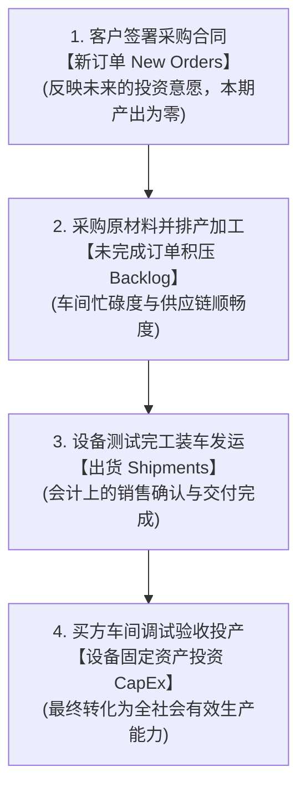
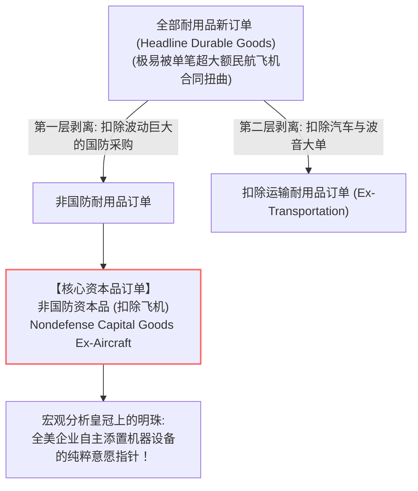
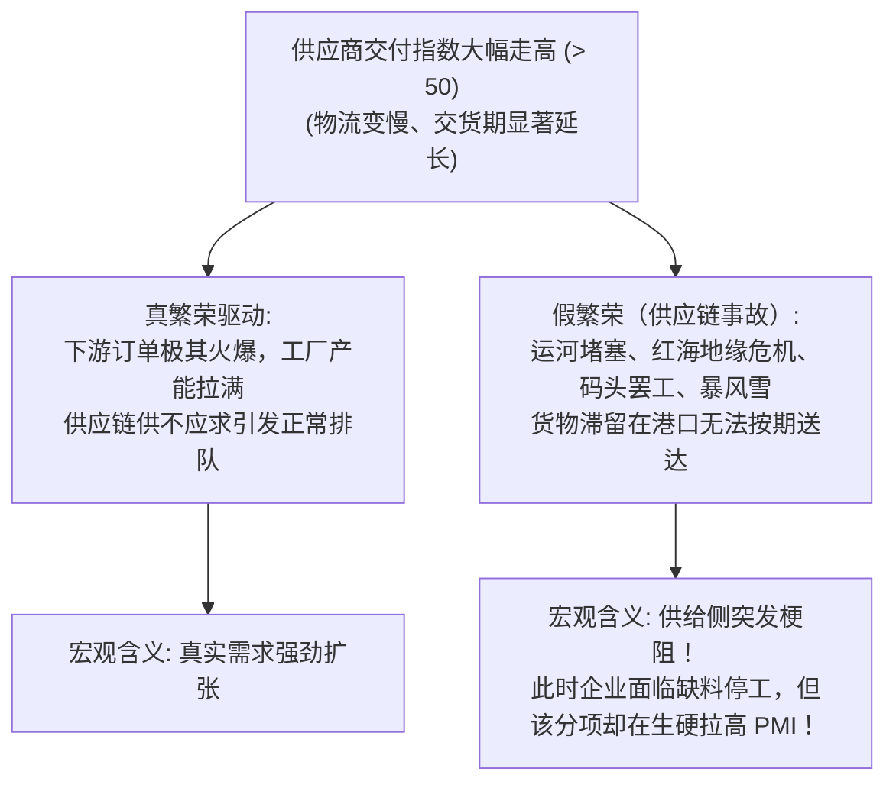

# 07 企业生产、景气与资本开支

[上一章](06-labor.md) · [目录](./) · [下一章](08-productivity.md)

> 本章解构宏观经济的供给侧底盘——企业微观经营、实物制造与机器投资。建议分三次学习：第 1—2 节掌握从合同订单到出货的会计链条，学会阅读 Census 耐用品订单；第 3—4 节掌握 PMI 扩散指数算法、供应商交付分项的“反直觉陷阱”与美联储工业产能利用率；第 5—7 节精读真实美联储 G.17 工业产出公报并完成综合实战。除明确注明的历史官方报告外，数值均为教学假设。原章中的住房内容已独立为专属模块，详见[第 23 章：住房市场与房地产周期](23-housing-market.md)。

---

## 本章要解决什么问题

在每天的宏观财经快讯中，有关企业生产的数据往往最为扑朔迷离：
- “某月制造业订单金额同比大增 10%，但是工厂实际产出和出货量却几乎原地踏步；”
- “某权威机构发布采购经理人指数（PMI），读数从 49.5 跃升至 52.0，财经头条高呼‘重返扩张区间’，然而细看分项，工厂新订单和雇工全在下滑，指数上涨纯粹是因为暴风雪导致货物堵在路上、供应商交货变慢；”
- “某重型机械巨头的产能利用率从 85% 跌至 75%，分析师却称这是一家公司的重大利好，因为‘全新现代化超级产线刚刚顺利点火投产’。”

这让初学者感到万分困惑：
- 客户下了订单，到底能不能直接算作当期的“经济增长”？
- 为什么耐用品订单公布时，华尔街所有分析师都在疯狂搜索“扣除飞机后的核心资本品”？飞机招谁惹谁了？
- PMI 指数突破 50 荣枯线，真的代表 50% 以上的企业产值在增长吗？
- 工厂开工率（产能利用率）下降，为什么不一定是“需求萧条”？

企业是宏观经济的造血细胞。从**客户签下采购订单**，到**车间排班加工**，再到**设备交付投产**，中间隔着漫长的时间滞后、原材料供应链与商业博弈。

读完本章，你将能够：
- 顺着“新订单 $\to$ 未完成积压 $\to$ 出货 $\to$ 存货”的业务全链条，彻底理清耐用品统计的底层逻辑；
- 亲手推导 PMI 扩散指数，一眼看穿“供应商交付变慢”背后的供需真伪；
- 读懂美联储工业生产指数（IP）与产能利用率（Capacity Utilization），区分天气突变导致的用电激增与真实的工业繁荣；
- 掌握资本开支（CapEx）的传导时滞，看清从企业投资意愿到 GDP 设备投资的完整脉络。

---

## 1. 从一张设备订单开始：企业的生产链条

在讨论宏观指标前，我们先跟着一家**智能食品加工厂**和一家**自动化机床制造厂**走一遍真实的商业旅程。

假设食品厂预计未来几年燕麦奶销量将爆发，决定向机床厂订购一条价值 $100$ 万美元的全自动无菌灌装生产线：
1. **商务谈判与签约（产生订单）**：双方签署具有法律效力的采购合同。此时，食品厂没有给全款，机床厂连一颗螺丝钉都还没拧，工厂没有发生任何物理加工；
2. **采购备料与排产（中间投入与用工）**：机床厂收到订单，开始采购特种钢材、工业芯片，并安排工程师加班设计图纸；
3. **车间加工组装（未完成订单与在制品存货）**：机床组装到一半，跨越了月末；
4. **测试与出厂交付（出货与固定投资落地）**：三个月后，设备组装测试完毕，装车发货运抵食品厂车间；
5. **现场安装调试（正式形成有效产能）**：食品厂工程师安装校准完毕，设备正式开机，未来 10 年持续产出燕麦奶。

### 1.1 核心概念防火墙

在这条紧密相扣的链条上，必须严格厘清不同指标的经济内涵：

| 观察指标 | 它在衡量什么？ | 为什么不能直接等同于“当期 GDP 增长”？ |
| :--- | :--- | :--- |
| **新订单 (New Orders)** | 客户未来的采购承诺与投资意愿 | 合同随时可能被修改、推迟甚至违约取消；订单尚未转化为当期物理生产 |
| **未完成订单 (Unfilled Orders)** | 已经签约但车间尚未交付的“在手积压存量” | 既可能反映订单爆满，也可能反映零部件短缺导致的“难产堵塞” |
| **出货 (Shipments)** | 本期实际交付出厂的产品总价值 | 出货可能来自仓库里的旧成品库存（旧产出），不完全等同于本期新制造的增加值 |
| **设备投资 (Equipment CapEx)** | 买方企业真正部署到位的生产性资产 | 必须区分是国产设备还是进口设备，且须剔除价格通胀影响 |

---

### 1.2 订单账与库存账的会计恒等式

对于任何一家制造企业，月末盘点都必须满足严密的实物流量—存量平衡：

$$
\begin{aligned}
\text{当月净新订单} &= \text{新签订合同总额} - \text{客户取消或削减的合同} \\
\text{期末在手未完成订单} &= \text{期初在手未完成订单} + \text{当月净新订单} - \text{当月实际出货额}
\end{aligned}
$$

将公式稍作移项，可以得到极其重要的推导关系：

$$
\text{当月净新订单} = \text{当月实际出货额} + (\text{期末未完成订单} - \text{期初未完成订单})
$$

#### 教学算例：看穿在手积压的经济玄机
假设机床制造厂月初在手未交付订单存量为 $200$ 万美元：
- **情景 A（供不应求）**：本月新签合同 $100$ 万美元，旧客户取消了 $20$ 万美元，车间满负荷出货交付了 $70$ 万美元：
  $$
  \text{净新订单} = 100 - 20 = \mathbf{80 \text{ 万美元}}
  $$
  $$
  \text{月末未完成订单} = 200 + 80 - 70 = \mathbf{210 \text{ 万美元}}
  $$
  未完成订单积压上升，说明客户需求涌入的速度超过了工厂目前的交付能力，企业生产排期已经排到了明年。
- **情景 B（消化积压）**：如果月末在手订单从 $200$ 万滑落至 $180$ 万美元，而出货依然保持在 $70$ 万美元：
  $$
  \text{净新订单} = 70 + (180 - 200) = \mathbf{50 \text{ 万美元}}
  $$
  订单积压减少了，但工厂当月依然干劲十足交付了 $70$ 万美元。这既可能是需求放缓的初兆，也可能是前期供应链堵塞解除后，工厂集中消化历史积压的健康表现。

> [!NOTE]
> **未完成订单 $\neq$ 仓库库存！**
> 未完成订单是法律合同上的履约承诺，属于“未来的货”；库存则是静静躺在仓库里的原材料、半成品与成品，属于“眼前的货”。一家工厂可以同时拥有堆积如山的未完成订单和空空如也的成品库房（例如汽车芯片短缺导致数十万辆半成品汽车无法总装出厂）。

---

## 2. 美国耐用品订单报告：为何要“剔除飞机”？

每月下旬，美国普查局（Census Bureau）会公布俗称**耐用品订单（Durable Goods Orders, M3 调查）**的报告，它是华尔街研判企业资本开支的头号风向标。

### 2.1 统计口径的层层穿透

所谓**耐用品（Durable Goods）**，在统计上定义为**预期使用寿命在 3 年以上的工业制成品**（如机床、电脑、卡车、商用飞机、医疗设备）。

但每当新闻公布“耐用品订单总额环比激增 8%”时，资深分析师的第一反应往往是把这个数字丢在一边，层层向下剥离：

### 2.2 为什么必须“剔除民航飞机”？

民航客机属于超级极端异常值：
- 一架波音 777 或空客 A350 的标价高达数亿美元；
- 某家中东航空公司在巴黎航展上一口气签下 100 架客机大单，就会凭空带来数百亿美元的耐用品订单激增；
- 然而，这批飞机可能需要未来 8 年甚至 10 年才能陆续分批制造交付，**绝不代表当期美国制造业的真实景气度发生了突变**。

看下面的教学算例（单位：十亿美元）：

| 统计分项 | 上月金额 | 本月金额 | 环比变动率 | 分析师的真实判断 |
| :--- | ---: | ---: | ---: | :--- |
| **波音民用飞机订单** | $20$ | **$5$** | **$-75\%$** | 航展结束后的正常回落 |
| **其他所有耐用品订单** | $200$ | **$204$** | **$+2.0\%$** | **实体制造需求普遍温和回暖** |
| **全部耐用品订单总额** | **$220$** | **$209$** | **$-5.0\%$** | **总额大跌纯属飞机干扰！** |

如果不做剔除，财经头条会惊呼“全美耐用品暴跌 5%”，而真实情况却是广谱制造业稳步扩张。因此，衡量全美企业真实资本开支动能的黄金基准指标，永远是**非国防核心资本品订单（Core Capital Goods Orders）**。

---

## 3. 采购经理人指数（PMI）：用广度换及时的晴雨表

除了政府统计局采集的企业财务账簿，金融市场上最炙手可热的还有**扩散指数（Diffusion Index）**，其中最著名的代表是美国供应管理协会（ISM）每月第一个工作日发布的 **ISM 制造业 PMI**。

### 3.1 扩散指数是如何计算出来的？

PMI 不调查具体的美元金额，而是向全美数百位核心采购经理发放调查问卷。针对新订单、生产、雇工等问题，选项极为干脆：**“比上月增加（Better）”、“与上月持平（Same）”还是“比上月减少（Worse）”？**

扩散指数的标准计算公式为：

$$
\text{扩散指数} = (\text{增加的百分比}) \times 1.0 + (\text{持平的百分比}) \times 0.5 + (\text{减少的百分比}) \times 0.0
$$

由于 $\text{增加} + \text{持平} + \text{减少} = 100\%$，公式可以等价改写为直观形式：

$$
\text{扩散指数} = 50 + 0.5 \times (\text{增加占比} - \text{减少占比})
$$

- 如果回答“增加”与“减少”的人数完全一样，指数正好等于 **$50.0$（荣枯分水岭）**；
- 如果回答“增加”的多于“减少”，指数高于 50，代表处于**扩张区间**；
- 如果回答“减少”的多于“增加”，指数低于 50，代表处于**收缩区间**。

#### 算例：看穿 PMI 的“广度”本质
假设一个由 100 家企业组成的样本：
- 40 家回答订单增加，30 家回答持平，30 家回答减少：
  $$
  \text{PMI} = 40 \times 1.0 + 30 \times 0.5 + 30 \times 0.0 = 40 + 15 = \mathbf{55.0}
  $$

> [!WARNING]
> **PMI 只度量广度（扩散度），不度量幅度！**
> 很多初学者误以为“PMI 从 50 升到 55，意味着制造业产出增长了 5%”。这是大错特错！
> 设想极端反例：那 40 家“增加”的企业，每家产出仅仅象征性增长了 $1$ 美元；而那 30 家“减少”的企业遭遇行业寒冬，每家产出暴跌了 $50\%$。此时全社会总产出遭遇毁灭性下滑，但算出来的 PMI 指数依然稳稳地站在 **55.0 的繁荣区间**！PMI 告诉你的是“景气好转的范围有多广”，而不是“产出规模到底长胖了多少”。

---

### 3.2 供应商交付指数：最容易读反的“致命分项”

ISM 制造业综合 PMI 由五个细分项等权重（各占 $20\%$）加权平均而成：
1. **新订单指数（New Orders）**
2. **生产指数（Production）**
3. **就业指数（Employment）**
4. **供应商交付指数（Supplier Deliveries）**
5. **存货指数（Inventories）**

在所有分项中，**供应商交付（Supplier Deliveries）是唯一一个“逆向指标”**：

$$
\text{供应商交付变慢（延误严重）} \implies \text{该分项指数飙升（高于 50）} \implies \text{推高整体 PMI 读数}
$$

#### 经典对比案例
看下面两组分项情景（各项等权重 $20\%$）：

| ISM 细分指数 | 情景 1（全面复苏） | 情景 2（红海物流断航事件） |
| :--- | ---: | ---: |
| **新订单指数** | $54.0$ | **$46.0$（需求正在萎缩）** |
| **生产指数** | $53.0$ | **$47.0$（车间被迫减产）** |
| **就业指数** | $52.0$ | **$48.0$（企业冻结招工）** |
| **存货指数** | $51.0$ | **$47.0$（零件库存告急）** |
| **供应商交付指数** | **$55.0$** | **$67.0$（港口瘫痪交货暴慢）** |
| **等权综合 PMI** | **$53.0$（健康扩张）** | **$51.0$（虚假跃过 50 荣枯线！）** |

在情景 2 中，订单、生产、雇工和库存全线溃败（均低于 50 收缩线），唯独因为港口物流瘫痪导致交货延误，供应商交付指数跳涨至 67.0，生生把综合 PMI 拉上了 **51.0 的荣枯线上方**！如果分析师只看标题而不穿透分项，就会把一场供给侧交通灾难误判为“经济强劲复苏”。

---

## 4. 工业生产与产能利用率：实物产出的真实体温

不同于经理人的问卷打分，美联储理事会（Federal Reserve Board）每月发布的 **G.17 工业产出与产能利用率（Industrial Production and Capacity Utilization）**，直接测量美国工厂、矿井与电网的**实物产出规模**。

### 4.1 工业生产（IP）的三大板块

工业生产指数覆盖三个截然不同的行业领域：
1. **制造业（Manufacturing，占比约 75%）**：汽车、机械、半导体、化工等，是经济周期的核心心脏；
2. **采矿业（Mining，占比约 15%）**：页岩油钻井、天然气开采、铁矿开采等，与国际大宗商品价格密切共振；
3. **公用事业（Utilities，占比约 10%）**：电力输送与燃气供应。

> [!TIP]
> **警惕高温与寒潮对公用事业的脉冲干扰！**
> 盛夏突发历史极端高温，全美居民空调全力制冷运转，公用事业用电量可能单月暴涨 $8\%$，直接把当月“总工业生产（Total IP）”拉高 1 个百分点。此时必须紧盯**制造业核心产出（Manufacturing IP）**，万不可把空调制冷带来的用电激增误读为“全美工业制造业订单繁荣”。

---

### 4.2 产能利用率（Capacity Utilization）：机器闲置率与通胀临界点

产能利用率衡量的是**现有机器设备的负荷程度**：

$$
\text{产能利用率} = \frac{\text{实际工业产出指数}}{\text{可持续潜在最大产能指数}} \times 100\%
$$

#### 算例：为什么利用率下跌不一定是坏事？
假设一家新能源汽车电池厂：
- **第 1 期**：拥有 1 条产线，额定可持续设计产能为 100 万度电。当期满负荷开工，实际生产 90 万度电：
  $$
  \text{产能利用率}_1 = \frac{90}{100} = \mathbf{90.0\%}
  $$
- **第 2 期**：企业历时两年投资的新厂房竣工投产，总产能跃升至 150 万度电。当期市场销量持续向好，实际产量提升到 105 万度电：
  $$
  \text{产能利用率}_2 = \frac{105}{150} = \mathbf{70.0\%}
  $$

仔细观察：实际产量明明从 90 万跃升到了 105 万度（实际产出扩张 $16.7\%$），**产能利用率却从 $90\%$ 暴跌至 $70\%$**！因为分母上的资本设备存量扩充得更快。这说明产能利用率不仅反映即期需求，更记录了资本投资落地的周期性节奏。

---

## 5. 真实报告带读：美联储 G.17 报告实战复盘

我们翻开 **2024 年 7 月 17 日美联储官方发布的 G.17 新闻公报**（反映 2024 年 6 月实际运行状况）：

### 5.1 首页核心指标矩阵

| 统计序列 | 2024 年 6 月公布读数 | 正确统计口径解读 |
| :--- | ---: | :--- |
| **总工业生产 (Total IP)** | **$+0.6\%$** | 经季节调整的月环比增速（MoM） |
| **制造业生产 (Manufacturing IP)** | **$+0.4\%$** | 实体制造车间产出温和扩张 |
| **采矿业 (Mining)** | $+0.3\%$ | 油气勘探与开采维持稳定 |
| **电力与燃气公用事业 (Utilities)** | **$+2.8\%$** | **受 6 月全美大范围高温热浪影响，用电需求异动拉升！** |
| **第二季度总工业生产年化增速** | $+4.3\%$ | 季环比折年率（SAAR） |
| **全美总产能利用率 (Capacity Utilization)** | **$78.8\%$** | **绝对百分比水平**（长期历史平均线为 79.7%） |

### 5.2 资深宏观分析师的诊断手记

1. **结构拆解**：总工业产出增长 $+0.6\%$ 看起来极为亮眼，但其中公用事业由于异常高温贡献了 $+2.8\%$ 的脉冲式拉动。不过，纯制造业产出依然实现了 $+0.4\%$ 的稳健增长，说明实体工厂并非空心化繁荣；
2. **通胀压力评估**：全美总产能利用率录得 $78.8\%$，依然运行在历史长期均值（$79.7\%$）下方。这意味着全美工业制造体系仍有充裕的闲置机器设备随时可以投入运转，**未触发“产能瓶颈紧绷导致制成品出厂价格恶性飞涨”的通胀警戒线**；
3. **政策含义**：美联储官员读到这份报告，既无需担心工业部门出现衰退崩溃，也无需因产能过热而急于加息。

---

## 6. 从企业景气到全社会资本开支传导

企业的一举一动，最终如何重塑宏观增长与资本市场？必须掌握以下三大传导链条：

1. **存货缓冲与排班优先**：企业面对突然涌入的新订单，绝不会立刻掏出上亿元盖厂房。企业的第一反应是**消耗现有成品库存**；如果订单继续增加，第二反应是**安排工人加班（增加工时）**；第三反应是**扩招员工（非农就业增加）**；只有当确信未来数年需求持续旺盛且现有厂房设备已不堪重负时，企业才会做出最昂贵、不可逆的决策——**资本开支（CapEx，购置机器设备与营建新工厂）**；
2. **供给修复 vs 需求过热**：如果工业产出增加伴随着交期缩短、积压下降和原材料价格平抑，说明这是**供应链梗阻排除的供给释放**，往往伴随着通胀降温与企业利润扩张；反之，若产出滞后而订单爆满、交货严重拖延，则是**需求过热引发的供给瓶颈**，通常会迫使央行收紧流动性。

---

## 7. 练习与参考答案

### 练习 1：订单与未完成订单推导
某精密机床制造集团在月初在手未完成订单为 $500$ 万美元。在当月经营中：
- 销售部门新承接客户合同 $250$ 万美元；
- 原有客户因自身项目变更，正式取消了 $30$ 万美元的在手合同；
- 车间装配完成并向客户发货出库了 $180$ 万美元的机床设备。

**请计算**：
1. 该集团当月的净新订单总额是多少？
2. 月末集团在手的未完成订单存量是多少？
3. 如果质检部门盘点发现当月仓库里的成品机床库存增加了 $40$ 万美元，财务分析师能否据此认定“新增订单全部被堆在仓库里滞销”？为什么？

点击查看参考答案与详细解析

1. **计算净新订单**：
   $$
   \text{净新订单} = \text{新签合同} - \text{取消合同} = 250 - 30 = \mathbf{220 \text{ 万美元}}
   $$
2. **计算月末未完成订单**：
   $$
   \text{月末未完成订单} = \text{期初未完成} + \text{净新订单} - \text{实际出货} = 500 + 220 - 180 = \mathbf{540 \text{ 万美元}}
   $$
   在手积压存量净增加了 $40$ 万美元。
3. **辨析库存与订单**：
   **绝对不能！** 未完成订单是客户签署的采购契约承诺（尚未完工交付）；而仓库里的成品库存是已经总装完毕但尚未装车发货的实物。成品库存增加 $40$ 万美元，很可能是企业为了保障下个月大批新订单交付而进行的**主动备货（Pre-building Inventory）**，或者由于专用运输物流车辆排期导致的正常暂存，绝不能草率下结论说是“订单滞销”。

---

### 练习 2：PMI 扩散指数与分项陷阱
某区域制造业调查涵盖了 200 家样本制造企业。就“生产车间活动（Production）”而言：
- 70 家企业回答本月实际产量高于上月；
- 90 家企业回答本月实际产量与上月持平；
- 40 家企业回答本月实际产量低于上月。

**请完成**：
1. 计算该调查当月的生产扩散指数；
2. 假设该指数上个月读数为 $52.0$，请用规范宏观术语描述本月车间活动的变化趋势；
3. 如果当月由于某跨海大桥封闭维修，供应商交货时间急剧延长，导致“供应商交付指数”从上月的 $50.0$ 暴涨到 $70.0$。请解释为什么这会导致综合 PMI 指数被动虚高，并说明分析师应如何剔除这一扭曲。

点击查看参考答案与详细解析

1. **计算扩散指数**：
   - 增加占比 $= (70 / 200) \times 100\% = 35\%$；
   - 持平占比 $= (90 / 200) \times 100\% = 45\%$；
   - 减少占比 $= (40 / 200) \times 100\% = 20\%$；
   - 扩散指数计算：
     $$
     \text{指数} = 35 \times 1.0 + 45 \times 0.5 + 20 \times 0.0 = 35 + 22.5 = \mathbf{57.5}
     $$
     （用差值法验算：$50 + 0.5 \times (35 - 20) = 57.5$，完全一致）。
2. **规范术语描述**：
   该指数不仅高于 50 荣枯线，且相比上月的 $52.0$ 上升了 $5.5$ 个百分点。规范表述为：“该地区制造业生产活动**处于扩张区间，且扩张步伐显著加速**”。
3. **解释供应商交付扭曲**：
   在扩散指数编制中，交付变慢会被赋高分（因为历史上需求过热会导致交货变慢）。但跨海大桥封闭属于**纯粹的外生交通供给事故**，与实体需求繁荣毫无关系。由于供应商交付分项在综合 PMI 中占有高达 $20\%$ 的权重，该分项从 50 飙升到 70 会直接给综合 PMI **人为贡献出 $+4.0$ 个点的虚假涨幅**！分析师必须穿透综合数字，重点排查新订单指数与生产指数，或者直接观察剔除交付分项后的核心需求扩散面。

---

### 练习 3：产能利用率背离之谜
某大型水泥生产集团拥有两条生产线，核定可持续最大产能量为每月 100 万吨：
- 第一季度：水泥市场需求平稳，集团实际月产量为 85 万吨；
- 第二季度：集团投资 2 亿元新建的第三条现代化高科技节能环保产线正式投入商业运行，集团总可持续最大产能扩充至每月 140 万吨；在市场营销推动下，当月水泥实际产量提升至 98 万吨。

**请计算**：
1. 计算该集团在第一季度和第二季度的产能利用率；
2. 结合计算结果，解释为什么“产能利用率下降了，但企业的实际生产与市场销售却在强势扩张”。

点击查看参考答案与详细解析

1. **计算产能利用率**：
   - 第一季度：
     $$
     \text{利用率}_1 = \frac{85}{100} \times 100\% = \mathbf{85.0\%}
     $$
   - 第二季度：
     $$
     \text{利用率}_2 = \frac{98}{140} \times 100\% = \mathbf{70.0\%}
     $$
2. **解释背离之谜**：
   产能利用率从 $85\%$ 骤降至 $70\%$，下滑了整整 15 个百分点。但这绝不是因为企业陷入了销路萎缩。恰恰相反，企业的实际产出与销售规模从 85 万吨激增到 98 万吨（实体产量扩张了 $+15.29\%$）！利用率之所以暴跌，是因为集团前期的大规模资本开支（新产线竣工）导致分母上的产能存量急剧扩大了 $40\%$。新产线投产初期往往需要产能爬坡，设备尚未被完全吃透。这生动地证明：**产能利用率下降既可能是需求坍塌，也可能是资本投资释放后为未来储备了巨大的增产弹性。**

---

## 本章小结与下一步学习

在这一章中，我们穿透了宏观供给侧的车间流水线：
- **新订单**衡量意愿，**未完成订单**衡量在手积压，**出货**衡量会计交付，**核心资本品**是穿透飞机干扰后的投资指南针；
- **PMI 扩散指数**衡量的是“景气扩散的广度”而非幅度，**供应商交付分项**必须警惕交通梗阻带来的“假繁荣”；
- **美联储 G.17** 测量物理实物产出，公用事业受气候干扰极大，**产能利用率**是透视工业闲置与通胀瓶颈的关键坐标。

如果一家工厂既没有添置新机器，也没有增加工人的工作时间，它还能不能生产出更多的产品？答案是可以——依靠**技术创新、工艺改良与全要素生产率的飞跃**。在下一章中，我们将进入宏观经济最迷人、最根本的长期增长密码：[生产率、供给约束与长期增长](08-productivity.md)。

---

[上一章](06-labor.md) · [目录](./) · [下一章](08-productivity.md)
