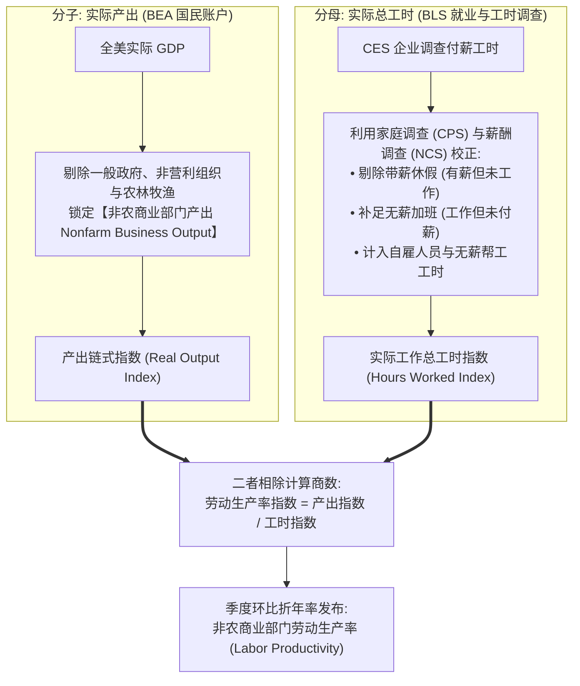
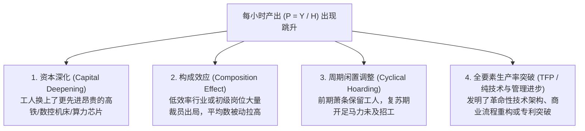
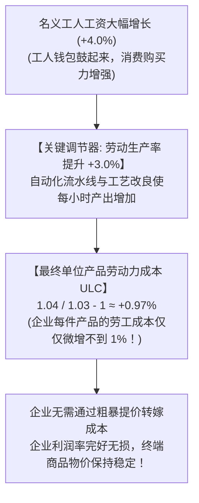
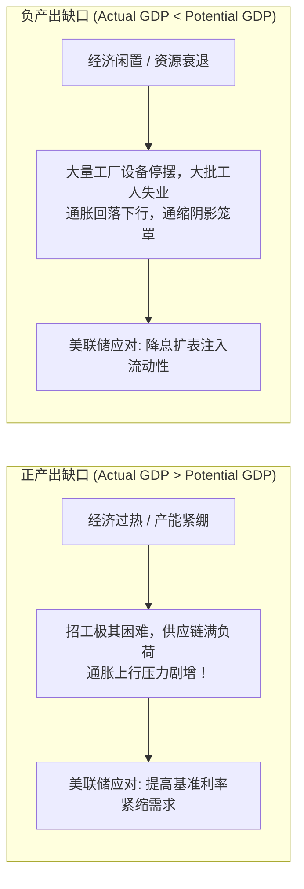
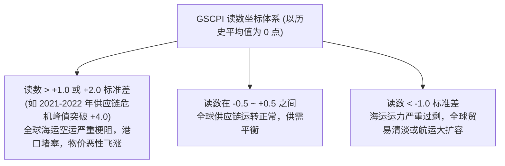

# 08 生产率、供给约束与长期增长

[上一章](07-business-activity.md) · [目录](./) · [下一章](09-inflation-measures.md)

> 本章是整个模块 2 的思想制高点，也是连接实体运行与物价通胀的决定性枢纽。建议分三次学习：第 1—4 节掌握劳动生产率与单位劳动力成本（ULC）的数学核算，破解“工资上涨必导致通胀”的迷思；第 5—7 节理解潜在产出（Potential GDP）、产出缺口（Output Gap）与纽约联储全球供应链压力指数（GSCPI）；第 8—10 节精读真实生产率修订报告并完成跨模块综合实战。除明确注明的历史官方报告外，数值均为教学假设。

---

## 本章要解决什么问题

在讨论宏观经济时，人们常常陷入一个思维定式：“经济增长越强劲，通胀就越容易失控；工资涨得越猛，物价就必然水涨船高”。

然而，经济史上一再出现让传统理论语塞的奇迹现象：
- **1990 年代后半叶的美国“新经济繁荣”**：经济连续多年以接近 4% 的强劲速度狂奔，失业率创下三十年新低，员工薪酬大幅攀升，然而通货膨胀却温和得不可思议；
- **2023—2024 年的抗通胀后半程**：美联储虽然维持高利率，但实际 GDP 屡屡超预期强劲，而通胀率却从 9% 的高位一路跌回 3% 附近；
- **微观企业的困惑**：某工厂给工人整体加薪 5%，老板非但没有提价，反而把产品售价降了 2%，而且企业净利润还扩大了！

这引出了一系列直击现代宏观经济核心的灵魂之问：
- 为什么工资大幅上涨，企业却完全不需要同步给产品涨价？
- 为什么裁员之后算出来的人均产出暴增，并不一定代表公司掌握了核心黑科技？
- 实际 GDP 增速超过潜在增速，真的等于“经济已经过热”吗？
- 供应链压力指数（GSCPI）从 $+2$ 降至 $-0.5$，到底测出的是“海运通畅了”，还是“全球没人买东西了”？

前几章我们聚焦于**需求（花了多少钱）**与**投入（用了多少人、添了多少机器）**。本章我们换上供给侧的终极透镜：**全社会的资源，到底用得有多高效？**

读完本章，你将能够：
- 熟练推导**劳动生产率**与**单位劳动力成本（ULC）**，彻底打破“工资必推高物价”的机械因果；
- 区分资本深化、人员构成效应、周期闲置与全要素生产率（TFP），看穿“假生产率繁荣”；
- 掌握潜在产出与产出缺口（Output Gap）的严谨测算方法与认知边界；
- 读懂美国劳工统计局（BLS）生产率季度报告，透视为什么数据大幅修订往往改变了全市场的通胀叙事。

---

## 1. 从一家车间开始：效率与成本的物理真相

我们从一家极简的自行车装配车间开始，建立对生产率的直观感知。

假设这家车间原本每天有 10 名技术工人，每人工作 8 小时，全天共投入 80 个工作小时，能够组装出 400 辆高质量自行车。

$$
\text{劳动生产率 } P = \frac{\text{实际产出 } Y}{\text{总投入工时 } H} = \frac{400 \text{ 辆}}{80 \text{ 小时}} = \mathbf{5 \text{ 辆/小时}}
$$

生产率衡量的仅仅是**单位时间内的物理产出能力**。它既不是工人的月收入，也不是老板的利润率。

### 1.1 人均产出 vs 每小时产出：别把加班当效率！

如果市场订单突然增加，老板要求大家每天加班 2 小时：
- 10 名工人每人工作 10 小时，全天总工时达到 100 小时，组装出 500 辆自行车；
- 算一算每个工人的日产出：从原先的 $400 / 10 = 40$ 辆跃升至 $500 / 10 = \mathbf{50 \text{ 辆/人}}$（人均产出暴增 $25\%$！）；
- 但再算一算每小时的生产率：
  $$
  P' = \frac{500 \text{ 辆}}{100 \text{ 小时}} = \mathbf{5 \text{ 辆/小时}} \quad (\text{完全原地踏步！})
  $$

> [!IMPORTANT]
> **延长劳动时间，不是效率进步！**
> 很多通俗报道常常把“人均产出提高”与“生产率进步”混为一谈。如果人均产出的增加纯粹是靠“996”或者强制加班堆砌出来的，全社会的真实小时生产效率根本没有提升一分一毫。宏观经济核算关注的基石永远是**每小时产出（Output per Hour）**！

---

### 1.2 宏观经济增长的分解恒等式

在口径一致的宏观核算中，总产出、工作时长与生产率之间存在一条严格的数学定义式：

$$
\text{实际总产出 } Y = \text{总劳动工时 } H \times \text{劳动生产率 } P
$$

对相邻两个时期的产出变动进行精密的乘积拆解：

$$
\frac{Y_1}{Y_0} = \left(\frac{H_1}{H_0}\right) \times \left(\frac{P_1}{P_0}\right)
$$

如果总工时投入增长了 $2.0\%$（即 $H_1 / H_0 = 1.02$），同时每小时生产率提升了 $1.5\%$（即 $P_1 / P_0 = 1.015$），那么实际总产出的增长乘数为：

$$
1.02 \times 1.015 = 1.0353 \implies \mathbf{+3.53\%}
$$

这揭示了一条不可动摇的宏观铁律：**一个国家的经济总量要实现长期增长，要么靠“投入更多的时间和人力（拉长工时、增加招工）”，要么靠“把同样的时间用得更聪明（提升劳动生产率）”！**

---

## 2. 美国劳工统计局（BLS）生产率数据是如何出炉的？

BLS 每季度公布的《生产率与成本》（Productivity and Costs）报告，绝不是派调查员去工厂敲门问“你今天感觉效率提高了多少”。

它是由国民核算的**两张庞大底表相除推导而成的衍生指标**：

> [!WARNING]
> **切勿把全美 GDP 除以非农岗位数！**
> 很多业余分析者把全美实际 GDP 直接除以当月公布的非农就业人数，并冠以“最新全美生产率”。这种除法充斥着致命错误：
> 1. 分子包含了政府公务员、军队、非营利机构甚至自有住房虚拟租金；
> 2. 分母用的是“岗位人数”而非“实际工作小时数”（忽略了全职兼职转换与加班）；
> 3. 分母排除了大量自雇创业者。两边口径完全失调，算出的数字没有任何宏观统计学意义。

---

## 3. 生产率提升的四大幕后推手

当看到统计公报中“劳动生产率大涨 3%”时，切不可盲目狂欢，必须分清背后到底是哪一种故事：

### 3.1 资本深化（Capital Deepening）：工欲善其事，必先利其器

一个物流搬运工靠双手搬运，一小时只能卸 20 个快递箱；公司斥巨资为他配备了电动叉车和智能传送带，他一小时能分拣 100 个箱子。
这位工人的体力、智商没有发生任何突变，但他掌控的**人均资本存量（Capital per Worker）**发生了质的飞跃。这就是**资本深化**——通过实体资本投资，极大地放大了劳动者的每小时产出。

---

### 3.2 构成效应（Composition Effect）：惨烈的“平均数欺骗”

看下面的可加总教学案例。假定全社会只有两大行业，单体效率恒定，物价不变：
- **行业 A（低增加值劳动密集型）**：每小时创造增加值 $\$20$ 美元；
- **行业 B（高增加值高科技型）**：每小时创造增加值 $\$60$ 美元。

| 发展时期 | 行业 A 工时 | 行业 B 工时 | 全社会总增加值 | 全社会总工时 | 全社会平均每小时产出 |
| :--- | ---: | ---: | ---: | ---: | ---: |
| **繁荣基期** | $100$ 小时 | $100$ 小时 | $\$20 \times 100 + \$60 \times 100 = \mathbf{\$8,000}$ | $200$ 小时 | $\$8,000 / 200 = \mathbf{\$40 \text{ 美元/小时}}$ |
| **突发危机** | **$50$ 小时（大萧条裁员）** | $100$ 小时 | $\$20 \times 50 + \$60 \times 100 = \mathbf{\$7,000}$ | $150$ 小时 | $\$7,000 / 150 \approx \mathbf{\$46.67 \text{ 美元/小时}}$ |

全社会的平均劳动生产率**从 $\$40$ 暴涨了整整 $16.67\%$ 至 $\$46.67$ 美元**！
然而，现实中没有发生任何技术进步，总产出反而缩水了 $12.5\%$，大批初级劳工流离失所。这种纯粹由于低产出部门被淘汰出局而导致的“被动生产率激增”，是经济危机初期极易出现的统计假象。

---

### 3.3 全要素生产率（TFP）：经济学中的“索洛剩余”

为了从产出增长中剥离掉“追加资本”和“增加人手”的物理贡献，诺贝尔经济学奖得主罗伯特·索洛（Robert Solow）提出了著名的**索洛增长核算（Growth Accounting）**：

假定全社会生产遵循经典的柯布—道格拉斯生产函数：

$$
Y = A \cdot K^\alpha L^{1-\alpha}
$$

其中：
- $Y$ 为实际总产出；
- $K$ 为资本存量服务投入，$L$ 为有效劳动投入；
- $\alpha$ 为资本在国民收入中的分配份额（通常约为 $0.3 \sim 0.4$），$1-\alpha$ 为劳动收入份额；
- $A$ 就是大名鼎鼎的**全要素生产率（Total Factor Productivity, TFP）**。

在小幅增长的对数差分近似下：

$$
g_Y \approx g_A + \alpha \cdot g_K + (1-\alpha) \cdot g_L
$$

反解出 TFP 增速（索洛剩余）：

$$
g_A \approx g_Y - \left[ \alpha \cdot g_K + (1-\alpha) \cdot g_L \right]
$$

#### 算例：拆解真实技术进步
假定全社会实际产出增长了 $3.0\%$，资本服务投入增长了 $4.0\%$，劳动投入增长了 $1.0\%$，资本份额 $\alpha = 0.4$，劳动份额 $1-\alpha = 0.6$：
- 生产要素单纯堆砌所能解释的产出增长为：
  $$
  0.4 \times 4.0\% + 0.6 \times 1.0\% = 1.6\% + 0.6\% = 2.2\%
  $$
- 扣除要素堆砌后，真正由技术创新、组织改良带来的全要素生产率（TFP）增长为：
  $$
  g_A = 3.0\% - 2.2\% = \mathbf{+0.8\%}
  $$

---

## 4. 单位劳动力成本（ULC）：破解“工资上涨必导致通胀”的迷思

在美联储主席的演讲中，**单位劳动力成本（Unit Labor Costs, ULC）**是研判中长期通胀韧性的决定性武器。

### 4.1 核心公式推导：效率如何稀释工资压力？

企业生产一件商品究竟承担了多重的工资负担？定义如下：

$$
\text{单位劳动力成本 (ULC)} = \frac{\text{劳动报酬总额 (Total Compensation, } C)}{\text{实际产出总量 (Real Output, } Y)}
$$

由于分子上的总报酬可以写成“总工时 $H \times$ 平均时薪报酬 $W$”，分母上的总产出可以写成“总工时 $H \times$ 劳动生产率 $P$”，工时 $H$ 在分子分母中被完美对消：

$$
\text{ULC} = \frac{H \times W}{H \times P} = \frac{W}{P} = \frac{\text{名义每小时劳动报酬}}{\text{每小时实际劳动生产率}}
$$

用变动率公式表达：

$$
1 + g_{\text{ULC}} = \frac{1 + g_W}{1 + g_P} \quad \left(\text{近似表达: } g_{\text{ULC}} \approx g_W - g_P\right)
$$

#### 算例：看懂高薪与低通胀的并存
- 某车间工人时薪报酬从 $\$30$ 上调到 $\$31.2$ 美元（加薪 $4.0\%$）；
- 依托自动化改造，每位工人每小时组装的零件从 10 件提升到 10.3 件（生产率提升 $3.0\%$）；
- 生产一件零件分摊的工人工资仅从 $30 / 10 = \$3.00$ 微增至 $31.2 / 10.3 \approx \$3.029$ 美元，**单位劳动力成本仅上升了 $0.97\%$**！

> [!NOTE]
> **黄金女孩经济（Goldilocks Economy）的密码！**
> 很多人以为“只要工人工资上涨，通胀就必然失控”。**这完全取决于生产率的脸色！** 
> 只要生产率提升的步伐能够紧紧咬住甚至超越工资涨幅（$g_P \ge g_W$），单位劳动力成本就不会上升，企业完全可以在大幅给工人涨工资的同时，保持最终商品售价不上涨甚至降价，从而实现“打工人收入高、企业盈利好、全社会物价温和”的宏观黄金组合！

---

## 5. 潜在产出与产出缺口：可持续能力的边界

宏观调控的最终目标不是让 GDP 冲得越高越好，而是让经济运行在**可持续的最佳潜在轨道**上。

### 5.1 潜在产出（Potential GDP）到底是什么？

> **潜在产出**是在不引发通货膨胀加速（维持物价稳定）的前提下，一个经济体的全部劳动力、厂房设备、科技与制度所能**持续达到的最大实际产出水平**。

- 它不是“所有人不吃不睡全天连轴转、机器不检修狂轰滥炸”的极限峰值；
- 实际 GDP 完全可以在一段时间内**高于潜在 GDP**（正如一个长跑运动员可以短时间超负荷冲刺），但其代价必然是设备过热磨损、招工恶性内卷竞争、工资与原材料价格疯狂飞涨。

---

### 5.2 产出缺口（Output Gap）与周期冷暖

美国国会预算办公室（CBO）定期估算全美的潜在产出序列。**产出缺口**定义为实际产出与潜在产出的百分比偏离度：

$$
\text{产出缺口 (Output Gap)} = \frac{\text{实际 GDP } - \text{潜在 GDP}}{\text{潜在 GDP}} \times 100\%
$$

> [!TIP]
> **警惕“增长快于潜在，并不等于经济过热”！**
> 假设在衰退谷底，实际产出为 $95$，潜在产出为 $100$（产出缺口为深度的 $-5.0\%$）。
> 下一年实际 GDP 爆发式增长了 $4.0\%$，而潜在增速仅为 $2.0\%$：
> - 新的实际产出 $= 95 \times 1.04 = 98.8$；
> - 新的潜在产出 $= 100 \times 1.02 = 102.0$；
> - 新的产出缺口 $= (98.8 - 102.0) / 102.0 \approx \mathbf{-3.14\%}$。
> 尽管实际增速（$4\%$）远超潜在增速（$2\%$），但由于前期闲置资源太深厚，经济依然运行在潜在水平下方，依然处于填补闲置的复苏阶段，万不可直接判定为“过热加息信号”。

---

## 6. 全球供应链压力指数（GSCPI）：给物流瓶颈做“心电图”

在现代全球化分工中，哪怕美国本土工厂万事俱备，只要跨国集装箱在苏伊士运河被卡住，或者关键芯片在海外港口积压，全社会的供给潜能就会瞬间瘫痪。

为了定量监控供给侧瓶颈，纽约联邦储备银行开发了**全球供应链压力指数（Global Supply Chain Pressure Index, GSCPI）**。

### 6.1 GSCPI 是如何构造的？

GSCPI 整合了全球 27 项核心指标（包括波罗的海干散货运价指数 BDI、空运成本、中欧美日等核心经济体制造业 PMI 中的供应商交货时间、积压订单及采购库存）。

核心算法分为两步：
1. **纯化供给变动（剔除需求杂质）**：用回归方程把指标中由纯需求拉动的部分剥离掉，仅保留无法被需求解释的“纯物流供给梗阻残差”；
2. **标准化统计汇总（PCA 主成分提取）**：通过主成分分析提取共同波动，并将其进行**标准差标准化（Z-Score）**：
   $$
   z = \frac{x - \mu}{\sigma}
   $$

> [!CAUTION]
> **绝对不能把标准化读数算百分比变化！**
> 新闻里常有人写：“GSCPI 从 $+2.0$ 降到 $+0.5$，供应链压力暴跌了 $75\%$”。
> 这是荒唐的数学错误！GSCPI 是以标准差为尺度的无量纲指数，代表偏离历史平均值的距离。读数为 0 并不代表“供应链没有摩擦”，而是代表“摩擦程度处于历史平均常态”。

---

## 7. 真实报告带读：同一个季度，成本叙事为何逆转？

我们翻开 **2024 年第二季度美国非农商业部门生产率与成本公报**。这个季度发生了一次经典的“官方修订大反转”：

### 7.1 表 1：对比 8 月 1 日初值与 9 月 5 日修正值（季调折年率，SAAR）

| 统计分项 | 2024 年 8 月 1 日 (初值公报) | 2024 年 9 月 5 日 (修订公报) | 官方修正量 | 市场叙事演变 |
| :--- | ---: | ---: | ---: | :--- |
| **实际产出 (Output)** | $+3.3\%$ | **$+3.5\%$** | $+0.2$ 百分点 | 实体产出小幅上修 |
| **工作总工时 (Hours)** | $+1.0\%$ | $+1.0\%$ | 持平不变 | 劳动投入保持稳定 |
| **劳动生产率 (Productivity)** | **$+2.3\%$** | **$+2.5\%$** | **$+0.2$ 百分点** | **每小时生产效率更为强劲** |
| **每小时名义报酬 (Compensation)**| $+3.3\%$ | **$+3.0\%$** | **$-0.3$ 百分点** | 雇主薪酬支出显著降温 |
| **单位劳动力成本 (ULC)** | **$+0.9\%$** | **$+0.4\%$** | **$-0.5$ 百分点！** | **通胀成本压力近乎腰斩！** |

### 7.2 资深宏观分析师的推演复盘

1. **初值发布时（8 月 1 日）**：
   市场看到 ULC 增长 $+0.9\%$，虽然比上一季度的恶化有所缓解，但依然处于温和上升轨道；
2. **修订发布时（9 月 5 日）**：
   劳工统计局融入了更晚到达的 GDP 产出修正与完整季度工资税收记录，产出向上修正 $0.2\%$，薪酬下修 $0.3\%$。
   **双向合力之下，单位劳动力成本增幅直接被腰斩至微不足道的 $+0.4\%$！**
3. **宏观结论**：
   全美企业承担的每件产品劳工成本几乎零增长，劳动力市场完全退出了推高物价的嫌疑犯阵营。这份修订公报彻底扫清了美联储在 2024 年 9 月 FOMC 会议上**启动超常规 50 个基点降息的最后顾虑**！

---

## 8. 监控实战：构建供给与生产率分析看板

建立对长期供给与成本的专业跟踪，建议在监控系统中常备以下核心矩阵：

| 跟踪维度 | 优先观察序列 | 发布机构与频次 | 核心防错要点 |
| :--- | :--- | :--- | :--- |
| **效率核心** | 非农商业部门劳动生产率、实际产出、工时 | BLS（季度） | 区分同比与季环比年化，牢记初值必有修正 |
| **成本中枢** | 单位劳动力成本（ULC）、每小时薪酬 | BLS（季度） | 牢记 ULC 才是企业端真实成本，不等于打工人的名义时薪 |
| **长期潜能** | 潜在 GDP（Potential GDP）、产出缺口 | CBO（每半年/年度） | 模型推算值，非现实硬统计，随历史基准修订而变 |
| **实物瓶颈** | 美联储工业产能利用率（Capacity Utilization）| Fed（月度） | 排除气温用电干扰，重点盯防制造业 $80\%$ 临界线 |
| **外生瓶颈** | 全球供应链压力指数（GSCPI） | 纽约联储（月度） | 以标准差为单位，区分供给短缺与需求衰退 |

---

## 9. 练习与参考答案

### 练习 1：工时、时薪与单位劳动力成本推导
某高科技半导体制造车间拥有 50 名专业操作员：
- **基期**：人均每周工作 40 小时，全员每周共生产合格晶圆 2,000 片，每小时综合薪酬与福利支出为 $\$40$ 美元；
- **本期**：车间引进了全新的 AI 缺陷自动检测机器人，良品率大增。操作员人均每周工时压缩至 38 小时，全员每周生产晶圆提升至 2,280 片。为了奖励员工，管理层将每小时综合薪酬提升至 $\$44$ 美元。

**请计算**：
1. 该车间在基期和本期的劳动生产率（每小时生产多少片晶圆）及生产率增长率；
2. 计算每小时名义劳动报酬的增长率；
3. 计算该车间在基期和本期的单位劳动力成本（ULC，每片晶圆的劳工成本），并验证 $1 + g_{\text{ULC}} = (1 + g_W) / (1 + g_P)$ 是否成立。

点击查看参考答案与详细解析

**第 1 步：计算工时与生产率**
- 基期总工时 $H_0 = 50 \times 40 = 2,000$ 小时；基期产出 $Y_0 = 2,000$ 片；
  基期生产率 $P_0 = 2,000 / 2,000 = \mathbf{1.0 \text{ 片/小时}}$；
- 本期总工时 $H_1 = 50 \times 38 = 1,900$ 小时；本期产出 $Y_1 = 2,280$ 片；
  本期生产率 $P_1 = 2,280 / 1,900 = \mathbf{1.2 \text{ 片/小时}}$；
- 生产率增长率：
  $$
  g_P = \frac{1.2 - 1.0}{1.0} \times 100\% = \mathbf{+20.0\%}
  $$

**第 2 步：计算时薪增长率**
$$
g_W = \frac{44 - 40}{40} \times 100\% = \mathbf{+10.0\%}
$$

**第 3 步：计算单位劳动力成本 (ULC)**
- 基期 ULC：
  $$
  \text{ULC}_0 = \frac{W_0}{P_0} = \frac{\$40}{1.0} = \mathbf{\$40.00 \text{ 美元/片}}
  $$
- 本期 ULC：
  $$
  \text{ULC}_1 = \frac{W_1}{P_1} = \frac{\$44}{1.2} \approx \mathbf{\$36.67 \text{ 美元/片}}
  $$
- ULC 变动率：
  $$
  g_{\text{ULC}} = \frac{36.6667 - 40}{40} \times 100\% = \mathbf{-8.33\%}
  $$
- 验证公式：
  $$
  \frac{1 + g_W}{1 + g_P} = \frac{1 + 0.10}{1 + 0.20} = \frac{1.10}{1.20} \approx 0.91667 \implies 0.91667 - 1 = \mathbf{-8.33\%}
  $$
  数学关系完美闭环验证！尽管工人时薪大幅上涨了 $10\%$，但由于生产率暴涨了 $20\%$，制造每片芯片的劳工成本反而**净下降了 $8.33\%$**！

---

### 练习 2：全要素生产率（TFP）的索洛分解
某新兴工业经济体在过去一年的统计公报显示：
- 实际 GDP 总量增长了 $4.5\%$；
- 全社会固定资本服务存量增长了 $5.0\%$；
- 经劳动力素质调整后的就业总工时增长了 $2.0\%$；
- 在国民收入核算中，资本所有者分配份额为 $40\%$，劳动者报酬分配份额为 $60\%$。

**请计算**：
1. 传统资本积累与劳动力投入增加，总共能解释多少百分点的产出增长？
2. 该经济体过去一年的全要素生产率（TFP / 索洛剩余）增速是多少？
3. 如果政府官员宣称“这 $4.5\%$ 的增长全部是国家自主高科技创新突破的结果”，请运用索洛模型给出客观评估。

点击查看参考答案与详细解析

1. **计算要素投入贡献**：
   $$
   \text{要素贡献} = \alpha \cdot g_K + (1 - \alpha) \cdot g_L = 0.40 \times 5.0\% + 0.60 \times 2.0\% = 2.0\% + 1.2\% = \mathbf{3.2\%}
   $$
   在 $4.5\%$ 的总增长中，有足足 $3.2$ 个百分点是由传统的“多投钱买机器（资本）”和“多招人加班（劳动）”机械拉动的。
2. **计算全要素生产率 (TFP)**：
   $$
   g_A = g_Y - [\alpha \cdot g_K + (1 - \alpha) \cdot g_L] = 4.5\% - 3.2\% = \mathbf{+1.3\%}
   $$
   真正的技术创新与全要素生产率增速为 $1.3\%$。
3. **客观评估官员言论**：
   该言论严重夸大了技术创新的单一贡献。根据增长核算，这 $4.5\%$ 的增长中，超过七成（$3.2 / 4.5 \approx 71.1\%$）是由资本深化与劳动要素的物理堆砌贡献的；纯粹代表创新、管理改良与效率跃升的 TFP 贡献了约三成（$1.3 / 4.5 \approx 28.9\%$）。虽然 $1.3\%$ 的 TFP 增速十分优异，但脱离要素投入空谈“全部是科技创新”违背了基本的核算规律。

---

### 练习 3：产出缺口与潜在能力演变
假定某国国会预算办公室在年初测算：
- 某年基准的潜在实际 GDP 为 $200$ 亿美元；
- 该国当年的实际 GDP 最终录得 $204$ 亿美元；
- 到了年底，由于该国接纳了大规模具有专业技能的高素质合法移民，且多条大型自动化基础设施提前竣工，统计机构将该年的潜在实际 GDP 向上修正为 $208$ 亿美元，而实际 GDP 读数维持 $204$ 亿美元不变。

**请计算**：
1. 修正前与修正后的产出缺口分别是多少？
2. 结合计算结果，说明为什么“实际产出没有任何变化，央行的政策判断却可能从防范过热逆转为防范衰退”。

点击查看参考答案与详细解析

1. **计算修正前后的产出缺口**：
   - 修正前：
     $$
     \text{缺口}_1 = \frac{204 - 200}{200} \times 100\% = \mathbf{+2.0\%} \quad (\text{正产出缺口，过热})
     $$
   - 修正后：
     $$
     \text{缺口}_2 = \frac{204 - 208}{208} \times 100\% \approx \mathbf{-1.92\%} \quad (\text{负产出缺口，闲置})
     $$
2. **央行政策态度逆转剖析**：
   在修正前，产出缺口为 $+2.0\%$，表明全社会需求超过了可持续供给潜能，工人加班严重，工厂产能逼近瓶颈，央行面临强烈的加息紧缩压力以扑灭潜在通胀；
   而当潜在产出被上修至 $208$ 亿后，产出缺口瞬间逆转为 $-1.92\%$！这意味着全社会的供给边界被巨额拓宽了，现有的 $204$ 亿产出根本无法充分吸收新涌入的机器与劳工，社会出现了近 $2\%$ 的闲置资源。此时不仅通胀压力彻底烟消云散，央行反而需要考虑降息以刺激总需求，避免宝贵的潜在供给能力被白白浪费。这一反转生动说明了潜在产出这一“分母”对宏观定调的决定性颠覆作用。

---

## 阶段大作业：撰写一份完整的美国实体经济运行诊断

学完【模块 2：实体经济的运行】（第 4 章至第 8 章），你已经掌握了宏观微观最核心的五大武器库：
1. **总需求**：GDP 支出法五大支柱与库存加速度（第 4 章）；
2. **家庭端**：实际消费 PCE、可支配收入 DPI 与债务偿付比率（第 5 章）；
3. **劳动力**：非农就业新增、失业率三态漏斗与薪酬构成效应（第 6 章）；
4. **企业端**：核心资本品订单、PMI 扩散面与工业产能利用率（第 7 章）；
5. **供给端**：劳动生产率、单位劳动力成本与潜在产出缺口（第 8 章）。

### 作业任务
请选择一段具有代表性的宏观时期（例如 2023—2024 年美国经济），综合运用上述五大维度的官方历史数据，撰写一份 **300~500 字** 的高水准宏观运行诊断报告。

点击查看专业诊断范文与评分标准

#### 专业宏观诊断示范范文
> **【美国实体经济运行综合诊断：兼具韧性与分化的供求重构】**
> 
> 本期宏观数据呈现出极其鲜明的“供给驱动型繁荣”特征：
> 1. **需求端（消费与投资）**：实际 GDP 环比折年率录得 2.8%，核心内生动力“私人国内最终购买”稳定在 2.6%。居民实际 PCE 稳健扩张，主要由非农就业扩容与实际时薪正增长支撑；但个人储蓄率低位徘徊于 3.4%，提示中低收入群体现金缓冲收窄，超额储蓄呈现阶层极化。核心资本品订单温和上行，企业资本开支维持渐进节奏。
> 2. **劳动力市场**：非农月均新增岗位平稳回落至 15 万左右常态区间，初请失业金 4 周均值维持低位。官方失业率微升至 4.3% 主要是由劳动参与率回升与移民劳动力供给扩张驱动，广义 U-6 处于可控区间，未见急剧衰退型断崖裁员。
> 3. **供给与成本**：非农商业部门劳动生产率年化回升至 2.5%，完全消化了每小时名义报酬 3.0% 的涨幅，将单位劳动力成本（ULC）增速大幅压低至 0.4% 的极低水平。全球供应链压力指数（GSCPI）回归历史常态中枢，全美工业产能利用率录得 78.8%（低于历史警戒线）。
> 
> **结论与后续验证**：经济处于典型的“高增长、低通胀、无过热”黄金女孩状态，美联储政策重心已从“单向抗通胀”平稳切换至“平衡就业下行风险”。后续重点盯防低收入群体信用卡新转入逾期率及制造业订单积压消耗速度，以验证私人需求的持续造血能力。

#### 评分核查要点
- **拒绝口诀，严守口径**：准确区分了实际值与名义值、年化率与月环比，严禁混淆存量与流量；
- **五大支柱有机融合**：将消费、就业、资本开支与生产率无缝串联成因果闭环，而非机械罗列指标；
- **给出证伪证据**：合格的宏观分析必须指明“在什么证据出现时，当前的诊断结论会被推翻”。

---

## 本章小结与下一步学习

在这一章中，我们登上了实体经济的最高峰：
- **劳动生产率（$P = Y / H$）**是全社会财富增长的终极动力，加班只能提高人均产出，无法改变真实效率；
- **单位劳动力成本（ULC）**是工资与效率的赛跑，只要生产率跑赢工资，企业就无需提价，通胀压力即可化解于无形；
- **潜在产出**描绘了不引发通胀的可持续能力边界，产出缺口决定了经济究竟处于过热紧缩还是闲置复苏；
- **全球供应链压力指数（GSCPI）**通过纯化统计模型，度量跨国物理运输的顺畅程度。

至此，我们已经完整走完了【模块 2：实体经济的运行】的五大宏观版图。

但是，所有的生产、消费与投资，最终都要通过货币与价格来结算。**同样是一元钱，在不同年代、买不同东西，它的购买力到底缩水了多少？CPI 与 PCE 究竟是如何统计千家万户的菜篮子的？** 在下一章中，我们将正式推开【模块 3：通货膨胀与物价】的大门：[CPI、PCE 与价格指数](09-inflation-measures.md)。

---

[上一章](07-business-activity.md) · [目录](./) · [下一章](09-inflation-measures.md)
