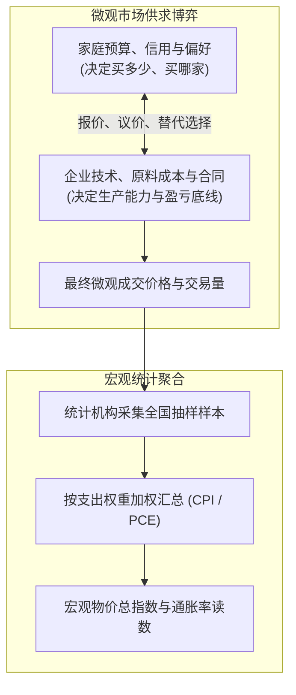
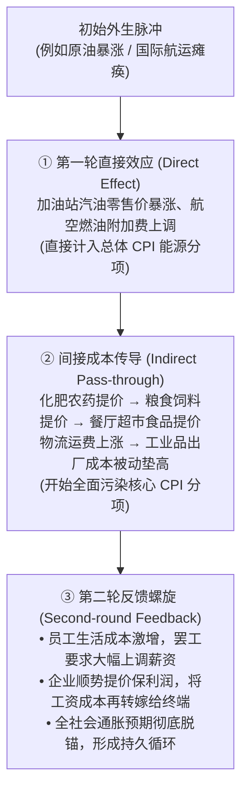
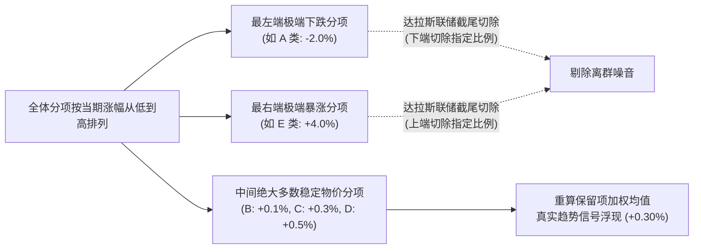
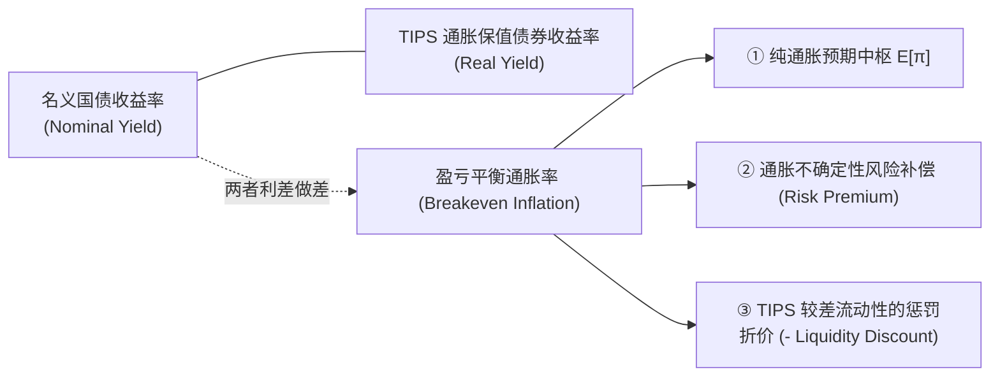
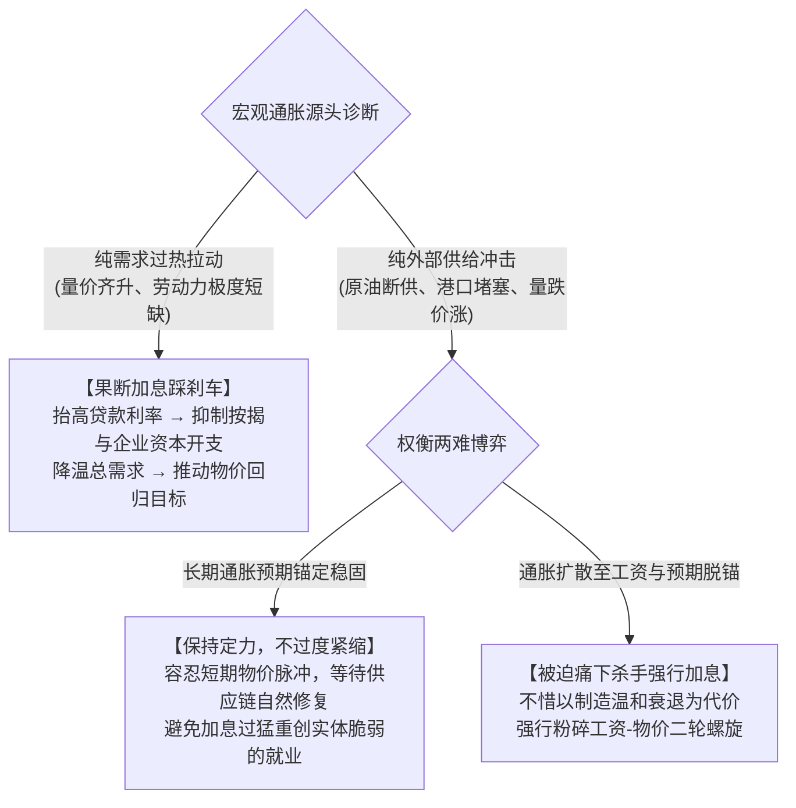

# 10 通胀来源、持续性与预期

[上一章](09-inflation-measures.md) · [目录](./) · [下一章](11-financial-system-map.md)

> 建议分三次学习：第 1—4 节理解供需微观根基、价格传导与工资—物价螺旋；第 5—7 节掌握截尾均值、加权中位数及通胀预期度量；第 8—10 节演练宏观综合诊断与监控规范。除明确标注的历史报告外，算例数字均为教学假设。

## 学习目标：知晓哪里涨价之后，更要追问背后的机制

上一章我们系统学习了 CPI 与 PCE 的**测量技术**。但在现实中，单纯知道“CPI 上涨了 $0.5\%$”远远不够做决策。

想象你常去的一家社区餐馆突然把招牌汉堡从 $\$10$ 涨到了 $\$12$。背后的真相可能完全不同：
1. **顾客挤爆**：周围新建了写字楼，中午排队百米，老板为了限流并增加收益主动加价；
2. **成本飙升**：暴雪导致牛肉进价翻倍、电费猛涨，老板不得不涨价保本；
3. **工资追赶**：员工因生活成本上升而要求加薪，老板被迫把新增劳动力成本转嫁给顾客；
4. **定价惯性与预期**：老板听信了新闻里的恶性通胀传言，即使成本还没涨，也抢先提价对冲风险。

一个冷冰冰的统计局指数绝不会自动注明它是哪一种。

本章的核心任务是带你穿透统计表象，直击通胀的**形成动力学**：
- 为什么同样是涨价，有的冲击转瞬即逝，有的却演变成全社会的**恶性通胀螺旋**？
- 加税或关税到底怎样影响物价？加征 $10\%$ 的关税，商品售价真的会跟着涨 $10\%$ 吗？
- 克利夫兰联储的中位数 CPI、达拉斯联储的截尾均值 PCE 究竟是如何剔除噪音的？
- 债券市场上的 TIPS 盈亏平衡通胀率，与老百姓的问卷预期到底差在哪里？

---

## 1. 从餐馆的菜单，到全社会的价格总水平

### 1.1 现实中没有一个“全社会物价总开关”

很多初学者容易误以为：统计局宣布通胀率上升，于是全美商户纷纷按比例上调价格。

现实恰恰相反。价格是全社会千万家企业在微观市场博弈中自主决定的结果：
- 餐馆每天面对具体的约束：今天来了多少客人？供应商送货单上的牛肉报价是多少？附近同行卖多少钱？员工如果不加薪会不会集体跳槽？
- 消费者也在动态权衡：汉堡太贵，是不是改吃披萨？外出就餐太贵，是不是买菜回家做？

**通胀指数是千万笔交易结果的事后统计镜像，而不是指挥微观企业调价的先行开关。**

---

### 1.2 相对价格变化 vs 宏观总体通胀

我们必须严格区分两个经济学概念：
- **相对价格变动（Relative Price Change）**：指**一种商品相对于另一种商品的价格比率变化**。
  例如：如果咖啡价格暴涨 $50\%$，而茶叶价格下跌 $20\%$，咖啡相对于茶叶变得昂贵。这会促使消费者多喝茶、少喝咖啡，引导资本流向咖啡种植园。相对价格是市场经济配置资源的核心信号灯。
- **总体通胀（General Inflation）**：指**全社会绝大多数商品与服务的加权价格水平发生持续、广泛的上升**，它反映的是货币购买力的系统性贬值。

#### 算例对比
假设一个微观经济体只消费“能源”与“其他日常消费品”两大类，基期支出权重分别为 $10\%$ 与 $90\%$：
- **情景 A**：能源价格暴涨 $+20\%$，其他消费品价格完全不动。
  $$\text{总通胀率} = 10\% \times (+20\%) + 90\% \times 0\% = +2.0\text{ 个百分点}$$
- **情景 B**：能源价格暴涨 $+20\%$，但由于居民把预算都花在了加油上，不得不节衣缩食，其他商品的需求被挤出，商家为了促销降价 $-2.22\%$：
  $$\text{总通胀率} = 10\% \times (+20\%) + 90\% \times (-2.22\%) = 2.0\% - 2.0\% = 0\%$$

在情景 B 中，虽然能源价格剧烈飙升，但并未转化为宏观总通胀。

> [!WARNING] 统计贡献 $\neq$ 因果归因
> 财经公报常写：“本月住房租金上涨拉动了 CPI 增长 1.2 个百分点，是通胀的最大推手。”
> 这句话描述的是**纯数学上的会计核算分解**（Weight $\times$ Change），绝不代表住房部门是通胀的**根本因果源头**。租金上涨究竟是因为人口迁徙、木材短缺、还是因为金融宽松推高了地价？需要深挖微观机制，不能把统计贡献当成经济原因。

---

## 2. 需求拉动 vs 供给冲击：量价组合的指纹特征

### 2.1 亲手解一个微观供求均衡模型

我们用标准微观代数来演示供求关系的定价逻辑。设某种消费品的市场需求曲线与供给曲线为：

$$\text{需求意愿量} \quad Q_d = 140 - 10p$$

$$\text{供给意愿量} \quad Q_s = 20 + 10p$$

其中 $p$ 为单位价格（美元），$Q$ 为商品数量。市场出清条件为 $Q_d = Q_s$：

$$140 - 10p = 20 + 10p \implies 20p = 120 \implies p^* = 6, \quad Q^* = 80$$

基准均衡状态为：**单价 $\$6$，成交量 $80$ 单位**。

---

### 2.2 同样是涨价 1 美元：两条迥异的经济命运

现在，我们对比两种截然相反的外生冲击：

#### 情景 1：需求拉动（Demand Pull）
政府发放纾困现金支票或银行信贷狂飙，家庭购买意愿全面增强。在任意价格下，需求量均净增 $20$ 单位。
- 新需求曲线：$Q_d' = (140 - 10p) + 20 = 160 - 10p$
- 供给曲线保持不变：$Q_s = 20 + 10p$
- 联立求解：
  $$160 - 10p = 20 + 10p \implies 20p = 140 \implies p' = 7, \quad Q' = 90$$
- **特征**：**价格上涨至 $\$7$，成交数量扩张至 $90$（量价齐升！）**。

#### 情景 2：成本推动 / 供给冲击（Cost Push）
地缘冲突导致运费与原材料断供。在任意价格下，企业愿意且能够供应的量净减 $20$ 单位。
- 需求曲线保持不变：$Q_d = 140 - 10p$
- 新供给曲线：$Q_s' = (20 + 10p) - 20 = 10p$
- 联立求解：
  $$140 - 10p = 10p \implies 20p = 140 \implies p'' = 7, \quad Q'' = 70$$
- **特征**：**价格同样上涨至 $\$7$，但成交数量萎缩至 $70$（量跌价涨，典型的滞胀雏形！）**。

| 冲击形态 | 市场均衡价格 $P$ | 实际产出与交易量 $Q$ | 宏观伴生现象 |
| :--- | :---: | :---: | :--- |
| **需求扩张冲击** | **上升（$\uparrow$）** | **上升（$\uparrow$）** | 工厂产能利用率爆满、加班工时增加、招工难。 |
| **供给紧缩冲击** | **上升（$\uparrow$）** | **下跌（$\downarrow$）** | 供应链交期延误、货架空置、企业被迫降负荷减产。 |
| **双重夹击（现实复合）** | **急剧飙升（$\uparrow\uparrow$）** | **视相对力量而定** | 既有放水刺激需求，又有疫情码头拥堵（如 2021—2022 年）。 |

---

### 2.3 旧金山联储的供需驱动分解模型

旧金山联邦储备银行（FRBSF）正是利用这种**“量价协方差符号”**来拆解现实中的 PCE 通胀：
- 如果某个 PCE 分项在当月的**价格意外变动**与**实际消费量意外变动**方向**相同**，将其判定为**需求驱动（Demand-driven）**；
- 如果两者意外变动方向**相反**，将其判定为**供给驱动（Supply-driven）**；
- 如果某项变动极其微弱、处于统计不显著带，则归为**模糊/未定义（Ambiguous）**。

这种官方前沿研究证明：宏观分析绝不能只盯价格单边变动，必须把**“价格”与“剔除价格后的实际物量”放在一张坐标系下联合审视**。

---

## 3. 从一次性脉冲到持续通胀：传导的三级跳

### 3.1 价格不再涨，绝不等于物价降回原点

假设某种关键商品原价为 $\$100$，本年 1 月遭遇突发关税冲击，价格一次性跳涨至 $\$110$，之后再无新变动：

| 观察时点 | 价格绝对水平 | 月度环比增速 (MoM) | 12 个月同比增速 (YoY) | 购买力状态 |
| :--- | :---: | :---: | :---: | :--- |
| **本年 1 月 (冲击发生)** | $\$110$ | **$+10.0\%$** | **$+10.0\%$** | 购买力缩水，价格上台阶 |
| **本年 2 月 (风平浪静)** | $\$110$ | **$0.0\%$** | **$+10.0\%$** | 物价持平，但高位横盘 |
| **本年 12 月 (整年无事)** | $\$110$ | **$0.0\%$** | **$+10.0\%$** | 统计基数仍在，同比居高不下 |
| **次年 1 月 (基数滑出)** | $\$110$ | **$0.0\%$** | **$0.0\%$** | 同比归零，但价格再没回跌 |

**同比读数归零，只是统计窗口向前滚动的必然代数结果，绝不等于物价退回到了冲击前的低位。**

---

### 3.2 冲击的分批渗透与滞后重定价

哪怕微观上只有一次外生冲击，它反映在宏观指数上往往呈现为**连续数月的持续上涨**：
- 租房合同通常一年一签，每月仅有 $\frac{1}{12}$ 的房客重新议价；
- 工业采购长协价格每季度甚至每半年重置一次。

假设市场上有三家体量完全相等的企业（合同分别在 1、2、3 月到期），各家在合同到期时将出厂价从 $\$100$ 提升到 $\$110$：
- 12 月均价：$\$100.00$
- 1 月均价：$\frac{110 + 100 + 100}{3} \approx \$103.33$（环比 $+3.33\%$）
- 2 月均价：$\frac{110 + 110 + 100}{3} \approx \$106.67$（环比 $+3.23\%$）
- 3 月均价：$\frac{110 + 110 + 110}{3} = \$110.00$（环比 $+3.12\%$）

宏观统计学家连续三个月看到价格指数上涨，可能会惊呼“通胀形成了趋势！”但其本质仅仅是**单个旧冲击在黏性契约经济中的分批渗透**。

---

### 3.3 通胀波及的三轮涟漪

- **第一轮直接效应（Direct Effect）**：主要集中在受冲击的源头品类（如成品油、燃气）。
- **间接成本传导（Indirect Pass-through）**：原料成本通过产业链传导至中下游。即使你剔除了能源，核心商品与核心服务也会因运费和包装成本而被动抬价。
- **第二轮反馈螺旋（Second-round Effect）**：工资与定价心理全面卷入。此时，通胀由“外部输入”彻底内生化为“本土螺旋”。

---

### 3.4 关税算例：税率、到岸价与货架价的分母陷阱

财经新闻中经常有这样的错误言论：“对进口商品加征 $25\%$ 关税，全美物价将随之暴涨 $25\%$。”

我们用严格的产业链分母来戳破这一流言。假设一件从海外进口的外套：
1. **海外出厂计税到岸价（CIF Price）**：$\$100$
2. **美国本土通关、仓储物流与商场运营成本**：$\$20$
3. **零售商原定加价利润**：$\$30$
4. **原货架零售价**：$\$100 + \$20 + \$30 = \$150$

现在，美国政府对该外套加征 **$10\%$ 从价关税**：
- 关税计税基准仅仅是**到岸价（$\$100$）**，关税税额为 $\$100 \times 10\% = \$10$；
- 假设供应商不降价、零售商将这 $\$10$ 关税一分不差地完全顺加给消费者，新零售价为：
  $$\$150 + \$10 = \$160$$
- **货架零售价的实际涨幅为**：
  $$\frac{160 - 150}{150} = \frac{10}{150} \approx +6.67\%$$

加征 $10\%$ 的关税，终端售价只涨了 $6.67\%$！因为关税的分母（$\$100$）远小于最终零售价的分母（$\$150$）。

如果该类服装在居民 CPI 篮子中的支出权重为 $2\%$，且没有其他替代效应，其对全社会总 CPI 的直接拉动仅仅是：
$$\text{总 CPI 贡献} = 2\% \times 6.67\% \approx +0.133\text{ 个百分点}$$

---

## 4. 利润挤压还是薪资螺旋：谁在主导再分配？

### 4.1 辨清“加价率（Markup）”与“销售利润率（Margin）”

通胀飙升时期，常有舆论指责企业“贪婪膨胀、哄抬利润（Greedflation）”。我们必须用清晰的财务公式区分概念：

- **加价率（Markup, $\mu$）**：利润相对**成本**的比例：
  $$\mu = \frac{P - C}{C} = \frac{P}{C} - 1$$
- **销售利润率（Profit Margin, $m$）**：利润相对**售价**的比例：
  $$m = \frac{P - C}{P}$$

#### 算例分析
某产品最初单位成本 $C = \$80$，售价 $P = \$100$，单位利润为 $\$20$：
- 加价率：$\frac{20}{80} = 25.0\%$
- 销售利润率：$\frac{20}{100} = 20.0\%$

一年后，因供应链成本暴涨，单位成本升至 $C' = \$88$。企业为了维持原来的加价比例（$25\%$），将售价调整为 $P' = \$88 \times (1 + 0.25) = \$110$：
- 新单位利润：$\$110 - \$88 = \$22$（增加了 2 美元，名义利润增长了 $10\%$！）
- 新加价率：$\frac{22}{88} = 25.0\%$（完全未变）
- 新利润率：$\frac{22}{110} = 20.0\%$（完全未变）

**企业赚得的名义利润总额增加了，绝不代表企业扩大了加价贪婪程度！** 在通胀环境下，企业需要更多的名义利润才能维持其资本与投资的实际购买力。只有当加价率 $\mu$ 发生结构性提升时，才能断定企业定价权发生了垄断性增强。

---

### 4.2 工资—物价螺旋（Wage-Price Spiral）的数学条件

工资上涨本身并不必然引发通胀。复习第 8 章的**单位劳动力成本（ULC）**原理：

$$\text{单位劳动力成本增速} \approx \text{名义时薪增速} - \text{劳动生产率增速}$$

- 如果员工时薪上涨 $+4.0\%$，同时由于引入了先进软件，员工每小时产出的物品数量也增加了 $+4.0\%$，则生产单件产品的劳动力成本变动为 $0\%$。企业没有任何调价压力！
- 只有当时薪增速持续**大幅超过生产率提升**时，多出来的成本才会像滚雪球一样涌向终端物价。

我们构建一个简化的**价格反馈阻尼衰减模型**。假设初始外生通胀脉冲为 $2.0\text{ 个百分点}$，每一轮物价上涨引发的工资传导系数为 $\alpha$：

$$I_t = \alpha \cdot I_{t-1}$$

$$I_{\text{总累积}} = 2.0 \times \left(1 + \alpha + \alpha^2 + \alpha^3 + \dots\right) = \frac{2.0}{1 - \alpha} \quad (\text{当 } \alpha < 1)$$

- **稳定收敛型（$\alpha = 0.4$）**：
  $$2.0 \to 0.8 \to 0.32 \to 0.128 \to \dots \implies \text{累计传导} \approx \frac{2.0}{1 - 0.4} \approx 3.33\text{ 个百分点}$$
  反馈逐步减弱，物价最终稳定在新中枢。
- **失控爆炸型（$\alpha \ge 1.0$）**：
  如果工会具有极强议价力，要求工资 $100\%$ 挂钩甚至超额补偿生活成本，企业又拥有充足垄断地位继续提价，反馈级数将彻底发散，形成自我实现的恶性通胀循环。

---

## 5. 穿透极端值噪音：中位数与截尾均值物价指数

### 5.1 加权平均数的致命弱点

传统的 CPI 与 PCE 本质上是加权算术平均数。这种统计结构极其容易被**个别极端的异常波动**带偏（例如某月鸡蛋因禽流感暴涨 $60\%$，或者二手车因芯片短缺单月暴涨 $15\%$）。

为了看清全社会物价涨幅的**真实中枢与扩散广度**，美联储格外青睐另外两把“统计手术刀”：
1. **加权中位数 CPI（Median CPI）**（克利夫兰联储编制）；
2. **截尾均值 PCE（Trimmed Mean PCE）**（达拉斯联储编制）。

---

### 5.2 亲手计算：均值、中位数与截尾均值

我们用一个涵盖五大品类的微观篮子，按**当月价格涨幅从低到高排列**，演示其完全透明的清洗过程：

| 商品品类 | 支出权重 ($w_i$) | 当月环比涨幅 ($g_i$) | 权重 $\times$ 涨幅 (对总数贡献) | 累计权重分布区间 |
| :---: | :---: | :---: | :---: | :---: |
| **A 类 (电子促销)** | $10\%$ | **$-2.0\%$** | $-0.20\text{ 个百分点}$ | $0\% \to 10\%$ |
| **B 类 (温和耐用品)** | $20\%$ | **$+0.1\%$** | $+0.02\text{ 个百分点}$ | $10\% \to 30\%$ |
| **C 类 (核心基础服务)**| $40\%$ | **$+0.3\%$** | $+0.12\text{ 个百分点}$ | $30\% \to 70\%$ |
| **D 类 (日用百货)** | $20\%$ | **$+0.5\%$** | $+0.10\text{ 个百分点}$ | $70\% \to 90\%$ |
| **E 类 (能源突发暴涨)**| $10\%$ | **$+4.0\%$** | $+0.40\text{ 个百分点}$ | $90\% \to 100\%$ |

#### 第一步：常规加权均值（传统 CPI 逻辑）
$$\text{加权均值} = \sum w_i g_i = (-0.20) + 0.02 + 0.12 + 0.10 + 0.40 = \mathbf{+0.44\%}$$

#### 第二步：加权中位数（Median CPI 逻辑）
观察累计权重分布，寻找第 **$50\%$ 百分位**坐落在哪个品类上：
- $A$ 累积至 $10\%$；
- $B$ 累积至 $30\%$；
- $C$ 从 $30\%$ 跨越至 $70\%$，中位数第 $50\%$ 百分位稳稳落在 **C 品类**上！
- 因此：**加权中位数通胀率 = $+0.30\%$**。

#### 第三步：两端各截尾 $10\%$ 的截尾均值（Trimmed Mean 逻辑）
两端各砍去 $10\%$ 的极端权重（即完全剔除排在首尾的 A 类与 E 类），保留位于中间最稳健的 $80\%$ 权重（B、C、D）：
$$\text{截尾均值} = \frac{0.20 \times 0.1\% + 0.40 \times 0.3\% + 0.20 \times 0.5\%}{0.20 + 0.40 + 0.20} = \frac{0.24\%}{0.80} = \mathbf{+0.30\%}$$

#### 指标对比的洞见
- 传统均值（$+0.44\%$）被高居 $+4.0\%$ 的 E 类严重拉高；
- 中位数与截尾均值（均为 $+0.30\%$）准确锁定了全社会大多数行业真实发生的温和调价中枢。它们是研判底层通胀黏性最硬核的罗盘。

---

## 6. 通胀预期（Inflation Expectations）：行为学的镜像

### 6.1 为什么美联储对“预期”如履薄冰？

现代央行学派认为，通胀不仅是货币现象，更是**心理契约现象**：
- 如果工人和企业普遍深信未来通胀将长期锚定在 $2\%$，哪怕今年油价暴涨导致物价跳升到 $5\%$，工人在续签合同时也不会强行索要 $6\%$ 的加薪，企业也不会盲目将长期菜单标价上翻；
- 但如果全社会形成了**“通胀脱锚（De-anchoring）”**的心理预期，人人相信物价永远失控，抢购、囤货、涨薪、提价就会成为正反馈闭环，彻底击穿法定货币的信任底线。

---

### 6.2 问卷调查预期：纽约联储 SCE 与密歇根大学调查

我们如何度量老百姓的通胀预期？
以著名的**纽约联储消费者预期调查（SCE）**为例，它的设计极为讲究：
1. **概率分布调查，而非简单点问询**：
   调查员不会粗暴地问“你觉得明年通胀是多少”，而是提供多个区间（如 $0-2\%$、$2-4\%$、$4-6\%$），让受访者给各个区间分配概率（例如：$20\%$ 概率落在 $0-2\%$，$50\%$ 概率落在 $2-4\%$，$30\%$ 概率落在 $4-6\%$）；
2. **个人主观期望值的数学拟合**：
   $$\text{个人期望} = 0.20 \times 1\% + 0.50 \times 3\% + 0.30 \times 5\% = 3.2\%$$
3. **分清统计维度：中心 vs 分歧 vs 个人不确定性**：
   - **中心倾向（Median Expectation）**：全美家庭预期的中位水平；
   - **群体分歧（Disagreement）**：不同受访者之间的意见分散度（如第 75 百分位减去第 25 百分位）；
   - **个人不确定性（Individual Uncertainty）**：单个人自己对未来的摇摆程度（个人概率分布的方差）。

> [!CAUTION] 期限的严格边界
> 纽约联储 SCE 的三年期预期（3-year Ahead），问的是**“从现在起第二年到第三年那一年内的通胀率”**，绝不是未来三年累计物价涨了多少！读报告时必须看清表头说明。

---

### 6.3 市场交易预期：TIPS 盈亏平衡通胀率

除了调查问卷，金融市场还在用真金白银交易通胀预期：

$$\text{名义国债收益率} - \text{TIPS 实际收益率} = \text{盈亏平衡通胀率 (Breakeven Inflation, BEI)}$$

很多财经公报直接把 10 年期 Breakeven 称为“市场对未来 10 年的年化通胀预期”。在严格的资产定价理论中，这个利差由三部分拼装而成：

$$\text{BEI} \approx \mathbb{E}[\pi] + \text{通胀风险溢价 (Inflation Risk Premium)} - \text{TIPS 流动性折价 (Liquidity Premium)}$$

在流动性极度恶化的危机时刻（如 2008 年雷曼破产或 2020 年 3 月疫情恐慌），投资者踩踏式抛售流动性较差的 TIPS 换取现金，导致 TIPS 收益率虚高，盈亏平衡通胀率剧烈暴跌甚至逼近零。此时**绝不代表市场预期未来会发生极端通缩**，而是流动性折价畸形扩大的扭曲。

---

## 7. 真实数据带读：2024 年夏天的纽约联储 SCE 报告

打开纽约联储 2024 年 8 月 12 日发布的 7 月份 SCE 调查公报：

| 调查期限维度 | 2024 年 6 月公布读数 | 2024 年 7 月公布读数 | 边际变动量 |
| :--- | :---: | :---: | :---: |
| **一年期通胀预期中位数** | $3.0\%$ | $3.0\%$ | 持平（$0.0\text{ 个百分点}$） |
| **三年期通胀预期中位数** | **$2.9\%$** | **$2.3\%$** | **大幅暴跌 $0.6\text{ 个百分点}$** |
| **五年期通胀预期中位数** | $2.8\%$ | $2.8\%$ | 持平（$0.0\text{ 个百分点}$） |

### 深度解密与避坑指南
1. **不能笼统称“预期全面溃堤”**：
   一年期与五年期预期完全纹丝不动，仅仅是中期（三年期）读数录得显著下行。
2. **严防百分比 vs 百分点混淆**：
   从 $2.9\%$ 下滑至 $2.3\%$，变动是**下降了 $0.6$ 个百分点**；如果误写成“预期下降了 $0.6\%$”，对应的数值将是 $2.9\% \times (1 - 0.006) \approx 2.88\%$，误差高达近 30 倍！

---

## 8. 货币、需求与宏观政策的辩证法

### 8.1 彻底破除“印钞必然同比例通胀”的机械论

货币学派著名的交易方程式为：

$$M \times V = P \times Y$$

- $M$：货币供给量（Money Supply，如 M2）；
- $V$：货币流通速度（Velocity of Money）；
- $P$：全社会物价总水平（Price Level）；
- $Y$：实际总产出（Real Output）。

写成变化率连乘形式：

$$1 + g_P = \frac{(1 + g_M) \times (1 + g_V)}{1 + g_Y}$$

#### 算例演练
假设某年央行大举扩表，M2 狂飙增长 $+10.0\%$。但与此同时，由于经济不确定性增强，居民与企业极度偏好预防性储蓄，把钱死死压在银行定期存款里不肯花，货币流通速度剧降 $-8.0\%$；而工厂实际产出微幅扩张 $+1.0\%$：

$$1 + g_P = \frac{(1 + 0.10) \times (1 - 0.08)}{1 + 0.01} = \frac{1.10 \times 0.92}{1.01} = \frac{1.012}{1.01} \approx 1.00198 \implies g_P \approx +0.20\%$$

尽管广义货币暴增了整整 $10\%$，但由于货币流通速度被动“冻结”，最终体现在物价上的实际通胀率**仅仅微涨了 $0.20\%$**！这解释了为什么 2008 年金融危机后欧美央行海量量化宽（QE）并未换来恶性通胀——资金大多沉淀在商业银行的超额准备金账户与金融资产里，并未形成流向消费市场的实体购买力。

---

### 8.2 美联储的抉择艺术：不同冲击的靶向药

宏观决策最严峻的挑战在于：**央行手里的货币政策是调节总需求的总闸门，它根本无法修复微观供给**。

---

## 9. 宏观实战诊断：通胀降温，我们真的胜利了吗？

假设你在对冲基金担任宏观策略师，最新公布的数据包如下：

| 宏观分项 | 篮子权重 | 上月环比读数 | 本月环比读数 | 对应分项拉动贡献 |
| :--- | :---: | :---: | :---: | :---: |
| **能源大宗** | $10\%$ | $+5.0\%$ | **$-2.0\%$** | $10\% \times (-2\%) = -0.20\text{ 个百分点}$ |
| **核心核心商品** | $30\%$ | $+0.2\%$ | **$0.0\%$** | $30\% \times 0\% = 0.00\text{ 个百分点}$ |
| **超级核心服务** | $60\%$ | $+0.4\%$ | **$+0.4\%$** | $60\% \times 0.4\% = +0.24\text{ 个百分点}$ |
| **总计** | $\mathbf{100\%}$ | $\mathbf{+0.80\%}$ | $\mathbf{+0.04\%}$ | $\mathbf{+0.04\text{ 个百分点}}$ |

其他伴随证据：
- 原油出海运费大跌，国际港口拥堵指数重回常态；
- 休闲酒店与医疗服务业时薪同比增速高达 $+4.5\%$，而劳动生产率仅增长 $+1.0\%$；
- 一年期短端通胀预期显著回落，但十年期长端预期依然牢固锚定在 $2.2\%$。

### 策略师报告范文（严禁单向武断）
> **核心事实**：全社会总体物价环比从 $+0.80\%$ 骤降至 $+0.04\%$，呈现显著降温态势。但这主要由国际能源大宗暴跌（贡献 $-0.20$ 个百分点）主导；占全社会支出六成壁垒的超级核心服务通胀依然顽固维持在 $+0.40\%$ 的高位。
>
> **机制解释**：
> - **假说 A（软着陆顺利推进）**：全球供应链瓶颈与大宗商品的供给修复已见成效，服务价格的黏性只是旧租约与用工长协的滞后补涨，未来 3—6 个月将随薪资增速见顶而自然回落。
> - **假说 B（再通胀泥潭）**：服务业单位劳动力成本增速（$4.5\% - 1.0\% = 3.5\%$）显著高出美联储 $2\%$ 通胀目标兼容区间，薪资成本黏性或将阻碍核心物价进一步下行，一旦能源反弹，总体通胀随时面临二次冲高。
>
> **验证与行动指引**：在未看到失业率微幅上升、服务业职位空缺率（JOLTS）显著下行之前，切忌押注美联储激进降息。

---

## 10. 练习与参考答案

### 练习 1：供需代数出清求解
沿用正文市场模型，需求保持 $Q_d = 140 - 10p$。由于极端地缘危机爆发，供给曲线恶化为 $Q_s'' = -20 + 10p$。
1. 求解新的市场出清均衡价格 $p$ 与产出 $Q$；
2. 相比基准状态（$p=6, Q=80$），这一变化体现了什么宏观冲击的指纹特征？

参考答案与推理

1. 令 $Q_d = Q_s''$：
   $$140 - 10p = -20 + 10p \implies 20p = 160 \implies p = 8, \quad Q = 60$$
2. 价格从 6 暴涨到 8，产出从 80 萎缩到 60。**量价反向变动**（价涨量跌）是供给紧缩冲击（成本推动型滞胀）最典型的微观指纹。

---

### 练习 2：同比基数滚动推演
某种消费品过去一年价格稳定在 $\$200$。今年 4 月因突发关税一次性跳涨至 $\$220$，之后至次年年底价格一直维持在 $\$220$。
请计算：今年 5 月、次年 3 月与次年 4 月的月度环比和同比增速。次年 4 月同比归零是否意味着家庭生活成本回到了从前？

参考答案与推理

1. **各期环比**：今年 5 月、次年 3 月、次年 4 月的月环比均为 $0.0\%$（因为价格始终是 $\$220$，再无新增涨幅）；
2. **各期同比**：
   - 今年 5 月同比：$\frac{220 - 200}{200} = +10.0\%$；
   - 次年 3 月同比：$\frac{220 - 200}{200} = +10.0\%$；
   - 次年 4 月同比：基期已是去年跳涨后的 $\$220$，因此同比为 $\frac{220 - 220}{220} = 0.0\%$。
3. 次年 4 月同比归零绝不代表物价回落。老百姓每买一件该商品依然要实打实支付 $\$220$，较两年前多掏 $\$20$。同比归零仅仅是“价格不再进一步恶化”的统计描述。

---

### 练习 3：关税与终端加价精算
某高端智能音箱进口到岸价为 $\$80$，美国国内渠道分销运输成本为 $\$20$，原货架零售价为 $\$125$。
现美国对该国商品加征 $25\%$ 关税：
1. 若零售商维持原每件绝对美元利润不变，新零售价为多少？新零售价较原零售价上涨了百分之几？
2. 为什么加税 $25\%$，零售价没有涨 $25\%$？

参考答案与推理

1. 关税税额仅按到岸价计征：$\$80 \times 25\% = \$20$；
   原利润为 $\$125 - (\$80 + \$20) = \$25$；
   维持原利润时，新售价为 $\$80 + \$20\text{(国内成本)} + \$20\text{(关税)} + \$25\text{(利润)} = \$145$；
   零售价涨幅为 $\frac{145 - 125}{125} = \frac{20}{125} = +16.0\%$。
2. 因为关税的计税基准是**到岸裸价（$\$80$）**，而终端售价包含国内物流运营成本及商家利润（分母高达 $\$125$），基础税率被高额的非关税本土成本稀释了。

---

### 练习 4：极端异常值污染与截尾均值实操
保持第 5 节的五类商品权重不变：A（$10\%$）、B（$20\%$）、C（$40\%$）、D（$20\%$）、E（$10\%$）。
现假设因极端地缘冲突，E 类（能源）的当月涨幅从 $+4.0\%$ 恶性飙升至 $+8.0\%$，其余品类涨幅保持不变（A: $-2.0\%$, B: $+0.1\%$, C: $+0.3\%$, D: $+0.5\%$）。
请重新计算：加权均值、加权中位数与两端各截尾 $10\%$ 的截尾均值。哪些指标动了，哪些没动？说明其深层含义。

参考答案与推理

1. **加权均值**：
   $$0.10 \times (-2\%) + 0.20 \times 0.1\% + 0.40 \times 0.3\% + 0.20 \times 0.5\% + 0.10 \times 8.0\% = \mathbf{+0.84\%}$$
   （比原先的 $+0.44\%$ 几乎翻倍！）
2. **加权中位数**：
   排序依然未变，第 $50\%$ 百分位依旧稳稳坐落在 C 类，加权中位数依然是 **$+0.30\%$**（完全未受影响）；
3. **两端各截 $10\%$ 的截尾均值**：
   E 类位于最顶端，恰好被无情切除，截尾均值依然是 **$+0.30\%$**（完全未受影响）；
4. **经济含义**：
   加权均值极其脆弱，极易被单一非典性大宗商品暴涨绑架；而中位数与截尾均值具备极强的鲁棒性（Robustness），准确向决策者传达了“全社会 $90\%$ 的广大行业并未卷入二次通胀”的真实图景。

---

## 本章小结与原始资料延伸

- **微观决定宏观**：通胀不是全社会统一翻动的数字，而是供需双向博弈的汇聚结果。
- **看价必须看量**：量价同向看需求，量价反向查供给；离开实际产出的价格分析是盲人摸象。
- **警惕二轮螺旋**：一次性脉冲不可怕，怕的是薪资追赶、长期预期脱锚形成的正反馈恶魔。
- **用好统计手术刀**：学会用中位数与截尾均值过滤暴风雪和石油突变，直击经济真正的中枢黏性。

### 官方方法论与原始资料
- [克利夫兰联储加权中位数 CPI 编制方法论](https://www.clevelandfed.org/indicators-and-data/median-cpi)：掌握剔除异常噪音的核心度量法则。
- [达拉斯联储截尾均值 PCE 官方白皮书](https://www.dallasfed.org/research/pce/descr)：理解非对称剪裁与核心趋势提取的尖端算法。
- [旧金山联储供需驱动 PCE 通胀追踪器](https://www.frbsf.org/research-and-insights/data-and-indicators/supply-and-demand-driven-pce-inflation/)：查阅如何用微观量价数据对冲宏观判断。
- [纽约联储消费者预期调查（SCE）问答白皮书](https://www.newyorkfed.org/microeconomics/sce/sce-faq)：深入概率问卷、分布拟合与主观不确定性的度量前沿。

[上一章](09-inflation-measures.md) · [目录](./) · [下一章](11-financial-system-map.md)
