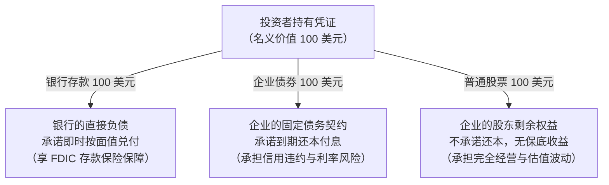
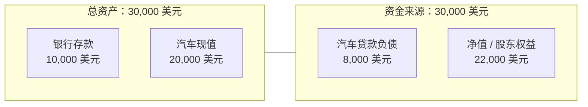
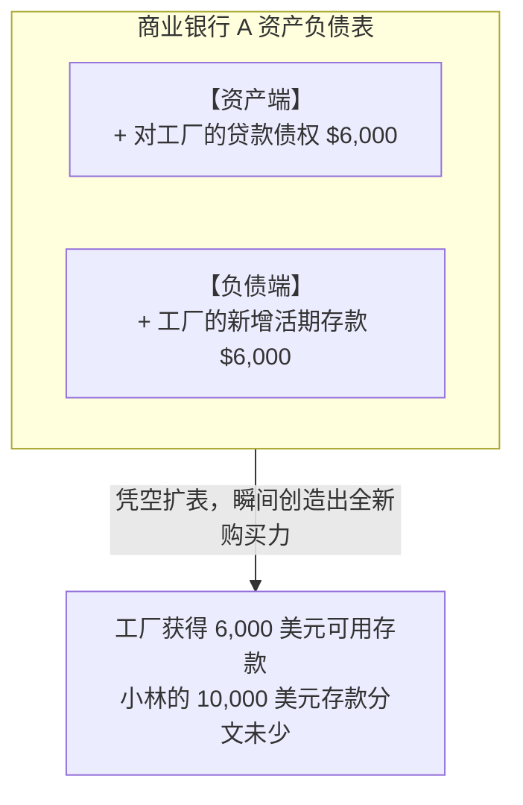
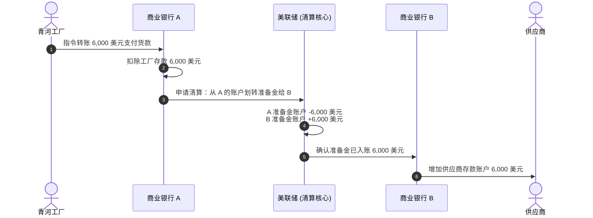
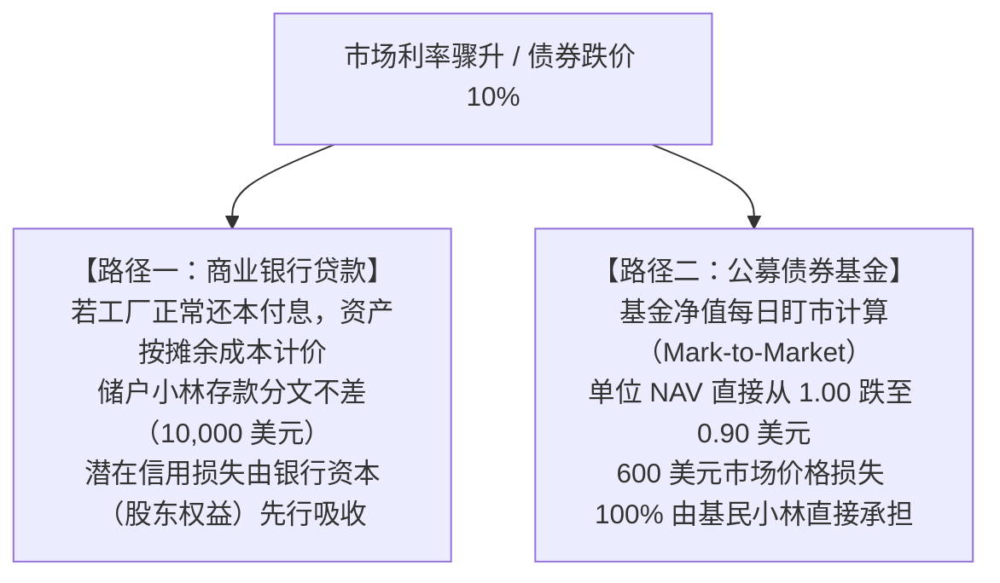
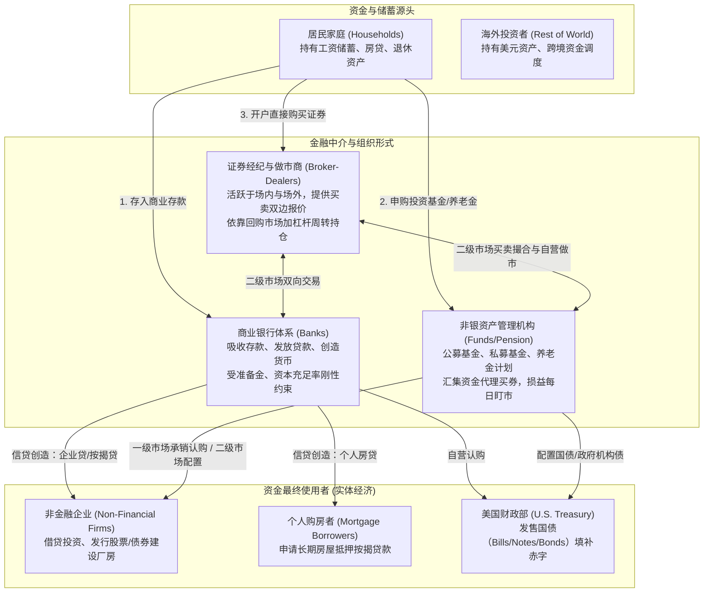
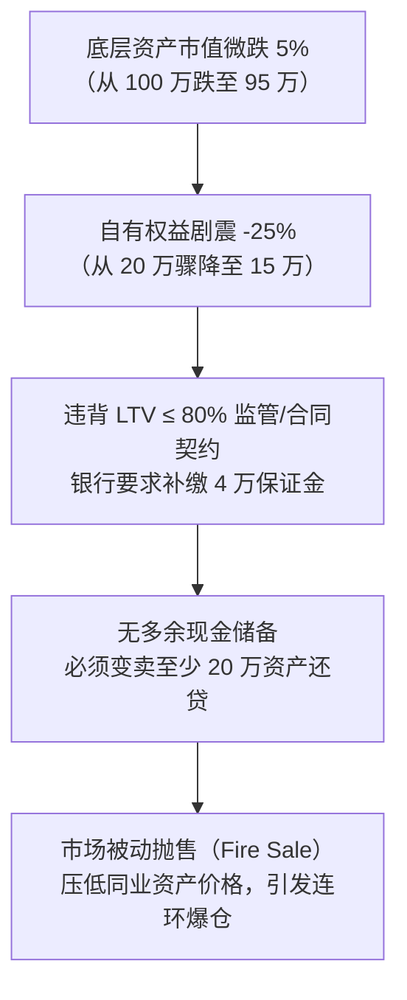

# 11 金融体系地图：资金、合同、机构与市场

[上一章](10-inflation-mechanisms.md) · [目录](./) · [下一章](12-bank-balance-sheets.md)

> 本章是全书金融模块的“导览底图”。建议分三次学习：第 1—3 节理解基础合同与两条截然不同的融资路径；第 4—6 节理清二级市场交易、金融中介角色与全景地图；第 7—10 节掌握风险传导、阅读美联储 Z.1 资金流量表并完成实战练习。除明确注明的历史官方报告外，数值均为教学假设。

---

## 本章要解决什么问题：同样叫“钱进入市场”，究竟发生了什么？

假设同一天，你在财经新闻里看到这样一句话：“今天有 100 亿美元资金流入市场，支持实体经济发展。”

很多人脑海中立刻浮现出一幅画面：
> 储蓄者把装满现金的箱子搬进金融机构，金融机构的大门打开，再把这笔现钞原封不动地递到工厂老板手里。

这幅“管道注水”式的想象虽然直观，却掩盖了现代金融体系最关键的运作真相：
1. **商业银行发放贷款**，并不是从某个储户的账户里扣除余额，而是凭空同时在资产端记上一笔贷款债权、在负债端记上一笔新增存款；
2. **你在二级市场买入 100 万美元苹果公司的股票**，苹果公司的银行账户里其实连一分钱都没有多出来，这笔钱只是打给了卖给你股票的另一位投资者；
3. **你花 1 万元认购了一只债券基金**，你并不直接成为发债企业的债权人，你拥有的仅仅是基金的一份按日浮动的资产净值份额；
4. **两家看起来都在支持同一座新厂房的企业**，一家发行了 5 年期固定利率债券，另一家借了 3 个月滚动的银行贷款，面对下一次加息时，它们的生存概率可能天差地别。

本章的任务，就是**为你绘制一张清晰、严密且能追踪每一笔交易的“金融全景地图”**。

读完本章，你将能够：
- 顺着资产与负债的两端，看清“谁对谁拥有权利、谁向谁承担义务”；
- 彻底区分**商业银行贷款**、**基金买新债**与**二级市场买旧资产**这三条截然不同的资金与合同路径；
- 掌握杠杆如何将微小的资产价格波动成倍放大为净值剧震；
- 读懂美联储权威的 Z.1《美国金融账户》（资金流量表），不再将账面资产估值增长误读为“居民兜里有了现款”。

---

## 1. 先问“谁欠谁”，再问“钱去了哪里”

### 1.1 三张看似相同的 100 美元凭证

假设你的钱包或证券账户里有三张写着“100 美元”的凭证：
1. **第一张是银行活期存款 100 美元**：这是商业银行对你承担的、必须随时按面额兑付的法定义务。
2. **第二张是某科技公司发行的债券，面值 100 美元**：这是该公司向你出具的借据，承诺在未来约定日期还本，并按期支付利息。
3. **第三张是某家公司市值 100 美元的普通股股票**：这是你对该公司的“剩余权益凭证”。公司从未承诺在未来哪一天还你 100 美元，你享受的是公司扣除所有债务和成本后的分红权与投票权。

> [!IMPORTANT]
> **金融世界的第一准则：数字离开了合同，就毫无意义。**
> 任何一个孤立的“100 美元”，只有连同它的**合同类型**（债务还是股权）、**对手方是谁**（主权政府、大银行还是初创企业）、**计价方式**（面值清算还是市价浮动）以及**到期时间**，才能界定它的真实价值与风险。相关基础法律界定可参考 [SEC：债券的权利与风险](https://www.investor.gov/introduction-investing/investing-basics/investment-products/bonds-or-fixed-income-products/bonds) 以及 [SEC：普通股与股东权利](https://www.investor.gov/introduction-investing/investing-basics/investment-products/stocks)。

---

### 1.2 资产负债表不是现金流水账

为了把所有人连接在一起，我们需要现代金融最强大的语言：**资产负债表（Balance Sheet）**。

无论是普通居民、制造业巨头还是华尔街投行，资产负债表永远遵循一条最基础的会计恒等式：

$$
\text{资产} = \text{负债} + \text{净值（所有者权益）}
$$

我们通过一位大学毕业生小林的账本来看清它：
- **资产（拥有什么）**：银行存款 10,000 美元，一台估值 20,000 美元的代步轿车。总资产 = 30,000 美元；
- **负债（欠别人什么）**：车贷欠款 8,000 美元；
- **净值（真正属于自己的剩余）**：$30,000 - 8,000 = 22,000$ 美元。

这里潜藏着两个初学者极易踩中的认知陷阱：

1. **“账面净值”绝不等于“随时可花的现金”**：
   小林拥有 22,000 美元的净值，并不意味着他的银行卡里有 22,000 美元随时待命。如果明天早晨必须偿还一笔 15,000 美元的紧急借款，他手头的现金存款只有 10,000 美元，依然会陷入实质性的**流动性违约危机**——除非他能今天折价把汽车卖掉，或者找到别人借钱周转。
2. **“会计账做平”绝不等于“资产估值真实可靠”**：
   汽车在账面上写着 20,000 美元，但如果二手车市场突然崩盘，汽车真实转手价跌到 12,000 美元，小林的真实净值会立刻被抹平到只剩 4,000 美元；然而，那 8,000 美元的银行贷款却是一分钱都不会减少的刚性契约。

---

### 1.3 一项合同有两端，但不能把两端当成社会总财富

在宏观经济中，金融资产具有极特殊的双重性：**一个主体的金融资产，必定是另一个主体的负债。**

- 小林的 10,000 美元银行存款，是小林的资产，也是银行的负债；
- 银行贷给工厂的 6,000 美元贷款，是银行的资产，也是工厂的负债；
- 银行股东持有的股权，是股东的资产，对应着银行扣除存款后的剩余净权益。

如果我们把小林、银行和工厂合并为一个整体来考察全社会的物质财富，这些彼此交错对应的内部债权与债务必须全部**对冲抵销**。真正留下的、能够持续为社会创造实际产出的，只有工厂里的那台**实体机器设备**。

> [!NOTE]
> 实体资产（如厂房、机床、耕地、软件代码）能够直接参与物质与服务生产；
> 而金融合同（存款、债券、股票）的作用，是**界定由谁来调配当期的购买力、谁有权分享未来的产出收益、以及在遭受损失时由谁最先承担痛苦**。全社会的金融资产数字翻倍，并不代表真实的物质生产能力同步翻了一番。

---

## 2. 第一条路径：商业银行放贷（信用创造与跨行结算）

现代经济中绝大多数的“钱”，并非来自印钞机，而是诞生于商业银行的放贷过程。

### 2.1 贷款不是搬运储户的存款，而是凭空记账

青河机械制造厂为了承接新订单，计划向银行 A 申请一笔 6,000 美元的贷款，用来购买一台全新机床。

许多人以为，银行 A 的信贷经理必须先在行内翻看账本，找到小林刚刚存入的 10,000 美元存款，然后把其中的 6,000 美元“挪”给青河工厂。

**现代银行体系的真实记账完全不是这样。**

当银行 A 完成对工厂的信用评估、抵押核查并批准提款时，会计操作瞬间发生（略去利息计提与准备金计提）：

| 记账主体 | 资产端变化 | 负债与所有者权益端变化 |
| :--- | :--- | :--- |
| **青河工厂** | 银行存款 $+6,000$ 美元 | 银行贷款负债 $+6,000$ 美元；所有者权益不变 |
| **商业银行 A** | 贷款资产 $+6,000$ 美元 | 客户存款负债 $+6,000$ 美元；所有者权益不变 |
| **储户小林** | **完全无变化（存款依然是 10,000 美元）** | **无变化** |

这就是金融学中著名的**“贷款创造存款”（Loans Create Deposits）**机制。商业银行在资产端确认了一笔对工厂的收款权利，同时在负债端凭空开出了一笔可供工厂用于全社会支付的自身负债（存款）。全社会的广义货币（M2）在这一瞬间净增加了 6,000 美元！权威机理解释可查阅 [英格兰银行：现代经济中的货币创造](https://www.bankofengland.co.uk/quarterly-bulletin/2014/q1/money-creation-in-the-modern-economy)。

---

### 2.2 跨行支付：准备金的流转

如果商业银行能够敲敲键盘就创造存款，那岂不是可以无休止地放贷赚取利息？

**约束立刻就会出现，而且就发生在借款人花钱的那一秒。**

青河工厂借这 6,000 美元不是为了把数字放在账户里看着，而是为了向设备供应商付款。假设供应商在另一家银行——**商业银行 B** 开立账户。工厂通过网银向供应商转账 6,000 美元：

1. 工厂在银行 A 的存款减少 6,000 美元；
2. 供应商在银行 B 的存款增加 6,000 美元。

此时，银行 B 凭什么白白为供应商记上 6,000 美元的存款负债？银行 B 会要求银行 A 交付等额的“真金白银”——在美联储账户里的**中央银行准备金（Reserves）**！

此时三方的资产负债表变化如下：

| 记账主体 | 资产端变化 | 负债端变化 |
| :--- | :--- | :--- |
| **青河工厂** | 银行存款 $-6,000$ 美元 固定资产（机床）$+6,000$ 美元 | 无变化（贷款负债仍在） |
| **商业银行 A** | **美联储准备金 $-6,000$ 美元** | 客户存款负债 $-6,000$ 美元 |
| **商业银行 B** | **美联储准备金 $+6,000$ 美元** | 客户存款负债 $+6,000$ 美元 |

> [!CAUTION]
> **商业银行的真实硬约束：流动性清算与资本底线**
> 银行 A 放贷时虽然轻松，但只要借款人把钱付给别家银行，银行 A 就必须实打实地划出联储准备金。如果银行 A 手头只有 2,000 美元的富余准备金，它这笔 6,000 美元的支付就会直接导致结算失败！银行必须紧急去货币市场上拆借准备金、或者变卖国债资产。银行无法自己印制美联储准备金，详细微观约束见[第 12 章](12-bank-balance-sheets.md)。

---

## 3. 第二条路径：投资基金与直接发债（非银中介）

现在我们换一种情景：假设青河工厂没有找银行贷款，而是通过发行企业债券来筹集资金。

### 3.1 基金认购：存量存款的汇集与转移

小林把银行账户里的 6,000 美元拿出来，申购了一只新成立的开放式债券基金。
随后，青河工厂在一级市场上公开发行了面值 6,000 美元的 3 年期固定利率企业债券，年化票息率 5%。该基金正好用小林汇集上来的 6,000 美元资金全额认购了这批债券。

我们来对比这条路径与银行放贷路径的本质区别：

| 记账主体 | 资产端变化 | 负债与净值端变化 |
| :--- | :--- | :--- |
| **小林** | 银行存款 $-6,000$ 美元 **基金份额资产 $+6,000$ 美元** | 无变化 |
| **债券基金** | 银行存款由 $+6,000$ 转为 $-6,000$（净为 0） **企业债券资产 $+6,000$ 美元** | **基金持有人权益 $+6,000$ 美元** （共发行 6,000 份，初始 NAV = 1.00 美元） |
| **青河工厂** | 银行存款 $+6,000$ 美元 | **应付企业债券负债 $+6,000$ 美元** |

**核心宏观差异：**
- 在银行放贷路径中，全社会无中生有地凭空多出了 6,000 美元的银行存款（广义货币创造）；
- 在基金购债路径中，**全社会的银行存款总量分文未变**。小林的存款被转给了基金，基金又把存款付给了工厂，工厂随后付给了设备供应商。全社会只是将现有存量存款在不同主体间进行了转移，新增的是基金份额和企业债券两张金融凭证。

---

### 3.2 净值下跌时，风险由谁承担？

假设一年后，市场无风险利率大幅上升，青河工厂的企业债券市场交易价格从 6,000 美元跌到了 5,400 美元。

我们来看看此时基金小林的账户会发生什么：

$$
\text{单位基金净值（NAV）} = \frac{\text{基金底层组合总市值}}{\text{总发行份额}} = \frac{5,400 \text{ 美元}}{6,000 \text{ 份}} = 0.90 \text{ 美元/份}
$$

小林持有的基金总资产账面价值变成了：

$$
6,000 \text{ 份} \times 0.90 \text{ 美元/份} = 5,400 \text{ 美元} \quad (\text{账面损失 } -600 \text{ 美元})
$$

> [!WARNING]
> **别把包装名称当成保本承诺**
> 很多人以为“在银行柜台买的基金”就能享受银行存款同等的安全保障。这是极具危害的误解。
> 基金管理公司只是受托管理资产并收取管理费，它并不对底层证券的市价波动兜底。根据法律，**基金资产绝不属于银行负债，不受 FDIC 存款保险保障**，参见 [FDIC：不受存款保险覆盖的金融产品](https://www.fdic.gov/resources/deposit-insurance/financial-products-not-insured)。

---

## 4. 第三条路径：二级市场交易（证券转手与价格发现）

### 4.1 证券换了主人，公司没有拿到一分钱

现在假设小林急需用钱，他在手机股票软件上以 5,400 美元的价格，把持有的全部基金份额（或工厂旧债券）卖给了投资者老张。

在这笔交易完成的瞬间：
- 老张银行账户里的存款减少 5,400 美元，名下多了这批证券；
- 小林账户里的存款增加 5,400 美元，证券交出；
- **青河工厂的财务负责人甚至根本不知道这笔交易的发生，工厂的银行账户没有多出一分钱，原先发行的债务总额也没有任何增减。**

这就是**二级市场交易（Secondary Market Trading）**的本质：**它是现有金融资产在不同投资者之间的所有权转让**，参见 [SEC：二级市场基本概念](https://www.investor.gov/introduction-investing/investing-basics/glossary/secondary-market)。

---

### 4.2 为什么二级市场对实体经济至关重要？

既然二级市场买卖不给企业送去新资金，为什么所有国家的政策制定者和企业高管都对二级市场价格高度关注？

因为二级市场提供了不可替代的两大功能：
1. **流动性溢价与安全感**：如果老张知道买下债券后必须死守到期、中途无法转让换现，他一定会要求极高的风险溢价；正是因为随时能在二级市场上卖出变现，投资者才敢于在一级市场上以较低利率认购新发债券。
2. **边际定价基准**：二级市场上旧债券的折现价格，决定了企业未来新发债券的融资成本。

假设青河工厂一年后需要再建一条新产线，准备发行一批新的 1 年期债券（到期兑付 1,050 美元）：
- 如果此时二级市场上相似信用资质的旧债按 1,000 美元成交，对应的市场预期年化到期收益率 $y$ 为：
  $$ y = \frac{1,050 - 1,000}{1,000} = 5.00\% $$
  企业可以按 5% 的低成本顺利融到资金；
- 如果二级市场上悲观情绪蔓延，投资者抛售，相似旧债价格被砸到 980 美元，隐含的到期收益率就飙升至：
  $$ y = \frac{1,050 - 980}{980} \approx 7.14\% $$
  此时工厂若想在一级市场成功发售新债，就必须被迫提供高达 7.14% 的票面息率，否则根本无人问津！这可能直接导致建厂计划因资金成本过高而流产。

---

### 4.3 “股市市值蒸发 5,000 亿”不等于 5,000 亿现金被销毁

财经自媒体最喜欢用耸人听闻的标题：“今天美股暴跌，5,000 亿美元财富凭空蒸发，大量现金被主力抽走！”

这种说法在金融会计上是完全荒谬的。

假设一家公司总共有 1 亿股股票，昨天收盘价每股 10 美元，总市值 = 10 亿美元。
今天开盘，全市场只有一位持股者急于用钱，他挂出仅仅 100 股以 9 美元卖出，并顺利成交。

因为最新一笔边际成交价是 9 美元，交易行情软件立刻将全公司的股票价格统一显示为 9 美元，公司账面总市值瞬间变成 9 亿美元——所谓的“1 亿美元市值蒸发了”。

但这笔交易中：
- 真实流动的资金仅仅是买方支付的 $100 \times 9 = 900$ 美元现金；
- 剩下的 99,999,900 股根本没有发生任何现金流转！
- 并没有 1 亿美元的钞票被扔进碎纸机，蒸发的仅仅是**全市场所有持有者基于边际交易价格对未来现金流贴现形成的“估值预期”**。

---

## 5. 全景地图：把三条路径与主体安放在同一张网中

现在，我们可以把整个现代金融体系的核心图景完整连接起来：

### 5.1 别把“资产”、“包装”与“机构”混为一谈

很多初学者之所以觉得金融世界千头万绪，是因为把不同维度的词汇堆在了一起。在阅读任何产品说明书时，请严格建立以下四层解剖结构：

| 分析维度 | 关键提问 | 典型例子 | 混淆带来的常见错误 |
| :--- | :--- | :--- | :--- |
| **1. 底层经济权利** | 谁应在何时付钱？收益由什么决定？ | 苹果公司普通股、美国财政部 10 年期国债、个人住房按揭房贷 | 以为买入债券和买入股票享有同样的求偿顺位 |
| **2. 法律包装形式** | 资产放在什么法律载体里被持有？ | 直接持有单一证券、共同基金（Mutual Fund）、交易型开放式指数基金（ETF） | 以为“买 ETF”本身是一种全新的底层资产，其实它只是一层透明包装盒 |
| **3. 运营与管理机构** | 谁在替你盯盘并决定买卖？ | 先锋领航（Vanguard）、贝莱德（BlackRock）、富达（Fidelity） | 以为基金管理人破产就会吞没基金托管在银行独立账户里的股票资产 |
| **4. 交易与结算场所** | 在哪里撮合价格，在哪里交收？ | 纽约证券交易所（NYSE）、场外询价市场（OTC）、清算所（DTCC） | 以为所有证券都像股票一样在电子屏幕上公开自动撮合成交 |

---

## 6. 金融风险是怎样传导与放大的？

金融体系不仅能高效匹配资金，同时也是风险放大器。

### 6.1 三种截然不同的风险

遇到金融波动时，首先必须将风险拆解为三个独立维度：
1. **信用违约风险（Credit Risk）**：对方还不起钱的风险（例如借款企业倒闭清算）；
2. **市场价格风险（Market Risk）**：资产本身没有违约，但因基准利率飙升或市场偏好改变，资产现值大幅折价；
3. **流动性风险（Liquidity Risk）**：
   - *资产变现流动性*：某只冷门债券虽然没有违约，但在市场上找不到买家，必须打 7 折才能脱手；
   - *负债端融资流动性*：今天下午 4 点前必须支付 1,000 万美元清算款，账面资产明明有 1,500 万，但兜里就是拿不出可用现金。

---

### 6.2 杠杆：把微小的价格震荡放大为灭顶之灾

杠杆（Leverage）是现代金融机构扩大收益的核心利器，也是引发金融危机的第一诱因。

用一个极其干净的算例来看看它的放大机制：
某交易型对冲基金拥有自有资金（初始所有者权益 $E_0$）20 万美元，它通过向银行质押借款（负债 $D_0$）80 万美元，凑齐了 100 万美元总资产（$A_0 = 100$ 万），全额买入某优级债券组合。

初始状态满足：

$$
A_0 = D_0 + E_0 \implies 100 = 80 + 20 \quad (\text{杠杆倍数 } \frac{A_0}{E_0} = 5 \text{ 倍})
$$

#### 阶段一：资产跌价 5% 时的权益震荡
假设市场基准利率上升，该债券组合市值下跌了 $5\%$，资产总值变为 $95$ 万美元。但银行的 80 万美元债务本金分文未变：

$$
\text{最新权益 } E_1 = A_1 - D_0 = 95 - 80 = 15 \text{ 万美元}
$$

$$
\text{自有权益跌幅} = \frac{15 - 20}{20} = -25\%
$$

底层资产仅仅微跌了 $5\%$，基金的自有本金就被硬生生削减了整整 $25\%$（恰好是资产跌幅乘上 5 倍杠杆）！

#### 阶段二：触发保证金追缴（Margin Call）与被动去杠杆踩踏
借款银行绝不会坐视自己的 80 万借款暴露在风险中。银行在质押借款合同中约定了严格的**最高借贷价值比（LTV $\le 80\%$）**，即负债总额不得超过抵押品当前市值的 $80\%$：

$$
\text{当前允许的最大借款额} = 95 \times 80\% = 76 \text{ 万美元}
$$

然而基金当前的实际借款是 80 万美元，产生了 $80 - 76 = 4$ 万美元的资金缺口！银行发出追加保证金通告：**限期在今明两天内补缴 4 万美元现金，否则将强行平仓变卖抵押品。**

如果基金经理手头没有任何外部备用流动资金，他只能选择在二级市场上变卖资产还债。

**现在请回答：为了归还这 4 万元差额，基金经理只需要变卖 4 万市值的债券吗？**

**绝对不够！** 因为卖出债券的同时，基金压在银行里的抵押品总量也同步缩水了！

设基金必须变卖市值总和为 $x$ 万美元的债券，并将变现所得全部用于优先偿还银行贷款：
- 变卖后剩余债务为：$80 - x$
- 变卖后剩余抵押品资产为：$95 - x$

合同风控约束必须被满足：

$$
80 - x \le 0.80 \times (95 - x)
$$

展开求解不等式：

$$
80 - x \le 76 - 0.80x \implies 4 \le 0.20x \implies x \ge 20 \text{ 万美元}
$$

> [!CAUTION]
> **流动性螺旋的起源：**
> 仅仅为了填补 4 万美元的账面保证金缺口，基金经理必须在市场上抛售高达 20 万美元的优质资产！
> 如果全市场上几十家机构同时面临同样的保证金追加，成百上千亿的资产就会被同时甩向市场，直接酿成灾难性的**“踩踏性抛售”（Fire Sale）**与流动性黑洞。

---

## 7. 读一张真实原表：美联储 Z.1 资金流量表

在现实研究中，我们从哪里能够看到全美各部门的金融资产全貌？
最权威的来源是美联储每个季度公布的 **Z.1 报告《美国金融账户》（Financial Accounts of the United States）**。

### 7.1 表 B.101：家庭与非营利机构资产负债表

我们以美联储 **2025 年 3 月 13 日官方发布**的版本为例，读取 **2024 年第四季度末**的全美家庭部门资产负债表（未季调，单位：十亿美元）：

| 行号 | 统计项目 | 2024 Q4 末数值（十亿美元） | 核心经济学含义与避坑指南 |
| :---: | :--- | ---: | :--- |
| **Line 1** | **总资产 (Total Assets)** | **190,151.1** | 包含全美家庭持有的所有房地产、企业股权、养老金储备和存款 |
| *Line 2* | *非金融实体资产 (Real Estate etc.)* | *53,602.4* | 主要是自住房产与家庭耐用品实物，不能拿去直接刷卡消费 |
| *Line 10* | *金融资产总额 (Financial Assets)* | *136,548.7* | 涵盖股票、共同基金、退休年金和各类存款 |
| *Line 11* | *— 其中：货币与支票存款* | *4,982.6* | **真正具备即时支付能力的银行活期资金仅约 5 万亿美元！** |
| **Line 30** | **总负债 (Total Liabilities)** | **20,790.3** | 全美家庭背负的所有按揭房贷、学生贷、信用卡欠款 |
| *Line 31* | *— 其中：房屋抵押贷款* | *13,248.9* | 家庭部门最庞大的长期刚性债务支出项 |
| **Line 40** | **净值 (Balance / Net Worth)** | **169,360.8** | $190,151.1 - 20,790.3 = 169,360.8$ |

数据官方出处可查阅 [美联储发布目录与 Z.1 表 B.101 存档](https://www.federalreserve.gov/releases/z1/20250313/html/b101.htm)。

---

### 7.2 宏观高手的读表要领

看到这张表上惊人的“169.3 万亿美元全美家庭净财富”时，优秀的宏观研究员会立刻在心里划出三道防线：

1. **切勿把“净值增长”当成“新增储蓄流入”**：
   从 2023 年底到 2024 年底，家庭净值大涨了十多万亿美元。但这十万亿中，绝大部分不是家庭靠省吃俭用把工资结余存进银行，而是因为**标普 500 指数大涨和全美房价攀升带来的“未实现重估增值（Revaluation）”**。如果明天股市大跌，这笔纸面财富就会凭空消失。
   
   美联储官方在分解资金流量表存量变动时，遵循严格的三分法：
   $$
   \text{本期期末余额} - \text{上期期初余额} = \text{实际交易净流量（Transactions）} + \text{资产重估损益（Revaluation）} + \text{其他统计调整}
   $$
2. **切勿把“宏观人均”当成“典型中位数家庭”**：
   全美总人口约 3.3 亿，若简单用 169 万亿美元除以家庭户数，平均每户净资产超过 120 万美元。然而，根据美联储《消费者财务调查报告》（SCF），前 $10\%$ 的富裕阶层持有了全美超过 $85\%$ 的股票和金融资产。对于绝大多数普通工薪家庭而言，资产的主要构成就是一套仍有大额房贷尚未还清的自住房。
3. **分清 Z.1 报告中不同系列字母表的使命**：
   - **F 系列表（Flows）**：记录一段时间内的资金交易净流量（例如本季度全美居民究竟净申购了多少国债）；
   - **L 系列表（Levels）**：记录某个时点上的总存量余额；
   - **B 系列表（Balance Sheets）**：整合资产、负债与净值结构。

---

## 8. 综合应用：银行信贷放缓，是否意味着实体经济面临“钱荒”？

### 8.1 教学推演案例

某季度，宏观观察室汇总了针对同一批样本实体企业的融资监测数据（单位：百万美元，已对齐统计口径与时间范围）：

| 监测维度 | 已核实事实与资金变化 |
| :--- | ---: |
| 银行对该批企业的贷款期初存量余额 | 500 |
| 本季度银行向该批企业新发放贷款本金 | $+40$ |
| 本季度企业按期归还银行贷款本金 | $-60$ |
| 该批企业已发行公司债券期初存量余额 | 300 |
| 本季度企业在公募市场上发行新债券融资金额 | $+80$ |
| 本季度企业按期偿付到期旧债券本金 | $-30$ |
| 企业新发行债券筹集 80 百万美元的具体用途 | **20 用于置换银行高息贷款，30 用于借新还旧，30 存入账户拟用于次月支付新设备款** |
| 该批企业在股票市场上的总市值变动 | 市值上涨 200；本季度企业**未增发**任何新股 |

---

### 8.2 规范的三步核查分析

#### 第一步：动手复算各融资管道的存量净变动
- **银行贷款管道**：
  $$ \text{期末余额} = 500 + 40 - 60 = 480 \text{ 百万美元} \quad (\text{净减少 } -20) $$
- **公司债券管道**：
  $$ \text{期末余额} = 300 + 80 - 30 = 350 \text{ 百万美元} \quad (\text{净增加 } +50) $$
- **两项核心债务融资合计净增量**：
  $$ (-20) + (+50) = +30 \text{ 百万美元} $$
  在统计口径完整的前提下，该批企业整体背负的有息债务总额不仅没有收缩，反而**净扩张了 30 百万美元**！

#### 第二步：识别替代效应与资金去向，剔除重复计算
- 如果仅凭“银行贷款余额净下降 20”就草率得出“银行惜贷导致实体资金断流”的结论，就犯了“只盯单一水管”的片面错误；
- 事实清晰表明：企业是因为债券市场利率更低，主动发行 80 新债，并把其中 20 偿还了银行贷款（直接替代渠道）。
- 股票市值上涨 200，纯粹是二级市场交易者的市价重估，企业账上没有因此多出哪怕 1 美元现金，绝不能算作企业本期融得的增量投资金；
- 企业留存的 30 设备款尚未实际打给设备商，在国民经济核算（GDP）中尚未转化为当期的“固定资产投资支出”。

#### 第三步：给出客观严密的研判结论
> “本季度该群体呈现出典型的‘债贷替代’特征。银行贷款存量下降并非源于供给端无差别信贷紧缩，而主要是优势企业抓住债券市场窗口进行了债务置换与期限优化。整体债务融资保持净扩张（+30 百万美元）。但需防范分化风险：无法进入公募债券市场的中小微企业是否在信贷端受到了挤压，仍需补充定向微观调研。”

---

## 9. 练习与参考答案

### 练习 1：识别底层权利与保障边界
小王在大型商业银行的手机 App 理财专区里，花 5,000 美元购买了一款由该银行全资子公司“信达资产管理”发行的固定收益型理财基金；小李直接在证券交易所买了该银行发行的 10 年期次级债券；小赵持有该银行的普通股股票。
请回答：三者分别持有谁的什么经济权利？当该银行遭遇严重的底层资产亏损时，谁最先承受损失？哪一位享有联邦存款保险公司（FDIC）的本金兜底保障？

点击展开参考答案与解析

1. **三者的权利对象**：
   - 小王持有的是由资产管理公司设立的独立基金财产份额，其底层是一篮子债券组合，银行 App 仅仅是代销渠道，资管公司是受托管理机构；
   - 小李直接持有对商业银行法人的次级债权，承诺在未来到期还本付息，但在破产清偿时排在普通存款人之后；
   - 小赵持有该商业银行的股东剩余权益（普通股），享有分红与剩余索偿权。
2. **损失承担顺序**：
   - 小赵（普通股股东）最先承担损失，股价暴跌甚至被清零；
   - 其次是小李（次级债持有人），若资本耗尽可能面临次级债本金核销；
   - 小王的基金净值直接取决于基金底层那一篮子债券的变现价值，与银行本身的破产并不是同一件事；
3. **存款保险保障**：
   - **三者完全都不享受 FDIC 存款保险保障！** FDIC 仅保护居民和企业存放在受保银行的合法商业存款（通常每人每家银行限额 25 万美元），投资类产品、基金份额、银行自身发行的股票与次级债券均属于非保本证券，亏损由投资者依契约自行承担。

---

### 练习 2：跨行放贷与准备金缺口
商业银行 X 的资产负债表处于初始平衡状态，持有美联储准备金 500 万元。今天，该行向某优质建筑企业新发放了一笔 1,200 万元的工程周转贷款，全额记入该企业在该行开立的活期存款账户中。一小时后，该企业为采购钢材，向开户在商业银行 Y 的钢厂一次性电汇支付了整笔 1,200 万元款项。
1. 请写出银行 X 在“发放贷款”与“跨行支付”两个步骤中的资产负债表变动分录；
2. 银行 X 在美联储准备金清算结算端面临多少缺口？它有哪些可能的合规市场化解决方案？

点击展开参考答案与解析

1. **分录推演**：
   - **步骤一（放贷入账）**：
     - 资产端：发放贷款 $+1,200$ 万元；
     - 负债端：客户存款 $+1,200$ 万元；所有者权益不变。
   - **步骤二（跨行对外支付）**：
     - 负债端：客户存款扣除 $-1,200$ 万元（存款回到放贷前水平）；
     - 资产端：需向联储申请从自身准备金账户划转 $-1,200$ 万元至银行 Y。
2. **准备金清算缺口与应对**：
   - 银行 X 初始账面仅有准备金 500 万元，划转 1,200 万元后，准备金清算账户将面临 $-700$ 万元的透支缺口；
   - 银行 X 必须在当日系统截止结算前补足这 700 万元流动性，常见合规途径包括：
     1. 在隔夜联邦基金市场（Federal Funds Market）或银行间同业市场上拆借 700 万元准备金；
     2. 以持有的优质国债作为抵押品，在短期回购市场（Repo）借入现金准备金；
     3. 紧急变卖自身持有的短期流动性证券（如国库券 Bills）；
     4. 若全市场流动性枯竭，申请使用美联储的常备借贷便利（贴现窗口 Discount Window）。

---

### 练习 3：杠杆与强制平仓临界点计算
某对冲基金用 50 万美元自有资本，通过质押借入 150 万美元现金，构建了总值 200 万美元的优质企业债组合（4 倍杠杆）。质押融资合同严格规定：负债与抵押品市值的比率（LTV）不得高于 $80\%$。
1. 若由于市场收益率跳升，该债券组合市值下挫 $10\%$ 至 180 万美元，请计算该基金自有净值的损失幅度；
2. 此时是否触发了违约风控红线？若基金通过外部注资现金补足担保，需要追加多少现金？
3. 若基金没有任何外部现金，只能通过变卖部分债券并全额偿还贷款来恢复 LTV 至 $80\%$，在不考虑市场冲击的前提下，至少需要变卖多少市值的债券？

点击展开参考答案与解析

1. **净值变动幅度**：
   - 初始权益 $E_0 = 200 - 150 = 50$ 万美元；
   - 市值下挫至 180 万美元后，债务本金仍为 150 万美元；
   - 最新权益 $E_1 = 180 - 150 = 30$ 万美元；
   - 自有资本损失率 $= \frac{30 - 50}{50} = -40\%$（资产下跌 10% 经 4 倍杠杆放大为 40% 损失）。
2. **LTV 校验与现金追缴**：
   - 当前实际负债比率 $= \frac{150}{180} \approx 83.33\% > 80\%$，已触发风控平仓预警；
   - 180 万抵押品允许的最大借款额 $= 180 \times 80\% = 144$ 万美元；
   - 外部追加偿还现金差额 $= 150 - 144 = 6$ 万美元。
3. **变卖资产去杠杆测算**：
   - 设变卖资产市值为 $x$ 万美元，所得全额还贷；
   - 剩余债务为 $150 - x$，剩余抵押品市值为 $180 - x$；
   - 需满足风控条件：$150 - x \le 0.80 \times (180 - x)$；
   - 解方程：$150 - x \le 144 - 0.80x \implies 6 \le 0.20x \implies x \ge 30$ 万美元；
   - **结论**：基金必须在二级市场强制卖出至少 **30 万美元**的债券，才能将杠杆率压缩至合同许可的安全范围。

---

## 本章小结与后续学习路线

金融体系绝不是一个浑然一体的池塘，而是一张由无数**法定合同、资产负债表与清算网络**紧密交织起来的传导网。

当遇到财经新闻讨论巨额资金变动时，请务必形成本能的**“四维追问”**：
1. **这是直接融资还是间接信贷？**（全社会存款总量是否发生净变动？）
2. **这是存量换手还是新发注资？**（资金是进入了企业项目，还是在二级市场投资者之间转移？）
3. **这是资产重估还是真实交易流量？**（账面财富增加是来自资产价格上涨，还是真金白银的储蓄增加？）
4. **谁在承担潜在亏损？**（是商业银行股东、国家存款保险，还是买入基金的普通投资者？）

- 想要彻底看清商业银行如何通过资产负债表与美联储进行准备金清算，请进入[第 12 章：银行资产负债表、存款与准备金](12-bank-balance-sheets.md)；
- 想要理解隔夜回购与短期借贷利率 SOFR 的微观形成机制，请阅读[第 14 章：货币市场](14-money-markets.md)；
- 想要深入推演债券现值贴现、久期与利率期限结构，请前往[第 17 章：债券合同、价格、久期与收益率曲线](17-bonds-and-curves.md)。

---

[上一章](10-inflation-mechanisms.md) · [目录](./) · [下一章](12-bank-balance-sheets.md)
