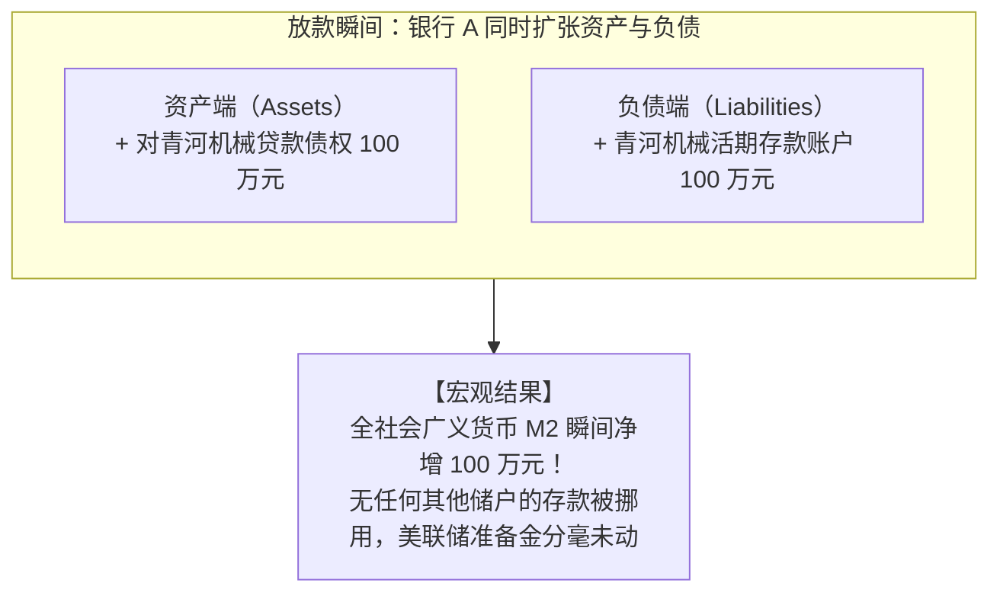
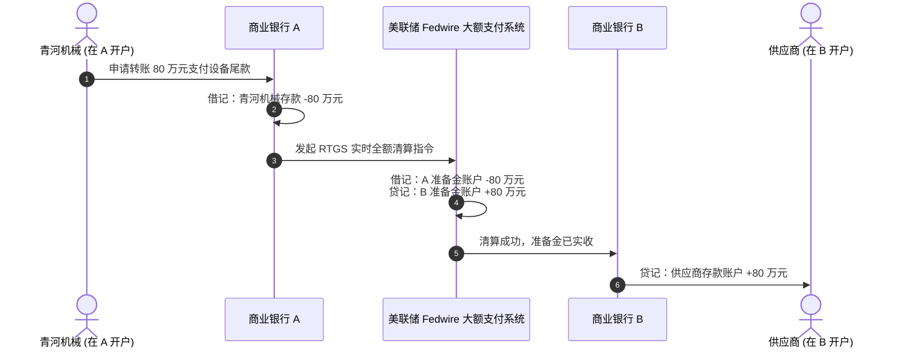
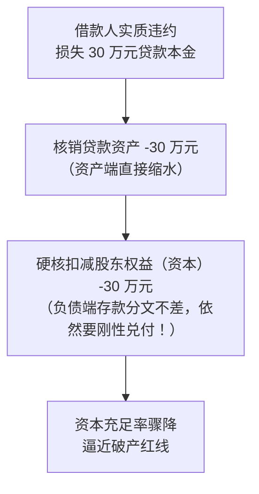
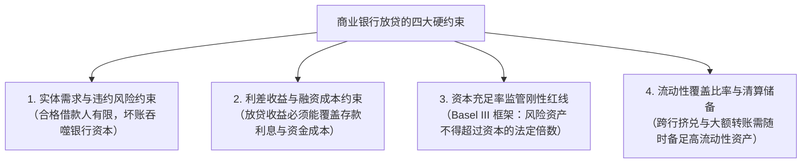
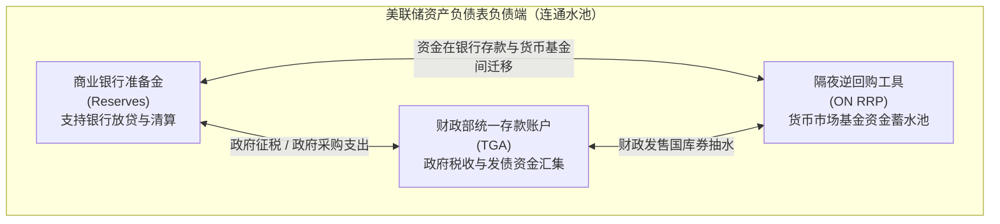
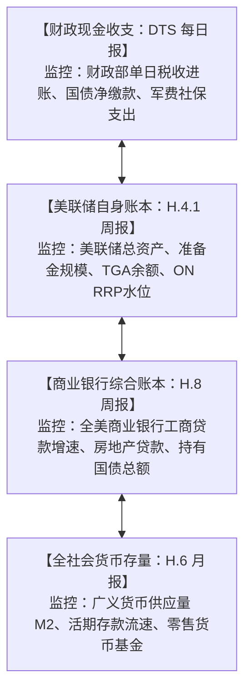

# 12 银行资产负债表、存款与准备金

[上一章](11-financial-system-map.md) · [目录](./) · [下一章](13-monetary-policy.md)

> 本章是理解现代货币运行与央行政策的“底层引擎”。建议分三次学习：第 1—5 节彻底理清商业银行放贷、跨行清算与准备金流转；第 6—9 节掌握信贷约束边界、美联储与财政部对准备金总量的联动影响；第 10—13 节精读美联储 H.4.1 资产负债表并完成全套实战练习。除明确注明的历史官方报告外，数值均为教学假设。

---

## 本章要解决什么问题

在财经讨论中，你经常会听到两句看似水火不容的断言：
- 观点 A：“**商业银行发放贷款，本质上是敲击键盘凭空创造存款。**”
- 观点 B：“**银行必须先有充足的存款或筹到资金，才能对外发放贷款。**”

与此同时，在宏观流动性分析中，又有两句貌似矛盾的抱怨：
- 观点 C：“**美联储向银行体系注入了数万亿美元准备金，这是大放水！**”
- 观点 D：“**小微企业依然拿不到贷款，实体经济根本没有感受到水流过来。**”

这些争议之所以经年不息，是因为许多人把**贷款入账、客户对外付款、银行同业清算、以及最终承担信用风险**这几个截然不同的环节，胡乱搅成了一团乱麻。

本章的任务，就是通过两家商业银行和一笔具体的贷款，**一层层拆解现代银行资产负债表与中央银行准备金账户的运转机制**。

读完本章，你将能够：
- 亲手画出放贷、跨行支付、借款人还贷、美联储量化宽松（QE）与量化紧缩（QT）的账户变动；
- 严格区分**银行准备金（Reserves）**、**商业银行存款（Deposits）**、**纸币现钞（Cash）**与**银行资本（Capital/Equity）**；
- 明白为什么法定准备金率降为零并不意味着银行能无限制放贷；
- 读懂美联储每周四发布的 H.4.1 资产负债表，不再把准备金、财政存款（TGA）和隔夜逆回购（ON RRP）混称为一个模糊的“流动性大资金池”。

---

## 1. 银行账本基础：资产、负债与资本的严格边界

### 1.1 会计恒等式与真实银行账本

在进入货币流转之前，先牢固确立商业银行的资产负债表恒等式：

$$
\text{总资产} = \text{总负债} + \text{所有者权益（银行资本）}
$$

$$
\text{所有者权益（银行资本）} = \text{总资产} - \text{总负债}
$$

我们来看一家处于健康运营状态的商业银行 A 的简化初始资产负债表（金额单位：万元）：

| 资产端 (Assets) | 金额 | 负债与权益端 (Liabilities & Equity) | 金额 |
| :--- | ---: | :--- | ---: |
| **中央银行准备金**（存放在 Fed） | 120 | **客户活期与定期存款** | 900 |
| **流动性证券**（美国国债/MBS） | 180 | **同业借款与发债融资** | 0 |
| **客户贷款资产**（企业贷/个人房贷）| 700 | **所有者权益（核心资本与历年留存利润）** | 100 |
| **资产总计** | **1,000** | **负债与权益总计** | **1,000** |

> [!IMPORTANT]
> **避坑警示：资本不是保险柜里的备用现钞！**
> 很多人望文生义，以为银行资本 100 万元是银行董事长保险柜里单独锁着的 100 万元绿钞。**完全不是。**
> 资本是一个**计算出来的差额概念（净值）**。它代表股东对银行资产扣除全部对外负债后的剩余索偿权。银行手里能拿来对外清算付款的即时现金，在资产端的“准备金”与“金库现钞”科目里，而不在权益端。

---

### 1.2 绝不能混淆的五种“钱”

在日常口语中，大家都把它们笼统地称为“钱”，但在现代金融管道中，它们行驶在完全不同的车道上：

| 货币载体 | 持有者账上的性质 | 对应谁的负债？ | 可以在哪里流转？ |
| :--- | :--- | :--- | :--- |
| **1. 居民与企业存款** | 普通公众的金融资产 | 商业银行 | 实体经济支付；普通企业无法直接拿它与央行结算 |
| **2. 商业银行准备金** | 商业银行在央行的资产 | 美联储 (Fed) | **仅限合资格存款机构与央行之间流转，公众无法直接持有** |
| **3. 实体美元纸钞** | 持有者（居民/银行）的资产 | 美联储 (Fed) | 物理世界手递手交付；受制于实体运钞与库存管理 |
| **4. 财政部账户余额 (TGA)**| 联邦财政部在央行的资产 | 美联储 (Fed) | 财政收税与国债发行的汇集地，政府公共支出的源头 |
| **5. 隔夜逆回购头寸 (ON RRP)**| 货币市场基金等机构的资产 | 美联储 (Fed) | 非银机构存放在央行的隔夜带息质押工具，暂不参与实体支付 |

详见美联储官方负债结构说明：[Fed: 负债项目及其账户关系](https://www.federalreserve.gov/monetarypolicy/bst_frliabilities.htm)。

---

## 2. 信贷起源：商业银行如何通过放贷创造存款

### 2.1 敲击键盘的会计瞬间

假设青河机械制造厂为了购进新设备，向商业银行 A 申请一笔 100 万元的商业贷款。

当银行 A 完成严格的风控合规审查、批准放款并通知企业提款时，银行柜员（或后台系统）在计算机上执行的分录如下：

| 记账主体 | 资产端变动 | 负债与权益端变动 |
| :--- | :--- | :--- |
| **青河机械制造厂** | 银行活期存款 $+100$ 万元 | 银行贷款负债 $+100$ 万元；权益不变 |
| **商业银行 A** | 客户贷款资产 $+100$ 万元 | 客户存款负债 $+100$ 万元；权益不变 |
| **中央银行 (Fed)** | **无变动** | **无变动** |

这一过程被英格兰银行等全球央行权威文献定义为**“贷款创造存款”（Loans Create Deposits）**。银行并没有把小林的 100 万元存款“搬”走，而是凭借自身的信用授权，开具了被全社会接受的自身负债凭据。参见 [英格兰银行：现代经济中的货币创造](https://www.bankofengland.co.uk/quarterly-bulletin/2014/q1/money-creation-in-the-modern-economy)。

---

### 2.2 放款后的两家银行资产负债表对比

为了展示接下来的跨行清算，我们引入另一家互不相干的**商业银行 B**。此时放款刚刚完成，借款人青河工厂尚未开始付款：

| 科目明细 | 银行 A（放款前） | 银行 A（放款后） | 银行 B（基准状态） |
| :--- | ---: | ---: | ---: |
| 准备金资产（存 Fed） | 120 | 120 | 80 |
| 流动性证券资产 | 180 | 180 | 120 |
| 客户贷款资产 | 700 | **800 (+100)** | 300 |
| **资产总计** | **1,000** | **1,100 (+100)** | **500** |
| 客户存款负债 | 900 | **1,000 (+100)** | 450 |
| 所有者权益（资本） | 100 | 100 | 50 |
| **负债与权益总计** | **1,000** | **1,100 (+100)** | **500** |

全银行体系的客户存款总额由 $900 + 450 = 1,350$ 万元，跃升至 $1,000 + 450 = 1,450$ 万元；而两家银行在央行的准备金合计始终恒等于 $120 + 80 = 200$ 万元。

---

## 3. 钱离开银行 A：跨行清算与准备金搬移

现在，我们把故事推向核心矛盾点：**借款人要花钱了。**

### 3.1 同行转账：风平浪静的内部记账
如果青河工厂要支付 80 万元货款给某供应商，而该供应商碰巧也开户在商业银行 A：
- 银行 A 仅需将青河工厂账户的存款减少 80 万元，同时给供应商账户增加 80 万元；
- 银行 A 对外负债总额分文未变，准备金资产分文未动，仅在行内完成了一次分户账的划转。

---

### 3.2 跨行转账：准备金在央行系统的硬核清算

现实中，绝大多数支付都是跨行交易。假设供应商开户在**商业银行 B**，青河工厂发出网银转账指令，向供应商支付 80 万元。

此时，**两层记账机制必须同时发动**：
1. **客户层**：青河工厂在 A 的存款减 80 万；供应商在 B 的存款增 80 万；
2. **银行同业层**：银行 B 不可能白白给供应商增加存款凭条，它要求银行 A 交付具备最终清偿力的**中央银行准备金**！

清算完成后的银行体系平衡表发生了深刻变化：

| 科目明细 | 商业银行 A | 商业银行 B | 两家银行合计 |
| :--- | ---: | ---: | ---: |
| 准备金资产 | **40 (-80)** | **160 (+80)** | **200 (总量恒定)** |
| 流动性证券资产 | 180 | 120 | 300 |
| 客户贷款资产 | 800 | 300 | 1,100 |
| **总资产** | **1,020 (-80)** | **580 (+80)** | **1,600** |
| 客户存款负债 | **920 (-80)** | **530 (+80)** | **1,450 (总量恒定)** |
| 所有者权益 | 100 | 50 | 150 |
| **负债与权益总计** | **1,020 (-80)** | **580 (+80)** | **1,600** |

关于美联储大额实时全额结算系统的运行机制与终局性，参见官方文档：[Fed: Fedwire Funds 的结算机制](https://www.federalreserve.gov/paymentsystems/fedfunds_about.htm)。

---

### 3.3 破解最初的迷思

现在，我们终于可以彻底化解文章开头的争论：
- **“贷款创造存款”成立在微观签约放款的瞬间**：银行放款确实不需要提前把别人的存款拿过来；
- **“银行需要融资”成立在跨行结算与持续经营的现实中**：放款创造的存款绝不会老老实实呆在放贷行内。客户一花钱，放贷行就必须拿出真金白银的**准备金**来履行跨行清算承诺！

如果银行 A 没有足够的准备金储备，或者没有能力在货币市场上随时借到准备金，它在放款前就必须三思而后行。

---

## 4. 银行流动性告急：准备金的同业借贷与央行注入

### 4.1 商业银行间的同业拆借：只改分布，不增总量

承接上面的情形：银行 A 此时手头的准备金只剩下 40 万元，如果下午又有一家企业客户要对外跨行电汇 90 万元，银行 A 的准备金清算账户将面临 $40 - 90 = -50$ 万元的透支违约危机！

为了避免清算失败，银行 A 紧急联系手头准备金充裕的银行 B，在**联邦基金市场（Federal Funds Market）**拆借 60 万元隔夜准备金：

- 银行 A 借入准备金后，账面准备金恢复到 $40 + 60 = 100$ 万元；
- 成功支付 90 万元后，准备金降为 10 万元；
- **全美银行体系的准备金总数仍然是 200 万元！** 同业拆借只能解决局部流动性失衡，根本无法增加哪怕 1 美元全体系的法定准备金。

---

### 4.2 真正能够增加体系总准备金的唯一源泉：中央银行

如果全市场所有商业银行都普遍缺乏准备金，或者彼此失去信任拒绝拆借，谁能凭空注入全新的准备金？
**只有中央银行——美联储。**

美联储向商业银行 A 提供一笔 60 万元的贴现窗口贷款（Discount Window Loan）：

$$
\text{Fed 资产端：+ 对银行 A 的贴现贷款 60 万元} \quad \Longleftrightarrow \quad \text{Fed 负债端：+ 银行 A 的准备金存款 60 万元}
$$

| 记账主体 | 资产端变动 | 负债端变动 |
| :--- | :--- | :--- |
| **中央银行 (Fed)** | 贴现贷款债权 $+60$ 万元 | **全体系准备金负债 $+60$ 万元（总量扩容至 260 万元）** |
| **商业银行 A** | **在 Fed 准备金资产 $+60$ 万元** | 对美联储借款负债 $+60$ 万元 |

相关借贷工具与抵押品要求详见：[Fed: 贴现窗口运作机制](https://www.federalreserve.gov/monetarypolicy/discountrate.htm) 与 [Fed: 存款机构贷款抵押品管理](https://www.federalreserve.gov/monetarypolicy/bst_lendingdepository.htm)。

---

## 5. 贷款偿还、利息支付与坏账核销

许多人只知道贷款创造存款，却不知道存款是怎样在日常运转中被“注销消亡”的。

### 5.1 偿还本金：货币的消亡
当青河工厂将经营赚取的 20 万元银行存款用于偿还银行 A 的贷款本金时：
- 银行 A 的贷款资产减少 20 万元；
- 银行 A 对青河工厂的存款负债减少 20 万元；
- **全社会的广义货币存量直接减少 20 万元。信用循环完成闭环，被创造出的货币就此消亡。**

---

### 5.2 支付利息：利润分配而非货币蒸发
假设客户向银行 A 支付本月到期利息 5 万元：
- 银行扣除客户存款负债 5 万元；
- 银行在所有者权益端确认本期未分配利润（收入）$+5$ 万元；
- 银行后续将用这笔利润给员工发工资、给股东分红，资金重新回到实体经济，利息并未永久消失。

---

### 5.3 违约坏账：资本的硬核消耗

如果某借款人破产，确认发生一笔未预料到的贷款本金损失 30 万元：

$$
\text{银行资产端：贷款资产净值 } -30 \text{ 万元} \quad \Longleftrightarrow \quad \text{银行权益端：所有者权益（资本） } -30 \text{ 万元}
$$

> [!CAUTION]
> **切记：借款人违约绝不会自动消除已付给第三方的存款！**
> 借款人借到钱后早已把款项付给了建材厂。建材厂在银行的合法存款受法律严格保护，银行绝不可能因为这笔借款烂账而回头把建材厂的存款清零！
> **坏账亏损由银行的资本（股东出资和未分配利润）先行全额兜底吸收。** 一旦亏损额度击穿了银行的全部资本，银行便陷入资不抵债，走向破产重组。

---

## 6. 为什么商业银行不能无限制创造存款？

如果银行可以通过放贷自行创造存款，为什么现实中没有一家银行敢狂印贷款买下全世界？

商业银行的资产负债表扩张，被死死锁在**四道坚不可摧的制度与市场钢印**之中：

1. **资本约束（Capital Constraint）**：
   国际巴塞尔协议（Basel III）对商业银行实施极其严格的资本充足率监管。以基础的核心一级资本充足率要求为例：银行每新增一笔风险权重为 $100\%$ 的 100 万元信贷资产，自身就必须至少持有 8 万元以上的高质量股东资本。没有充足的本金兜底，系统会自动锁死新增放贷通道。
2. **流动性约束（Liquidity Constraint）**：
   客户存款具有“随时可提现、随时可跨行转走”的极高波动性，而贷款往往需要 3—5 年甚至 30 年（按揭贷款）才能收回。为了应对流动性风险，银行必须维持严格的流动性覆盖率（LCR），参见 [美国银行监管机构：流动性风险管理联合指引](https://www.federalreserve.gov/frrs/guidance/interagency-policy-statement-on-funding-and-liquidity-risk-management.htm)。
3. **零法定准备金率的误区**：
   自 2020 年 3 月 26 日起，美联储将商业银行的**法定准备金率正式降至 0%**，参见 [Fed: 准备金要求规定](https://www.federalreserve.gov/monetarypolicy/reservereq.htm)。但这绝不意味着银行可以无限放贷！法定准备金率取消，只是取消了一项过时的静态行政配额；银行为了日常千万笔跨行资金结算的安全，依然必须自主储备庞大的超额清算准备金。

---

## 7. 财政部与美联储操作：什么真正改变全体系准备金？

全美银行体系的准备金总量，绝不会因为普通百姓存钱、取钱或跨行转账而改变。真正能让整个准备金池子涨水或退水的，是**中央银行（Fed）与联邦财政部（Treasury）**的宏观运作。

### 7.1 美联储负债端的三国演义：准备金、TGA 与 ON RRP

在美联储的资产负债表上，负债端有三大核心科目像“连通器”一样实时互动：

$$
\text{Fed 总资产} = \text{商业银行准备金 (Reserves)} + \text{财政部存款账户 (TGA)} + \text{隔夜逆回购 (ON RRP)} + \text{流通中纸钞与其它}
$$

1. **居民与企业集中纳税（抽水准备金）**：
   每年 4 月美国报税季，居民动用商业银行存款向国税局缴税。税款直接打入财政部在美联储的 TGA 账户。
   - 结果：商业银行在央行的**准备金断崖式下降**，美联储的 **TGA 账户暴涨**。全体系可用清算资金骤紧！
2. **财政部向军工企业与公务员发放薪水（注水准备金）**：
   财政部动用 TGA 账户资金对外支付。
   - 结果：**TGA 账户资金减少**，对应承办银行的**准备金与员工存款同步增加**。流动性回流银行体系。
3. **美联储量化宽松（QE）**：
   美联储在二级市场向非银投资者购买 1,000 亿美元国债：
   - 美联储资产端：$+1,000$ 亿美元国债资产；
   - 美联储负债端：直接增加结算银行的准备金 $+1,000$ 亿美元；
   - 商业银行负债端：增加该投资者的存款 $+1,000$ 亿美元。**准备金与 M2 同步扩张！**
4. **美联储量化紧缩（QT）与国债到期不续作**：
   详见美联储官方负债互动解读：[纽约联储: ON RRP 操作与负债流转](https://www.newyorkfed.org/markets/rrp_faq)。

---

## 8. 实战读表：美联储 H.4.1 资产负债表拆解

在现实投资与宏观跟踪中，全球交易员每周四下午必读的报告就是美联储官方公布的 **H.4.1《准备金影响因素及资产负债表》（Factors Affecting Reserve Balances）**。

### 8.1 读取 2024 年 9 月 19 日官方历史快照

我们调取美联储 **2024 年 9 月 19 日发布的 H.4.1 报告**（单位保持官方原始规格：**百万美元**）：

| 项目科目 (Table 1: Factors Affecting Reserve Balances) | 截至 9 月 18 日周平均值 | 9 月 18 日周三单日时点值 | 核心功能与勾稽关系 |
| :--- | ---: | ---: | :--- |
| **1. 供给准备金的全部资产因素合计 (Total Factors)** | **7,164,647** | **7,160,289** | 涵盖美联储持有的国债、MBS、央行流动性便利等 |
| **2. 除准备金外吸收资金的负债因素合计** | **3,851,366** | **3,943,467** | **主要包括流通中纸币、TGA、逆回购等** |
| *— 包含项：财政部一般账户 (TGA)* | *771,194* | *839,398* | 财政部账上沉淀的备用金 |
| *— 包含项：逆回购协议总额 (Reverse Repos)* | *701,440* | *723,605* | 包含外国官方账户与国内货币基金隔夜逆回购 |
| **3. 商业银行准备金最终实际余额 (Reserve Balances)** | **3,313,281** | **3,216,822** | **银行体系真正的即时清算储备！** |

官方原版存档见：[Fed: 2024-09-19 H.4.1 统计公报](https://www.federalreserve.gov/releases/h41/20240919/)。

---

### 8.2 必须亲自动手的算式验证

打开报表，首先完成两个神圣的列内核对：

1. **周三时点值勾稽核验**：
   $$
   \text{供给因素 (7,160,289)} - \text{吸收因素 (3,943,467)} = \mathbf{3,216,822} \text{ 百万美元} \approx 3.217 \text{ 万亿美元}
   $$
2. **周平均值勾稽核验**：
   $$
   \text{供给因素 (7,164,647)} - \text{吸收因素 (3,851,366)} = \mathbf{3,313,281} \text{ 百万美元} \approx 3.313 \text{ 万亿美元}
   $$

> [!WARNING]
> **避坑：别把“周平均”与“单日时点”混在一起减！**
> 新闻媒体经常犯低级错误：看到周三单日准备金比上周平均少了几百亿，就惊呼“美联储单日暴抽几百亿流动性”。
> 这是把不同维度的统计数据混淆的典型失误。如果要观察单周趋势，请严格比较“本周平均 vs 上周平均”；如果要观察特定日期的冲击，请严格比较“本周三 vs 上周三”。

---

## 9. 宏观分析框架：金融数据监控体系

在建立宏观跟踪指标时，合格的研究员会将四张权威报表串联观察：

相关指引可查阅官方编制说明：[Fed: H.8 商业银行统计编制说明](https://www.federalreserve.gov/releases/h8/about.htm) 以及 [Fed: H.6 货币度量定义](https://www.federalreserve.gov/releases/h6/about.htm)。

---

## 10. 练习与参考答案

### 练习 1：坏账损失与权益侵蚀
商业银行 M 当前资产总额 2,000 万元（其中中央银行准备金 100 万元，对企业贷款 1,500 万元，其他资产 400 万元）；负债端为客户活期存款 1,800 万元；所有者权益为 200 万元。
1. 该银行的核心一级资本充足率（简化以所有者权益/总资产衡量）是多少？
2. 若某房地产企业客户发生突发性彻底破产，该行此前未对其计提任何损失准备的 80 万元贷款本金全部无法收回，银行予以全额直接核销。请写出核销后的总资产、准备金、客户存款总额和所有者权益；
3. 此时行长能否通过紧急向美联储借入 80 万元贴现窗口贷款，把银行的股东资本“补回来”？

点击展开参考答案与解析

1. **初始资本比率**：
   $$ \text{资本比率} = \frac{\text{所有者权益}}{\text{总资产}} = \frac{200}{2,000} = 10.00\% $$
2. **坏账核销后的分录与余额**：
   - 资产端：贷款资产减少 80 万元，总资产降至 $2,000 - 80 = 1,920$ 万元；准备金依然为 100 万元（分文未动）；
   - 负债端：客户存款依然为 1,800 万元（刚性兑付）；
   - 权益端：所有者权益扣减 80 万元，降至 $200 - 80 = 120$ 万元；
   - 最新资本比率降至 $\frac{120}{1,920} = 6.25\%$。
3. **向央行借款的作用分析**：
   - **绝对不能。** 向美联储借入 80 万元，是“资产端准备金增加 80 万，负债端对美联储借款负债增加 80 万”，所有者权益分文不变！
   - 向央行借款只能解决流动性清算危机（手里有可用现钱），根本无法解决由于资产永久减值带来的偿付能力危机（股东权益耗尽）。要补足资本，只能通过股东增资扩股、或者依靠未来自身盈利留存。

---

### 练习 2：美联储资产负债表的“连通器”测算
某统计区间内，美联储的资产负债表发生以下独立变动（单位：亿美元）：
- 美联储实施量化紧缩（QT），总资产自然到期减少 400 亿美元；
- 财政部因集中征收公司所得税，TGA 账户余额净增加 600 亿美元；
- 货币市场基金因购买国库券，退出美联储隔夜逆回购工具，使 ON RRP 规模净减少 850 亿美元；
- 流通中实体纸币现钞净增加 50 亿美元；
- 其余非重大负债及央行资本科目保持不变。
请问：该时期内全美商业银行体系的准备金余额净变化是多少？

点击展开参考答案与解析

根据美联储资产负债表恒等式：
$$
\Delta \text{总资产} = \Delta \text{准备金} + \Delta \text{TGA} + \Delta \text{ON RRP} + \Delta \text{流通中现钞}
$$
代入已知数据：
$$
-400 = \Delta \text{准备金} + (+600) + (-850) + (+50)
$$
化简等式右侧非准备金部分：
$$
600 - 850 + 50 = -200 \text{ 亿美元}
$$
解出准备金净变动：
$$
\Delta \text{准备金} = -400 - (-200) = -200 \text{ 亿美元}
$$
**结论**：在该时期内，全美商业银行准备金净减少了 **200 亿美元**。
*机制剖析*：虽然央行缩表 400 亿且财政征税抽走 600 亿（两者本应合计抽走 1,000 亿准备金），但由于非银资金从隔夜逆回购（ON RRP）巨幅释放了 850 亿美元回流银行体系，极大地对冲了准备金枯竭的风险。

---

## 本章小结与后续学习路线

在学习完本章后，请在脑海中建立起三条铁律：
1. **存款产生于信贷扩张，消亡于债务偿还**；
2. **跨行支付与货币创造是两码事：前者移动准备金分布，后者扩张广义货币存量**；
3. **中央银行准备金是银行的特权资产，实体经济的繁荣取决于商业银行是否愿意且能够承受风险向实体放贷**。

- 想要理解美联储如何通过调节政策利率区间（IORB、ON RRP）来指引银行间拆借成本，请进入[第 13 章：美联储与货币政策传导](13-monetary-policy.md)；
- 想要看懂银行间与非银机构短期拆借抵押品的无抵押与有抵押货币市场（Repo、SOFR），请前往[第 14 章：货币市场](14-money-markets.md)；
- 想要理解财政部如何根据发债计划与 TGA 账户管理国债发行节奏，请继续阅读[第 16 章：财政、政府债务、发行安排与 TGA](16-fiscal-policy.md)。

---

[上一章](11-financial-system-map.md) · [目录](./) · [下一章](13-monetary-policy.md)
