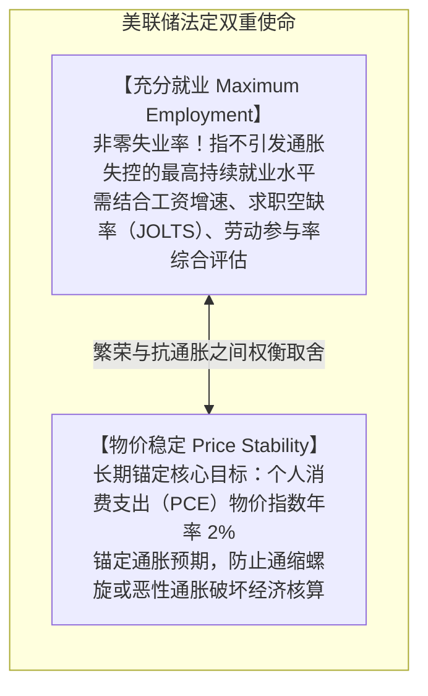
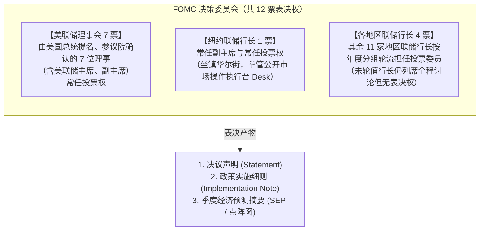
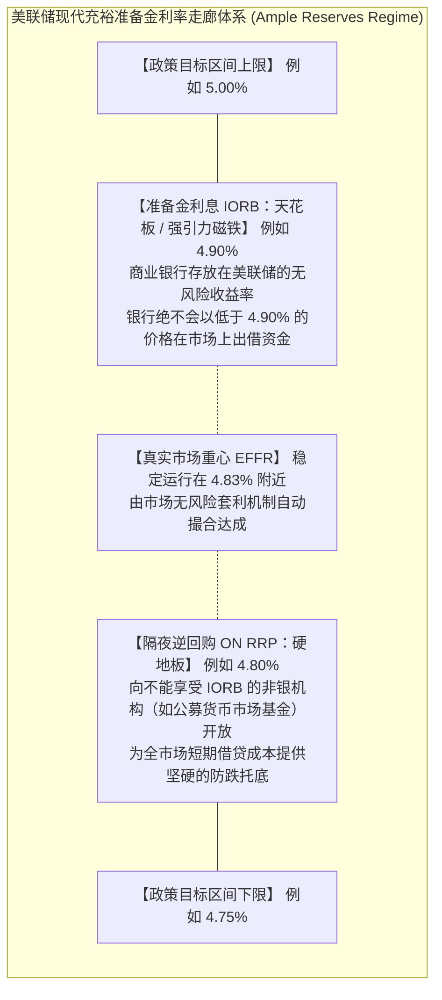
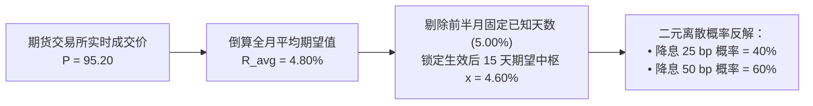
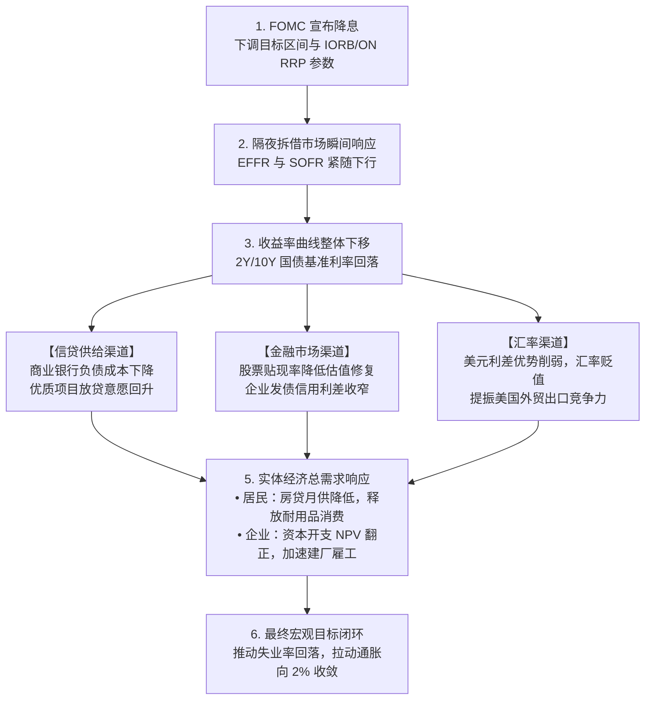
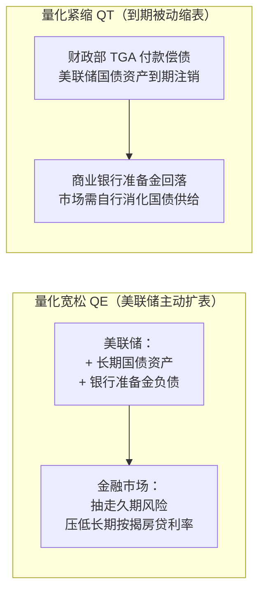

# 13 美联储与货币政策传导

[上一章](12-bank-balance-sheets.md) · [目录](./) · [下一章](14-money-markets.md)

> 本章是全书理解宏观调控与金融资产定价的“核心中枢”。建议分三次学习：第 1—3 节理解双重使命、利率走廊（IORB 与 ON RRP）与政策落地；第 4—6 节掌握期货预期倒推、真实利率与金融条件传导链；第 7—10 节精读 QE/QT 资产负债表运作、解剖 2024 年 9 月真实议息会议并完成全套练习。除明确注明的历史官方报告外，数值均为教学假设。

---

## 本章要解决的问题

在日常财经新闻中，你几乎每天都能刷到类似这样的头条：
> “美联储宣布降息 50 个基点，全球金融市场震动！”

但是，请你停下来深入思考几个看似简单却直击本质的问题：
1. **美联储降的究竟是什么利率？** 鲍威尔是在白宫签署一份行政命令，要求全美商业银行把房贷利率强行下调 0.5% 吗？
2. **为什么美联储宣布一个目标区间，全市场的借贷利息就会跟着乖乖变动？** 借钱和买债明明是自由市场中两家私人机构之间的自主协商，央行凭什么隔空操控成千上万笔独立交易？
3. **为什么经常出现“美联储明明降息了，十年期国债利率和企业贷款成本反而暴涨”的反常怪象？**

这些令人困惑的现象，揭示了宏观分析的一条底层规律：
**货币政策从来不是一根单向直通的杠杆，而是一套由“法定行政参数”、“市场套利套现”与“未来预期折现”层层联动的精密传导齿轮。**

读完本章，你将能够：
- 顺着美联储的指令，看清政策利率如何通过 **IORB（准备金利息）** 和 **ON RRP（隔夜逆回购）** 牢牢锁死在走廊区间内；
- 亲手用 CME 联邦基金期货报价，精确反解全市场交易员对下一次议息会议降息幅度的**隐含概率分布**；
- 区分名义利率与实际利率，理解为什么“名义降息”完全可能伴随着“真实政策立场收紧”；
- 读懂 FOMC 决议声明、点阵图（SEP）与执行细则，不再盲目跟随媒体标题情绪化炒作。

---

## 1. 美联储的法定职责：它在稳定什么？

### 1.1 双重使命（Dual Mandate）及其内在张力

美联储（Federal Reserve System，简称 Fed）是美国的中央银行。美国国会通过《联邦储备法》赋予了它明确的宏观政策目标：
**实现最大就业（Maximum Employment）与物价稳定（Price Stability）**，通常被称为美联储的“双重使命”。

> [!NOTE]
> **官方权威策略声明**：
> 美联储对长期通胀目标的界定是**“长周期内使总体 PCE（Personal Consumption Expenditures）年通胀率锚定在 2%”**。核心 PCE（剔除波动极大的食品和能源）是研判通胀内在黏性的关键辅助工具，但央行对公众承诺的最终法定问责指标始终是总体 PCE。相关机制可回溯[第 09 章](09-inflation-measures.md)，策略全文参见官方文献：[美联储关于长期目标与货币政策策略的正式声明](https://www.federalreserve.gov/monetarypolicy/monetary-policy-strategy-tools-and-communications-statement-on-longer-run-goals-monetary-policy-strategy-2025.htm)。

---

### 1.2 为什么未到目标就必须提前行动？（政策时滞与先发制人）

许多人问：“既然美联储的目标是 2% 通胀，为什么当通胀还在 3% 时，美联储就敢大幅降息？”

原因在于货币政策具有**极其漫长且不可预见的时滞（Long and Variable Lags）**：
- 今天美联储调整利率，资金成本的变化需要 **9 到 18 个月** 才能充分渗透到实体经济的厂房投资、房屋开工、居民消费和工资谈判中。
- 如果央行像一个没有经验的司机一样，“等到车头已经越过红线（通胀彻底降到 2.0% 且不再反弹）才开始踩刹车或松油门”，政策的巨大惯性极有可能让实体经济直接滑入深度衰退与失业暴增的冰窟。

因此，**货币政策永远是一门面向未来的“风险管理艺术”**：政策制定者必须在数据尚未完全达标之前，根据经济运行的动能衰减斜率，提前转向中性水平。

---

## 2. 决策的产生：FOMC 会议如何运转？

### 2.1 谁在投票？（委员会的法定席位）

在新闻报道中，“美联储决定”通常具体指的是**联邦公开市场委员会（FOMC，Federal Open Market Committee）**的集体表决。

权限划分极其分明：
- **FOMC**：负责确立宏观方向，设定**联邦基金利率目标区间（Target Range）**；
- **美联储理事会（Board of Governors）**：负责独立制定**法定准备金利息（IORB）**与贴现窗口利率；
- **纽约联储公开市场操作交易台（The Desk）**：负责在一线执行买卖指令，把决策落到金融市场上。
决策架构权威说明见：[FOMC 组织架构与职责分工](https://www.federalreserve.gov/monetarypolicy/fomc.htm)。

---

## 3. 政策实施：目标区间如何变成真实市场利率？

### 3.1 现实中被交易的利率：EFFR

美联储所调控的终极微观基石，叫做**联邦基金市场（Federal Funds Market）**。

在这个市场里，有合资格资格的金融机构（主要是商业银行、联邦住房贷款银行 FHLB 等）进行**无抵押的隔夜美元头寸借贷**。
每天纽约联储后台会对市场上所有的真实成交记录进行加权统计，计算出**有效联邦基金利率（EFFR，Effective Federal Funds Rate）**：

$$
\text{EFFR 是全美隔夜联邦基金实际成交交易的【成交量加权中位数 (Volume-Weighted Median)】}
$$

#### 算例：加权中位数是如何防范极值干扰的？
假设某一交易日，全美联邦基金市场上只有以下三笔撮合成交：

| 成交利率 ($r_i$) | 成交量 ($V_i$) | 该利率及以下累计成交量占比 | 统计学判定位置 |
| :---: | :---: | :---: | :---: |
| **4.80%** | 20 亿美元 | $20 / 100 = 20\%$ | 尚未达到 50% 分位线 |
| **4.83%** | 60 亿美元 | $(20 + 60) / 100 = 80\%$ | **涵盖了第 50% 核心分位线！** |
| **4.90%** | 20 亿美元 | $(20 + 60 + 20) / 100 = 100\%$ | 极端溢价成交 |

- **加权中位数结果**：由于累计成交量从 $20\%$ 跃升至 $80\%$ 越过了 $50\%$ 的中轴，当日 **$\text{EFFR} = \mathbf{4.83\%}$**。
- **对比误用加权平均数的结果**：
  $$ 4.80\% \times 0.20 + 4.83\% \times 0.60 + 4.90\% \times 0.20 = \mathbf{4.838\%} $$
加权中位数排除了少量因突发流动性短缺而支付高息的极端杂音，反映了全市场资金供求的真实重心。发布细则见 [纽约联储: EFFR 统计方法与更正规则](https://www.newyorkfed.org/markets/reference-rates/effr)。

---

### 3.2 充裕准备金框架下的利率走廊双保险：IORB 与 ON RRP

在 2008 年金融危机前，美联储通过精确微调市场上极度稀缺的准备金数量来调整利率（稀缺准备金体系）。
但如今，经过多轮 QE 后，全美银行体系充斥着数万亿美元的准备金。美联储如何在这种“洪泛”状态下精准控制利率？

**答案是：依靠“利率走廊管理（Floor System）”**。美联储设立了两个由央行兜底的挂牌交易窗口：

#### 机制一：天花板与套利磁铁——准备金利息（IORB）
**IORB（Interest on Reserve Balances）** 是美联储付给商业银行准备金的官方利息。
- 如果市场上有银行或机构愿意以 $4.80\%$ 的超低利率向外借钱，任何具有理性的商业银行都会以 $4.80\%$ 把它借进来，转手存入美联储享受 $4.90\%$ 的 IORB！
- 这一扣除微小资产负债表成本后的无风险套利行为，会瞬间推高市场借贷利率，使其向 IORB 靠拢：
  $$ \text{套利利差空间} = \text{IORB (4.90\%)} - \text{借入成本 (4.80\%)} - \text{资产负债表与监管成本 (0.03\%)} = 0.07\% \quad (7\text{ 个基点}) $$

#### 机制二：地下室防漏水底板——隔夜逆回购（ON RRP）
但是，全美最重要的资金出借方——**联邦住房贷款银行（FHLB）和大型公募货币市场基金（MMF）**，依法无法在美联储享受 IORB 存款利息。它们如果资金过剩，可能会以极低价格踩踏出借。
为了堵住这一漏洞，美联储设立了 **ON RRP（Overnight Reverse Repurchase Facility）**：
- 美联储对货币基金承诺：“如果你在市场上借不出去，直接把钱借给我美联储，我给你按 $4.80\%$ 结息，并压给你足额优质美国国债作为抵押！”
- 有了美联储作为终极交易对手，货币市场基金绝不会以低于 $4.80\%$ 的收益把钱借给任何华尔街投行。**全市场的隔夜利率底线被坚实托住！**

关于该体系的官方理论构建，详见：[美联储经济分析: 充裕准备金框架下的货币政策实施](https://www.federalreserve.gov/econres/notes/feds-notes/implementing-monetary-policy-in-an-ample-reserves-regime-the-basics-note-1-of-3-20200701.html)。

---

## 4. 预期管理与期货推演：行动未至，市场先行

金融市场永远活在对未来的折现中。在 FOMC 官员举手表决之前，市场早已根据经济数据完成了全面定价。

### 4.1 预期如何重塑长期资金价格？

为什么美联储今天只是宣布隔夜利率不变，两年期国债收益率就能大幅下挫？

我们用一个纯粹、无摩擦的两年期投资无套利假想模型来看清它：
投资者有两种资金配置方式：
- 策略 A：直接购买 2 年期固定收益国债，年化收益率为 $y_2$；
- 策略 B：今年先存 1 年期短期资产（年利率 $r_1 = 4.00\%$），到期后本息滚存到第 2 年的预期 1 年期短率 $r_2^e$。

在无风险中性世界里，两者的到期总回报必然相等：

$$
(1 + y_2)^2 = (1 + r_1)(1 + r_2^e) \implies y_2 = \sqrt{(1 + r_1)(1 + r_2^e)} - 1
$$

- 若市场预期美联储第 2 年将执行紧缩，$r_2^e$ 预期为 $5.00\%$：
  $$ y_2 = \sqrt{1.04 \times 1.05} - 1 = \sqrt{1.092} - 1 \approx 4.499\% $$
- 若鲍威尔发表了一通鸽派演讲，市场对第 2 年政策利率的预期 $r_2^e$ 暴跌至 $3.00\%$，而今天的当前利率 $r_1$ 分文未变（仍为 $4.00\%$）：
  $$ y_2' = \sqrt{1.04 \times 1.03} - 1 = \sqrt{1.0712} - 1 \approx 3.499\% $$
**当前利率分毫未动，仅凭对未来预期的重塑，两年期基准资金成本直接断崖式下降了 100 个基点！** 这就是为什么美联储的“前瞻指引（Forward Guidance）”与口头沟通具有核武器般的威力。

---

### 4.2 实战推演：从 CME 联邦基金期货反解降息概率

在彭博终端或 CME 官网上，我们常看到的“美联储下次会议降息 50 个基点的概率为 60%”，这个数字究竟是怎么算出来的？

CME 联邦基金期货合约在到期时的最终结算价格公式严格定义为：

$$
\text{期货合约结算价格 } P = 100 - \bar{R}_{\text{month}}
$$

其中 $\bar{R}_{\text{month}}$ 是该自然月内**每一天实际 EFFR 的算术平均值**（百分数形式，包含周末与法定节假日，周末沿用周五的利率）。

#### 经典测算案例：
假设某个月共有 30 天。
- 关键 FOMC 议息会议定在第 15 天举行，新利率在**第 16 天起正式生效**；
- 会前第 1 至 15 天，市场 EFFR 稳定运行在 $5.00\%$；
- 此时，该月份期货合约在交易所的成交市价显示为 **$95.20$**。

**第一步：反求全月隐含平均期望利率 $\bar{R}_{\text{month}}$**
$$ \bar{R}_{\text{month}} = 100 - 95.20 = 4.80\% $$

**第二步：倒推下半月会议生效后的期望利率水平 $x$**
全月共 30 天，前 15 天已确定为 $5.00\%$，后 15 天为未知数 $x$：
$$ \frac{15 \times 5.00\% + 15 \times x}{30} = 4.80\% \implies 5.00\% + x = 9.60\% \implies x = 4.60\% $$

**第三步：在离散情景下测算概率分布**
假设全市场机构一致共识美联储本次必然降息，唯一的分歧在于：是常规降息 25 bp（将利率降至 $4.75\%$），还是超预期降息 50 bp（将利率降至 $4.50\%$）？
设降息 50 个基点的隐含市场发生概率为 $p$（则降息 25 个基点的概率为 $1 - p$）：

$$
x = (1 - p) \times 4.75\% + p \times 4.50\%
$$

$$
4.60\% = 4.75\% - 0.25\% \times p \implies 0.25\% \times p = 0.15\% \implies p = \frac{0.15}{0.25} = \mathbf{60\%}
$$

这就是全球宏观对冲基金每天使用的无套利定价逻辑！实务中还需结合多个跨月合约进行联立校准，参见 [CME FedWatch 分析方法说明](https://www.cmegroup.com/articles/2023/understanding-the-cme-group-fedwatch-tool-methodology.html)。

---

## 5. 政策立场的真假虚实：名义利率 vs 实际利率

判断货币政策究竟是“踩油门”还是“踩刹车”，绝不能只盯着电视新闻里报出的名义利率数字，必须使用宏观金融学的**费雪效应（Fisher Hypothesis）**：

$$
\text{实际利率 (Real Rate) } r = \frac{1 + i}{1 + \pi^e} - 1 \approx i - \pi^e
$$

其中 $i$ 为名义基准利率，$\pi^e$ 为市场对应期限的预期通胀率。

> [!CAUTION]
> **名义降息完全可能带来“实质紧缩”！**
> 来看一个颠覆直觉的推演：
> - **基准期状态**：名义利率 $i_0 = 5.00\%$，预期通胀率 $\pi_0^e = 3.00\%$。
>   $$ r_0 = \frac{1 + 0.05}{1 + 0.03} - 1 = 1.94\% $$
> - **冲击发生后**：通胀出现急速跳水，预期通胀率断崖式跌落至 $\pi_1^e = 1.50\%$；美联储顺应民意宣布“名义降息 50 个基点”，将名义利率降至 $i_1 = 4.50\%$。
> - **最新实际利率**：
>   $$ r_1 = \frac{1 + 0.045}{1 + 0.015} - 1 = \mathbf{2.96\%} $$
> **结果惊心动魄：美联储虽然在电视上高调降息了 50 个基点，但全社会企业与居民承担的实际真实资本成本反而从 $1.94\%$ 暴涨到了 $2.96\%$（实质收紧了整整 102 个基点）！**
> 如果央行降息的节奏赶不上通胀下行的速度，实体经济就会被动陷入实际利率狂飙的“被动变紧”陷阱。

---

## 6. 全景传导大地图：从美联储会议室到实体车间

美联储宣布降息后，这条宏观神经系统是如何一步步传导至每一个企业和家庭的？

### 为什么降息有时无法拯救企业？（信用利差反向撕裂）
企业在资本市场上借钱发债的利率，从来不等于无风险国债利率，而是满足：

$$
y_{\text{企业借款成本}} = y_{\text{同期限国债基准}} + \text{信用利差 (Credit Spread)}
$$

假设经济遭遇了严重的突发性衰退危机：
- 美联储紧急降息，推动 5 年期国债基准利率从 $4.00\%$ 骤降至 $3.00\%$（基准降了 100 bp）；
- 但由于全市场弥漫着对企业违约破产的极度恐慌，高收益垃圾债的信用利差从原来的 $2.50\%$（250 bp）暴涨到了 $6.00\%$（600 bp）！
- 企业发债融资的真实利率变成了：
  $$ y_{\text{危急时刻}} = 3.00\% + 6.00\% = \mathbf{9.00\%} \quad (\text{危机前为 } 4.00\% + 2.50\% = \mathbf{6.50\%}) $$
**美联储把基准利率砸到了地板上，但实体高风险企业面临的真实借贷成本反而从 6.5% 飙升到了 9.0%！** 这就是为什么单靠常规基准降息无法应对流动性危机的深层原因。

---

## 7. 非常规政策：资产负债表武器（QE 与 QT）

当政策利率已经降至接近零的**有效下限（ELB，Effective Lower Bound）**而无法再降时，美联储会直接动用资产负债表工具。

### 7.1 量化宽松（QE）与量化紧缩（QT）的微观记账

- **QE（大规模资产购买）**：美联储在二级市场真金白银向非银机构购买长期国债与住房抵押贷款证券（MBS），人为压低长端收益率，并通过资产负债表传导渠道压低期限溢价；
- **QT（资产负债表正常化/缩表）**：美联储让持有的国债和 MBS 到期后“本金不予全额再投资（Runoff）”，收回并在账面上注销流动性。

必须牢记：**QT 公布的每月不续作“上限（Cap）”不等于每个月实际资产缩减量。**
例如若设定 MBS 每月减持上限为 350 亿美元，但当月由于全美高利率导致居民提前还贷极少、实际回收的 MBS 本金只有 180 亿美元，则当月 MBS 资产就仅能自然收缩 180 亿，绝不会超额强行扣除。

---

## 8. 真实历史案例精读：2024 年 9 月 18 日 FOMC 议息会议

现在，我们把所学知识应用到一次载入史册的真实会议中。翻开 [美联储 2024 年 9 月 18 日官方议息历史归档](https://www.federalreserve.gov/newsevents/pressreleases/monetary20240918a.htm)。

### 8.1 决议核心三要素

1. **宏观定调**：通胀朝向 2% 目标的信心增强，但委员会对就业下行风险的关注度显著上升，判定“实现双重使命的风险处于大体平衡状态”。
2. **行动幅度**：打破常规的 25 bp 步伐，以 **50 个基点**的先发制人大动作开启降息周期，将基准联邦基金利率目标区间下调至 **4.75%—5.00%**。
3. **关键异议票**：表决结果为 11 比 1。理事鲍曼（Michelle Bowman）投出了罕见的反对票，主张仅降息 25 个基点，防止市场形成恶性再通胀预期。

---

### 8.2 实施细则中的精确数字矩阵

查阅[2024 年 9 月 18 日配套政策实施说明（Implementation Note）](https://www.federalreserve.gov/newsevents/pressreleases/monetary20240918a1.htm)：

| 政策工具科目 | 实施设定数值 | 生效执行日期 | 核心功能机制 |
| :--- | :---: | :---: | :--- |
| **联邦基金目标区间 (Target Range)** | **4.75% — 5.00%** | 2024-09-19 | FOMC 核心指令 |
| **准备金利息率 (IORB)** | **4.90%** | 2024-09-19 | 商业银行隔夜资金停泊收益 |
| **隔夜逆回购操作利率 (ON RRP Rate)** | **4.80%** | 2024-09-19 | 货币市场基金资金硬底板 |
| **贴现窗口主信贷利率 (Discount Rate)** | **5.00%** | 2024-09-19 | 央行给商业银行提供的流动性安全阀 |
| **国债被动缩表月度上限 (Treasury Cap)** | **250 亿美元/月** | 维持执行 | 超额到期本金转入一级市场拍卖续作 |
| **机构 MBS 被动缩表月度上限** | **350 亿美元/月** | 维持执行 | 超额本金再投资于美国国债 |

注意看：**降息与缩表正在同一天同时并行！** 美联储一方面调降隔夜短端资金成本，另一方面继续收缩历史遗留的庞大资产负债表规模。

---

## 9. 练习与参考答案

### 练习 1：从期货报价精准倒推降息预期
某月份共有 31 天。该月关键 FOMC 议息会议定于第 20 天闭幕，各项新政策利率参数从**第 21 天起正式生效**执行。
- 已知在第 1 至 20 天内，全美有效联邦基金利率（EFFR）保持在 $5.33\%$；
- 此时芝加哥商品交易所（CME）挂牌的当月联邦基金期货合约市价成交于 **$94.88$**；
- 市场一致预期本次会议必然采取降息举措，争论焦点仅在于：是“降息 25 bp（后半月中枢变为 $5.08\%$）”，还是“降息 50 bp（后半月中枢变为 $4.83\%$）”。
请通过严格的数学推导，计算出金融市场当前定价所隐含的“降息 50 个基点”的概率是多少？

点击展开参考答案与解析

1. **计算当月隐含平均利率 $\bar{R}$**：
   $$ \bar{R} = 100 - P = 100 - 94.88 = 5.12\% $$
2. **列出按天加权的时间方程**：
   全月共 31 天，前 20 天为 $5.33\%$，后 11 天为会议生效后的未知利率中枢 $x$：
   $$ \frac{20 \times 5.33\% + 11 \times x}{31} = 5.12\% $$
   $$ 106.60\% + 11x = 31 \times 5.12\% = 158.72\% $$
   $$ 11x = 158.72\% - 106.60\% = 52.12\% \implies x = \frac{52.12\%}{11} \approx 4.7382\% $$
3. **求解两档降息离散概率**：
   设降息 50 bp（对应利率 $4.83\%$）的概率为 $p$；降息 25 bp（对应利率 $5.08\%$）的概率为 $1 - p$：
   $$ x = (1 - p) \times 5.08\% + p \times 4.83\% $$
   $$ 4.7382\% = 5.08\% - 0.25\% \times p $$
   $$ 0.25\% \times p = 5.08\% - 4.7382\% = 0.3418\% $$
   $$ p = \frac{0.3418}{0.25} \approx 136.7\% $$
   *经济学洞察与结论反思*：
   算出的 $p > 100\%$ 明确告诉我们：**市场的降息预期已经极其激进，市场不仅认为降息 50 bp 是 $100\%$ 确定事件，甚至已经在定价当月有更大概率实施一次性降息 75 个基点（降至 4.58%）！** 这提醒分析员必须立即拓宽候选情景集合，重新纳入降息 75 bp 的可能性。

---

### 练习 2：实际利率与紧缩力度的辨析
在某次宏观经济深度研讨会上，分析员张三指出：“当前名义政策利率为 5.50%，而前瞻一年期市场通胀预期为 3.00%；如果未来一年内美联储将名义利率降至 4.75%，而受大宗商品暴跌影响，市场通胀预期迅速崩塌至 1.50%，那么借款人所面对的真实还款约束将得到实质性舒缓。”
请结合精确的费雪公式计算实际利率变化，并对张三的结论进行专业纠错。

点击展开参考答案与解析

1. **初始实际利率计算**：
   $$ r_0 = \frac{1 + i_0}{1 + \pi_0^e} - 1 = \frac{1 + 0.055}{1 + 0.030} - 1 = \frac{1.055}{1.030} - 1 \approx 2.427\% $$
2. **变化后的最新实际利率计算**：
   $$ r_1 = \frac{1 + i_1}{1 + \pi_1^e} - 1 = \frac{1 + 0.0475}{1 + 0.015} - 1 = \frac{1.0475}{1.015} - 1 \approx 3.202\% $$
3. **专业纠错分析**：
   - 张三的结论是**完全错误**的。
   - 尽管名义利率下调了 75 个基点（从 5.50% 降至 4.75%），但由于通胀预期下降幅度更大（剧降 150 个基点），按商品购买力折算的**真实实际利率不仅没有下降，反而逆势上升了 $3.202\% - 2.427\% = +0.775\%$（实质收紧了约 77.5 个基点）**！
   - 企业用卖产品赚来的钱偿还固定债务本息的实际负担变得更加沉重。这种名义降息、实际紧缩的状况会导致实体总需求进一步承压。

---

## 本章小结与后续学习路线

在学完本章后，请在脑海中牢牢刻下宏观货币政策分析的四步闭环：
1. **看参数**：分清联邦基金目标区间、准备金利息（IORB）与隔夜逆回购（ON RRP）三维走廊；
2. **推预期**：用联邦基金期货与隔夜掉期（OIS）反解市场定价的会后利率路径；
3. **求真实**：扣除预期通胀计算实际政策立场，防止掉入“名义降息实则收紧”的直觉误区；
4. **查利差**：基准利率下行不等于金融条件宽松，必须结合商业银行信贷标准与高收益信用利差综合定夺。

- 想要深入理解银行间与非银机构隔夜回购融资交易的微观细节与 SOFR 利率基准，请继续进入[第 14 章：货币市场：回购、SOFR 与短期融资](14-money-markets.md)；
- 想要看懂财政部如何在美联储开设的 TGA 账户进行巨额税收清算与国债发行安排，请前往[第 16 章：财政、政府债务、发行安排与 TGA](16-fiscal-policy.md)；
- 想要掌握长期美债收益率曲线（Yield Curve）的无套利贴现、修正久期与倒挂形态，请精读[第 17 章：债券合同、价格、久期与收益率曲线](17-bonds-and-curves.md)。

---

[上一章](12-bank-balance-sheets.md) · [目录](./) · [下一章](14-money-markets.md)
