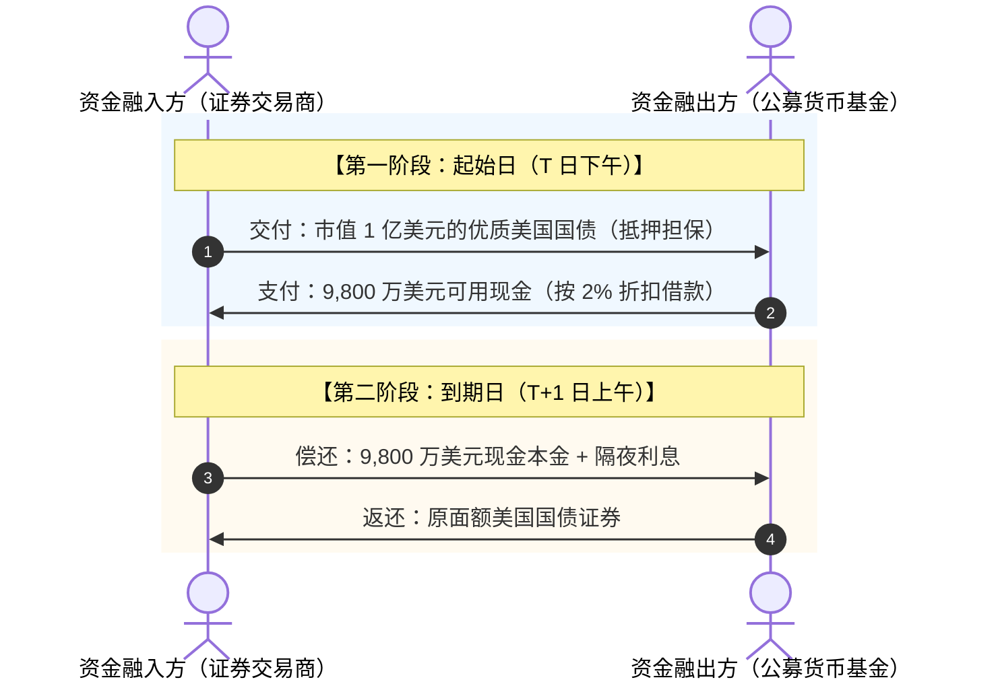
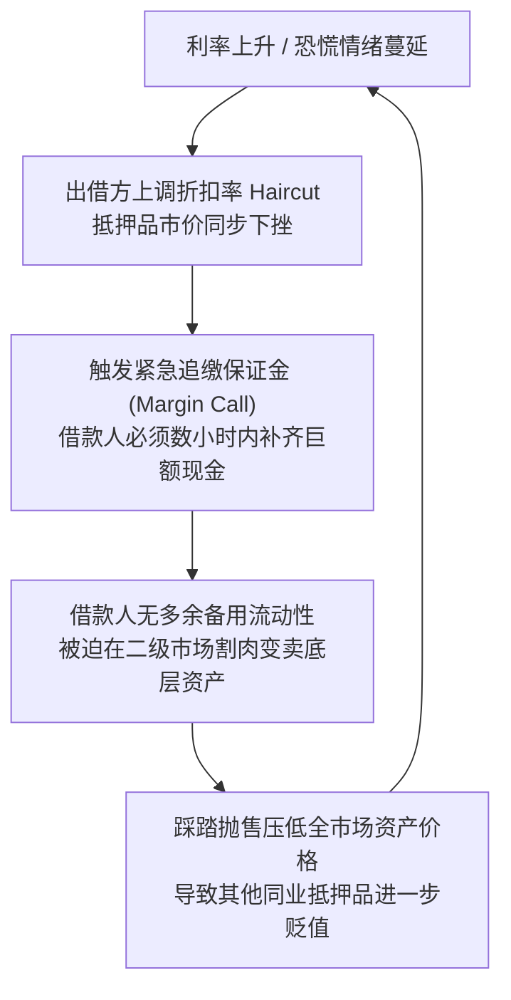
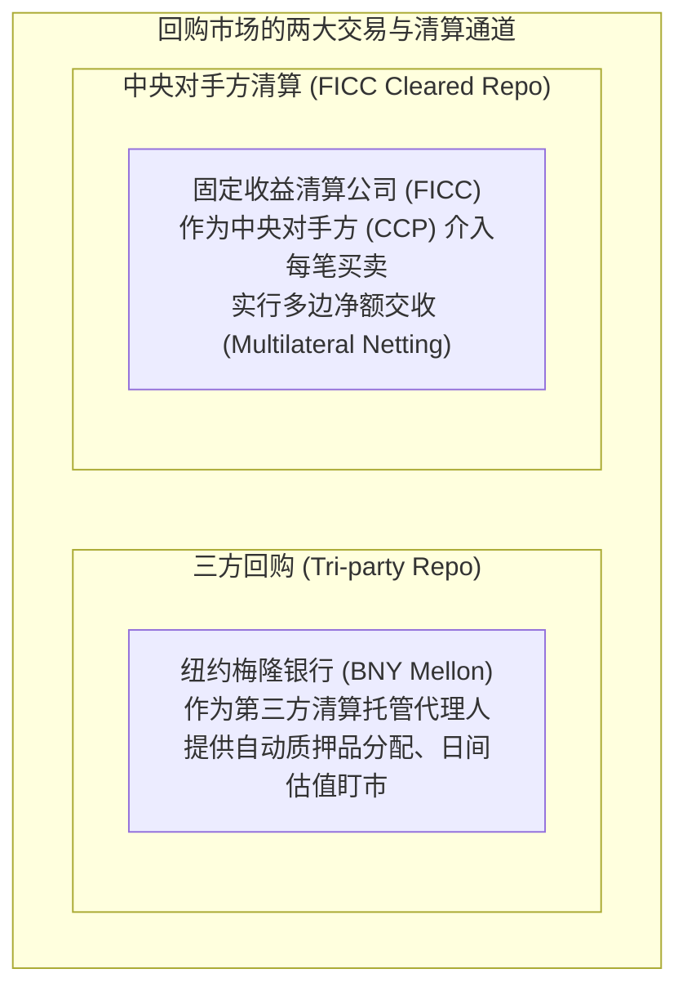
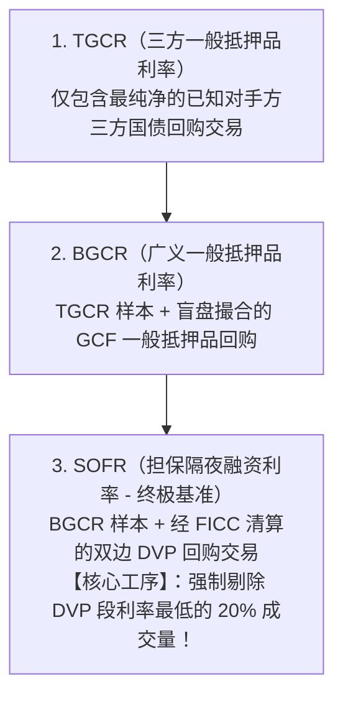
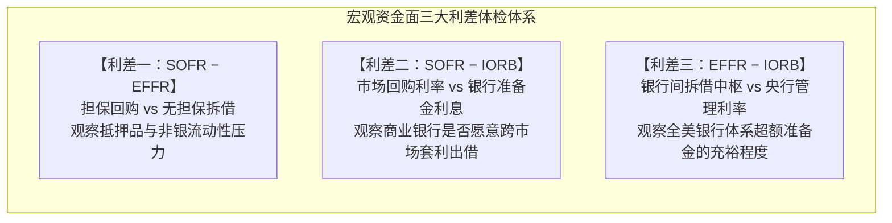
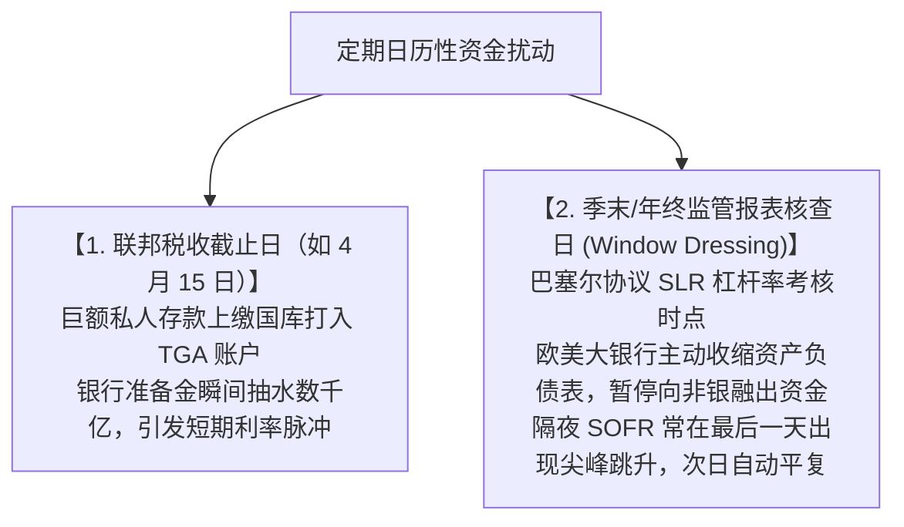
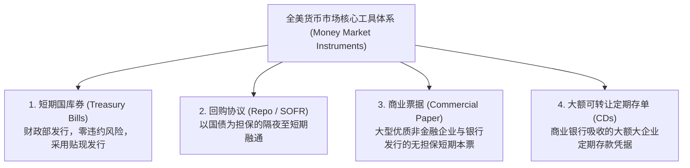

# 14 货币市场：回购、SOFR 与短期融资

[上一章](13-monetary-policy.md) · [目录](./) · [下一章](15-bank-credit.md)

> 本章是宏观金融与华尔街短期资金流转的“微观管道工手册”。建议分三次学习：第 1—3 节彻底理清回购协议（Repo）结构、利息计算与追加质押品机制；第 4—6 节掌握基准利率 SOFR 的数据生产流程、三大利差与特殊券溢价；第 7—10 节精读货币市场工具箱（国库券、商业票据、存单）并完成全套实战练习。除明确注明的历史官方报告外，数值均为教学假设。

---

## 本章要解决的问题：手握 1 亿国债，为什么还会陷入“钱荒”？

假设你是一家大型华尔街一级交易商的首席投资官，你的自营投资组合里整整齐齐地躺着**市值 1 亿美元的优质美国国债**。
今天下午 3:30，你的结算账户突然亮起红灯：由于日内承销和客户交割，你必须在下午 4:00 前对外支付 **9,800 万美元的现金准备金**。

面对这笔刚性现金支出，你手里价值连城的美国国债能直接拿去刷卡付账吗？
**绝对不能。** 国债拥有无可挑剔的极高信用和市场价值，但在清算系统里，它不是能够即时用于大额转账的中央银行现金存款。

此时，摆在你面前的只有两条路：
1. **直接把国债卖掉**：但这意味着你将彻底失去这批国债的头寸，而且在短时间内强行抛售 1 亿国债可能会砸低市价，承受巨大的割肉损失；
2. **保留国债的所有权，把它作为抵押物换取隔夜现金**：明天早晨你收到新的资金后，再连本带利把国债赎回来。

第二条路，就是全球规模最大、日成交额超数万亿美元的隐秘资金大动脉——**回购协议市场（Repurchase Agreement Market，简称 Repo）**。

读完本章，你将能够：
- 顺着日内资金与抵押品流转，算清一笔回购的现金利息、质押折扣率（Haircut）与追缴保证金机制；
- 理解纽约联储如何从数千笔真实交易中，剔除杂音加工出全球金融新基准——**SOFR（担保隔夜融资利率）**；
- 熟练运用 **SOFR、EFFR 与 IORB 三大利差**，敏锐诊断金融体系是陷入了“真实钱荒”还是“短期日历摩擦”；
- 搞懂国库券（T-Bills）的贴现率与真实年化收益率之间的算术陷阱。

---

## 1. 拆解一笔回购交易：不是买卖，而是典当式的短期融资

### 1.1 两次交换，完成一次无缝资金融通

**回购协议（Repo）**从法律文本上看是一笔“买卖合约”，但在实质经济功能上，它就是一笔**以高信用等级证券作为完全担保的抵押借款**。

这两笔交易构成了完美的镜像：
- **对于借钱的交易商而言**：这是“卖出并承诺购回”，称为**正回购（Repo）**；
- **对于借出现金的货币市场基金而言**：这是“买入并承诺返售”，称为**逆回购（Reverse Repo）**。
它们只是同一笔生意的两个观察视角，切勿以为这是两种不同的金融业务！

---

### 1.2 华尔街利息计算规则：ACT/360

在美元短期货币市场中，利息计算遵循国际通行的 **ACT/360 计息惯例**（即一年按 360 天计算，分子按实际跨越的自然日天数计算）：

$$
\text{隔夜应付利息} = \text{借入现金本金 } L \times \text{年化回购利率 } r \times \frac{\text{实际经过的自然日天数 } \Delta t}{360}
$$

我们沿用开头的经典教学案例：
- 融入现金本金：$L = 98,000,000$ 美元（9,800 万美元）；
- 约定的隔夜年化利率：$r = 4.50\%$。

#### 情景 A：周一至周四（跨越 1 个自然日）
$$
\text{利息} = 98,000,000 \times 0.045 \times \frac{1}{360} = \mathbf{12,250} \text{ 美元}
$$
到期应偿付总金额 $= 98,000,000 + 12,250 = 98,012,250$ 美元。

#### 情景 B：周五成交至下周一到期（跨越 3 个自然日）
虽然周六周日金融市场闭市休假，但资金在这三天内被借款人持续占用，因此必须连续计算 3 天的利息：
$$
\text{利息} = 98,000,000 \times 0.045 \times \frac{3}{360} = \mathbf{36,750} \text{ 美元}
$$

> [!WARNING]
> **避坑提醒：年化报价不等于单日利率！**
> 新闻中常说的“隔夜回购利率飙升至 5%”，是指折合年化收益率为 5%，绝非一天要支付借款本金的 5% 作为利息！切勿在数据编程中漏掉除以 360 的换算分母。

---

## 2. 抵押折扣率（Haircut）与流动性踩踏螺旋

有极其安全的美国国债做抵押，借钱的人就真的万无一失了吗？**绝对不是。**

### 2.1 什么是质押折扣率（Haircut）？

出借资金的一方为了防范“借款人突然违约破产，且破产期间国债市价刚好遭遇下跌”的双重风险，绝不会按照国债市值的 100% 借出现金。

出借方会要求扣除一定的安全防撞缓冲垫，这个扣除比例就叫做**质押折扣率（Haircut，直译为理发/削头）**：

$$
\text{可借现金金额 } L = \text{抵押证券当前公允市值 } V \times (1 - h)
$$

其中 $h$ 为折扣率（通常优质国债为 $1\% \sim 2\%$，高收益企业债可高达 $10\% \sim 20\%$）。

在我们的案例中，抵押品国债市值 $V = 1$ 亿美元，约定折扣率 $h = 2\%$：
$$ L = 100,000,000 \times (1 - 0.02) = 98,000,000 \text{ 美元} $$
剩余的 200 万美元缺口，必须由交易商动用自身的自有资本垫付。

---

### 2.2 追缴保证金与双重冲击测算

在回购存续期间，如果市场发生不利变动，借款人会面临双重压力：

#### 冲击一：抵押品国债市值下挫
假设美联储突然发表鹰派言论，市场利率跳升，该笔国债市值由 1 亿美元跌至 **9,900 万美元**（折扣率 $h$ 维持 $2\%$ 不变）：
$$
\text{重新核定的最高可借资金} = 99,000,000 \times (1 - 0.02) = 97,020,000 \text{ 美元}
$$
但交易商此前已经实打实借出了 9,800 万美元！
- **必须立刻补缴的现金缺口**：
  $$ \Delta \text{现金} = 98,000,000 - 97,020,000 = \mathbf{980,000} \text{ 美元} $$
- **如果不补现金，需要追加多少市值的合格国债抵押品？**
  设追加国债市值为 $\Delta V$，需满足 $\Delta V \times (1 - 0.02) \ge 980,000$：
  $$ \Delta V \ge \frac{980,000}{0.98} = \mathbf{1,000,000} \text{ 美元} $$

#### 冲击二：市场恐慌导致出借方强行调高折扣率
在金融危机中，更致命的打击往往来自出借方信心的崩塌：
假设国债市值依然维持 1 亿美元不变，但货币基金出于避险恐慌，在次日滚存续借时，强制要求将折扣率从 $2\%$ 上调至 **$4\%$**：
$$
\text{最新可借资金} = 100,000,000 \times (1 - 0.04) = 96,000,000 \text{ 美元}
$$
交易商在国债价格分文未跌的晴空万里下，被凭空逼出了 **200 万美元的硬性现金缺口**！

这就是 2008 年次贷危机中击垮雷曼兄弟与贝尔斯登的**“回购市场挤兑与流动性黑洞”**。

---

## 3. 市场组织架构：谁在撮合与清算？

现代回购市场并不是在路边摊一对一私下倒手，而是运行在严密的金融基建网络之上：

- **三方回购（Tri-party Repo）**：交易双方自己敲定价格后，把繁琐的抵押品验真、划转、每日盯市估值和违约处置全部外包给大型清算托管行（如纽约梅隆银行 BNY Mellon）。
- **券款对付（DVP，Delivery versus Payment）**：清算系统确保“交出债券的同时必然收到现金，付出现金的同时必然收到债券”，从根源上杜绝了某一方卷款跑路的本金风险。

---

## 4. 全球新基准：SOFR 利率是如何诞生的？

在过去几十年里，全球几百万亿美元的贷款和衍生品都锚定伦敦银行间同业拆借利率（LIBOR）。但由于 LIBOR 充斥着虚假报价丑闻，美联储主导确立了全新的黄金基准——**SOFR（Secured Overnight Financing Rate，担保隔夜融资利率）**。

### 4.1 SOFR 的数据原料与三大过滤层

SOFR 不是任何美联储官员拍脑袋决定的行政利率，它是**纽约联储每天根据前一个交易日市场上真实成交的隔夜国债回购数据汇总加工出的统计量**。

纽约联储将数据层层过滤，构建了由小到大的三大参考利率体系：

> [!IMPORTANT]
> **为什么要强制剔除 DVP 中利率最低的 20% 成交量？**
> 在回购市场中，如果某位华尔街对冲基金急于借入某只极其抢手的特定国债（例如刚出炉的最新 10 年期基准国债）用来做空，他宁愿报出极低的贷款利息（甚至 0%）把现金拱手送人，只为借到这只国债！这种交易反映的是**“这只特定债券的稀缺溢价（Speciality）”**，根本不能代表全市场一般抵押借钱的普遍成本。
> 纽约联储为此设立了铁律：**必须无条件剔除 DVP 交易段中利率最低的 20% 成交量**，以确保 SOFR 测量的纯粹是真实的普遍融资成本！编制细则参见官方文档：[纽约联储: 参考利率编制与排除规则说明](https://www.newyorkfed.org/markets/reference-rates/additional-information-about-reference-rates)。

---

### 4.2 动手算一算：成交量加权中位数

纽约联储对过滤后的全部合规回购交易，按照利率从低到高排列每一笔成交金额，提取**第 50% 成交量所在的分位点**作为当日 SOFR。

#### 算例推演：
假设某日经过筛选后的合规交易共包含以下三档：

| 撮合年化利率 ($r_i$) | 成交金额 ($V_i$) | 累计成交量及占比 | 统计中轴归属判定 |
| :---: | :---: | :---: | :---: |
| **4.30%** | 20 亿美元 | 20 亿美元 ($20\%$) | 尚未触及中位数线 |
| **4.35%** | 60 亿美元 | **80 亿美元 ($80\%$)** | **完美跨越了第 50% 核心分位线！** |
| **4.60%** | 20 亿美元 | 100 亿美元 ($100\%$) | 尾部边缘高息成交 |

- **全天 SOFR 官方读数**：中位数落在第二档，公布值为 **$4.35\%$**；
- **加权平均值对比**：
  $$ \frac{20 \times 4.30\% + 60 \times 4.35\% + 20 \times 4.60\%}{100} = \mathbf{4.39\%} $$
若采用平均数，尾部 20 亿美元的 4.60% 高息就会把整体指标拉高 4 个基点；而中位数算法成功过滤了这一局部噪音。

---

## 5. 三大利差监控仪表盘：给金融水管做体检

在顶级量化宏观机构的监控屏幕上，资深交易员每天早晨必看以下**三大利差**：

| 利差指标 | 经典正常读数 | 若利差显著走阔（大幅转正）意味着什么？ |
| :--- | :---: | :--- |
| **1. SOFR − EFFR** | **$0 \sim +5$ bp** | 市场上国债供给暴增（财政部大规模发债交割），或者非银机构（对冲基金）加杠杆融资需求旺盛，导致抵押融资需求踩踏。 |
| **2. SOFR − IORB** | **$-5 \sim 0$ bp** | 正常情况下商业银行宁可存 IORB 也懒得去回购市场折腾。一旦 SOFR 持续大幅高出 IORB 10 bp 以上，说明银行即便有利可图也不敢放款，预示**银行资本或流动性指标出现隐性阻塞**。 |
| **3. EFFR − IORB** | **$-8 \sim -5$ bp** | 正常情况下无担保拆借利率略低于准备金利息。若该差值向上攀升并无限逼近 0 甚至翻正，**是全美银行体系准备金告急的最强烈红灯报警信号**！ |

---

## 6. 现实中的日历摩擦：季末与税期的规律性异动

不要一看到回购利率跳升就惊呼“雷曼时刻重演”。在成熟金融市场中，有两大常规的**制度性日历扰动**：

> [!TIP]
> **合格宏观研究员的诊断准则：**
> 1. **看日历**：跳升是否发生在上半年报税日或 3/6/9/12 月的最后一个交易日？
> 2. **看持续性**：是一天之内迅速平复，还是连续 3 天以上居高不下？
> 3. **看后备工具**：美联储的常备回购便利（SRF）是否被大规模动用？（官方参数与准入细则见：[纽约联储: 常备回购工具 SRF 操作指引](https://www.newyorkfed.org/markets/repo-agreement-ops-faq)）。

---

## 7. 货币市场大拼图：国库券、商业票据与大额存单

货币市场（Money Markets）是所有**剩余期限在 1 年以内的短期债务工具**的总称。

### 7.1 国库券贴现率（Discount Rate）的算术陷阱

短期国库券（T-Bills）不支付定期票息，而是**按低于面值的价格折价发售，到期按 100 美元面值全额兑付**。

假设一张面值 $F = 100$ 美元、期限为 $t = 90$ 天的国库券，当前在市场上的发行购买价格为 $P = 98.75$ 美元。
持有 90 天到期后，投资者赚取 $100 - 98.75 = 1.25$ 美元的固定差价收益。

在报价终端上，有两种计算收益率的方法，初学者极易混淆：

#### 方法一：银行贴现收益率（Bank Discount Yield, $d$）
华尔街传统交易员习惯用面值作为分母，按一年 360 天折算：
$$
d = \frac{F - P}{F} \times \frac{360}{t} = \frac{100 - 98.75}{100} \times \frac{360}{90} = 1.25\% \times 4 = \mathbf{5.00\%}
$$

#### 方法二：真实债券等价收益率（Bond Equivalent Yield / Investment Yield, $y$）
这才是投资者真实投入资金所获得的真实年化收益率（以实际付出的购买价格 $P$ 为分母，按一年 365 天折算）：
$$
y = \frac{F - P}{P} \times \frac{365}{t} = \frac{100 - 98.75}{98.75} \times \frac{365}{90} = \frac{1.25}{98.75} \times 4.0556 \approx \mathbf{5.13\%}
$$

> [!NOTE]
> 银行贴现率算出来的 $5.00\%$，严重低估了投资者的真实回报率（真实年化其实是 $5.13\%$）！官方定价换算公式详见：[美国财政部 TreasuryDirect: 国债价格与收益率折算说明](https://www.treasurydirect.gov/marketable-securities/understanding-pricing/)。

---

## 8. 练习与参考答案

### 练习 1：跨周末回购利息与足额抵押测算
某高频量化做市商在周五下午通过隔夜回购协议（Repo）借入 **6,000 万美元**的现金准备金周转，约定于下周一上午按期偿还，合同约定的年化回购利率为 $4.60\%$（遵循 ACT/360 计息规则）。资方要求的抵押品折扣率（Haircut）为 $2.5\%$。
1. 计算做市商在下周一偿还这笔交易时，应向资方支付的利息金额是多少？
2. 在周五成交的瞬间，该做市商必须向出借方划转公允市值至少为多少美元的合格美国国债？

点击展开参考答案与解析

1. **隔夜利息计算**：
   - 从周五到下周一跨越了 3 个完整自然日（$\Delta t = 3$）；
   - 根据公式：
     $$ \text{利息} = 60,000,000 \times 0.0460 \times \frac{3}{360} = 23,000 \text{ 美元} $$
   - 周一应付总还款额为 $60,023,000$ 美元。
2. **所需抵押品最低公允市值测算**：
   - 设所需国债市值为 $V$，已知融入现金 $L = 60,000,000$ 美元，折扣率 $h = 2.5\%$；
   - 满足约束：$L = V \times (1 - h) \implies 60,000,000 = V \times (1 - 0.025) = 0.975 V$；
   - 解出：
     $$ V = \frac{60,000,000}{0.975} \approx \mathbf{61,538,461.54} \text{ 美元} $$
   - **警示**：千万不要顺手用 $6,000 \text{ 万} \times (1 + 0.025) = 6,150$ 万，那会导致抵押品不足额而遭到清算系统拒绝！

---

### 练习 2：抵押品贬值与质押折扣率跳升的双重保证金追缴
华尔街某对冲基金原本以公允价值为 **2 亿美元**的长期国债作为质押品，在回购市场上借入了 **1.96 亿美元**的现金（对应初始质押折扣率为 $2\%$）。
次日开盘，受地缘政治剧震影响，该批国债市值暴跌至 **1.92 亿美元**。同时，由于市场流动性收紧，资金融出方在续借时强制将质押折扣率上调至 **$5\%$**。
请问：该对冲基金在当日面临的**现金追加保证金缺口（Margin Call）**是多少美元？

点击展开参考答案与解析

1. **计算最新允许借入的最大现金容量**：
   - 最新抵押品公允市值 $V_1 = 1.92$ 亿美元；
   - 最新苛刻折扣率 $h_1 = 5\%$；
   - 最新融资上限：
     $$ L_1 = V_1 \times (1 - h_1) = 1.92 \times (1 - 0.05) = 1.92 \times 0.95 = 1.824 \text{ 亿美元} $$
2. **计算必须立刻补缴的现金缺口**：
   - 基金账面上当前背负的到期存量债务本金为 $L_0 = 1.96$ 亿美元；
   - 现金缺口：
     $$ \Delta L = L_0 - L_1 = 1.96 - 1.824 = \mathbf{0.136} \text{ 亿美元} = \mathbf{1,360} \text{ 万美元} $$
   - **深度点评**：虽然底层资产市值仅缩水了 800 万美元，但在折扣率提升的合力挤压下，基金必须在数小时内掏出高达 **1,360 万美元**的活期现金！这往往是高杠杆基金在危机中瞬间猝死的根源。

---

## 本章小结与后续学习路线

学完本章后，请在脑海中建立起短期资金市场的立体架构：
1. **回购是短期流动性的命脉**：抵押品市值、Haircut 折扣率与借款本金构成了稳固的铁三角；
2. **SOFR 是剔除特权杂质后的纯净基准**：通过排除最低 20% 成交量，纽约联储确保其测算的是一般借贷成本；
3. **利差是流动性的晴雨表**：时刻紧盯 $\text{SOFR} - \text{IORB}$ 与 $\text{EFFR} - \text{IORB}$，精准区分是季末 SLR 考核的短期杂音，还是银行体系深层的流动性干涸。

- 想要理解商业银行信贷供给、广义信贷标准与企业贷款周期的互动关系，请前往[第 15 章：银行信贷](15-bank-credit.md)；
- 想要理解美国财政部如何统筹赤字融资与 TGA 账户资金划拨，请阅读[第 16 章：财政、政府债务、发行安排与 TGA](16-fiscal-policy.md)；
- 想要推演长期美债价格贴现、修正久期敏感度与收益率曲线倒挂形态，请精读[第 17 章：债券合同、价格、久期与收益率曲线](17-bonds-and-curves.md)。

---

[上一章](13-monetary-policy.md) · [目录](./) · [下一章](15-bank-credit.md)
