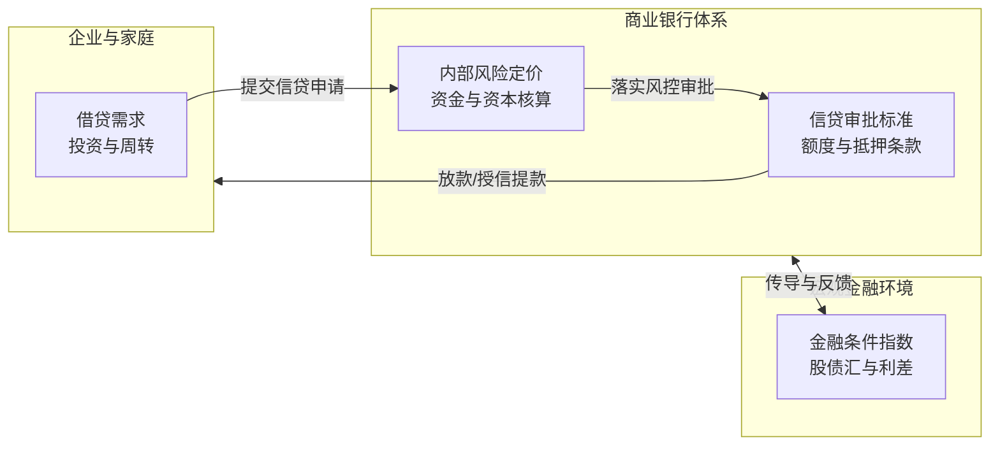
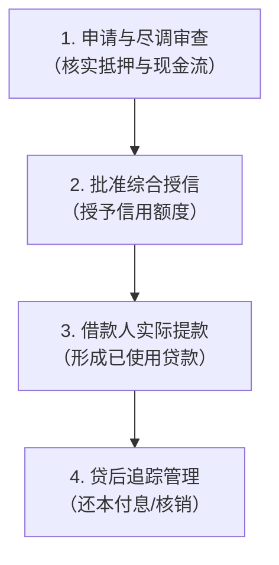
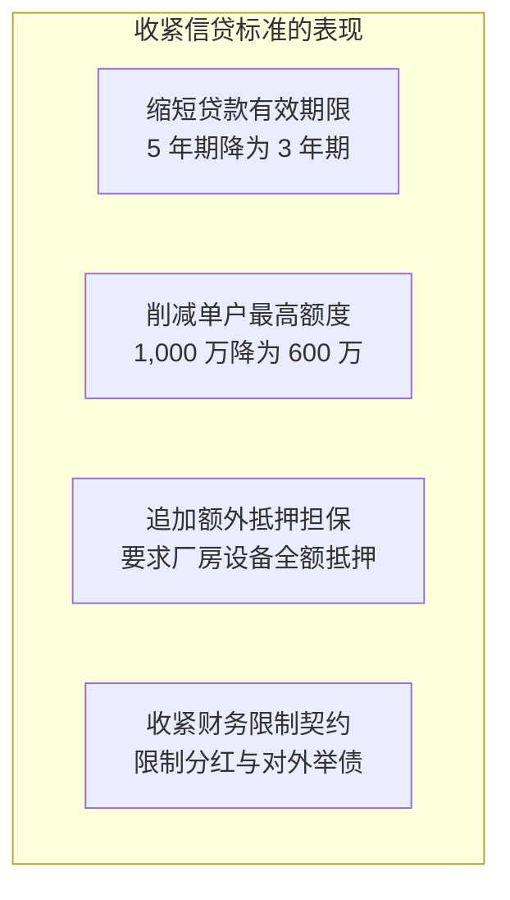
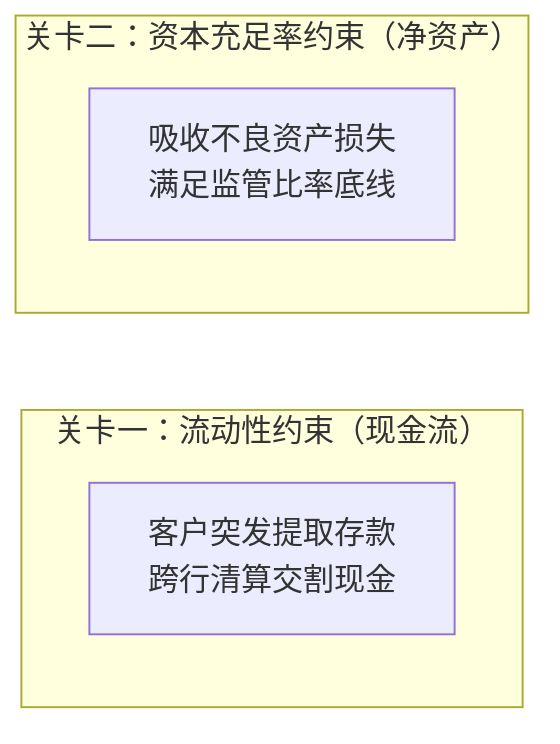
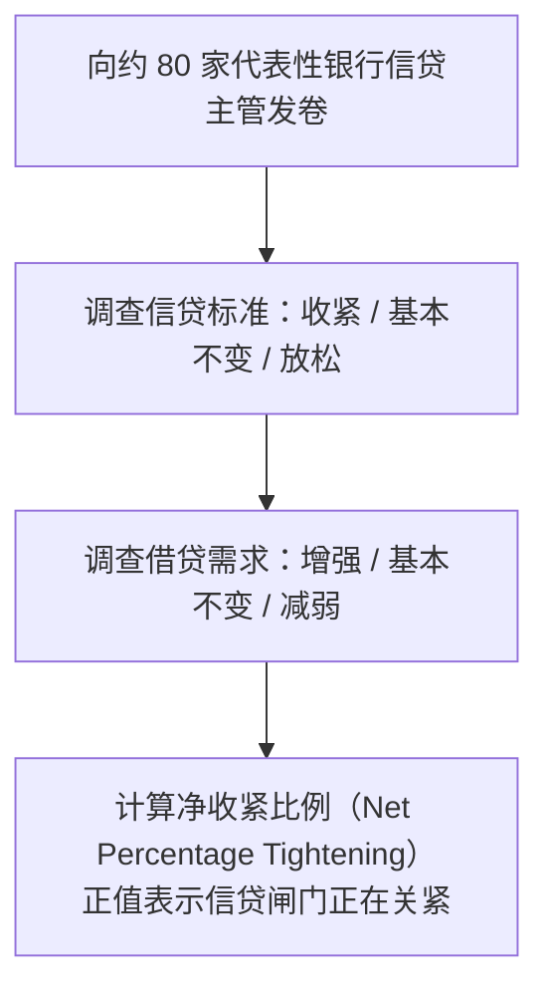
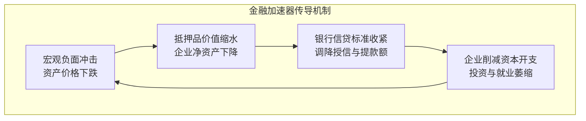
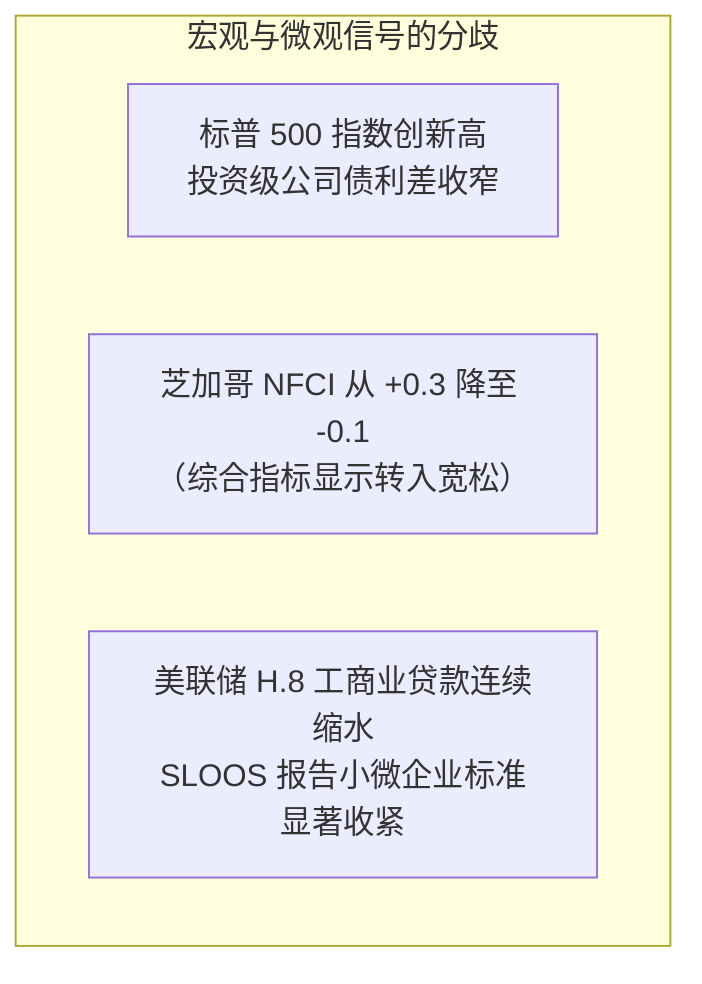

# 15 银行信贷、非银行融资与金融条件

[上一章](14-money-markets.md) · [目录](./) · [下一章](16-fiscal-policy.md)

## 本章要解决的问题：贷款变少，是谁不愿意成交？

设想你在经营一家机械制造厂，准备采购一批高精度数控机床，向合作银行申请了 1,000 万美元额度。银行进行了严格审核后批准了授信，但企业最终只提取了 400 万美元，剩下的 600 万美元留在账上备用。三个月后，宏观统计显示全社会银行贷款余额出现下滑。

这是因为银行惜贷不敢放款，还是因为制造业订单减少、企业主动压缩了借款需求？亦或是银行发放贷款后，通过资产证券化将其打包转售给了养老基金？这三种情形对实体经济的含义截然不同，但在单调的总量贷款余额曲线上，却会留下极其相似的痕迹。

在前面的货币与资金市场模块中，我们追踪了政府融资、准备金流转、回购市场与国债交易。本章我们将镜头推进到现代信用体系的中枢：银行与企业、家庭之间的信贷往来。

读完本章，你将能够：
1. 清晰拆解贷款的价格、数量、审批标准与合同条款四个维度；
2. 亲手复算美联储 H.8 周度报告与高级信贷员意见调查（SLOOS）的关键统计读数；
3. 理解银行面临的“流动性”与“资本充足率”双重约束，搞清为什么有钱的银行也可能不敢放贷；
4. 熟练掌握芝加哥联储全国金融条件指数（NFCI）的编制逻辑与边界，学会立体诊断真实的信用温度。

---

## 1. 从申请到还款：贷款不是按下按钮就自动发生

### 1.1 企业需要的首先是一个可行项目

企业向银行申请借款，动机往往各不相同：有的为了添置厂房设备扩大产能，有的为了采购旺季原材料，有的为了垫付客户应收账款，还有的仅仅是为了偿还下周即将到期的旧债券。

商业逻辑决定了融资性质：
- **扩产性融资**：依赖未来增量销售现金流偿付，代表企业家对经济前景抱有信心；
- **周转性与防御性融资**：用于平抑营运资金波动或防备流动性枯竭，可能恰恰发生在行业逆风期。

在企业递交申请表前，财务经理会权衡预期投资回报率、资金利息与财务脆弱性。即使基准利率降得再低，如果下游订单腰斩，理性的企业也不会盲目借钱买设备；相反，当供应链危机导致核心元器件断货，哪怕贷款利率高达 10%，企业为了避免工厂停摆也必须咬牙借入营运周转金。

银行信贷官面对同一份申请，思考的维度完全不同：这笔贷款产生的利息收入，是否足以覆盖资金成本、营运开支、潜在违约损失，并为股东提供合意的股本回报？项目对企业来说有利可图，并不代表银行愿意承担其潜在的下行破产风险。

### 1.2 审批、授信、提款与余额是四个独立环节

在商业银行的日常运作中，一笔信贷从无到有，会清晰地经历四个步骤：

| 环节 | 实际商业过程 | 我们可以观察到的现象与认知红线 |
| :--- | :--- | :--- |
| **申请与审查** | 银行评估借款人还款意愿、经营现金流、抵押品变现价值与担保能力 | 申请量激增可能仅代表企业现金流紧张，不等于放款成功 |
| **批准授信** | 双方在法律合同中约定总信用额度、可用期限、定价机制与限制性契约 | 获批授信是银行的信贷承诺，不等于资产负债表上的贷款余额 |
| **实际提款** | 借款人满足提款先决条件后，银行将资金打入账户，正式形成生息债权 | 当期提款可能来自两年前就获批的备用授信额度 |
| **后续管理** | 客户按期付息、到期还本；银行监控财务指标、办理展期或处置坏账 | 期末贷款余额是新发放、还本、资产转让与不良核销的净结果 |

举个具体算例：某制造企业获得了银行批准的 $1{,}000$ 万美元一年期循环贷款授信，但目前仅提取了 $400$ 万美元用于支付货款。
此时该企业的授信使用率为：
$$\text{授信使用率} = \frac{\text{实际提款余额}}{\text{获批授信总额}} = \frac{400}{1{,}000} = 40\%$$

对于未使用的 $600$ 万美元额度，企业通常只需按季度支付少量的承诺费（如年化 $0.25\%$）。这笔未动用额度虽然随时可能给银行带来突发结算压力，但在借款人真正提款前，它并不会出现在银行资产负债表的“贷款”资产科目中。

> [!NOTE] 会计常识补充
> 商业银行放贷时在会计上是“贷款增加、客户存款增加”，即现代银行通过扩张账本创造内生货币。然而，当借款企业将这笔存款转给供应商所在的其他银行时，放款银行就必须在跨行清算中交割真金白银的准备金。因此，能记账绝不等于银行可以无限度放款。

### 1.3 审批标准与合同条款：利率不变，也可以大幅收紧

我们经常在财经媒体上看到“美联储维持利率不变，企业融资环境平稳”之类的评论。但在真实信贷市场上，即使挂牌名义利率纹丝不动，借贷难度也可能发生天翻地覆的变化。

这需要区分两个关键概念：
- **信贷审批标准（Lending Standards）**：回答“银行愿意借给谁”。例如客户信用评分门槛、最低利息覆盖倍数、抵押品折价率（Haircut）等准入条件。
- **贷款合同条款（Loan Terms）**：回答“获准放款后按照什么条件执行”。包括授信额度上限、贷款期限长短、利率加点点差、提前还款罚金以及限制性契约（Covenants）。限制性契约是借款人必须遵守的红线约定，比如资产负债率不得超过 $65\%$、未经银行同意不得对外大额担保等。

为什么银行不干脆把名义利率上浮到 $15\%$，让所有有风险的企业都来借？
金融经济学中的经典理论揭示了**信贷配给（Credit Rationing）**机制：利率越高，稳健保守的优质企业越会被高昂成本吓退，反而是那些从事高风险投机甚至孤注一掷的劣质借款人乐意接受高息（逆向选择）；此外，借款人一旦背上极高利率，更倾向于冒险赌一把（道德风险）。因此，面对风险抬升，理性的商业银行宁愿选择拒贷、砍额度、缩期限，也不会单纯依赖提价来出清市场。

---

## 2. 贷款价格怎样形成：从银行成本到借款人支出

### 2.1 商业银行的贷款定价公式拆解

银行做贷款并不是拍脑袋敲定价格，其内部定价逻辑非常类似于一家工厂对工业品的成本加成核算：

假设某商业银行正在审批一笔金额为 $1{,}000$ 万美元、期限为一年的优质企业流动资金贷款。银行内部的年化资金定价拆解如下：

| 定价构成组件 | 教学假设数值 | 商业与经济学本质 |
| :--- | :---: | :--- |
| **边际资金成本** | $4.0\%$ | 银行在批发金融市场上筹集相应期限边际负债（如大额存单、回购）的成本 |
| **预期信用损失补偿** | $1.2\%$ | 同类风险池贷款平均可能发生的本金坏账损失计提 |
| **运营与服务费用** | $0.3\%$ | 尽职调查、财务审计、IT 核心系统维护及法务文本合规支出 |
| **资本占用与利润要求** | $1.5\%$ | 覆盖非预期尾部风险的监管资本占用成本，以及股东要求的合理权益回报 |
| **最终基准贷款报价** | **$7.0\%$** | 上述四项成本与目标利润的合计数 |

其中，$1.2\%$ 的预期信用损失（Expected Loss, EL）来源于经典的风险计量公式：
$$\text{预期损失率 (EL)} = \text{违约概率 (PD)} \times \text{违约损失率 (LGD)}$$

若该行业同评级企业一年的违约概率 $\text{PD} = 2.0\%$，一旦发生实质性违约，抵押品清偿后的本金损失幅度为 $\text{LGD} = 60\%$（即回收率 $40\%$），则预期本金损失率即为：
$$\text{EL} = 2.0\% \times 60\% = 1.2\%$$

这一项是用来在统计意义上平摊可预见的坏账成本；至于极端危机下的未预期损失（Unexpected Loss），则必须由最后那一项资本与所有者权益来承担。

### 2.2 基准利率下降，为何最终贷款报价反而上升？

在实际信贷业务中，浮动利率贷款通常表达为“参考基准利率 + 风险利差加点（Spread）”：
$$\text{实际贷款利率} = \text{参考基准利率（如 SOFR 或优惠利率）} + \text{合同风险加点}$$

当宏观经济遭遇突发黑天鹅或信用恶化时，常会出现令人费解的现象：中央银行明明在降息，企业拿到的贷款报价反而变贵了。

假设原先市场基准利率为 $5.0\%$，银行针对某行业评级收取的加点为 $2.0\%$，借款企业承担的实际年利率为：
$$\text{原报价} = 5.0\% + 2.0\% = 7.0\%$$

随后宏观环境转差，央行紧急降息 50 个基点（$-50\,\text{bp}$），基准利率降至 $4.5\%$。然而，由于该行业违约潮涌现，银行风险评估模型将加点利差调升了 100 个基点（$+100\,\text{bp}$）以抵补潜在损失。此时企业面对的新报价变为：
$$\text{新报价} = 4.5\% + 3.0\% = 7.5\%$$

整个过程的利息变动可量化拆解为：
$$\Delta \text{基准利率} = -50\,\text{bp}$$
$$\Delta \text{利差加点} = +100\,\text{bp}$$
$$\Delta \text{最终报价} = -50\,\text{bp} + 100\,\text{bp} = +50\,\text{bp}$$

> [!WARNING] 统计读数的“幸存者偏差”
> 如果你在宏观统计月报中看到“全行业新发放贷款平均利率下降了 30bp”，切忌盲目判定实体企业融资变得普遍宽松。因为在风险高企时，银行往往直接拒绝了高风险客户的申请，市场上只剩下一小批实力雄厚的超优质国企与行业巨头能够拿到贷款。平均利率被借款人结构的改变人为拉低了，而绝大多数普通企业反而更加借钱无门。

### 2.3 利率变动的现实传导具有非对称与滞后性

同样面对借款利率上升 100 个基点（$+1.0\%$）：
- **浮动利率借款人**：若是挂钩 SOFR 的浮息银团贷款，每季度重定价日一到，财务费用立刻上升。借款 $\$4{,}000{,}000$ 美元的企业，一年需实打实多掏出：
  $$\$4{,}000{,}000 \times 1.0\% = \$40{,}000\,\text{美元}$$
- **固定利率借款人**：如果此前签订的是 5 年期固定利率借款合同，只要本金未到期，当月的现金流出就完全不受加息冲击。然而，一旦债务到期需要借新还旧（再融资），企业就会瞬间撞上一堵“利息墙”。

---

## 3. 银行想放贷，必须连过“资金”与“资本”两道关

许多初学者容易把银行的存款准备金（现金）和银行的资本金（净资产）混为一谈。事实上，银行扩张信贷犹如汽车在公路上行驶，**资金（流动性）**是油箱里的汽油，**资本（偿付能力）**是车身的坚固钢架。油不够车会抛锚，钢架变形撞车就会散架。

### 3.1 存款流失影响的是负债重构成本，不是自动强制抽贷

假设某银行原先依靠年利率为 $2.0\%$ 的活期储蓄存款来提供日常资金。某个月内，因为理财产品竞争，账上发生了 $100$ 单位的活期存款外流。银行为了维持资产负债表平衡，不得不通过发行年利率 $5.0\%$ 的同业定期存单来补足负债缺口。

在贷款本金未缩水的情况下，银行每年新增的利息负担为：
$$\Delta \text{年资金成本} = 100 \times (5.0\% - 2.0\%) = 3.0\,\text{单位}$$

这家银行并未破产，存量贷款也没有瞬间消失，但利差利润被严重压缩。为了恢复盈利，银行要么在后续放贷中提高要价，要么放慢新资产扩张步伐。

### 3.2 资本不是锁在金库里的现钞

**资本（Capital）是股东权益，在资产负债表的右下方，用来承担最终损失；准备金（Reserves）是央行存款，在资产负债表的左上方，用来应对清算提现。**

为了防止银行过度放大财务杠杆，巴塞尔协议确立了**资本充足率（Capital Adequacy Ratio）**监管规则：
$$\text{资本充足率} = \frac{\text{合格监管资本}}{\text{风险加权资产 (RWA)}}$$

我们构建一个极度清晰的监管教学模型：
- 银行初始合格一级资本为 $10$ 亿元；
- 当前风险加权资产（RWA）为 $100$ 亿元；
- 监管要求的最低资本充足率底线为 $10\%$。
此时银行恰好达标：
$$\text{初始资本充足率} = \frac{10}{100} = 10.0\%$$

现在，有大型企业上门申请 $20$ 亿元新贷款。假设按照监管规则，这类一般企业工商贷款的风险权重为 $100\%$。若银行没有任何增资扩股或未分配利润留存，在发放这笔贷款后：
$$\text{新风险加权资产} = 100 + 20 \times 100\% = 120\,\text{亿元}$$
$$\text{新增放贷后的资本充足率} = \frac{10}{120} \approx 8.33\%$$

为了满足 $10\%$ 的监管合规线，在 $120$ 亿元 RWA 规模下，银行必须具备的最低资本额为：
$$\text{合规所需最低资本} = 120 \times 10\% = 12\,\text{亿元}$$
$$\text{实际资本缺口} = 12 - 10 = 2\,\text{亿元}$$

**哪怕银行金库里有上百亿结算资金，只要资本充足率突破了红线，根据金融法规，银行就必须停止发放这笔贷款！**

### 3.3 资本损失对信贷供给能力的乘数级收缩效应

反过来，如果经济恶化导致资产发生坏账，会发生什么？

假定银行账面资本依然为 $10$ 亿元，RWA 为 $100$ 亿元。某一天，因借款人破产重组，银行被迫全额冲销坏账，发生了 $2$ 亿元的本金净损失：
- 资本金瞬间被蚕食：从 $10$ 亿元缩水至 $8$ 亿元；
- 假设在短期内无法完成二级市场定向增发，也没有利润结转补充资本；
- 为了满足 $10\%$ 的底线，银行资产端所能支撑的最高风险加权资产只能是：
  $$\text{最高允许 RWA} = \frac{\text{剩余资本}}{\text{最低资本充足率}} = \frac{8}{10\%} = 80\,\text{亿元}$$

这意味着，为了让资本充足率重新爬回 $10\%$，银行必须主动压降风险加权资产规模达：
$$\Delta \text{RWA} = 100 - 80 = 20\,\text{亿元}$$

这就是银行业著名的**资本乘数放大机制**：区区 $2$ 亿元的资本损失，迫使银行不得不通过停止续贷、变现资产等方式，压降多达 $20$ 亿元的表内高风险信贷资产！

---

## 4. 贷款余额到底在量什么：存量与流量的明辨

### 4.1 存量变化不等于当期信贷投放

我们在宏观新闻中听到的“贷款规模增加或减少”，本质上指的是银行资产负债表在特定时点的**存量余额（Outstanding Balance）**。

一个标准信贷账户的存量演进遵循如下恒等式：
$$\text{期末贷款余额} = \text{期初贷款余额} + \text{当期新增发放} + \text{同业购入贷款} - \text{借款人偿还本金} - \text{向外出售贷款} - \text{坏账核销金额}$$

假设某银行信贷组合在年初的存量规模为 $1{,}000$ 亿美元。在这一年中发生了以下事件：
- 全年审批放款给新项目：$+80$ 亿美元；
- 存量借款企业按期偿还到期本金：$-60$ 亿美元；
- 银行将一批住房按揭贷款打包出售给两房或外部投资机构：$-30$ 亿美元；
- 确认严重不良贷款予以法定冲销核销：$-5$ 亿美元。

代入公式计算期末总贷款余额：
$$\text{期末余额} = 1{,}000 + 80 - 60 - 30 - 5 = 985\,\text{亿美元}$$
$$\Delta \text{总余额} = 985 - 1{,}000 = -15\,\text{亿美元（即下滑 } 1.5\%)$$

你看，虽然期末贷款余额净减少了 $15$ 亿美元，但这绝不意味着银行今年“躺平停止放贷”——事实上该行实打实支持了 $80$ 亿美元的新增项目投放。余额的下降主要是因为正常的到期还本与资产负债表结构优化（贷款出售）。

### 4.2 警惕“贷款余额暴增”背后的防御性提款

在宏观经济面临高度不确定性或突发金融危机时（例如 2020 年初春），常常会出现反常的景象：企业信贷余额在短短几周内出现断崖式脉冲暴涨。

这真的是实体经济蓬勃向上、投资需求亢奋吗？
答案恰恰相反。许多大型企业（如航空公司、连锁零售、重型制造）在危机苗头初现时，出于对未来银行可能会切断信贷的极度恐惧，会连夜通知各大银行，将此前合同签署的全部未动用授信额度（Committed Credit Lines）全额提取出来，转换成企业名下的银行存款现金储备。

这种由恐慌驱动的**防御性提款（Precautionary Drawdowns）**，虽然在统计口径上推高了银行贷款余额，但资金并没有投入到采购设备和招募员工中，而是静静躺在活期账户上充当避难安全垫。

---

## 5. 美联储 H.8 周报：从样本推算全系统商业银行信贷

### 5.1 报告覆盖范围与统计口径

美联储每周五美东时间 16:15 准时对外公布的 **H.8 报告（Assets and Liabilities of Commercial Banks in the United States）**，是全市场跟踪美国银行体系信贷活动的核心一手信源。

H.8 报告的数据并非每家银行逐日逐笔上报的全面普查，而是基于美联储每周对大约 850 家具有代表性的美国本土注册银行和外国银行在美分支机构（FR 2644 报告）进行的科学抽样调查，其样本机构资产规模覆盖全美商业银行总资产的近 $90\%$。每季度，美联储再利用全量银行向监管机构提交的详尽季度 Call Report（季度财务状况报告）对周度估计数据进行基准校准（Benchmarking Revision）。

### 5.2 样本如何放大推算为全系统总量

为了直观理解统计推演过程，我们用一个简化的模型来说明：
假设某类中等规模商业银行周度样本在季度末经核验占据同类群体总贷款规模的 $80\%$。本周该样本组汇总的未清偿贷款为 $800$ 亿美元。
统计人员据此对该类银行整体规模进行乘数扩展估计：
$$\text{全行业估计总量} = \frac{\text{样本汇总金额}}{\text{样本代表率}} = \frac{800}{80\%} = 1{,}000\,\text{亿美元}$$

当新的季度全面报表送达后，如果发现由于某几家样本银行合并重组，该样本群体的实际代表率已经变成了 $85\%$，美联储就会在后续发布中将历史数据修正为：
$$\text{基准校准后总量} = \frac{800}{85\%} \approx 941\,\text{亿美元}$$

这种历史数据的统计修订是样本加权校准的正常现象，并不代表银行在真实世界中追回或注销了已发放的贷款。

### 5.3 真实报告带读：2024 年 9 月 20 日美联储 H.8

我们调取[2024 年 9 月 20 日发布的 H.8 历史存档报告](https://www.federalreserve.gov/releases/h8/20240920/)，截取 Table 2（全体商业银行经季节性调整后资产负债表，单位：**十亿美元**）：

| 资产大类科目 | 2024-09-04 | 2024-09-11 | 单周变动值（作者计算） |
| :--- | :---: | :---: | :---: |
| **Bank credit（银行信贷总额）** | $17{,}798.3$ | $17{,}826.8$ | $+28.5$ |
| 　**Securities in bank credit（持有证券资产）** | $5{,}334.2$ | $5{,}358.4$ | $+24.2$ |
| 　**Loans and leases in bank credit（贷款与租赁总额）** | $12{,}464.1$ | $12{,}468.4$ | $+4.3$ |
| 　　*Commercial and industrial loans（工商业贷款，C&I）* | $2{,}779.5$ | $2{,}776.4$ | $-3.1$ |

专业分析师阅读这份表格时，必须严格执行三项事实核验：
1. **概念边界**：`Bank credit` 包含“持有证券投资”与“贷款和租赁”两大类。表中银行信贷增加了 $285$ 亿美元，但其中 $242$ 亿美元全是在金融市场上购入的国债与机构 MBS 等证券资产，实体经济真正获得的全部净新增贷款只有微不足道的 $43$ 亿美元！绝不可把 $285$ 亿直接称作“银行向实体经济新增放款”。
2. **层级包含关系**：工商业贷款（C&I）只是贷款总额下属的一个细分子项，万万不可与上级父项重复相加。此处工商业贷款单周下滑了 $31$ 亿美元，表明实体企业流动资金贷款处于收缩状态，贷款总额的微幅增加主要依靠住房与消费贷款的对冲。
3. **时滞核对**：报告虽然发布于 9 月 20 日（周五），但最右侧的数据列对应的统计截止日是 9 月 11 日（周三收盘）。

---

## 6. 美联储高级信贷员意见调查（SLOOS）：透视银行信贷供给意愿

如果说 H.8 衡量的是已发生交易的“数量”，那么美联储每季度开展的 **SLOOS（Senior Loan Officer Opinion Survey）** 则直击决策源头——它直接询问各大商业银行主管放贷的最高级别信贷官：在过去三个月里，你们对待申请人的态度到底是变松了还是变紧了？

### 6.1 净收紧比例的严格数学计算

SLOOS 的统计结果通常以**净百分比（Net Percentage）**呈现。以大中型企业工商业贷款（C&I）的信贷标准为例：
假设在一次季度调查中，共有 $50$ 家银行提供了有效答卷：
- 明显收紧（Tightened considerably）：$5$ 家
- 有所收紧（Tightened somewhat）：$10$ 家
- 基本保持不变（Remained basically unchanged）：$30$ 家
- 有所放松（Eased somewhat）：$4$ 家
- 明显放松（Eased considerably）：$1$ 家

按照美联储标准定义：
$$\text{收紧比例} = \frac{5 + 10}{50} = \frac{15}{50} = 30\%$$
$$\text{放松比例} = \frac{4 + 1}{50} = \frac{5}{50} = 10\%$$
$$\text{信贷标准净收紧比例} = \text{收紧比例} - \text{放松比例} = 30\% - 10\% = +20\text{ 个百分点}$$

类似地，信贷需求的方向定义为：
$$\text{需求净增强比例} = \text{报告需求增强的银行比例} - \text{报告需求减弱的银行比例}$$

> [!IMPORTANT] 指标方向的极性区分
> - **标准净收紧（Net Tightening Standards）为正值**：意味着收紧放贷门槛的银行多于放松门槛的银行，代表**信贷供给收紧**；
> - **需求净增强（Net Stronger Demand）为正值**：意味着感受借款意向扩大的银行多于减少的银行，代表**实体需求回暖**。

### 6.2 增速放慢不等于闸门打开

如果上一季度大企业 C&I 贷款标准净收紧比例为 $+45\%$，本季度回落到 $+15\%$，许多粗心的宏观评论会写道：“银行信贷环境已经大幅放松”。

这是一个严重的逻辑谬误：
$+15\%$ 依然是一个**大于零的正值**，表明全美范围内报告进一步抬高门槛的银行，依然比降低门槛的银行多出整整 15 个百分点！它说明的是“银行继续收紧信贷的步伐放慢了”，而不是“银行已经开始放松放贷条件”。这与“通胀增速从 $9\%$ 降到 $3\%$ 物价仍在上涨”是完全相同的数学逻辑。

### 6.3 真实问卷实战复算：2024 年 7 月 SLOOS

我们调取[2024 年 7 月美联储发布的 SLOOS 问卷原表 Table 1 问题 1A](https://www.federalreserve.gov/data/sloos/sloos-202407-table-1.htm)（调查大中型企业工商业贷款审批标准的调整情况），提取其 All Respondents 统计分布：

| 信贷标准选项 | 报告该选项的银行家数 | 对应百分比分布 |
| :--- | :---: | :---: |
| 明显收紧（Tightened considerably） | 2 | $3.2\%$ |
| 有所收紧（Tightened somewhat） | 6 | $9.5\%$ |
| 基本不变（Remained basically unchanged） | 52 | $82.5\%$ |
| 有所放松（Eased somewhat） | 3 | $4.8\%$ |
| 明显放松（Eased considerably） | 0 | $0.0\%$ |
| **该问题有效回答合计** | **63** | **$100.0\%$** |

我们按照各选项的原始有效银行家数进行精确复算：
$$\text{净收紧比例} = \frac{2 + 6 - 3 - 0}{63} \times 100\% = \frac{5}{63} \times 100\% \approx 7.94\text{ 个百分点}$$

如果直接采用官方表格中已经保留一位小数的百分比进行计算：
$$(3.2\% + 9.5\%) - (4.8\% + 0.0\%) = 12.7\% - 4.8\% = 7.9\%$$

二者产生的微弱差异完全来自四舍五入。在此题中，有效回答的分母是 $63$ 家，切忌误用整期调查的国内受访银行总数（$65$ 家）或包含外资行在内的全场总数（$85$ 家）作为分母。

---

## 7. 将价格、数量与调查放在一起：立体识别供求冲击

单一指标永远无法孤立地证明供需变动。为了科学诊断信贷市场究竟发生了什么，必须把同一时间窗口内的“价格数据”、“数量余额”与“调查指标”进行交叉对照：

| 现象组合 | 数量余额 | 借贷利率/加点 | SLOOS 调查状态 | 最受支持的经济学解释 |
| :--- | :--- | :--- | :--- | :--- |
| **组合 A** | 增速显著放缓 | 利率加点平稳 | 标准稳定，需求净减弱 | **纯需求端转弱**：企业对宏观预期谨慎，自主收缩资本开支与举债意愿 |
| **组合 B** | 增速显著放缓 | 利率加点飙升 | 标准大幅收紧，需求尚可 | **纯供给端紧缩**：银行受制于资本金或坏账风险，主动关紧信贷闸门 |
| **组合 C** | 增速放缓甚至下滑 | 利差高位震荡 | 标准显著收紧，需求同样疲弱 | **供求双重冷冻**：宏观经济衰退，企业不敢借，银行不敢贷 |
| **组合 D** | 余额脉冲式暴涨 | 短端利差上行 | 标准净收紧，大企业急提款 | **防御性避险提款**：外部不确定性加剧，企业提前锁死备用流动性 |

这种信贷收缩与实体经济下滑之间的相互强化，就是宏观经济学中著名的**金融加速器机制（Financial Accelerator）**。但现实中，充裕的企业自有现金缓冲、债券市场替代融资渠道以及中央银行的及时降息，都可以有效打断这个负向反馈螺旋。

---

## 8. 全球与全市场视角：芝加哥联储全国金融条件指数（NFCI）

### 8.1 为什么我们需要看综合金融条件？

银行信贷只是美国现代金融体系的一个分支。对于大型跨国公司，它们不仅可以找银行贷款，还能在公开市场上发行企业债、商业票据或增发股票；对于居民部门，股票牛市带来的财富效应可能完全抵消银行房贷加息的压力。

因此，我们需要一个能够将利率市场、债券信用利差、股票波动率、银行调查与货币市场等全方位指标浓缩在一起的综合晴雨表——**金融条件指数（Financial Conditions Index, FCI）**。

### 8.2 编制方法解密：从标准化（Z-score）到动态因子模型

不同金融指标的物理量纲各不相同：利差是以基点（$\text{bp}$）计，波动率是以点数计，贷款增速是以百分比（$\%$）计。若想把它们熔于一炉，第一步必须对各指标进行无量纲标准化转换：

$$z = \frac{x - \mu}{\sigma}$$
其中，$x$ 为当期观测读数，$\mu$ 为该序列的历史样本均值，$\sigma$ 为历史样本标准差。标准化后的 $z$ 值代表当前偏离历史平均水平的“标准差倍数”。

接着，统一指标的方向（例如将利差拉大、波动率飙升、放贷放慢等不利于融资的变动全部定义为正号表示“趋紧”）：

| 监测维度 | 指标举例 | 统一方向后的标准化值 $z$ | 自编教学权重 | 对指数的边际贡献 |
| :--- | :--- | :---: | :---: | :---: |
| **信用利差** | 高收益企业债利差 | $+1.0$ | $0.5$ | $+0.50$ |
| **市场波动率** | 标普 500 VIX 指数 | $-0.5$ | $0.3$ | $-0.15$ |
| **银行信贷** | SLOOS 审批净收紧 | $+0.5$ | $0.2$ | $+0.10$ |
| **合成综合分数** | — | — | $1.0$ | **$+0.45$** |

芝加哥联储公布的 **NFCI（National Financial Conditions Index）**，每周跟踪涵盖风险、信用与杠杆三个维度的多达 105 个金融变量。其底层运用了先进的**动态因子模型（Dynamic Factor Model）**，由模型算法自动提取这 105 个变量背后的共同驱动因子，而不是人为拍脑袋指定权重。

> [!TIP] NFCI 读数的金标准解读
> - **NFCI 刻度以 $0$ 为基准线**：$0$ 代表美国历史长期平均的金融条件水平；
> - **读数为正值（$> 0$）**：表示当前宏观金融环境比历史平均水平更偏**紧缩**；
> - **读数为负值（$< 0$）**：表示当前宏观金融环境比历史平均水平更偏**宽松**。
> 
> 若 NFCI 从 $-0.6$ 回升到 $-0.2$，正确的经济学描述是：“金融条件较前一段有所收敛收紧，但其绝对水平依然处于历史平均偏宽松区间”，绝不可武断地说“因为依然是负数，所以本周流动性泛滥”。

### 8.3 NFCI 与调整后 ANFCI 的关键区别

芝加哥联储在发布 NFCI 的同时，还会公布一条**调整后指数（ANFCI）**：
- **NFCI** 回答的是：“当前的金融市场到底有多紧（相对于全部历史平均）？”
- **ANFCI** 回答的是：“剔除当前经济增长强弱与通胀高低后，当前的金融条件到底有没有异常脱轨？”

当宏观经济正处于强劲过热扩张期时，由于违约率极低、股市大涨，未经调整的 NFCI 通常极度宽松（深负值）；但 ANFCI 会通过模型剥离这种由繁荣基本面自然带来的宽松效应，识别出金融机构是否在风险狂欢中过度放水。

---

## 9. 综合研判实战案例：金融条件改善，小企业为何依然喊渴？

宏观分析师常在早报中遇到互相矛盾的数据迷局，我们来看一组典型的教学观察：

如果只看金融条件指数（从 $+0.3$ 改善到 $-0.1$），很多人会欢呼“放水降息奏效了，全社会流动性奔涌”。然而实体经济中的小微民营企业主却普遍抱怨银行不仅没有放款，甚至还在抽贷查账。

**逻辑穿透分析**：
1. **渠道分割效应**：综合指数（NFCI）中股票市值和大型公募债券利差占据主导地位。华尔街上市巨头可以在债券市场上以极低票息发债融资，甚至用来回购股票；但这些资金根本无法通过资本市场直接流入社区街角的小餐馆或精密模具小厂。
2. **小企业的关系型信贷约束**：小微企业没有公开评级，完全依赖中小商业银行的线下抵押与关系信贷。如果小商业银行本身受到商业地产（CRE）坏账暴露、存款成本上升或资本金告急的束缚，哪怕美联储天天喊降息，这些银行为了自保也必须对小微企业抬高审批门槛、削减贷款额度。
3. **数据证据的交叉审计**：如果后续公布的微观调查显示小企业违约转移率上行、小企业信用卡逾期扩大，就进一步证实了“大企业大口喝水、小企业严重缺血”的信贷结构分化格局。

---

## 10. 每日与周度信贷监控仪表盘设计

为了避免在自动化宏观监控中落入“自欺欺人”的陷阱，分析系统必须对不同频率的数据源实施分层归档：

| 监控层级 | 代表性数据序列 | 官方合理更新节奏 | 正确使用规范与证据边界 |
| :--- | :--- | :---: | :--- |
| **批发资金价格** | SOFR、EFFR、商业票据利率 | 每日公布（$T+1$） | 反映短端货币市场流动性成本，不可直接等同于最终贷款利率 |
| **信贷总量存量** | 美联储 H.8 周度报告 | 每周五美东 16:15 | 分清持有证券与贷款总额，注意统计截止日通常滞后 9 天 |
| **信贷审批态度** | 美联储季度 SLOOS 调查 | 每年 2、5、8、11 月公布 | 季度低频数据，无新发布日必须维持背景标签，禁止每日倒填零变化 |
| **综合金融条件** | 芝加哥联储 NFCI / ANFCI | 每周三美东 8:30 | 关注风险、信用、杠杆子成分的边际拉动项，明确正负基准线 |
| **银行底层健康度**| FDIC 季度银行档案 Call Report| 每季度公布一次 | 评估全系统不良核销、准备金计提及核心一级资本充足率真实厚度 |

---

## 练习与参考答案

### 练习 1：授信额度与提款余额的数学计算
某科技初创企业成功向银行申请到一份 $\$1{,}200$ 万美元的 2 年期综合信贷授信。一季度末企业提款 $\$300$ 万美元购置服务器；二季度末企业因备货追加提款 $\$180$ 万美元；期间企业均未归还本金。
请计算：
1. 二季度末该企业的实际贷款使用余额；
2. 此时未动用的信贷额度；
3. 二季度末的授信使用率；
4. 能否在财经新闻中将该行今年对该企业的信贷投放报道为“新增贷款 1,200 万美元”？

点击查看详细参考答案与推理步骤

1. **实际使用余额**：
   $$\text{已用余额} = \$300 + \$180 = \$480\,\text{万美元}$$
2. **未动用信贷额度**：
   $$\text{未动用额度} = \$1{,}200 - \$480 = \$720\,\text{万美元}$$
3. **授信使用率**：
   $$\text{授信使用率} = \frac{\$480}{\$1{,}200} \times 100\% = 40.0\%$$
4. **新闻定性核查**：
   **绝对不能**。授信额度本质上是银行向借款人提供的一项带约束条件的未来借款承诺（附带承诺费）。只有当借款人发起提款且资金实际到账时，才在会计上形成商业银行资产端的“贷款”投放。若企业经营良好不再需要提款，剩余的 $\$720$ 万美元承诺可能随着合同到期自然终止，从始至终都不会形成真实的货币投放。

### 练习 2：存量贷款余额下滑的结构解剖
某区域性商业银行年初贷款余额总额为 $500$ 亿元。在过去一年中，该行新发放项目贷款 $50$ 亿元；从同业机构折价收购优质贷款资产包 $10$ 亿元；存量客户按期还本 $40$ 亿元；为调整信贷结构向第三方信贷基金出售贷款资产 $25$ 亿元；此外对无法收回的烂账实施法定坏账核销 $5$ 亿元。
请计算：
1. 年末该银行的贷款余额总额；
2. 相比年初，贷款余额变动幅度是多少？
3. 能否因为贷款总余额下滑，就得出“该银行在过去一年处于惜贷断贷状态”的结论？
4. 如果被出售的 $25$ 亿元贷款的受让方是全美商业银行体系内的另一家大行，这笔交易是否会导致全美全行业银行信贷总量萎缩？

点击查看详细参考答案与推理步骤

1. **年末总贷款余额**：
   $$\text{年末余额} = 500 + 50 + 10 - 40 - 25 - 5 = 490\,\text{亿元}$$
2. **余额变动幅度**：
   $$\Delta \text{余额} = \frac{490 - 500}{500} \times 100\% = -2.0\%$$
3. **经营行为判定**：
   **不能**。存量余额虽然下降了 $2.0\%$，但该行在过去一年累计完成了 $50$ 亿元的新贷款投放，并收购了 $10$ 亿元信贷资产，信贷拓展保持活跃。余额的下降主要是受正常的到期收回（$-40$ 亿元）以及主动出表转让（$-25$ 亿元）影响。
4. **全行业总量边界**：
   **不会**。这笔交易属于商业银行体系内部的存量资产换手。卖方银行的贷款科目减少 $25$ 亿元，而买方银行的贷款科目相应增加 $25$ 亿元。在全美商业银行总合并报表（如美联储 H.8 报告）中，正负相抵，全行业贷款总额完全保持不变。借款企业的债务依然存续，只是未来的还本付息对象换了另一家银行。

### 练习 3：降息周期中的贷款报价反弹复算
某基准利率从 $5.0\%$ 调降至 $4.5\%$，而某银行针对中型制造企业的信贷风险利差加点从 $2.0\%$ 上调至 $3.0\%$。
请计算：
1. 借款企业面对的最终年化贷款报价变动了多少个基点（$\text{bp}$）？
2. 作为信贷分析师，你应该调取哪两项关键证据来解释为何加点会大幅上浮？

点击查看详细参考答案与推理步骤

1. **最终报价变动计算**：
   - 原报价：$5.0\% + 2.0\% = 7.0\%$
   - 新报价：$4.5\% + 3.0\% = 7.5\%$
   - 变动值：$7.5\% - 7.0\% = +0.5\% = +50\,\text{bp}$
   企业承担的融资成本净上升了 $50$ 个基点。
2. **需要调取的两项关键证据**：
   - **预期信用损失补偿（EL）上升**：检查该行业近期违约概率（PD）与违约损失率（LGD）是否由于下游需求恶化或资产抵押品暴跌而恶化，迫使银行提高风险弥补溢价；
   - **银行自身边际融资与资本成本抬升**：检查放贷银行是否发生了存款脱媒（资金流向高息理财或国债），不得不发行更高成本的存单进行负债置换；或银行资本充足率接近监管红线，提高加点以换取更高的资本占用回报。

### 练习 4：银行资本充足率与信贷扩张边界
某商业银行当前的监管核心资本为 $12$ 亿元，当前的风险加权资产（RWA）总规模为 $100$ 亿元，银行内部遵循的最低资本充足率控制底线为 $10.0\%$。假设当前有若干制造业大客户申请新增借款，这类工商贷款在监管模型中的风险权重均为 $100\%$。假定在审批放款期间，该行不进行外部增资扩股，也没有净利润结转补充资本。
请计算：
1. 在保持资本充足率不低于 $10.0\%$ 底线的前提下，该行理论上最多还能批准发放多少亿元的新增贷款？
2. 如果今天下午该银行的若干大企业储户突然因结算需要办理了 $15$ 亿元现金跨行转账提现，上述资本计算能够证明该行一定能顺利完成资金清算支付吗？

点击查看详细参考答案与推理步骤

1. **最大新增信贷规模计算**：
   - 允许持有的最大 RWA 上限：
     $$\text{最大允许 RWA} = \frac{\text{核心资本}}{\text{最低资本充足率}} = \frac{12}{10\%} = 120\,\text{亿元}$$
   - 剩余可用 RWA 增量空间：
     $$120 - 100 = 20\,\text{亿元}$$
   - 对应的新增贷款投放上限（由于风险权重为 $100\%$）：
     $$\text{新增贷款上限} = \frac{20}{100\%} = 20\,\text{亿元}$$
2. **流动性支付能力判定**：
   **完全不能**。资本充足率衡量的是银行净资产对资产端最终本金损失的吸收能力（偿付能力，Solvency）；而储户即时提款清算要求银行账上拥有立即可用的在央行准备金现钞或未抵押的高流动性国债资产（流动性，Liquidity）。即使银行资本充足率高达 $20\%$，如果账面只有流动性极差的未到期贷款而没有现钱，遭遇大额挤兑依然会发生技术性违约清算失败。

### 练习 5：美联储 H.8 周度报告带读实战
重新打开正文第 5.4 节引用的[2024 年 9 月 20 日 H.8 存档报告 Table 2](https://www.federalreserve.gov/releases/h8/20240920/)：
1. 确认该表格中资产数据的计量单位以及最新单周数据的实际观察截止日期；
2. 计算 `Securities in bank credit` 与 `Loans and leases in bank credit` 两大分项在过去一周的变动值，并验证它们与 `Bank credit` 总变动额之间的数学勾稽关系；
3. 解释为什么财经媒体在报道“美国商业银行过去一周信贷投放”时，绝不能直接引用 `Bank credit` 增加的 $285$ 亿美元作为企业与居民借款的净增量？

点击查看详细参考答案与推理步骤

1. **报告基本元数据核查**：
   - 计量单位：**十亿美元（Billions of dollars）**；
   - 最新周度列的实际观察截止日期：**2024 年 9 月 11 日（周三）**，绝不是报告正式对外的发布日（9 月 20 日）。
2. **分项变动复算与勾稽关系**：
   - 证券投资资产变动：$5{,}358.4 - 5{,}334.2 = +24.2\,\text{十亿美元}$；
   - 贷款与租赁总额变动：$12{,}468.4 - 12{,}464.1 = +4.3\,\text{十亿美元}$；
   - 合计数：$+24.2 + 4.3 = +28.5\,\text{十亿美元}$；
   - 刚好等于银行信贷总额（`Bank credit`）的单周净增量：$17{,}826.8 - 17{,}798.3 = +28.5\,\text{十亿美元}$。
3. **经济学定性辨析**：
   因为在美联储的统计框架中，`Bank credit` 不仅包含向居民和企业发放的贷款，还包含了商业银行在二级金融市场上自营购买的美国国债、机构 MBS 以及其他流动性证券资产。在单周增加的 $285$ 亿美元信贷总额中，$84.9\%$（$242$ 亿）均是银行购买的债券资产，全美所有商业银行面向实体经济新增放款的净额仅为微薄的 $43$ 亿美元。

### 练习 6：SLOOS 净收紧比例的计算与分母陷阱
某期美联储季度 SLOOS 调查中，针对某一信贷品种共有 $80$ 家商业银行提供了有效答卷，统计结果显示：$24$ 家银行报告收紧标准，$8$ 家银行报告放松标准，$48$ 家银行报告保持标准不变。紧接着的下一季度调查中，该品种的标准净收紧比例降至 $+10\%$。
请计算：
1. 本季度该信贷品种的标准净收紧比例是多少？
2. 从本季度到下季度，净收紧比例变动了多少个百分点？
3. 下季度该信贷品种的真实放贷条件是否已经转入“净放松”？
4. 如果该期调查问卷总共向 $85$ 家银行发放，能否使用 $85$ 作为本题的分母？

点击查看详细参考答案与推理步骤

1. **本季度净收紧比例计算**：
   $$\text{本季度净收紧比例} = \frac{24 - 8}{80} \times 100\% = \frac{16}{80} \times 100\% = +20\text{ 个百分点}$$
2. **跨季变动幅度**：
   $$\Delta \text{净收紧比例} = +10\% - (+20\%) = -10\text{ 个百分点}$$
3. **信贷闸门状态判定**：
   **绝不是净放松**。虽然下季度的净收紧比例下滑了 10 个百分点，但其绝对读数依然为**正值（$+10\%$）**。这意味着在下个季度，报告进一步收紧放贷门槛的银行家数依然比报告放松门槛的银行多出 10 个百分点。放贷环境依然在收紧，只是进一步收缩的广度有所缓和。
4. **分母合规核查**：
   **绝对不能**。在专业统计中，任何单项问题的计算分母必须是**该问题实际提交有效作答的银行家数**（本题为 $80$ 家）。未作答的 $5$ 家机构可能在该细分品种上无实际业务或因合规缺席，切不可擅自将未回答者默认为“保持不变”强行计入分母，否则会人为稀释百分比读数。

### 练习 7：真实调查问卷的小企业与大企业口径对比
调取 2024 年 7 月 SLOOS 报告 Table 1，查阅问题 1B（小企业工商业贷款标准变动）：明显收紧 $1$ 家，有所收紧 $6$ 家，基本不变 $52$ 家，有所放松 $2$ 家，明显放松 $0$ 家，有效回答合计 $61$ 家。
请计算：
1. 小企业工商业贷款审批标准的净收紧比例；
2. 对比第 6.3 节大中型企业（有效分母 $63$ 家，净收紧 $7.94\%$）的结果，二者在净收紧广度上有何差异？
3. 能否将两题的百分比直接取简单算术平均，以此构建“全美全体企业统一综合信贷标准指数”？

点击查看详细参考答案与推理步骤

1. **小企业净收紧比例计算**：
   $$\text{净收紧比例} = \frac{1 + 6 - 2 - 0}{61} \times 100\% = \frac{5}{61} \times 100\% \approx +8.20\text{ 个百分点}$$
2. **大中小企业差异对比**：
   小企业的信贷标准净收紧比例（$+8.20\%$）略高于大中型企业（$+7.94\%$），表明在外部经济不确定性升温时，抵押品较少、信息透明度较低的小型企业更容易遭遇银行信贷闸门的额外关紧。
3. **合成指数方法论判定**：
   **不能直接简单算术平均**。首先，大中型企业与小企业在全社会总信贷金额中占据的权重完全不对等（大企业贷款金额占绝对大头）；其次，问卷回答是基于银行家数的一票一份额统计，简单平均既失去了按金额加权的经济学意义，也会忽略大银行与社区银行服务群体的异质性。

### 练习 8：金融条件指数的读数与信息重叠陷阱
芝加哥联储公布的全国金融条件指数（NFCI）在过去一个月中从 $-0.7$ 回升至 $-0.3$。在此期间，全美商业银行信贷调查（SLOOS）也显示多数银行收紧了信贷标准。
请回答：
1. NFCI 从 $-0.7$ 变为 $-0.3$，其代表的金融环境发生了什么变化？当前其绝对状态是偏紧还是偏松？
2. 在撰写宏观经济分析报告时，分析师能否将“NFCI 上行”与“SLOOS 调查收紧”写成两条“相互完全独立的证据”来论证信贷危机？
3. 假设某教学自编指数的三个标准化驱动项对总指数的边际拉动贡献分别为 $+0.40$、$-0.10$ 和 $+0.05$，该自编指数的当期总得分为多少？

点击查看详细参考答案与推理步骤

1. **NFCI 指数经济学解读**：
   - 读数从 $-0.7$ 升至 $-0.3$，表明过去一个月全美金融环境**边际收紧**；
   - 但是，由于当前读数 $-0.3$ **依然小于零**（零为历史长期平均基准），因此其绝对金融条件状态依然处于**历史长期平均偏宽松区间**。
2. **证据独立性审计**：
   **绝对不能**。因为芝加哥联储的 NFCI 在编制时，其 105 个输入序列中本身就已经直接吸收包含了美联储 SLOOS 调查中的信贷标准与利差数据。两项指标存在显著的底层数据重叠，将其当作完全独立的两个信号会犯宏观分析中的“信息双重计算（Double Counting）”错误。
3. **自编指数总分计算**：
   $$\text{总得分} = (+0.40) + (-0.10) + (+0.05) = +0.35$$

### 练习 9：宏观经济中的“坏消息贷款增长”机理推演
假设某宏观分析团队在日常监测中观察到：全美商业银行工商贷款余额单月激增了 $500$ 亿美元；然而与此同时，全美工业设备订单断崖式暴跌，美联储 SLOOS 调查显示 $70\%$ 的商业银行正在紧急收紧所有信贷准入标准。
请回答：
1. 试提出一个能够合理解释上述所有看似矛盾现象的宏观经济学机制；
2. 如果你是资深宏观分析师，你会调取哪两项具体的微观报表数据来验证或推翻你的假设？

点击查看详细参考答案与推理步骤

1. **核心假说推演（防御性提款机理）**：
   最合理的机制是实体企业对未来可能爆发的系统性金融危机产生了极端恐慌，由于担心银行很快会冻结授信，大批企业赶在银行关门前**集中顶格提取此前签订的未动用信贷额度（Revolving Credit Facilities）**。这导致账面贷款余额短期暴增；然而这笔钱并没有投入生产性活动（工业设备订单断崖式下跌），而是被企业作为预防性现金储备存回了账户。
2. **两项微观核验数据**：
   - **企业活期存款账户与流动现金储备变动**：核查全美企业在商业银行的存款是否同步出现暴增；
   - **银行未动用授信额度（Unused Commitments）与使用率**：核查银行报表中表外未动用额度是否出现断崖式塌陷，证实激增的借款全来自旧额度的被迫兑付，而非新立项贷款审批。

### 练习 10：构建合规可审计的每日宏观监控摘要
假设今天是周二早晨，美联储本季度尚未公布任何新的 SLOOS 调查（最近一次调查发布于两个月前）；最新一期 H.8 周报的观察截止日为 9 天前的周三；而在今天凌晨的纽约市场上，投资级公司债二级市场收益率由于某项宏观数据意外而瞬间下行了 $15\,\text{bp}$。
请写一份不超过 150 字的标准可审计分析师早报简评，清晰陈述今日已知事实、可能的传导链条以及当前决不能越界的结论。

点击查看可审计的专业分析师摘要模板

**【每日流动性与信贷早报】**
> “今日投资级公司债收益率下行 $15\,\text{bp}$，表明公开批发债务市场融资成本边际改善。若该价格下行具有持续性，未来浮动利率借款人利息负担或将缓解。但当前银行信贷数据（H.8 观察日为 9 天前）与审批标准（SLOOS 仍沿用两月前背景）缺乏今日微观更新。严禁据此认定今日银行信贷已放松准入或实体贷款需求已经回暖。”

---

## 本章小结与下一章

信贷条件的松紧绝非一根单调的利率曲线所能概括，它是由资金供求双方在法律契约、财务杠杆与监管合规的约束下共同博弈出来的综合产物。我们必须将名义价格、实际余额、信贷员调查与合成金融条件指数有机编织在一起，方能穿透总量指标的迷雾。

在下一章中，我们将把视角从私人银行信贷转向宏观财政的核心支柱——美国联邦政府财政政策、国债发行与国债账户（TGA）的运作机制，探索政府举债如何从源头重塑整个金融体系的资金版图。

[上一章](14-money-markets.md) · [目录](./) · [下一章](16-fiscal-policy.md)
