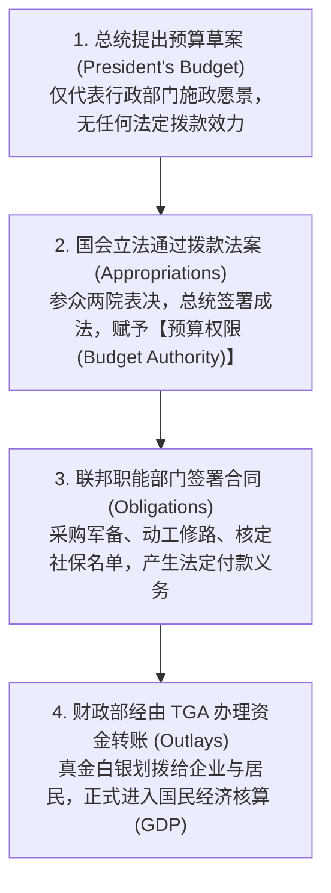
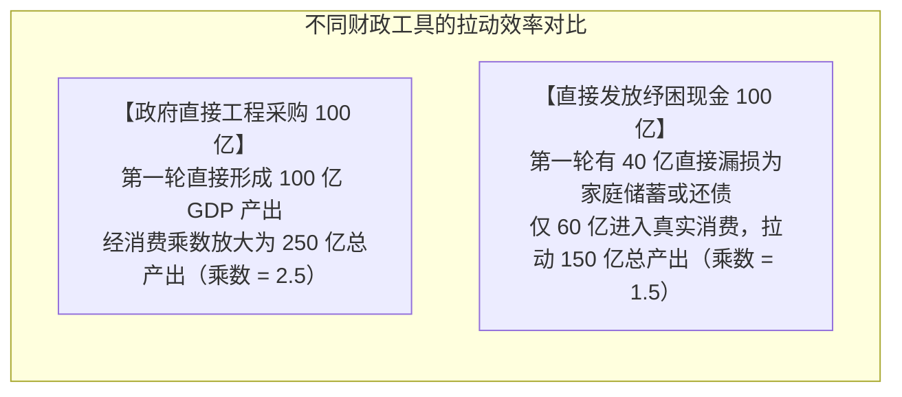
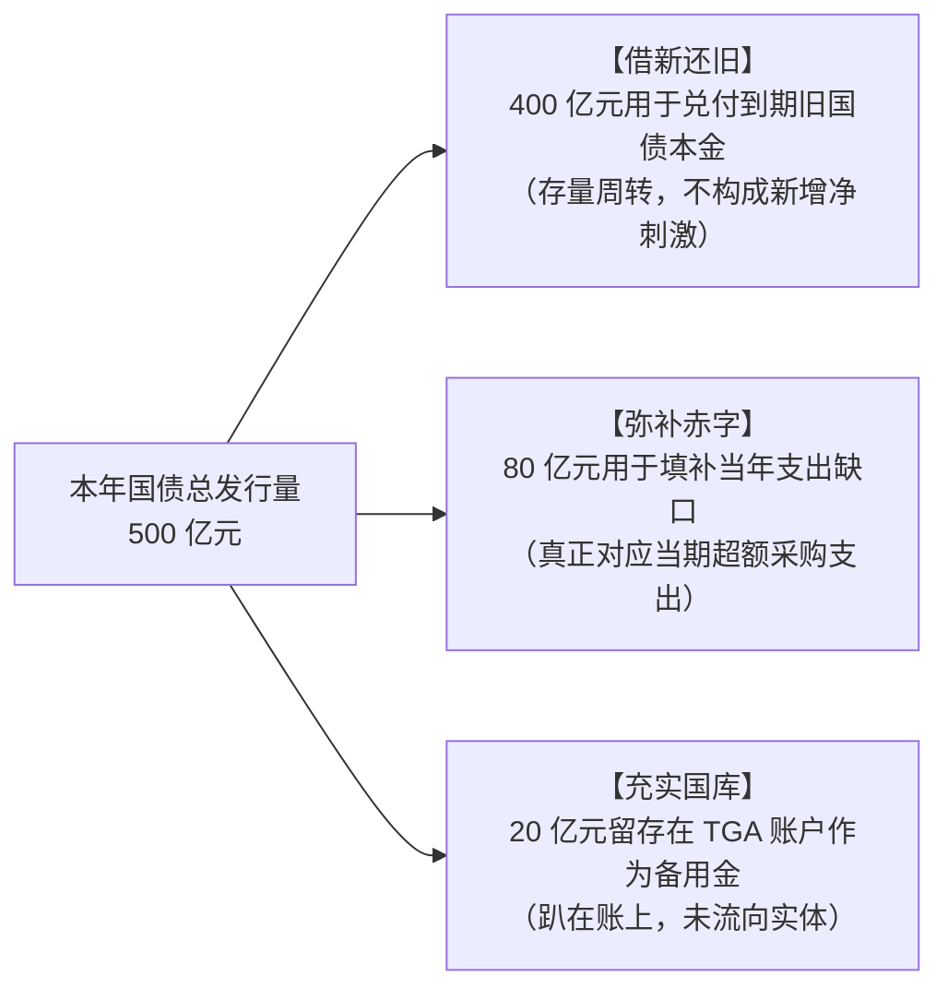
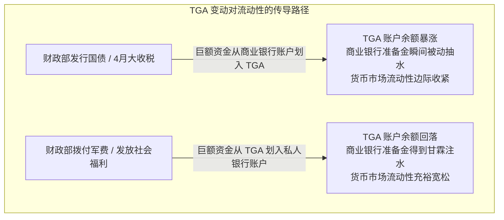
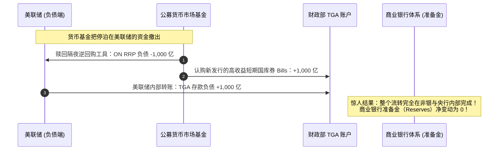
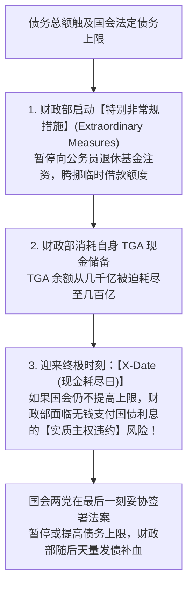
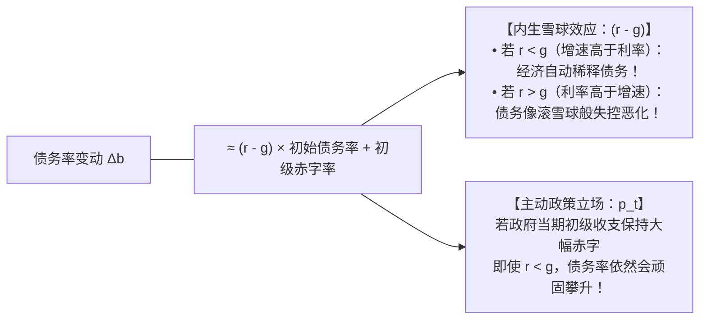

# 16 财政、政府债务、发行安排与 TGA

[上一章](15-bank-credit.md) · [目录](./) · [下一章](17-bonds-and-curves.md)

> 本章是打通宏观财政政策、国债供给与银行流动性的“财政水利工程图”。建议分三次学习：第 1—4 节理解立法预算、财政乘数与三大财政赤字口径；第 5—8 节掌握国债发行现金表、季度再融资公告与 TGA 账户对银行准备金的抽水/注水效应；第 9—13 节精读债务率动态方程（$r - g$ 机制）、解剖 2024 年官方财政数据并完成全套练习。除明确注明的历史官方报告外，数值均为教学假设。

---

## 本章要解决什么问题

在追踪宏观财经大势时，你经常会在同一周读到以下三条让人眼花缭乱的新闻：
1. **“国会通过法案，联邦财政赤字逼近 2 万亿美元关口！”**
2. **“财政部公布最新季度再融资计划，本季度国债总发行量超 1 万亿美元！”**
3. **“由于税收集中入账，财政部在美联储的 TGA 现金余额激增 3,000 亿美元！”**

许多初学者会顺理成章地得出一些看似合理实则荒谬的结论：
- “赤字 2 万亿，发债 1 万亿，那剩下的 1 万亿缺口谁来补？”（**混淆了财政年度累计赤字与单季度发债流量**）
- “发债 1 万亿就是政府向市场注水 1 万亿经济刺激！”（**混淆了借新还旧的债务滚存与实际用于采购的政府支出**）
- “财政部存了 3,000 亿在账上，所以把刚刚发债刺激经济的钱全部对冲收回去了！”（**混淆了预算支出流量与国库现金缓冲池**）

本章的任务，就是**为你建立起一套严密的“财政三本账”思维模型**，彻底理清**立法预算、债务融资与央行结算**之间的传导齿轮。

读完本章，你将能够：
- 严格区分**预算权限（Budget Authority）**、**已承担义务（Obligations）**与**实际财政支出（Outlays）**；
- 算清国债到期借新还旧的现金流，理解为什么“总发行量极其庞大”往往只是存量债务的高频周转；
- 洞悉财政部 **TGA 账户**与商业银行**准备金**之间的“翘翘板联动”；
- 熟练运用经典的**债务率演化方程（$r - g$ 动态）**，用严谨的数学推导评估主权债务的可持续性，不再被营销号的“债务崩盘倒计时”煽动情绪。

---

## 1. 一项财政政策，什么时候才算“真正发生了”？

### 1.1 财政决策的四级火箭：从白宫提议到支票兑付

与美联储十几位官员开会表决就能决定货币政策不同，美国的财政政策是一场涉及三权分立、漫长而复杂的政治博弈。

> [!IMPORTANT]
> **切记四个关键日期的严重错位：**
> **新闻宣布日 $\ne$ 法律生效日 $\ne$ 合同签署日 $\ne$ 实际国库付款日。**
> 很多财经媒体在总统签署法案当天，就将总额 1 万亿美元的新法案直接宣布为“今日向市场注入 1 万亿流动性”，这是对财政制度极其外行的误读。官方流程说明见 [美国政府问责署 (GAO): 联邦预算过程指南](https://www.gao.gov/blog/2016/02/05/budget-day-is-around-the-corner)。

---

### 1.2 用一座跨海大桥看清权限、义务与现金支出

我们用一个具体的工程案例来理解这三个关键财务概念的差异：
某联邦跨海大桥工程列入基建法案，获得国会批准的**预算权限 100 亿元**。

| 发展阶段 | 对应会计科目 | 本例金额 | 真实经济含义 | 致命认知误区 |
| :--- | :--- | ---: | :--- | :--- |
| **立项拨款** | **预算权限 (Budget Authority)** | 100 亿元 | 法律授权该部门未来为该项目支付的总上限 | 误以为财政部今天账上直接划拨了 100 亿现钞 |
| **施工招标** | **已承担义务 (Obligations)** | 80 亿元 | 交通部与建筑商正式签订大桥一期工程总承包合同 | 误以为工程已竣工且全部验收通过 |
| **工程进度结算**| **实际预算支出 (Outlays)** | **当年 20 亿 次年 60 亿** | 根据当期完成的桥墩工程进度，向建筑商账户电汇现金 | 误以为下一年还需要国会重新通过一次 60 亿的预算拨款 |

大桥在建设第一年，对全社会总需求的直接拉动是**当年支付的 20 亿元工程款**，而不是那张 100 亿元的法律授权批文。关于这三者的精确法定定义，参见 [国会预算办公室 (CBO): 预算权限、义务与支出的法律边界](https://www.cbo.gov/publication/57660)。

---

## 2. 财政赤字是怎样核算出来的？

### 2.1 基础恒等式：总赤字 vs 初级赤字

在选定的财政年度（Fiscal Year，美联邦财年为前一年 10 月 1 日至当年 9 月 30 日）内：

$$
\text{预算赤字 (Budget Deficit)} = \text{预算支出 (Outlays)} - \text{预算收入 (Receipts)}
$$

$$
\text{初级赤字 (Primary Deficit)} = \text{预算赤字} - \text{净利息支出 (Net Interest)}
$$

假设某财政年度联邦政府总收入 4,200 亿美元，总支出 5,000 亿美元（其中支付国债净利息 200 亿美元）：
- **总预算赤字**：$5,000 - 4,200 = \mathbf{800} \text{ 亿美元}$（反映政府整体的净资金缺口）；
- **初级赤字**：$800 - 200 = \mathbf{600} \text{ 亿美元}$（**衡量剔除历史累积债务的利息负担后，现行税收能否覆盖当期公共职能的收支立场**）。

---

### 2.2 自动稳定器：赤字扩大不等于政府新出台了刺激

很多人以为：“只要看到赤字扩大，就说明政府在主动推行宽松扩张政策。”

**这是极其常见的倒因为果。**
在现代财政体系中，存在着强大的**自动稳定器（Automatic Stabilizers）**：
- 当经济陷入衰退、企业裁员减产时：全社会工资与企业利润滑坡，所得税收入自动暴跌；与此同时，符合申请失业救济和贫困补助的人数激增，政府转移支付自动攀升。
- 此时，即使白宫和国会没有出台任何一项新法案，**财政赤字也会被动大幅飙升**！
- 这种赤字扩大，是经济下滑导致税基萎缩的**结果**，而非政府主动加大刺激的**原因**。

要衡量政府是否在主动发力，经济学家必须使用**周期调整后初级赤字（Cyclically Adjusted Primary Balance）**：剔除经济周期波动和历史利息后，测算政府主动政策立场的变化，参见 [CBO: 自动稳定器运作机制与评估方法](https://www.cbo.gov/publication/62741)。

---

### 2.3 财政乘数机制：小模型推演

政府花出去的 100 亿美元，能在全社会拉动出多少新增 GDP？
这取决于**边际消费倾向（MPC）**与总需求的传导链条。

假设全社会的边际消费倾向 $\text{MPC} = 0.60$（即居民每增加 100 元可支配收入，就会把其中的 60 元花掉，剩下的 40 元存起来）：

#### 情景一：政府直接购买商品与工程劳务（Government Purchases, $G$）
政府出资 100 亿美元向民营企业采购工程服务，直接创造了 100 亿美元的初始增加值。随后这 100 亿变成工人和企业家的收入，引发连锁消费：

$$
\Delta Y = 100 + 100 \times 0.6 + 100 \times 0.6^2 + 100 \times 0.6^3 + \dots = \frac{100}{1 - 0.6} = \frac{100}{0.4} = \mathbf{250} \text{ 亿美元}
$$

$$
\text{购买支出乘数} = \frac{\Delta Y}{\Delta G} = \frac{250}{100} = \mathbf{2.5}
$$

#### 情景二：政府向居民直接发放转移支付（Transfer Payments）
政府向居民发放 100 亿美元救济金。发放现金本身并没有换取任何当期商品，第一轮直接 GDP 贡献为 0！
只有当居民把其中的 $60\%$（60 亿美元）拿去超市购物时，消费循环才正式启动：

$$
\Delta Y_{\text{转移}} = 60 + 60 \times 0.6 + 60 \times 0.6^2 + \dots = \frac{60}{1 - 0.6} = \frac{60}{0.4} = \mathbf{150} \text{ 亿美元}
$$

$$
\text{转移支付乘数} = \frac{150}{100} = \mathbf{1.5}
$$

> [!NOTE]
> 现实中的真实财政乘数远比教学模型复杂：它受到产能利用率、进口漏损（部分购买被海外商品吸收）、通胀反应以及央行是否加息对冲（挤出效应）的多重制约，详见 [CBO: 财政政策经济影响评估与乘数区间](https://www.cbo.gov/publication/49494)。

---

## 3. 从财政赤字到发债：现金平衡表全解

新闻里最耸人听闻的标题，往往是把**赤字、还债与发债**全部混为一谈。我们用一张严谨的现金平衡表来还原真相。

### 3.1 借新还旧占发债的绝大部分

沿用经典假设：某财政年度联邦政府预算收入 420 亿元，预算支出 500 亿元，产生**预算赤字 80 亿元**。
同时，历史上发行的旧国债在今年有 **400 亿元到期需要偿付本金**。
财政部期初账面备用现金为 40 亿元，为了应对未来的支付波动，财政部决定在期末将国库备用现金充实到 **60 亿元（现金储备净增 20 亿元）**。

现在我们来计算：**财政部今年总共需要在国债市场上发售多少债券？**

$$
\text{总发债筹资需求} = \text{到期旧债本金续借} + \text{当期预算赤字} + \text{国库现金储备净增加额}
$$

代入数据：
$$ \text{总发行额} = 400 + 80 + (60 - 40) = 400 + 80 + 20 = \mathbf{500} \text{ 亿元} $$

$$ \text{净借款增量 (Net Borrowing)} = \text{总发行额 (500)} - \text{到期偿还本金 (400)} = \mathbf{100} \text{ 亿元} $$

这就是真相：
- **总发行 500 亿中，整整 400 亿（占 $80\%$）仅仅是为了维持存量债务不违约的“借新还旧”**！
- 真正对应实体经济当期新增财政刺激的，只有那 80 亿元的预算赤字部分。如果把 500 亿总发行说成是“政府向市场猛烈注水 500 亿”，就是最基础的财务常识错误。

---

## 4. 财政部的大金库：TGA 账户与银行流动性联动

### 4.1 TGA 账户的本质

**TGA（Treasury General Account，财政部一般账户）**是美国联邦财政部在中央银行——美联储开设的主账户。
- 对于财政部而言，TGA 是它在央行存留的**资产（活期备用金）**；
- 对于美联储而言，TGA 是它资产负债表负债端的一项**法定负债**。

根据我们在第 12 章确立的美联储负债端恒等式：

$$
\text{Fed 总资产} = \text{银行体系准备金 (Reserves)} + \text{财政部 TGA 存款} + \text{隔夜逆回购 (ON RRP)} + \text{流通中纸钞}
$$

在央行资产规模保持稳定的前提下，**TGA 账户的涨落与商业银行在美联储的准备金构成了直接的“水池连通器”！**

---

### 4.2 为什么发债有时不会抽紧银行准备金？（ON RRP 的绝妙对冲）

很多华尔街交易员在 2023 年曾极度担忧：美国债务上限危机解除后，财政部计划在短短几个月内疯狂发售上万亿美元的短期国库券（T-Bills）来重建 TGA 现金，这岂不是会把全美银行的准备金吸干，引爆同业流动性危机？

然而，后来的事实证明：**全美银行的准备金不仅没有暴跌，反而平稳如常。**
这是为什么？

因为这批新发售的短期国库券，**绝大部分被大型公募货币市场基金（MMF）买走了，资金直接来源于美联储的隔夜逆回购（ON RRP）工具**！

通过这套巧妙的资金腾挪，财政部从美联储的 ON RRP 蓄水池里直接抽水 1,000 亿灌进了 TGA，而全美商业银行连一分钱的准备金都没有损失！分析财政发债的流动性冲击时，**必须死死盯紧认购资金的真正来源是银行存款还是货币基金的 ON RRP**，详见 [纽约联储: 逆回购工具与负债流转机制说明](https://www.newyorkfed.org/markets/rrp_faq)。

---

## 5. 债务上限与政治博弈：什么是真正的 X-Date？

在美国法律中，存在着极具政治戏剧性的**法定债务上限（Debt Limit / Debt Ceiling）**制度：
- 国会设定了一个刚性的联邦债务最高法律总额；
- 一旦联邦债务总额撞上线，财政部便依法被剥夺了“发行新债券筹集净资金”的权力！

> [!CAUTION]
> **切勿混淆：债务上限危机 $\ne$ 政府暂时关门（Government Shutdown）**
> - **政府关门**：是因为国会没有通过新财年的“年度拨款法案”，导致部分联邦非核心机构（如国家公园、航天局）暂时停工，但国债还本付息不受影响；
> - **债务上限危机**：直击美国主权信用基石！一旦在 X-Date 违约，美国国债将面临技术性违约，可能引发全球金融资产的全面崩盘。相关法律界定见 [美国财政部: 债务上限与非常规措施官方备忘录](https://home.treasury.gov/system/files/136/DescriptionofExtraordinaryMeasures20250117.pdf)。

---

## 6. 债务可持续性推演：经典的 $r - g$ 动态方程

美国庞大的国家债务到底会不会破产？
经济学不相信空洞的口号，我们用诺贝尔经济学奖得主戴蒙德与布兰查德标准使用的**主权债务动态演化方程**来严谨推导。

### 6.1 数学推导过程

设 $t$ 年末的政府债务总额为 $B_t$，$t$ 年名义 GDP 为 $Y_t$。
债务的动态演变为：上一年债务 $B_{t-1}$ 按有效平均名义借贷利率 $r_t$ 滚存本息，再加上当年的**初级赤字（不含利息支出）$PD_t$**：

$$
B_t = (1 + r_t) B_{t-1} + PD_t
$$

同理，名义 GDP 以年增长率 $g_t$ 扩张：

$$
Y_t = (1 + g_t) Y_{t-1}
$$

定义债务负担率（债务占 GDP 比重）为 $b_t = \frac{B_t}{Y_t}$，初级赤字占 GDP 比重为 $p_t = \frac{PD_t}{Y_t}$。
将第一个方程两边同时除以 $Y_t$：

$$
\frac{B_t}{Y_t} = (1 + r_t) \frac{B_{t-1}}{Y_t} + \frac{PD_t}{Y_t} = (1 + r_t) \frac{B_{t-1}}{(1 + g_t) Y_{t-1}} + p_t
$$

$$
b_t = \frac{1 + r_t}{1 + g_t} b_{t-1} + p_t
$$

计算债务负担率的变动量 $\Delta b_t = b_t - b_{t-1}$：

$$
\Delta b_t = \left( \frac{1 + r_t}{1 + g_t} - 1 \right) b_{t-1} + p_t = \frac{r_t - g_t}{1 + g_t} b_{t-1} + p_t
$$

当名义经济增速 $g_t$ 处于适度区间时，分母 $1 + g_t \approx 1$，便得到了风靡全球宏观金融界的**经典债务变动方程**：

$$
\Delta b_t \approx (r_t - g_t) \times b_{t-1} + p_t
$$

---

### 6.2 经典算例：经济增速高于利率，债务率就一定会下降吗？

假设某国上年末的债务负担率已经达到 $b_{t-1} = 100\%$。
本年度宏观环境极佳：
- 政府平均借贷名义利率：$r = 3.00\%$；
- 名义 GDP 增速高达：$g = 5.00\%$（利差条件极好：$r - g = -2.00\%$）；
- 但与此同时，政府由于大手大脚花钱，本年的**初级赤字率高达 GDP 的 $4.00\%$**（$p_t = 4.00\%$）。

现在用精确公式计算本年末的债务率：

$$
b_t = \frac{1 + 0.03}{1 + 0.05} \times 1.00 + 0.04 = \frac{1.03}{1.05} + 0.04 \approx 0.98095 + 0.04 = \mathbf{1.02095} \quad (102.10\%)
$$

$$
\Delta b_t = 102.10\% - 100\% = +\mathbf{2.10\%}
$$

> [!WARNING]
> **破除神话：即使经济增速跑赢了利率，债务率依然可以失控上升！**
> 在上述案例中，虽然有利的 $(r - g)$ 帮助国家把存量债务稀释了约 $1.90\%$，但由于当期主动产生的初级赤字高达 $4.00\%$，直接将债务率反向推高了 2.10 个百分点！
> **使债务率保持恒定不动的临界最大允许初级赤字率**为：
> $$ p^* = \frac{g - r}{1 + g} b_{t-1} = \frac{0.05 - 0.03}{1.05} \times 100\% \approx \mathbf{1.90\%} $$
> 一旦初级赤字率超过 1.90%，债务杠杆率就会不可阻挡地持续攀升。

---

## 7. 真实历史文献带读：解剖美国财政部官方公报

### 7.1 读取 2024 年 7 月 29 日季度借款预估公告

翻开美国财政部 [2024 年 7 月 29 日发布的官方借款预估文件归档](https://home.treasury.gov/news/press-releases/jy2506)，提取官方原始核心数据（单位：十亿美元）：

| 报告披露指标项 | 官方公布数值（十亿美元） | 核心性质界定与读表要领 |
| :--- | ---: | :--- |
| **2024 年 7—9 月私人持有可交易债务净借款预估** | **740** | 财政部预计当季需从私人市场筹措的纯净新资金 |
| *— 相比 4 月份同一季度预估值的下调幅度* | *-106* | 并非同比去年减少，而是两期预测版本之间的预期差 |
| **2024 年 9 月末财政备用现金（TGA）目标假设** | **850** | 季末备用金的蓄水池目标规模 |
| **2024 年 6 月末实际已实现的现金余额** | **778** | 当季初实际账面上剩下的备用现钱 |

#### 宏观分析师的专业解剖：
1. **现金储备增加量**：
   从 6 月末的 778 亿增长到 9 月末的 850 亿，意味着财政部要在当季**净抽出现金 $850 - 778 = \mathbf{72}$ 亿美元沉淀在 TGA 账上**；
2. **扣除现金储备后的实际融资需求**：
   $$ 740 - 72 = 668 \text{ 亿美元} $$
   这 668 亿美元才是用于覆盖该季度实际预算赤字及其他现金缺口的净融资额。

---

### 7.2 2024 年 7 月 31 日季度再融资发售结构

两天后，财政部公布了具体的发债期限配比：[2024 年 7 月 31 日季度再融资操作公告](https://home.treasury.gov/news/press-releases/jy2512)：
- 发行 3 年期国债：580 亿美元；
- 发行 10 年期国债：420 亿美元；
- 发行 30 年期国债：250 亿美元；
- **三笔基准长债总发行规模**：$58 + 42 + 25 = \mathbf{1,250}$ 亿美元；
- **同期到期需偿还的私人持有到期票据**：约 1,110 亿美元；
- **本次长债再融资为国库筹集的新增纯现金**：$1,250 - 1,110 = \mathbf{140}$ 亿美元。

这清晰地表明：哪怕是 1,250 亿的长债大发行，其中 1,110 亿都是借新还旧，纯增量仅为 140 亿美元！

---

## 8. 练习与参考答案

### 练习 1：预算权限与支出的区分
美国国会通过《国家先进人工智能与半导体基础设施法案》，赋予能源部一项总额为 **900 亿美元**的为期三年预算权限。能源部第一年经公开招标签署了总额为 **600 亿美元**的数据中心电网改造工程合同；根据第一年的工程实际验收进度，财政部在第一年累计向工程施工承包商划拨支付了 **150 亿美元**工程款，并在第二年按进度支付了 **350 亿美元**。
1. 请分别写出第一年与第二年计入联邦财政实际支出（Outlays）的金额；
2. 某财经博主在自媒体发文称：“第一年政府注入了 900 亿刺激，第二年又追加了 350 亿刺激，两年累计刺激 1,250 亿。”请指出其错误所在。

点击展开参考答案与解析

1. **各年度实际财政支出（Outlays）**：
   - 第一年实际支出（Outlays）$= \mathbf{150}$ 亿美元；
   - 第二年实际支出（Outlays）$= \mathbf{350}$ 亿美元；
   - 两年累计实际支出 $= 150 + 350 = 500$ 亿美元。
2. **专业纠错辨析**：
   - 该博主犯了**将“法律授权额度”与“后续实际支付流水”重复相加**的严重低级错误。
   - 900 亿是预算权限（Budget Authority），仅仅是一张法律允许未来花钱的最高“信用卡额度”，它绝非当期实际支付的资金；
   - 第一年实际流向实体经济的只有 150 亿，第二年为 350 亿。两年的真实总支出是 500 亿美元，绝非 1,250 亿。

---

### 练习 2：动态债务率精准测算
某工业国当前政府公共债务总额与名义 GDP 恰好相等（初始债务负担率 $b_0 = 100\%$）。在未来的评估周期内，预计该国宏观环境参数如下：
- 政府存量国债的平均有效名义借贷成本保持在 $r = 4.00\%$；
- 名义国内生产总值（GDP）受技术革新推动，保持 $g = 3.00\%$ 的年增长率；
- 政府因社保刚性支出庞大，每年的初级赤字率稳定在 GDP 的 $2.50\%$（即 $p = 2.50\%$）。
1. 请利用精确债务率演变方程，计算一年后该国的最新债务负担率 $b_1$；
2. 若该国希望将债务负担率永久稳定在 $100\%$ 不再继续恶化，在上述利率与增长率不变的前提下，该国的初级收支（Primary Balance）必须达到怎样的目标？

点击展开参考答案与解析

1. **最新债务负担率推导**：
   根据精确公式：
   $$ b_1 = \frac{1 + r}{1 + g} b_0 + p $$
   代入参数：
   $$ b_1 = \frac{1 + 0.04}{1 + 0.03} \times 1.00 + 0.025 = \frac{1.04}{1.03} + 0.025 \approx 1.009709 + 0.025 = \mathbf{1.0347} \quad (103.47\%) $$
   **结论**：一年后该国的债务占 GDP 比重将从 $100\%$ 恶化上升至 **$103.47\%$**（攀升了约 3.47 个百分点）。
2. **保持债务率稳定的初级收支底线测算**：
   要使 $\Delta b = 0$，即 $b_1 = b_0 = 100\%$，代入平衡条件：
   $$ 1.00 = \frac{1.04}{1.03} \times 1.00 + p^* $$
   $$ p^* = 1.00 - \frac{1.04}{1.03} = 1.00 - 1.009709 = -\mathbf{0.009709} \approx -\mathbf{0.97\%} $$
   **政策含义**：
   由于利率高于经济增速（$r > g$，利差倒挂 1 个百分点），经济增长已无法稀释存量债务利息。该国必须实现**初级财政盈余占 GDP 的 $0.97\%$ 以上**（即初级收支为负的初级赤字，必须通过增税或减支压出结余），才能阻断债务雪球的自发膨胀。

---

## 本章小结与后续学习路线

在学完本章后，请在脑海中建立起财政分析的立体逻辑：
1. **分清三本账**：预算账算收支赤字，融资账算到期滚存与发债规模，现金账看 TGA 与流动性池；
2. **盯紧发债结构**：不仅要看发多少亿，更要看发的是短期国库券（Bills）还是长期国债（Bonds），以及资金是从银行准备金出还是从非银逆回购（ON RRP）出；
3. **客观看待债务**：评估财政可持续性不是看债务绝对数字有多大，而是看 $r - g$ 动能差与初级财政赤字率的博弈平衡。

- 想要深入理解新发行的国债如何在二级市场进行现值贴现、久期测算与收益率曲线形态演化，请前往[第 17 章：债券合同、价格、久期与收益率曲线](17-bonds-and-curves.md)；
- 想要看懂一级自营交易商如何利用回购与期货对冲国债承销库存，请精读[第 18 章：国债微观结构与做市机制](18-treasury-plumbing.md)；
- 想要将长端美债收益率精细拆解为预期短期利率路径与期限溢价（Term Premium），请阅读[第 19 章：美债收益率分解](19-yield-decomposition.md)。

---

[上一章](15-bank-credit.md) · [目录](./) · [下一章](17-bonds-and-curves.md)
