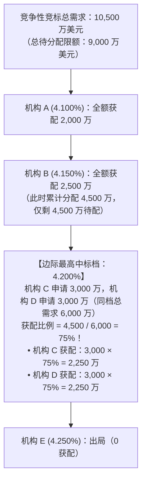
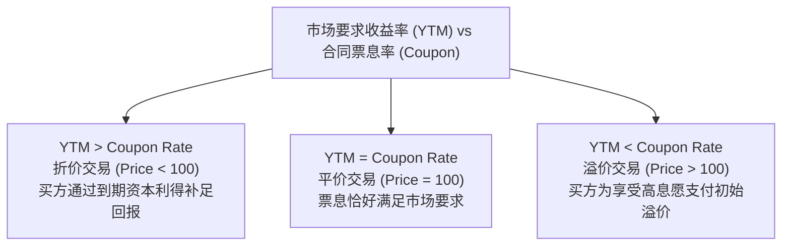
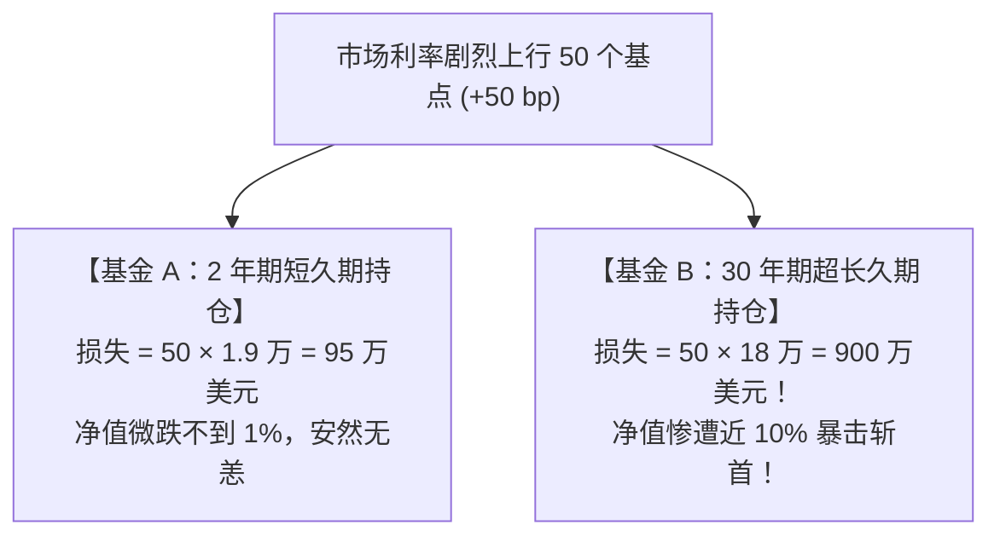
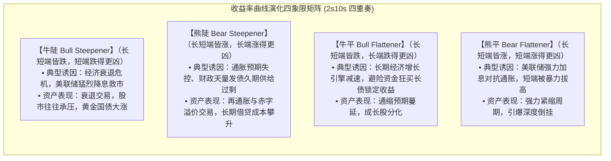
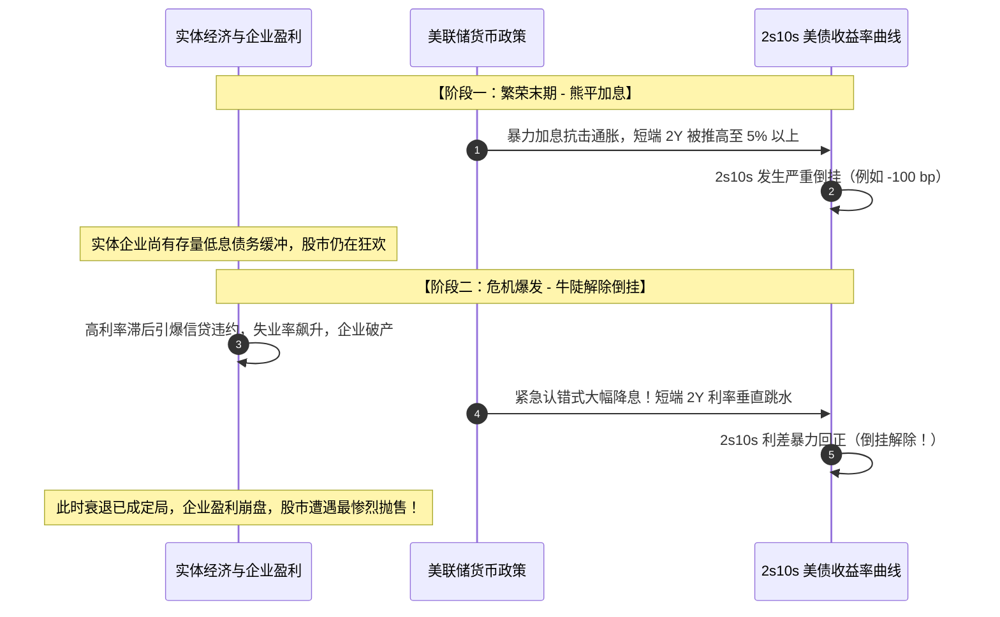

# 17 债券合同、价格、久期与收益率曲线

[上一章](16-fiscal-policy.md) · [目录](./) · [下一章](18-treasury-plumbing.md)

> 本章是全书资产定价与利率分析的“重型武器库”。建议分三次学习：第 1—3 节理解国债合同条款、荷兰式拍卖竞标与贴现定价公式；第 4—6 节掌握持有期回报陷阱、麦考利久期与基点价值（DV01）；第 7—11 节精读收益率曲线（CMT）插值原理、2s10s 利差的四象限形态演化并完成全套实战练习。除明确注明的历史官方报告外，数值均为教学假设。

---

## 本章要解决的问题

在财经新闻中，你几乎每天都能看到类似这样充满行话的播报：
> “今日美国 10 年期基准国债收益率上行 15 个基点至 4.30%，收益率曲线呈现典型的‘熊陡’形态，2s10s 倒挂进一步收窄！”

对于没有金融专业背景的学习者，这句话里充斥着令人费解的谜团：
1. **“国债利率涨了”是财政部宣布给国债涨利息了吗？** 已经买到手里的债券，合同上印着的利息难道不是一辈子固定不变的吗？
2. **为什么市场上常说“债券价格暴跌，收益率反而飙升”？** 价格和收益率究竟遵循怎样的算术羁绊？
3. **“收益率曲线倒挂（2s10s < 0）”真的意味着美国经济必然陷入衰退的死刑判决吗？** 为什么倒挂消除、曲线重新变陡的时候，资本市场反而经常发生暴跌？

这些问题的答案，就隐藏在**债券这一古老金融契约的贴现现金流数学**之中。

读完本章，你将能够：
- 从一份真实的财政部发债公告开始，推演一场**单一价格荷兰式拍卖（Single-Price Auction）**是如何排定获配名单与发行价格的；
- 熟练写出**债券现值贴现方程**，区分**净价（Clean Price）**与**全价（Dirty Price）**；
- 算清**修正久期（Modified Duration）**与 **DV01（基点价值）**，理解为什么长期债券对利率变动具有惊人的杠杆放大效应；
- 绘制收益率曲线的**“牛陡、熊陡、牛平、熊平”四象限演化图谱**，穿透利差表象看清市场真实的宏观叙事。

---

## 1. 拆开一张债券合同：面值、票息与现金流

### 1.1 买国债，就是购买未来确定时间的一串现金流

假设你通过美国国债官方直销网（TreasuryDirect）购买了一张刚发行的**两年期美国财政部附息票据（Treasury Note）**：
- **票面面值（Par Value / Face Value, $F$）**：1,000 美元（到期偿还本金的基准）；
- **年票面息率（Coupon Rate, $c$）**：$4.00\%$；
- **付息频率**：美国国债标准惯例为**每半年付息一次（Semi-annual）**。

在发行人（美国联邦政府）不违约的前提下，你在未来两年内将收到的现金流时间线如下：

每次半年度支付的票面利息现金为：

$$
\text{单期票息} = F \times \frac{c}{2} = 1,000 \times \frac{4.00\%}{2} = \mathbf{20} \text{ 美元}
$$

> [!IMPORTANT]
> **票息率（Coupon Rate）是焊死在合同里的法律承诺！**
> 无论未来金融市场狂风暴雨、美联储加息还是降息，美国财政部每次都将准时在你的账户里存入 20 美元，到期返还 1,000 美元本金。
> 新闻里每天跳动的“10 年期美债利率”，**绝不是**财政部单方面修改了每期的利息金额，而是**二级市场上这串固定现金流的买卖折现率发生了波动**！

---

### 1.2 美国可交易国债的三大家族

美国财政部发行的可交易国债主要分为三大类：

| 证券类别 | 英文名称 | 原始发行期限 | 现金流与计息结构 | 核心经济功能 |
| :--- | :--- | :--- | :--- | :--- |
| **短期国库券** | **Treasury Bills (Bills)** | 4 周至 52 周（1 年以内） | **无定期票息**！贴现发行，到期按面值全额兑现 | 现金流动性管理、货币市场核心质押品 |
| **中期国库票据** | **Treasury Notes (Notes)** | 2 年、3 年、5 年、7 年、10 年 | **每半年付息一次**，到期返还固定面值 | 全球金融资产定价的核心基准锚（尤其是 10Y Note） |
| **长期国债** | **Treasury Bonds (Bonds)** | 20 年、30 年 | **每半年付息一次**，到期返还固定面值 | 养老金与保险机构的超长期久期资产负债匹配 |

官方分类与现金流指引参见 [美国财政部 TreasuryDirect: 可交易国债产品说明](https://www.treasurydirect.gov/marketable-securities/)。

---

## 2. 一级市场：财政部如何把投标变成一只新债券？

美国国债不是由财政部长独自给华尔街大佬打电话私下定价发售的，而是通过极为严格公开的**单一价格荷兰式拍卖（Single-Price Dutch Auction）**完成的。

### 2.1 竞争性投标与非竞争性投标

在拍卖开始前，全市场的需求被分为两类：
1. **非竞争性投标（Non-competitive Bids）**：
   主要来自个人零售散户和小机构。态度是：“无论最终拍卖确定什么利率，我都全盘接受，只要保证分给我面额即可。”这部分投标依法**最先全额获配**；
2. **竞争性投标（Competitive Bids）**：
   主要来自华尔街一级交易商、大型基金和全球央行。投标时必须同时报出**“认购面值”与“自己能接受的最低到期收益率要求”**。

---

### 2.2 荷兰式单一价格拍卖分配全流程推演

假设美国财政部新发行一只两年期国债，总面值为 **1 亿美元**：
- 合规的非竞争性投标总额为 **1,000 万美元**（先行无条件全额分配）；
- 剩余留给竞争性投标竞逐的额度为 $100 - 10 = \mathbf{9,000}$ 万美元。

财政部将所有竞争性投标按照**报出的收益率要求从低到高排列（收益率越低 = 愿意付出的购买价格越高 = 对财政部越有利）**，自上而下逐档吸纳：

| 投标机构 | 申报要求收益率 | 申请认购面值 | 累计已接受面值 | 实际获配面值 | 获配依据与分配法则 |
| :---: | :---: | :---: | :---: | :---: | :--- |
| **机构 A** | 4.100% | 2,000 万 | 2,000 万 | **2,000 万** | 报价极优，全额获配 |
| **机构 B** | 4.150% | 2,500 万 | 4,500 万 | **2,500 万** | 报价优良，全额获配（累计已分配 4,500 万） |
| **机构 C** | 4.200% | 3,000 万 | 7,500 万 | **2,250 万** | 触及边际档，与 D 机构同档按比例瓜分剩余额度 |
| **机构 D** | 4.200% | 3,000 万 | 10,500 万 | **2,250 万** | 触及边际档，与 C 机构同档按比例瓜分剩余额度 |
| **机构 E** | 4.250% | 2,000 万 | — | **0 万** | 胃口太大要价过高，**完全出局落标！** |

#### 核心产物一：确定中标收益率（High Yield / Stop-out Yield）
最后刚好将 9,000 万额度分完的那一档最高收益率，被称为 **High Yield（最高中标收益率）**。本例中 **$\text{High Yield} = \mathbf{4.200\%}$**，该档获配比例（Allotted at High）为 **$75.00\%$**。

#### 核心产物二：单一价格法则（The Single-Price Rule）
**所有成功中标的机构，无论是报了 4.100% 的机构 A，还是参与非竞争性投标的普通散户，全部统一享受 4.200% 对应的最终划一发行价格购买！** 谁也不用为自己报了更低的利率而多掏冤枉钱。

#### 核心产物三：票息率敲定与折溢价发行
财政部按 $0.125\%$（八分之一百分点）为步长确定正式票息，规则是**使其尽量贴近、且不高于中标收益率**：
- 本例中中标收益率为 $4.200\%$，向下最接近的 $0.125\%$ 步长档位是 **$4.125\%$**；
- 于是，该期国债的法定年票面息率正式敲定为 **$4.125\%$**（每半年每 100 美元面值付息 $2.0625$ 美元）。拍卖规则细节参见美国联邦法规：[31 CFR §356.20 国债统一价格拍卖细则](https://www.govinfo.gov/content/pkg/CFR-2025-title31-vol2/pdf/CFR-2025-title31-vol2-sec356-20.pdf)。

---

## 3. 债券定价方程：现金流折现与到期收益率（YTM）

### 3.1 基础定价模型：把未来的每一笔现金贴现回今天

在起息日，市场要求的年化到期收益率为 $y = 4.200\%$（对应半年折现率 $\frac{y}{2} = 2.100\%$）。
购买每 100 美元面值的债券价格 $P$，就是将未来 4 期固定现金流进行复利折现求和：

$$
P = \sum_{k=1}^N \frac{F \times \frac{c}{2}}{\left(1 + \frac{y}{2}\right)^k} + \frac{F}{\left(1 + \frac{y}{2}\right)^N}
$$

代入本例参数（$F = 100$，$c = 4.125\%$，$\frac{c}{2} = 2.0625$，$N = 4$，$\frac{y}{2} = 0.021$）：

$$
P = \frac{2.0625}{1.021^1} + \frac{2.0625}{1.021^2} + \frac{2.0625}{1.021^3} + \frac{100 + 2.0625}{1.021^4}
$$

$$
P \approx 2.020078 + 1.978529 + 1.937835 + 93.921114 = \mathbf{99.857556} \text{ 美元}
$$

中标机构每认购 1,000 美元面值的国债，在结算日需向国库支付 **998.58 美元**。
因为约定的票息率（$4.125\%$）略低于市场要求的年化投资回报率（$4.200\%$），所以债券必须**折价（Discount）发售**，差额部分在到期按 100 面值兑现时补齐。

---

### 3.2 净价（Clean Price）与全价（Dirty Price）

在实际交易中，如果在两次付息日的正中间发生买卖转让，该如何结算？

- **净价（Clean Price）**：你在行情软件屏幕上看到的报价（剔除了应计利息的纯粹资产估值）；
- **全价（Dirty Price / Invoice Price）**：买方实际必须电汇给卖方的全额发票金额。

$$
\text{全价 (Dirty Price)} = \text{净价 (Clean Price)} + \text{应计利息 (Accrued Interest)}
$$

$$
\text{应计利息} = \text{半年度单期票息} \times \frac{\text{距上次付息日已过去的实际天数}}{\text{本付息周期的实际自然天数}}
$$

#### 算例：
某国债面值 1,000 美元，年票息 4.125%（半期利息 20.625 美元）。本付息周期共有 182 天，在第 60 天时以净价 $99.50$ 转手成交：
$$
\text{应计利息} = 20.625 \times \frac{60}{182} \approx \mathbf{6.80} \text{ 美元}
$$
买方实际支付的真实结算总款项为：
$$ \text{全额发票价} = (99.50 \times 10) + 6.80 = \mathbf{1,001.80} \text{ 美元} $$
这 6.80 美元利息由买方先行垫付给卖方，因为当下一次付息日到来时，买方将独享全额 20.625 美元的半年度支票。

---

## 4. 衡量利率风险的核心标尺：久期（Duration）与 DV01

许多人问：“如果央行加息 100 个基点，我手里的国债到底会跌多少？”
回答这个问题的终极武器，是**久期（Duration）**。

### 4.1 麦考利久期与修正久期公式推导

**麦考利久期（Macaulay Duration, $D_{\text{Mac}}$）**衡量的是投资者收回全部现金流现值的**加权平均时间跨度（以年为单位）**：

$$
D_{\text{Mac}} = \frac{\sum_{k=1}^N t_k \times \text{PV}(CF_k)}{P}
$$

我们沿用上文两年期国债案例（每半年一期，$t_k = 0.5, 1.0, 1.5, 2.0$ 年）：

$$
D_{\text{Mac}} = \frac{0.5 \times 2.020 + 1.0 \times 1.979 + 1.5 \times 1.938 + 2.0 \times 93.921}{99.858} \approx \mathbf{1.940} \text{ 年}
$$

在微积分上对债券价格方程求导，可以得到价格变动百分比与收益率变动的严格微分关系——**修正久期（Modified Duration, $D_{\text{mod}}$）**：

$$
D_{\text{mod}} = \frac{D_{\text{Mac}}}{1 + \frac{y}{2}} = \frac{1.940}{1 + 0.021} \approx \mathbf{1.900}
$$

$$
\frac{\Delta P}{P} \approx -D_{\text{mod}} \times \Delta y
$$

> [!CAUTION]
> **久期法则的第一铁律：负号代表的反向杠杆！**
> 公式前面的负号明确宣告：**收益率上升（$\Delta y > 0$），债券价格必然下跌（$\Delta P < 0$）！**
> 若市场利率上升 $25$ 个基点（$\Delta y = +0.0025$）：
> $$ \frac{\Delta P}{P} \approx -1.900 \times (+0.0025) = -0.00475 = -\mathbf{0.475\%} $$
> 该债券市值将缩水约 $0.475\%$。

---

### 4.2 交易员的风险语言：DV01（基点价值）

华尔街做市商的盯盘屏幕上，不会显示抽象的百分比，而是直接换算为真金白银的**基点价值（DV01，Dollar Value of 01）**：
**利率变动 1 个基点（0.01% = 0.0001）时，持仓头寸发生的价格盈亏美元金额：**

$$
\text{DV01} \approx \text{持仓总公允市值 } V \times D_{\text{mod}} \times 0.0001
$$

#### 震撼对比：短久期 vs 长久期
两家养老基金各自持有 **1 亿美元公允市值**的美债组合：
- **基金 A（持有 2 年期国债）**：$D_{\text{mod}} = 1.90$
  $$ \text{DV01}_A = 100,000,000 \times 1.90 \times 0.0001 = \mathbf{19,000} \text{ 美元/bp} $$
- **基金 B（持有 30 年期超长国债）**：$D_{\text{mod}} = 18.00$
  $$ \text{DV01}_B = 100,000,000 \times 18.00 \times 0.0001 = \mathbf{180,000} \text{ 美元/bp} $$

这就是为什么 2022—2023 年美联储剧烈加息期间，硅谷银行（SVB）等大量重仓长久期国债和 MBS 的银行会瞬间陷入资产减值爆仓破产的底层物理机制！

---

## 5. 收益率曲线形态演化：解密 2s10s 的四象限罗盘

在宏观研判中，**收益率曲线（Yield Curve）**是全市场最重要的风向标。最经典的观察指标是**10 年期与 2 年期国债利差（2s10s Spread）**：

$$
\text{2s10s 利差} = y_{10\text{Y}} - y_{2\text{Y}}
$$

当 $y_{10\text{Y}} < y_{2\text{Y}}$ 时，利差为负数，被称为**曲线倒挂（Inversion）**。

### 5.1 收益率曲线移动的四象限图谱

收益率曲线的变化绝不是单维度的“陡”或“平”，必须结合**两端利率绝对变动的方向**，严格划分为四大象限：

| 曲线形态术语 | 短端 2Y 变动 | 长端 10Y 变动 | 2s10s 利差变动 | 背后主导的宏观驱动力与核心叙事 |
| :--- | :---: | :---: | :---: | :--- |
| **牛市变陡 (Bull Steepener)** | **暴跌 (如 -50 bp)** | **下跌 (如 -20 bp)** | **大幅扩大 (+30 bp)** | 衰退警报拉响，央行降息预期完全打满，短端疯狂抢跑 |
| **熊市变陡 (Bear Steepener)** | **微涨 (如 +10 bp)** | **大涨 (如 +40 bp)** | **大幅扩大 (+30 bp)** | 市场担忧财政赤字失控导致国债天量供应，或长期二次通胀 |
| **牛市变平 (Bull Flattener)** | **微跌 (如 -10 bp)** | **大跌 (如 -30 bp)** | **利差收窄 (-20 bp)** | 长期经济增长与通胀预期降温，长债受避险资金热捧 |
| **熊市变平 (Bear Flattener)** | **暴涨 (如 +50 bp)** | **上涨 (如 +20 bp)** | **利差收窄/倒挂 (-30 bp)** | 美联储处于激进加息抗通胀中继期，强力压制经济过热 |

---

### 5.2 历史复盘：为什么“倒挂解除”往往才是股灾的开始？

金融市场上流传着一句格言：“倒挂预示衰退，倒挂平复引爆危机。”

很多人误以为只要曲线倒挂修复、利差重新变为正数，经济就警报解除了。
**大错特错！**

历史证明：**最危险的时刻不是倒挂持续的岁月，而是倒挂通过“牛陡（Bull Steepener）”急速转正的那一瞬间！** 这往往宣告实体经济已经承受不住高利率重压而发生骨折，降息救市已无法阻挡衰退与盈利滑坡的到来。

---

## 6. 真实历史案例精读：2024 年 9 月三年期国债拍卖公报

翻开美国财政部 [2024 年 9 月 10 日三年期国债拍卖官方公告与结果报告](https://www.treasurydirect.gov/instit/annceresult/press/preanre/2024/R_20240910_2.pdf)，我们来逐项核对华尔街一级交易商眼中的真实报表数据（证券识别代码 CUSIP：**91282CLL3**）：

| 官方报表原始字段 (Treasury Report) | 官方公布实测数据 | 核心经济学解析与实务指引 |
| :--- | :---: | :--- |
| **票面利率 (Interest Rate)** | **3-3/8% (3.375%)** | 财政部每半年按面值向持有人付息的固定票息 |
| **最高中标收益率 (High Yield)** | **3.440%** | 全场边际中标成本！统领全场最终发行价格的折现率 |
| **边际获配比例 (Allotted at High)** | **41.38%** | 在 3.440% 申报档位的机构，仅能按 41.38% 比例获配 |
| **发行价格 (Price per 100)** | **99.816223** | 折价发行！每 1,000 美元面值净价为 998.16 美元 |
| **应计利息 (Accrued Interest / $1,000)** | **0.09323 美元** | 由于起息日（9月15日）比结算日（9月16日）早 1 天，需补缴 1 天利息 |
| **投标倍数 (Bid-to-Cover Ratio)** | **2.66 倍** | 总竞争性认购量（1,544 亿）/ 计划发行量（580 亿）= 2.66 倍 |

数据勾稽完美闭环：
- 认购 1,000 美元面值的总支付现金 $= 998.16223 (\text{净价}) + 0.09323 (\text{应计利息}) = \mathbf{998.26} \text{ 美元}$；
- 年利息 $= 1,000 \times 3.375\% = 33.75$ 美元，每半年现金支票为 **$16.875$ 美元**。

---

## 7. 练习与参考答案

### 练习 1：单一价格荷兰式拍卖推演
美国财政部宣布新发售一批 5 年期国债，总面额为 **8,000 万美元**。
- 其中合规的非竞争性投标全额预定为 **1,000 万美元**；
- 剩余 7,000 万美元用于竞争性招标，收到的投标清单如下：
  - 机构甲：认购 2,500 万美元，要价收益率 $3.800\%$；
  - 机构乙：认购 3,000 万美元，要价收益率 $3.850\%$；
  - 机构丙：认购 3,000 万美元，要价收益率 $3.900\%$；
  - 机构丁：认购 2,000 万美元，要价收益率 $3.900\%$；
  - 机构戊：认购 1,500 万美元，要价收益率 $3.950\%$。
1. 请确定本次拍卖的最高中标收益率（High Yield）；
2. 计算边际中标档位的获配比例（Allotted at High），并写出各机构的最终获配面值；
3. 机构甲在投标时报了极低的 $3.800\%$，他在最终提货缴款时，是按照 $3.800\%$ 还是按照其他收益率对应的价格结算？为什么？

点击展开参考答案与解析

1. **确定 High Yield**：
   - 待分配总额度 $= 8,000 - 1,000 = \mathbf{7,000}$ 万美元；
   - 机构甲（3.800%）：全额分配 2,500 万，剩余 4,500 万；
   - 机构乙（3.850%）：全额分配 3,000 万，剩余 1,500 万；
   - 下一档为 3.900%，机构丙（3,000 万）与机构丁（2,000 万）合计申请 5,000 万，超过了剩余的 1,500 万；
   - **最高中标收益率 High Yield 锁定在 $3.900\%$**。
2. **计算边际获配比例与分配结果**：
   - 边际获配比例 $= \frac{1,500}{3,000 + 2,000} = \frac{1,500}{5,000} = \mathbf{30.00\%}$；
   - **机构获配明细**：
     - 机构甲：全额获配 **2,500 万美元**；
     - 机构乙：全额获配 **3,000 万美元**；
     - 机构丙：$3,000 \times 30\% = \mathbf{900}$ 万美元；
     - 机构丁：$2,000 \times 30\% = \mathbf{600}$ 万美元；
     - 机构戊：出局，获配 **0 美元**；
     - 竞争性分配总计：$2,500 + 3,000 + 900 + 600 = 7,000$ 万美元。
3. **单一价格机制解释**：
   - 机构甲**绝不**按照自己报价的 $3.800\%$ 付款，而是**全额按照最高中标收益率 $3.900\%$ 对应的统一划一价格付款**；
   - 这正是现代国债单一价格荷兰式拍卖（Dutch Auction）的核心制度设计：它鼓励竞标者大胆报出自己能够承受的最激进真实底线，消除“因报出过低利率而沦为冤大头多付钱”的“赢者诅咒（Winner's Curse）”。

---

### 练习 2：久期与组合市值敏感度测算
某宏观对冲基金管理着 **5 亿美元**的美国国债全价现货投资组合，组合当前的修正久期（Modified Duration）为 **$8.50$**。
1. 计算该组合当前的基点价值（DV01，以美元为单位）；
2. 若由于通胀数据超预期爆表，美债收益率全线飙升 $40$ 个基点（$+40$ bp），该基金在不采取任何对冲措施的前提下，账面总市值的近似损失金额是多少美元？

点击展开参考答案与解析

1. **计算基点价值 DV01**：
   $$ \text{DV01} = \text{总市值 } V \times D_{\text{mod}} \times 0.0001 $$
   $$ \text{DV01} = 500,000,000 \times 8.50 \times 0.0001 = \mathbf{425,000} \text{ 美元/bp} $$
   **经济含义**：全曲线利率每上行 1 个基点，该基金组合就损失 42.5 万美元。
2. **收益率跳升 40 bp 的损失金额推导**：
   - 损失百分比：
     $$ \frac{\Delta P}{P} \approx -D_{\text{mod}} \times \Delta y = -8.50 \times (+0.0040) = -0.034 = -\mathbf{3.40\%} $$
   - 美元损失金额（方法一：利用 DV01 直接相乘）：
     $$ \text{损失金额} = \text{DV01} \times \Delta y_{\text{bp}} = 425,000 \times 40 = \mathbf{17,000,000} \text{ 美元} = \mathbf{1,700} \text{ 万美元} $$
   - 美元损失金额（方法二：利用百分比相乘）：
     $$ \text{损失金额} = 500,000,000 \times 3.40\% = \mathbf{1,700} \text{ 万美元} $$
   - **结论**：40 个基点的微小利率波动，将直接令该基金蒸发整整 **1,700 万美元**的本金！

---

## 本章小结与后续学习路线

在学完本章后，请在脑海中牢牢锁定债券与收益率的核心认知框架：
1. **价格与收益率如影随形**：现金流贴现方程注定了利率上升与价格暴跌是同一个物理过程的两面；
2. **久期是风险的核心敞口**：持有长债绝非稳赚不赔，高久期会在加息周期中变成吞噬资本的利刃；
3. **读懂收益率曲线四象限**：不要只看 2s10s 利差变宽还是变窄，必须区分是“衰退降息的牛陡”还是“赤字供给的熊陡”。

- 想要深入理解一级自营做市商（Primary Dealers）如何利用回购与国债期货对冲持仓风险，请前往[第 18 章：国债微观结构与做市机制](18-treasury-plumbing.md)；
- 想要将长端美债收益率精细拆解为无风险短期利率期望路径与期限溢价（Term Premium），请精读[第 19 章：美债收益率分解](19-yield-decomposition.md)；
- 想要推演主权国债与信用债券（投资级 IG、高收益 HY）之间的违约利差传导，请阅读[第 21 章：信用风险](21-credit-risk.md)。

---

[上一章](16-fiscal-policy.md) · [目录](./) · [下一章](18-treasury-plumbing.md)
