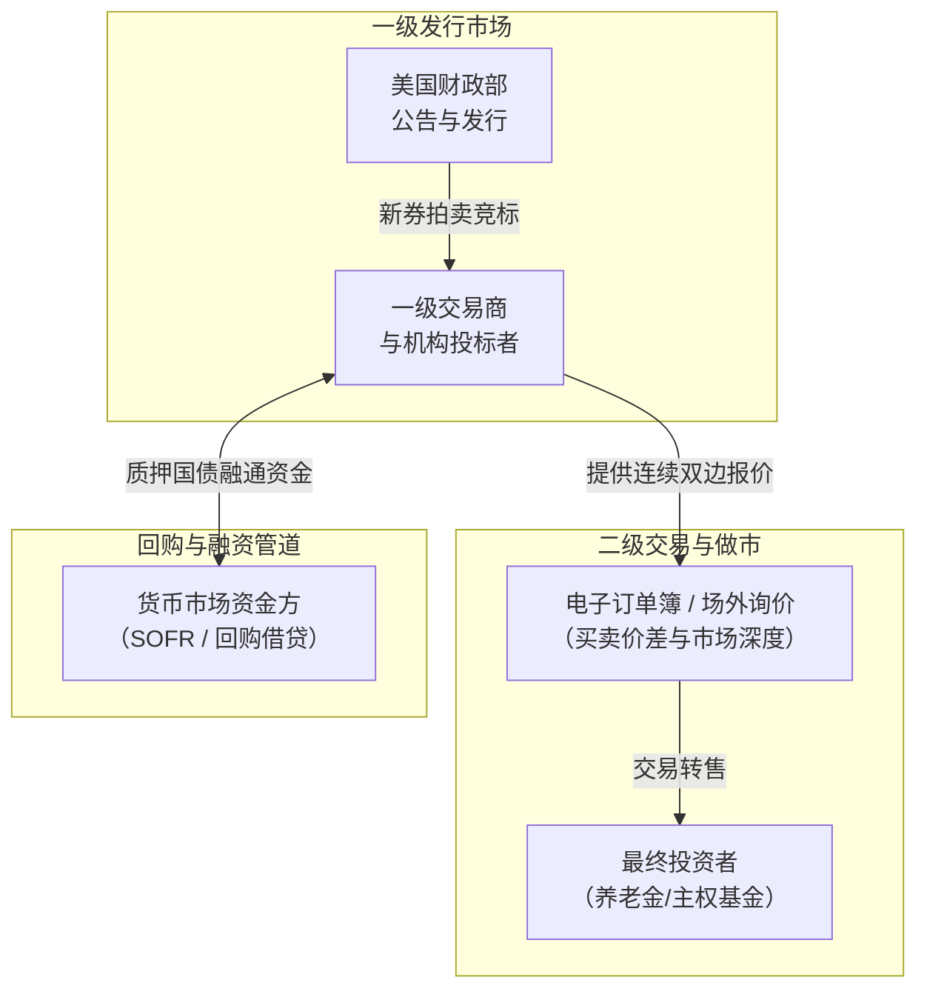
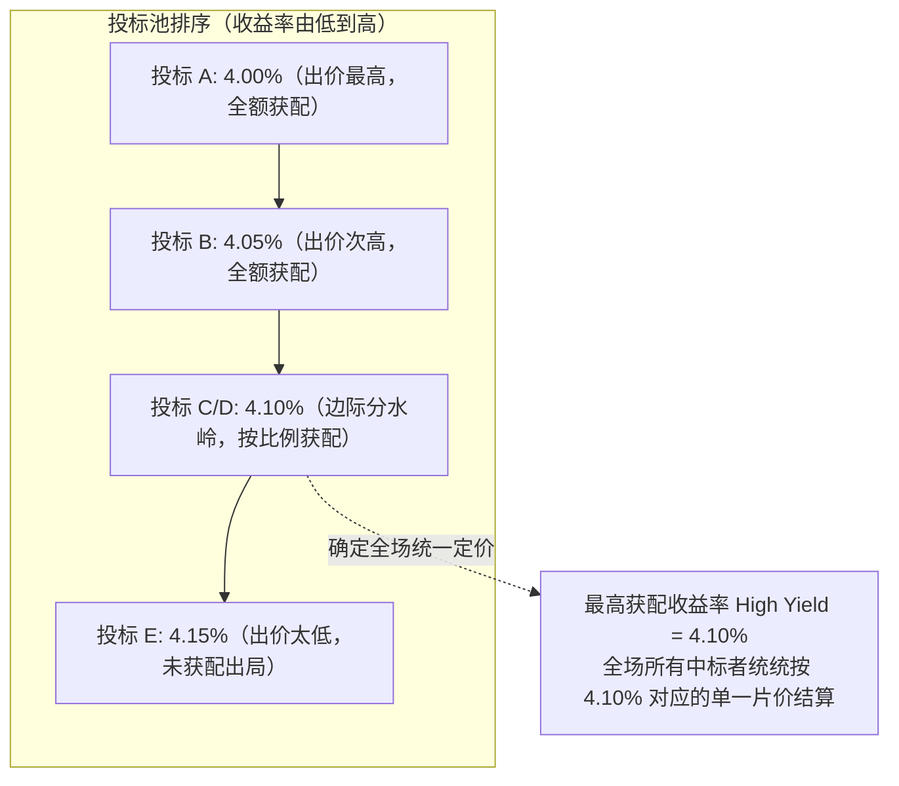
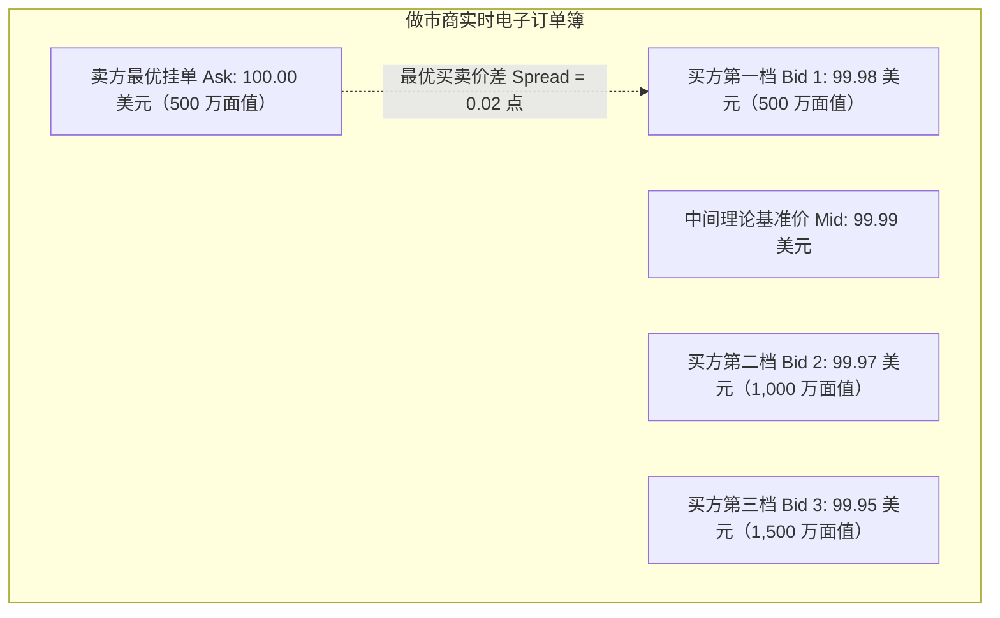
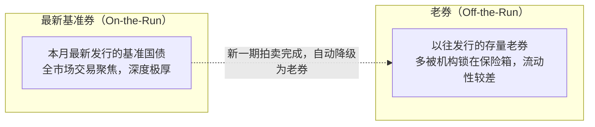
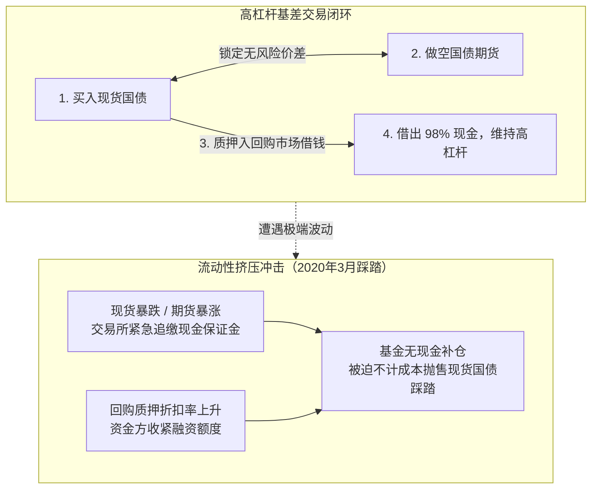
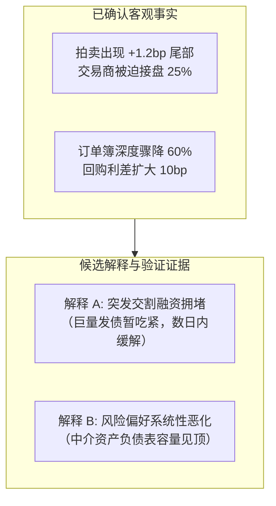

# 18 国债拍卖、二级交易与市场流动性

[上一章](17-bonds-and-curves.md) · [目录](./) · [下一章](19-yield-decomposition.md)

## 本章要解决的问题：世界上最安全的资产，为什么有时很难卖出？

如果你有一张 100 美元的百元大钞，任何时候在超市都能买到 100 美元的商品，因为它是法定货币。美国国债被公认为全球金融体系中“无信用违约风险”的无风险资产，但当你持有 1 亿美元国债急需换成现金时，你却可能发现：屏幕上的买家突然消失了，或者原本只要付几百美元手续费的交易，现在必须降价几十万美元才有人愿意接盘。

更令人困惑的是：
- 为什么财政部新发国债的拍卖倍数高达 2.6 倍，财经媒体却一片哀叹“拍卖惨淡”？
- 为什么华尔街对冲基金明明同时买了国债现货、卖了国债期货对冲了利率涨跌，却依然会在 2020 年 3 月因“缺现金”险些引爆全市场崩盘？
- 为什么“交割失败”频频发生，却绝不代表美国联邦政府即将赖账违约？

上一章我们学习了债券价格、到期收益率与收益率曲线的数学逻辑。本章我们将深入美国国债市场的“底层管道系统（Plumbing）”：从财政部的新券拍卖分配，到二级交易商的订单簿微观结构，再到回购融资与清算交割。

读完本章，你将能够：
1. 掌握国债单一价格拍卖规则，亲手计算拍卖尾部（Tail）与投标倍数（BTC）；
2. 读懂订单簿的买卖价差、市场深度与价格冲击，区分表面流动性与深度承接力；
3. 理解国债期现基差交易（Basis Trade）的杠杆与现金流错配机制；
4. 严格辨析交割失败（Settlement Fail）与主权违约的本质区别，建立全流程的国债市场监控框架。

---

## 1. 从财政部发行到最终持有：国债流转的完整链路

设想美国财政部计划发行 500 亿美元十年期国债。最终需要这批债券的，可能是为了匹配 30 年后退休金支付的加利福尼亚州养老基金，或是海外中央银行的外汇储备库。

然而，这些最终买家并不总是在财政部开标的那一分钟正好备齐了数百亿美元现金。因此，现代国债市场依赖一个高度专业化的分销中介体系：
一级交易商（Primary Dealers，如摩根大通、高盛等指定承销行）必须积极参与财政部拍卖，先用自身资产负债表“接下”巨额新发国债，随后在二级市场中逐步分销转售给各路基金与家庭；在此期间，交易商必须通过回购（Repo）市场质押这些国债来借入现金周转，并利用国债期货对冲持仓期间的利率风险。

国债的生命周期因此完整跨越了五个阶段：

在跟踪国债市场时，我们必须严格厘清三种性质不同的市场状态：

| 监测维度 | 核心关注对象 | 典型观测指标与证据 | 常见认知误区 |
| :--- | :--- | :--- | :--- |
| **一级发行承接力** | 财政部新发债券能否被平稳吸收 | 中标收益率、拍卖尾部（Tail）、投标倍数（BTC）、间接投标获配比例 | 投标倍数高就以为财政部融资毫无压力 |
| **二级交易流动性** | 存量债券在市场上买卖的难易程度 | 买卖价差（Spread）、订单簿深度（Depth）、大额滑点冲击 | 把成交活跃的最新基准券等同于所有老券 |
| **持仓融资与履约** | 交易商和对冲基金的现金借贷与交收 | 回购利差（SOFR 对比 EFFR）、质押折扣率、交割失败金额 | 把证券结算卡壳误报成美国财政部违约 |

---

## 2. 拍卖结果是怎么产生的：单一价格拍卖机制

### 2.1 荷兰式统一价格拍卖（Single-Price Auction）

美国普通固定利率附息国债（Treasury Notes and Bonds）目前均采用**单一价格拍卖（Single-Price Auction，俗称荷兰式拍卖）**。

其游戏规则非常清晰直观：
1. **非竞争性投标（Non-Competitive Bids）**：主要是个人零售散户或外国央行。他们不报价，只报想买多少金额（单户限额 1,000 万美元），承诺全盘接受最终拍卖确定的价格。财政部优先全额满足这部分需求。
2. **竞争性投标（Competitive Bids）**：主要是华尔街一级交易商、对冲基金和大型资管。他们同时申报“想买的金额”和“要求的最低年化收益率”（精确到小数点后三位，如 $4.250\%$）。申报收益率越低，代表愿意出的买价越高。
3. **分配规则**：财政部扣除预留的非竞争性额度后，将所有竞争性投标按照申报收益率从低到高（即价格从高到低）排序，顺次满足，直到待分配的发行总额全部用完。最后一个中标的最高收益率，被称为**最高获配收益率（High Yield）**。
4. **统一清算**：全场所有中标者（包括非竞争性投标者以及那些报了更低收益率的人），**统统统一按照这个最高获配收益率（即最低中标净价）成交！**

### 2.2 拍卖尾部（Tail）：衡量需求意外的关键标尺

如何判断一场拍卖是“火爆”还是“惨淡”？
绝对不能只看最高获配收益率绝对值是 $4\%$ 还是 $3\%$，因为这主要取决于宏观大势。专业金融机构看的是**相对预期差**。

在国债正式开标前的几天里，金融市场上就已经在交易这只尚未正式出生的“准国债”了，这被称为**发行前交易（When-Issued, WI）**。WI 收益率犹如体育博彩中开盘前的赔率，反映了全市场在截标瞬间对该期国债价值的共识定价。

**拍卖尾部（Tail）**定义为：
$$\text{Tail (bp)} = (\text{拍卖最高获配收益率} - \text{投标截止前同券 WI 收益率}) \times 100$$

假设在上午 13:00 截标前一分钟，市场上交易的同券 WI 收益率为 $4.240\%$，而拍卖最终确定的最高获配收益率为 $4.252\%$：
$$\text{Tail} = (4.252 - 4.240) \times 100 = +1.2\,\text{bp}$$

- **正尾部（Positive Tail，如 $+1.2\,\text{bp}$）**：表明财政部必须给出比截标前二手市场更高的收益率（即更低廉的贱卖价格），才能把这批国债强行塞给市场。这被业内称为**“出现尾部（Tailed）”**，是一级市场承接力疲软、买家意愿低迷的典型信号。
- **负尾部（Stop-Through，如 $-1.5\,\text{bp}$）**：表明投标竞争异常激烈，买家争相抢购，最终中标收益率比预售基准还低了 $1.5\,\text{bp}$。

> [!NOTE] 综合审视拍卖前让利（Concession）
> 如果在拍卖前两天，由于国债发行供应压力巨大，二级市场交易商已经提前抛售砸盘，使十年期国债收益率从 $4.10\%$ 大幅推高至 $4.24\%$（即所谓“发行前让利”）；此时即便拍卖最终出现 $-0.5\,\text{bp}$ 的微幅 Stop-through，也不代表市场毫无消化压力。成熟的分析必须将拍卖前的价格演进路径与拍卖尾部结合在一起复盘。

---

## 3. 真实官方拍卖报告带读：2024 年 9 月 10 日三年期国债

我们调取美国财政部正式公布的[2024 年 9 月 10 日三年期国债拍卖结果官方 PDF 报告](https://www.treasurydirect.gov/instit/annceresult/press/preanre/2024/R_20240910_2.pdf)（CUSIP 编码：91282CLL3，计划发行 580 亿美元）。

### 3.1 核心价格字段的物理含义

| 报告原始字段 | 官方报告数值 | 严谨经济学解读 |
| :--- | :---: | :--- |
| **Interest Rate（票面利率）** | $3\text{-}3/8\%$（即 $3.375\%$） | 债券未来每年固定支付的现金票息率，不等于当前市场交易收益率 |
| **High Yield（最高获配收益率）** | **$3.440\%$** | 本次拍卖边际中标收益率，决定了全场最终统一定价 |
| **Price（清算结算价格）** | $99.816223$ | 每 $100$ 美元面值对应的未计利息发行净价（贴水折价发行） |
| **Allotted at High** | $41.38\%$ | 在报出 $3.440\%$ 的边际投标者中，由于额度用尽，只能按比例获配 $41.38\%$ |
| **Median Yield（中标中位数）** | $3.403\%$ | 获配的竞争性投标中，有 $50\%$ 的资金申报收益率位于 $3.403\%$ 或以下 |
| **Low Yield（最低获配收益率）** | $2.880\%$ | 根据脚注，它代表排在获配金额前 $5\%$ 分位数的极端激进投标申报水平 |

> [!CAUTION] 警惕字段误读陷阱
> 许多外行初学者经常将 `High Yield` 减去 `Median Yield`（$3.440\% - 3.403\% = 3.7\,\text{bp}$）作为拍卖尾部。这是完全错误的！中位数收益率只是中标者内部申报的分布特征，绝不可替代截标前的外部市场基准 WI。官方 PDF 报告本身并不收录民间的实时 WI 行情，因此无法仅凭这份 PDF 单独算出当期 Tail。

### 3.2 投标倍数（Bid-to-Cover, BTC）的严格分子与分母

**投标倍数（BTC）**衡量全场申报总金额相对财政部实际接纳金额的倍数关系：
$$\text{BTC} = \frac{\text{全场总申报金额 (Subtotal Tendered)}}{\text{全场实际接纳金额 (Subtotal Accepted)}}$$

查阅该份 PDF 原始报告核心数字：
$$\text{BTC} = \frac{154{,}412{,}794{,}200}{58{,}000{,}178{,}700} \approx 2.6623 \quad (\text{官方报告舍入显示为 } 2.66)$$

- 分子包含了全部竞争性投标、普通大众非竞争性投标以及外国货币当局（FIMA）非竞争性投标的申报总额；
- 报告另附有一笔美联储自营公开市场账户（SOMA）的到期续作滚动认购金额（$\$554{,}238{,}500$），美联储这笔属于政策性非公开追加，不纳入上述 BTC 计算的分子与分母。

### 3.3 竞争性获配结构分析：识别谁在真正买单

报告将竞争性中标的获配资金（总计 577.11 亿美元）细分为三类渠道：

| 投标人类别与渠道 | 实际获配中标金额（美元） | 占竞争性获配总额比例（作者复算） |
| :--- | :---: | :---: |
| **Primary Dealer（一级交易商自营）** | $\$6{,}031{,}675{,}000$ | $\approx 10.45\%$ |
| **Direct Bidder（直接投标机构自营）** | $\$6{,}524{,}000{,}000$ | $\approx 11.30\%$ |
| **Indirect Bidder（间接投标客户渠道）** | $\$45{,}155{,}539{,}500$ | $\approx 78.24\%$ |
| **竞争性获配总计（Total Competitive）** | $\$57{,}711{,}214{,}500$ | $100.00\%$ |

复算间接投标者占比：
$$\text{间接获配比例} = \frac{45{,}155{,}539{,}500}{57711214500} \times 100\% \approx 78.24\%$$

> [!IMPORTANT] 渠道标签不等于买家国籍
> 财经媒体常将“间接投标者占比创纪录”解读为“海外国家队央行疯狂抄底美债”。然而在监管定义中，**间接投标（Indirect Bidders）描述的仅仅是申报路径**——即通过一级交易商代为向财政部转交标书的所有外部客户。这其中既有外国央行，也包含了大量美国本土的对冲基金、共同基金与资管机构。不能把间接投标比例简单等同于外国官方持仓变动。

---

## 4. 走进二级做市商的订单簿：流动性的微观结构

二级市场上，国债并不是凭空瞬间成交的。流动性本质上是做市商（Market Makers）冒着资产跌价风险，用真金白银挂在屏幕上的买卖意愿。

我们通过一个标准的电子限价订单簿（Limit Order Book）来拆解流动性的三大维度：

### 4.1 买卖价差（Bid-Ask Spread）：微小交易的摩擦成本

假设某只国债的最优买价（Bid）为 $99.98$，最优卖价（Ask）为 $100.00$（按百美元面值计）：
$$\text{买卖价差} = 100.00 - 99.98 = 0.02\,\text{个价格点}$$
$$\text{订单簿中间价} = \frac{99.98 + 100.00}{2} = 99.99\,\text{美元}$$

如果你只是买卖 $100$ 万美元面值的小额头寸，你可以瞬间以 $100.00$ 买入、以 $99.98$ 卖出，单程摩擦成本仅为：
$$\$1{,}000{,}000 \times \frac{0.02}{100} = \$200\,\text{美元}$$

### 4.2 订单簿深度（Market Depth）与大单滑点冲击

但如果一家大型资管公司需要紧急平仓抛售 **$2{,}000$ 万美元面值**的国债呢？
屏幕上的第一档买单只有 $500$ 万美元，根本接不下这笔大单。如果强行市价抛售，该笔卖单就会像一把推土机，自上而下逐层“砸穿”买方订单簿：
- 第 1 档（$99.98$）：吃掉 $500$ 万美元；
- 第 2 档（$99.97$）：吃掉 $1{,}000$ 万美元；
- 第 3 档（$99.95$）：继续吃掉剩下的 $500$ 万美元。

此时，这笔大额抛售的实际加权平均成交价格变为：
$$\text{平均成交净价} = \frac{5 \times 99.98 + 10 \times 99.97 + 5 \times 99.95}{20} = \frac{1{,}999.35}{20} = 99.9675$$

相对于下单前的市场公允中间价（$99.99$），平均滑点亏损为：
$$\text{滑点价格冲击} = 99.99 - 99.9675 = 0.0225\,\text{个价格点}$$
$$\text{总冲击滑点损失} = \$20{,}000{,}000 \times \frac{0.0225}{100} = \$4{,}500\,\text{美元}$$

如果所有筹码都能在首档最优买价（$99.98$）变现，成本原本只需 $\$2{,}000$ 美元。多掏出的 $\$2{,}500$ 美元，就是市场**缺乏深层厚度（Lack of Depth）**带来的流动性惩罚！

### 4.3 价格弹性与订单簿恢复速度（Resilience）

大单成交后，订单簿中间价瞬间被打低到 $99.95$。接下来会发生什么？
- 在健康活跃的市场上，其他套利者与做市商会在几秒钟内迅速补回买单，中间价很快回弹修复至 $99.98$ 附近；
- 而在流动性枯竭的恐慌时刻（如 2020 年 3 月），大单砸穿后，买方席位长期空虚，无人敢挂单补血，市场陷入单边失控暴跌。

---

## 5. 新券（On-the-Run）与老券（Off-the-Run）的生态断层

美国财政部发行的同期限国债，在市场上被严格划分为两大家族：

- **最新基准券（On-the-Run, OTR）**：指财政部最新拍卖的那一只特定国债（如最新的十年期国债）。全市场的投机客、对冲基金和做市商都集中用它来报价和对冲，其换手率极高，买卖价差极窄。
- **老券（Off-the-Run, OFFR）**：一旦下个月财政部新发了一只十年期国债，上个月那只就会退化成老券。老券大多被养老基金或保险公司买入后锁进托管账户，交易极度稀疏清淡。

这种流动性差异直接反映在价格上：**老券往往比新券更便宜，收益率更高。** 这多出的收益率差，很大程度上就是投资者为承担“不易变现风险”而索要的**流动性溢价（Liquidity Premium）**。

> [!WARNING] 数据源拼接的“虚假暴跌”陷阱
> 纽约联储等多家机构在绘制“国债市场深度图”时，每逢新老券轮换（Roll），底层追踪的 CUSIP 编码就会发生突变。若分析系统盲目将老券退役前后的深度数据直接拼接，屏幕上就会出现毫无宏观意义的断崖式跳水。

---

## 6. 做市商资产负债表与回购融资中枢

国债二级市场的承接力，完全取决于做市商的资产负债表空间。

做市商在充当缓冲垫接下客户抛售的国债后，必须妥善解决三重硬约束：
1. **利率市场风险**：持有国债会暴露于利率上行风险中，做市商通常需要做空国债期货来锁定风险敞口；
2. **现金融资需求**：持有 100 亿美元国债库存，做市商账上并没有这么多闲钱，必须在隔夜回购（Repo）市场上将国债质押给货币市场基金来拆入现金；
3. **监管资本与杠杆限制**：即使头寸在数学上实现了完美对冲，巴塞尔协议的补充杠杆率（SLR）监管依然要求银行必须按照总资产规模（不扣减对冲）计提昂贵的股东权益资本。

当全市场抛压涌来，做市商资本额度被撑爆、回购融资利率飙升时，做市商唯一的理性选择就是调宽价差、削减挂单数量，甚至关掉交易终端。

---

## 7. 国债基差交易（Basis Trade）：看似完美的对冲为何会引爆流动性危机？

### 7.1 什么是现货—期货基差套利？

在正常市场环境下，十年期国债期货的价格往往比现货国债价格稍微贵那么一点点（因为资产管理机构更偏爱使用保证金杠杆购买期货）。

聪明的华尔街对冲基金敏锐地发现了这个几乎没有方向性利率风险的套利机会：
- **操作步骤 1**：在现货市场上买入相对便宜的**现货国债**；
- **操作步骤 2**：在期货交易所卖出相对昂贵的**国债期货**（锁定未来交割价差）；
- **操作步骤 3**：通过隔夜回购市场（Repo），把刚买的现货国债质押出去，借回 $98\%$ 的现金，自己只掏 $2\%$ 的自有本金。

这就是经典的**国债基差交易（Cash-Futures Basis Trade）**。其扣除转换因子后的理论毛基差为：
$$\text{毛基差} = \text{现货净价} - \text{期货报价} \times \text{转换因子 (CF)}$$

单笔交易的基差收益可能只有年化 $0.5\%$ 到 $1.0\%$，但由于现货被做空期货对冲，在高达 50 倍杠杆（$2\%$ 保证金）的放大下，对冲基金可以把年化回报率做到惊人的 $25\%$ 至 $50\%$！

### 7.2 2020 年 3 月的惊魂一幕：现金流错配引发踩踏

2020 年 3 月新冠疫情爆发初期，金融市场遭遇了百年一遇的流动性踩踏：
1. **基差扩大，账面亏损**：由于全球避险资金不顾一切买入国债期货，国债期货价格暴涨，对冲基金的空头头寸出现巨额账面浮亏，芝加哥商业交易所（CME）要求基金在数小时内补缴数亿美元的现金**变动保证金（Variation Margin）**；
2. **浮盈无法变现**：虽然基金持有的现货国债也同步升值，但如果不把现货卖掉，账面浮盈根本无法变成可供清算的现金；
3. **回购融资加压**：回购市场上做市商自顾不暇，纷纷要求提高质押折扣率（Haircut）。

面对巨额现金追缴，对冲基金被迫连夜在二级市场上不计成本地**狂抛巨量现货国债**以换取现金。瞬间，数百亿美元的主动抛单将整个美国国债订单簿彻底砸瘫，导致原本应该在危机中上涨的美国国债现货价格出现了历史罕见的暴跌，最终倒逼美联储出台无上限量化宽松（QE）与紧急做市支持才稳住大局。

---

## 8. 交割失败（Settlement Fail）为什么绝不等于主权违约？

在宏观研报中，我们经常会看到“国债交割失败规模创历史新高”的惊悚标题。

**这与美国财政部违约是两码事：**
- **主权违约（Sovereign Default）**：是指国债发行人（美国联邦财政部）未能按期向债券持有人支付到期本金或票息。这是债务人的信用违约。
- **交割失败（Settlement Fail）**：是指在二级市场的买卖双方清算中，卖方由于某种后台技术原因或未能及时在市场上借到这只特定券，导致在交割日当天**未能按时向买方交付证券（Fail to Deliver）**。

在二级交易中，某些特定基准券由于全市场做空借券需求过于旺盛，在回购市场上经常变得极度稀缺（即处于前一章讲过的“特别借贷 Specials”状态）。此时借券的成本甚至跌入负利率，如果做空者无论如何也借不到这只券，就会在中央清算系统里记下一笔“交割失败”。

买方虽然没拿到债券，但也完全没有支付现金，交易在后续几个工作日补齐交割即可。将交割失败夸大为“美国财政部面临倒闭”，是混淆金融后台运作机制的典型外行错误。

---

## 9. 综合研判实战：一次偏弱的国债拍卖意味着什么？

假设在今天中午美东时间 13:00 的十年期国债拍卖中，系统记录了如下一组真实数据：

| 观测指标与环节 | 读数与事实证据 |
| :--- | :--- |
| **拍卖相对同券 WI 的尾部** | $\text{Tail} = +1.2\,\text{bp}$（出现显著正尾部） |
| **投标倍数 BTC** | $2.66$ 倍（与历史均值基本持平） |
| **一级交易商获配比例** | 升至 $25\%$（大幅高于近期 $12\%$ 的平均水平） |
| **订单簿第一档深度** | 较近五日平均水平断崖式下挫 $60\%$ |
| **最优买卖价差** | 维持在 $0.02$ 个价格点（未见明显异动） |
| **全市场成交量** | 单日环比暴增 $70\%$ |
| **回购市场资金价格** | $\text{SOFR} - \text{EFFR}$ 利差扩大了 $10\,\text{bp}$ |

**资深宏观分析师的推演复盘框架**：

1. **第一步：廓清事实，剔除臆断**：
   - 拍卖需求确实偏弱（正尾部 $+1.2\,\text{bp}$），大量未被终端客户买走的筹码被一级交易商作为兜底库存吃下（占比从 $12\%$ 激增至 $25\%$）；
   - 订单簿表面价差虽然完好，但深层承接力已严重脆弱（深度缩水 $60\%$）；回购市场借钱变贵。
   - 但**绝不能妄下结论**说“外国投资者正在全面抛售美债”或“美联储即将丧失利率控制权”。
2. **第二步：提出两个竞争性假设**：
   - **假设 A（暂时性管道拥堵）**：由于本周财政部新券交割量极大，大量现金被缴存至国债账户（TGA），货币市场流动性暂时抽紧，交易商背负大量新库存不敢激进报价；随着资金跨期回流，下周将恢复正常。
   - **假设 B（系统性做市能力耗尽）**：长端国债波动率飙升，大型机构的内部 VaR 风险限额被打破，正在主动压缩美债风险资产暴露。
3. **第三步：设计可证伪的后续审计点**：
   - 观察未来 3 个交易日订单簿深度与 SOFR 利差是否迅速恢复；
   - 查阅美联储周度一级交易商资产负债表持仓统计（Primary Dealer Statistics），确认交易商库存是否顺利分销。

---

## 10. 自动化每日国债监控系统建设标准

构建工业级可审计的每日国债运行监控，必须遵守以下证据等级边界：

| 监控层级 | 核心提取字段 | 更新频率 | 严禁越界的证据红线 |
| :--- | :--- | :---: | :--- |
| **一级拍卖** | 获配净价、High Yield、Tail、BTC、获配占比 | 仅在拍卖日公布 | 无拍卖的日子必须显示“今日无新拍卖”，严禁向前填充虚构 Tail |
| **发行前交易** | 截标前 5 分钟 WI 收益率买卖中间价 | 拍卖日盘中实时 | 必须带有精确毫秒时间戳，严禁使用收盘后的 CMT 曲线点冒充 WI |
| **二级订单簿** | 最优买卖价差、前三档累计深度、恢复时间 | 每日活跃交易时段 | 严格标注特定 CUSIP，严禁将新券（OTR）与老券（OFFR）无缝拼接 |
| **回购融资** | SOFR、TGCR、各期限国债 Specials 借券费率 | 每日早晨发布 | 隔夜融资数据反映前一日交易，不可作为即时行情的绝对代理 |
| **交割清算** | 纽约联储报告的 Fail to Deliver / Receive 金额 | 每周四公布 | 具有统计滞后性，严禁将其作为主权违约指标在早报中预警 |

---

## 练习与参考答案

### 练习 1：单一价格荷兰式拍卖分配全流程推演
某期三年期固定利率美国国债计划向市场公开筹集发行 1 亿美元（$\$100\,\text{M}$）面值。非竞争性合格投标总额为 1,000 万美元（$\$10\,\text{M}$）。留给竞争性投标的总配额为 9,000 万美元（$\$90\,\text{M}$）。
开标后，系统收到五位互不相关的华尔街机构提交的竞争性标书：
- 机构 A：申报收益率 $4.00\%$，申报金额 2,000 万美元；
- 机构 B：申报收益率 $4.05\%$，申报金额 3,000 万美元；
- 机构 C：申报收益率 $4.10\%$，申报金额 3,000 万美元；
- 机构 D：申报收益率 $4.10\%$，申报金额 3,000 万美元；
- 机构 E：申报收益率 $4.15\%$，申报金额 2,000 万美元。
请回答：
1. 本次国债拍卖最终确定的全场最高获配收益率（High Yield）是多少？
2. 机构 C 与机构 D 在边际分水岭上的最终获配金额各是多少？
3. 机构 A 申报的收益率仅为 $4.00\%$，在统一价格拍卖规则下，机构 A 最终获配的国债按照什么收益率计价结算？

点击查看详细参考答案与推理步骤

1. **最高获配收益率推算**：
   - 待分配竞争性总额度：$\$90\,\text{M}$；
   - 按照申报收益率从低到高（出价从高到低）排序满足：
     - 首先全额满足机构 A（$4.00\%$）：满足 $\$20\,\text{M}$，剩余可用配额 $\$70\,\text{M}$；
     - 其次全额满足机构 B（$4.05\%$）：满足 $\$30\,\text{M}$，剩余可用配额 $\$40\,\text{M}$；
     - 接下来遇到机构 C 与机构 D，两家均申报 $4.10\%$，合计申报金额为 $\$30\,\text{M} + \$30\,\text{M} = \$60\,\text{M}$；
     - 由于剩余额度只有 $\$40\,\text{M}$，不足以全额满足该档全部需求，因此本次拍卖的配额在此处耗尽。
   - 故本次拍卖的全场最高获配收益率（High Yield）即为 **$4.10\%$**；申报 $4.15\%$ 的机构 E 彻底出局，获配为 $0$。
2. **边际获配金额按比例分配**：
   - 在 $4.10\%$ 这一档位上，获配比例为：
     $$\text{获配比例} = \frac{\text{剩余可用额度}}{\text{该档申报总额}} = \frac{\$40\,\text{M}}{\$60\,\text{M}} = \frac{2}{3} \approx 66.67\%$$
   - 机构 C 获配：$\$30\,\text{M} \times \frac{2}{3} = \$20\,\text{M}$（2,000 万美元）；
   - 机构 D 获配：$\$30\,\text{M} \times \frac{2}{3} = \$20\,\text{M}$（2,000 万美元）。
3. **统一定价机制落地**：
   机构 A 虽然激进地报出了 $4.00\%$ 的低收益率，但在单一价格荷兰式拍卖规则下，**全场所有中标者统一享受边际最高获配收益率清算**。因此机构 A 获配的 2,000 万美元国债完全按照 **$4.10\%$** 对应的折现价格结算，享受了价格赢家红利。

### 练习 2：拍卖尾部（Tail）计算与基准错配排查
某期十年期美国国债拍卖最终确定的最高获配收益率为 $4.100\%$。
1. 若截标前一分钟同券 WI 收益率为 $4.115\%$，计算该次拍卖的 Tail 是多少个基点（$\text{bp}$）？这是尾部偏弱还是 Stop-through？
2. 如果某宏观学徒在撰写研报时，找不到当期 WI 数据，直接从 FRED 上下载了当天傍晚纽约收盘的十年期恒定期限国债收益率（CMT 读数为 $4.115\%$），然后用 $4.100\% - 4.115\% = -1.5\,\text{bp}$，并声称“本次拍卖出现了 $1.5\,\text{bp}$ 的火爆抢购 Stop-through”。请指出其犯下的致命错误。

点击查看详细参考答案与推理步骤

1. **Tail 精确计算**：
   $$\text{Tail} = (\text{High Yield} - \text{WI Yield}) \times 100 = (4.100 - 4.115) \times 100 = -1.5\,\text{bp}$$
   由于 Tail 为负值（$-1.5\,\text{bp}$），表明拍卖中标收益率低于截标前市场预期，是一级市场需求极为火爆的 **Stop-through** 现象。
2. **研究方法致命错误指正**：
   - **时间戳严重错配**：国债拍卖截标发生于美东时间中午 13:00，而 CMT 收盘收益率采集自傍晚 15:30 以后。下午两个半小时里可能发布了多项宏观数据或突发讲话，两者的市场定价环境完全不可比；
   - **标的物根本不同**：CMT 是由财政部模型拟合出来的“标准剩余 10.0 年”虚拟期限点收益率；而 WI 是这只特定新发十年期国债现券在拍卖前的真实预售成交价。将收盘模型曲线点减去中午的实际拍卖收益率，所得出的结果没有任何经济学意义，属于虚假的伪造指标。若缺乏可靠 WI 数据，正规报告必须如实披露“Tail 暂无法验证”。

### 练习 3：复算官方拍卖 PDF 核心指标
重新查阅第 3 节引用的[2024 年 9 月 10 日三年期国债拍卖结果官方报告](https://www.treasurydirect.gov/instit/annceresult/press/preanre/2024/R_20240910_2.pdf)：
1. 复算并写出投标倍数（BTC）的计算公式与数值；
2. 计算间接投标者（Indirect Bidders）在竞争性中标总金额中所占的比例；
3. 解释为什么报告中的 `Median Yield`（$3.403\%$）绝不能当作拍卖前的 WI 预期价格？为什么间接获配占比较高不能草率证明“外国央行正在增持美债”？

点击查看详细参考答案与推理步骤

1. **BTC 复算**：
   $$\text{BTC} = \frac{\text{Subtotal Tendered}}{\text{Subtotal Accepted}} = \frac{154{,}412{,}794{,}200}{58{,}000{,}178{,}700} \approx 2.6623 \quad (\text{报告显示为 } 2.66)$$
2. **间接投标者获配占比复算**：
   $$\text{间接获配占比} = \frac{\$45{,}155{,}539{,}500}{\$57{,}711{,}214{,}500} \times 100\% \approx 78.24\%$$
3. **核心概念辨析**：
   - `Median Yield` 仅仅是本次拍卖获配竞争性申报内部的分布中位数（即 $50\%$ 的资金出价在 $3.403\%$ 以下），它完完全全是拍卖投标产生的内生结果，并不反映开标前外部二级市场的预售交易定价；
   - 间接投标者（Indirect Bidders）是由交易商代理提交标书的所有外部客户的统称。该群体中虽然包含外国央行与主权基金，但同样包含了美国本土数以千计的公募基金、保险资管、养老金与对冲基金。渠道分类不代表国籍属性。

### 练习 4：大额订单深度砸盘的加权执行成本计算
沿用正文第 4.3 节的买方订单簿数据（当前市场中间价为 $99.99$ 美元）：
- 档位 1：净价 $99.98$，可买面值 500 万美元；
- 档位 2：净价 $99.97$，可买面值 1,000 万美元；
- 档位 3：净价 $99.95$，可买面值 1,500 万美元。
假设你是一家主权财富基金的交易员，因紧急现金调拨，必须立即市价抛售 **2,500 万美元面值**的国债。假定在下单瞬间订单簿无新增挂单也无人撤单。
请计算：
1. 该笔 2,500 万美元大单完全成交后的加权平均成交净价；
2. 相对于下单前中间价（$99.99$），该笔交易所遭受的每百美元面值平均滑点冲击；
3. 因大额冲击而损失的实际滑点现金金额（美元）。

点击查看详细参考答案与推理步骤

1. **加权平均成交净价计算**：
   - 卖出 2,500 万美元需要顺次吞噬：
     - 档位 1（$99.98$）：500 万美元；
     - 档位 2（$99.97$）：1,000 万美元；
     - 档位 3（$99.95$）：剩余的 1,000 万美元（未全部吃光第三档）。
   - 加权平均净价：
     $$\text{平均净价} = \frac{5 \times 99.98 + 10 \times 99.97 + 10 \times 99.95}{25} = \frac{499.90 + 999.70 + 999.50}{25} = \frac{2{,}499.10}{25} = 99.964$$
2. **相对中间价的平均滑点冲击**：
   $$\text{滑点冲击} = 99.99 - 99.964 = 0.026\,\text{个价格点（即每百元面值损失 } \$0.026\,\text{美元)}$$
3. **实际滑点损失金额**：
   $$\text{实际损失} = \$25{,}000{,}000 \times \frac{0.026}{100} = \$6{,}500\,\text{美元}$$

### 练习 5：买卖价差与订单簿深度的假象辨析
在某一特定交易时段，某只十年期基准国债在平台上的最优买卖价差（Bid-Ask Spread）始终稳定在极窄的 $0.01$ 个价格点上；然而订单簿第一档的最优挂单深度从原先的 1,000 万美元骤降至 200 万美元。
有市场评论员撰文宣称：“买卖价差纹丝不动，证明国债市场流动性依然极其充裕健康”。请纠正这一错误言论，并说明面对大额机构投资者时，真实的流动性环境发生了什么变化。

点击查看详细参考答案与推理步骤

该评论犯了“以一维价差替代整体微观结构”的典型错误：
1. **小单与大单的流动性割裂**：最优买卖价差仅能保证极小金额（如 100 万美元以内）的零星交易能以低成本达成。
2. **深层承接力已暴跌 $80\%$**：第一档深度从 1,000 万降至 200 万，意味着做市商由于风险偏好恶化或负债能力吃紧，已不敢在盘口大量提供挂单流动性。
3. **真实滑点成本激增**：对于正常规模为数千万美元的机构抛盘，极薄的盘口会被瞬间砸穿并滑落至低位深档，引发巨大的市场价格冲击。因此此时的市场流动性不仅没有保持健康，反而处于高度脆弱的冰点状态。

### 练习 6：基差套利在对冲下的现金流错配机理
某量化基金构建了一笔规模为 1 亿美元的国债期现基差交易（买入现货国债、做空国债期货）。在某次突发避险行情中，国债现货与期货价格均出现大幅上涨：现货端产生 100 万美元账面未实现浮盈；而国债期货空头端产生 100 万美元浮亏。由于期货交易所实行每日无负债结算，要求基金必须在当天下午交收 100 万美元现金变动保证金。
基金交易员向风控主管辩解：“现货赚了 100 万，期货亏了 100 万，整体损益为零，因此不需要准备现金”。请从流动性与会计结算机制指明其错误所在。

点击查看详细参考答案与推理步骤

该交易员严重混淆了**会计经济损益（Economic P&L）**与**即期现金流动性（Cash Liquidity）**：
1. **期货保证金要求即期现金交收**：期货交易所要求补缴的 100 万美元变动保证金，必须在规定时点前划付真金白银的结算货币，否则将被强制平仓违约；
2. **现货浮盈无法直接用于支付**：持有的现货国债虽然升值了 100 万美元，但这笔钱以浮盈形式凝结在债券资产中。在基金没有通过卖出债券或通过回购市场重新评估抵押品追加借款之前，它根本无法变成可以划转的可用银行存款；
3. **结论**：方向性对冲抹平了净资产波动，但完全无法消除现货与衍生品在结算时点上的现金流错配。手头缺乏流动现金储备的基差基金，依然会因流动性枯竭而爆仓。

### 练习 7：交割失败与主权违约的法律与经济边界
在某只美国国债因市场做空需求激增导致极度紧俏的时期，纽约联储报告的该券二级市场交割失败金额（Fail to Deliver）创下近三年新高。在此期间，美国财政部正常向全体国债持有人足额划拨了季度利息。
请回答：
1. 应该如何准确向公众解释该现象？
2. 能否在财经早报中将全市场所有机构的“未能交出（Fail to Deliver）”与“未能收到（Fail to Receive）”金额简单加总，并宣称“美国国债违约规模已达数百亿美元”？

点击查看详细参考答案与推理步骤

1. **准确经济学解释**：
   该现象应定性为“二级市场特定基准券的现券借贷与清算交收拥堵”，是做空借券需求旺盛导致特定 CUSIP 稀缺引发的技术性清算延迟。美国财政部作为债务人自始至终按期足额支付本息，主权信用未发生任何动摇。
2. **统计数据合规性辨析**：
   **绝对不能**。在多边中央清算网络中，一笔国债交易如果在中间的交易商间经纪链条中卡壳，会在上游与下游多家机构的账本上同时各记录一笔“未能交出”和“未能收到”。将这些统计流水简单机械相加，会造成数倍的重复双重计算；更重要的是，交割失败属于金融机构间的履约时效瑕疵，与主权发行人违约存在不可逾越的法律鸿沟。

### 练习 8：设计自动化每日国债监控 Agent 的异常诊断逻辑
假设今天是周四下午，你负责的自动化宏观监控系统发出警报：
- 今日财政部新发三十年期国债拍卖出现 $+1.8\,\text{bp}$ 的显著 Tail；
- 某一主流电子交易平台上十年期国债最优档深度骤降 $70\%$，且买卖价差扩大了 3 倍；
- 但你检索发现，该十年期国债今日恰逢新老券（On-the-Run 切换至 Off-the-Run）代码滚动轮换日；
- 此外，纽约隔夜回购参考利率（SOFR）尚未对外公布。
请为你的监控 Agent 撰写一段不超过 200 字的标准分析报告，严密区分已知事实、数据口径陷阱与待验证假设。

点击查看专业可审计的分析简报模板

**【每日国债市场运行与流动性诊断简报】**
> “今日三十年期国债拍卖录得 $+1.8\,\text{bp}$ 正尾部，表明超长端一级配置需求边际疲软。电子交易平台显示的十年期国债深度塌陷与价差走阔，经核实底层适逢最新券滚动日，反映了旧券退役导致的统计口径切换断点，不可直接等同于全市场流动性雪崩。今日 SOFR 隔夜融资数据将于明晨补齐，届时将排查一级承接是否导致回购融资市场出现结构性资金拥堵。在缺乏全市场多源验证前，维持中性流动性观察评级。”

---

## 本章小结与下一章

国债不仅是一张写着票息的财政借据，更是整个现代金融大厦运转的基础抵押品。从财政部的单一价格拍卖分配，到做市商订单簿的深层承接力，再到基差交易背后的高杠杆回购管道，每一个环节的畅通与否，都直接牵动着全球无风险利率的中枢。

在下一章中，我们将把显微镜对准国债收益率的内在微积分：如何把一个生硬的名义国债收益率，精确拆解为**实际收益率、通胀预期补偿与期限溢价（Term Premium）**，看穿利率涨跌背后的真实驱动源。

[上一章](17-bonds-and-curves.md) · [目录](./) · [下一章](19-yield-decomposition.md)
