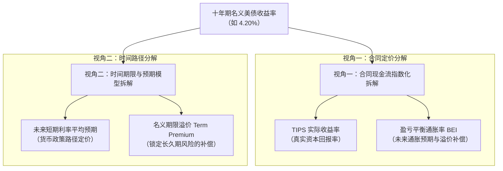
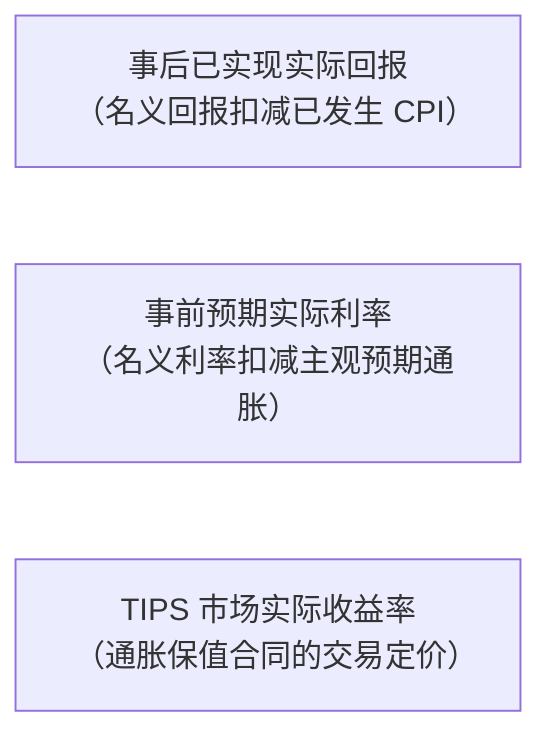
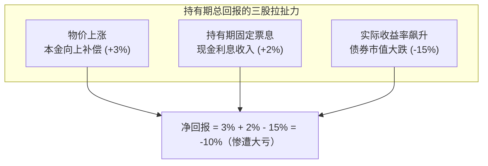
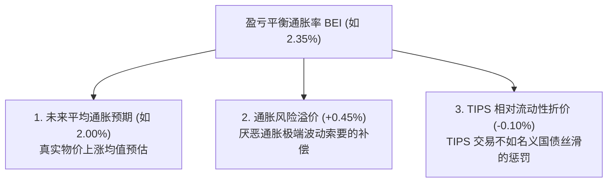
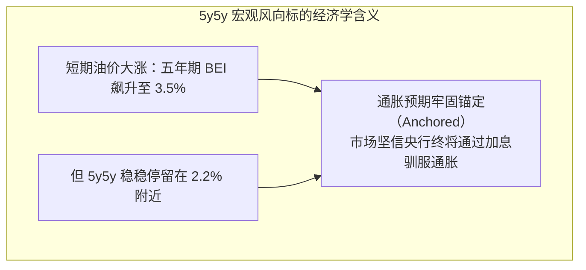
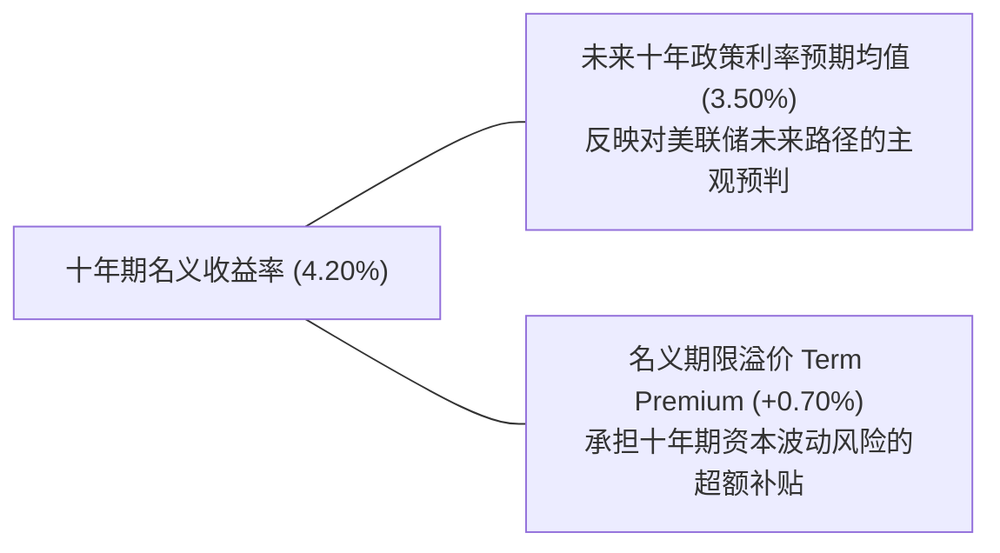
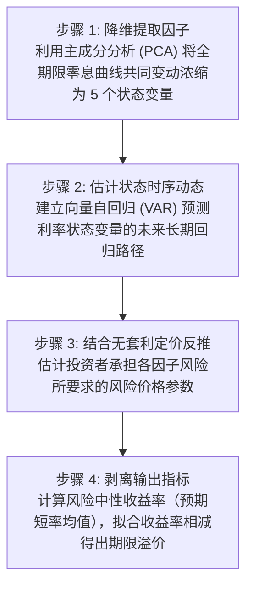
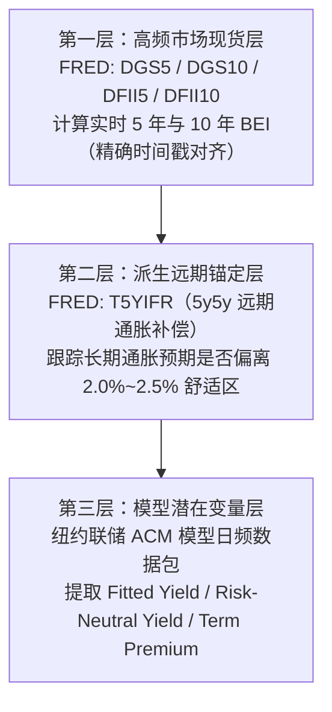

# 19 实际收益率、通胀补偿与期限溢价

[上一章](18-treasury-plumbing.md) · [目录](./) · [下一章](20-corporate-financing.md)

## 本章要解决的问题：十年期国债利率上涨，到底是谁在推动？

设想你在某天清晨打开行情终端，发现十年期美国国债收益率在几个小时内从 $4.00\%$ 暴拉到了 $4.20\%$，跳涨了整整 20 个基点（$+20\,\text{bp}$）。

不同频道的财经名嘴给出了截然相反的宏观“故事”：
- 宏观分析师 A 说：“这是大通胀卷土重来！大宗商品暴涨，市场在恐慌计入未来物价失控。”
- 产业分析师 B 说：“这是经济强劲扩张的证明！AI 革命提振了投资回报率，实际经济增速超预期。”
- 债券基金经理 C 说：“通胀和经济都没变，纯粹是美国财政部发债泛滥，长端国债供过于求导致买家要求更高的风险补偿（期限溢价）！”

三种说法都能讲出合乎逻辑的故事，但如果只盯着屏幕上单调的一个 $4.20\%$，你根本无法判定哪一种叙事贴近现实。

上一章我们厘清了国债在一级拍卖和二级交易中的管道流转机制。本章我们将拿起一把锋利的手术刀，切开长端名义国债收益率的内部结构：
如何利用通胀保值国债（TIPS）、盈亏平衡通胀率（BEI）以及期限结构模型（如纽约联储 ACM 模型），将收益率精准剥离为**实际无风险利率、未来通胀补偿与期限风险溢价**三大成分。

读完本章，你将能够：
1. 彻底分清事后实际回报、事前实际利率与 TIPS 实际收益率的本质差异；
2. 亲手从月度 CPI 计算 TIPS 的指数比率、调整后本金与实际结算现金流；
3. 准确计算盈亏平衡通胀率（BEI）与五年后五年远期通胀补偿（$5\text{y}5\text{y}$），识别美联储通胀信誉是否稳固；
4. 掌握纽约联储 ACM 期限溢价模型的估计逻辑与局限，构建立体透视宏观利率异动的专业分析框架。

---

## 1. 概念先导：三个都可能叫“实际利率”的数字

假设你借给朋友 100 美元，约定一年后归还 105 美元，名义利率为 $5.0\%$。
如果这一年间全社会物价平均上涨了 $3.0\%$，一年后你拿回的 105 美元在超市里的实际购买力为：
$$\text{折算期初购买力} = \frac{105}{1 + 3\%} = \frac{105}{1.03} \approx 101.94\,\text{美元}$$
你在这笔借贷中实际获得的购买力净增幅只有 $1.94\%$，而不是账面的 $5.0\%$。

但在现实经济决策中，以下三个数字经常被混称为“实际利率”，必须严格厘清：

| 概念名称 | 如何获取与计算 | 核心回答的经济学问题 | 绝对不能误当成什么 |
| :--- | :--- | :--- | :--- |
| **事后已实现实际回报** | 投资结束后，用已实现的账面回报折算同期真实的 CPI 物价涨幅 | “我在过去这笔投资中，实际购买力究竟增长了多少？” | 投资者在年初做决策时就能提前预知的数字 |
| **事前预期实际利率** | 名义利率减去投资者对未来对应期限的主观预期通胀率 | “如果我今天把钱借出去，我预计能换来多大的真实购买力？” | 投资到期后必然能够兑现的真实结果 |
| **TIPS 实际收益率** | 财政部发行的通胀保值国债在二级市场竞价交易形成的到期收益率 | “金融市场愿意为一份本金全额随物价指数化的无风险借据付多少钱？” | 纯粹的自然实际利率 $r^*$，或短期持有必然盈利的保证 |

因此，当新闻里报道“十年期实际利率暴涨”时，第一件事是核查口径：是用名义收益率减去刚刚公布的过去 12 个月历史 CPI（这是将未来 10 年定价与过去 1 年物价机械拼凑），还是指二级市场上**十年期 TIPS 的实际收益率**？本章聚焦的是后者。

---

## 2. 通胀保值国债（TIPS）：从底层合同到市场收益率

### 2.1 固定的是票息率，调整的是本金

普通固定利率国债（Nominal Treasury）承诺给你的每一期美元现金流是固定死的。如果未来发生恶性通胀，投资者收到的票息和本金就会被通胀稀释得形同废纸。

为了解决这一痛点，美国财政部于 1997 年开始发行 **TIPS（Treasury Inflation-Protected Securities）**。
其合同机制非常精妙：
- **票面利率（Coupon Rate）终身固定**：例如年化 $2.0\%$；
- **计息本金（Principal）随物价动态调整**：财政部每月根据物价指数，为每只 TIPS 计算一个**指数比率（Index Ratio）**，计息本金等于“原始面值 $\times$ 指数比率”。

假设某只 TIPS 原始面值为 $\$1{,}000$ 美元，票面利率为 $2.0\%$（半年付息一次）。在某一期付息日，由于通胀累积，官方公布的指数比率为 $1.035$：
$$\text{调整后本金} = \$1{,}000 \times 1.035 = \$1{,}035\,\text{美元}$$
$$\text{当期半年现金利息} = \$1{,}035 \times \frac{2.0\%}{2} = \$10.35\,\text{美元}$$

固定的是 $2.0\%$ 这个百分比，而投资者收到的实际现金支票从 $\$10.00$ 自动上调到了 $\$10.35$！如果物价指数继续走高，未来的计息本金和每期利息还会进一步水涨船高。

### 2.2 从月度 CPI 到每日指数比率：财政部的线性插值法

TIPS 挂钩的物价指标是美国劳工统计局（BLS）公布的**城市未季调全项目消费者价格指数（CPI-U NSA）**。
月度 CPI 指数每月只发布一次，但债券在二级市场上每个工作日都在交易交割，财政部是如何确定具体到每个日历日的参考指数的？

答案是严格的**滞后三月日历线性插值法**：
1. **滞后参考**：4 月 1 日使用的基准是 3 个月前的 1 月 CPI；5 月 1 日使用的基准是 2 月 CPI；
2. **月内线性插值**：4 月份中每一天的参考 CPI，并不进行日常物价抽样调查，而是将 1 月和 2 月的 CPI 差值，均匀按天数平摊在 4 月的 30 天内：

$$\text{当日参考 CPI} = \text{本月首日参考 CPI} + \frac{\text{当日日期序号} - 1}{\text{本月总天数}} \times (\text{下月首日参考 CPI} - \text{本月首日参考 CPI})$$

$$\text{某券当日指数比率 (Index Ratio)} = \frac{\text{当日参考 CPI}}{\text{该券原始起息日基准参考 CPI}}$$

假设 1 月 CPI 为 $300.0$，2 月 CPI 为 $303.0$。4 月总共有 30 天。
计算 4 月 15 日（日期序号为 15）的参考 CPI：
$$\text{4 月 15 日参考 CPI} = 300.0 + \frac{15 - 1}{30} \times (303.0 - 300.0) = 300.0 + \frac{14}{30} \times 3.0 = 301.4$$

> [!IMPORTANT] 指数化时滞（Indexation Lag）的双重时钟
> 今天的 TIPS 本金调整，反映的是大约 2 至 3 个月前的历史物价数据。
> 这种机械时滞绝不代表 TIPS 的交易价格反应迟钝。当最新的 CPI 超预期大涨时，二级市场做市商会**在几毫秒内重定价 TIPS 的屏幕交易价格**，而纸面上的合同本金则严格按照预定的插值日历按部就班地逐日调整。

### 2.3 到期面值保护伞：防通缩下限（Deflation Floor）

如果未来发生深度经济萧条，美国陷入长达五年的持续通缩，物价指数一路下跌，TIPS 的本金会被扣到零吗？

美国财政部在发行条款中确立了坚实的**到期面值保护条款**：
债券到期偿还本金时，财政部承诺支付**“调整后本金”与“原始面值（$\$1{,}000$ 美元）”二者中的较高者**。
- 若到期时指数比率为 $1.20$，财政部支付 $\$1{,}200$ 美元；
- 若到期时爆发大通缩，指数比率跌至 $0.95$（调整后本金仅剩 $\$950$ 美元），财政部依然会**全额偿还 $\$1{,}000$ 美元原始面值！**

必须极其注意：这项保护仅在债券最终到期日生效，且只针对原始面值。在存续期间，各期票息仍然严格按照当期缩水的调整后本金计算；如果你在二级市场上以 $\$1{,}150$ 美元的高溢价买入 TIPS，合同也绝不承诺在通缩时保你个人买入成本不亏。

---

## 3. 有通胀保值，为什么买 TIPS 依然会严重亏损？

许多散户投资者在 2022 年大通胀期间买入 TIPS 基金，年底却震惊地发现账户净值暴跌了超过 $15\%$。他们愤怒地质问：不是说“通胀保值”吗？为什么通胀创下 40 年新高，保值债券反而大亏？

### 3.1 实际收益率折现对资产价格的压制

TIPS 是一只债券，其二级市场价格必须受到债券定价基本公式的无情支配。

为了彻底看清本质，我们看一只还有 2 年到期、年票面利率为 $2.0\%$ 的 TIPS（半年付息一次，每期实际票息为 1 元，到期实际还本 100 元）：
- 如果此时市场上同类资产要求的**实际到期收益率（Real YTM）**为 $2.0\%$（即半年折现率 $1.0\%$），这四笔现金流折现现值恰好等于 $100.0$ 美元。
- 现在，假定美联储为了对抗通胀而暴力加息，带动市场上整体实际收益率暴增至 $3.0\%$（即半年折现率升至 $1.5\%$）：

$$P = \frac{1}{1.015} + \frac{1}{1.015^2} + \frac{1}{1.015^3} + \frac{101}{1.015^4} \approx 98.0728\,\text{美元}$$

要求的回报率上升，未调整净价立刻从 $100.0$ 跌落到 $98.07$！

### 3.2 真实持有期回报的算术较量

买入 TIPS 的实际持有总回报由三股力量共同拉扯决定：
$$\text{持有期名义总回报} = \frac{\text{卖出全价} + \text{期间实际收到的现金利息} - \text{买入全价}}{\text{买入全价}}$$

在 2022 年，虽然美国通胀率高达 $7\%$（本金上调提供了正补偿），但美联储暴力加息使得十年期 TIPS 实际收益率在一年内从 $-1.0\%$ 垂直拉升到 $+1.5\%$（飙涨了 $250\,\text{bp}$）。由于十年期长久期债券对折现率极度敏感，债券市值本身的暴跌幅度高达 $15\%$ 至 $20\%$，不仅彻底吞噬了通胀补偿，还造成了巨大的账面亏损！

---

## 4. 盈亏平衡通胀率（BEI）：通胀补偿的定价解密

### 4.1 为什么要将名义国债与 TIPS 相减？

假设市场上有一年期普通名义国债提供 $4.5\%$ 的固定年化回报；同时有一年期 TIPS 提供 $2.0\%$ 的实际年化回报。
如果未来一年的实际通胀率为 $\pi$：
- 投资名义国债的期末本利和因子为：$1 + 4.5\% = 1.045$；
- 投资 TIPS 的期末本利和因子为：$(1 + 2.0\%) \times (1 + \pi) = 1.02 \times (1 + \pi)$。

要让这两种投资在一年后的现金回报完全相等，通胀率 $\pi$ 必须满足：
$$1.045 = 1.02 \times (1 + \pi) \implies 1 + \pi = \frac{1.045}{1.02} \approx 1.02451 \implies \pi \approx 2.451\%$$

在金融工程实践中，市场通常采用忽略微小复利交叉项的极简无套利定义，将同期限的名义国债收益率与 TIPS 实际收益率直接相减：
$$\text{盈亏平衡通胀率 (Breakeven Inflation, BEI)} = \text{名义国债收益率} - \text{TIPS 实际收益率}$$

若十年期名义国债为 $4.20\%$，十年期 TIPS 收益率为 $1.85\%$：
$$\text{十年期 BEI} = 4.20\% - 1.85\% = 2.35\% = 235\,\text{bp}$$

### 4.2 为什么叫“通胀补偿”，而不是“纯通胀预期”？

财经新闻中经常不假思索地称“十年期 BEI 达到了 2.35%，意味着市场预期未来十年通胀平均为 2.35%”。
这是一个缺乏金融学常识的粗糙判断。

在严谨的资产定价理论中，**BEI 绝不仅仅等于未来通胀预期，它包含三项异质成分**：

$$\text{BEI} \approx \text{未来平均通胀预期} + \text{通胀风险溢价 (Inflation Risk Premium)} - \text{TIPS 相对流动性折价 (Liquidity Premium)}$$

1. **通胀风险溢价（$+0.45\%$）**：名义债券持有人时刻面临物价失控的恶性侵蚀，因此他们会额外索要一笔风险保护补偿；
2. **TIPS 相对流动性折价（$-0.10\%$）**：正如我们在第 18 章所学，TIPS 二级市场的做市深度远不如流动性极佳的名义国债。投资者买入 TIPS 时，会因为“不易变现”而要求更高的收益率（即 TIPS 收益率被流动性溢价人为推高了），相减之后，BEI 反而被动缩窄了！

美联储经济学家团队建立的经典 **DKW 模型（D'Amico, Kim, and Wei Model）**，正是利用仿射期限结构模型在幕后剥离这三项成分。若某一时期金融市场发生流动性踩踏，TIPS 流动性折价骤升，BEI 可能会出现断崖式暴跌，此时全社会真实的通胀预期可能毫无变化。

### 4.3 交叉验证工具：零息通胀互换（Zero-Coupon Inflation Swap）

除了在国债现货市场上做差，金融机构还在场外衍生品市场上交易**零息通胀互换（Inflation Swaps）**。
在互换合同中，双方约定：
- 一方支付固定的年化通胀率（如 $2.5\%$）；
- 另一方根据未来两年的真实 CPI-U 实际累积涨幅划拨浮动金额。

若名义本金为 $\$1{,}000{,}000$ 美元，期限 2 年，固定利率为 $2.5\%$：
$$\text{固定方期末累计应付金额} = \$1{,}000{,}000 \times [(1 + 2.5\%)^2 - 1] = \$50{,}625\,\text{美元}$$

若两年内实际物价指数累计上涨了 $7.0\%$，浮动方应付 $\$70{,}000$ 美元。两者相抵，收取浮动、支付固定的一方净赚：
$$\text{净现金交割} = \$70{,}000 - \$50{,}625 = \$19{,}375\,\text{美元}$$

通胀互换不涉及买卖现货债券的庞大本金，因此较少受到国债做市商库存拥堵的干扰。当 BEI 暴跌而同期限通胀互换报价稳如泰山时，聪明的交易员会立即意识到：这纯粹是 TIPS 现货市场遭遇了抛售流动性危机，而非通胀预期真的退烧了。

---

## 5. 五年后五年（5y5y）：央行长期信誉的试金石

### 5.1 期限剥离：把未来十年拆成“前半段”与“后半段”

五年期通胀补偿（5-Year Breakeven）反映的是未来第 1 年到第 5 年的年化通胀补偿；
十年期通胀补偿（10-Year Breakeven）反映的是未来第 1 年到第 10 年的年化通胀补偿。

在很多时候，国际油价暴涨或红海航运危机可能会把未来 1 至 2 年的物价大幅推高，但这属于短期外生供给冲击。中央银行最关心的灵魂拷问是：**在危机过去的 5 年之后，市场是否依然相信美联储有能力把长期通胀牢牢按在目标线附近？**

为此，金融工程学利用远期复利剥离技术，计算**五年后五年远期通胀补偿（5-Year, 5-Year Forward Inflation Expectation Rate, 简称 5y5y）**：

$$(1 + b_{10})^{10} = (1 + b_5)^5 \times (1 + f_{5\text{y}5\text{y}})^5$$

解出远期年化通胀补偿率 $f_{5\text{y}5\text{y}}$：
$$f_{5\text{y}5\text{y}} = \left[ \frac{(1 + b_{10})^{10}}{(1 + b_5)^5} \right]^{1/5} - 1$$

在低利率环境下，可以使用直观的线性加权算术近似公式：
$$f_{5\text{y}5\text{y}} \approx 2 \times b_{10} - b_5$$

假设当前五年期通胀补偿 $b_5 = 2.2\%$，十年期通胀补偿 $b_{10} = 2.4\%$：
- 线性近似法：$2 \times 2.4\% - 2.2\% = 2.60\%$
- 精确复利公式：
  $$f_{5\text{y}5\text{y}} = \left[ \frac{(1.024)^{10}}{(1.022)^5} \right]^{1/5} - 1 \approx 2.6004\%$$

圣路易斯联储 FRED 数据库中每日发布的 **T5YIFR 指数**，正是基于上述精确复利公式对全市场公布的权威基准。

如果五年期 BEI 大涨的同时，5y5y 也同步向上击穿 $3.0\%$，这表明市场已经对中央银行丧失信心，认为通胀已经彻底失控脱锚（Unanchored），往往会倒逼美联储采取更激进的抗通胀措施。

---

## 6. 期限溢价（Term Premium）：买长债与滚动买短债的较量

### 6.1 为什么长期收益率不等于未来短期利率的平均值？

如果你有一笔闲置资金需要投资十年，你面临两种策略抉择：
- **策略 A（一劳永逸）**：今天直接买入一只十年期固定利率国债，锁定未来每年现金流；
- **策略 B（年年滚动）**：先买一年期国债，到期后按当时的市场利率再买一只一年期国债，连续滚动 10 次。

在无风险和完全理性的教科书假定下（纯预期假说），策略 A 的十年期收益率应该恰好等于策略 B 未来 10 年短期利率预期的几何平均值。

但在真实市场上，持有长期国债必须承担巨大的**长久期资本利得波动风险**（一旦中途利率上涨，长债价格会腰斩；若遇紧急用钱卖出就会巨亏）。因此，理性投资者在购买十年期长债时，必须索要一笔额外的风险补偿费——这就是**期限溢价（Term Premium, TP）**：

$$\text{长期名义国债收益率} \approx \text{未来短期无风险利率预期的平均值} + \text{名义期限溢价 (Term Premium)}$$

### 6.2 期限溢价为什么可以是负数？

在许多人的直觉中，借钱时间越长风险越大，期限溢价理所当然应该永远是正数。
然而，在 2014 至 2020 年间，十年期美债的期限溢价屡屡深陷于**负值区间（Negative Term Premium，如 $-0.5\%$）**！

这背后是资产配置中的**负贝塔对冲属性（Hedging Value）**：
- 如果经济遭遇衰退或金融海啸，股市暴跌、宏观风险飙升，资金会疯狂涌入国债避险，促使长期国债价格逆势暴涨；
- 对于大型主权基金和寿险资金而言，长期国债犹如一张“在世界变坏时能够赔付巨款的看跌保单”。为了买到这种能对冲股票下行风险的安全资产，机构甚至愿意**主动倒贴收益**，接受低于未来预期短率的收益率！

相反，如果在高通胀环境下（如 2022-2023 年），股债双杀，长债失去了对冲价值；加之美国联邦财政赤字连年飙升，万亿规模的超长端国债不断推向市场，做市商承接吃力，期限溢价就会报复性反弹蹿升至 $+1.0\%$ 以上。

---

## 7. 纽约联储 ACM 模型：如何从可观测价格中反推隐形溢价？

期限溢价在债券账单上是没有独立科目的，它是一个**无法直接观测的潜在经济学变量**。
纽约联储官方每日公布的期限溢价估算，基于 Tobias Adrian、Richard Crump 与 Emanuel Moench 三位学者开发的 **ACM 仿射期限结构模型**。

ACM 模型的精髓在于严格贯彻跨期限无套利约束：
1. **输入数据**：采用经过严密数学拟合的美国国债零息收益率曲线（Gürkaynak, Sack, and Wright, GSW 数据库）；
2. **三步线性回归**：
   - 提取解释全曲线变动的 5 个主成分状态因子（综合反映曲线水平、斜率与曲度）；
   - 估计历史截面中，承担不同久期风险的债券所兑现的超额持有回报；
   - 反推投资者对每单位利率风险索要的风险价格参数 $\lambda$。
3. **输出分解**：
   - `Fitted Yield`：模型对该期限名义收益率的理论拟合值；
   - `Risk-Neutral Yield`：假想投资者完全不计较风险（$\lambda=0$）时，纯粹由未来短期利率预期铺就的**风险中性收益率**；
   - `Term Premium`：拟合收益率减去风险中性收益率，即为纯粹的**期限溢价**。

> [!CAUTION] 警惕模型的“参数与历史样本依赖”
> ACM 模型虽然高度经典，但其本质依然是一个统计时序模型。如果模型选取的历史训练样本长达 40 年（包含 80 年代的高通胀狂飙期），模型会自动假定未来利率具有向历史高均值强劲均值回归的趋势，从而估算出极高的预期短率和极低的期限溢价；而如果改变样本窗口，估计结果可能会大幅摆动。因此，模型产出是逻辑一致的参考，绝非上帝视角下的物理真理。

---

## 8. 两副完全正交的分析眼镜：千万不可重复相加！

到目前为止，我们学习了剖析国债收益率的两种独立视角：

| 剖析视角 | 核心公式分解 | 主要数据来源与依据 | 核心回答的宏观问题 |
| :--- | :--- | :--- | :--- |
| **合同属性视角** | $\text{名义收益率} = \text{TIPS 实际收益率} + \text{BEI}$ | 名义国债与 TIPS 二级市场可交易真实行情 | 利率变动是由**资本实际回报要求**驱动，还是由**通胀补偿诉求**驱动？ |
| **时间预期视角** | $\text{名义收益率} = \text{未来短期利率预期} + \text{期限溢价}$ | 零息曲线结合 ACM 动态因子模型估算 | 利率变动是由**美联储降息/加息路径**驱动，还是由**期限供需与避险属性**驱动？ |

> [!WARNING] 绝不可将两套公式拼凑相加！
> 经常有初学者自作聪明地写出荒谬的算式：
> $$\text{错误认知}：\text{十年期美债利率} = \text{TIPS 实际收益率} + \text{BEI} + \text{美联储短率预期} + \text{期限溢价}$$
> 
> 这是极具欺骗性的**双重重复计算**！因为名义期限溢价本身就已经包含了通胀风险溢价；而 TIPS 实际收益率内部也同样内含了“实际利率的期限溢价”。两套体系是观测同一个物理对象的“两副正交眼镜”，只能分别独立使用，严禁交叉混搭。

---

## 9. 真实官方拍卖报告带读：2024 年 7 月 18 日十年期 TIPS

为了彻底打通从微观结算到宏观定价的每一个细节，我们打开美国财政部公布的[2024 年 7 月 18 日十年期 TIPS 拍卖结果官方 PDF 报告](https://www.treasurydirect.gov/instit/annceresult/press/preanre/2024/R_20240718_3.pdf)（CUSIP 编码：91282CLE9，计划发售 190 亿美元）：

| 报告原始字段 | 官方报告数值 | 严谨金融学解读 |
| :--- | :---: | :--- |
| **Dated Date / Issue Date** | 2024-07-15 / 2024-07-31 | 原始起息日为 7 月 15 日，但实际发行交割日为 7 月 31 日（产生应计利息） |
| **Maturity Date** | 2034-07-15 | 债券最终到期日，整整十年期 |
| **Interest Rate（票面利率）** | $1\text{-}7/8\%$（即 $1.875\%$） | 每年固定不变的实际票息率 |
| **High Yield（最高获配收益率）** | **$1.883\%$** | 本次拍卖边际中标的**实际到期收益率**（Real Yield） |
| **Unadjusted Price** | $99.926982$ | 每 $\$100$ 美元原始面值对应的未指数化基准净价 |
| **Index Ratio（结算指数比率）** | **$1.00086$** | 对应 7 月 31 日交割日适用的物价调整乘数 |
| **Adjusted Price** | $100.012919$ | 经指数化调整后的交割净价（按百美元原始面值计） |
| **Adjusted Accrued Interest** | $\$0.81592$ / 每千元本金 | 7 月 15 日至 31 日间累积的经通胀调整后的应计利息 |

**第一步：验证经物价调整后的价格（Adjusted Price）**：
$$99.926982 \times 1.00086 \approx 100.012919$$
由于该券起息半个月间物价微幅上升了 $0.086\%$，未调整净价乘以指数比率后，精准复现了报告中的经调整价格。

**第二步：计算获配 $\$1{,}000$ 美元原始面值的真实应付结算总金额**：
- 价格栏以 100 美元为单位，购买 1,000 美元面值需乘以 10；
- 应计利息栏已经直接按每 1,000 美元为计量单位列报，直接相加即可：
$$\text{应付结算现金总额} = 100.012919 \times 10 + 0.81592 = 1{,}000.12919 + 0.81592 = 1{,}000.94511 \approx 1{,}000.95\,\text{美元}$$

你看，中标签约 $\$1{,}000$ 美元面值，交割日你必须从银行账户划出 $\$1{,}000.95$ 美元现金。其中既包含了折价发行与通胀指数调整的综合结果（$\$1{,}000.13$），也包含了必须付给财政部的应计半个月利息（$\$0.82$）。

---

## 10. 综合诊断案例：同样是利率上涨，三种截然不同的宏观剧本

我们回到开头的难题：某日十年期名义美债收益率单日跳涨了 $20\,\text{bp}$（从 $4.00\%$ 升至 $4.20\%$）。
我们调取当天的 TIPS、互换与期限溢价监控数据，展现三种截然不同的情境：

### 情景 A：实际资本回报率驱动型（经济强劲狂飙）
- **数据组合**：名义利率 $+20\,\text{bp}$，TIPS 实际收益率同步暴涨 $+18\,\text{bp}$，而 BEI 仅微涨 $+2\,\text{bp}$；短端利率期货显示降息预期大幅推迟。
- **机制诊断**：这是教科书式的“实际繁荣驱动”。市场根本没有恐慌通胀，而是实体企业资本开支强劲、就业数据大超预期，全社会真实资金需求旺盛，倒逼美联储必须把紧缩政策维持得更久。股票市场通常反应积极。

### 情景 B：通胀失控恐慌驱动型（物价脱锚警报）
- **数据组合**：名义利率 $+20\,\text{bp}$，TIPS 实际收益率纹丝不动（$0\,\text{bp}$），而 BEI 垂直狂飙 $+20\,\text{bp}$；且超长端 $5\text{y}5\text{y}$ 击穿 $3.0\%$。
- **机制诊断**：这是极度危险的“恶性通胀溢价失控”。实际经济没有任何增量回报，名义利率的跳涨完全是投资者对未来物价贬值的恐慌补偿，央行信誉受到严峻挑战，大宗商品大涨而股票成长股惨遭杀估值。

### 情景 C：财政天量发债供需失衡型（期限溢价爆表）
- **数据组合**：名义利率 $+20\,\text{bp}$，短端 2 年期国债利率完全平稳，ACM 模型显示短期政策利率预期仅变动 $+2\,\text{bp}$，但名义期限溢价（Term Premium）单日飙升 $+18\,\text{bp}$；一级国债拍卖出现巨大正尾部（Tail）。
- **机制诊断**：这是“纯粹的久期供求失衡”。市场对未来美联储的政策路径预期没有任何改变，纯粹是因为财政部超预期宣布扩大超长端国债发债规模，华尔街一级交易商负债表被国债撑爆，长端做市流动性骤降，倒逼长久期资产通过暴跌折价来出清。

---

## 11. 每日监控：构建专业国债分解流水线

在自动化每日宏观投研监控中，分析 Agent 应按三层架构组织数据清洗流水线：

**每日报告标准产出模板**：
> “今日十年期名义美债收益率收于 $4.20\%$（$+20\,\text{bp}$）。合同端分解显示：TIPS 实际收益率上行 $+15\,\text{bp}$ 至 $1.85\%$，通胀补偿（BEI）上行 $+5\,\text{bp}$ 至 $2.35\%$，实际收益率为主导驱动项；模型端分解显示：纽约联储 ACM 拟合收益率上行 $19\,\text{bp}$，其中期限溢价贡献 $+15\,\text{bp}$。结合今日短端 SOFR 期货路径平稳的事实，当前利率上行主要反映超长端期限供需消化压力，而非美联储加息预期升温。继续跟踪明日三十年期拍卖承接状态。”

---

## 练习与参考答案

### 练习 1：TIPS 本金通胀指数调整与利息计算
某只美国财政部发行的十年期 TIPS 原始面值为 $\$2{,}000$ 美元，票面利率固定为 $1.5\%$（每年 6 月和 12 月各付息一次），原始起息日基准参考 CPI 为 $250.0$。
1. 在第一个付息日，官方公布的参考 CPI 上升至 $260.0$。请计算此时该券的指数比率（Index Ratio）、调整后计息本金以及当期应收到的半年现金利息；
2. 随后半年经济出现物价下行，第二个付息日的参考 CPI 回落至 $257.5$。请计算此时的指数比率、调整后本金以及当期收到的半年现金利息；
3. 投资者能否在第二个付息日以“合同存在到期防通缩面值保护”为由，要求财政部依然按照原始 $\$2{,}000$ 美元面值或前一期峰值支付利息？

点击查看详细参考答案与推理步骤

1. **第一个付息日现金流计算**：
   - 指数比率：
     $$\text{Index Ratio}_1 = \frac{260.0}{250.0} = 1.040$$
   - 调整后计息本金：
     $$\text{本金}_1 = \$2{,}000 \times 1.040 = \$2{,}080\,\text{美元}$$
   - 半年现金利息：
     $$\text{利息}_1 = \$2{,}080 \times \frac{1.5\%}{2} = \$15.60\,\text{美元}$$
2. **第二个付息日现金流计算**：
   - 指数比率：
     $$\text{Index Ratio}_2 = \frac{257.5}{250.0} = 1.030$$
   - 调整后计息本金：
     $$\text{本金}_2 = \$2{,}000 \times 1.030 = \$2{,}060\,\text{美元}$$
   - 半年现金利息：
     $$\text{利息}_2 = \$2{,}060 \times \frac{1.5\%}{2} = \$15.45\,\text{美元}$$
3. **法律合同条款辨析**：
   **完全不能**。TIPS 的防通缩本金下限（Deflation Floor）**仅在最终到期偿还本金的那一刻生效**。在债券存续期内的日常付息，合同明文规定利息必须严格按照付息当天的实时调整后本金计算。指数比率从 $1.04$ 跌到 $1.03$，计息基数自然缩水，利息从 $\$15.60$ 降至 $\$15.45$ 完全合规，合同绝不保护日常票息不受通缩下行侵蚀。

### 练习 2：参考 CPI 的滞后日历插值计算
假设劳工统计局公布的某年 4 月未季调 CPI-U 为 $310.0$，5 月为 $313.0$。7 月份总共有 31 天。
根据美国财政部官方公布的 TIPS 指数化插值编制规则：
1. 7 月 1 日适用的参考 CPI 是多少？
2. 7 月 16 日适用的参考 CPI 是多少（保留 5 位小数）？
3. 能否在宏观简报中将 7 月 16 日的参考 CPI 称为“7 月 16 日当天全美通胀抽样调查值”？

点击查看详细参考答案与推理步骤

1. **7 月 1 日参考 CPI**：
   根据滞后 3 个月的规则，7 月 1 日直接对应 3 个月前的 4 月 CPI，因此为 **$310.0$**。
2. **7 月 16 日参考 CPI 线性插值计算**：
   - 7 月 1 日基准为 4 月 CPI（$310.0$）；8 月 1 日基准对应 5 月 CPI（$313.0$）；
   - 7 月总天数为 31 天，7 月 16 日对应的日期序号为 16（经过了 $16 - 1 = 15$ 天）：
     $$\text{7 月 16 日参考 CPI} = 310.0 + \frac{16 - 1}{31} \times (313.0 - 310.0) = 310.0 + \frac{15}{31} \times 3.0 \approx 310.0 + 1.45161 = 311.45161$$
3. **统计性质定性**：
   **绝对不能**。7 月 16 日的参考值纯粹是由 4 月份和 5 月份两个历史月度数据，在数学上用两点连线平摊出来的插值数字，根本不包含 7 月 16 日当天的任何一手物价信息。这正是理解“指数化时滞（Indexation Lag）”的关键。

### 练习 3：到期面值保护与真实二级市场投资损益
某机构投资者在二级市场上以全价 $\$1{,}100$ 美元买入了一只原始面值为 $\$1{,}000$ 美元的已上市 TIPS。在持有的一年中，投资者累计收到现金票息 $\$12$ 美元。一年后由于美联储超预期大幅加息，投资者在二级市场上以全价 $\$1{,}060$ 美元割肉卖出。
请计算：
1. 该投资者在这一年中的名义持有期总投资回报率；
2. 该投资者能否以“美国国债具有到期本金防通缩保护条款”为由，向财政部申请赔偿其亏损的 $\$40$ 美元？为什么？

点击查看详细参考答案与推理步骤

1. **持有期名义总回报率计算**：
   $$\text{总回报率} = \frac{\text{卖出全价} + \text{期间票息} - \text{买入全价}}{\text{买入全价}} = \frac{1{,}060 + 12 - 1{,}100}{1{,}100} = \frac{-28}{1{,}100} \approx -2.5455\%$$
2. **法律与市场责任核查**：
   **绝对不能**。
   - 财政部的到期保护条款针对的是**原始面值（$\$1{,}000$ 美元）**在**到期偿还日**的购买力保障；
   - 投资者是在二级市场上以 $\$1{,}100$ 美元高溢价买入，并在到期之前因市场实际利率上行而在二级市场上以 $\$1{,}060$ 美元折价转售。这项亏损属于纯粹的**二级市场资本利得亏损（利率风险）**，财政部不承担任何兜底二级市场转售价格的义务。

### 练习 4：同一盈亏平衡通胀率（BEI）变动的双重解释
在某一交易日，十年期名义美债收益率上升了 $10\,\text{bp}$，而十年期 TIPS 实际收益率跳升了 $15\,\text{bp}$。
请计算：
1. 同口径下的十年期盈亏平衡通胀率（BEI）变动了多少个基点？
2. 财经记者据此宣称“BEI 下滑，证明市场对未来通胀预期大幅降温”。作为高级宏观研究员，请给出一种完全不同的替代解释，并指出需要调取什么外部证据来证实你的假说。

点击查看详细参考答案与推理步骤

1. **BEI 变动计算**：
   $$\Delta \text{BEI} = \Delta \text{名义收益率} - \Delta \text{TIPS 实际收益率} = (+10\,\text{bp}) - (+15\,\text{bp}) = -5\,\text{bp}$$
   十年期 BEI 收窄了 $5$ 个基点。
2. **替代解释与证据审计**：
   - **替代解释（TIPS 流动性恶化冲击）**：根据 BEI 的经济学分解公式：
     $$\text{BEI} \approx \text{预期通胀} + \text{通胀风险溢价} - \text{TIPS 流动性折价}$$
     若当天金融市场上做市商资金紧张，抛售 TIPS 现券导致 TIPS 市场深度骤降、买卖价差拉大，投资者要求更高的流动性溢价补偿（TIPS 实际收益率被非理性推高 $15\,\text{bp}$），就会在数学上导致 BEI 被动收窄 $-5\,\text{bp}$，而全市场真实的通胀预期可能丝毫无损。
   - **核验证据**：调取不受国债现货做市库存影响的**同期限场外零息通胀互换（Inflation Swap）报价**。如果通胀互换利率当天毫无波动，而 TIPS 买卖价差显著走阔，即可彻底证实该变动纯属 TIPS 二级流动性折价所致。

### 练习 5：五年后五年远期通胀补偿（5y5y）计算实战
假设某日盘面数据显示：五年期盈亏平衡通胀率 $b_5 = 2.0\%$，十年期盈亏平衡通胀率 $b_{10} = 2.5\%$。
1. 利用直观的线性加权近似公式，估算未来第 6 至第 10 年的远期通胀补偿（$5\text{y}5\text{y}$）；
2. 利用圣路易斯联储 FRED 官方发布的精确复利公式，计算该远期通胀补偿率（精确到小数点后 5 位百分比）；
3. 能否在分析报告中将该远期读数解释为“金融市场保证未来第十年当年的 CPI 同比一定是这个数字”？

点击查看详细参考答案与推理步骤

1. **线性近似公式估算**：
   $$f_{5\text{y}5\text{y}} \approx 2 \times b_{10} - b_5 = 2 \times 2.5\% - 2.0\% = 3.0\%$$
2. **精确复利公式计算**：
   $$(1 + 0.025)^{10} = (1 + 0.020)^5 \times (1 + f)^5$$
   $$1 + f = \left[ \frac{(1.025)^{10}}{(1.020)^5} \right]^{1/5} = \frac{(1.025)^2}{1.020} = \frac{1.050625}{1.020} \approx 1.0300245$$
   $$f_{5\text{y}5\text{y}} \approx 3.00245\%$$
3. **经济学定性辨析**：
   **绝对不能**。首先，$5\text{y}5\text{y}$ 衡量的是未来第 6 年至第 10 年这整整五年区间的**年化复合平均通胀补偿水平**，而非单一年份的瞬时通胀；其次，该指标内部依然包裹着通胀风险溢价和流动性溢价，绝非市场做出的确定性保证。

### 练习 6：官方 TIPS 拍卖报告实战复算
重新打开正文第 9 节引用的[2024 年 7 月 18 日十年期 TIPS 拍卖结果官方 PDF 报告](https://www.treasurydirect.gov/instit/annceresult/press/preanre/2024/R_20240718_3.pdf)（CUSIP 编码：91282CLE9）：
假设某机构在本次拍卖中成功获配了 $\$5{,}000$ 美元的原始面值。
1. 根据报告中的 `Adjusted Price`（$100.012919$）与 `Adjusted Accrued Interest`（每千元 $\$0.81592$ 美元），精确计算该机构在交割日应支付的实际结算现金总额；
2. 解释为什么报告中的 `Interest Rate`（$1.875\%$）、`High Yield`（$1.883\%$）与 `Index Ratio`（$1.00086$）均不能直接被称作“该债券每年保证为投资者赚取的回报率”。

点击查看详细参考答案与推理步骤

1. **实际结算金额计算**：
   - 净价结算金额（面值 $\$5{,}000$ 对应 50 个 100 美元基准）：
     $$\text{净价款} = 100.012919 \times 50 = \$5{,}000.64595\,\text{美元}$$
   - 应计利息金额（面值 $\$5{,}000$ 对应 5 个 1,000 美元基准）：
     $$\text{应计利息} = 0.81592 \times 5 = \$4.07960\,\text{美元}$$
   - 实际应划拨现金总额：
     $$\text{结算总额} = 5{,}000.64595 + 4.07960 = 5{,}004.72555 \approx \$5{,}004.73\,\text{美元}$$
2. **指标物理含义辨析**：
   - `Interest Rate` 只是每年计算现金利息的固定名义乘数，实际到手美元票息随未来尚未发生的 CPI 指数变动；
   - `High Yield` 只是边际中标的实际到期收益率，只有将债券持有整整十年到期且将票息按原利率再投资才能兑现，中途卖出会面临巨大折价风险；
   - `Index Ratio` 是发售时点相对于基期的物价累积倍数，是静态比值而非收益率。

### 练习 7：期限溢价的观测属性与模型分歧
某日十年期国债收益率为 $4.10\%$，当天纽约联储隔夜联邦基金有效利率（EFFR）为 $5.00\%$。
有财经博主宣称：“十年期利率比当前隔夜利率低了 $0.9\%$，因此十年期国债的期限溢价必然是 $-0.9\%$”。
请问：
1. 该博主的逻辑错在哪里？
2. 假设同一天，在保持输入数据完全相同的前提下，模型 A 估计未来十年平均政策短率为 $3.60\%$，模型 B 估计未来十年平均政策短率为 $4.20\%$。请分别计算两个模型估算出的期限溢价是多少？

点击查看详细参考答案与推理步骤

1. **逻辑错误指正**：
   该博主将“单单一天的即期隔夜利率”错误地替代了“未来整整十年短期政策利率预期的动态加权平均值”。在加息见顶周期，未来数年美联储可能会多次降息，因此未来十年的平均短率预期可能远低于今天的 $5.0\%$。直接用 $4.10\% - 5.00\% = -0.9\%$ 完全抹杀了未来政策路径的演进。
2. **两套模型期限溢价计算**：
   $$\text{期限溢价} = \text{十年期收益率} - \text{未来短期利率预期均值}$$
   - 模型 A：$\text{TP}_A = 4.10\% - 3.60\% = +0.50\% = +50\,\text{bp}$（显著正溢价）；
   - 模型 B：$\text{TP}_B = 4.10\% - 4.20\% = -0.10\% = -10\,\text{bp}$（负溢价）。
   这充分证明了期限溢价是高度依赖底层时序回归假设的模型推断值，绝不可视作单一客观物理观测。

### 练习 8：通胀超预期公布后的反常市场剧变
美国劳工统计局公布了一份大超市场预期的炽热核心 CPI 报告。然而在数据公布后的一个小时内，国债期货隐含的加息概率飙升，十年期名义美债收益率上涨了 $12\,\text{bp}$，十年期 TIPS 实际收益率飙涨了 $18\,\text{bp}$，相减后的 BEI 反而收窄了 $6\,\text{bp}$。
有实习分析师得出结论：“BEI 下跌证明这份超预期的通胀数据完全被市场无视了，大家并不担心通胀”。请纠正其逻辑，并阐明真实的宏观传导链条。

点击查看详细参考答案与推理步骤

该实习生的解读属于对宏观传导机制的严重误读：
1. **反向传导机理（激进紧缩预期）**：通胀数据大超预期，直接迫使全市场重定价美联储的货币政策反应函数（Reaction Function）。市场预期美联储将被迫实施更长时间的高利率紧缩（Higher for Longer）来遏制物价；
2. **实际折现率暴力拉升**：紧缩预期推高了未来实际利率，TIPS 实际收益率狂飙 $+18\,\text{bp}$；
3. **远期通胀预期受抑**：市场相信美联储的严厉加息最终能够压制未来的中长期物价，从而导致远期通胀补偿回落（BEI 收窄 $-6\,\text{bp}$）。
因此，BEI 的收窄不仅不是“无视通胀”，反而恰恰是市场对美联储将以更强硬手段痛击通胀的严厉定价反馈。

---

## 本章小结与下一章

名义利率的跳动从来不是孤立的单一事件。透过通胀保值国债（TIPS），我们得以把资本的真实回报要求与通胀补偿分离开来；透过 ACM 等期限结构模型，我们得以把美联储的未来政策路径预期与供需期限溢价分离开来。两副正交眼镜的有机结合，让我们彻底摆脱了看风是风的浅层叙事。

在下一章中，我们将把视野从主权国债延伸至更广阔的实体商业世界——深入探索企业债务融资体系：公司债公募发行、银行银团贷款与近年来迅猛崛起的私人信贷（Private Credit），探寻不同融资工具背后的风险阶梯与定价法则。

[上一章](18-treasury-plumbing.md) · [目录](./) · [下一章](20-corporate-financing.md)
