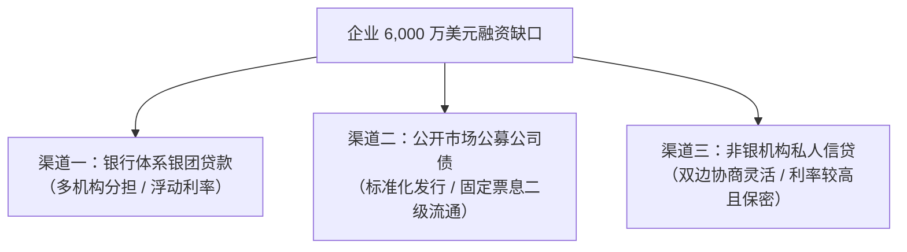
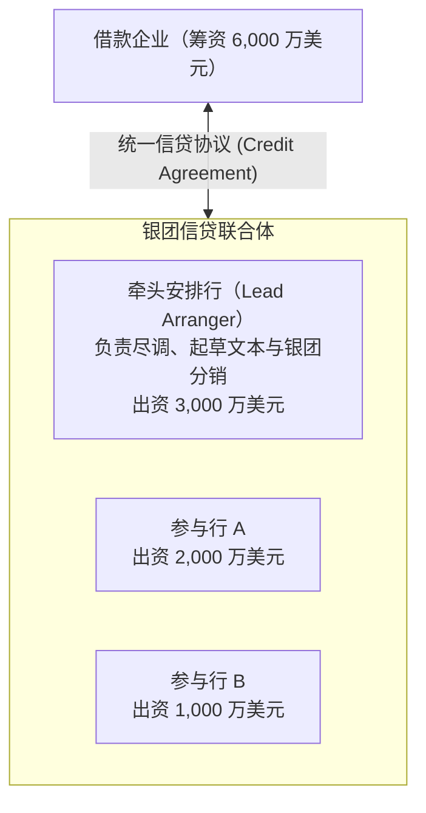
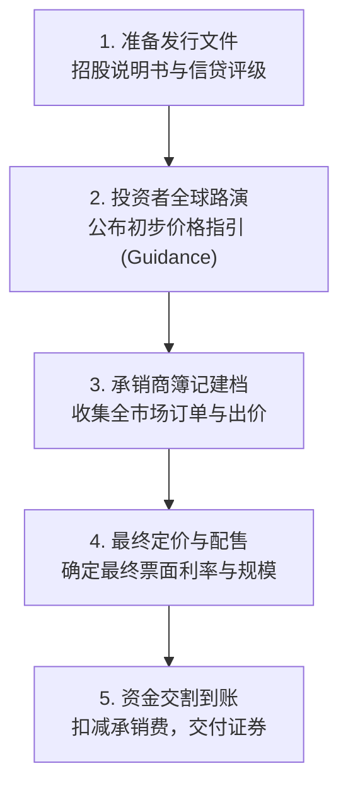
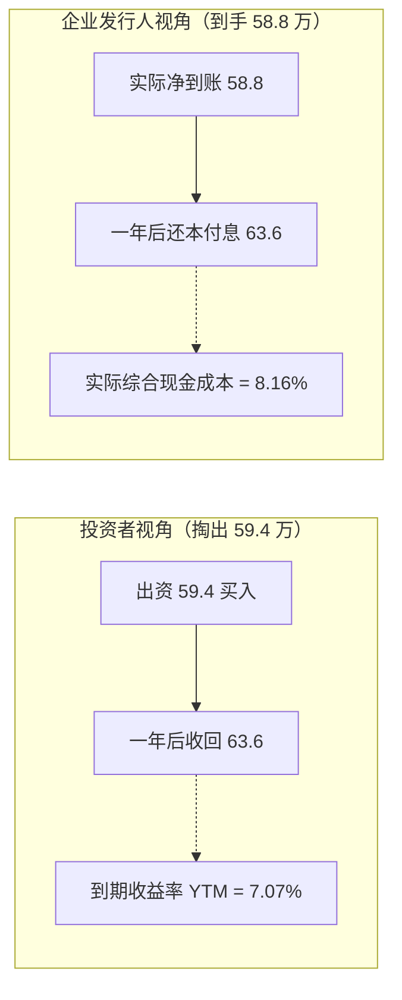
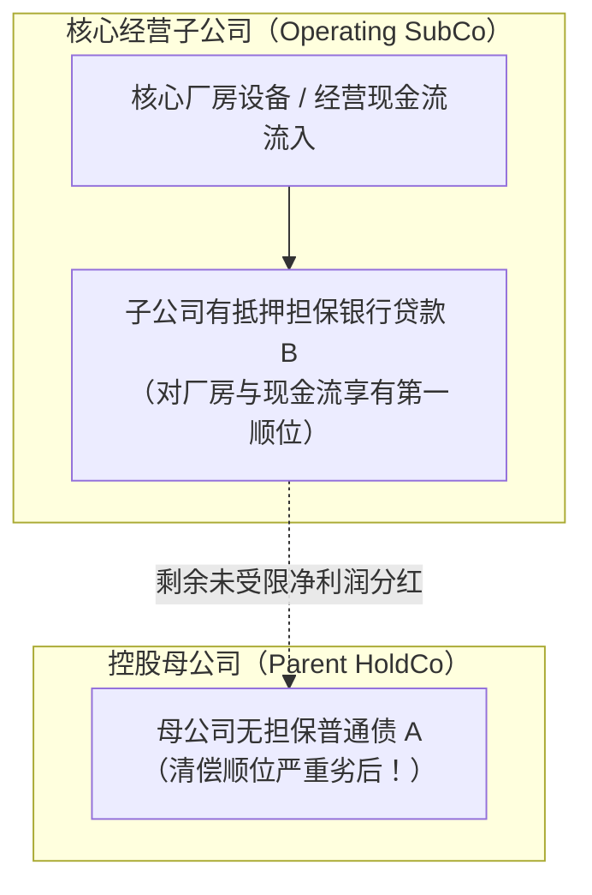
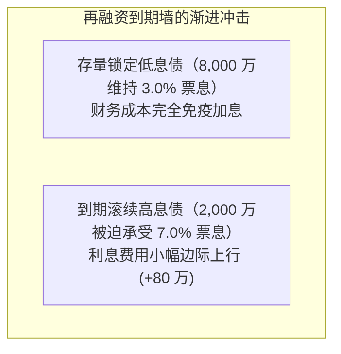

# 20 企业债务融资：公司债、银团贷款与私人信贷

[上一章](19-yield-decomposition.md) · [目录](./) · [下一章](21-credit-risk.md)

## 本章要解决的问题：企业缺钱时，从哪里借、怎么借？

设想你是一家高端工业机器人制造公司的首席财务官（CFO）。在年底做下一年度的财务预算规划时，你梳理出了公司的四笔大账：
- **购置先进自动化设备与扩建厂房**：需要固定资本开支 6,000 万美元；
- **采购核心精密零部件与垫付客户账期**：新增占用流动营运资金 2,000 万美元；
- **偿还三年前发行的即将到期的高息旧债**：需要刚性偿还本金 3,000 万美元；
- **公司期初账面闲置现金**：有 1,000 万美元可动用；
- **预计全年扣除利息与税收后的日常经营现金净流入**：预计贡献 4,000 万美元。

我们来做一笔加减法：
$$\text{总资金需求} = 60 + 20 + 30 = 110\,\text{百万美元}$$
$$\text{内部自有可用资金} = 10 + 40 = 50\,\text{百万美元}$$
$$\text{净外部融资缺口} = 60 + 20 + 30 - 10 - 40 = 60\,\text{百万美元}$$

这 6,000 万美元的缺口，绝不等于企业在会计上发生了 6,000 万美元的亏损——企业完全可能盈利丰厚，但由于扩张投资和借新还旧，当期依然面临巨大的现钞缺口。

面对这笔 6,000 万美元的缺口，你该去找谁借？
- 是去商业银行，拉上几家银行共同组建一笔**银团贷款（Syndicated Loan）**？
- 还是聘请华尔街投资银行，在公开金融市场上向全社会投资者发行**公募公司债券（Corporate Bonds）**？
- 亦或是找黑石、阿波罗、橡树等非银资产管理机构，私下敲定一笔保密且快捷的**私人信贷（Private Credit / Direct Lending）**？

读完本章，你将能够：
1. 算清公募公司债的票面利率、投资者到期收益率与发行人实际融资成本的差别；
2. 理解银团贷款的承诺额（Commitments）与提款余额（Outstanding），看懂银行间的二级转让；
3. 掌握私人信贷（Private Credit）的运作机制与实物支付利息（PIK）的雪球效应；
4. 辨析企业集团内部母公司债与子公司债的结构从属（Structural Subordination）陷阱，学会查阅美联储全国联合信贷（SNC）监管报告。

---

## 1. 商业银行贷款与银团贷款：一份合同，多家分担

### 1.1 双边贷款与大额资金的银团化

如果企业只需要借 500 万美元，找当地一家关系紧密的商业银行申请双边贷款（Bilateral Loan）最为便捷。但当融资金额攀升至数千万甚至数十亿美元时，没有任何一家审慎的商业银行愿意（或被监管允许）单独把鸡蛋放在同一个篮子里。

此时，**银团贷款（Syndicated Loans）**应运而生：
借款企业与多家金融机构共同签署一份统一的信贷法律文件，各家贷款机构按照约定的份额分别出资，共同承担借款企业的违约风险。

在银团体系中，角色分工极其清晰：
- **牵头安排行（Lead Arranger）**：通常是实力最雄厚的大型投资银行或商业银行。负责与企业谈判合同条款、安排法律文本，并在全市场“路演招募”其他银行加入。安排行在初期可能承诺包销全额，随后将份额分销给其他成员，因此**“安排了 6,000 万”绝不等于“自身永久持有 6,000 万”**。
- **代理行（Administrative Agent）**：负责日常事务管理，比如统一向借款人收取利息并按出资比例分发给各参团行，监控借款企业的财务报表与合规契约。
- **参与行（Participant Banks）**：按照认购份额提供资金并按期收取利息，各自独立承担该份额的信用风险。

假设银团的三家机构出资份额分别为 3,000 万、2,000 万和 1,000 万美元，借款企业累计获得 6,000 万美元贷款。半年后，参与行 B 出于自身流动性管理需要，在二级贷款市场上将其中 500 万美元债权转让给了一家养老金基金。在此过程中，企业没有多借一分钱，贷款总余额依然是 6,000 万美元，改变的仅仅是银团背后的债权人名册。

### 1.2 循环信贷额度：承诺额不是已欠余额

大型企业与银团签订的协议中，最核心的品种是**循环信贷额度（Revolving Credit Facility, 业内俗称 Revolver）**。
它就像一张大额商业信用卡：在约定的期限内（如 3 至 5 年），企业可以在额度上限内随时提款、还本、再提款。

必须严格区分两个关键概念：
- **总承诺额度（Committed Amount）**：银行团在法律上承诺随时可供企业提取的资金上限（如 6,000 万美元）；
- **已动用贷款余额（Outstanding Borrowings）**：企业根据生产经营节奏实际提取打入账户的金额（如 2,000 万美元）。

此时企业账面欠款是 2,000 万美元，未动用的备用额度是 4,000 万美元。对于这未动用的 4,000 万美元，企业只需每年按期支付一笔微小的**承诺费（Commitment Fee，如年化 $0.25\%$）**。切不可把 6,000 万额度与 2,000 万欠款相加，误认为企业借了 8,000 万债务。

### 1.3 杠杆贷款与严格财务限制契约

如果借款企业本身的财务杠杆较高（例如由私募股权基金 PE 发起的杠杆收购 LBO 交易），这类贷款在金融市场上被称为**杠杆贷款（Leveraged Loans）**。

杠杆贷款绝大多数采用**浮动利率（Floating Rate）**，通常报价为“基准利率（如 SOFR） + 信用利差加点（如 $+350\,\text{bp}$）”，并普遍附带最低基准利率下限（Floor）。

为了防范违约，贷款协议中会设置严密的**限制性契约（Financial Covenants）**：
- **维持型契约（Maintenance Covenants）**：要求企业每个季度末必须强制接受财务体检。例如净负债 / EBITDA 不得高于 4.5 倍，利息覆盖倍数不得低于 3.0 倍。一旦踩线，即使企业从未拖欠过一天利息，在法律上也直接构成“技术性违约（Technical Default）”，银行团有权立即要求全额提前还本或强制提升借款利率！

---

## 2. 公开发行公司债券：从簿记建档到资金到账

对于具有公开信用评级、资金需求期限较长的大型企业，在公开资本市场上向成千上万的机构投资者发行**公司债券（Corporate Bonds）**是更为宏大的融资途径。

### 2.1 债券发行流程与簿记建档（Bookbuilding）

公司债发行并不是像国债拍卖那样靠几家大行暗标竞价，而是采用由投资银行主导的**簿记建档（Bookbuilding）机制**：

在簿记建档过程中，承销商会不断收集各大基金的认购意向表。
假设某工业企业计划公开发行规模为 6,000 万美元、期限 1 年、到期一次还本付息的公司债。承销商在市场上收集到的阶梯需求分布如下：
- 当到期收益率为 $5.0\%$ 时：市场累计认购意向仅有 2,000 万美元（严重不足额）；
- 当到期收益率提高到 $5.5\%$ 时：市场累计认购意向攀升至 4,500 万美元；
- 当到期收益率进一步放宽到 $6.0\%$ 时：全市场认购总额达到 7,500 万美元（实现超额认购 1.25 倍）。

此时，发行人与承销商团队敲定最终发行条件：将年化票息率锁定在 $6.0\%$。

### 2.2 票息率、买入收益率与实际现金融资成本的三重分离

这是公司金融学中最经典、也最容易混淆的计算题。**票面利率、投资者买入到期收益率与发行人实际承担的现金融资成本，由于“折溢价发行”和“承销发行费用”的存在，会清晰地分裂为三个不同的百分比！**

我们来看这个经过严密验证的算例：
- **发行面值（Par Value）**：企业发行债券总面值为 6,000 万美元，票面利率固定为 $6.0\%$；
- **折价发售（Discount Pricing）**：为了吸引大买家，债券按照面值的 $99.0\%$ 折价发行，企业获得的**募集毛额**为：
  $$\text{募集毛额} = 60 \times 99\% = 59.4\,\text{百万美元}$$
- **承销与中介费用**：承销商从中直接扣除了 0.6 百万美元的承销费、会计师与律师佣金；企业最终实际到手入账的**净现金**为：
  $$\text{净到账资金} = 59.4 - 0.6 = 58.8\,\text{百万美元}$$
- **期末清偿还本付息**：一年到期后，企业必须按照面值 6,000 万美元偿还本金，并按 $6.0\%$ 票面利率支付一年的利息：
  $$\text{期末到期应付总现金} = 60 \times (1 + 6.0\%) = 63.6\,\text{百万美元}$$

现在，我们分别站在**投资者视角**与**企业发行人视角**，计算一年的真实收益率与资金成本：

**1. 投资者的到期收益率（Yield to Maturity, YTM）**：
投资者按照 $99.0\%$ 的价格掏出了 59.4 百万美元，一年后拿回了 63.6 百万美元：
$$\text{投资者到期收益率} = \frac{63.6}{59.4} - 1 = \frac{4.2}{59.4} \approx 7.0707\% \quad (\approx 7.07\%)$$

**2. 发行人的实际一年期现金融资成本**：
企业实际拿到手可供支配的银行存款只有 58.8 百万美元，一年后必须实打实汇出 63.6 百万美元：
$$\text{发行人实际现金成本} = \frac{63.6}{58.8} - 1 = \frac{4.8}{58.8} \approx 8.1633\% \quad (\approx 8.16\%)$$

| 利率度量口径 | 最终数值 | 差异来源与经济学本质 |
| :--- | :---: | :--- |
| **票面利率 (Coupon Rate)** | **$6.00\%$** | 仅用于根据债券票面本金计算每期支付的名义利息（合同基准） |
| **投资者到期收益率 (YTM)** | **$7.07\%$** | 包含了票息现金流以及买入折价在一年内摊销带来的资本增值 |
| **发行人实际现金融资成本** | **$8.16\%$** | 在折价基础上，进一步吸收了 0.6 百万美元的承销发行摩擦费用 |

三者数字完全不同，但彼此在财务数学上高度统一。企业财务经理若只看 $6.0\%$ 的票息率，就会严重低估企业实际承担的真实资金成本（$8.16\%$）。

---

## 3. 私人信贷（Private Credit）：悄然崛起的影子银行巨头

过去十年间，全球金融市场上最迅猛的变革，莫过于以直接借贷（Direct Lending）为核心的**私人信贷（Private Credit）**的爆发式扩张。

### 3.1 什么是私人信贷？

传统模式下，企业缺钱要么找商业银行（受到严厉监管与资本金约束），要么公开发债（需要公开评级、公开详尽商业机密并耗时数月路演）。
私人信贷则完全打破了这一壁垒：
由大型非银行资产管理机构（如 Blackstone、Ares、Oaktree、Blue Owl 等设立的私人信贷基金），直接作为单一贷款人，坐在会议室里与借款企业面对面谈判，由信贷基金独立出资完成数千万甚至数十亿美元的整笔贷款发放。

企业为什么愿意接受私人信贷？
1. **确定性与超高效率**：公开发债可能遭遇市场动荡而发行失败；私人信贷基金资金充裕，往往两到三周内即可全额包销到账；
2. **商业机密保护**：无需向全社会公开招股说明书披露核心技术、客户明细与供应商利润率；
3. **合同条款极其灵活**：可以根据企业特殊的现金流节奏量身定制偿付方案。

### 3.2 真实综合成本核算与实物支付利息（PIK）

天下没有免费的午餐。由于私人信贷基金承担了无二级流动性、高度集中的信用下行风险，其要价通常显著高于传统银行贷款和公募公司债。

沿用前述 6,000 万美元的融资需求，假设某私人信贷基金给出的方案为：
- 名义借款本金 6,000 万美元，期限 1 年；
- 基金预先扣收 $2.0\%$ 的前期安排费（Upfront Fee），即扣减 1.2 百万美元，企业实际到手净款为：
  $$\text{净到账现金} = 60 \times (1 - 2\%) = 58.8\,\text{百万美元}$$
- 合同约定年化借款利率为 $9.0\%$，一年到期后需偿还本息合计：
  $$\text{到期本息} = 60 \times (1 + 9.0\%) = 65.4\,\text{百万美元}$$

此时企业承担的实际年度现金融资成本为：
$$\text{私人信贷年化现金融资成本} = \frac{65.4}{58.8} - 1 = \frac{6.6}{58.8} \approx 11.2245\% \quad (\approx 11.22\%)$$

面对超过 $11.2\%$ 的资金成本，处于快速扩张期的初创企业或受压企业如果当期掏不出这么多现金利息，私人信贷合同常允许引入**实物支付利息（Payment-in-Kind, 简称 PIK）**条款：
借款人无需每季度汇出真金白银支付利息，而是将应付利息直接追加滚入未偿本金！

举个直观例子：
- 年初借款本金为 100 万美元，年利率为 $10\%$（约定应付利息 10 万美元）；
- 双方约定其中 $4.0\%$ 以现金支付（汇出 4 万美元现钞），剩下的 $6.0\%$ 采用 PIK 实物支付；
- 到了年末，借款企业虽然少掏了 6 万美元现金，但其账面欠款本金自动滚存膨胀为：
  $$\text{年末欠款本金} = 100 + 6 = 106\,\text{万美元}$$

> [!WARNING] 警惕 PIK 的雪球陷阱与“假性低波动”
> PIK 条款虽然避免了企业在现金流困难时期因付不起利息而立刻倒闭，但这绝不意味着利息被凭空免除。企业债务犹如滚雪球一般迅速自我膨胀。如果企业主营业务没有迎来爆发式改善，未来的偿债负担将被几何级数放大；此外，私人信贷在财务报表上极少出现日频波动，这仅仅是因为它缺乏公开二级市场竞价交易，绝不代表底层信用风险消失。

---

## 4. 偿债阶梯与结构从属（Structural Subordination）陷阱

许多初学者容易以为：“既然都是同一家跨国集团发行的债券，它们的违约风险和利差理应完全一样”。
这是极其危险的盲区。同一家母公司控制的企业帝国，其内部资产负债表往往是层层嵌套的。

设想某制造集团由“控股母公司（HoldCo）”和下属的“实体运营子公司（OpCo）”组成：
- **债券 A**：由控股母公司在华尔街发行，无特定资产抵押；
- **贷款 B**：由运营子公司向商业银行申请，且以子公司的核心厂房和全部生产流水线作为抵押担保。

在日常经营中，所有的产品销售、客户打款都发生在子公司（OpCo）的账户上。
当集团遭遇破产危机时，法律清偿程序是严格属地属实体的：
1. 子公司产生的现金和变现的厂房资产，**必须 100% 优先足额清偿子公司自身的贷款 B**；
2. 只有在子公司还清了自己所有的银行借款、员工工资和供货商欠款后，剩余的净资产才能以“股东分红”的形式向上递解给母公司；
3. 母公司的债权人（债券 A）只能眼巴巴地排在最末尾，参与母公司仅存财产的残值分配！

这种由于公司法律层级架构导致母公司债权人在实质上劣后于子公司所有负债的现象，在金融学中被称为**结构从属（Structural Subordination）**。评级机构通常会将母公司发行的债券评级打得远低于子公司，其二级市场要求的风险信用利差也必须大幅拓宽。

---

## 5. 真实监管报告带读：美联储等联合发布的 SNC 报告

为了防止银行业在大额信贷与杠杆贷款中盲目扩张积累系统性风险，美联储（Fed）、联邦存款保险公司（FDIC）和货币监理署（OCC）每年联合开展**全国联合信贷评估项目（Shared National Credit, SNC）**，并向全社会公开发布年度审计报告。

我们调取[2025 年 3 月 10 日美联储官方发布的最新 SNC 审查报告公告入口](https://www.federalreserve.gov/newsevents/pressreleases/bcreg20250310a.htm)。

在阅读官方 SNC 报告时，专业分析师必须严格执行三步审计：
1. **审查门槛与对象**：SNC 审查只针对总承诺额度达到 1 亿美元以上、由三个或三个以上受监管金融机构共同分担的大额联合信贷。它重点解剖高风险的杠杆贷款（Leveraged Loans）与陷入财务困境的受压行业，它**并不是**全美所有微小企业借款的普查。
2. **严格区分承诺额（Commitments）与余额（Outstanding）**：
   - 表中的 `Commitments` 代表银行与信贷机构对外作出的最高法律借款承诺（包含未动用的授信额度）；
   - `Outstanding` 才是借款人账面上实打实尚未归还的实际贷款本金。
3. **识别风险分类（Criticized Loans）**：报告中列报的“特殊关注（Special Mention）”、“次级（Substandard）”或“可疑（Doubtful）”，是监管机构根据借款人第一还款来源恶化做出的前瞻审慎风险分类，**绝不等于这些贷款在今年已经全部发生了无法偿付利息的现金违约**。

---

## 6. 宏观连接：企业债务再融资与利息支出传导

宏观经济中的基准利率上涨，究竟需要多久才会彻底传导到实体企业的财务利润表上？

我们用一个极度清晰的再融资数学模型来说明：
假设某制造企业的固定债务总额为 1 亿美元（$\$100\,\text{M}$），原先均是在低利率时期锁定的 $3.0\%$ 长期固定利率，每年固定支付利息 300 万美元。
在今年年初，其中只有 2,000 万美元（$\$20\,\text{M}$）的债券到期需要续借（再融资），剩下的 8,000 万美元还有 3 至 5 年才到期。

如果当前市场加息后，企业重新发债的成本飙升至 $7.0\%$：
- 借新还旧后，企业每年承担的新年利息支出为：
  $$\text{重借后年利息} = 80 \times 3.0\% + 20 \times 7.0\% = 2.4 + 1.4 = 3.8\,\text{百万美元}$$
- 全年新增利息现金流出为：
  $$\Delta \text{年利息支出} = 20 \times (7.0\% - 3.0\%) = 0.8\,\text{百万美元}$$

你看，虽然借款利率从 $3.0\%$ 翻倍到了 $7.0\%$，但由于到期债务只有 $20\%$，企业当年的财务利息费用只增加了 80 万美元，绝不是外行所臆想的“全盘增加 400 万美元”！

这种由于长期固定利率合同阻隔带来的**再融资到期墙（Maturity Wall）时滞**，解释了为什么美联储哪怕加息了 500 个基点，美国大型企业在过去两年中依然保持了惊人的盈利韧性。然而，随着时间推移，如果高利率环境长期维持，每年都有新的低息债券到期并被迫置换为高息债，企业的利息负担就会犹如慢性毒药一般年复一年地持续恶化。

---

## 7. 综合研判：企业债务市场监控决策矩阵

在自动化宏观投研监控中，不同债务工具的变动往往交织在一起：

| 现象组合 | 银行贷款余额 | 公募公司债发行 | 私人信贷活动 | 宏观深度归因 |
| :--- | :--- | :--- | :--- | :--- |
| **组合 A（渠道替代）** | 显著负增长 | 异常火爆放量 | 表现平稳 | **公开市场低成本替代**：大企业利用债券市场基准利率下行的窗口期，发债还清昂贵银行贷款 |
| **组合 B（信贷供给紧缩）** | 银行全面停贷 | 垃圾债发行停滞 | 交易异常火爆且要求高额前期费 | **银行与公募双双关门**：高风险企业被逼入非银私人信贷怀抱，承担苛刻条件断臂求生 |
| **组合 C（虚假繁荣）** | 贷款平稳 | 公募总发行额创新高 | 续贷增加 | **借新还旧浪潮**：虽然发债总额创新高，但 $90\%$ 均用于偿付到期旧债，实体净投资毫无增加 |

---

## 练习与参考答案

### 练习 1：公募债券到账金额与实际融资成本复算
某制造企业拟通过公募发行一年期固定利率公司债券，债券票面总面值为 1,000 万美元（$\$10\,\text{M}$），票面利率设定为 $5.0\%$，到期一次性偿还本息。发行时为了确保销售，债券按照面值的 $98.0\%$ 折价向外部投资者配售；承销商从中扣除了相当于票面总面值 $1.0\%$ 的承销佣金与相关法务会计费用。
请计算：
1. 承销商扣除费用后，企业最终实际到手入账的净资金额；
2. 购买该债券的外部投资者在持有这一年中所实现的到期收益率（YTM）；
3. 发行企业根据最终净到手资金衡量的一年期实际现金融资成本；
4. 为什么企业财务经理绝对不能直接将票面利率 $5.0\%$ 当作企业借入这笔资金的全部综合成本？

点击查看详细参考答案与推理步骤

1. **实际净到手现金计算**：
   - 债券募集毛额（按 $98\%$ 发行）：
     $$\text{募集毛额} = \$10\,\text{M} \times 98\% = \$9.8\,\text{M}$$
   - 承销与中介费用（票面面值的 $1.0\%$）：
     $$\text{承销费用} = \$10\,\text{M} \times 1.0\% = \$0.1\,\text{M}$$
   - 实际到手净款：
     $$\text{净到账现金} = \$9.8\,\text{M} - \$0.1\,\text{M} = \$9.7\,\text{M}$$
2. **投资者到期收益率（YTM）计算**：
   - 投资者掏出了 9.8 百万美元，一年后收回本息：
     $$\text{到期本息} = \$10\,\text{M} \times (1 + 5.0\%) = \$10.5\,\text{M}$$
   - 投资者到期收益率：
     $$\text{YTM} = \frac{10.5}{9.8} - 1 = \frac{0.7}{9.8} \approx 7.1429\% \quad (\approx 7.14\%)$$
3. **发行人实际年化现金融资成本计算**：
   - 企业实际拿到 9.7 百万美元，一年后必须支出 10.5 百万美元：
     $$\text{实际现金融资成本} = \frac{10.5}{9.7} - 1 = \frac{0.8}{9.7} \approx 8.2474\% \quad (\approx 8.25\%)$$
4. **财务本质辨析**：
   票面利率 $5.0\%$ 仅仅是计算各期应付名义利息的合同基数。由于发行折价（让利 0.2 百万）和承销佣金（摩擦损耗 0.1 百万），企业实际仅使用了 9.7 百万美元资金，却在一年后承担了多达 0.8 百万美元的全部差价损失。实际融资成本（$8.25\%$）比票面利率高出了整整 325 个基点，忽略折价与费用会导致严重的资本预算失误。

### 练习 2：贷款存量余额不变是否代表企业无借贷活动？
某跨国物流企业在年初与银团签署的循环信贷总额度为 1.2 亿美元（$\$120\,\text{M}$）。年初该企业账面上的已动用贷款余额为 8,000 万美元（$\$80\,\text{M}$）。在这一年中，该企业在二季度由于运费垫资追加提款 3,000 万美元；在四季度运费回款后向银团归还了 3,000 万美元本金；年末账面贷款余额依然为 8,000 万美元。
请回答：
1. 年末企业未动用的信贷额度是多少？
2. 能否在财务总结中将该企业全年的信贷活动记录为“负债净额变动为零，因此全年毫无信贷融资活动”？
3. 如果外部审计师查阅报表，能否把 1.2 亿额度与 8,000 万欠款简单相加，向管理层汇报“企业背负了 2 亿美元贷款债务”？

点击查看详细参考答案与推理步骤

1. **年末未动用信贷额度计算**：
   $$\text{未动用额度} = \text{总承诺额度} - \text{实际动用余额} = \$120\,\text{M} - \$80\,\text{M} = \$40\,\text{M} \quad (4,000\,\text{万美元})$$
2. **信贷活动实态判定**：
   **完全不能**。虽然年末净新增借款为零，但企业在年内实打实发生了一笔 3,000 万美元的新增提款以平抑季节性资金缺口，并随后完成了一笔 3,000 万美元的清偿。这表明企业的循环信贷管道在发挥极其关键的流动性缓冲作用。只看期末存量净变化会彻底抹杀年内真实的资金流转。
3. **会计债务定义合规性**：
   **绝对不能**。未动用的 4,000 万美元额度只是银团提供的未来借款承诺（附带承诺费），企业尚未提款，在会计上属于表外承诺事项，绝不是表内负债；企业真实的法律借款欠款仅仅是已动用的 8,000 万美元。将其粗暴相加为 2 亿美元是严重的会计虚增负债错误。

### 练习 3：宏观信贷信号分化下的竞争性假说设计
在某一季度的宏观跟踪中，某投资机构的宏观策略师观察到以下组合现象：
- 全美商业银行工商业贷款（C&I）余额连续三个月负增长；
- 公募投资级公司债单月发行规模创历史新高；
- 二级市场上公司债信用利差（OAS）明显收窄。
请提出两种能够合理解释上述现象的竞争性经济学假设，并分别列出你需要调取哪两项具体的底层数据来区分这两种解释。

点击查看详细参考答案与推理步骤

1. **假设 A（大企业融资渠道替代假说）**：
   由于长端债券收益率下行，大型跨国巨头抓住窗口期，在公开债券市场上以更低成本大额发债，募集资金用来提前偿还此前在商业银行借入的昂贵浮息贷款。这导致银行贷款萎缩、债券发债放量、优质利差收窄。
2. **假设 B（借贷两极分化与小微企业信贷配给假说）**：
   商业银行由于资本充足率受压或商业地产坏账暴露，主动向广大小微企业抽贷惜贷，导致全社会银行信贷总量塌陷；而公开债券市场的火爆纯粹是极少数顶尖巨头的盛宴，资金并未惠及普通实体企业。
3. **区分两种假说的核心核验证据**：
   - **核查发债募集资金的具体用途**：查阅公司债发行招股书的“募集资金用途（Use of Proceeds）”一栏，统计有多少资金被明确注明为“偿还现有银行信贷融通（Refinance Bank Facilities）”；
   - **核查美联储 SLOOS 信贷调查与小企业借贷指标**：检查银行收紧贷款是仅限于小企业还是同时覆盖大中型企业；核查全美独立企业联合会（NFIB）小企业融资难易度调查是否出现严重恶化。

---

## 本章小结与下一章

企业债务从来不是铁板一块，它是由商业银行银团贷款、公开市场公司债与新兴的私人信贷共同编织而成的立体网络。从票面利率到实际到手现金融资成本的折溢价差异，从循环信贷的未动用承诺到结构从属下的清偿梯队，透视企业债务工具的微观结构，是准确评估宏观实体经济杠杆健康度的坚实基石。

在下一章中，我们将进一步把视角推进到信用风险的核心深水区：深入探索**信用利差、债券违约、破产清偿瀑布与家庭部门债务偿债能力（DSR）**，系统拆解市场预期与实体企业和家庭真实偿还能力之间的微妙博弈。

[上一章](19-yield-decomposition.md) · [目录](./) · [下一章](21-credit-risk.md)
