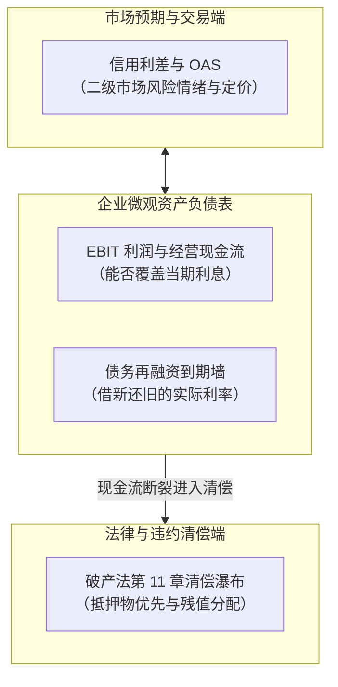
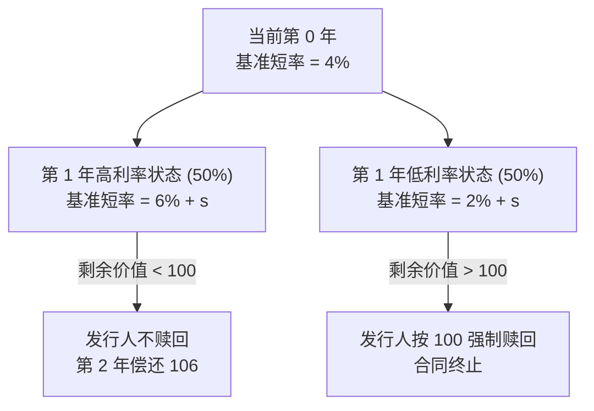
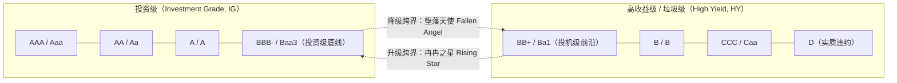
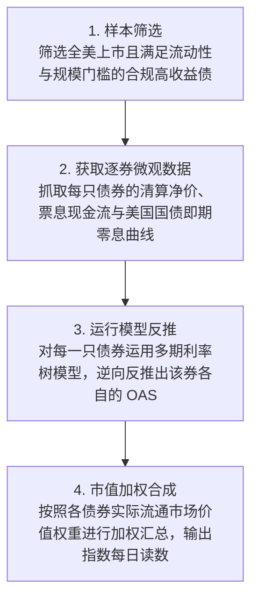
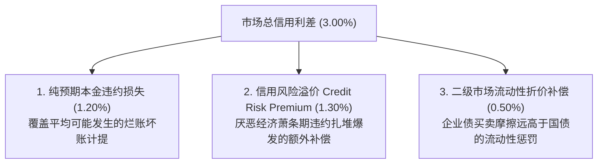
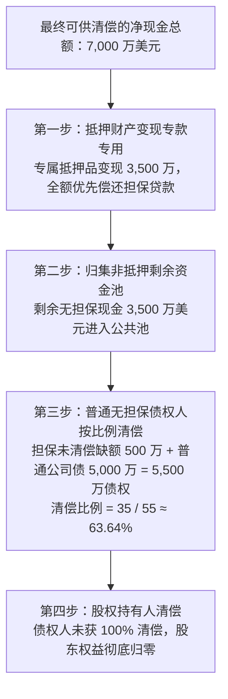

# 21 信用利差、违约、清偿与偿债能力

[上一章](20-corporate-financing.md) · [目录](./) · [下一章](22-municipal-finance.md)

## 本章要解决的问题：利差收窄了，借款人就一定还得起钱吗？

设想你在金融行情终端上看到：某高负债零售巨头的债券信用利差（Credit Spread）在过去一个月里从 400 个基点一路收窄至 250 个基点。股评家们一片欢腾，宣称“市场风险偏好大增，公司破产危机彻底解除”。

然而在同一家公司的总部大楼里，财务总监却在召开紧急闭门会议：
三年前在零利率时期发行的 10 亿美元固定利率债券下个月即将到期。虽然在二级市场上该公司的信用利差收窄了，但由于美联储持续加息，基准国债利率从 $1.5\%$ 暴涨到了 $4.5\%$。哪怕利差只有 250 个基点，公司借新还旧的实际票息也将高达 $7.0\%$！以公司当前的营业利润，连翻倍后的利息都付不起，技术性违约一触即发。

与此同时，宏观新闻中充斥着互相矛盾的数字：
- 头条新闻惊呼：“全美家庭债务总额突破 17.8 万亿美元，创下历史新高！”
- 美联储发布的宏观家庭偿债比率（DSR）却显示：“全美家庭偿债负担依然处于历史中位数健康水平。”
- 而纽约联储的下沉微观报告又敲响警钟：“低收入年轻人群的信用卡与汽车贷款逾期率正以惊人速度垂直飙升，创下十余年新高。”

为什么市场报价、宏观总量与微观现金流之间会出现如此撕裂的景象？

读完本章，你将能够：
1. 掌握债券到期收益率、Z-spread 与期权调整利差（OAS）的递进逻辑，亲手用二叉树反推 OAS；
2. 算清预期本金损失率与市场利差的本质鸿沟，理解为何利差绝不仅等于违约概率；
3. 掌握企业利息覆盖倍数与现金到期墙的审计方法，透视利润与真实现金的脱节；
4. 亲手计算破产重组清偿瀑布（Waterfall），分清有担保债权与无担保债权的残值分配；
5. 读懂美联储家庭偿债率（DSR）与纽约联储 CCP 逾期转移率，建立穿透宏观表象的信用风控体系。

---

## 1. 信用利差（Credit Spread）：先分清减的是哪两个数

### 1.1 两年期固定利率公司债的价格与收益率

企业向市场发行债券，本质上是借入本金并承诺按照约定合同定期付息、到期还本。
债权人与股东有着本质的不同：**债权人无法分享企业盈利无限上行的果实，却必须承担本金无法收回的下行清偿风险。**

我们来看一只最标准的两年期无担保公司债：
- 票面面值为 100 美元，每年支付一次票面利息 6 美元（票面利率 $6.0\%$）；
- 第二年到期时还本付息 106 美元；
- 假定目前处于付息周期的起点，暂不考虑应计利息与交易费用。

债券的**到期收益率（Yield to Maturity, YTM，记为 $y$）**，是使得未来这笔承诺现金流折现现值恰好等于当前二级市场交易价格 $P$ 的内部收益率：
$$P = \frac{6}{1 + y} + \frac{106}{(1 + y)^2}$$

- 如果该债券在市场上的交易价格恰好等于票面面值 $100.0$ 美元，代入公式可得 $y = 6.0\%$；
- 如果行业遭遇逆风，买家为了补偿风险，要求 $7.0\%$ 的年化回报率，该债券的二级市场成交价格就会被砸落至：
  $$P = \frac{6}{1.07} + \frac{106}{1.07^2} = 5.607477 + 92.584505 \approx 98.191982\,\text{美元}$$

必须牢记：$7.0\%$ 的到期收益率是建立在**企业未来必然按期全额足额兑现每笔还本付息**的严苛假设之上的；若企业未来发生重组破产，投资者最终实际拿到手的回报率可能远低于 $7.0\%$，甚至血本无归。

### 1.2 简单收益率利差的用途与局限

最朴素的**名义信用利差（Nominal Spread）**，就是将这只公司债的到期收益率减去相同币种、相近到期期限的无风险基准国债收益率：
$$\text{简单信用利差} = \text{企业债到期收益率} - \text{可比国债收益率}$$

若企业债收益率为 $6.0\%$，可比两年期国债收益率为 $4.0\%$，两者之间的利差为：
$$\text{利差} = 6.0\% - 4.0\% = 2.0\% = 200\,\text{bp}$$

这 200 个基点看似清晰，但在实际投资中却存在致命局限：
1. **现金流权重与期限错配**：公司债中间每期有大额票息，而国债的现金流分布可能完全不同。在倾斜的收益率曲线上，用哪一个单一国债期限点相减都会引入噪音；
2. **静态利差（Z-spread）的演进**：为了解决收益率曲线不平的问题，金融工程引入了 **Z-spread（Zero-Volatility Spread）**，它是在国债即期零息利率曲线的每一个时间节点上加上同一个恒定利差，使得现金流现值精准匹配市价；
3. **期权条款的干扰**：许多公司债包含提前赎回权（Call Option），企业在利率下行时有权强行以面值提前买回债券。简单相减会把期权的价值粗暴混入信用风险中。

### 1.3 信用利差与绝对借款利率的同向与背离

利差描述的是**相对风险溢价**，而决定企业生死的是**绝对融资成本**。
我们看下表中的两个真实商业情景：

| 市场阶段 | 基准国债利率 | 信用利差加点 | 最终实际借款利率 | 企业财务真实感受 |
| :--- | :---: | :---: | :---: | :--- |
| **基准情境** | $3.0\%$ | $3.0\%$（$300\,\text{bp}$） | **$6.0\%$** | 正常经营，财务费用可控 |
| **情境一（央行激进加息）** | $4.0\%$ | $2.5\%$（$250\,\text{bp}$） | **$6.5\%$** | **利差虽收窄 50bp，但绝对借款利率暴涨 50bp！融资环境实际在恶化** |
| **情境二（危机避险买国债）** | $1.5\%$ | $5.5\%$（$550\,\text{bp}$） | **$7.0\%$** | 避险买盘把国债收益率打低，但企业信用恶化，实际融资成本飙升 |

> [!WARNING] 谨防“利差收窄即宽松”的片面结论
> 当宏观基准利率大幅走高时，哪怕二级市场风险利差收窄了 50 个基点，借款企业面对的绝对重定价利率依然在向上攀升。评估实体企业债务压力，必须把“基准利率演进”与“信用利差波动”放在同一张资产负债表内综合核算。

---

## 2. 期权调整利差（OAS）：用二叉树剥离提前赎回权

### 2.1 为什么必须剥离可赎回权？

绝大多数美国高收益企业债（垃圾债）都带有**发行人提前赎回条款（Callable）**。
例如某企业发行的 10 年期债券，约定在第 3 年末以后，企业有权随时按照 100 美元面值强行赎回。

如果市场利率暴跌，企业为了省钱，一定会行使赎回权，借入便宜的新钱把高息旧债提前还掉；而此时债券投资者不仅被迫提前交出高票息资产，还必须把拿回来的本金投入到极其低迷的低利率市场中去。

因此，**提前赎回权是发行人免费从投资者手中拿走的一张“金融看跌期权”**。为了补偿这一劣势，可赎回债券在二级市场上必须以更低的价格交易，其表面名义到期收益率被人为推高了。

**期权调整利差（Option-Adjusted Spread, 简称 OAS）**的唯一目的，就是在数学模型中彻底剔除提前赎回等期权因素的影响，还原出纯粹的信用与流动性利差补偿。

### 2.2 极简两期利率树模型构建

为了彻底理解 ICE BofA 等权威机构公布的 OAS 是如何从计算机里算出来的，我们亲手搭建一个极度清晰的两期自编二叉树教学模型：

- **债券特征**：面值 100 美元，每年票面利息 6 美元，期限 2 年；但**发行人有权在第一年年末付息后，按照 100 美元面值全额提前赎回**；
- **第一年无风险基准利率**：固定为 $4.0\%$；
- **第二年基准利率二叉树情景**：
  - 高利率情景：基准利率跳升至 $6.0\%$（定价权重 $50\%$）；
  - 低利率情景：基准利率回落至 $2.0\%$（定价权重 $50\%$）；
- **赎回行为假设**：在第一年付息后，若未赎回状态下的剩余债券市场价值高于赎回价格 100 美元，理性的发行人必定立即执行赎回（以 100 美元结束义务）；否则不赎回，让债券存续至第二年。

### 2.3 倒推法计算现金流现值

我们采用反推法，首先尝试代入利差参数 $s = 2.0\%$（即 $200\,\text{bp}$），观察模型会评估出什么理论价格：

**第一步：评估第一年末付息后的剩余债券价值**
若不赎回，第二年到期偿还本息合计 106 美元：
- **高利率情景**（折现率为 $6\% + 2\% = 8\%$）：
  $$\text{高利率下剩余价值} = \frac{106}{1 + 8\%} = \frac{106}{1.08} \approx 98.148148\,\text{美元}$$
  由于 $98.15 < 100$，发行人保留这笔旧借款更为划算，**不执行赎回**，投资者在第一年末持有的债权价值为 $98.148148$ 美元；
- **低利率情景**（折现率为 $2\% + 2\% = 4\%$）：
  $$\text{未赎回时的理论剩余价值} = \frac{106}{1 + 4\%} = \frac{106}{1.04} \approx 101.923077\,\text{美元}$$
  由于市场利率极低使得债券价值高达 $101.92$，发行人立刻选择**行使赎回权，支付 100 美元强行清偿**！投资者在低利率状态下只能拿回 $100.00$ 美元现金，而无法享受后续收益。

**第二步：倒推第 0 年的理论债券现值**
在第 1 年末，无论哪种状态，投资者都将稳稳收到当期的第 1 期票息 6 美元。
我们将第 1 年末的综合现金流按照第一年的折现率（$4\% + s = 4\% + 2\% = 6\%$）折现回今天：
$$P(s = 2\%) = \frac{6 + 0.5 \times 98.148148 + 0.5 \times 100.00}{1 + 4\% + 2\%} = \frac{6 + 49.074074 + 50.00}{1.06} = \frac{105.074074}{1.06} \approx 99.126485\,\text{美元}$$

### 2.4 从二级市价逆向求解 OAS

现在，假定这只可赎回债券在二级市场上的实际成交价格就是 **$99.126485$ 美元**。
量化定价算法会在二叉树程序中不断迭代试算不同的利差 $s$：
- 若试探 $s = 100\,\text{bp}$：模型算出的价格约为 $100.507343$ 美元（高于市价，说明折现利差给低了）；
- 若试探 $s = 300\,\text{bp}$：模型算出的价格约为 $97.779302$ 美元（低于市价，说明折现利差给高了）；
- 逼近至 $s = 200\,\text{bp}$ 时：模型理论价格与二级市场市价精准吻合。

因此，该债券的**期权调整利差 OAS 即为 $200\,\text{bp}$**。
如果我们在同样的利率树和利差下，错误地忽略赎回权（假设发行人永远不赎回），该债券的无期权价值为 $100.033597$ 美元。两者相差约 $0.9071$ 个价格点——这就是提前赎回权剥夺投资者的期权时间价值。

---

## 3. 从单只债券到全市场信用指数：IG 与 HY 指数体系

### 3.1 投资级（IG）与高收益级（HY）的分水岭

全美可交易公司债券被一条著名的信用鸿沟一分为二：

- **投资级（IG）**：标准普尔/惠誉评级在 $\text{BBB-}$ 及以上，或穆迪评级在 $\text{Baa3}$ 及以上。发行人多为苹果、微软、强生等现金流极其雄厚的蓝筹企业，违约概率极低；
- **高收益级（HY，俗称垃圾债）**：评级在投资级底线以下。多为杠杆收购主体、周期性高负债企业或成长型重资产公司。

当一家原本属于投资级的大型巨头因行业恶化被评级机构下调至垃圾级时，它被称为**“堕落天使（Fallen Angel）”**。由于全美数以千计的养老金和保守型债基在章程中严厉禁止持有垃圾债，堕落天使往往会在降级生效当天遭遇百亿美元级的被动强制抛售砸盘。

### 3.2 每日 ICE BofA 指数 OAS 的加权生产链

我们在财经终端上每天看到的 **ICE BofA 美洲高收益指数 OAS**（FRED 代码：`BAMLH0A0HYM2`），并不是简单抓取几家公司做算术平均，而是经历了一条严谨的工业化流水线：

我们用一个极度简化的两只债券池来理解市值加权机制：
- 债券 1（巨头企业）：流通市值为 80 亿元，单券 OAS 为 $100\,\text{bp}$；
- 债券 2（高危企业）：流通市值为 20 亿元，单券 OAS 为 $500\,\text{bp}$。

合成后的指数 OAS 为：
$$\text{指数 OAS} = 80\% \times 100\,\text{bp} + 20\% \times 500\,\text{bp} = 80 + 100 = 180\,\text{bp}$$
它绝对不是简单算术平均的 $300\,\text{bp}$。流通规模庞大的优质大型发债主体，在指数中享有压倒性的权重主导权。

> [!WARNING] 警惕指数样本剔除带来的“虚假好转”
> 如果在某个月末的指数成分再平衡日（Rebalancing Day），上述高危的债券 2 正式宣告破产倒闭或评级被注销，按照指数编制规则，**已经发生违约的债券将被自动剔除出指数成分池**。
> 此时，指数池中只剩下了债券 1，指数 OAS 会瞬间从 $180\,\text{bp}$ 跳水降至 $100\,\text{bp}$！
> 表面上看指数利差大幅收窄，但现实中并没有任何一家企业的基本面改善，反而是因为最烂的同学退学了而人为拉高了全班平均分！分析高收益指数必须剔除这种“再平衡幸存者偏差”。

---

## 4. 预期本金损失率：利差为什么绝不等于违约概率？

### 4.1 预期损失的经典金融计量

假设某商业银行或信贷基金持有总面值为 1 亿元（$\$100\,\text{M}$）的一年期高收益企业债券组合。经过严密违约历史回溯，量化风控给出两个参数：
- 该资产池未来一年的平均**实质违约概率（Probability of Default, PD）**：$p = 2.0\%$；
- 一旦发生实质性违约，抵押品清偿后的**本金清偿回收率（Recovery Rate, R）**：$R = 40.0\%$；
- 对应违约时的**违约损失率（Loss Given Default, LGD）**为：
  $$\text{LGD} = 1 - R = 1 - 40\% = 60.0\%$$

在统计期望意义下，该债券组合在未来一年面临的**预期本金损失率（Expected Loss Rate, EL）**为：
$$\text{预期本金损失率 (EL)} = \text{PD} \times \text{LGD} = p \times (1 - R) = 2.0\% \times 60.0\% = 1.2\%$$
$$\text{预期本金损失现金金额} = 1\,\text{亿元} \times 1.2\% = 120\,\text{万元}$$

这 120 万元是统计平均下的常态化经营损耗，必须在贷款定价中以基础风险准备金的形式打入成本。

### 4.2 为什么不能用“市场利差 / LGD”反推真实违约概率？

如果当前高收益企业债指数的平均利差高达 $300\,\text{bp}$（$3.0\%$），有缺乏金融常识的分析师做了一个粗暴计算：
$$\text{错误推算违约概率} = \frac{\text{市场信用利差}}{\text{违约损失率}} = \frac{3.0\%}{60\%} = 5.0\%$$
并由此向董事会汇报：“全美高收益企业在未来一年的实际倒闭违约率将高达 $5.0\%$”。

这是一个严重的逻辑谬误！
**市场信用利差（$3.0\%$）绝不仅仅是对预期违约损失（$1.2\%$）的补偿，它包含三大不可分割的溢价积木**：

1. **宏观系统性风险溢价（$+1.30\%$）**：企业违约绝不是独立抛硬币，它们往往集中在宏观经济最惨烈的衰退萧条期扎堆爆发。在投资者自身收入缩水、资金最饥渴的时候遭遇违约，其痛苦程度远超繁荣时期。因此，风险厌恶的资本必须额外索要一笔丰厚的风险溢价；
2. **流动性与做市折价（$+0.50\%$）**：正如我们在第 18 章所学，企业债做市深度极浅，急于变现时需要承受巨大的价差滑点。利差中必须有一块专门用来补偿流动性劣势。

因此，直接用利差除以损失率算出的所谓“风险中性违约概率（Risk-Neutral PD）”，严重包含了资本情绪与风险偏好的溢价放大，其数值往往是现实中真实物理违约概率（Physical PD）的 2 至 3 倍！

---

## 5. 企业真实偿债能力透视：从会计利润到现金流到期墙

### 5.1 利息覆盖倍数：分母与分子的微妙博弈

在企业财务报表分析中，最经典的偿债安全指标是 **EBIT 利息覆盖倍数（Interest Coverage Ratio）**：
$$\text{EBIT 利息覆盖倍数} = \frac{\text{息税前营业利润 (EBIT)}}{\text{当期利息支出总额}}$$

假设某制造企业当前年度的息税前利润 EBIT 为 3,000 万美元，每年的刚性债务利息支出为 1,000 万美元：
$$\text{初始利息覆盖倍数} = \frac{3{,}000}{1{,}000} = 3.0\,\text{倍}$$

如果宏观经济遭遇滞胀，企业原材料涨价使得利润下滑，同时借新还旧导致利息上升：
- EBIT 从 3,000 万萎缩至 2,000 万美元；
- 利息支出从 1,000 万攀升至 1,500 万美元；
- 新的覆盖倍数骤降至：
  $$\text{新利息覆盖倍数} = \frac{2{,}000}{1{,}500} \approx 1.33\,\text{倍}$$

此时企业虽然尚未发生账面亏损，但财务安全缓冲垫已被大幅压缩至危险红线附近。

### 5.2 利息覆盖良好、账面却无现金还本的真实陷阱

许多外行看财报，看到利息覆盖倍数高达 4.0 倍，便轻率断定“企业绝对安全、高枕无忧”。
我们来看一个极具启发性的严密教学案例（单位：百万美元）：

某高精制造企业全年的会计利润表非常靓丽：
- 息税前营业利润 EBIT：$20.0$ 百万美元；
- 账面计提的无现金折旧与摊销：$+5.0$ 百万美元；
- 当期实际支出的现金利息：$-5.0$ 百万美元；
- 当期实际缴纳的企业所得现金税款：$-3.0$ 百万美元。

此时，该企业的会计**利息覆盖倍数高达 4.0 倍**（$\frac{20}{5} = 4.0$）。
然而，我们翻开该公司的**现金流量表**，惊悚的真相浮出水面：
- 由于下游客户回款困难、供应链囤积原材料，当期**新增营运周转资金净占用多达 12.0 百万美元**！
- 企业实际产生的**经营性现金流净流入（Operating Cash Flow）**仅剩：
  $$\text{经营现金流} = 20.0 + 5.0 - 5.0 - 3.0 - 12.0 = 5.0\,\text{百万美元}$$
- 为了维持核心竞争力，企业在厂房与设备更新上进行了刚性的**固定资本开支支出（CapEx）：$-8.0$ 百万美元**；
- 扣除资本开支后的**自由现金流（Free Cash Flow）彻底击穿变为负数**：
  $$\text{投资后自由现金流} = 5.0 - 8.0 = -3.0\,\text{百万美元}$$

更致命的是：**该公司在今年年底有一笔刚性到期的银行贷款本金 10.0 百万美元必须全额偿还！**
而公司在年初账面累积的全部可用闲置现金储备只有 **$4.0$ 百万美元**。

我们来做最终的现金缺口清算：
$$\text{当期到期必须还本支出} = 10.0\,\text{百万美元}$$
$$\text{自由现金流赤字缺口} = 3.0\,\text{百万美元}$$
$$\text{资金需求总额} = 10.0 + 3.0 = 13.0\,\text{百万美元}$$
$$\text{扣除期初可用现金后，真实净融资断裂缺口} = 13.0 - 4.0 = 9.0\,\text{百万美元}$$

**虽然账面利润丰厚、利息覆盖率高达 4 倍，但如果企业无法在市场上立刻成功借到 900 万美元新钱，它在年底还本的那一天就会因账上掏不出真金白银而当场暴毙破产！**

---

## 6. 破产重组清偿瀑布（Default & Recovery Waterfall）

当企业现金彻底断裂、无法获得新融资时，便不得不进入法律破产程序。
美国破产法第 11 章（Chapter 11）为企业提供了法庭监督下的重组保护伞：企业维持运营，全部债权人在破产法官监督下，按照严格的法律优先顺位执行**绝对优先原则（Absolute Priority Rule, 俗称清偿瀑布）**。

### 6.1 清偿瀑布严谨数学推导

我们通过一个经典的基准案例来彻底掌握清偿计算：
- **可分配破产财产总额**：扣除破产法庭法务审计费用后，企业最终可变现现金总额为 **7,000 万美元**；
- **负债结构**：
  - **高级有抵押担保贷款（Secured Loan）**：债权本金为 **4,000 万美元**，合同指定了某工业园区专属厂房作为有效抵押物；
  - **高级普通无担保公司债（Unsecured Bonds）**：债权本金为 **5,000 万美元**，无特定资产抵押；
  - **股权资本（Equity）**：若干普通股东。
- **财产变现明细**：
  - 上述专属抵押厂房最终拍卖处置，变现净得现金 **3,500 万美元**；
  - 企业其他通用资产与应收账款变现，获得非抵押流动现金 **3,500 万美元**（两者合计刚好为 7,000 万美元）。

**第一阶段：有担保债权针对抵押物的优先受偿**
担保贷款享有对抵押厂房的独占第一顺位清偿权：
- 专属抵押品变现的 3,500 万美元**全额划拨给担保贷款人**；
- 担保贷款原债权为 4,000 万，抵押品不足以全额清偿，产生了 **500 万美元的清偿缺额（Deficiency Claim）**；
- 根据破产法，这未获满足的 500 万美元缺额债权，自动降格为与其他普通无担保债权人平起平坐的**普通无担保债权**。

**第二阶段：普通无担保资金池的按比例（Pro-rata）清偿**
现在，法官面前摆着剩余的 3,500 万美元非抵押现金公共资金池。
申请参与瓜分这笔现金的普通无担保债权总额包括两部分：
$$\text{无担保索赔总额} = \text{担保贷款剩余缺额} (5\,\text{M}) + \text{普通无担保公司债} (50\,\text{M}) = 55\,\text{百万美元}$$

公共池的最终清偿回收率（Recovery Rate）为：
$$\text{无担保池清偿比例} = \frac{\text{可分配非抵押现金}}{\text{无担保索赔总额}} = \frac{35}{55} \approx 63.63636\%$$

**第三阶段：各方最终收回金额与损失核算**
1. **高级有担保贷款人总回收**：
   - 抵押品直接回收：35.0 百万美元；
   - 在无担保池中分得残值：
     $$5 \times \frac{35}{55} \approx 3.181818\,\text{百万美元}$$
   - 担保贷款人最终收回总额：
     $$\text{担保贷款最终回收} = 35 + 5 \times \frac{35}{55} = 35 + 3.181818 \approx 38.181818\,\text{百万美元} \quad (\approx 38.18\,\text{M})$$
   - 最终本金回收率：$\frac{38.1818}{40.0} \approx 95.45\%$。
2. **普通无担保公司债投资人总回收**：
   - 在无担保池中按比例清偿：
     $$\text{普通公司债最终回收} = 50 \times \frac{35}{55} \approx 31.818182\,\text{百万美元} \quad (\approx 31.82\,\text{M})$$
   - 最终本金回收率：$\frac{31.8182}{50.0} \approx 63.64\%$。
3. **股权持有人**：由于债权人本金未获全额清偿，根据绝对优先原则，**股东权益全额归零**。

我们验证全场现金流勾稽平衡：
$$38.181818 + 31.818182 = 70.00\,\text{百万美元}$$
一分钱没有凭空产生，一分钱也没有凭空消失。

---

## 7. 家庭部门债务偿债能力：存量大山与微观还款流

评估完全美企业债务，我们转向宏观经济的基石——居民家庭部门。

### 7.1 为什么总债务创新高不等于家庭债务崩盘？

媒体经常以“全美家庭债务突破 17.8 万亿美元大关”制造恐慌。
但名义总债务是一个伴随人口增长、城市化通胀自然膨胀的**静态存量指标**。
真正决定家庭会不会断供的，是**每月的还本付息现金流支出与家庭可支配收入之间的比值**。

假设某家庭每月到手可支配收入为 5,000 美元，按揭房贷月供为 1,500 美元：
$$\text{还款收入比} = \frac{1{,}500}{5{,}000} = 30.0\%$$
如果该家庭的房贷是在 2021 年锁定的 30 年期 $2.8\%$ 超低固定利率，哪怕全美房价暴涨、名义贷款存量看起来极大，该家庭每月的硬性现金月供支出在未来 30 年内都被牢牢锁死在 1,500 美元。随着通胀带动名义工资上涨，其还款收入比不仅没有恶化，反而变得更加轻松。

### 7.2 美联储家庭偿债比率（DSR）的统计进化

美联储定期发布的 **DSR（Household Debt Service Ratio）**，衡量全美所有家庭被要求支付的定期还本付息款项占个人可支配收入的总比例：
$$\text{宏观 DSR} = \frac{\text{全美家庭应付债务款项估计总额}}{\text{全美个人可支配收入总额}}$$

> [!IMPORTANT] 2024 年 DSR 统计方法重大升级
> 在 2024 年第二季度之前，旧版 DSR 主要根据全美债务总余额结合平均利率估算还款额。
> 从 2024 年第二季度起，美联储全面改版转向**基于征信局信用报告（Credit Bureau-based）的全新微观加总方法**，直接从海量征信账户中抓取每份房贷合同中约定的真实月供数据，并纳入了随按揭一并交纳的房屋财产税与火险托管金。新旧序列存在明显的统计定义断点，分析时严禁将新旧数据生硬拼接。

### 7.3 纽约联储 CCP 调查：存量逾期率与严重逾期转移率

宏观总 DSR 往往容易掩盖严重的微观分化。拥有房产的高净值中产锁定了超低房贷利率，其充裕的现金流拉低了全美平均水平；但缺乏抵押资产的低收入年轻群体，其债务主要集中在高息的信用卡与汽车贷款上。

纽约联储基于 Equifax 匿名征信档案建立的 **CCP（Consumer Credit Panel）报告**，提供了最锋利的微观透视工具：

必须严格区分两个指标：
- **逾期存量比例（Delinquency Stock）**：例如“90 天以上逾期余额占该品类总债务余额的比例”，它回答“现在存量账面上到底有多少烂账”；
- **新进入严重逾期的转移率（Transition Rate to 90+ Days Delinquent）**：它回答“本季度有多少原本正常的健康账户，新掉入了 90 天以上的严重断供深渊”。

假设上季度末正常还款的合格信用卡余额为 920 亿美元。在本季度内，新发生 90 天以上严重逾期的借款金额为 18.4 亿美元：
$$\text{季度转移率} = \frac{18.4}{920} = 2.0\%$$
按年化表达（简单乘以 4）：
$$\text{年化严重逾期转移率} = 2.0\% \times 4 = 8.0\%$$

我们查阅[纽约联储 2024 年 8 月 6 日发布的 2024Q2 官方家庭债务报告](https://www.newyorkfed.org/newsevents/news/research/2024/20240806)：

| 居民债务大类品种 | 2023Q2 年化严重逾期转移率 | 2024Q2 年化严重逾期转移率 | 单年同比净变动 |
| :--- | :---: | :---: | :---: |
| **住房抵押贷款（Mortgages）** | $0.63\%$ | $0.95\%$ | $+0.32\text{ 个百分点}$ |
| **汽车贷款（Auto Loans）** | $2.41\%$ | $2.88\%$ | $+0.47\text{ 个百分点}$ |
| **无抵押信用卡（Credit Cards）** | **$5.08\%$** | **$7.18\%$** | **$+2.10\text{ 个百分点（飙升 210bp！）}$** |

这组震撼的数据揭示了宏观总量的巨大欺骗性：
虽然全美总债务逾期存量比例在房地产抵押贷款的压舱石作用下依然平稳（$3.2\%$）；但在无抵押消费端，年轻脆弱家庭的信用卡新发生严重断供年化转移率在一年内从 $5.08\%$ 狂飙到了 $7.18\%$！这预示着底层居民的可选消费能力正在遭受毁灭性打击，微观违约潮已从消费信贷端拉响警报。

---

## 8. 自动化每日与季度信用风险监控仪表盘

为了搭建专业级、不可欺骗的自动化投研监控系统，必须将指标按更新频率与证据效力分层固化：

| 监控层次 | 核心监测指标 | 官方发布节奏 | 严禁跨越的逻辑红线 |
| :--- | :--- | :---: | :--- |
| **一级市场情绪** | IG OAS、HY OAS、各评级细分利差 | 每日傍晚公布（$T+1$） | 反映二级交易预期与风险偏好，绝不可直接等同于现实已发生违约 |
| **企业再融资墙** | 标普/彭博全美企业债券年度到期总规模 | 按季滚动更新 | 区分投资级与垃圾级到期结构，关注未来 12 个月密集借新还旧缺口 |
| **企业真实造血** | 标普 500 样本企业季度 EBIT 利息覆盖率、经营现金流 | 随财报季更新 | 警惕经调整后 EBITDA 的虚假粉饰，必须对照现金流量表扣减营运占款 |
| **家庭微观健康** | 纽约联储 CCP 信用卡与车贷严重逾期年化转移率 | 每年 2、5、8、11 月公布 | 季度低频数据，无新数据发布日禁止伪造日变化，分清存量与流量 |
| **终端法律清偿** | 全美大型企业 Chapter 11 破产申请案件数量 | 每周/每月跟踪 | 破产重组不等于立即清算破产，重点关注抵押品价值与普通债回收率 |

---

## 练习与参考答案

### 练习 1：到期收益率与承诺现金流折现计算
某只信用评级为 BB 级的两年期固定利率公司债券，票面面值为 100 美元，每年支付一次固定票面利息 6 美元（年票息率 $6.0\%$），第二年到期时全额归还 100 美元本金，合同中不含提前赎回条款。二级市场上追求高风险回报的机构买家要求 $7.0\%$ 的年化到期收益率。
请计算：
1. 按照年复利折现模型，该债券在二级市场上的公允成交净价是多少？
2. 如果该企业在第一年末按期支付了 6 美元利息，但在第二年到期时由于主营业务崩塌，最终只偿付了 50 美元本金且未付第二期利息。请问购买该债券的投资者在持有两年中所实现的真实年化实际内部回报率是否依然为 $7.0\%$？为什么？

点击查看详细参考答案与推理步骤

1. **债券二级市场公允价格计算**：
   $$P = \frac{6}{1 + 7\%} + \frac{106}{(1 + 7\%)^2} = \frac{6}{1.07} + \frac{106}{1.1449} \approx 5.607477 + 92.584505 = 98.191982\,\text{美元}$$
2. **实际回报率定性辨析**：
   **绝对不再是 $7.0\%$，而是严重巨额亏损！**
   到期收益率 $7.0\%$ 的数学推导，本质上是建立在未来所有承诺现金流（第 1 年 6 元，第 2 年 106 元）**100% 毫无违约瑕疵足额兑现**的前提假设下的。现实中第二年发生违约仅收回 50 元，总现金流入仅为 $6 + 50 = 56$ 元，相比最初付出的 $98.19$ 美元买入成本，实际年化复合内部收益率（IRR）将深陷重度负值。到期收益率仅仅是一张“报价承诺”，绝非投资者的“保底收益”。

### 练习 2：基准下行与利差上浮下的企业总融资成本重估
某高负债制造企业原先发行的 3 年期固定利率债券即将到期，需要全额平价借新还旧。在发行筹备期内，基准国债收益率受到央行降息预期影响从 $4.5\%$ 下调至 $4.0\%$（下降 $50\,\text{bp}$）；然而由于该企业所处行业违约频发，承销商给出的信用利差从原先的 $2.0\%$（$200\,\text{bp}$）大幅拓宽至 $2.8\%$（$280\,\text{bp}$）。
请计算：
1. 该企业重新发债所承担的实际总到期收益率发生了什么变动？
2. 解释为什么在宏观基准利率下行的宽松周期中，部分抗风险能力较弱的企业反而会遭遇严重的“融资成本加剧上行”的逆风？

点击查看详细参考答案与推理步骤

1. **总融资收益率变动计算**：
   - 原总融资利率：$4.5\% + 2.0\% = 6.5\%$
   - 新总融资利率：$4.0\% + 2.8\% = 6.8\%$
   - 变动幅度：$6.8\% - 6.5\% = +0.3\% = +30\,\text{bp}$
   企业实际承担的借款成本净增加了 30 个基点。
2. **经济学传导机制分析**：
   虽然中央银行通过货币政策引导基准无风险利率下行（$-50\,\text{bp}$），但决定企业微观借款成本的另一半权重在于市场给予的风险利差加点。当行业基本面恶化、投资者避险情绪高涨时，市场索要的信用风险溢价补偿暴增（$+80\,\text{bp}$），其拉动效应彻底抹杀并压倒了央行降息的红利，导致信用脆弱型企业在宽松周期中反而承受更重的利息枷锁。

### 练习 3：手算二叉树模型验证期权调整利差（OAS）
沿用正文第 2.2 节的自编两期利率树模型：
- 债券面值 100 美元，每年票面利息 6 美元，期限 2 年，到期还本 100 美元；
- 发行人有权在第一年年末付息后，以 100 美元面值全额提前赎回；
- 第 1 年基准利率为 $4.0\%$；第 2 年高利率状态基准为 $6.0\%$（权重 $50\%$），低利率状态基准为 $2.0\%$（权重 $50\%$）。
假设你正在运行量化寻根算法，试探代入利差参数 $s = 1.0\%$（即 $100\,\text{bp}$）：
1. 计算高利率状态与低利率状态下，第一年末付息后的剩余债券市场价值，并判定发行人是否会执行提前赎回；
2. 倒推计算在 $s = 1.0\%$ 假定下，该债券在第 0 年的理论现值；
3. 如果该债券在二级市场上的实际成交价格为 $99.126485$ 美元，模型下一步应该把利差参数 $s$ 调大还是调小？

点击查看详细参考答案与推理步骤

1. **第一年末状态价值与赎回决策判定（当 $s = 1.0\%$ 时）**：
   第二年折现率分别为：高利率状态 $6\% + 1\% = 7\%$；低利率状态 $2\% + 1\% = 3\%$。
   - **高利率情景**：
     $$\text{剩余价值} = \frac{106}{1 + 7\%} = \frac{106}{1.07} \approx 99.065421\,\text{美元}$$
     由于 $99.07 < 100$，保留旧债务更便宜，**发行人不赎回**，价值保持为 $99.065421$ 美元；
   - **低利率情景**：
     $$\text{未赎回时的理论剩余价值} = \frac{106}{1 + 3\%} = \frac{106}{1.03} \approx 102.912621\,\text{美元}$$
     由于理论价值高达 $102.91$ 美元，发行人必定行使赎回权，**以 100.00 美元强制清偿**！
2. **倒推计算第 0 年理论价格**：
   第一年折现率为 $4\% + 1\% = 5\%$：
   $$P(s = 1\%) = \frac{6 + 0.5 \times 99.065421 + 0.5 \times 100.00}{1 + 5\%} = \frac{6 + 49.532711 + 50.00}{1.05} = \frac{105.532711}{1.05} \approx 100.507343\,\text{美元}$$
3. **算法调整方向判定**：
   当前模型算出的理论现值为 $100.507343$ 美元，**显著高于**市场上观察到的真实价格 $99.126485$ 美元。由于折现率越大、计算出的现值越低，为了让理论模型价格下降以匹配市价，算法下一步必须**将利差参数 $s$ 调大**（逐步调高至 $2.0\%$ 即可精准吻合）。

### 练习 4：预期违约损失与真实信用利差的边界
某评级机构对某细分高收益债务池进行测算，得出未来一年的统计平均违约概率 $\text{PD} = 3.0\%$，违约发生后的本金清偿回收率 $\text{R} = 50.0\%$。
请计算：
1. 该资产池未来一年的简化预期本金损失率（EL）；
2. 如果当前二级市场上该资产池的交易信用利差高达 $300\,\text{bp}$（$3.0\%$），能否由此断定“该市场定价隐含了未来高达 $6.0\%$ 的实际违约概率”？请列出利差中包含的另外两项核心溢价成分。

点击查看详细参考答案与推理步骤

1. **预期本金损失率（EL）计算**：
   $$\text{EL} = \text{PD} \times (1 - R) = 3.0\% \times (1 - 50.0\%) = 3.0\% \times 50.0\% = 1.5\% \quad (150\,\text{bp})$$
2. **逻辑推论批驳与溢价拆解**：
   **绝对不能**。直接用 $3.0\% / 50\% = 6.0\%$ 反推违约概率，错误地假设了整个 $300\,\text{bp}$ 利差全部仅仅用于补偿本金违约坏账。
   在现实资产定价中，这 $300\,\text{bp}$ 利差只有一半（$150\,\text{bp}$）是真正的预期损失补偿；剩下的 $150\,\text{bp}$ 包含了：
   - **系统性信用风险溢价（Credit Risk Premium）**：投资者承担经济危机时期违约集中爆发的风险厌恶补贴；
   - **二级市场流动性折价补偿（Liquidity Premium）**：补偿企业债交易不活跃、买卖价差巨大的变现摩擦成本。

### 练习 5：指数成分再平衡引发的“虚假繁荣”辨析
某精选高收益企业债券指数池中原先只有两只成分债券：
- 债券 A（稳健型，市值权重 $75\%$）：单券 OAS 为 $120\,\text{bp}$；
- 债券 B（困境型，市值权重 $25\%$）：单券 OAS 为 $600\,\text{bp}$。
请计算：
1. 该指数当前的初始综合 OAS 是多少？
2. 在月末指数定期调整再平衡日，债券 B 由于正式发生债务违约被法庭受理，按照指数编制规则被从成分池中剔除除名。在债券 A 利差完全保持 $120\,\text{bp}$ 不变的情况下，剔除后该指数的新 OAS 为多少？
3. 能否在宏观研报中撰写“指数利差大幅收窄，表明该债务池中的企业基本面显著好转、投资者迎来了可观回报”？

点击查看详细参考答案与推理步骤

1. **初始指数 OAS 计算**：
   $$\text{初始指数 OAS} = 75\% \times 120 + 25\% \times 600 = 90 + 150 = 240\,\text{bp}$$
2. **剔除后的新指数 OAS 计算**：
   剔除债券 B 后，指数池中只剩债券 A，其市值权重变为 $100\%$，因此新指数 OAS 为 **$120\,\text{bp}$**（暴跌了 $120\,\text{bp}$）。
3. **宏观研报真实性批驳**：
   **绝对不能**。指数 OAS 从 $240\,\text{bp}$ 骤降到 $120\,\text{bp}$，纯粹是由指数剔除违约垃圾样本产生的**统计再平衡幸存者偏差**。现实中存续的债券 A 基本面毫无变化，而持有债券 B 的投资者实打实遭受了违约破产的惨重资本本金损失。将其吹嘘为“基本面好转”属于混淆统计口径的虚假宣传。

### 练习 6：借新还旧到期墙对企业财务利息的渐进侵蚀
某制造集团当前账面固定利率负债总额为 1 亿美元（$\$100\,\text{M}$），原先均在低息时期锁定了年化 $3.0\%$ 的固定利率（年利息支出为 300 万美元）。在今年年中的 7 月 1 日，其中有 3,000 万美元（$\$30\,\text{M}$）的债务到期，企业在当天按照当前市场主流的年化 $7.0\%$ 利率等额重新借入了一笔为期 3 年的新固定债务，剩余 7,000 万美元债务在年内未到期。
假定一年按两个完全等长的半年计息，忽略手续费。
请计算：
1. 该企业在当年实际支出的利息总额，相比原先增加了多少万美元？
2. 到了重借生效后的下一个完整年度，该企业全年承担的利息总额相比最初的 300 万美元又增加了多少万美元？

点击查看详细参考答案与推理步骤

1. **当年实际新增利息现金流出计算**：
   - 未到期的 7,000 万美元全年支付：$70 \times 3.0\% = 2.1\,\text{M}$；
   - 到期的 3,000 万美元：
     - 上半年（1-6 月）按原利率 $3.0\%$ 计息半年：$30 \times 3.0\% \times 0.5 = 0.45\,\text{M}$；
     - 下半年（7-12 月）按新利率 $7.0\%$ 计息半年：$30 \times 7.0\% \times 0.5 = 1.05\,\text{M}$；
   - 当年实际总利息支出：$2.1 + 0.45 + 1.05 = 3.60\,\text{百万美元}$；
   - 相比原先 300 万，当年仅增加了：$3.60 - 3.00 = 0.60\,\text{百万美元}$（60 万美元）。
2. **后续完整年度利息侵蚀计算**：
   - 在后续完整年度，新借的 3,000 万全额承受 $7.0\%$ 利率整整一年：
     $$\text{全年度新利息支出} = 70 \times 3.0\% + 30 \times 7.0\% = 2.1 + 2.1 = 4.20\,\text{百万美元}$$
   - 相比最初的 300 万，全年度利息永久净增加：
     $$30 \times (7.0\% - 3.0\%) = 30 \times 4.0\% = 1.20\,\text{百万美元} \quad (120\,\text{万美元})$$
   这清晰展示了固定利率到期墙在年内的“半期时滞效应”。

### 练习 7：破产重组清偿瀑布（Chapter 11）独立全额复算
某破产制造企业在清盘重组程序中，最终归集的可供全体债权人分配的净变现现金总额为 **7,000 万美元**。
该企业的债务结构与抵押资产情况如下：
- **高级有抵押银行贷款（Secured Loan）**：债权本金为 **4,000 万美元**，合同指定了某专属厂房作为独家有效抵押品；
- **高级普通无担保公司债（Unsecured Bonds）**：债权本金为 **5,000 万美元**，无任何资产抵押；
- 经破产法庭拍卖处置，上述专属抵押厂房变现净得现金 **2,500 万美元**（相比原案减少了 1,000 万）；而企业其他通用资产变现获得的非抵押现金依然为 **4,500 万美元**（两者加总依然为 7,000 万美元）。
假定除上述债务外无破产费用及税收优先债务。
请严格按照破产法绝对优先清偿原则计算：
1. 担保贷款人产生的普通无担保清偿缺额债权（Deficiency Claim）是多少？
2. 汇集到公共无担保资金池的索赔债权总额是多少？
3. 该无担保公共资金池的按比例清偿回收率（保留 4 位小数百分比）；
4. 高级有担保银行贷款人最终拿回的现金总额与最终本金回收率；
5. 普通无担保公司债投资人最终拿回的现金总额与最终本金回收率。

点击查看详细参考答案与推理步骤

1. **专属抵押品受偿与缺额债权计算**：
   - 专属抵押厂房变现的 2,500 万美元全额优先划拨给担保贷款人；
   - 担保贷款未获清偿的缺额债权：
     $$\text{缺额债权} = 40.0 - 25.0 = 15.0\,\text{百万美元}$$
2. **公共无担保资金池索赔总额归集**：
   $$\text{无担保池索赔总额} = \text{担保贷款缺额} (15\,\text{M}) + \text{普通公司债} (50\,\text{M}) = 65.0\,\text{百万美元}$$
3. **无担保公共资金池清偿回收率**：
   公共池中拥有的非抵押现金为 4,500 万美元：
   $$\text{清偿比例} = \frac{45.0}{65.0} = \frac{9}{13} \approx 69.2308\%$$
4. **高级有担保银行贷款人最终回收核算**：
   - 抵押品直接分配现金：25.0 百万美元；
   - 在无担保池中分得残值：
     $$15.0 \times \frac{45.0}{65.0} = 15 \times \frac{9}{13} \approx 10.384615\,\text{百万美元}$$
   - 担保贷款人最终现金总回收：
     $$\text{担保贷款总回收} = 25.0 + 10.384615 = 35.384615 \approx 35.38\,\text{百万美元}$$
   - 最终本金回收率：$\frac{35.3846}{40.0} \approx 88.46\%$。
5. **普通无担保公司债投资人最终回收核算**：
   - 在无担保池中分得残值：
     $$\text{普通公司债总回收} = 50.0 \times \frac{45.0}{65.0} = 50 \times \frac{9}{13} \approx 34.615385 \approx 34.62\,\text{百万美元}$$
   - 最终本金回收率：$\frac{34.6154}{50.0} \approx 69.23\%$。

全场总现金流核验平衡：$35.384615 + 34.615385 = 70.00\,\text{百万美元}$，严丝合缝。

### 练习 8：纽约联储微观逾期转移率与宏观总债务辨析
查阅正文第 7.3 节引用的[纽约联储 2024Q2 家庭债务官方发布数据](https://www.newyorkfed.org/newsevents/news/research/2024/20240806)：
1. 报告中信用卡新进入 90 天以上严重逾期的年化转移率为 $7.18\%$，相比 2023Q2 的 $5.08\%$ 变动了多少个基点（$\text{bp}$）？
2. 报告显示全美全品类债务总逾期存量比例仅为 $3.2\%$。某实习研究员将 $7.18\%$ 与 $3.2\%$ 放在一起比较，得出结论“信用卡逾期比例是总债务逾期比例的两倍多”。请指正其错误。

点击查看详细参考答案与推理步骤

1. **信用卡逾期转移率变动计算**：
   $$\Delta \text{转移率} = 7.18\% - 5.08\% = +2.10\text{ 个百分点} = +210\,\text{bp}$$
   信用卡严重断供年化转移率单年激增了整整 210 个基点。
2. **统计学逻辑错误指正**：
   该实习生犯了**严重混淆存量（Stock）与流量（Flow）**的低级统计学错误：
   - $3.2\%$ 是**全美所有类型债务总额中，当前处于任何逾期阶段的存量余额占比**（这是截至期末静态的“池子水位”）；
   - $7.18\%$ 是**原本正常还款的信用卡健康账户中，在过去一个季度新掉入 90 天以上严重逾期的边际流量年化比率**（这是动态的“注水速度”）。
   两者的统计分母、观察门槛、资产类型与时间维度完全不同，直接拿存量与年化流量做大小对比毫无数学与经济学逻辑。

---

## 本章小结与下一章

信用风险从来不是冰冷单调的违约概率，它是二级市场投资者在期权调整利差（OAS）中倾注的风险情绪，是企业资产负债表与到期墙进行的一场惊心动魄的现金流较量，更是法庭破产清偿瀑布中白纸黑字的法律权利分配。与此同时，家庭部门的债务大山虽然被长期房贷锚定，但消费信贷微观逾期转移率的飙升，早已在底层悄然拉响了经济周期的深层警报。

在下一章中，我们将把视野转向美国公共金融版图的另一重要支柱——**州与地方政府市政债券（Municipal Bonds）与地方财政约束**，探索免税待遇下的市政收益率折算、项目收益债的现金覆盖率以及地方财政对宏观经济波动的特殊传导路径。

[上一章](20-corporate-financing.md) · [目录](./) · [下一章](22-municipal-finance.md)
