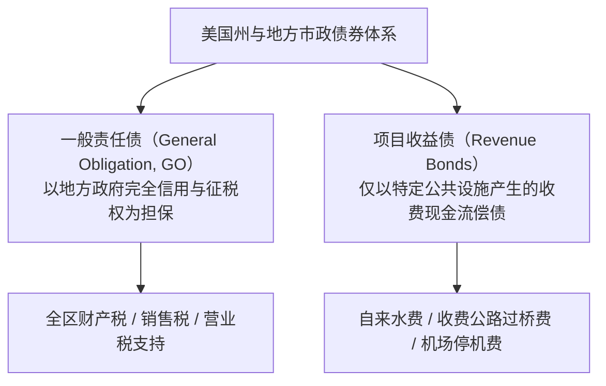
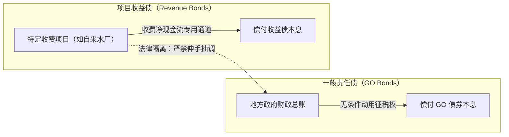
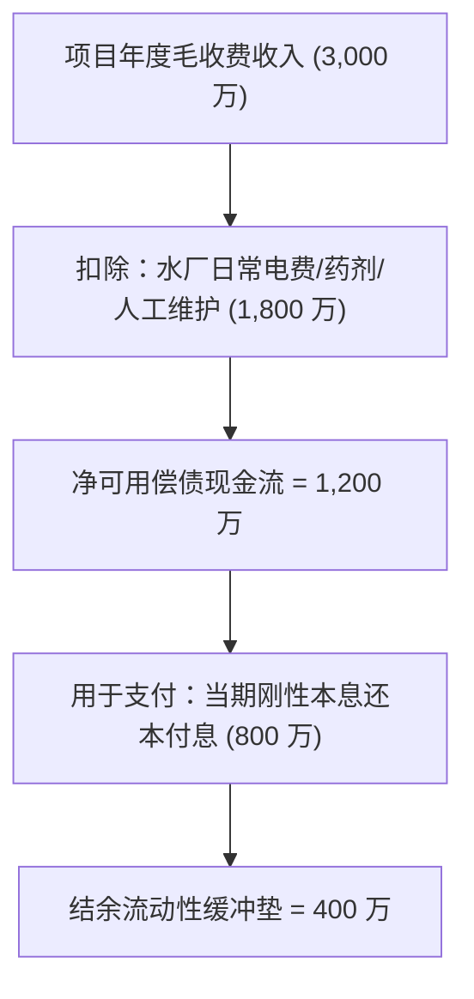
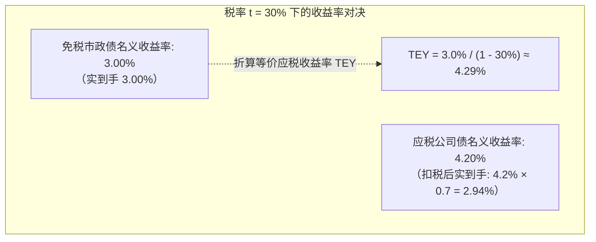
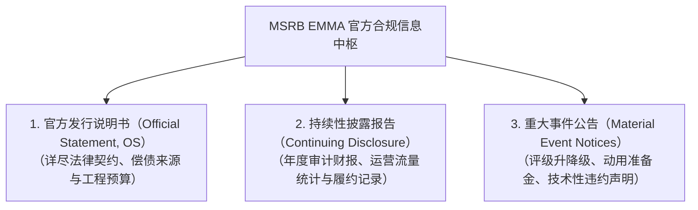

# 22 州与地方政府融资：市政债与财政约束

[上一章](21-credit-risk.md) · [目录](./) · [下一章](23-housing-market.md)

## 本章要解决的问题：同样叫美国政府债，谁实际负责还钱？

当你买入一张由美国联邦财政部发行的国债时，你面对的是全球最坚挺的主权信用背书；但如果你买入的是一张由加利福尼亚州、芝加哥市、或者某个偏远县立供水区发行的**市政债券（Municipal Bonds，业内常称 Muni）**，情况就截然不同了。

在现代金融历史上：
- 2013 年，曾经的全美第四大工业重镇底特律市正式向法庭申请破产保护，涉及债务高达 180 亿美元，部分无担保市政债持有人的本金最终被大幅腰斩；
- 2017 年，美国海外自治属地波多黎各爆发超过 700 亿美元的世纪债务违约危机；
- 即使是同一座城市发行的两只债券，一只可能享受着全市财产税的无条件兜底保障，而另一只可能因为城市自来水厂经营亏损而当场陷入违约！

为什么同为公权力机构发债，不同市政债之间的安全边界会有云泥之别？
为什么华尔街顶级富豪、家族办公室与高净值家庭会对票面利率看似并不高的市政债券趋之若鹜？

读完本章，你将能够：
1. 严格辨析一般责任债（GO）与项目收益债（Revenue Bonds）在法律约束与偿债来源上的本质鸿沟；
2. 亲手计算项目收益债的债务偿付覆盖率（DSCR），看透项目运营现金流与刚性本息支付的安全垫；
3. 熟练掌握等价应税收益率（TEY）的折算公式，算清联邦免税特权在不同纳税人手中的真实含金量；
4. 掌握美国市政证券规则制定委员会（MSRB）旗下 EMMA 官方披露系统的核心检索与审计实务。

---

## 1. 两种截然不同的偿债结构：一般责任债 vs 收益债

美国宪法确立了高度分权的联邦体制。联邦政府、州政府与各级市县政府在财政预算上各自独立核算。联邦政府绝不为地方政府的债务提供连带无限担保兜底。

在地方市政金融中，债券被根本性地划分为两大阵营：

| 核心维度 | 一般责任债（General Obligation, GO） | 项目收益债（Revenue Bonds） |
| :--- | :--- | :--- |
| **法律偿债来源** | 发行政府的“完全信用与无限征税权（Full Faith, Credit and Taxing Power）” | 仅限于指定公共设施或独立公用事业项目自身产生的经营收费现金流 |
| **政府兜底责任** | 政府有法律义务通过征收财产税、营业税甚至上调税率来确保还本付息 | **政府一般财政总账严格隔离，不对项目债务承担法定兜底清偿责任** |
| **发债审批程序** | 通常需要全区选民在公投选举中投票表决（Voter Referendum）授权通过 | 通常由公用事业单位董事会依据项目预期经济可行性直接批准发行 |
| **典型融资场景** | 公立中小学教学楼、警察局、城市市政厅、市政道路与公共公园 | 城市自来水与污水处理厂、跨海收费大桥、公共集装箱码头、公立医院 |

理解这种法律隔离至关重要：
假设某城市拥有充裕的财政总金库，同时下属经营着一座供水系统。如果供水系统因居民节水导致自来水收费锐减、无法偿还供水收益债，**债权人无权强制要求市长动用市财政总金库的税收来替供水收益债买单**；反之，若供水系统利润丰厚，其收入也受到债券法定契约（Bond Indenture）的严格保护，市长也不能随意挪用水费去弥补市政府自身的公务员工资赤字！

---

## 2. 从工程资金缺口到市政债发行实务

我们来跟随一座中等城市的公共公用事业管理局（Water Authority），追踪一笔真实的重大水利工程融资：

- **工程预算总支出**：新建一座现代化自来水净化厂，总预算为 **1.0 亿美元**（$\$100\,\text{M}$）；
- **建设周期**：预计施工期 3 年；
- **管理局既有自有资金储备**：账面留存自备准备金 **2,000 万美元**（$\$20\,\text{M}$）；
- **外部净发债融资需求**：
  $$\text{工程发债缺口} = 100 - 20 = 80.0\,\text{百万美元}$$

### 2.1 竞争性招标与协商发售

管理局通常面临两种发行承销路径：
1. **竞争性招标发售（Competitive Sale）**：发行人在官方系统公布最终定稿的发行说明书通知，华尔街各大承销投行在指定时间提交电子标书竞标。出价最低、使得全期“真实利息成本（True Interest Cost, TIC）”最低的投行联合体中标夺单；
2. **协商发售（Negotiated Sale）**：当项目设计复杂、含有多批次提前赎回或涉及受压信用时，发行人提前选定主承销商，共同商讨发行架构、组织投资者路演并协商敲定利率。

### 2.2 溢价发行与综合到手资金核算

为了精准筹集到工程所需的 8,000 万美元净现金，管理局决定发行固定票息为 $5.0\%$ 的 20 年期高级收益债券。在当前市场上，由于该类免税高票息受到追捧，承销商以高于票面面值的价格向最终投资者进行**溢价发售（Premium Pricing）**：

- **发售定价**：债券总面值确定为 **8,000 万美元**，按照面值的 **$101.0\%$** 溢价发行；
- **募集资金毛额**为：
  $$\text{募集资金毛额} = 80.0 \times 101.0\% = 80.8\,\text{百万美元}$$
- **承销佣金与发行成本**：投行承销佣金、评级费、债券法律顾问与财务顾问咨询费合计扣除 **0.8 百万美元**；
- **管理局实际净到账现金**：
  $$\text{净筹集工程资金} = 80.8 - 0.8 = 80.0\,\text{百万美元} \quad (80 \times 1.01 - 0.8 = 80)$$

通过微幅溢价发行，筹得的超额溢价资金（80 万美元）恰好吸收并对冲了全部承销与发债摩擦成本，从而确保了打入工程专款专用监管账户的净资金不多不少正好是 8,000 万美元整。

---

## 3. 项目收益债的核心标尺：债务偿付覆盖率（DSCR）

对于项目收益债而言，投资人最关心的核心生命线不是地方 GDP 规模，而是该公用事业项目自身的**债务偿付覆盖率（Debt Service Coverage Ratio, DSCR）**。

### 3.1 覆盖率公式的严谨定义

$$\text{债务偿付覆盖率 (DSCR)} = \frac{\text{系统可用净收入 (Net Revenues Available for Debt Service)}}{\text{当期法定应偿还的本金加利息总额 (Annual Debt Service)}}$$

其中，分子**系统可用净收入**必须满足公用事业会计的严格约定：
$$\text{系统可用净收入} = \text{项目年度营业毛收入} - \text{必要合规运营与维护现金支出 (O&M Expenses)}$$

我们代入基准教学算例：
- 供水系统每年向全区居民与工商业收取水费总收入：**3,000 万美元**；
- 维持水厂运转、净化消毒药剂、电力能耗与一线工人薪酬等合规运营维护现金开支：**1,800 万美元**；
- 可用于偿付债券本息的净营业现金流为：
  $$\text{系统可用净收入} = 30.0 - 18.0 = 12.0\,\text{百万美元}$$
- 当期该批收益债券按照还本付息摊销计划，必须刚性兑付的年化利息加本金总额：**8.0 百万美元**。

此时，该供水项目的债务偿付覆盖率（DSCR）为：
$$\text{初始 DSCR} = \frac{12.0}{8.0} = 1.50\,\text{倍} \quad \left( \frac{30 - 18}{8} = 1.5 \right)$$

在市政收益债标准契约中， $1.25$ 至 $1.50$ 倍是极为健康的黄金安全区间。多出的 400 万美元净沉淀资金，将被依法划拨进专门的**偿债准备金账户（Debt Service Reserve Fund, DSRF）**，作为未来极端风险时刻的避险安全气囊。

### 3.2 压力情景测试：收入下滑时的现金断裂推演

现在，我们对该项目实施极端压力测试：
假定当地爆发极端干旱，或者主导制造业工厂外迁，导致区域总用水量断崖式下挫 $20\%$：

- **重估后的营业毛收入**（暴跌 $20\%$）：
  $$\text{受压营业毛收入} = 30.0 \times (1 - 20\%) = 30.0 \times 0.8 = 24.0\,\text{百万美元}$$
- **运营维护刚性成本**：由于管网固定折损与基础运维无法即时削减，运营维护支出依然刚性停留在 **1,800 万美元**；
- **重估后的可用净收入**：
  $$\text{重估后可用净收入} = 24.0 - 18.0 = 6.0\,\text{百万美元}$$
- **重估后的债务偿付覆盖率（DSCR）**：
  $$\text{受压后 DSCR} = \frac{6.0}{8.0} = 0.75\,\text{倍} \quad \left( \frac{30 \times 0.8 - 18}{8} = 0.75 \right)$$

覆盖率骤然跌破 $1.0$ 的生死平衡线！
当期项目产生的实际净收入（600 万）根本不足以足额偿还当期 800 万的到期债务，**年度当期现金偿付净缺口为 200 万美元**（$8.0 - 6.0 = 2.0$）。

如果项目原先建立的偿债准备金账户中有 600 万美元现金余额，在算术上它可以暂时替项目垫付 3 年的资金缺口（$\frac{6}{2} = 3$ 年）。但债券契约通常明文规定：一旦动用储备金，管理当局必须在随后 12 个月内通过上调水价或削减支出重新补足储备。储备金只是买到了缓冲时间，绝不等于结构性财务危机自动消散。

---

## 4. 联邦免税特权与等价应税收益率（TEY）

市政债券之所以在美国金融大厦中占据半壁江山，其核心王牌在于美国税法确立的**联邦所得税豁免特权（Tax-Exempt Status）**。

### 4.1 税前与税后的收益率折算公式

根据美国国内税收法典（IRC）第 103 条，投资者持有的合格公立市政债券所赚取的利息收入，**完全免除向美国联邦政府缴纳个人所得税**（且通常免除债券发行所在州的州所得税）。

对于一名处于最高边际税率阶层的高净值投资者而言，如果他在公开市场上购买可比评级的应税公司债，到手利息必须被国税局（IRS）切下一大块。

为了在“免税市政债”与“普通应税债券”之间进行公平的收益比较，必须使用**等价应税收益率（Tax-Equivalent Yield, TEY）**工具：

$$\text{等价应税收益率 (TEY)} = \frac{\text{免税市政债收益率 } (r_{\text{muni}})}{1 - \text{投资者适用边际所得税率 } (t)}$$

反过来，一只提供年化收益率 $r_{\text{taxable}}$ 的应税债券，扣除所得税后的真实到手净收益率为：
$$\text{税后真实净回报} = r_{\text{taxable}} \times (1 - t)$$

### 4.2 真实纳税人画像算例对比

假设当前市场上有一只高等级免税市政债券，报出的年化到期收益率为 **$3.0\%$**；而在可比评级与到期期限的公募公司债市场上，报价收益率为 **$4.20\%$**。

我们来对比两位收入阶层截然不同的投资者的决策分水岭：

**案例 A：高收入科技高管（适用联邦边际税率 $t = 30\%$）**
- 应税公司债的税后净收益率：
  $$\text{税后净到手} = 4.20\% \times (1 - 30\%) = 4.20\% \times 0.70 = 2.94\%$$
- 免税市政债的等价应税收益率（TEY）：
  $$\text{TEY} = \frac{3.0\%}{1 - 30\%} = \frac{3.0\%}{0.70} \approx 4.2857\% \quad (\approx 4.29\%)$$

结论显而易见：对于这位税率 $30\%$ 的投资者而言，买入 $3.0\%$ 的免税市政债，其实际到手回报（$3.0\%$）直接秒杀了税后仅剩 $2.94\%$ 的应税公司债！它相当于享受了一只高达 **$4.29\%$** 的应税金融资产。

**案例 B：退休低收入储户（适用低边际税率 $t = 10\%$）**
- 应税公司债的税后净收益率：
  $$\text{税后净到手} = 4.20\% \times (1 - 10\%) = 4.20\% \times 0.90 = 3.78\%$$
- 免税市政债的等价应税收益率（TEY）：
  $$\text{TEY} = \frac{3.0\%}{1 - 10\%} = \frac{3.0\%}{0.90} \approx 3.3333\% \quad (\approx 3.33\%)$$

结论彻底反转：对于税率仅有 $10\%$ 的储户，免税特权的吸引力大幅缩水，其实际到手仅 $3.0\%$，远不如应税公司债扣税后的 **$3.78\%$**。

> [!TIP] 市政债的天然买方属性
> 这项精妙的数学公式揭示了为什么全美市政债券近 $70\%$ 的持有者是美国本土的高净值自然人家庭、信托基金以及面向零售高净值的免税共同基金。免税价值取决于纳税人的边际税率，税率越高，免税资产的实际性价比就越呈现指数级放大。

---

## 5. 二级市场微观结构与提前赎回陷阱

与美国国债全天候由算法高频交易做市不同，全美市政债券市场由超过 5 万个不同发行主体、上百万只零散且流动性极差的独立券种拼接而成，其二级交易具有鲜明的特质：

### 5.1 散户主导与高昂的隐形买卖价差

由于大多数高净值买家买入市政债的初衷是“吃免税票息持有到期（Buy-and-Hold）”，存量市政债往往被锁进私人银行保险箱，二级市场的日均换手率极低。
做市交易商在挂牌收购冷门市政债时，常常会索要高达 100 至 200 个基点的超宽买卖价差。小额散户若遇急用钱被迫中途抛售，往往会遭受意想不到的折价变现惩罚。

### 5.2 溢价买入可赎回市政债的暴雷风险

绝大多数 20 年至 30 年期的市政债券，都附带了典型的**“10 年不可赎回，随后可按面值 100 提前全额赎回（10-Year Par Call）”**条款。

假设你在二级市场上看中了一只剩余期限 15 年、票息高达 $5.0\%$ 的市政收益债。由于票息极具吸引力，你按照 **$108.0$ 美元的高溢价**全款买入：
- 如果你按照 15 年到期计算，你的账面到期收益率（YTM）看起来还有 $4.2\%$；
- 然而，如果两年后市场基准利率大跌，该地方政府在第 10 年的第一个赎回日行使了赎回权，强制按照 **$100.0$ 美元面值**将债券提前注销买回；
- 此时，你在最初支付的高达 $8.0$ 美元的溢价必须在短短两年内全部摊销亏尽，你的真实**赎回收益率（Yield to Call, YTC）**可能会当场跌至极度惨淡的负数！

> [!CAUTION] 比较市政债报价的金法则：最差收益率（Yield-to-Worst, YTW）
> 在国际固定收益市场上，对任何可赎回市政债券进行系统报价时，**必须同时计算持有至到期的收益率（YTM）以及假定在每一个可能赎回日被提前赎回的收益率（YTC），并强制取其中的最低值作为最差收益率（YTW）呈报给客户**。严禁仅凭表面高票息或长端 YTM 误导投资者。

---

## 6. 官方一手信源带读：MSRB 旗下 EMMA 审计实战

在针对美国市政债券进行专业信贷尽调与宏观分析时，全市场唯一的法定官方一手数据库是由美国市政证券规则制定委员会（MSRB）运营的 **EMMA 网站（Electronic Municipal Market Access, emma.msrb.org）**。

专业分析师检索 EMMA 平台，必须严格执行五步法：
1. **核验唯一证券编码（CUSIP）**：美国同名城市极多（例如全美有超过 30 个名为“Springfield”的城镇），绝不可在搜索栏仅凭城市名字检索，必须精准输入该批债券的 9 位 CUSIP 代码；
2. **翻开 Official Statement 查阅偿债来源（Sources of Payment）**：直接定位到核心法律章节，逐字核实其属于有征税权兜底的 GO 债，还是仅限自负盈亏的项目收益债；
3. **复算准备金与限制性契约**：查阅是否设立了偿债准备金账户（DSRF）、最低要求储备金额度是多少、增发额外新债的准入覆盖率测试门槛（Additional Bonds Test, ABT）是多少；
4. **提取年度持续性披露财报**：查阅该公用事业单位最新年度的经审计财报，重新用实测收入与支出复算当前的债务偿付覆盖率（DSCR）；
5. **排查重大负面事件通知**：核查该发行人历史上是否向 MSRB 提交过因资金枯竭而延迟付息、准备金被强制抽调破损或违规挪用的重大事件污点记录。

---

## 7. 宏观连接：地方财政如何放大就业与经济周期？

地方政府与联邦政府有着一个生死攸关的制度差异：
**美国绝大多数州和地方政府受到各州宪法明文规定的“预算平衡法案（Balanced Budget Requirements）”的刚性制约。**

联邦政府在遭遇经济危机时可以无上限扩大赤字、由国债和央行印钞托底；但州与地方政府在法律上严禁出现赤字性经常预算运营。
这一制度设计在宏观经济学中产生了显著的**顺周期放大效应（Pro-cyclical Fiscal Drag）**：

当房地产市场暴跌、居民消费陷入冰点时：
- 地方政府税基缩水，财力骤降；
- 由于无法合法透支赤字，市长唯一的合规选择就是**在危机中逆势大幅削减公共支出**（解雇地方公立雇员、停止采购基建设备、推迟道路管网维修）；
- 这种在衰退期被迫实行的自我财政紧缩，犹如在病人失血时强制节食，会进一步从就业和消费端对实体宏观经济造成强烈的二次紧缩冲击。

---

## 练习与参考答案

### 练习 1：公用事业收益债的发行溢价与净筹款计算
某市水务管理局计划筹资建设一座现代化海水淡化厂，工程预算总资金缺口恰好为 8,000 万美元（$\$80\,\text{M}$）。为了全额解决工程款并覆盖中介摩擦成本，管理局发行了一笔票面总面值为 8,000 万美元的 20 年期固定利率项目收益债。该债券在二级市场上获得了超额认购，承销团最终按照票面面值的 $101.0\%$ 溢价成功向高净值免税基金发售；承销团从中扣收了总计相当于 0.8 百万美元（$\$0.8\,\text{M}$）的承销报酬与专业发行费用。
请计算：
1. 承销团通过溢价发售累计向投资者筹集的募集资金毛额；
2. 扣除承销费用后，水务管理局最终实际到手入账并用于工程建设的净现金金额；
3. 解释为什么该溢价发行并没有使得该海水淡化厂凭空获得额外暴利。

点击查看详细参考答案与推理步骤

1. **募集资金毛额计算**：
   $$\text{募集毛额} = \$80\,\text{M} \times 101.0\% = \$80.8\,\text{百万美元}$$
2. **实际到账净款计算**：
   $$\text{净到账现金} = \$80.8\,\text{M} - \$0.8\,\text{M} = \$80.0\,\text{百万美元} \quad (80 \times 1.01 - 0.8 = 80)$$
3. **财务本质辨析**：
   投资者之所以愿意按照 $101.0\%$ 的溢价掏出 8,080 万美元，是因为该债券承诺的票面票息率高于当前二级市场的绝对公允要求收益率。这笔超额的 80 万美元溢价在本质上是投资者提前预付的利息补贴，发行人在未来 20 年的存续期内必须为此承担更高的固定利息流出负担，并在到期时全额按面值兑付本金。溢价仅仅在财务结算上吸收了发债成本，绝不代表工程资产本身白捡了利润。

### 练习 2：项目收益债偿债覆盖率（DSCR）与抗风险审计
某海滨城市下属的收费跨海大桥运营管理局发行了一批特许经营项目收益债券。在基准年度中，大桥通行费总现金收入为 3,000 万美元（$\$30\,\text{M}$），大桥日常维护、除锈保养、人工与收费系统维护等必要现金支出为 1,800 万美元（$\$18\,\text{M}$），当年该批债券按合同约定应刚性偿还的本金与利息总支出为 800 万美元（$\$8\,\text{M}$）。
1. 计算该收费大桥项目在基准年度的债务偿付覆盖率（DSCR）；
2. 假定下一年邻近开通了一条免费高速公路分流车辆，导致大桥收费收入大幅下挫 $20\%$，而运营维护开支依然维持在 1,800 万美元。请计算受压后该大桥项目的可用净收入与重估后的 DSCR；
3. 在收入下滑 $20\%$ 的受压状态下，该项目当年的净现金缺口是多少？若该大桥设立的偿债准备金账户中存有 600 万美元未受限流动现金，算术上可为该项目维持几年的缺口兑付？
4. 大桥管理局能否以“大桥属于全市民生基础设施”为由，直接强制划扣市政府财政金库中的一般商业税收来垫付这笔亏损？为什么？

点击查看详细参考答案与推理步骤

1. **基准年度债务偿付覆盖率（DSCR）计算**：
   - 净可用收入：
     $$\text{净可用收入} = \$30\,\text{M} - \$18\,\text{M} = \$12.0\,\text{百万美元}$$
   - 基准 DSCR：
     $$\text{基准 DSCR} = \frac{\$12.0\,\text{M}}{\$8.0\,\text{M}} = 1.50\,\text{倍} \quad \left( \frac{30 - 18}{8} = 1.5 \right)$$
2. **受压年度 DSCR 计算**：
   - 受压后营业总收入（下滑 $20\%$）：
     $$\text{受压总收入} = \$30.0\,\text{M} \times (1 - 20\%) = \$24.0\,\text{百万美元}$$
   - 受压后净可用收入：
     $$\text{受压后净收入} = \$24.0\,\text{M} - \$18.0\,\text{M} = \$6.0\,\text{百万美元}$$
   - 重估后 DSCR：
     $$\text{受压后 DSCR} = \frac{\$6.0\,\text{M}}{\$8.0\,\text{M}} = 0.75\,\text{倍} \quad \left( \frac{30 \times 0.8 - 18}{8} = 0.75 \right)$$
3. **现金缺口与储备金缓冲计算**：
   - 年度当期现金刚性缺口：
     $$\text{年度现金赤字} = \$8.0\,\text{M} - \$6.0\,\text{M} = \$2.0\,\text{百万美元}$$
   - 600 万美元准备金在算术上可支撑的时长：
     $$\text{缓冲年限} = \frac{\$6.0\,\text{M}}{\$2.0\,\text{M}} = 3.0\,\text{年}$$
4. **法律边界定性**：
   **绝对不能**。项目收益债（Revenue Bonds）的法律基石在于**与市政府一般财政总账彻底法律隔离**。债券持有人享有的索赔权仅限于大桥自身的通行费收费资金池。市政府没有法定义务、且通常受到法律禁止动用全体市民的一般税收来替自负盈亏的项目收益债进行无限兜底清偿。大桥若无法恢复造血，必须依法进入违约债务重组。

### 练习 3：等价应税收益率（TEY）与最优资产配置决策
某高净值个人投资者的投资组合中包含两只评级与期限完全相同的候选债券：
- 候选资产 A（免税市政公债）：年化收益率为 $3.0\%$，利息全额免缴联邦个人所得税；
- 候选资产 B（可比应税公司债）：年化收益率为 $4.2\%$，利息必须全额纳入联邦所得税合并计税；
假定该投资者的适格联邦综合边际所得税率为 $t = 30.0\%$。
请计算：
1. 购买应税公司债 B 后，该投资者扣税后实际到手落袋的税后净收益率；
2. 免税市政债 A 对于该特定投资者而言，所对应的等价应税收益率（TEY）是多少？
3. 从税后收益最大化原则出发，该投资者应该优先选择哪一只债券？
4. 如果该投资者的边际所得税率仅为 $t = 10.0\%$，上述选择结论会发生什么变化？

点击查看详细参考答案与推理步骤

1. **应税公司债 B 的税后净收益率计算**：
   $$\text{税后净回报} = r_{\text{taxable}} \times (1 - t) = 4.20\% \times (1 - 30.0\%) = 4.20\% \times 0.70 = 2.94\%$$
2. **免税市政债 A 的等价应税收益率（TEY）计算**：
   $$\text{TEY} = \frac{r_{\text{muni}}}{1 - t} = \frac{3.0\%}{1 - 30.0\%} = \frac{0.03}{0.70} \times 100\% \approx 4.2857\% \quad (\approx 4.29\%)$$
3. **投资决策判定**：
   - 市政债 A 的等价应税收益率（$4.29\%$）高于应税公司债 B 的名义收益率（$4.20\%$）；
   - 从实际到手净现金来看，市政债 A 净赚 **$3.00\%$**，而公司债 B 扣税后仅剩 **$2.94\%$**；
   - 故该投资者应毫不犹豫地优先买入**免税市政债 A**。
4. **低税率情景下的结论反转分析**：
   当边际税率降至 $t = 10.0\%$ 时：
   - 市政债 A 的等价应税收益率变为：
     $$\text{TEY}_{10\%} = \frac{3.0\%}{1 - 10.0\%} = \frac{3.0\%}{0.90} \approx 3.3333\% \quad (\approx 3.33\%)$$
   - 公司债 B 的税后净收益率为：
     $$4.20\% \times (1 - 10.0\%) = 3.78\%$$
   结论发生彻底逆转！低税率投资者买入应税公司债 B 税后净赚 $3.78\%$，远胜于免税市政债 A 的 $3.00\%$。这充分验证了免税特权的价值高度依赖于投资者的纳税阶层。

---

## 本章小结与下一章

美国市政金融是一幅由法律隔离、税收特权与财政联邦制交织而成的独特画卷。从以征税权为底气的一般责任债（GO），到以项目现金流自负盈亏的收益债（Revenue Bonds），偿债来源的边界决定了资产的生死底线。与此同时，联邦免税特权使得等价应税收益率（TEY）成为衡量高净值资产配置的核心准绳，而州与地方宪法的平衡预算约束，又让地方财政在不知不觉中充当了宏观经济周期的敏感放大器。

在下一章中，我们将正式开启宏观经济学中体量最为庞大、牵动千家万户财富中枢的超级模块——**美国房地产市场、住房抵押贷款管道与机构住房抵押贷款支持证券（Agency MBS）**，系统拆解从一间房屋的购房按揭到华尔街数百亿美元资产证券化流水线的完整运作机制。

[上一章](21-credit-risk.md) · [目录](./) · [下一章](23-housing-market.md)
