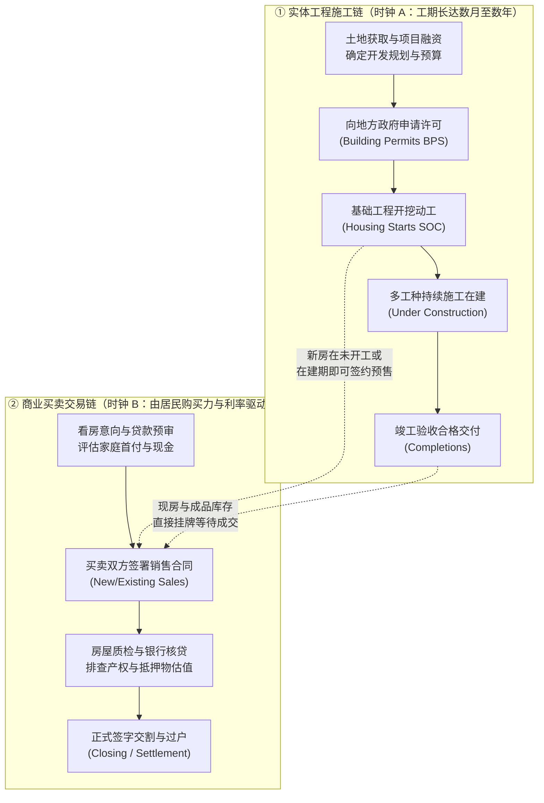
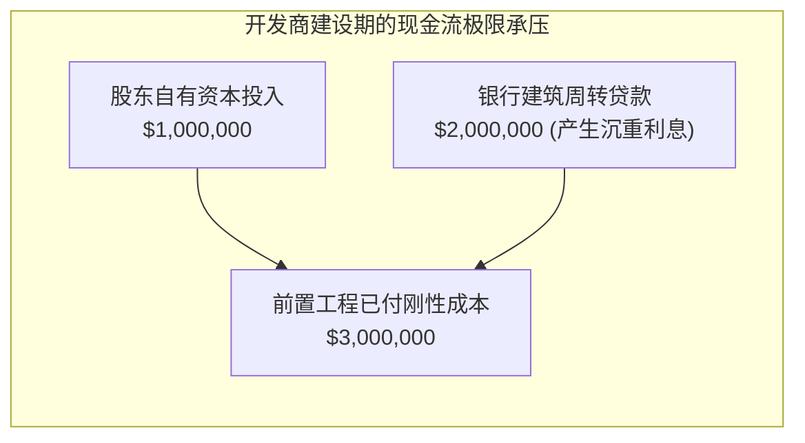

# 23 住房市场：开发、交易、库存与价格

[上一章](22-municipal-finance.md) · [目录](./) · [下一章](24-housing-returns.md)

> 建议分两次学习：第一次跟随“施工”与“买卖”两个不同步的时钟，掌握从许可证到全国开工、从签约到交割的统计推算与库存月数计算；第二次精读开发商资金链、价格指数样本偏差与一份真实的 Census 新屋销售报告。除明确注明的历史官方发布外，正文所有工程与交易数值均为教学假设。

---

## 本章要解决的问题

如果你打开某个月份的美国宏观经济新闻，经常会看到一组看似自相矛盾的标题：
> “美国建筑许可超预期增加，但新屋开工意外下滑；与此同时，新房竣工量创近年新高，而成屋签约销售却连跌三月，全国房屋中位售价反而再度刷出历史新高！”

对于初学者来说，这简直像是一道逻辑乱麻：
1. **许可增加了，为什么开工反而会减少？** 盖房子的动作难道不是批准之后立刻发生的吗？
2. **房子卖不动了，为什么中位数成交价却还在涨？** 难道高利率下大家还在抢豪宅？
3. **“库存还有 9 个月”究竟是什么意思？** 真是开发商手里压着 9 个月前的烂尾楼卖不出去吗？

要解开这些谜团，核心在于明白一条规律：**房地产市场从来不是一条平滑的单向流水线，而是由两条“速度极不相同、在不同时点交汇”的时钟咬合而成的复杂齿轮系统。**

读完本章，你将能够：
- 画出**实体施工链**与**商业买卖链**的完整交汇网络，解释为什么许可、开工、竣工与销售会经常背离；
- 理解 Census 是如何从一张地方许可证（BPS）和抽样跟踪（SOC）推算出全美数百万套开工年率（SAAR）的；
- 熟练计算**待售库存月数（Months' Supply）**，敏锐识别由于“分母（销售速度）暴跌”所造成的虚假库存激增；
- 识破“中位数价格上行”背后的**成交结构错觉**，理解 FHFA 重复销售指数（Repeat-Sales HPI）的构造原理与局限；
- 读懂一份官方 Census 新屋销售原始报告，准确辨识置信区间、存量流量口径与季调影响。

---

## 1. 住房有两条不同步的链：施工与买卖

### 1.1 不要把销售排在竣工之后

在许多人的直觉中，买房的过程就像去超市买面包：开发商先盖好一栋漂亮的房子，摆在市场上，买家走进去挑中、付钱、拿钥匙。

但在现实中，尤其是在美国新房市场，**交易行为往往发生在工程刚刚破土动工、甚至地面上还只是一片荒草的时候**。房地产市场同时存在着两条并行的时钟：

这两条链条受完全不同的力量驱动：
- **施工链**受行政审批进度、建筑工人供给、建材供应链、天气条件以及开发贷款（Construction Loan）拨付进度的制约；
- **买卖链**则对每星期的**房贷利率变动**、股市财富效应、居民就业预期以及二手房业主的换房意愿极为敏感。

许可是行政法律批准；而是否真正开工，开发商还要看眼下的水泥钢筋价格和融资成本。销售合同是买卖双方的法律承诺；而最终能否在公证处交割（Closing），还要看买家的房贷审批会不会在中途被银行拒贷。

这就是为什么在同一个月里，你会看到**“许可增加（批文积压释放）、开工减少（借款利率飙升阻碍动工）、竣工激增（两年前开工的大楼终于封顶）、销售暴跌（当月房贷利率破 7%）”**同时发生！

---

### 1.2 怎样从一张许可证推算全国开工

在统计上，美国联邦政府并没有派人在全美几十万个工地上每天打卡数工人。美国人口普查局（Census Bureau）是通过一套精心设计的抽样外推体系来掌握全国脉搏的：

1. **建筑许可调查（Building Permits Survey, BPS）**：
   Census 定期从全美约 20,000 个具有发证权的地方政府许可管理机构（Permit Issuing Places）收集住宅获批数据。地方行政记录能确切给出“法律上被允许动工的套数”，但无法告诉你施工队具体哪天进场。[BPS 方法说明](https://www.census.gov/construction/bps/methodology.html)
2. **住宅建设调查（Survey of Construction, SOC）**：
   统计人员在被抽中的样本许可中，派出调查员对建筑商或业主进行持续跟踪访谈，记录具体何时开挖基础、何时完工、何时签合同预售。调查人员联系不上建筑商时，可通过现场航拍、实地踏勘或官方补充源核实。[SOC 采集与估计方法](https://www.census.gov/construction/soc/methodology.html)

#### 简化数值演示：外推不是简单乘以固定系数

假设某细分地区当月新获批住宅许可证共计 $1{,}000$ 套。通过历史样本追踪发现，该地区平均约有 $60\%$ 的许可会在当月破土动工，但这绝不意味着当月的实际开工只有 $600$ 套！

因为全美当月的实际开工总量，是一个包含动态滚动的管道：

$$
\text{当月实际开工} = \text{当月获批且当月开工} + \text{往月获批但延期至本月开工} + \text{无许可管制地区的推算开工}
$$

若往期积压的开工集中释放，哪怕当月新批许可暴跌，当月开工依然可能大幅冲高。绝不能机械地套用“本月许可 $\times 60\% =$ 全国开工”。

---

### 1.3 开工计的是“套数”，不是“大楼栋数”

在阅读建筑数据时，务必牢记：**统计单位是独立的居住套数（Housing Units），绝非建筑物栋数（Buildings）**！

- 如果一位农场主在自家土地上开挖一栋独栋木屋，贡献的开工量是 **$1$ 套**（Single-family unit）；
- 如果一家商业地产商在西雅图市中心开工兴建一栋拥有 50 层、内含 500 套精装公寓的摩天大楼，只要地基开挖施工开始，贡献的开工量就是 **$500$ 套**（Multi-family units）！

> [!NOTE]
> 这正是为什么美国的月度住宅开工数据（尤其是多户住宅 Multi-family）经常出现月度暴涨暴跌的原因：几栋大型公寓楼的集中地基工程，就能让单月数据跳升几千套，但这并不代表全国各地的独立平房需求突然出现了井喷。

#### 在建工程管道恒等式

在任何一个时间区间内，全美住宅施工管道严格遵循如下存量与流量平衡方程：

$$
\text{期末在建套数} = \text{期初在建套数} + \text{当期新开工} - \text{当期竣工验收} - \text{工程烂尾中途废弃}
$$

假设某都会区月初在建住宅为 $1{,}000$ 套：
- 本月新开工：$100$ 套；
- 本月完成并取得入住许可（CO）：$140$ 套；
- 忽略极少数烂尾弃建，月末在建套数即为：$1{,}000 + 100 - 140 = \mathbf{960} \text{ 套}$。

在这个月里，**“竣工旺盛（140 套）”与“在建规模下滑（从 1000 套降至 960 套）”同时出现**！这表明过去几年堆积的工程正在加速交房释放，但未来的施工储备粮正在被消耗。如果新开工持续低迷，半年后建筑工人就会面临无活可干的局面，哪怕眼前的竣工数据看起来繁荣无比。

---

### 1.4 年率（SAAR）不是当月实际盖出的房子

新闻里常说：“美国 6 月新屋开工达到 120 万套！”

刚接触经济学的读者往往大吃一惊：美国一个月内竟然能拔地而起 120 万栋房子？

**不是！** 这个数字采用的是**季调折年率（Seasonally Adjusted Annual Rate, SAAR）**：

$$
\text{月度折算实际水平} = \frac{\text{公布的 SAAR 读数}}{12}
$$

当公布 120 万套 SAAR 时，意味着剔除冬季冰雪天气或夏季开工旺季的正常季节规律后，**当月的季调实际开工规模大约是 $\frac{120 \text{ 万}}{12} = 10 \text{ 万套}$**。它表达的是：“如果全年的 12 个月都保持当前月份这般火热（或寒冷）的建设节奏，一年下来累计会建造 120 万套”。

季调能过滤掉正常的春夏施工潮与冬日歇工，但无法消除突发的罕见飓风或世纪暴雪。因此，在分析月度波动时，必须结合未季调原始表格（Not Seasonally Adjusted, NSA）与三个月移动平均线进行审慎观察。[SOC 发布与修订安排](https://www.census.gov/construction/soc/methodology.html)。

---

## 2. 卖出了什么：新房、成屋、库存与价格

### 2.1 新房销售与成屋销售：两把完全不同的标尺

宏观分析师常跟踪两份截然不同的房屋销售报告，它们记录的节点与交易对象截然不同：

| 比较维度 | 新屋销售（New Home Sales） | 成屋销售（Existing Home Sales） |
| :--- | :--- | :--- |
| **统计与发布机构** | 美国人口普查局（Census Bureau） / HUD | 全美房地产经纪人协会（NAR） |
| **调查对象** | 供出售的新建**单户住宅（Single-family）** | 已经有人居住过的二手房、既有公寓、联排等 |
| **数据源头** | 建筑商直报与抽样许可证跟踪调查 | 全美各地方**多重挂牌系统（MLS）**成交汇总 |
| **统计确认节点** | **买家签署购房合同或交定金时**（早！） | **正式签字付款交割完毕过户时**（晚！） |
| **取消订单的处理** | 后续违约毁约**不会**冲减已公布的历史签约净额 | 只有真正交割才会计入，毁约不计入 |

由于这两个时钟的节点不同：
假设美联储在 5 月突然猛烈加息，房贷利率暴升 150 个基点。
- Census 的新屋销售在 **5 月当月**就会立刻骤降，因为看房的买家被高利率吓退，停止签新合同；
- NAR 的成屋销售在 **5 月依然保持坚挺**，甚至直到 **6 月**才见顶回落，因为 6 月交割的成屋是买家早在 4 月份甚至更早之前锁定了低利率旧合同的结果！

如果分析师只看横轴上同为“6 月”的两根柱状图，就会得出“一手房暴跌、二手房火爆”的荒谬误判。

---

### 2.2 待售库存月数：为什么分母比分子更会骗人？

待售库存（Inventory）是一个时点的存量，而销售（Sales）是一段时间的流量。两者相除得到宏观分析中最核心的景气指标——**待售月数（Months' Supply）**：

$$
\text{待售月数} = \frac{\text{月末待售套数存量}}{\text{当期月度销售速度}} = \frac{\text{待售存量}}{\text{SAAR 销售年率} / 12}
$$

它回答的问题是：“假设未来开发商一套新房也不修，按照眼下这批买家的扫货速度，手头的这批房子需要几个月才能被彻底买空？”

#### 分母坍塌陷阱推演

假设全美待售新房库存稳定在 **30 万套**：
- **情景 1（市场火爆）**：季调年化销售速度为 **60 万套/年**（折合每月卖出 5 万套）。
  $$
  \text{待售月数} = \frac{30}{60 / 12} = \frac{30}{5} = \mathbf{6.0 \text{ 个月（供需均衡健康）}}
  $$
- **情景 2（加息骤冷）**：开发商手里的房子一套没增，依然是 **30 万套**，但年化销售速度因利率飙升瞬间腰斩至 **36 万套/年**（折合每月仅卖出 3 万套）。
  $$
  \text{待售月数} = \frac{30}{36 / 12} = \frac{30}{3} = \mathbf{10.0 \text{ 个月（严重供过于求警报！）}}
  $$

看到了吗？开发商没有盲目拿地盖房，仓库里的物理存量纹丝不动，**库存月数却从 6 个月恶化到了 10 个月的历史警戒线！** 这个跃升完全是由于**分母（销售速度）的骤降**导致的。

此外，新房库存并不全是已经能推门入住的“现房”：
Census 将待售新房划分为三大阶段：**未动工（Not Started）、在建中（Under Construction）、已竣工（Completed）**。
如果 10 个月的高库存里，有 7 成是甚至还没开挖地基的蓝图期房，开发商还可以通过违约退地、暂缓动工来控制失血；但如果这 10 个月全是已经落成、每天都在产生高额利息和物业折旧的已竣工现房，一场腥风血雨的降价踩踏就不可避免了。

---

### 2.3 中位数房价的“障眼法”：没有一套房涨价，中位价却翻倍？

很多人看新闻：“全美 7 月房屋销售中位数价格从 30 万跳升至 60 万美元，房价涨疯了！”

真的是房子升值了吗？我们来看一个最直观的数学反例：

假设市场上只有两类固定的标准化住宅，单价在两年内从来没有发生过一分钱变动：
- **郊区普通小户型**：售价永远是 **30 万美元**；
- **核心富人区大豪宅**：售价永远是 **60 万美元**。

| 月份 | 30 万普通房成交量 | 60 万豪宅成交量 | 全月总成交量 | 按价格从小到大排序的第 5、6 套成交价 | 全月成交中位数价格 |
| :---: | :---: | :---: | :---: | :---: | :---: |
| **上月（刚需火爆）** | **7 套** | 3 套 | 10 套 | 第 5 套: 30 万 / 第 6 套: 30 万 | **30 万美元** |
| **本月（利率破 7%）** | **3 套**（工薪层被拒贷） | 7 套（富豪全现金买） | 10 套 | 第 5 套: 60 万 / 第 6 套: 60 万 | **60 万美元** |

在上面的真实推演中，**每一栋具体房屋的售价都纹丝未动，但全市场的中位数成交价整整翻了一倍（从 30 万暴涨至 60 万）！**

这就是典型的**成交结构变动（Mix Shift）**：当高利率打击了普通工薪阶层的按揭购买力时，平价小户型门可罗雀；而不需要贷款的富裕买家仍在购置豪宅，导致成交样本严重向高端倾斜。

#### 重复销售指数（Repeat-Sales HPI）的解决思路

为了消除这种“苹果比橘子”的结构偏差，**FHFA（联邦住房金融局）**和 **S&P CoreLogic Case-Shiller** 普遍采用**重复销售匹配模型（Repeat-Sales Method）**。

其核心思想是：**只比较同一栋房屋在不同历史时点的两次真实成交记录！**
例如，德州某套独栋住宅在 2018 年以 30 万成交，2023 年再次以 33 万转手。通过配对这一组交易对，模型剥离了面积、户型、地理位置的先天差异，纯粹提取出该房产在 5 年间上涨了 $10\%$ 的纯资产价格变动。

当然，哪怕是重复销售指数也有其局限：
- 如果房东在两次转手之间花费 5 万美元重金装修了厨房卫生间，该指数往往会把房屋物理质量的改善误当成纯通胀涨价；
- FHFA 的 Purchase-Only 指数只覆盖了房利美、房地美所能购买的符合合规额度（Conforming Loan）的贷款抵押房产，覆盖不到全现金交易与超大额豪宅（Jumbo Loan）。[FHFA 房价指数方法与修订说明](https://www.fhfa.gov/data/hpi)。

---

## 3. 开发商的项目账本：谁在承受现金流极限

房地产从来不是统计局屏幕上的指数，它是建筑商真金白银的资产负债表博弈。我们通过一个典型的自编开发项目，看看利润是如何在现实中被利息和降价侵蚀的。

### 3.1 规划账面利润 vs 现实资金断裂

假设某中型开发商筹划建设一个由 **10 套独栋房屋**组成的小区：
- 预计建成后每套平均售价：$400{,}000$ 美元，预计销售总收入为 $4{,}000{,}000$ 美元；
- 土地购置、前期三通一平、工程建安与规费合计成本：$3{,}500{,}000$ 美元；
- **账面预计毛利**：$4{,}000{,}000 - 3{,}500{,}000 = \mathbf{500{,}000} \text{ 美元}$（利润率 $12.5\%$）。

看起来这是一笔赚钱的生意。然而，**“利润”不能用来给工人发每周的工资，只有“流动性现金”才能！**

- 在工程尚未封顶交割、还没有从购房者那里收到一分钱房款之前，开发商已经必须陆续开出 **$3{,}000{,}000$ 美元** 的工程与土地现金支票；
- 股东自身原始自有资本（Equity）只有 **$1{,}000{,}000$ 美元**；
- 此时项目存在高达 **$2{,}000{,}000$ 美元** 的现实资金缺口，必须向商业银行申请建筑开发贷款。

### 3.2 当市场微调 5%，利润去哪儿了？

假设项目即将完工时，市场突遇加息：
1. 市场承压，开发商不得不将每套售价下调 $5\%$，降至 $380{,}000$ 美元。总销售回款从 400 万缩水至 **$3{,}800{,}000$ 美元**；
2. 由于供应链耽搁、工期拖延以及建材涨价，实际总成本追加了 **$200{,}000$ 美元**，升至 $3{,}700{,}000$ 美元；
3. **此时项目的总毛利只剩下：**
   $$
   3{,}800{,}000 - 3{,}700{,}000 = \mathbf{100{,}000} \text{ 美元}！
   $$
   这还没有计入因为工期延长而多付给银行的数十万美元贷款利息！

开发商此时会面临生死抉择：
- **方案 A（降价甩卖抢现金）**：哪怕每套亏本卖 37 万，也要赶在下个月银行贷款到期前把房子变成现金，归还贷款保住公司信用；
- **方案 B（利息买断，买家补贴）**：表面上坚持 40 万挂牌价不肯降价（维护前期业主情绪和估值），但私下为买家向银行全额支付 2 个百分点的房贷利息点数（Rate Buydown）。在统计数据上，这套房屋的“成交价”依然记录为光鲜亮丽的 40 万，但开发商实际收到的现金早已大幅缩水！

---

## 4. 真实官方报告带读：Census 新屋销售公报

我们来实战带读一份真实的美国联邦政府一手统计文件：[美国人口普查局 2024 年 7 月 24 日发布的 6 月新屋销售公报](https://www.census.gov/construction/nrs/pdf/newressales_202406.pdf)。

### 4.1 核心数据表格还原与复算

公报首页醒目地给出了三个关键指标：
- **销售速度（Sales）**：$617{,}000$ 套（季调年率 SAAR）；
- **月末待售库存（For Sale）**：$476{,}000$ 套（季调存量）；
- **待售月数（Months' Supply）**：$9.3$ 个月。

我们来动手核对统计局的除法算式：
第一步，先算出 6 月份折算的月度单月销售速率：
$$
\text{月度销售速度} = \frac{617{,}000}{12} \approx 51{,}416.67 \text{ 套/月}
$$

第二步，将月末库存除以该速度：
$$
\text{待售月数} = \frac{476{,}000}{51{,}416.67} \approx 9.2577 \to \mathbf{9.3 \text{ 个月}}
$$
两项指标精确严丝合缝！

---

### 4.2 警惕抽样误差：连正负号都无法确定的单月环比

公报的新闻通稿写道：“2024 年 6 月单户新屋销售比修订后的 5 月估计值（621,000 套）低 0.6%。”

许多网络媒体立刻大肆渲染：“美国房地产市场再度失速下行！”

但只要你稍微把目光下移，就会在公报脚注中看到一行至关重要的统计披露：
> **“$\pm 14.6\%$ margin of error at the 90% confidence level.”**

这意味着什么？
统计局给出的单月环比变化 $-0.6\%$ 只是抽样调查的一个**中心点估计值（Point Estimate）**！在 $90\%$ 的置信区间下，全美真实的销售波动范围实际上落在：

$$
[-0.6\% - 14.6\%, -0.6\% + 14.6\%] \implies \mathbf{[-15.2\%, +14.0\%]}
$$

区间赫然横跨了“零”！
换句话说，在统计学意义上，**我们甚至根本无法百分之百断定 6 月份的全国新房销售究竟是轻微下滑了，还是强劲反弹了！**

因此，一名合格的宏观分析师，绝不能只盯着单月的初值小幅波动大呼小叫，而必须观察至少连续 3 至 6 个月的移动平均线、分地区趋势（如南部与西部核心市场）以及后续月份的历史修订（Revisions）。

---

## 5. 宏观监控仪表盘：怎样追踪美国地产脉搏

在实际宏观投研与政策跟踪中，专业分析师会将住房指标按照其内在传导链条编排成具有严格先后次序的监控矩阵：

| 阶段分类 | 跟踪核心指标 | 数据源与发布频次 | 分析师核心关注点 |
| :--- | :--- | :--- | :--- |
| **先导阶段** | 建筑许可（BPS）、NAHB 住宅建筑商信心指数 | Census（月） / NAHB（月） | 建筑商对未来半年拿地与开工的意愿及融资条件 |
| **开工建设** | 新屋开工（Starts）、在建规模（Under Construction） | Census SOC（月度，SAAR） | 实体施工对建筑业用工、木材等原材料实际拉动 |
| **完工释放** | 住宅竣工（Completions） | Census SOC（月度，SAAR） | 过去周期在建项目形成的有效物理供给释放时点 |
| **交易意向** | 抵押贷款申请指数（MBA）、成屋签约销售（Pending） | MBA（周） / NAR（月） | 居民对实时按揭利率变化的购买力瞬时弹性 |
| **最终过户** | 成屋销售（Existing Sales）、新屋签约销售 | NAR（月） / Census（月） | 真实进入产权交割或锁定开发商订金的有效成交 |
| **供需天平** | 待售库存套数、待售库存月数（分施工阶段） | Census / NAR / Realtor.com | 现房成品库存积压程度与开发商降价促销压力 |
| **真实资产价格** | FHFA 重复销售指数、Case-Shiller 20 城指数 | FHFA（月） / S&P（月） | 剥离装修与结构偏差后的纯同质房产价值通胀 |

---

## 6. 练习与参考答案

### 练习 1：给工程与交易事件匹配正确的统计科目

某大型开发商在 2024 年内经历了如下关键业务节点：
1. 2 月份：取得一栋包含 80 套可出租高档公寓大楼的地方行政许可；
2. 3 月份：一套待售独立平房与买家达成协议并收受 $20{,}000$ 美元订金签署了销售合同（此时该独立屋土地尚是一片荒地未动工）；
3. 4 月份：上述 80 套公寓大楼开挖地基；
4. 5 月份：上述独立平房正式开挖地基；
5. 11 月份：上述独立平房竣工验收并正式办理产权过户交割。

**问**：请逐一指明上述事件在几月份分别进入美国官方统计的哪项指标？能否将公寓楼开工与平房开工简单相加作为“新房销售”？

点击查看详细参考答案与推理步骤

1. **2 月份**：公寓大楼取得许可，计入 Census 建筑许可调查（BPS）**80 套许可**；
2. **3 月份**：独立平房在未动工状态下签订预售合同，当月即全额计入 Census **新屋销售（New Home Sales）1 套**；
3. **4 月份**：公寓大楼开挖地基，按居住单元计入 Census 住宅建设调查（SOC）**80 套开工（Multi-family Starts）**；
4. **5 月份**：独立平房动工开挖地基，计入 SOC **1 套开工（Single-family Starts）**；
5. **11 月份**：独立平房完工交付，计入 SOC **1 套竣工（Completions）**；注意，该平房在 11 月正式交割过户时，**绝不能**再次计入 Census 新屋销售，否则就会发生同一套房屋被重复统计两次的严重错误！

**关于能否相加**：绝不能！首先，公寓大楼建造目的是用于出租（Built-for-rent），根本不属于 Census 新建单户住宅销售的统计范围；其次，平房销售发生在 3 月，开工发生在 5 月，时间节点存在跨期错位。

---

### 练习 2：库存月数分解——分子与分母谁在起作用？

某大都会区统一口径下的待售新房库存从 40 万套微增至 42 万套；在此期间，季调折年化销售速度从 60 万套/年急剧下降至 50.4 万套/年。
1. 请分别计算变动前后的待售库存月数；
2. 如果假设待售库存完全保持在 40 万套不变，纯粹由销售速度降至 50.4 万套引起，库存月数会变成多少？说明这一分解对判断开发商压力的启示。

点击查看详细参考答案与推理步骤

1. **前后待售月数计算**：
   - 变动前：
     $$
     \text{月度销售速率} = \frac{60 \text{ 万}}{12} = 5 \text{ 万套/月} \implies \text{待售月数} = \frac{40}{5} = \mathbf{8.0 \text{ 个月}}
     $$
   - 变动后：
     $$
     \text{月度销售速率} = \frac{50.4 \text{ 万}}{12} = 4.2 \text{ 万套/月} \implies \text{待售月数} = \frac{42}{4.2} = \mathbf{10.0 \text{ 个月}}
     $$
2. **单一因素反事实分解**：
   若库存套数固定在 40 万套，纯粹由销量下滑引起的月数为：
   $$
   \frac{40}{4.2} \approx \mathbf{9.52 \text{ 个月}}
   $$
   在从 8 个月上升到 10 个月的整整 2 个月增量中，有约 $\frac{9.52 - 8.0}{10.0 - 8.0} = 76\%$ 的恶化幅度是由**买方需求萎缩、销售速度放慢这一分母因素**主导的，只有不到四分之一来自库存物理存量增加。这提示分析师：当前库存压力主要来自销售阻滞而非过度盲目开工，后续应重点监控降价促销效果与停工止损情况。

---

### 练习 3：独立阅读一份 Census 真实官方公报

在 Census 2024 年 6 月新屋销售报告中：
- 查阅 Table 1a，6 月销售数据为 **617 千套**；
- 查阅 Table 1b，6 月销售数据却显示为 **53 千套**；
- 并且在 6 月数字旁标注了一个小字母 `p`。

请解释：为什么同一个月份的官方销售会有 617 与 53 两个完全不同的数值？字母 `p` 代表什么？

点击查看详细参考答案与推理步骤

1. **口径与折年率差异**：
   - Table 1a 提供的是**季调折年率（Seasonally Adjusted Annual Rate, SAAR）**，即假设全年 12 个月都按 6 月的季调速度销售，全美将售出 617,000 套；其隐含的 6 月单月季调销量为 $\frac{617{,}000}{12} \approx 51{,}417$ 套；
   - Table 1b 提供的是**未季调的当月实际估计套数（Not Seasonally Adjusted, NSA）**，即全美样本调查估算出的 6 月份当月真实发生的净签约套数为 53,000 套。由于夏季是传统购房旺季，未季调数字（53 千）略高于季调后的平滑月度速度（51.4 千），二者口径完全不同，不存在统计冲突；
2. **字母 `p` 的含义**：
   `p` 代表 **Preliminary（初值 / 初次预估）**。根据 Census 规则，新屋销售数据在首次发布后，通常会在接下来的 3 个月内随着晚报数据和样本核实进行例行修正（Revision）。

---

### 综合应用：开发商期末现金流与破产缺口测算

某小型住宅项目规划兴建 10 套房屋。在期初，项目账户存有股东初始权益资本 $1{,}000{,}000$ 美元。截至本期末，项目累计已硬性支付各项工程与土地账单 $3{,}000{,}000$ 美元，无其他外部借款或资金流入。
假定本期项目实现现房交割 5 套，实际成交价受市场影响降至每套 $380{,}000$ 美元；剩余 5 套仍在施工中。
1. 计算截至本期末该项目的实际现金缺口；
2. 能否仅仅因为此时存在现金缺口，就断言该项目全生命周期必然亏损破产？

点击查看详细参考答案与推理步骤

1. **期末现金缺口计算**：
   - 销售现房流入资金：$5 \times 380{,}000 = 1{,}900{,}000$ 美元；
   - 期初可用资金：$1{,}000{,}000$ 美元；
   - 累计可用现金总额：$1{,}000{,}000 + 1{,}900{,}000 = 2{,}900{,}000$ 美元；
   - 累计已付刚性成本：$3{,}000{,}000$ 美元；
   - **期末实际现金净缺口**：$2{,}900{,}000 - 3{,}000{,}000 = \mathbf{-100{,}000} \text{ 美元}$（现金赤字 10 万美元）。
2. **破产与盈利判断**：
   绝不能断言项目必然亏损！
   - 项目总收入潜力取决于全部 10 套房屋的销售：若剩余 5 套在后续施工完成后亦能按 38 万或更高价格售出，总收入将达 380 万美元；若后续剩余完工成本低于 80 万美元，项目最终仍将产生可观的会计利润；
   - 但是，**“有远期利润”不等于“能活到明天”**：眼下项目账面上已经实打实产生了 10 万美元的即期支付赤字。如果开发商无法通过过桥贷款（Bridge Loan）、追加股东注资或供应商欠款展期解决这 10 万美元的现金缺口，施工队可能会立刻停工并申请留置权查封工地，导致一个原本盈利的项目因为流动性枯竭而中途夭折。

---

[上一章](22-municipal-finance.md) · [目录](./) · [下一章](24-housing-returns.md)
