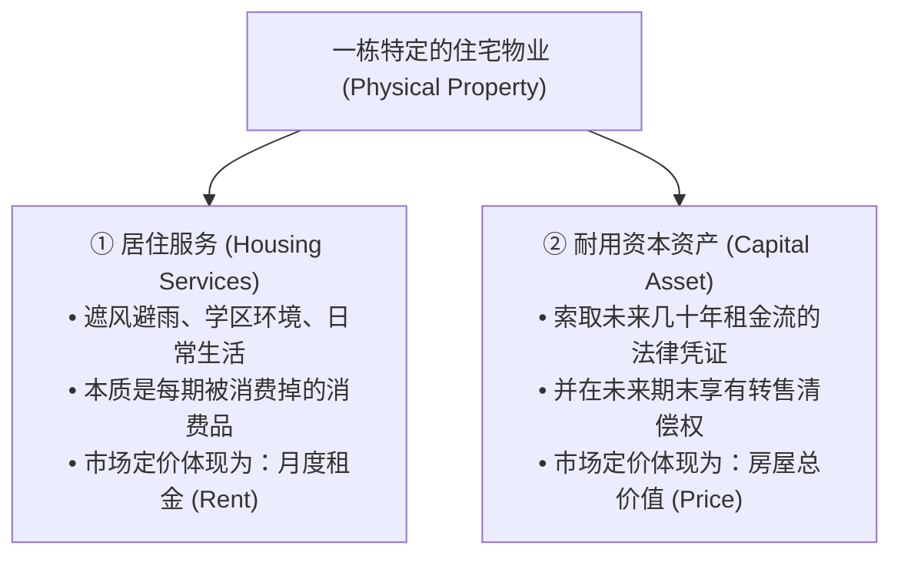
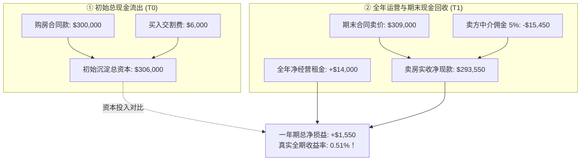
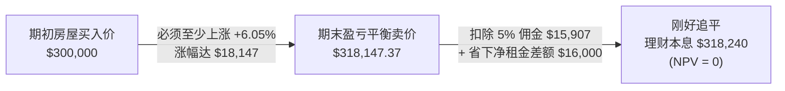
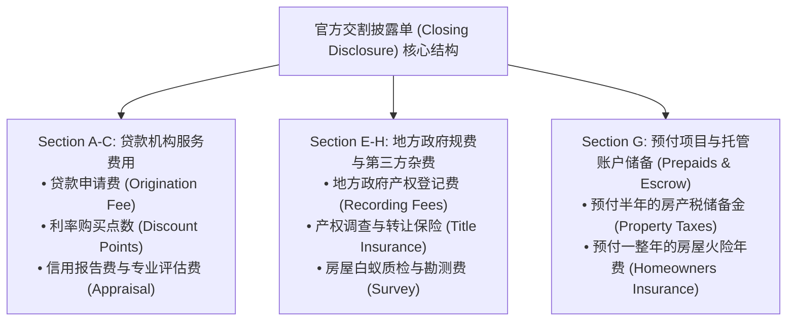

# 24 买房、租房与住房持有回报

[上一章](23-housing-market.md) · [目录](./) · [下一章](25-mortgages-households.md)

> 建议分两次学习：第一次掌握房屋作为“消费品（居住服务）”与“投资品（金融资产）”的双重属性，精算全现金条件下的持有期全收益（Total Return）；第二次精读买房与租房的净现值（NPV）无套利比较模型，并带读一份官方 Closing Disclosure 交割披露文件。正文所有数值均为教学假设，单位美元；不构成个性化投资、置业或税务建议。

---

## 本章要解决的问题

在日常生活中，你一定听过许多关于买房的“财富神话”：
> “我去年 30 万买的房子，今年挂牌 30.9 万卖掉了，房价稳稳涨了 3%，买房果然抗通胀！”
> “租房等于每个月把钱白白扔给房东，交月供才是把钱存进自己的资产里！”

这些朗朗上口的说辞，往往掩盖了极其残酷的财务现实：
1. **房价涨了 3%，房主真的一定赚了 3% 吗？** 如果算上买入税费、房产税、房屋维修、物业费、中介佣金和空置损失，真实的年化净回报究竟还剩多少？
2. **“租金比月供便宜”是否就能断定租房更划算？** 如果买房需要先拿出 10 万美元首付，这笔钱如果留在银行吃 4% 的安全利息，其**机会成本（Opportunity Cost）**该如何与房价涨幅进行公平对决？
3. **在买房交割当天，除了房款本身，那张密密麻麻的 Closing Disclosure 上为什么还会有几千上万美元的“预付项目”？**

在把复杂的银行按揭贷款和高杠杆引入之前，我们必须先彻底解剖房屋这一底层资产本身的现金流本质。

读完本章，你将能够：
- 严格区分**居住服务的消费价值（虚拟租金）**与**房屋产权的资产价格（转售价值）**；
- 熟练编制包含空置损失、房产税、保险、修缮与交易摩擦费用的**房产全生命周期现金流报表**；
- 复算真实的**持有期净回报率（Total Return）**，理解为什么微小的买卖交易摩擦就能将名义房价涨幅彻底吞噬；
- 运用**净现值方程（NPV）**推导出买房与租房的**盈亏平衡房价变动点（Breakeven Appreciation Rate）**；
- 读懂美国消费者金融保护局（CFPB）的官方交割披露文件，看清每一笔过户资金的去向。

---

## 1. 房屋提供两种完全不同的东西

在分析房地产时，最大的思维混乱来自于将“住在房子里”与“拥有一栋房子”混为一谈。从经济学视角看，房屋同时扮演着两个截然不同的角色：

### 1.1 毛租金收益率的致命陷阱

假设市场上有一套标价为 **$300{,}000$ 美元** 的独栋平房，当前同类房型的月租金为 **$2{,}000$ 美元**。
许多民间房产中介会这样推销：
$$
\text{年租金收入} = 2{,}000 \times 12 = 24{,}000 \text{ 美元}
$$
$$
\text{租金回报率} = \frac{24{,}000}{300{,}000} = \mathbf{8.00\%}！
$$
“8% 的回报，远超银行存款！”

**这是极具误导性的毛租金收益率（Gross Rental Yield）！**
它假定：一年 365 天永远满租（零空置）、租客从不欠租、房屋永不老化漏水（零维修）、地方政府不征收一分钱房产税、火灾保险免费，且买入与卖出没有任何中介佣金。在现实世界中，这些刚性扣除项将大幅侵蚀所谓的 8%。它绝不能直接与一张美国国债的无风险到期收益率进行等量齐观的比较。

### 1.2 自住业主：自己在消费自己的服务

如果家庭购买这套房屋纯粹为了自住，他们并没有每个月从租客那里收到 2,000 美元的支票，也没有向外部房东开出 2,000 美元的付款。
但根据国民经济核算（BEA）与生活成本定义：**自住家庭实际上是在自己向自己提供居住服务，同时自己消费掉了这笔服务**。这在宏观 GDP 与 CPI 核算中被称为**业主等价租金（Owner's Equivalent Rent, OER）**。

> [!IMPORTANT]
> **虚拟租金不是口袋里的现金！**
> 很多初学者误以为自住房屋的“虚拟租金”也是一笔可以用来看病、吃饭或偿还银行按揭的收入。绝非如此！自住服务提升的是家庭的实际效用水平，但它无法直接填补银行账户的流动性赤字。

---

## 2. 先全现金经营一年：看清真实的持有期回报

为了彻底剥离银行贷款杠杆对认知的干扰，我们先建立一个**纯全款购房、持有整整一年、随后卖出**的标准化基准测试模型。

### 2.1 一处投资房的真实经营账本

投资者在年初以现金 **$300{,}000$ 美元** 买入该房产，交割时支付了产权保险、律师费、验房费及登记税等买方杂费 **$6{,}000$ 美元**。
在持有的一年间，真实的收支明细如下表所示：

| 项目分类 | 会计科目 | 实际金额（美元） | 经济学归属与现实业务原因 |
| :--- | :--- | ---: | :--- |
| **理论毛收入** | 满租名义合同租金 | $+24{,}000$ | $2{,}000 \times 12$ 个月（假定全年无间断） |
| **租赁摩擦** | 租客换茬空置与坏账 | $-2{,}000$ | 换租期间产生 1 个月空置期，未收到租金 |
| **刚性持有成本** | 地方财产税（Property Tax） | $-3{,}600$ | 地方学区与市政刚性征税（年税率约 $1.2\%$） |
| **保障成本** | 房产房屋保险（Homeowners Insurance） | $-1{,}200$ | 覆盖火灾、冰雹及人身责任险的年费 |
| **物理维护** | 日常损耗维修（Repairs & Maintenance） | $-2{,}000$ | 修缮屋顶渗水、维护暖通空调及修补管道 |
| **管理运营** | 物业托管中介管理费（Management Fee） | $-1{,}200$ | 委托专业物业公司打理的提成（约实收租金 $5.5\%$） |
| **净经营现金** | **净营业现金流（Net Operating Cash, NOI）** | **$+14{,}000$** | **实际到手租金 $22,000$ 扣除各项维持性支出 $8,000$** |

### 2.2 期末卖出与真实投资回报精算

一年之后，当地房价温和上涨了 $3\%$，投资者以 **$309{,}000$ 美元** 的合同价成功将房屋卖给下一任买家。
卖房时，投资者作为卖家需要承担经纪人佣金、转让税等交易摩擦费用，按成交总额的 **$5\%$** 计算，即：
$$
\text{卖出交易摩擦成本} = 309{,}000 \times 5\% = \mathbf{15{,}450 \text{ 美元}}
$$

我们来系统复盘这一整年的真实资金流水：

我们列出规范的财务数学方程式：

第一步，计算期初实际发生的总资本投入：
$$
\text{初始总投资 (Invested)} = 300{,}000 + 6{,}000 = \mathbf{306{,}000 \text{ 美元}}
$$

第二步，计算期末卖房后真正打到银行卡上的净变现资金：
$$
\text{出售实收净额} = 309{,}000 - 15{,}450 = \mathbf{293{,}550 \text{ 美元}}
$$

第三步，汇总全周期总流入现金（经营租金现金 $+$ 卖房变现现金）：
$$
\text{期末总回收资金 (Proceeds)} = 293{,}550 + 14{,}000 = \mathbf{307{,}550 \text{ 美元}}
$$

第四步，计算该笔投资的绝对净收益与百分比持有期回报（Total Return）：
$$
\text{全期净损益} = \text{Proceeds} - \text{Invested} = 307{,}550 - 306{,}000 = \mathbf{1{,}550 \text{ 美元}}
$$
$$
\text{持有期实际总回报率} = \frac{1{,}550}{306{,}000} \approx \mathbf{0.506536\% \approx 0.51\%}！
$$

> [!CAUTION]
> **名义涨幅 $3\%$ vs 实际到手 $0.51\%$！**
> 这是所有房地产投资者必须经历的“现实洗礼”。虽然房屋名义上涨了 $9{,}000$ 美元，但由于买入支付了 $6{,}000$ 杂费，卖出又被经纪人拿走了 $15{,}450$ 佣金，**买卖两头的交易摩擦成本高达 $21{,}450$ 美元，一口气吞掉了名义资产增值额的 $238\%$！** 最终全靠租客贡献的 $14{,}000$ 净租金支撑，才勉强避免了名义亏损。如果这一年通胀率为 $3\%$，投资者的实际购买力（Real Return）实际上遭受了严重缩水。

---

## 3. 区分维护费用、资本开支与偿还本金

在记录房屋财务流水时，非专业学习者极易混淆三种性质截然不同的现金流出：

| 支出项目 | 现实典型例子 | 资产负债表与损益表的本质区别 | 错误的常见误读 |
| :--- | :--- | :--- | :--- |
| **日常维护性费用** (Maintenance) | 修补漏水水管、更换坏掉的门锁、粉刷旧墙壁 | **当期损耗成本！** 仅用于保持房屋原有的可使用状态，不增加房屋的物理寿命或面积，直接冲减当期净利润。 | 误把日常换水龙头当成给房子“增值”。 |
| **资本性改善开支** (CapEx) | 加盖一间全新主卧、将整套屋顶更换为高强度琉璃瓦 | **资产追加投资！** 显著延长了物理寿命或扩大了居住服务面积，应计入房屋的历史成本基准（Cost Basis）。 | 以为年初花了 2 万加盖卧室，卖房多卖 2 万就算是自己“白赚了 2 万”。 |
| **偿还银行贷款本金** (Principal Repayment) | 每月还贷中扣除的本金部分 | **负债清偿与权益置换！** 在现金资产减少的同时，等额削减了对银行的负债，家庭总净资产在这一瞬间**完全不变**，它绝非当期消费费用。 | 以为每月还的本金全像租金一样“白白送给银行了”。 |

假设某业主买入 30 万的房子后，年中追加花费 **$20{,}000$ 美元** 扩建了一个现代化阳光房，年底以 **$330{,}000$ 美元** 出售。
在评估这套房子的表现时，绝不能轻率地宣称“同质房价大涨了 $10\%$（从 30 万涨到 33 万）”！因为其中的 2 万美元是业主从自己口袋里掏出的真金白银再投资，实际的纯资产通胀涨幅远远低于 $10\%$。

---

## 4. 用同一终点比较买房与租房：无套利与 NPV 视角

“到底是买房还是租房？”这是全社会争论最激烈的话题。一个公平科学的财务对比，必须满足如下严密前提：
1. **享受完全相同的居住效用**（居住在同小区、同户型的两套完全相同房屋中）；
2. **考察相同的生命周期时间段**（例如正好 1 年）；
3. **拥有相同的初始资金禀赋**；
4. **将两套方案在期末的净资产进行统一终点折算**。

### 4.1 边际净现值（NPV）方程推导

考虑一个标准决策模型：
- **方案 A（全款买房）**：
  - 今天（$T_0$）付出现金：购房款 $300{,}000$ 美元 $+$ 买入杂费 $6{,}000$ 美元 $= \mathbf{306{,}000 \text{ 美元}}$；
  - 一年后（$T_1$）：无需支付房租，但需要承担房产税、保险及基础维护成本 **$8{,}000$ 美元**；
  - 一年后（$T_1$）：将房屋按期末市场售价 $P$ 卖出，扣除 $5\%$ 的交易摩擦佣金后，实收变现净款为 **$0.95P$**。
- **方案 B（租房并将现金用于低风险稳健理财）**：
  - 今天（$T_0$）：不买房，原计划购房的 **$306{,}000$ 美元** 全部存入年化收益率为 **$r = 4.00\%$** 的低风险无风险金融资产（如高评级债券或货币基金）；
  - 一年后（$T_1$）：支付全年房租 **$24{,}000$ 美元**；
  - 一年后（$T_1$）：理财本息全额到账：$306{,}000 \times (1 + 4\%) = \mathbf{318{,}240 \text{ 美元}}$。

从租房方案转变为买房方案，所带来的**边际增量现金流（Incremental Cash Flows）**为：
- 今天（$T_0$）：净现金流出 $-306{,}000$ 美元；
- 一年后（$T_1$）：省下了租金 $+24{,}000$，但新增了持有支出 $-8{,}000$，并收到了卖房净款 $+0.95P$。净现金结余为：
  $$
  CF_1 = (24{,}000 - 8{,}000) + 0.95P = 16{,}000 + 0.95P
  $$

按照替代性理财的折现率 $4.00\%$，买房相对于租房的**净现值（NPV）**方程为：

$$
NPV = -306{,}000 + \frac{16{,}000 + 0.95P}{1 + 0.04}
$$

### 4.2 求解盈亏平衡出售价格

买房在财务上要想达到与租房理财完全一致的水平，必须满足 $NPV = 0$：

$$
-306{,}000 + \frac{16{,}000 + 0.95P}{1.04} = 0
$$

我们将方程两边移项展开：
$$
16{,}000 + 0.95P = 306{,}000 \times 1.04
$$
$$
16{,}000 + 0.95P = 318{,}240
$$
$$
0.95P = 318{,}240 - 16{,}000 = 302{,}240
$$
$$
P = \frac{302{,}240}{0.95} \approx \mathbf{318{,}147.37 \text{ 美元}}！
$$

#### 震撼的结论：买房需要多大的刚性涨幅？

要让买房不输给租房，一年后这栋房屋的转售价格必须至少达到 **$318{,}147.37$ 美元**！
折算成房价年增幅为：

$$
\text{所需最低房价涨幅} = \frac{318{,}147.37}{300{,}000} - 1 \approx \mathbf{+6.05\%}！
$$

> [!IMPORTANT]
> **短持有期内的交易摩擦是买房最大的敌人！**
> 在短短一年的时间尺度内，买房若想击败“租房 + 稳健理财”，房价必须在一年内暴涨超过 **$6.05\%$**！如果房价涨幅低于 $6.05\%$，买房的综合财务成果在这一期限内其实不如安安稳稳租房理财。
> 只有当计划自住长达 **7 年、10 年甚至更久**时，前期高昂的 $6{,}000$ 买入杂费和 $5\%$ 卖出佣金才会被漫长的岁月充分摊薄，买房抵御长期通胀的优势才会真正凸显。

---

## 5. 租售比、房价收入比与可负担性

在媒体和投资报告中，经常使用几个宏观倍数来衡量一个城市的房地产是否健康：

### 5.1 房价收入比（Price-to-Income Ratio）
$$
\text{房价收入比} = \frac{\text{房屋中位数总价}}{\text{当地家庭年收入中位数}}
$$
例如：一套中位价 $300{,}000$ 美元的城市，当地中位数家庭年收入为 $75{,}000$ 美元，房价收入比为 **$4.0$ 倍**。
**局限性**：它完全没有考虑**当时的房贷利率水平**！
在房贷利率为 $3\%$ 时，一个 4 倍收入比的城市，居民每月只需拿出月收入的 $25\%$ 还贷，生活非常轻松；
而当房贷利率飙升至 $7\%$ 时，同样的 4 倍收入比，每月按揭将吞噬月收入的 $45\%$ 以上，立即引发全城性的按揭断供危机。

### 5.2 租售比（Price-to-Rent Ratio）
$$
\text{租售比} = \frac{\text{房屋售价}}{\text{年租金收入}}
$$
例如：$300{,}000 / 24{,}000 = \mathbf{12.5}$。
租售比本质上反映了金融市场对该城市未来租金增长速度与折现率的预期。租售比高，可能是因为投资者极度看好该地区未来的人口涌入与长期经济繁荣，也可能单纯是由于炒作投机形成的估值泡沫。在跨区域比较时，必须严格统一房屋品质、物业折旧率以及学区配套等微观维度。

---

## 6. 带读官方购房账单：CFPB Closing Disclosure

在全美任何一笔合规房屋买卖交割前三天，贷款机构依法必须向购房者出示一份长达 5 页的标准法定文件——**交割披露单（Closing Disclosure, CD）**。[CFPB 官方 Closing Disclosure 交互式样表带读指南](https://www.consumerfinance.gov/owning-a-home/closing-disclosure/)。

在带读这份文件时，请遵循专业审计的四个黄金步骤：
1. **核对第 1 页的合同基石**：确认贷款总额（Loan Amount）、贷款期限（30年或15年）、固定或浮动利率、月供金额是否与之前收到的 Loan Estimate（贷款预估单）严丝合缝；
2. **区分“真正被消耗掉的交易费用”与“预存的自有资金”**：
   - 支付给产权公司、评估师的 $3{,}000$ 美元是真正的费用（消耗性支出）；
   - 但被要求预存进 **托管账户（Escrow Account）** 的 $4{,}000$ 美元（用于未来半年由银行代缴的房产税和保险），其所有权依然属于购房者本人！这笔钱只是资金被暂时占用了，绝不能在第二年银行扣缴房产税时重复记账算成二次亏损！
3. **查验“交割结清所需现金”（Cash to Close）**：
   在很多情况下，购房者准备了 6 万美元首付，到了交割桌前才惊恐地发现需要支付 6.8 万美元现金！那多出来的 8,000 美元正是由上述第三方杂费、预付税险储备金构成的交割流动性沉淀。

---

## 7. 练习与参考答案

### 练习 1：房价没涨，买房真的必然亏钱吗？

某投资者全现金买入一套总价为 $200{,}000$ 美元的两居室公寓，在交割时支付了买入费用 $4{,}000$ 美元。持有的一整年内，该公寓扣除全部税险管理维护后的净经营现金收入（NOI）为 **$12{,}000$ 美元**。
一年之后，该投资者按照原价 $200{,}000$ 美元平价出售，卖出时支付了中介与转让杂费 $8{,}000$ 美元。
1. 请计算该投资者的全周期实际到手净损益与名义回报率；
2. 结合计算结果，解释为什么“资产价格没有上涨”不能单独决定投资结果的成败。

点击查看详细参考答案与推理步骤

1. **净损益与回报率精算**：
   - 初始全额总投入：$200{,}000 + 4{,}000 = \mathbf{204{,}000 \text{ 美元}}$；
   - 出售回收实收净现金：$200{,}000 - 8{,}000 = \mathbf{192{,}000 \text{ 美元}}$；
   - 全年经营净现金流入：$+12{,}000 \text{ 美元}$；
   - **全期总回收资金**：$192{,}000 + 12{,}000 = \mathbf{204{,}000 \text{ 美元}}$；
   - **全期名义净损益**：$204{,}000 - 204{,}000 = \mathbf{0 \text{ 美元}}$；
   - **名义持有期回报率**：$\frac{0}{204{,}000} = \mathbf{0.00\%}$。
2. **经济学启示**：
   虽然名义房价涨幅为 0%，且买卖两头消耗了整整 $12{,}000$ 美元的交易摩擦损耗（买入 4,000 $+$ 卖出 8,000），但由于底层优质的租赁现金流（全年净赚 $12{,}000$ 美元）完全填平了这笔高昂的摩擦成本，使得本金名义上实现了完整保本！这证明：**房屋的总回报由“资产价格变动”和“经营净现金分红”两股独立力量共同决定**。

---

### 练习 2：敏感性压力测试——如果一年后房价原价卖出？

沿用正文第 4 节的买房与租房比较基准模型（初始购房款 $300{,}000$，买入杂费 $6{,}000$，持有成本 $8{,}000$，年租金 $24{,}000$，卖方佣金 $5\%$，折现率 $4.00\%$）。
如果一年后当地房地产市场停滞，房屋期末卖出价格 $P$ 恰好等于原买入价 **$300{,}000$ 美元**（零资本增值）。
1. 请代入 NPV 方程，精确计算此时“买房相对于租房理财”的边际净现值；
2. 列举至少三个能彻底逆转该财务结论的现实变量。

点击查看详细参考答案与推理步骤

1. **代入求解 NPV**：
   期末卖房实收净现款为：
   $$
   0.95P = 0.95 \times 300{,}000 = 285{,}000 \text{ 美元}
   $$
   期末省下的租金与持有成本净差额为：
   $$
   24{,}000 - 8{,}000 = 16{,}000 \text{ 美元}
   $$
   期末总边际现金流入为：
   $$
   285{,}000 + 16{,}000 = 301{,}000 \text{ 美元}
   $$
   计算买房相对租房的边际折现净现值：
   $$
   NPV = -306{,}000 + \frac{301{,}000}{1.04} \approx -306{,}000 + 289{,}423.08 \approx \mathbf{-16{,}576.92 \text{ 美元}}
   $$
   **结论**：在零房价上涨的假设下，买房一年的财务结果比“租房加稳健理财”净亏损了整整 **$16{,}576.92$ 美元**！
2. **可逆转结论的现实因素**：
   - **持有期限延长至 10 年**：高额买入杂费被分摊到漫长的 10 年中，租金随着通胀不断复利攀升；
   - **替代资产理财利率崩跌**：如果未来无风险理财利率从 $4\%$ 骤降至 $0.5\%$，方案 B 的机会成本收益将大幅缩水；
   - **非金融效用溢价**：自住买房带来了免受房东驱赶、随时按喜好装修的居住安定感与心理归属感。

---

### 练习 3：审计一份房产中介的虚假宣传单

某房产中介在一处大学城附近张贴了一张传单：“本套学生公寓售价 $300{,}000$ 美元，常年月租金 $2{,}000$ 美元，稳赚 $8.00\%$ 极品高息回报，立买立赚！”
请以专业宏观分析师的口吻，列出你需要向中介索取的真实财务清单，并撰写一段不超过 150 字的专业审计评语。

点击查看详细参考答案与推理步骤

**需要索取的关键资料清单**：
1. 过去三年的真实报税收租流水（排查学生寒暑假真实空置月数与欠租坏账率）；
2. 当地市政出具的最新财产税单据与房产火险保单年费；
3. 公寓业主协会（HOA）每月刚性物业费与近期是否存在大楼外立面、屋顶大修的专项摊派款（Special Assessments）；
4. 当地房屋中介代管服务费扣费比例。

**审计判断评语（示例）**：
> “传单宣称的 8% 纯属未经任何扣除的‘满租毛租金/购价’噱头，绝非投资者的最终净到手回报！在计入大学城寒暑假空置、学生租客高磨损维修、高额房产税、HOA 物业费以及买卖双向高达 6% 以上的交易佣金后，该资产的真实年化现金收益率将大幅滑落至 3%~4% 甚至更低，且尚未考虑未来转售时的流动性折价风险。”

---

[上一章](23-housing-market.md) · [目录](./) · [下一章](25-mortgages-households.md)
