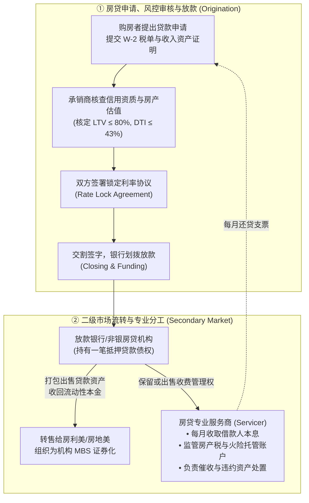
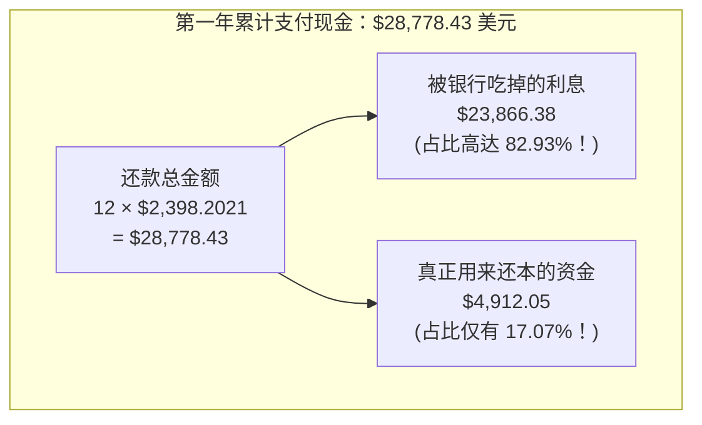
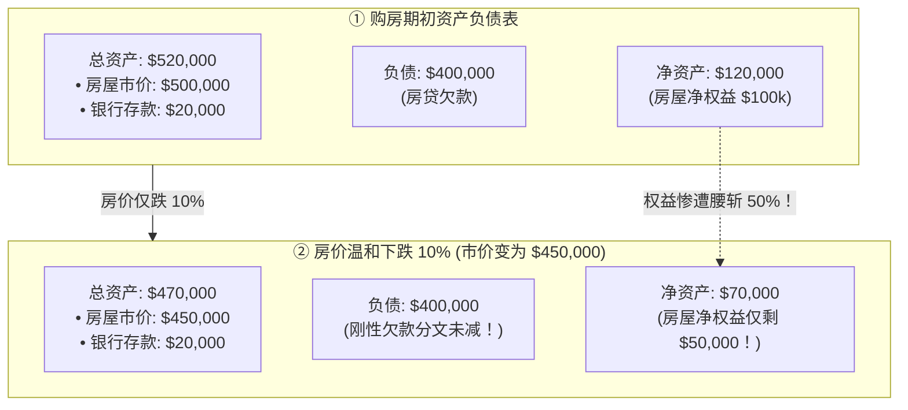

# 25 按揭、再融资与家庭资产负债表

[上一章](24-housing-returns.md) · [目录](./) · [下一章](26-housing-securitization.md)

> 建议分两次学习：第一次跟随一位普通买家的借贷旅程，彻底推导等额本息还贷公式（Amortization），搞清为什么房贷前期绝大部分都是“白给银行的利息”；第二次精精细算家庭资产负债表上的 LTV、DTI、首付杠杆爆仓机制，并用严格的无套利与期权思维审计一笔“看似省钱”的房贷再融资（Refinance）。正文案例为美元教学假设，不构成贷款审批承诺或个人法律意见。

---

## 本章要解决的问题

如果说买房是绝大多数美国家庭一生中最大的一笔资产投资，那么**抵押贷款（Mortgage）**就是这张家庭资产负债表上最沉重、也最精密的杠杆支点。

然而，在这个几乎所有人都会接触的金融契约中，充斥着惊人的认知误区：
1. **“美联储宣布降息 50 个基点，我的房贷下个月是不是就能少还几百块？”** 为什么已经办好的 30 年固定利率房贷对此毫无反应？
2. **“每个月按时还款 2,400 美元，一年下来还了近 3 万，为什么欠银行的本金只减少了区区 4,900 元？”** 剩下的 24,000 美元究竟被谁拿走了？
3. **“房价只跌了 10%，为什么我的本金首付会瞬间蒸发 50%？”**
4. **“把 20 年的旧房贷重新办成 30 年，每月月供直接少交 629 美元，这种天上掉馅饼的再融资能做吗？”**

要回答这些攸关家庭财务生死的硬核问题，必须穿透浮夸的营销口号，走进房贷摊销公式背后的动态复利数学。

读完本章，你将能够：
- 画出房贷从申请、风控审核、利率锁定到二级市场转让与贷后服务（Servicing）的完整流转网络；
- 用规范的数学递归推导出**等额本息每月还款额（Monthly Payment）公式**与**逐期本金余额函数**；
- 计算衡量违约风险的两大硬指标——**贷款价值比（LTV）**与**总债务收入比（DTI）**，测算家庭面临失业时的现金流断裂极值；
- 揭开**杠杆放大效应（Leverage Effect）**，看透抵押品估值下跌如何快速击穿自有权益；
- 精算**房贷再融资（Refinancing）**的盈亏平衡回收期，识破通过“无限拉长期限”制造低月供假象的名义利息陷阱；
- 读懂 Freddie Mac 每周发布的 **PMMS 全美平均房贷利率**调查是如何通过真实放款系统数据生成的。

---

## 1. 走进一次真实的房贷：全流程不是按下月供计算器

很多人以为申请房贷就是打开手机上的房贷计算器，输入 40 万美元、30 年、利率 6%，屏幕跳出一个 2,398 美元，就完成了对房贷的理解。

但在金融工程现实中，一笔抵押贷款是一组高度严密、跨越不同专业机构的权利义务链条：

### 1.1 关键角色必须分清
- **房贷经纪人（Mortgage Broker）**：帮助借款人比较全美不同银行的利率政策，撮合交易，但他本人既不出资，也不承担后续的违约风险；
- **放款机构（Mortgage Originator）**：审核你的银行流水，在公证处开出大额支票买下房屋，获得最初的借款抵押合同；
- **房贷服务商（Mortgage Servicer）**：你在交割后每个月收到账单、把钱转过去的那个机构。**服务商往往并不是这笔贷款的出资人！** 它只是受聘代为收账、代管地方房产税与火险的托管账户（Escrow），并提取约 $0.25\% \sim 0.50\%$ 的年化服务费（Servicing Fee）。
即使你的贷款被放款行打包卖给了华尔街养老基金或房利美，你的日常还款服务商也可能完全保持不变，合同上写死的利率更是受到法律绝对保护，绝不可能因为房贷所有权的转手就被单方面随意修改。

### 1.2 固定利率（FRM）vs 浮动利率（ARM）
- **固定利率贷款（Fixed-Rate Mortgage, FRM）**：合同利率在整个 15 年或 30 年内**绝对冻结不变**！无论美联储未来加息到 20% 还是降息到 0%，借款人每月的本息还款额分文不改；
- **可调整利率贷款（Adjustable-Rate Mortgage, ARM）**：例如“5/1 ARM”，意味着前 5 年利率固定，之后每年根据指定的基准指标（如 SOFR 隔夜融资利率）加上约定的固定利差重新计算月供，且通常设有单次调价上限（Cap）与全周期利率天花板。[CFPB：固定与浮动利率贷款差异指引](https://www.consumerfinance.gov/ask-cfpb/what-is-the-difference-between-a-fixed-rate-and-adjustable-rate-mortgage-arm-loan-en-100/)。

---

## 2. 月供摊销的数学本质：为什么前期全在给银行打工？

绝大多数美国家庭采用的是**等额本息摊销（Fully Amortizing Fixed-Rate Mortgage）**。

### 2.1 递归推导每月还款额公式

假设：
- **初始贷款总额（Principal）**：$L = \$400{,}000$ 美元；
- **贷款期限**：$30$ 年，总还款期数 $n = 30 \times 12 = 360$ 个月；
- **年化合同名义利率**：$c = 6.00\%$，折合**月度有效利率**为：
  $$
  r = \frac{c}{12} = \frac{6.00\%}{12} = 0.005 \quad (0.50\% \text{ 每月})
  $$

设每个月固定还款金额为 $M$。
我们来观察贷款余额的月度动态演化：
- 第 1 个月开始时，尚欠银行 $L$。这个月产生的利息是当前本金的利息：$L \cdot r$。
- 借款人支付了 $M$。由于 $M > L \cdot r$，超额部分用于归还本金：$M - L \cdot r$。
- 第 1 个月末的剩余本金余额 $B_1$ 为：
  $$
  B_1 = L + L \cdot r - M = L(1+r) - M
  $$
- 第 2 个月末的剩余本金余额 $B_2$ 为：
  $$
  B_2 = B_1(1+r) - M = [L(1+r) - M](1+r) - M = L(1+r)^2 - M[(1+r) + 1]
  $$
- 以此类推，在支付了 $k$ 期之后，剩余本金余额 $B_k$ 遵循严密的等比数列求和通项：
  $$
  B_k = L(1+r)^k - M \sum_{i=0}^{k-1} (1+r)^i = L(1+r)^k - M \frac{(1+r)^k - 1}{r}
  $$

由于贷款必须在第 $n$ 个月末（即第 360 期）彻底清零，即 $B_n = 0$：
$$
L(1+r)^n - M \frac{(1+r)^n - 1}{r} = 0
$$

我们通过简单的代数变形，即可解出著名的**等额本息月供核心方程**：

$$
M = L \cdot \frac{r(1+r)^n}{(1+r)^n - 1} = \frac{L \cdot r}{1 - (1+r)^{-n}}
$$

---

### 2.2 40 万美元房贷的震撼实算

我们将真实参数代入公式：
- $L = 400{,}000$
- $r = 0.005$
- $n = 360 \implies (1 + 0.005)^{-360} \approx 0.166041$

计算每月固定本息还款额 $M$：
$$
M = \frac{400{,}000 \times 0.005}{1 - 0.166041} = \frac{2{,}000}{0.833959} \approx \mathbf{2{,}398.20210061 \to 2{,}398.20 \text{ 美元}}
$$

现在，我们把前 12 个月的月供拆解成“利息”与“还本”，看看第一年到底发生了什么：

我们来验证逐月递推的精确财务数据：
- **第 1 个月**：
  - 月初本金：$\$400{,}000.00$
  - 当期利息：$400{,}000 \times 0.005 = \mathbf{2{,}000.00 \text{ 美元}}$
  - 当期还本：$2{,}398.20 - 2{,}000.00 = \mathbf{398.20 \text{ 美元}}$
  - 月末剩余本金：$400{,}000 - 398.20 = \mathbf{399{,}601.80 \text{ 美元}}$
- **第 12 个月末（整整一年后）**：
  我们将 $k = 12$ 代入通项公式 $B_{12}$：
  $$
  B_{12} = 400{,}000(1.005)^{12} - 2{,}398.20210061 \times \frac{(1.005)^{12} - 1}{0.005} \approx \mathbf{395{,}087.95315089 \to 395{,}087.95 \text{ 美元}}
  $$

| 指标项目 | 累计金额（保留两位小数） | 占全年月供现金流总额比例 |
| :--- | ---: | :---: |
| **第一年累计支付月供总额** | **$28{,}778.43** | $100.00\%$ |
| **归还的利息总额** | **$23{,}866.38** | **$82.93\%$** |
| **实际减少的贷款本金（40万 - 39.5088万）** | **$4{,}912.05** | **$17.07\%$** |

> [!WARNING]
> **还了一整年，欠款只少了 4,912 美元！**
> 很多年轻买家看到对账单时愤怒不已，认为银行在“偷偷多扣利息”。
> 事实上，银行一分钱也没有多扣：**因为第一年的剩余本金高达近 40 万美元，每时每刻产生的资本占用成本极其巨大！** 只有随着漫长的 10 年、15 年过去，剩余本金被缓慢蚕食到 20 万以下时，每月月供中“利息少、本金多”的拐点才会真正降临。

---

## 3. 能借多少与能付多少：LTV、DTI 与家庭承压极限

商业银行在审批房贷时，绝不相信口头承诺，而是依赖两把量化尺子：

### 3.1 资产维度：贷款价值比（LTV, Loan-to-Value）
$$
LTV = \frac{\text{贷款本金余额}}{\text{房屋评估价值}}
$$
例如：一套市价 **$500{,}000$ 美元** 的房屋，首付 **$100{,}000$ 美元**，贷款 **$400{,}000$ 美元**：
$$
LTV = \frac{400{,}000}{500{,}000} = \mathbf{80.00\%}
$$
$80\%$ 是全美按揭市场的“黄金分水岭”。若 $LTV > 80\%$，贷款机构通常强制要求借款人每月额外购买**私人按揭保险（PMI）**，直到还款使 $LTV \le 80\%$ 为止。

### 3.2 收入维度：总债务收入比（DTI, Debt-to-Income）
$$
DTI = \frac{\text{每月各项刚性债务付款总额}}{\text{每月税前总收入（Gross Monthly Income）}}
$$
假设某家庭每月税前毛收入为 **$8{,}000$ 美元**：
- 每月房贷本息（P&I）：$\$2{,}398.20$
- 托管账户预存的房产税与火险（T&I）：$\$700.00$
- 车贷月供与信用卡最低还款：$\$400.00$
- 每月刚性债务支付合计：$2{,}398.20 + 700 + 400 = \mathbf{3{,}498.20 \text{ 美元}}$

此时该家庭的负债比为：
$$
DTI = \frac{3{,}498.20}{8{,}000} \approx \mathbf{43.73\%}
$$
$43\%$ 正好触及了房利美合格优质抵押贷款（Qualified Mortgage, QM）的标准风控上限！

#### 极度脆弱的流动性缓冲测试

很多人以为 $DTI = 43.73\%$ 意味着“还能剩下 $56\%$ 的收入，非常宽裕”。
**这是严重的税前幻觉！** 我们还原该家庭的真实税后净流水：
- 税前毛收入 8,000 美元，扣除联邦税、州税、社保医保（FICA）后，实际到手净现金往往只有约 **$6{,}200$ 美元**；
- 扣除各项债务本息与税险：$-3{,}498.20$ 美元；
- 扣除一家三口的食品、燃油、水电网络、医疗保险等必要生活开销：$-2{,}500.00$ 美元；
- **全月最终净储蓄结余仅剩：**
  $$
  6{,}200 - 3{,}498.20 - 2{,}500 = \mathbf{201.80 \text{ 美元}}！
  $$

这就是数以百万计美国家庭的典型生存状态：表面上有房有车、中产阶级，但每个月的安全现金流缓冲**只有区区 200 美元**！只要房屋火险因飓风保费月均上调 250 美元，或者汽车爆胎需要维修，整个家庭的现金流就会瞬间陷入月度赤字。

---

## 4. 房价跌 10%，首付为什么会腰斩 50%？

高杠杆是一把极其锋利的双刃剑。我们来考察抵押品下跌时的资本传导：

假设某家庭买入 **$500{,}000$ 美元** 的房屋，全家掏出毕生积蓄 **$100{,}000$ 美元首付**，银行按揭 **$400{,}000$ 美元**。家庭此时拥有现金资产 **$20{,}000$ 美元**，总净资产为：$100{,}000 + 20{,}000 = \$120{,}000$。

### 4.1 权益暴跌的算术机制
- 当全城房价微跌 $10\%$，房屋市价降至 **$450{,}000$ 美元**；
- 银行绝对不会因为你家房子跌价就慈悲地减少借款本金，负债依然焊死在 **$400{,}000$ 美元**；
- 家庭的房屋账面净资产（Home Equity）瞬间缩水为：
  $$
  \text{剩余房屋净权益} = 450{,}000 - 400{,}000 = \mathbf{50{,}000 \text{ 美元}}
  $$
- 房屋权益跌幅为：
  $$
  \frac{50{,}000 - 100{,}000}{100{,}000} = \mathbf{-50.00\%}！
  $$
- 此时房屋的 $LTV$ 急剧恶化飙升至：
  $$
  LTV = \frac{400{,}000}{450{,}000} \approx \mathbf{88.89\%}
  $$

### 4.2 交易摩擦与负资产（Underwater）
如果此时家庭由于失业急需卖房变现：
- 房产中介要收取成交额 $5\%$ 的佣金及转让费用：$450{,}000 \times 5\% = \$22{,}500$；
- 卖房实际到手现金：$450{,}000 \times 0.95 = \$427{,}500$；
- 归还银行 40 万贷款后，全家辛苦攒下的 10 万首付**只剩下了可怜的 $27{,}500$ 美元**！
如果房价下跌 $20\%$ 至 40 万美元，扣除卖房中介费后，甚至连银行贷款都无法全额还清，家庭立刻陷入**负资产（Underwater Mortgage / Negative Equity）**的绝境。

---

## 5. 房贷再融资（Refinance）：天上掉馅饼还是期限戏法？

当市场利率下行时，许多房贷公司会寄来信件：“恭喜您！现在再融资，月供立减数百美元！”
一个理性的分析师必须将再融资拆解为两种性质截然不同的操作：

### 5.1 场景设定
假设借款人多年前借了一笔 30 年房贷，目前**剩余本金尚欠 $300{,}000$ 美元，剩余还款期限正好还剩 20 年（240 个月），原贷款年利率为 $6.00\%$**。
- **原贷款当前每月月供**：
  $$
  M_{\text{old}} = 300{,}000 \times \frac{0.005}{1 - (1.005)^{-240}} \approx \mathbf{2{,}149.29 \text{ 美元}}
  $$
此时市场房贷利率下行，银行提供了一款 **$4.50\%$（月利率 $r = 0.045/12 = 0.00375$）** 的新贷款方案，但办理该再融资需要一次性支付申请费、评估费、产权保险等**刚性交易手续费 $6{,}000$ 美元**（假设以现金付清）。

---

### 5.2 方案 A：期限不变（重借 20 年期 4.5% 贷款）
保持剩余的 240 个月期限不变，单纯享受利率下调红利：
- **新月供**：
  $$
  M_{\text{new-20}} = 300{,}000 \times \frac{0.00375}{1 - (1.00375)^{-240}} \approx \mathbf{1{,}897.95 \text{ 美元}}
  $$
- **每月实打实少付的现款**：
  $$
  \Delta M = 2{,}149.29 - 1{,}897.95 = \mathbf{251.35 \text{ 美元/月}}
  $$
- **手续费静态盈亏平衡回收期（Breakeven Horizon）**：
  $$
  \text{回收期} = \frac{6{,}000 \text{ 美元}}{251.35 \text{ 美元/月}} \approx \mathbf{23.87 \text{ 个月（约 2 年）}}
  $$

> [!TIP]
> **财务准则**：如果家庭确定未来至少还要在这栋房子里居住超过 2 年，这笔 $6{,}000$ 美元的手续费就能通过每月少还的 251 美元完全回本，之后的每一年都在为家庭纯赚利息差额，再融资具备强烈的财务合理性！

---

### 5.3 方案 B：期限拉长陷阱（借 30 年期 4.5% 贷款）
银行信贷员竭力推销另一种“更具诱惑力”的方案：“既然都办再融资了，为什么不重新办成 30 年（360 个月）呢？”
- **重新拉长至 30 年后的新月供**：
  $$
  M_{\text{new-30}} = 300{,}000 \times \frac{0.00375}{1 - (1.00375)^{-360}} \approx \mathbf{1{,}520.06 \text{ 美元}}
  $$
- **每月月供暴减**：
  $$
  2{,}149.29 - 1{,}520.06 = \mathbf{629.24 \text{ 美元/月}}！
  $$

工薪家庭欣喜若狂：每个月竟然省下了 629 美元巨款！
**但只要拉出全周期的利息总账本，真相令人倒吸一口凉气：**

| 方案类别 | 合同利率与剩余期限 | 每月月供 | 持有到期的累计支付总利息（名义值） | 相对原贷款的利息总额变动 |
| :--- | :---: | ---: | ---: | :---: |
| **原贷款基准** | **6.00%，剩余 20 年** | **$2{,}149.29** | $2{,}149.29 \times 240 - 300{,}000 = \mathbf{\$215{,}830}$ | 基准线 |
| **方案 A（保持 20 年）** | **4.50%，重借 20 年** | **$1{,}897.95** | $1{,}897.95 \times 240 - 300{,}000 = \mathbf{\$155{,}508}$ | **大赚！少还 $60,322 利息** |
| **方案 B（拉长 30 年）** | **4.50%，拉长 30 年** | **$1{,}520.06** | $1{,}520.06 \times 360 - 300{,}000 = \mathbf{\$247{,}220}$ | **惨亏！反而多付 $31,390 利息！** |

看清楚了吗？
方案 B 表面上让月供减少了 629 美元，但由于将本金的偿还时间凭空向后推迟了整整 10 年，**全生命周期支付的利息反而比不折腾的原贷款暴增了 31,390 美元！** 这种操作本质上是用子孙后代的远期负债换取眼前的苟且现金流。

---

## 6. 提前还款与锁定效应（Rate Lock-in）

### 6.1 提前还贷的流动性陷阱
许多家庭一旦手头有了 2 万美元闲钱，第一反应就是“提前还本金”。
在固定月供贷款下，将 2 万美元一次性提前冲抵本金，虽然能显著减少未来的总利息支出，但**并不会自动减少你下个月的刚性月供账单**（除非做专门的 Loan Recast 重新摊销）！
如果你把所有应急现金都填进了砖头里，一旦下个月遭遇突发失业，银行绝不会因为你上个月多还了 2 万本金就免除你当月的月供，现金流断裂导致的断供风险反而成倍上升。

### 6.2 利率锁定效应（The Lock-in Effect）
在 2020~2021 年的历史超级大放水期间，数以千万计的美国房主锁定了 $2.75\% \sim 3.25\%$ 的超低 30 年期固定房贷。
当 2023~2024 年房贷利率飙升至 $7\%$ 时，出现了一个极其罕见的宏观奇观：**利率锁定效应（Rate Lock-in Effect）**。[Freddie Mac 利率锁定微观研究](https://www.freddiemac.com/research/insight/mortgage-rate-lock-in)。

这就是为什么美联储暴烈加息 500 个基点，美国成屋市场成交量暴跌，但房价中位数居然异常坚挺的微观根源！因为没人愿意放弃那张印着 3% 利率的珍贵旧合同。

---

## 7. 屏幕上的平均房贷利率从何而来：Freddie Mac PMMS

每天财经网站上闪烁的“美国 30 年期房贷平均利率 6.85%”，既不是美联储定的，也不是某家商业银行的牌价。它主要是由**房地美（Freddie Mac）每周四公布的初级按揭市场调查（Primary Mortgage Market Survey, PMMS）**提供的。

### 7.1 2022 年 11 月的方法论革命
- **旧方法（2022 年前）**：Freddie Mac 每周向全美各大放款机构打电话发问卷：“请问你们本周向优质借款人报出的主流利率是多少？”其缺点是主观意向报价，不代表最终真实交割；
- **新方法（2022 年 11 月至今）**：彻底抛弃人工问卷，直接接入 Freddie Mac 自家的**贷款产品顾问系统（Loan Product Advisor, LPA）**！只要全美成千上万的房贷机构向该系统提交合规贷款申请，后台算法就会自动抓取真实审批的数以万计的数据，剔除异常值后实时加权计算。

### 7.2 观察口径的标准画像
PMMS 锁定的基准画像极其严苛：
1. **信用极优**（FICO 信用分在 740 分以上）；
2. **首付充足**（LTV 严格控制在 80% 即首付 20%）；
3. **贷款性质**：符合房利美、房地美合规收购额度的标准常规购房贷款（Conventional Conforming Loan）。

如果你是一名信用分只有 620、首付只有 5% 的借款人，屏幕上跳动的 PMMS 6.85% 对你毫无参考价值，真实银行向你报出的利率很可能是 7.8% 甚至更高。

---

## 8. 练习与参考答案

### 练习 1：本金与利息的现金流与会计属性

某家庭本月收到银行的按揭扣款单：本月总扣款金额为 **$2{,}600 美元**，其中银行注明：贷款利息为 **$1{,}500 美元**，归还本金为 **$500 美元**；代扣代缴地方房产税与火险储备金为 **$600 美元**。
请回答：
1. 从纯现金支出角度看，该家庭当月必须准备多少可用资金？
2. 从家庭资产负债表与当期经济费用的角度看，这三笔款项各自扮演了什么角色？

点击查看详细参考答案与推理步骤

1. **现金流角度**：
   家庭当月银行卡上必须硬性拥有 **$2{,}600 美元** 的可用现金，差一分钱都会导致扣款失败并产生逾期罚款。
2. **资产负债表与经济成本角度**：
   - **$1{,}500 利息**：属于当期不可回收的**刚性融资财务费用（Expense）**，属于资本占用的纯消耗；
   - **$600 税险代扣**：属于购买地方公共教育治安服务和财产保险保障的**当期消费性支出（Service Expense）**；
   - **$500 归还本金**：**绝非当期消费！** 这一笔操作在减少家庭现金资产 $500 的同时，严格等额削减了家庭对银行的长期债务 $500，家庭的净资产（Net Worth）在还本的这一瞬间**没有减少一分钱**，本质上是流动性资产向房屋净权益的内部形态转换。

---

### 练习 2：家庭资产负债表的极限承压测试

某中产家庭购入了一套总价为 **$400{,}000 美元** 的住宅，向银行办理了 **$320{,}000 美元** 的抵押贷款。购房后家庭存款结余仅剩 **$12{,}000 美元** 现金。不幸的是，户主在下半年遭遇突发裁员，家庭每月各项收支扣除失业救济后产生 **$3{,}000 美元/月** 的刚性现金流净赤字。与此同时，当地房地产不景气，该房屋市价下跌了 $15\%$；若紧急出售，需承担成交价 $5\%$ 的中介与过户杂费。
1. 计算房价下跌后，该家庭在账面上的房屋净资产（Equity）；
2. 若紧急卖房还清贷款，最终能拿到多少净现金？
3. 原有的 $12{,}000$ 美元存款能支撑家庭多少个月不违约？这说明了什么？

点击查看详细参考答案与推理步骤

1. **账面房屋净权益**：
   - 下跌 $15\%$ 后的房屋市价：$400{,}000 \times (1 - 0.15) = \mathbf{340{,}000 \text{ 美元}}$；
   - 银行贷款本金分文未变仍为：$\$320{,}000$；
   - 账面房屋净权益：$340{,}000 - 320{,}000 = \mathbf{20{,}000 \text{ 美元}}$。
2. **紧急卖房回收现款**：
   - 扣除 $5\%$ 摩擦成本后的卖房实收：$340{,}000 \times (1 - 0.05) = \mathbf{323{,}000 \text{ 美元}}$；
   - 还清银行 $320{,}000$ 贷款后，最终真正拿到手的净残值仅为：
     $$
     323{,}000 - 320{,}000 = \mathbf{3{,}000 \text{ 美元}}！
     $$
3. **流动性极限测算与启示**：
   - 存款消耗时间：$\frac{12{,}000 \text{ 存款}}{3{,}000 \text{ 月赤字}} = \mathbf{4.0 \text{ 个月}}$；
   - **核心财务启示**：账面上所谓的“2 万美元房屋净值”纯属无法立刻变现的纸面富贵！如果全美成屋平均出售周期长达 3~6 个月，家庭现有的 12,000 元存款在第 4 个月末就会彻底见底。如果房子在 4 个月内无法顺利完成交割过户拿到那区区 3,000 元现金，家庭就会在第 5 个月因无法支付月供而正式走向违约断供和被银行司法拍卖（Foreclosure）的深渊。

---

### 练习 3：辨析财经传言——降息与固定房贷

一位自媒体博主宣称：“美联储刚刚宣布降息 100 个基点，这意味着全美所有身背房贷的家庭下个月起每个月都能少还数百美元，这是天大的消费利好！”
请运用本章所学知识，严密驳斥该言论的三大核心逻辑漏洞。

点击查看详细参考答案与推理步骤

1. **混淆了固定利率合同与浮动利率合同**：
   全美存量按揭中超过 $85\%$ 以上均为 **30 年期固定利率贷款（FRM）**。固定利率在法律上已经锁死了整个还款周期的利率，无论央行基准利率如何涨跌，既有合同的每月月供分文不改；
2. **混淆了政策短端利率与按揭长端利率**：
   美联储决议调整的是**隔夜联邦基金利率（Federal Funds Rate）**，而 30 年期房贷利率在金融市场中锚定的是**10 年期美国国债收益率与 MBS 利差**。如果美联储降息是因为恶性通胀失控引发市场抛售长债，10 年期美债利率完全可能逆势飙升，导致新发放的房贷利率不跌反涨；
3. **忽略了再融资的严苛门槛与摩擦成本**：
   即便新房贷利率随之下行，既有固定房贷业主想要享受更低利率，也必须通过**申请再融资（Refinancing）**重写合同。这需要重新审核家庭当期的收入证明、信用分并支付高达数千美元的交割手续费；如果此时部分家庭已经因经济衰退而失业或房屋已经变成负资产，他们根本无法通过银行风控审批，绝不可能平白无故享受到降息福利。

---

[上一章](24-housing-returns.md) · [目录](./) · [下一章](26-housing-securitization.md)
