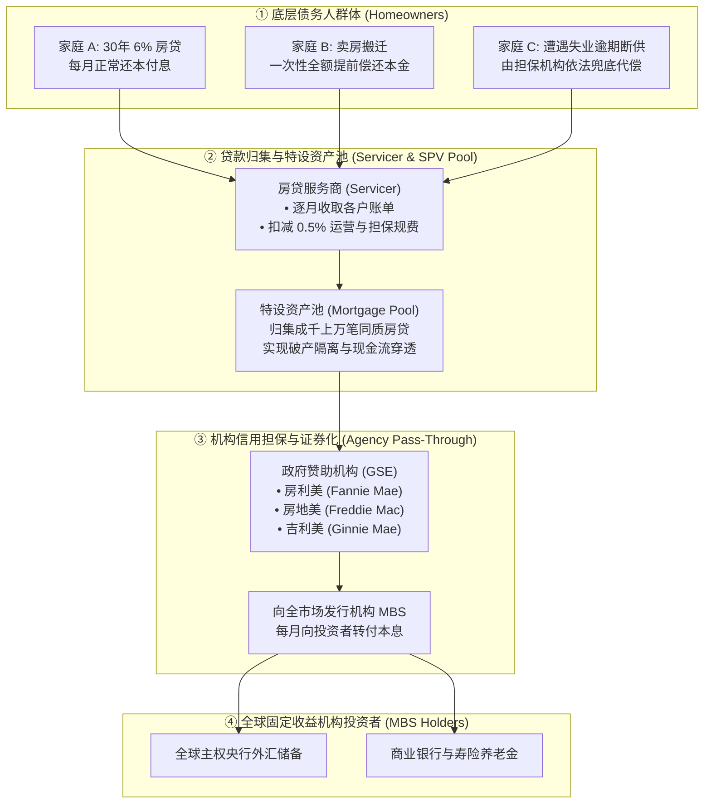
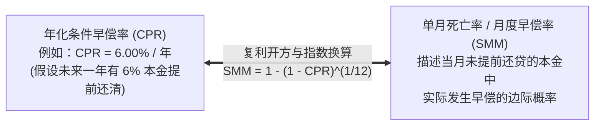
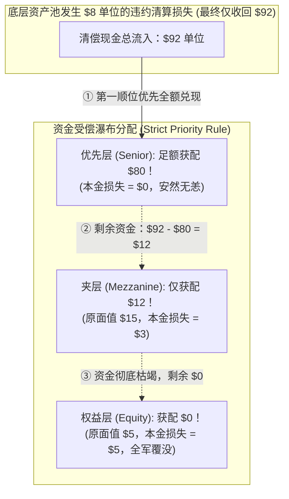

# 26 从房贷到 MBS：住房金融与证券化

[上一章](25-mortgages-households.md) · [目录](./) · [下一章](27-housing-cycle.md)

> 建议分两次学习：第一次跟随一笔普通按揭如何被打包进入直通证券（Pass-Through），精算每月本金因子与现金分配；第二次精读提前还款风险（早偿率 CPR/SMM）对 MBS 负凸性的不对称扭曲、次级贷款的分层瀑布（Waterfall）以及 TBA 远期交割机制。正文贷款池、费用与结构均为教学假设，不构成投资建议。

---

## 本章要解决的问题

在上一章中，我们站在一位普通购房者的视角，看清了每个月的按揭还款流水。但如果你把镜头拉远到整个金融体系，一个更宏大的问题浮出水面：
> **全美数万亿美元的住宅抵押贷款，究竟是由谁出资支撑的？商业银行把钱借给买房家庭后，真的会傻傻等上 30 年慢慢收回本金吗？**

答案是否定的。如果银行把所有资金都锁死在 30 年的长贷里，它的资产负债表很快就会被抽干，下一位买房者将再也借不到一分钱。
连接普通美国家庭与全球资本市场的超级枢纽，就是**抵押贷款支持证券（Mortgage-Backed Securities, MBS）**。

然而，在 MBS 的投资世界里，充斥着令华尔街精算师都头疼的独特物理法则：
1. **为什么市场利率大跌时，普通国债价格暴涨，而按揭 MBS 的价格反而涨不动甚至下跌？**
2. **“早偿率 CPR 与 SMM”究竟是如何精准刻画家庭搬家或再融资行为的？**
3. **“有政府机构（两房 / 吉利美）担保的 Agency MBS”，真的意味着投资者可以高枕无忧、毫无风险吗？**
4. **2008 年次贷危机中臭名昭著的 CDO 分层分级（Tranche），是如何将一批高风险垃圾贷款包装成 AAA 级证券的？**

读完本章，你将能够：
- 绘制从千家万户的月供到机构直通证券（Pass-Through）的**完整资金转付流水图**；
- 熟练运用规范 LaTeX 编写并计算**早偿率（CPR / SMM）**与**本金因子（Principal Factor）**；
- 算清包含计划还本与提前还本的**投资者月度现金分配方程**；
- 解释为什么借款人的“免费再融资期权”赋予了 MBS 致命的**负凸性（Negative Convexity）**与**期限延长风险（Extension Risk）**；
- 推演次贷证券化中的**本金损失清偿瀑布（Loss Waterfall）**；
- 读懂支配全美数万亿 MBS 流动性的核心交易机制——**TBA（待公布）远期市场**。

---

## 1. 证券化全流程：房贷是怎样被打包变成债券的？

在传统的储蓄贷款社（S&L）时代，银行依靠吸收储户的短期存单，发放 30 年长期房贷。这种“借短贷长”的商业模式面临致命的流动性与利率错配风险。

现代金融体系通过**资产证券化（Securitization）**彻底重构了产业链：

### 1.1 核心术语与法律分工
- **发起放款（Origination）**：房贷银行向买家发放贷款，取得债权合同；
- **仓储融资（Warehouse Lending）**：在贷款积累到足够规模卖给两房之前，放款行通常使用商业银行的短期授信垫付资金；
- **真实出售（True Sale）与破产隔离**：放款行将贷款转让给专门设立的信托资产池（SPV），即使放款行日后破产清算，池内的抵押贷款也绝不会被银行的普通债权人追索；
- **直通证券（Pass-Through Securities）**：借款人每月还贷的本金和利息，在扣除极小比例的服务费和担保费后，“原汁原味、按比例直接穿透转付”给最终的证券持有者。

---

## 2. 直通证券（Pass-Through）：算清一个月内的本息转付

我们通过一个标准的教学资产池，推演单月现金分配的精确数学。

### 2.1 教学池基准参数
- **月初资产池尚未偿还本金总额**：$L_0 = \$1{,}000{,}000$ 美元；
- **底层房贷借款人加权平均合同利率**：$c = 6.00\%$（月利率 $r = 0.06 / 12 = 0.005$）；
- **服务商服务费与机构担保费率合计**：$f = 0.50\%$（月费率 $f_m = 0.005 / 12$）；
- **本月计划正常摊销归还的本金**：$P_{\text{sched}} = \$1{,}000$ 美元；
- **部分房主因搬家或再融资额外提前偿还的本金**：$P_{\text{prepay}} = \$20{,}000$ 美元；
- **违约与损失**：本月无逾期违约。

### 2.2 资金流水分配推导

第一步，计算借款人当月支付的利息总额：
$$
\text{借款人利息总额} = L_0 \times \frac{6.00\%}{12} = 1{,}000{,}000 \times 0.005 = \mathbf{5{,}000.00 \text{ 美元}}
$$

第二步，扣除归属于服务商与担保机构的运营规费：
$$
\text{服务及担保费} = L_0 \times \frac{0.50\%}{12} = 1{,}000{,}000 \times \frac{0.005}{12} \approx \mathbf{416.6667 \to 416.67 \text{ 美元}}
$$

第三步，计算扣减费用后、转付给全部 MBS 投资者的净利息收入：
$$
\text{转付投资者净利息} = 5{,}000.00 - 416.6667 = \mathbf{4{,}583.3333 \to 4{,}583.33 \text{ 美元}}
$$
> 注意：投资者实际享受的年化票息率为：$6.00\% - 0.50\% = \mathbf{5.50\%}$！
> 核算：$1{,}000{,}000 \times \frac{5.50\%}{12} = 4{,}583.33$ 美元。

第四步，汇总全月转付给投资者的总本金（计划还本 $+$ 提前还本）：
$$
\text{转付总本金} = P_{\text{sched}} + P_{\text{prepay}} = 1{,}000 + 20{,}000 = \mathbf{21{,}000.00 \text{ 美元}}
$$

第五步，计算全池本月向全部投资者派发的现金流总额：
$$
\text{全池月度现金流分配总额} = 4{,}583.3333 + 21{,}000.00 = \mathbf{25{,}583.3333 \to 25{,}583.33 \text{ 美元}}
$$

第六步，计算月末资产池尚欠的本金余额：
$$
L_1 = L_0 - \text{转付总本金} = 1{,}000{,}000 - 21{,}000 = \mathbf{979{,}000.00 \text{ 美元}}
$$

---

### 2.3 投资者到手实算与“本金返还错觉”

假设某家养老基金购买并持有了该直通资产池 **$10.00\%$** 的份额。
当月，该基金的账户上收到了服务商转来的资金：

$$
\text{投资者当期收款} = 25{,}583.3333 \times 10\% \approx \mathbf{2{,}558.3333 \to 2{,}558.33 \text{ 美元}}
$$

拆开这 $2{,}558.33$ 美元：
- **净利息收益（真正的利润）**：$4{,}583.3333 \times 10\% = \mathbf{458.33 \text{ 美元}}$；
- **归还的本金（本金回收）**：$21{,}000.00 \times 10\% = \mathbf{2{,}100.00 \text{ 美元}}$。

> [!CAUTION]
> **绝对不能把 2,558 美元全当成投资收益！**
> 如果一位非专业的基金经理直接拿 $\frac{2{,}558.33}{100{,}000} \times 12 = 30.7\%$ 向客户吹嘘“我们的 MBS 年化收益率高达 30%”，那是极其荒谬的。因为收到的 2,558 元现金里，有超过 **$82\%$（2,100 美元）** 纯粹是借款人归还的本金本身！收回本金意味着投资者手里的生息资产规模正在不可逆转地缩水。

---

## 3. 本金因子（Factor）与二级市场结算报价

普通国债在发行后直到到期日之前，票面本金永远恒定为 1,000 美元。
但 MBS 却是一只“每天都在流失本金的活体资产”。为了在二级市场上精准交易，金融行业引入了**本金因子（Principal Factor）**：

$$
\text{本金因子 (Factor)} = \frac{\text{当前未偿还本金余额}}{\text{原始发行本金面额}}
$$

- 在发行第 0 天，$\text{Factor} = \frac{1{,}000{,}000}{1{,}000{,}000} = 1.000000$；
- 经过上述 1 个月的还款后，月末最新的本金因子为：
  $$
  \text{Factor}_1 = \frac{979{,}000}{1{,}000{,}000} = \mathbf{0.979000}
  $$

### 3.1 溢价交易中的“早偿杀手”
假设在月末，某交易商在二级市场上以 **$102.00$** 的净价挂牌买卖该 MBS（即每 100 美元当前未偿本金支付 102 美元，溢价 $2\%$）。
某投资者持有一份**原始面额为 $100{,}000$ 美元** 的证券凭证：
1. **该凭证当前的实际本金价值**：
   $$
   \text{当前本金} = 100{,}000 \times \text{Factor}_1 = 100{,}000 \times 0.979 = \mathbf{97{,}900.00 \text{ 美元}}
   $$
2. **此时若在二级市场上卖出，实际交易结算金额为**：
   $$
   \text{结算金额} = 97{,}900 \times 1.02 = \mathbf{99{,}858.00 \text{ 美元}}
   $$

#### 溢价买入的爆雷风险
假设你刚花 **$99{,}858$ 美元** 买下了这份证券，第二天底层的借款人突然集体中彩票，全额还清了房贷！
作为投资者，你将从两房那里收到什么？
两房只会按照合同足额向你兑现当时的**法定本金面额：$97{,}900$ 美元**！
**你为此支付的 $1{,}958$ 美元溢价（$99{,}858 - 97{,}900$）在一瞬间灰飞烟灭！**
这就是为什么在 MBS 市场中，溢价债券的买家对**提前还款风险（Prepayment Risk）**极度敏感。哪怕底层没有任何一笔贷款违约，本金提前跑回来本身，就会对高价买入者造成惨重的资本损失。

---

## 4. 早偿率量化指标：CPR 与 SMM 的转换公式

为了精确刻画千家万户不确定的提前还款行为，华尔街建立了一套严密的概率数学体系：

### 4.1 规范数学转换方程

1. **从年化条件早偿率（Conditional Prepayment Rate, CPR）换算为单月早偿率（Single Monthly Mortality, SMM）**：
   由于提前还贷遵循每月连续复利存活模型：
   $$
   (1 - SMM)^{12} = 1 - CPR
   $$
   我们两边开 12 次方移项，得到严密的 LaTeX 标准方程：
   $$
   SMM = 1 - (1 - CPR)^{\frac{1}{12}}
   $$

2. **从单月早偿率（SMM）反推年化 CPR**：
   $$
   CPR = 1 - (1 - SMM)^{12}
   $$

3. **当月实际提前还款本金计算**：
   $$
   P_{\text{prepay}, t} = SMM_t \times \left( L_{t-1} - P_{\text{sched}, t} \right)
   $$
   即 SMM 作用在剔除当月正常计划还本后的剩余本金池之上。

---

## 5. 为什么利率下行时，MBS 涨不动？负凸性与再投资陷阱

普通国债具有优美对称的**正凸性（Positive Convexity）**：市场利率下跌 100 个基点带来的价格涨幅，永远大于利率上涨 100 个基点带来的价格跌幅。

然而，按揭 MBS 却具有金融界臭名昭著的**负凸性（Negative Convexity）**：

### 核心物理本质：借款人手握“免费的美式看涨期权”
每一位美国家庭在签订固定房贷时，法律上都赠予了借款人一项特权：**可以随时按 100% 面值无罚金提前还清全部欠款！**
- 当利率大跌对借款人有利时，借款人行使期权（再融资），剥夺了投资者未来享受高息的权利；
- 当利率大涨对借款人不利时，借款人绝不行权，将低息负债享受到底，把久期延长的风险全部甩给投资者。

这就导致 MBS 的价格-收益率曲线呈现向内弯曲的怪异形状：**涨时涨不动，跌时跌得狠！**

---

## 6. 有政府担保（Agency），不等于毫无风险！

市场上的 MBS 严格划分为两大阵营：

| 证券属性 | 机构 MBS（Agency MBS） | 非机构 / 私人标号 MBS（Non-Agency） |
| :--- | :--- | :--- |
| **主要发行担保主体** | **吉利美（Ginnie Mae）**、**房利美（Fannie Mae）**、**房地美（Freddie Mac）** | 华尔街投行、大型商业银行设立的特设信托机构 |
| **底层房贷资质** | 符合两房额度限制的优质合规贷款（Conforming Loans） | 超额豪宅贷（Jumbo）、信用瑕疵次级贷（Subprime） |
| **信用违约风险** | **极低或零！** • Ginnie Mae 拥有**美国联邦政府的完全信用担保（Full Faith and Credit）**； • 两房受联邦住房金融局（FHFA）托管，具隐性政府后盾。 | **完全承担底层信用违约风险！** 没有任何政府信用支持。 |
| **投资者面临的核心风险** | **纯粹的利率风险、提前还款风险与负凸性久期延长风险！** | 提前还款风险 $+$ **底层大面积断供本金永久损失风险** |

> [!IMPORTANT]
> **官方机构保信用，不保市场价格！**
> 很多投资者误以为购买了 Ginnie Mae 或 Fannie Mae 担保的 MBS 就“万无一失”。
> 必须清醒地认识到：**两房担保的仅仅是“底层房主若断供违约，两房会掏腰包替他把本金和利息垫付给你”！** 但如果全美基准利率从 3% 飙升至 7%，你的 MBS 在二级市场上的交易价格跌了 20%，或者你在回购市场融资时被要求追加大额质押品，美国政府和两房绝不会补贴你一分钱的资本亏损！

---

## 7. 私人证券化分层：损失清偿瀑布（Loss Waterfall）

没有政府担保的非机构 MBS，是如何依靠金融工程内部消化风险的？
答案就是经典的**分层结构（Tranching）**与**清偿瀑布（Waterfall）**。

### 7.1 基准分层模型推演
假设某投资银行将一批价值 **$100$ 单位本金** 的抵押贷款组合打包，发行了三档受偿顺序截然不同的证券：
- **优先层（Senior Tranche / Class A）**：本金份额 **$80$**（评级 AAA，享有第一优先受偿权）；
- **夹层（Mezzanine Tranche / Class B）**：本金份额 **$15$**（评级 BBB，承担第二波损失）；
- **权益层 / 首损层（Equity Tranche / First-Loss Piece）**：本金份额 **$5$**（无评级，收益率极高，但第一个牺牲）。

我们来做独立严密的数学核算：
- 资产池总计损失：$100 - 92 = \mathbf{8 \text{ 单位}}$；
- 按照契约规定，权益层首先顶上去吸收损失：
  $$
  \text{权益层承担损失} = \min(8, 5) = \mathbf{5 \text{ 单位（全部本金清零！）}}
  $$
- 剩余未被吸收的损失为：$8 - 5 = \mathbf{3 \text{ 单位}}$，向下击穿传递给夹层：
  $$
  \text{夹层承担损失} = \min(3, 15) = \mathbf{3 \text{ 单位（实收 $12$ 单位本金）}}
  $$
- 优先层在此次危机中毫发无损，全额收回 **$80$ 单位**！
- 验证全系统损失恒等式：
  $$
  \text{权益损失 (5)} + \text{夹层损失 (3)} + \text{优先损失 (0)} = \mathbf{8} \equiv 100 - 92
  $$

> [!NOTE]
> **分层只是重新切分了风险蛋糕，绝不可能消灭客观损失总量！**
> 如果底层断供进一步恶化，清偿现金只有 **$75$ 单位**（总损失 25 单位），那么权益层先亏 5，夹层全亏 15，剩下的 5 单位损失就会毫不留情地砸在“最高评级”的优先层头上（优先层只能收回 75，亏损 5）！这就是 2008 年华尔街所谓“超安全 AAA 级证券”大面积爆雷违约的数学原罪。

---

## 8. TBA 市场：未出生的婴儿也可以预先交易

在金融市场上，流动性最强的 MBS 品种并不是具体的某一只代码证券，而是通过 **TBA（To-Be-Announced，待公布）** 机制交易的远期合约。[纽约联储关于 TBA 市场流动性与运作机制的权威研究](https://www.newyorkfed.org/research/epr/2013/exesum_vick.html)。

### 8.1 为什么需要 TBA？
全美每天产生的房贷池有成千上万个，每一笔贷款的借款人年龄、地理分布各不相同。如果投资者必须拿着放大镜逐个审查每一个小贷款池，市场交易成本将大到无法承受。

TBA 机制制定了一套标准化远期合约规则：**买卖双方在今天达成交易时，只需要敲定 6 个基本要素**：
1. **发行担保机构**（例如房利美 Fannie Mae）；
2. **产品期限**（例如 30 年固定）；
3. **票面利率**（例如 5.5%）；
4. **结算月份**（例如下个月第三周）；
5. **成交价格**（例如 101-16）；
6. **交易总面额**（例如 1 亿美元）。

此时，具体的底层贷款可能刚刚在全美各地的银行营业厅签署，甚至还没完成打包！
直到交割日前 48 小时（48-Hour Rule），卖方才正式向买方公布（Announce）究竟交付哪一批符合交割标准的具体 MBS 资产池。这种高度标准化的制度，使得放款银行能够在给客户锁定利率的当天，就能提前在华尔街二级市场上把贷款卖出去锁定利润，极大地降低了全美房贷的融资成本。

---

## 9. 练习与参考答案

### 练习 1：直通证券单月本息全流程核算

某标准机构 MBS 资产池在月初的未偿还本金余额为 **$2{,}000{,}000$ 美元**。底层贷款的加权借款利率为年化 **$6.00\%$**。本月服务费与担保费合计按月初本金扣除 **$1{,}000$ 美元**。
在本月内，借款人正常还款计划归还本金 **$3{,}000$ 美元**；此外有借款人发生房屋转手，一次性额外提前归还本金 **$97{,}000$ 美元**。本月无违约断供。
某机构投资者持有该池 **$5.00\%$** 的直通份额凭证。
请计算：
1. 本月全池借款人支付的利息总额及扣除费用后转付投资者的利息总额；
2. 该投资者本月账户上实际收到的现金支票金额，并将其拆解为利息收益与还本金额；
3. 月末全池的剩余本金余额，并计算最新的本金因子（假定期初即为原始发行本金）。

点击查看详细参考答案与推理步骤

1. **全池利息核算**：
   - 借款人月度利息总额：$2{,}000{,}000 \times \frac{6.00\%}{12} = \mathbf{10{,}000 \text{ 美元}}$；
   - 扣除管理担保费用 $1{,}000$ 美元后，转付投资者的净利息总额为：
     $$
     10{,}000 - 1{,}000 = \mathbf{9{,}000 \text{ 美元}}
     $$
2. **投资者分配实算（持股 5%）**：
   - 全池当月总归还本金：$3{,}000 + 97{,}000 = \mathbf{100{,}000 \text{ 美元}}$；
   - 全池转付总现金流：$9{,}000 \text{ 利息} + 100{,}000 \text{ 本金} = \mathbf{109{,}000 \text{ 美元}}$；
   - **投资者实收总现金**：$109{,}000 \times 5\% = \mathbf{5{,}450.00 \text{ 美元}}$；
   - **拆分**：
     - 其中真正的利息收入：$9{,}000 \times 5\% = \mathbf{450.00 \text{ 美元}}$；
     - 其中本金返还：$100{,}000 \times 5\% = \mathbf{5{,}000.00 \text{ 美元}}$。
3. **月末本金与本金因子**：
   - 月末资产池剩余本金：$2{,}000{,}000 - 100{,}000 = \mathbf{1{,}900{,}000 \text{ 美元}}$；
   - 最新本金因子：$\text{Factor} = \frac{1{,}900{,}000}{2{,}000{,}000} = \mathbf{0.950000}$。

---

### 练习 2：次贷分层受偿瀑布与溢价买入双重压力

沿用正文第 7 节的经典结构（总本金池 100 单位，优先层 80，夹层 15，权益层 5）。
假设在一次剧烈地产危机中，底层违约房产最终清算处置后仅回收净现款 **$86$ 单位**。
1. 请运用清偿瀑布法则，精确计算各层投资者各自获得的偿付金额与各自承担的实际本金损失；
2. 假设某海外基金此前在二级市场上以 **$102.00$（即 81.6 单位资金）** 溢价买入了全部优先层（面值 80）。在本期优先层足额收回 80 单位本金的情况下，能否断言该基金毫发无损、投资保本？

点击查看详细参考答案与推理步骤

1. **损失瀑布分配**：
   - 资产池总损失额度：$100 - 86 = \mathbf{14 \text{ 单位}}$；
   - **权益层（First-Loss）**：承担第一顺位损失，本金全部蒸发，损失 **$5$ 单位**，实获分配 **$0$ 单位**；
   - **夹层（Mezzanine）**：承担剩余的 $14 - 5 = 9$ 单位损失，损失 **$9$ 单位**，实获分配为 $15 - 9 = \mathbf{6 \text{ 单位}}$（本金亏损率高达 $60\%$）；
   - **优先层（Senior）**：享有超级优先权，全额受偿 **$80$ 单位**，本金法定违约损失为 **$0$ 单位**。
2. **溢价买入投资者的真实损益**：
   绝不能宣称保本！
   - 虽然后续合同本金 80 单位被足额兑现，但该基金当初买入该资产时支付了 $80 \times 1.02 = \mathbf{81.6 \text{ 单位}}$ 的真金白银；
   - 忽略期间极其微薄的利息，清偿收回 80 单位后，该基金遭受了 $80 - 81.6 = \mathbf{-1.6 \text{ 单位}}$ 的资本净亏损！这再次证明：**合同本金名义无违约兑现，绝不等于二级市场实际投资没有遭受资本损失**。

---

### 练习 3：利率下行冲击的跨主体不对称博弈

假设全美宏观基准利率在一个季度内突然深幅跳水 150 个基点。
请分别深入剖析这一利率冲击对以下三个金融主体的微观财务影响：
1. 原先背负 6.5% 高息房贷、但目前拥有良好信用和充足还款能力的借款人；
2. 此前以 103 溢价持有高息机构 MBS 的保守型养老保险基金；
3. 在回购市场上高度依赖隔夜短期借款进行 MBS 做市的高杠杆交易商。

点击查看详细参考答案与推理步骤

1. **优质借款人**：
   **重大利好**！借款人迎来了绝佳的再融资（Refinance）窗口期。通过申请新的 5% 低息房贷全额提前偿还旧贷款，每月固定月供将大幅减少数百美元，或者能够提取出大额现金（Cash-out Refi）改善流动性。
2. **溢价持有 MBS 的养老基金**：
   **痛苦的再投资困境与资本亏损**！利率暴跌引发借款人集中提前还贷，早偿率（CPR）急剧飙升。基金手头的高票息资产迅速被借款人连本带利退还，此前买入时支付的高额溢价无法摊销直接沦为资本亏损；收回的大量本金在眼下的低息市场中根本找不到合适的高收益去处，整体投资回报率断崖式下滑。
3. **高杠杆做市交易商**：
   **多空交织的极限考验**！一方面，短期回购融资成本因基准降息而显著下降，降低了头寸隔夜利息支出；但另一方面，其做市库存中持有的 MBS 现货价格因负凸性而涨幅微弱，若此前建立了反向对冲（如卖空国债期货），国债端的空头亏损甚至可能击穿 MBS 现货的多头盈利，从而在结算所面临巨额追加保证金（Margin Call）的致命流动性挤压。

---

[上一章](25-mortgages-households.md) · [目录](./) · [下一章](27-housing-cycle.md)
