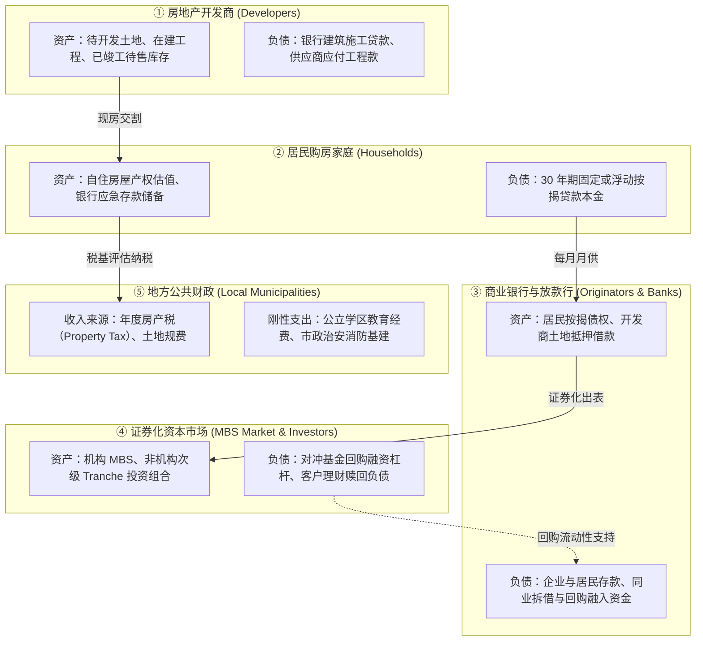
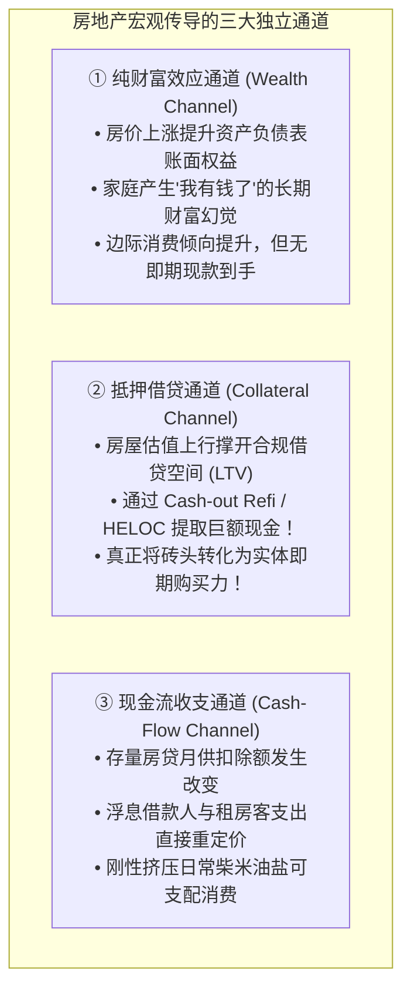
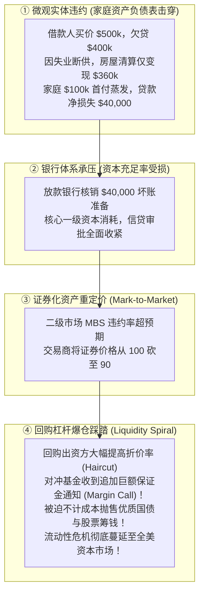

# 27 住房周期、金融风险与宏观传导

[上一章](26-housing-securitization.md) · [目录](./) · [下一章](28-fx-and-dollar.md)

> 建议分两次学习：第一次将开发商、家庭、放款银行、MBS 投资者与地方政府的五张资产负债表串联起来，理清施工在建管道与财富、抵押、现金流三大宏观传导机制；第二次精读两区域“平价表象下的风险分化”、跨账户流动性危机传递，并带读纽约联储 2020 年 MBS 市场失灵经典研究。正文数值与场景均为教学假设，不代表对当前市场的投资评级。

---

## 本章要解决的问题

在前四章中，我们分别解剖了土地施工与房屋买卖、房屋持有回报、家庭抵押贷款以及华尔街的 MBS 证券化。
现在，我们站在宏观经济学的全景高台上，提出一个终极问题：
> **为什么每一次美国宏观经济周期的高潮与大衰退，几乎都少不了房地产市场的身影？一栋水泥砖瓦建成的房子，究竟是怎样撼动全美 GDP、通胀与华尔街金融系统的？**

很多人习惯将房地产简化为单一的“全国房价指数”。然而在宏观现实中：
1. **两个城市的房价同比都完全持平（0% 涨幅），为什么一个欣欣向荣，另一个却正在酝酿一场金融风暴？**
2. **“房价上涨通过财富效应刺激消费”，这句话到底对不对？** 没卖房子的家庭，真的会因为房产估值上升就上街大手大脚刷卡吗？
3. **在 2020 年 3 月新冠疫情暴发之初，为什么在美联储狂暴降息至零的同时，拥有美国政府最高信用背书的机构 MBS 竟然发生了恐怖的流动性枯竭与踩踏？**

读完本章，你将能够：
- 绘制包含开发商、家庭、商业银行、MBS 投资者与地方公共财政的**五张联动资产负债表网络**；
- 运用**施工在建管道平衡方程**，测算开工与竣工错配对未来实体 GDP 投资与就业的滞后影响；
- 严密辨析**财富渠道（Wealth）、抵押渠道（Collateral）与现金流渠道（Cash-Flow）**在微观传导机制上的本质差异；
- 建立一套穿透“房价平稳表象”的**多维区域诊断雷达**（挂牌量、去化月数、断供迁徙率）；
- 还原一场危机如何从“家庭局部违约”演变成“华尔街对冲基金追加保证金踩踏”的**跨市场传染链条**；
- 读懂纽约联储关于 2020 年 MBS 市场微观流动性失灵的里程碑式研究。

---

## 1. 五张联动的资产负债表：不要把房地产简化为一个指标

许多财经评论员喜欢用“房价跌了，经济完了”这样扁平的口号下结论。
但在宏观经济学中，房地产不是一个抽象的数字，而是**五个关键部门之间相互咬合、互为资产与负债的网状系统**：

### 为什么五个部门不能合并计算？
如果一位初学者试图把这五张表简单合并，就会犯下致命的重复计算或抵消错误：
- 房贷是家庭的负债，但同时是商业银行或 MBS 投资者的资产；
- 地方政府的房产税依赖家庭房屋的账面评估价值（Assessed Value），但评估价值的更新往往滞后于二级市场真实成交整整 1~2 年；
- **每一张表上的现金流时钟完全不同**：开发商每天都要付工程进度款，家庭每月要交月供，地方政府按年度征税，而华尔街交易商每秒钟都在根据国债波动盯市（Mark-to-Market）。

任何一次房地产危机，从来不是同时在五个部门爆发的，而是**从某一张表的流动性断裂开始，沿着这根导火索逐级向全社会传导**。

---

## 2. 施工管道模型：开工滞后与供给时滞

实体建造工程具有漫长的生产周期。从开发商拿地、画图纸，到工人推土机进场，再到最终拧开水龙头交付钥匙，往往跨越 **12 至 36 个月**。

### 2.1 在建工程与现房库存平衡方程

我们建立两组精确的物理管线恒等式：

#### 第一组：实体施工在建管道（Under Construction）
$$
\text{期末在建工程套数} = \text{期初在建套数} + \text{当期新动工开工（Starts）} - \text{当期验收竣工（Completions）}
$$

假设某都会区：
- 月初正在施工的在建住宅为 **$10{,}000$ 套**；
- 本月由于建筑贷款利息高企，开发商放缓节奏，新开工仅为 **$500$ 套**；
- 过去两年开工的大楼陆续落成，本月验收竣工 **$900$ 套**；
- 忽略极少数烂尾废弃，月末在建规模为：
  $$
  10{,}000 + 500 - 900 = \mathbf{9{,}600 \text{ 套}}
  $$

#### 第二组：市场已竣工待售现房库存（Completed For-Sale Inventory）
$$
\text{期末已竣工待售库存} = \text{期初已竣工库存} + \text{当期新竣工入市套数} - \text{当期买家签约交付提取套数}
$$

假设同一时期：
- 月初开发商手里积压的已竣工现房为 **$1{,}000$ 套**；
- 上述新竣工的 **$900$ 套** 房屋验收合格，全部挂牌上市供买家现房选购；
- 当月由于房贷利率高企，买家仅交割买走了 **$700$ 套** 现房；
- 月末开发商手里的已竣工待售现房库存跃升为：
  $$
  1{,}000 + 900 - 700 = \mathbf{1{,}200 \text{ 套}}！
  $$

### 2.2 宏观经济学启示
在上述月份中，我们看到了极具欺骗性的一幕：
1. **实体经济读数繁荣**：竣工量高达 900 套，反映在 GDP 住宅固定资产投资（Residential Fixed Investment）收尾核算与建材采购中表现亮眼；
2. **然而未来衰退警报拉响**：在建规模从 10,000 套净流失至 9,600 套，未来几个月对建筑业焊工、电工、泥瓦匠的需求将急剧下滑；
3. **商业抛售风暴酝酿**：成品待售现房库存暴增 $20\%$（从 1,000 套飙升至 1,200 套），开发商账上每天都在为这 1,200 套现房垫付沉重的利息和安保费，一场全面的价格战蓄势待发。

---

## 3. 宏观传导三大约束通道：财富、抵押与现金流

当房价发生波动时，它是如何钻进千家万户的钱包、进而改变全美总需求的？必须严格区分以下三大微观通道：

### 3.1 抵押渠道（Collateral）的硬核算术：如何把砖头变成现金？

很多经济学家在回归分析中把“房价上涨带来消费”归功于心理上的“财富效应”。
然而，在现代金融体系中，真正产生购买力核爆的是**抵押借贷通道（Cash-out Refinance / HELOC）**！

假设某家庭数年前以 40 万购入一套房屋，原按揭贷款目前**剩余欠款本金为 $250{,}000$ 美元**。
在周期繁荣期，该房屋的最新市场评估价值跳升至 **$500{,}000$ 美元**（房屋升值 10 万美元）。
如果商业银行允许的最大贷款价值比为 **$LTV_{\max} = 80\%$**：
1. **以最新估值计算的最高可借款总额度**：
   $$
   \text{新贷款上限} = 500{,}000 \times 80\% = \mathbf{400{,}000 \text{ 美元}}
   $$
2. **通过房屋净值贷款（Cash-out Refinance）一次性套现提取的真金白银**：
   $$
   \text{可提取即期净现金} = 400{,}000 - 250{,}000 = \mathbf{150{,}000 \text{ 美元}}！
   $$

看清楚这笔钱的力量：
家庭并没有卖掉房子，依然住在里面，但银行直接在其储蓄账户里存入了 **$150{,}000$ 美元** 现金！这笔钱可以立刻用来买新车、度假、支付大学学费或装修。
在 2004~2007 年次贷超级繁荣期，全美家庭每年通过这一通道提取出数千亿美元现金，直接推升了美国强劲的耐用品消费，但代价是**家庭总负债从 25 万暴增至 40 万，抵押杠杆被拉到极限**。

---

## 4. 区域诊断雷达：为什么两个城市房价持平，风险却天壤之别？

全国宏观平均数往往会掩盖微观断裂。考虑两个在表面统计上看起来完全一致的都会区：

| 宏观观察指标 | 地区甲（阳光带核心都市圈） | 地区乙（传统工业制造老城） | 隐藏的深层微观机制对比 |
| :--- | :---: | :---: | :--- |
| **同质房价同比指数** | **同比持平（0.0%）** | **同比持平（0.0%）** | 表面上两地房价均极度稳定 |
| **全月房屋成交量** | **同比暴跌 20%** | **同比暴跌 20%** | 表面上两地交易均极度冰封 |
| **市场新增挂牌房源（New Listings）** | **同比暴跌 25%** | **同比反弹 10%** | **分化①**：甲是卖家惜售，乙是业主抛售 |
| **已竣工待售现房库存** | 保持历史低位平稳 | **持续 6 个月大幅累库** | **分化②**：甲无成品积压，乙现房泛滥 |
| **当地就业与工薪收入** | 高科技与医疗持续扩张 | **核心支柱企业大规模裁员** | **分化③**：甲收入无虞，乙失业激增 |
| **房贷 30 天新进入逾期率** | 稳定在 0.8% 极低区间 | **从 1.2% 飙升至 3.5%！** | **分化④**：甲资产负债健康，乙坏账激增 |

### 深度剖析：繁荣后的锁死 vs 崩盘前夜的堰塞湖
- **地区甲（利率锁定与健康冻结）**：
  这里的成交量下跌，纯粹是因为当地业主手握 3% 的旧房贷，绝不肯把房子挂出来卖（新增挂牌暴跌 25%）。买家虽然也受 7% 高利率压制，但市场上根本没有任何可买的二手房，供需在极低水平上达成了弱平衡。**这里的 0% 涨幅是健康的供需双缩，毫无系统性金融风险。**
- **地区乙（坏账危机与假性平稳）**：
  这里的 0% 涨幅纯粹是**统计数字的时滞假象**！当地居民因工厂裁员断供暴增，业主与开发商拼命挂牌甩货（挂牌上升 10%，现房库存泛滥）。由于正式交割过户需要时间，且挂牌价尚未在当月统计中完全认输，一旦下个季度第一批法拍房（Foreclosure）以 30% 的折扣流入市场，当地房价中枢将发生雪崩式暴跌。

---

## 5. 跨账户传导：一场违约是如何拖垮华尔街的？

我们来推演一笔极其微小的家庭违约，是如何沿着金融管道引发全美资本市场海啸的：

### 独立压力测试推演
1. **微观家庭清算**：
   家庭买入 50 万美元房屋，欠银行 40 万美元房贷。由于遭遇家庭变故断供，法院司法拍卖清算后，扣除法拍杂费实得变现净款 **$360{,}000$ 美元**。
   没有其他可追索资产，家庭初始的 10 万美元首付全部归零，而**贷款人面临实打实 $400{,}000 - 360{,}000 = \mathbf{40{,}000 \text{ 美元}}$ 的坏账损失**！
2. **从信用损失到流动性踩踏的三个时钟**：
   - **时钟一：实际最终信用清偿（耗时数月至数年）**；
   - **时钟二：二级市场资产公允价值波动（秒级反应，MBS 价格暴跌）**；
   - **时钟三：回购融资流动性质押品追加（当日甚至盘中即刻要求追加现金，Margin Call！）**。
   很多华尔街大型对冲基金与投资银行，在底层资产还远远没有真正确认最终损失之前，仅仅因为时钟三的流动性挤压（回购方拒收 MBS 质押），就在几天之内宣告轰然破产。

---

## 6. 历史机制窗口：2020 年 3 月 MBS 市场失灵之谜

在宏观金融史上，有一份极具教学价值的研究：[纽约联储 2020 年 7 月 17 日发表的《MBS Market Dysfunctions in the Time of COVID-19》](https://libertystreeteconomics.newyorkfed.org/2020/07/mbs-market-dysfunctions-in-the-time-of-covid-19/)。

### 6.1 荒谬的背离现象
2020 年 3 月中旬，全球暴发新冠疫情恐慌，美联储火速将联邦基金利率暴降 100 个基点至零，按理说全美债券价格应当全线暴涨。
然而，在抵押贷款证券化市场上，发生了一幕不可思议的奇观：
**具有美国政府隐性信用担保的 30 年期机构 MBS，其二级市场买卖价差（Bid-Ask Spread）瞬间扩大了数十倍，TBA 与现货指定池之间出现巨大折价，部分优质 MBS 价格甚至发生暴跌！**

### 6.2 纽约联储揭开的微观做市管道断裂
这篇里程碑式的研究揭示了如下微观管道秘密：
1. **房贷机构的大规模提前套保抛售**：
   利率大降引发全美数百万借款人通宵提交再融资申请，放款银行为了锁定未来的利润，必须在二级市场上疯狂卖空远期 TBA 合约进行对冲；
2. **华尔街一级交易商资产负债表撑爆**：
   面对如海啸般涌来的 MBS 卖单，华尔街一级交易商（Dealers）自身的资产负债表受制于沃克尔规则和资本充足率约束，根本无法吞下如此天量的库存；
3. **杠杆对冲基金的相对价值交易爆仓**：
   大量依赖 20 倍回购杠杆做“指定池 vs TBA”套利的对冲基金，遭遇回购融资方恐慌性上调抵押折扣率（Haircut），被迫不计成本砸盘变现。

最终，美联储不得不打破常规，在一周内狂买数千亿美元的机构 MBS，充当全市场的“终极做市商（Buyer of Last Resort）”，才将这条濒临停摆的金融动脉彻底救活。这再次告诫我们：**拥有信用担保的资产，也绝不可能免受微观流动性与微观资产负债表约束的绞杀！**

---

## 7. 模块综合练习与参考答案

### 练习 1：从施工管线到宏观经济综合诊断

某核心经济圈在月初的在建住宅工程规模为 **$8{,}000$ 套**。本月开发商新开挖动工 **$400$ 套**；与此同时，前期在建工程验收竣工了 **$700$ 套**（假定无工程烂尾）。
在销售端，全区已竣工待售现房库存从月初的 **$900$ 套** 逆势攀升至月末的 **$1{,}100$ 套**。当地工薪家庭收入基本平稳，但全美 30 年期按揭房贷利率在过去两个月内快速上行了 100 个基点。
请回答：
1. 严密计算月末该地区的在建工程套数，并指出在建规模的净变动量；
2. 计算当月该地区已竣工现房库存的净增量；
3. 结合数据，撰写一段 150 字左右的宏观研判：当前房地产市场处于周期的哪一阶段？开发商面临何种微观抉择？下一步应调取哪些关键数据进行反证？

点击查看详细参考答案与推理步骤

1. **在建工程套数精算**：
   $$
   \text{月末在建套数} = 8{,}000 + 400 - 700 = \mathbf{7{,}700 \text{ 套}}
   $$
   在建规模单月净减少 **$300$ 套**（降幅 $3.75\%$）。
2. **现房成品库存净增量**：
   $$
   \text{现房库存净变动} = 1{,}100 - 900 = \mathbf{+200 \text{ 套}}！
   $$
3. **宏观综合研判（示例）**：
   > “该地区目前正处于房地产繁荣退潮、向供给过剩与主动去库阶段切换的临界点。前期开工潮带来的 700 套高额竣工集中释放，但在 100 个基点的高利率冲击下，买方实际消化速度显著放缓，导致成品现房积压大增 200 套（+22%）。开发商已经敏锐嗅到风险，主动将新动工大幅砍至 400 套以压缩在建敞口。当前开发商正面临‘降价促销抢现金流’或‘垫付高额利息硬扛现房’的生死抉择。下一步必须调取开发商私下的买断利息补贴幅度（Rate Buydowns）、新房签约取消率（Cancellation Rate）以及不同价格区间的去化周期进行交叉核验。”

---

### 练习 2：抵押借贷空间绝不等于净财富

某家庭拥有一套无任何抵押贷款的全款住宅，购买成本为 **$600{,}000$ 美元**。一年后，当地房地产评估机构出具最新报告，该住宅的市场公允估值上涨至 **$650{,}000$ 美元**。
该家庭凭借这份估值报告，成功向商业银行申请了一笔抵押贷款，额外借出了 **$50{,}000$ 美元** 现金并暂存在银行活期存款账户中，尚未进行任何实体消费。
请回答：
1. 在房屋估值刚上涨至 65 万美元时（借款前），该家庭的账面净资产（Net Worth）增加了多少？
2. 在该家庭从银行把 5 万美元借出来存进账户后，其家庭资产负债表上的总资产、总负债与净资产分别发生了怎样的变动？
3. 能否因为借款使得银行账户多了 5 万现金，就宣称“借款行为使家庭又多了 5 万净财富”？为什么？

点击查看详细参考答案与推理步骤

1. **借款前估值变动**：
   房屋资产从 60 万增加至 65 万，负债为 0，该家庭账面净资产纯粹由于未实现的纸面资产升值而**增加了 $50{,}000$ 美元**。
2. **借款并暂存后的资产负债变动**：
   - **总资产**：增加了 **$50{,}000$ 美元**（房屋 65 万 $+$ 新增存款 5 万 $= 70$ 万美元）；
   - **总负债**：严格等额增加了 **$50{,}000$ 美元**（新增银行抵押欠款 5 万美元）；
   - **净资产**：
     $$
     \text{净资产} = \text{总资产 (70万)} - \text{总负债 (5万)} = \mathbf{650{,}000 \text{ 美元}}！
     $$
     净资产在借款后**分文未增，完全不变**！
3. **经济学辨析**：
   绝对不能！借款行为虽然使家庭的流动性现金增加了 5 万元，赋予了即期支付能力，但它在资产负债表右侧严格绑定了等额的刚性偿债义务与未来沉重的利息支出。很多非专业人士误将“借来的现金”当成“创造的财富”，一旦借款后胡乱挥霍且后续无力偿还，原本纸面升值的房屋就会面临被银行清算拍卖的毁灭性风险。

---

[上一章](26-housing-securitization.md) · [目录](./) · [下一章](28-fx-and-dollar.md)
