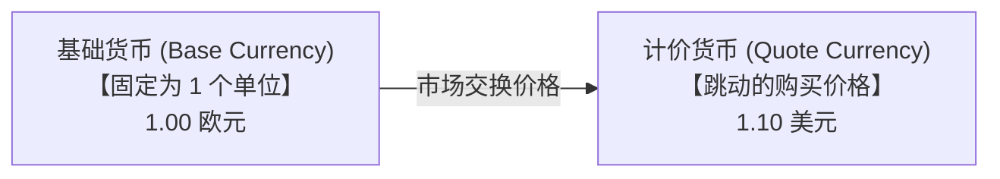
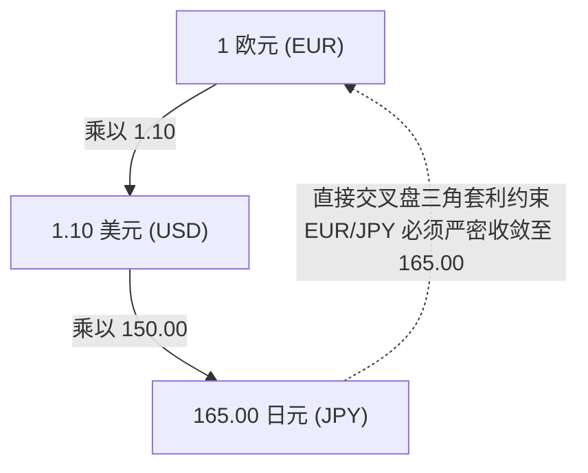
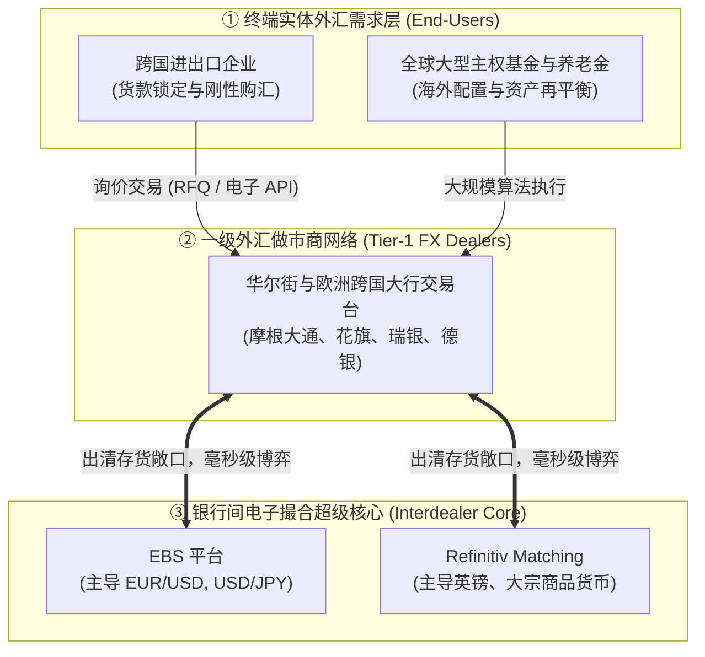
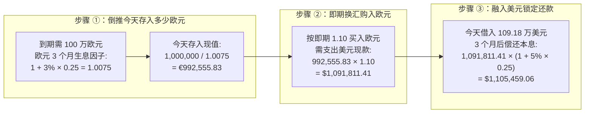

# 28 外汇市场、汇率与美元定价

[上一章](27-housing-cycle.md) · [目录](./) · [下一章](29-global-dollar.md)

> 建议分三次学习：第一次掌握外汇双向报价、基础货币与标价货币识别，以及场外市场（OTC）的撮合机制；第二次精读 DXY 美元指数与美联储广义贸易加权指数的几何编制原理、实际有效汇率（REER）以及 H.10 官方公报带读；第三次彻底推导抛补利率平价（CIP）远期定价方程，精算掉期点数（Swap Points）与跨国企业套期保值损益。正文数值除明确标注的 H.10 历史报告外均为教学假设。

---

## 本章要解决的问题

假设你是一家美国先进制造企业的首席财务官（CFO）。今天，你刚刚与德国西门子公司签订了一份精密机床进口合同：
> **3 个月后，你必须向德国供货商电汇支付 100 万欧元（€1,000,000）。**

今天打开路透终端，即期汇率显示：$1 \text{ 欧元} = 1.10 \text{ 美元}$。按照今天的价格，你只需要准备 **110 万美元** 即可。
然而，外汇市场每秒钟都在剧烈跳动：
1. **如果 3 个月后欧元升值到 1.20 美元，你将不得不支付 120 万美元！** 德国机床没有多给你一个螺丝钉，但你的企业白白多亏了整整 10 万美元净利润！
2. 当你焦急地向外汇做市银行询问“能否现在就白纸黑字把 3 个月后的兑换价格锁死”时，银行报出了 $1.1055$ 的远期汇率。**为什么这个价格既不是 1.10，也不是银行分析师对未来的猜测，而是由美欧两国的货币借贷利率算出来的？**
3. **“美联储加息，美元必涨”，这句口诀为什么常常失效？** 为什么有时美国非农数据大好，美债收益率狂飙，美元反而应声暴跌？

要解开全球跨国资本流动的奥秘，我们必须从最基础的双向报价开始，走向支配全球外汇定价的无套利金融工程。

读完本章，你将能够：
- 秒速辨识**基础货币（Base Currency）**与**计价货币（Quote Currency）**，一眼看出是谁在升值、谁在贬值；
- 读懂银行交易台的**双向买卖价差（Bid-Ask Spread）**与**基准点（Pips）**，算清企业换汇的摩擦损耗；
- 推导全球美元风向标——**ICE 美元指数（DXY）**与**美联储广义贸易加权美元指数**的几何加权方程式；
- 严格区分**名义有效汇率（NEER）**与**实际有效汇率（REER）**，看透相对通胀如何侵蚀国家出口竞争力；
- 用严密的无套利复制思想推导**抛补利率平价（CIP）方程**，计算**外汇掉期点数（Swap Points）**；
- 读懂美联储官方 H.10 外汇发布公报，避开跨市场时间差与报价方向陷阱。

---

## 1. 读懂一句报价：谁是一单位，谁是价格？

在接触外汇的第一天，许多初学者最容易被各种斜杠代码搞得晕头转向。

### 1.1 EUR/USD 上升，究竟是谁在升值？

在国际市场上，货币对通常写作 `EUR/USD`。
请牢记国际外汇市场的神圣法则：**斜杠左边是基础货币（Base Currency），永远代表“1 个整单位”；斜杠右边是计价货币（Quote Currency），代表“需要付出多少价格”！**

当交易屏上显示 $\text{EUR/USD} = 1.10$ 时，它表达的唯一严密含义是：
$$
1 \text{ 欧元} = 1.10 \text{ 美元} \implies \text{汇率单位为：美元/欧元}
$$

如果你要支付 100 万欧元，所需的美元金额为：
$$
1{,}000{,}000 \text{ 欧元} \times 1.10 \frac{\text{美元}}{\text{欧元}} = \mathbf{1{,}100{,}000 \text{ 美元}}
$$

#### 升值与贬值的非对称百分比
如果数周后，$\text{EUR/USD}$ 从 $1.10$ 跳升至 $1.21$：
- **欧元对美元升值幅度**：
  $$
  \frac{1.21}{1.10} - 1 = \mathbf{+10.00\%}
  $$
- **此时美元对欧元贬值了多少？是恰好 $-10\%$ 吗？**
  **绝不是！**
  我们必须将视角倒过来：一美元最初值 $1/1.10 \approx 0.9091$ 欧元，现在只值 $1/1.21 \approx 0.8264$ 欧元。
  $$
  \text{美元对欧元的变动幅度} = \frac{1/1.21}{1/1.10} - 1 = \frac{1.10}{1.21} - 1 \approx \mathbf{-9.09\%}！
  $$
百分比幅度并不对称，因为计算收益率的分母发生了改变。

#### 直接标价 vs 间接标价
再看另一个常见货币对：`USD/JPY = 150.00`。
此时 USD 是基础货币（1 美元），日元是计价货币。数值从 150 上升到 165，意味着**美元对日元升值了 $+10\%$（日元严重贬值）**！
因此，在宏观分析中，单说一句“外汇涨了”没有任何意义，必须指明具体货币对与基础货币方向。

---

### 1.2 银行为什么报两个数：买入价、卖出价与 Pips

在现实银行外汇柜台或电子交易终端上，你永远看不到一个孤独的数字，而是一对双向报价：
$$
\text{EUR/USD}: \mathbf{1.0998 \ / \ 1.1002}
$$

> [!IMPORTANT]
> **永远站在报价银行的视角看世界！**
> - **Bid（买入价，左侧较小值 $1.0998$）**：银行愿意掏钱**买入基础货币（买入欧元）**的价格；
> - **Ask / Offer（卖出价，右侧较大值 $1.1002$）**：银行愿意**卖出基础货币（卖出欧元）**的价格。

| 跨国企业的真实业务需求 | 交易对手银行在做什么 | 必须强制使用的报价侧 | 兑换 100 万欧元对应的实际美元现金 |
| :--- | :--- | :---: | ---: |
| **买入 100 万欧元支付进口设备款** | 银行把欧元**卖给**企业 | **Ask: 1.1002** | 企业实付：$1{,}000{,}000 \times 1.1002 = \mathbf{1{,}100{,}200 \text{ 美元}}$ |
| **将海外赚回的 100 万欧元收入结汇** | 银行从企业手中**买入**欧元 | **Bid: 1.0998** | 企业实收：$1{,}000{,}000 \times 1.0998 = \mathbf{1{,}099{,}800 \text{ 美元}}$ |

#### 交易摩擦与点数（Pips）
如果企业在同一秒内买入 100 万欧元又立刻反悔卖回给银行：
$$
\text{即时往返摩擦损失} = 1{,}100{,}200 - 1{,}099{,}800 = \mathbf{400 \text{ 美元}}
$$
两边的买卖差价为：$1.1002 - 1.0998 = 0.0004$ 美元/欧元。
在外汇交易惯例中，对于大多数四位小数货币对，$0.0001$ 被定义为 **1 个基准点（Pip）**。上述银行的买卖价差即为 **4 个 Pips**。中间价（Mid-rate）为 $1.1000$，但中间价只是分析师纸面上的理论基准，没有任何实际客户能按中间价不付成本地成交。

---

### 1.3 交叉汇率与无套利三角形约束

世界上的货币对数以千计，但绝大多数都以美元作为中转轴心。

假设在某一微秒：
- $\text{EUR/USD} = 1.1000$（1 欧元值 1.10 美元）
- $\text{USD/JPY} = 150.00$（1 美元值 150 日元）

通过美元连乘，即可精确合成**交叉汇率（Cross Rate）**：
$$
\text{EUR/JPY} = \text{EUR/USD} \times \text{USD/JPY} = 1.1000 \times 150.00 = \mathbf{165.00 \text{ 日元/欧元}}
$$

如果东京外汇市场上有人挂出 $166.00$ 愿意收购欧元，全球高频做市算法会在几毫秒内执行**三角套利（Triangular Arbitrage）**：用 165 日元经由美元买入 1 欧元，并在东京市场上以 166 日元卖出，净赚 1 日元无风险暴利。这种光速套利行为会瞬间推平两边的价差，迫使全球各地的交叉报价严格锁死在数学链条之上。

---

## 2. 汇率是怎样形成的：全球场外市场（OTC）的撮合微观结构

许多人误以为世界上有一个像纽约证券交易所（NYSE）那样的“全球外汇大厅”，每天早晨九点敲钟开盘。

**完全不是！** 全球外汇市场是一个典型的**分散式场外交易网络（Over-the-Counter, OTC）**：

- 当企业向银行买入 1 亿欧元时，银行的做市交易员瞬间背负了巨大的外汇裸露敞口（Short EUR）；
- 交易员绝不会死扛风险，而是立刻在银行间电子交易平台（如 EBS 或 Refinitiv）上向其他交易商对冲抛售；
- 汇率的每秒跳动，正是成千上万家做市银行为了在微秒级出清自身资产负债表库存而不断微调的结果。[国际清算银行（BIS）关于全球外汇市场微观结构的权威综述](https://www.bis.org/publications/working-paper-1094-foreign-exchange-market)。

---

## 3. 从双边汇率到美元指数：DXY 与美联储广义指数

新闻里常说：“今日美元大涨，突破 106 关口！”
这个“美元”指的是汇率指数。然而，**选取的货币篮子不同，得出的宏观结论完全不同**。

### 3.1 经典 ICE 美元指数（DXY）：古老但偏科的六币种指数

DXY 是全球金融媒体报道最多的指标，在洲际交易所（ICE）有活跃的期货交易。
它的货币篮子形成于 1973 年布雷顿森林体系瓦解之时，**几十年来构成币种从未扩充，其篮子权重如下**：

| 币种代码 | 货币名称 | 官方指定权重（$w_i$） | 报价方向惯例 | 幂次符号与经济学含义 |
| :---: | :--- | :---: | :---: | :--- |
| **EUR** | 欧元 | **$57.6\%$** ($0.576$) | EUR/USD（间接标价） | **负幂（$-0.576$）**：EUR 上涨意味着美元下跌！ |
| **JPY** | 日元 | **$13.6\%$** ($0.136$) | USD/JPY（直接标价） | **正幂（$+0.136$）**：USD 上涨推升指数！ |
| **GBP** | 英镑 | **$11.9\%$** ($0.119$) | GBP/USD（间接标价） | **负幂（$-0.119$）**：GBP 上涨意味着美元下跌！ |
| **CAD** | 加拿大元 | **$9.1\%$** ($0.091$) | USD/CAD（直接标价） | **正幂（$+0.091$）**：USD 上涨推升指数！ |
| **SEK** | 瑞典克朗 | **$4.2\%$** ($0.042$) | USD/SEK（直接标价） | **正幂（$+0.042$）**：USD 上涨推升指数！ |
| **CHF** | 瑞士法郎 | **$3.6\%$** ($0.036$) | USD/CHF（直接标价） | **正幂（$+0.036$）**：USD 上涨推升指数！ |

#### DXY 几何加权动态变化方程
根据 ICE 官方编制规则，新旧两期 DXY 的变动比例严格遵循几何连乘：

$$
\begin{aligned}
\frac{DXY_{\text{new}}}{DXY_{\text{old}}} = &\left(\frac{\text{EUR/USD}_{\text{new}}}{\text{EUR/USD}_{\text{old}}}\right)^{-0.576} \times \left(\frac{\text{USD/JPY}_{\text{new}}}{\text{USD/JPY}_{\text{old}}}\right)^{+0.136} \times \left(\frac{\text{GBP/USD}_{\text{new}}}{\text{GBP/USD}_{\text{old}}}\right)^{-0.119} \\
&\times \left(\frac{\text{USD/CAD}_{\text{new}}}{\text{USD/CAD}_{\text{old}}}\right)^{+0.091} \times \left(\frac{\text{USD/SEK}_{\text{new}}}{\text{USD/SEK}_{\text{old}}}\right)^{+0.042} \times \left(\frac{\text{USD/CHF}_{\text{new}}}{\text{USD/CHF}_{\text{old}}}\right)^{+0.036}
\end{aligned}
$$

#### 算例推演：单一货币冲击的非线性传导
假设其余 5 种货币汇率完全静止，**只有 EUR/USD 当天大涨了 $+10.0\%$**（比值为 $1.10$）：
$$
\frac{DXY_{\text{new}}}{DXY_{\text{old}}} = (1.10)^{-0.576} \approx \mathbf{0.94658}
$$
$$
\Delta DXY = 0.94658 - 1 \approx \mathbf{-5.34\%}！
$$

> [!CAUTION]
> **DXY 的严重偏科弊端！**
> 1. **欧元一家独大**：欧元权重高达 $57.6\%$，如果加上英镑、瑞郎和瑞典克朗，**欧洲货币总权重超过 $77\%$！** DXY 本质上是一面“欧美相对经济镜子”，根本无法反映全貌；
> 2. **完全缺失核心贸易伙伴**：DXY 篮子里**既没有人民币（CNY），也没有墨西哥比索（MXN）**！而中国与墨西哥是美国前两大双边贸易伙伴。

---

### 3.2 美联储广义贸易加权美元指数（Broad Dollar Index）

为了彻底克服 DXY 的局限性，美联储编制并每日发布**广义贸易加权美元指数（Trade-Weighted Dollar Index）**。[美联储 2019 年指数重构与权重编制全解](https://www.federalreserve.gov/econres/notes/feds-notes/revisions-to-the-federal-reserve-dollar-indexes-20190115.html)。

美联储动态追踪全美数十个主要进出口贸易伙伴的真实双边贸易流向（包括商品与服务），其链式几何加权方程规范表达为：

$$
\frac{I_t}{I_{t-1}} = \prod_{j=1}^N \left( \frac{e_{j, t}}{e_{j, t-1}} \right)^{w_{j, t}}
$$
其中 $e_{j, t}$ 统一规范定义为“一美元可兑换的 $j$ 伙伴货币数量”（直接标价法，$e$ 上涨代表美元升值），$w_{j, t}$ 为各伙伴经双边进出口测算归一化后的动态权重，满足 $\sum w_{j, t} = 1$。

---

## 4. 名义有效汇率（NEER）与实际有效汇率（REER）

在国际贸易中，仅看名义汇率是不够的。

### 4.1 相对通胀调整的数学定义
设美国国内生产的标准化商品价格为 $P_{\text{US}}$（以美元计价）；外国同类商品价格为 $P_{\text{F}}$（以外币计价）。名义汇率 $e$ 是一美元兑换的外币数。
将美国商品折算成外币后的售价为 $e \times P_{\text{US}}$，其与外国本土商品的相对价格 $q$ 定义为：

$$
q = e \times \frac{P_{\text{US}}}{P_{\text{F}}}
$$

将其推广到多边加权体系，即得到著名的**实际有效汇率（Real Effective Exchange Rate, REER）**：

$$
REER = NEER \times \frac{P_{\text{domestic}}}{P_{\text{foreign}}}
$$

### 4.2 案例：名义汇率不动，实际汇率也能暴涨？
假设在过去一年中，美元名义有效汇率完全横盘（$NEER_{\text{new}} / NEER_{\text{old}} = 1.00$）。
但在此期间：
- 美国爆发二次通胀，物价指数上涨了 **$+6.0\%$**（$P_{\text{US}} = 1.06$）；
- 欧洲与亚洲陷入紧缩，贸易伙伴物价仅微增 **$+2.0\%$**（$P_{\text{F}} = 1.02$）。

此时实际相对汇率变动为：
$$
\frac{q_{\text{new}}}{q_{\text{old}}} = 1.00 \times \frac{1.06}{1.02} \approx \mathbf{1.039216} \implies \text{实际升值约 } \mathbf{+3.92\%}！
$$

> [!NOTE]
> **真实竞争力的悄然丧失！**
> 虽然美元在银行屏幕上没有涨价，但由于美国国内物价涨得比别人快，美国商品在国际货架上变得显著昂贵，美国波音飞机与农产品的出口竞争力遭受了近 $4\%$ 的沉重打击！

---

## 5. 真实数据公报带读：美联储 H.10 统计报告

我们打开美联储官方历史发布归档：[美联储 2024 年 9 月 23 日发布的 H.10 外汇公报](https://www.federalreserve.gov/releases/h10/20240923/)。

### 5.1 历史公报摘录与方向校准

| 官方原始行标识 | 标价单位定义 | 2024-09-16 (周一) | 2024-09-20 (周五) | 独立精确核算变动幅度 | 真实经济学方向解读 |
| :--- | :---: | ---: | ---: | ---: | :--- |
| **带星号行：Euro (\*)** | 美元/欧元 | **$1.1123$** | **$1.1159$** | $\frac{1.1159}{1.1123} - 1 = \mathbf{+0.324\%}$ | **欧元升值，美元对欧元贬值！** |
| **日本日元：Japan (Yen)** | 日元/美元 | **$140.7900$** | **$143.9000$** | $\frac{143.90}{140.79} - 1 = \mathbf{+2.209\%}$ | **美元对日元大幅升值！** |
| **美联储广义美元指数** | $2006.01 = 100$ | **$121.7684$** | **$121.6673$** | $\frac{121.6673}{121.7684} - 1 = \mathbf{-0.083\%}$ | **广义贸易加权美元整体微跌！** |

> [!WARNING]
> **警惕星号行（*）陷阱！**
> 在美联储 H.10 原表中，绝大多数货币（如日元、加元、墨西哥比索）均默认为“直接标价法（外币/美元）”。
> 但对于**欧元、英镑、澳元、新西兰元**，表格旁赫然标注了星号 `*`，代表它们采用的是反向的“间接标价法（美元/外币）”！如果在数据处理中漏掉了对星号的处理，就会直接把欧元的涨跌完全记反！

---

## 6. 三个月后的汇率如何定价：抛补利率平价（CIP）

现在，我们彻底回答引言中财务经理的核心困惑：**3 个月后的外汇远期价格究竟是由什么决定的？**

### 6.1 完美复制现金流法（Replication Method）

回到企业要在 3 个月后支付 **$N = 1{,}000{,}000 \text{ 欧元}$** 的实战问题：
- **今天即期汇率（Spot）**：$S = 1.1000 \text{ 美元/欧元}$；
- **美元年化无风险简单利率**：$r_{\text{USD}} = 5.00\%$；
- **欧元年化无风险简单利率**：$r_{\text{EUR}} = 3.00\%$；
- **期限（Time）**：$T = 3 \text{ 个月} = 0.25 \text{ 年}$。

财务经理可以不用与银行签署远期，而是通过如下三步无套利组合，**在今天彻底复制出一模一样的现金流**：

#### 复制成本精算
1. **第一步：计算今天在欧洲银行需要存入多少欧元本金**：
   $$
   \text{欧元存款现值} = \frac{1{,}000{,}000}{1 + r_{\text{EUR}} \times T} = \frac{1{,}000{,}000}{1 + 0.03 \times 0.25} = \frac{1{,}000{,}000}{1.0075} \approx \mathbf{992{,}555.83 \text{ 欧元}}
   $$
2. **第二步：按今天的即期汇率买入这批欧元所需的即期美元**：
   $$
   \text{所需即期美元} = 992{,}555.83 \times 1.1000 \approx \mathbf{1{,}091{,}811.41 \text{ 美元}}
   $$
3. **第三步：将这笔美元以美国年化 5% 利率全部借入，计算 3 个月后应还的美元本息**：
   $$
   \text{到期偿还美元总额} = 1{,}091{,}811.41 \times (1 + r_{\text{USD}} \times T) = 1{,}091{,}811.41 \times (1 + 0.05 \times 0.25) \approx \mathbf{1{,}105{,}459.06 \text{ 美元}}
   $$

在 3 个月到期那天：
- 欧洲银行的欧元存款本息自动到账，刚好是 $992{,}555.83 \times 1.0075 = \mathbf{1{,}000{,}000 \text{ 欧元}}$，正好付清西门子公司的机床发票！
- 企业的唯一法律负债是向美国银行归还 **$1{,}105{,}459.06 \text{ 美元}$** 本息！

这相当于：企业在今天通过资金借贷，锁定了 **1,105,459.06 美元换 100 万欧元** 的确定交易！
折合每欧元的理论远期锁定成本为：

$$
F = \frac{1{,}105{,}459.06 \text{ 美元}}{1{,}000{,}000 \text{ 欧元}} \approx \mathbf{1.105459 \text{ 美元/欧元}}
$$

---

### 6.2 抛补利率平价（CIP）黄金方程与掉期点数（Swap Points）

为了防止跨国银行利用两边借贷无风险套利，外汇远期价格 $F$ 必须严格满足**抛补利率平价（Covered Interest Parity, CIP）**：

$$
F = S \times \frac{1 + r_{\text{USD}} \times T}{1 + r_{\text{foreign}} \times T}
$$

将基准参数代入：
$$
F = 1.1000 \times \frac{1 + 0.05 \times 0.25}{1 + 0.03 \times 0.25} = 1.1000 \times \frac{1.0125}{1.0075} \approx \mathbf{1.105459 \text{ 美元/欧元}}
$$

#### 核心产物：掉期点数（Forward / Swap Points）
在金融报价中，远期价格与即期汇率的差额被称为**掉期点数**：
$$
\text{掉期点数} = F - S = 1.105459 - 1.100000 = +0.005459 \implies \mathbf{+54.59 \text{ Pips}}
$$
由于 $F > S$，欧元远期呈现**远期升水（Forward Premium）**，而美元相对欧元呈现**远期贴水（Forward Discount）**。

> [!IMPORTANT]
> **远期价格高，绝不代表市场预测欧元会涨！**
> 很多初学者误以为 $F = 1.1055 > 1.10$ 说明华尔街分析师一致看涨欧元。
> **大错特错！** $F$ 之所以高于 $S$，纯粹是因为**美元借贷利率（5%）高于欧元借贷利率（3%）**！借美元买欧元的人必须在远期市场上把 2% 的利差补偿给交易对手，否则全市场都会去借廉价欧元存高息美元进行无风险套利。远期定价是**纯利差平衡算术**，与主观汇率预测毫无因果关系。

---

### 6.3 非抛补利率平价（UIP）与套息交易（Carry Trade）

如果投资者选择**不通过远期锁定汇率**，而是裸露承担汇率波动风险去赚取高利息，这就进入了**非抛补利率平价（Uncovered Interest Parity, UIP）**假说的领域：

$$
\frac{\mathbb{E}_t[S_{t+T}] - S_t}{S_t} \approx r_{\text{USD}} - r_{\text{foreign}}
$$

UIP 假说认为：高利率货币未来必然在预期中贬值，正好抵消利差。
但在现实中，UIP 经常发生著名的**远期溢价之谜（Forward Premium Puzzle）**：高利率货币不仅不贬值，反而因为全球资本涌入而持续坚挺，从而孕育了庞大的**套息交易（Carry Trade）**。

#### 套息交易的爆雷实验
假设一位欧洲基金经理借入 1 欧元（年利率 3%），按即期 1.10 换成 1.10 美元存入美国年化 5% 的高息债券：
- 一年后收回美元本息：$1.10 \times 1.05 = \mathbf{1.155 \text{ 美元}}$；
- 如果此时 EUR/USD 暴升至 **$1.2000$**（欧元猛烈升值）：
  $$
  \text{换回欧元的金额} = \frac{1.155}{1.2000} = \mathbf{0.9625 \text{ 欧元}}
  $$
- 扣除初始借入的 1 欧元本金，**该基金经理录得高达 $-3.75\%$ 的巨额资本亏损**，还必须额外支付 3% 的欧元借款利息！
这就是套息交易臭名昭著的特征：**“平时像在压路机前捡硬币，危机时瞬间被压路机碾得粉碎！”**

---

## 7. 宏观联动：同样是美元上涨，背后的三大剧本

宏观分析最忌讳刻舟求剑地背诵“加息美元就涨”。同样看到美元指数大涨，市场上往往在上演三种截然相反的经济大戏：

| 宏观驱动剧本 | 核心触发诱因 | 跨资产协同表象 | 寻找确认证据 | 证伪该解释的证据 |
| :--- | :--- | :--- | :--- | :--- |
| **剧本 ①：美国相对经济超预期繁荣** | 美国生产率突破、消费火爆，推升真实投资回报率 | **美元大涨，美股大涨，美债收益率温和上行** | 美国 GDP 上修，全球资本流入美国实体资产 | 美股与风险资产普遍暴跌 |
| **剧本 ②：美联储意外鹰派通胀冲击** | CPI 通胀意外超预期爆表，市场被迫计价更激进加息 | **美元大涨，美债收益率飙升，美股全面重挫！** | 联邦基金期货隐含降息预期暴跌，实际利率走高 | 两年期美债收益率反向暴跌 |
| **剧本 ③：全球地缘危机与避险恐慌（Safe-Haven）** | 突发中东地缘冲突或境外银行爆雷，全球避险资金抢购美元流动性 | **美元大涨，美股暴跌，但 10Y 美债被疯抢、美债收益率大跌！** | 黄金暴涨，高收益信用利差急剧走阔，离岸美元荒 | 信用利差平稳，风险资产狂欢 |

---

## 8. 练习与参考答案

### 练习 1：外汇做市台买卖方向决策

某大型跨国科技公司的财务部向外汇做市银行询问即期汇率。
做市银行的电子屏幕显示：
$$
\text{EUR/USD}: \mathbf{1.0798 \ / \ 1.0802}
$$
1. 该科技公司需要向爱尔兰子公司汇出 **$500{,}000$ 欧元** 作为研发运营经费，公司必须向银行支付多少美元？
2. 如果该技术公司在完成交易后一秒钟内，爱尔兰方面通知该项预算被总部董事会紧急叫停，公司立刻将刚刚买到的 50 万欧元按原报价卖回给银行。请精确计算这笔“反向操作”造成的瞬时无风险财务摩擦损失；
3. 如果实习分析师直接用中间价（Mid-rate）估算所需美元，会产生多少美元的预算缺口？

点击查看详细参考答案与推理步骤

1. **购入欧元支付计算**：
   企业买入欧元（基础货币），银行扮演卖方角色，必须使用银行的**卖出价（Ask: 1.0802）**：
   $$
   \text{企业应付美元} = 500{,}000 \times 1.0802 = \mathbf{540{,}100.00 \text{ 美元}}
   $$
2. **立刻卖回操作摩擦损耗**：
   企业将 50 万欧元卖回给银行，银行扮演买方角色，使用银行的**买入价（Bid: 1.0798）**：
   $$
   \text{企业实收美元} = 500{,}000 \times 1.0798 = \mathbf{539{,}900.00 \text{ 美元}}
   $$
   $$
   \text{瞬时摩擦净损失} = 540{,}100 - 539{,}900 = \mathbf{200.00 \text{ 美元}}
   $$
   （核算：$500{,}000 \times (1.0802 - 1.0798) = 500{,}000 \times 0.0004 = 200$ 美元）。
3. **中间价预算偏差**：
   中间价为 $\frac{1.0798 + 1.0802}{2} = 1.0800$。
   若按中间价测算：$500{,}000 \times 1.0800 = 540{,}000$ 美元。
   这将导致企业在向做市行开出支票时，面临 $540{,}100 - 540{,}000 = \mathbf{100.00 \text{ 美元}}$ 的短缺尴尬。

---

### 练习 2：抛补利率平价（CIP）实战复制推导

某跨国设备进出口公司需在 **3 个月后（$T = 0.25$ 年）** 向欧洲合作方支付 **$200{,}000$ 欧元**。
已知市场即期汇率为 $S = 1.0800 \text{ 美元/欧元}$，美元年化简单利率为 $r_{\text{USD}} = 4.00\%$，欧元年化简单利率为 $r_{\text{EUR}} = 2.00\%$。
在理想无摩擦与无买卖价差假设下：
1. 请一步一步写出利用“欧洲存款本息匹配”与“美元借贷”复制该笔未来付款的具体资金推演过程；
2. 利用 CIP 理论公式求解对应的理论远期汇率 $F$ 与锁定支付的美元总金额；
3. 计算该远期合约的掉期点数（Swap Points），并说明该远期高于即期是否意味着市场一致预期欧元升值。

点击查看详细参考答案与推理步骤

1. **无套利现金流复制推演**：
   - **第一步：倒推今天存入欧洲银行的欧元现值**：
     $$
     \text{欧元存款本金} = \frac{200{,}000}{1 + 0.02 \times 0.25} = \frac{200{,}000}{1.005} \approx \mathbf{199{,}004.9751 \text{ 欧元}}
     $$
   - **第二步：按即期汇率 1.0800 兑换所需美元**：
     $$
     \text{即期买入美元} = 199{,}004.9751 \times 1.0800 \approx \mathbf{214{,}925.3731 \text{ 美元}}
     $$
   - **第三步：借入该笔美元，计算 3 个月后应还本息**：
     $$
     \text{到期偿还美元本息} = 214{,}925.3731 \times (1 + 0.04 \times 0.25) = 214{,}925.3731 \times 1.01 \approx \mathbf{217{,}074.63 \text{ 美元}}
     $$
2. **理论远期公式求解**：
   $$
   F = S \times \frac{1 + r_{\text{USD}} \times T}{1 + r_{\text{EUR}} \times T} = 1.0800 \times \frac{1 + 0.04 \times 0.25}{1 + 0.02 \times 0.25} = 1.0800 \times \frac{1.01}{1.005} \approx \mathbf{1.085373 \text{ 美元/欧元}}
   $$
   到期锁定的美元总支出：
   $$
   200{,}000 \times 1.08537313 \approx \mathbf{217{,}074.63 \text{ 美元}}
   $$
3. **掉期点数与预测辨析**：
   - 掉期点数：
     $$
     F - S = 1.085373 - 1.080000 = +0.005373 \implies \mathbf{+53.73 \text{ Pips}}
     $$
   - **经济学本质辨析**：远期价格高于即期纯粹是由**美欧两国的年化利差（4% vs 2%）**决定的无套利产物，绝不代表市场交易员预测欧元在 3 个月后必然会上涨至 1.0854！

---

### 练习 3：双边背离与宏观归因辨识

某日纽约外汇市场收盘时，数据终端显示：
- 美元指数（DXY）单日上涨了 **$+0.45\%$**；
- 两年期美国国债收益率在同一交易日内暴跌了 **$-12 \text{ 个基点}$**；
- 标普 500 股票指数大跌 **$-1.8\%$**，高收益企业债信用利差走阔了 **$25 \text{ 个基点}$**；
- 与此同时，细分外汇市场上，$\text{EUR/USD}$ 大跌 $-0.8\%$，但 $\text{USD/JPY}$ 却逆势下跌了 $-0.6\%$（日元相对美元走强）。

请基于本章所学知识，回答：
1. 为什么“两年期美债利率暴跌”直接排除了“美联储突然放鹰推升美元”这种最常见的宏观解释？
2. 试提供一个能高度完美自洽解释上述所有资产异动特征的宏观情景剧本。

点击查看详细参考答案与推理步骤

1. **排除加息鹰派假说的逻辑**：
   如果美元大涨是由美联储意外加息或极度鹰派前瞻指引驱动的，作为全美基准政策利率最敏感风向标的**两年期美国国债收益率必须同步大幅跳升**！而当日两年期美债利率不涨反暴跌 12 个基点，确凿证明市场当天其实在大幅抢跑计价未来美联储降息，因此鹰派政策假说与数据事实直接自相矛盾。
2. **完美自洽的宏观避险剧本（Safe-Haven Shock）**：
   这是一个教科书级别的**“欧洲地缘或欧洲银行业突发黑天鹅暴雷引发的全球剧烈避险危机”**：
   - **欧洲黑天鹅**：事件冲击集中在欧洲，导致欧元汇率遭遇无差别恐慌抛售（EUR/USD 暴跌 0.8%），由于欧元在 DXY 占比高达 57.6%，直接暴力拉升了 DXY 指数；
   - **全球风险资产通杀**：避险情绪引发恐慌，美股重挫 1.8%，高风险企业信用利差恶化；
   - **避险资金涌入超安全资产**：全球资金一方面疯狂抢购超级流动性美元现金，另一方面海量买入超安全短期美债避险，直接压低了美债收益率；同时，全球传统的避险货币日元也受到强烈买盘支撑，从而出现了“美元对欧元大涨，但对避险日元小跌”的经典分化图景。

---

[上一章](27-housing-cycle.md) · [目录](./) · [下一章](29-global-dollar.md)
