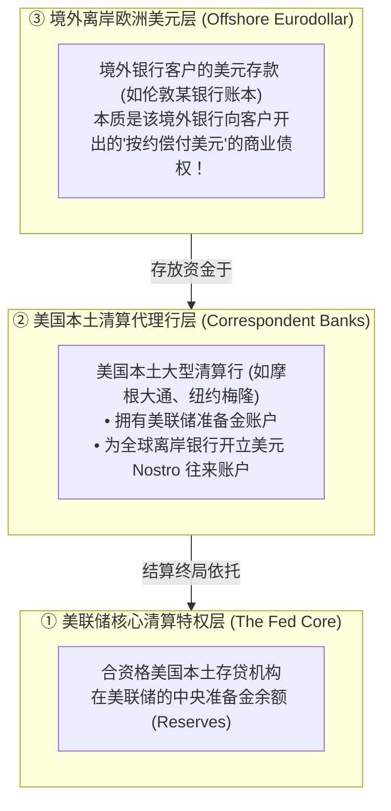
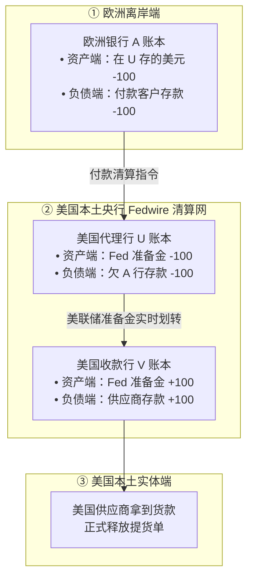
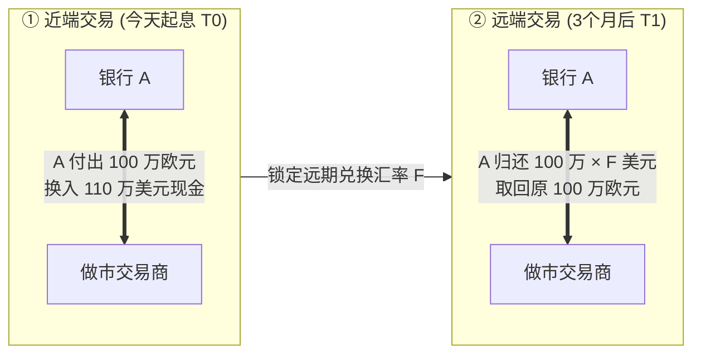
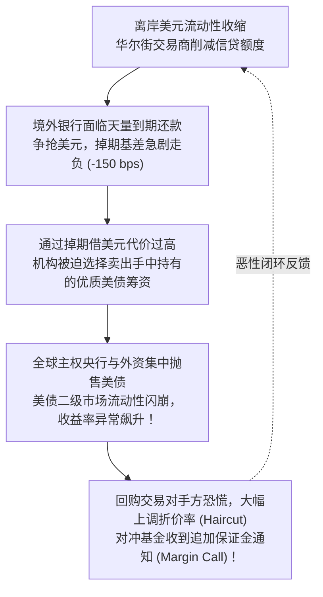
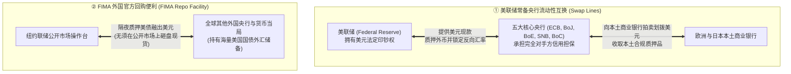

# 29 离岸美元、跨境融资与国际收支

[上一章](28-fx-and-dollar.md) · [目录](./) · [下一章](30-equity-market.md)

> 建议分三次学习：第一次跟随一笔离岸欧洲美元的账本划转，彻底搞清跨境代理行结算与外汇掉期（FX Swap）的合成借贷公式；第二次精读跨币种基差（Basis）走负背后的资产负债表约束、全球流动性紧缩螺旋，以及美联储常备央行互换（Swap Lines）与 FIMA 回购安全网；第三次读懂国际收支平衡表（BOP）与净国际投资头寸（NIIP）的存量与流量重估账本。正文数值除明确标注的历史报告外均为教学假设。

---

## 本章要解决的问题

在上一章中，我们研究了两种货币之间的汇率转换。现在，我们将视野推向更深层的全球水暖管道：
> **如果一家完全位于法兰克福的欧洲商业银行，手里有大把欧元，但急需 1 亿美元去购买美国资产或归还美元债务，它手里的欧元究竟能不能直接在美联储换成美元准备金？**

答案是残酷的：**不能！**
美联储是美国的主权中央银行，它的准备金账户绝不向非美国的普通境外商业机构开放。
这就引出了一连串关乎全球金融霸权与流动性危机的硬核谜团：
1. **“离岸欧洲美元（Eurodollar）”究竟存放在哪里？** 为什么英国银行可以凭空创造出美元存款，却依然可能在某天下午因为还不上 1 亿美元而濒临破产？
2. **“借欧元、做外汇掉期换美元”这套风靡华尔街的财技，到底是如何把外汇点数变成沉重的借款利息的？** 为什么有时美元表面上没升值，境外银行借美元的成本却飙升到 8%？
3. **“跨币种基差（Cross-Currency Basis）深幅走负”究竟意味着什么？** 为什么它是全球金融风暴最敏锐的地震预警仪？
4. **美联储是如何通过“央行流动性互换”与“FIMA 回购便利”，充当全人类的“终极全球美元印钞机”的？**
5. **美国常年背负巨额贸易逆差，欠了全世界数十万亿美元，为什么美国始终没有破产？**

读完本章，你将能够：
- 绘制一笔跨境美元从欧洲借出、经由美国代理行系统（Fedwire）清算到最终供应商的**完整借贷记账流水**；
- 运用规范 LaTeX 编写并推导**外汇掉期（FX Swap）的合成美元借款成本**与**跨币种基差方程式**；
- 还原一场离岸“美元荒”如何通过资产抛售、追加保证金演变为**跨国恶性紧缩螺旋**；
- 严密辨析**美联储常备央行互换协议（Swap Lines）**与**外国官方回购便利（FIMA Repo）**的法律抵押机制差异；
- 读懂**国际收支平衡表（BOP）**的恒等法则，并精算**净国际投资头寸（NIIP）**中资产价格变动与汇率重估的惊人规模。

---

## 1. 境外的美元究竟是什么：离岸欧洲美元的账本真相

很多人以为，全世界流通的每一张美元，都是美联储印钞机印出来的纸币，或者在美联储地下金库里有等额的黄金。
但在现代金融工程中，**美元首先是一种全球通用的跨国记账单位（Unit of Account）**。

### 1.1 离岸美元不是美联储的负债
- **你在纽约大通银行的 100 美元存款**：是大通银行欠你的商业债务，大通银行在美联储拥有准备金支持；
- **你在伦敦巴克莱银行持有的 100 美元存款**：**纯粹是巴克莱银行承诺向你兑付美元的商业信用凭证！** 美联储的资产负债表上根本没有你的名字，巴克莱银行也不能直接向美联储申请透支准备金。

这种在美国境外记账、不受美联储直接监管与存款保险管辖的美元银行业务，在历史上被称为**欧洲美元（Eurodollar）**。今天，它广泛分布在伦敦、新加坡、东京、苏黎世、香港以及开曼群岛，并构成了规模高达十几万亿美元的离岸资金池。[国际清算银行（BIS）全球金融体系委员会（CGFS）关于离岸美元融资的里程碑报告](https://www.bis.org/publications/cgfs-paper-65-us-dollar-funding-international-perspective)。

---

### 1.2 境外银行能凭空创造美元存款，为什么还会遭遇“美元荒”？

沿用现代银行复式记账原理：
假设位于巴黎的欧洲银行 A 决定向空中客车公司发放一笔 **$100 美元** 的贷款。
在记账瞬间，银行 A 敲击键盘：
- 资产端：新增美元贷款 $+100$
- 负债端：新增空中客车公司的美元活期存款 $+100$

此时，银行 A 在完全没有求助美联储的情况下，在自己的账本上**凭空创造了 100 美元的欧洲美元信用**！
如果空客公司拿这 100 美元向波音公司采购零件，波音要求把这笔钱汇到其在纽约花旗银行的账户上：
**灾难发生了！**
波音绝不接受自己在巴黎银行 A 账上多出一笔凭空记出来的存款，波音要求的是**货真价实打进花旗银行在美联储的真实结算资金！**
此时，银行 A 必须从自己的金库里掏出 100 美元真实资金给花旗。如果银行 A 手头没有足够的真正美元储备，这笔对外清算就会发生违约——**这就是为什么“能凭空创造存款”的境外银行，依然会因为流动性枯竭而瞬间猝死！**

---

## 2. 走完一笔跨境美元的全球结算流水

境外银行是如何完成跨国对外结算的？
答案是**代理行系统（Correspondent Banking）与 Nostro 账户（我行存在你行的账户）**。

### 2.1 极简跨境清算四方账本推演

假设：
- 境外银行 A 在美国没有直接的美联储账户，它在美国本土的大型清算银行 U 开立了一个美元存款账户（Nostro 账户），期初存有 **$120 美元** 可用余额；
- 客户要把刚才借来的 **$100 美元** 支付给美国供应商；
- 美国供应商在本土银行 V 开户；
- 银行 U 与银行 V 均拥有美联储准备金账户，并通过 Fedwire 完成跨行清算。

我们来盘点这一笔交易完成后各方的真实变化：
1. **欧洲银行 A**：在 U 行的美元存款从 120 缩水至 **$20 美元**，原先发放给空客的 100 美元长期贷款依然挂在资产端慢慢收息；
2. **美国代理行 U**：对 A 行的负债减少 100，自身在美联储的准备金减少 100；
3. **美联储总账本**：全美准备金总量**分文未变**！只是系统把 100 美元准备金从银行 U 的户头转移到了银行 V 的户头；
4. **如果银行 A 原本在 U 行只有 20 美元可用余额，却要对外支付 100 美元呢？**
   **它面临实打实 $80 美元 的致命结算缺口！** 它必须在今天下午系统关闭前，通过拆借、资产抛售或外汇掉期，从市场上借到 80 美元填平窟窿。

---

## 3. 外汇掉期（FX Swap）：借欧元、换美元的真实财务成本

当境外银行缺美元时，它最常用的金融工具不是去华尔街借裸露的信用贷款，而是**外汇掉期（Foreign Exchange Swap, FX Swap）**。[国际清算银行（BIS）关于外汇掉期作为隐藏全球债务的深度分析](https://www.bis.org/publications/qr-201709/fx-swaps-and-forwards-missing-global-debt)。

### 3.1 什么是标准外汇掉期？
外汇掉期由两笔方向相反的交易紧密绑定而成：
- **近端交易（Near Leg，今天起息）**：银行 A 付出本币（如欧元），从交易商手中换取美元；
- **远端交易（Far Leg，3 个月后到期）**：银行 A 归还约定的美元，换回最初质押的欧元。

---

### 3.2 贯穿实战精算：从远期报价反推“合成美元利率”

假设：
- 欧洲银行 A 在本土借入 **$1{,}000{,}000$ 欧元**，期限 **$3$ 个月（$T = 0.25$ 年）**，年化简单借款利率为 **$r_{\text{EUR}} = 3.00\%$**；
- 今天即期汇率：$S = 1.1000 \text{ 美元/欧元}$；
- 银行 A 与外汇交易商签订固定欧元本金为 100 万欧元的 FX Swap：
  - **近端（今天）**：A 付出 100 万欧元，换得 **$1{,}100{,}000$ 美元** 现金；
  - **远端（3 个月后）**：A 归还 $1{,}000{,}000 \times F$ 美元，取回 100 万欧元本金。

#### 严密利息补足推演
然而，在 3 个月后，银行 A 必须向欧元借款人归还借款本金加利息：
$$
\text{应还欧元本息} = 1{,}000{,}000 \times (1 + r_{\text{EUR}} \times T) = 1{,}000{,}000 \times (1 + 0.03 \times 0.25) = \mathbf{1{,}007{,}500 \text{ 欧元}}
$$
掉期远端只换回了 100 万欧元，还差 **$7{,}500$ 欧元** 的借款利息！
为了在今天彻底锁死全部汇率风险，银行 A 必须同时与银行签一份微型远期，按完全相同的远期汇率 $F$ 预先购买 7,500 欧元利息。
因此，在 3 个月到期那天，银行 A 为这笔美元融资所必须付出的**美元现金总流出量**为：

$$
\text{到期总付出美元} = 1{,}000{,}000 \times F + 7{,}500 \times F = \mathbf{1{,}007{,}500 \times F \text{ 美元}}
$$

---

### 3.3 零基差参考情景 vs 真实基差走负情景

#### 情景 1：理想零基差基准（Zero-Basis CIP Benchmark）
若市场处于无摩擦的抛补利率平价状态，且可比美元无风险利率为 **$r_{\text{USD}} = 5.00\%$**：
$$
F_0 = S \times \frac{1 + r_{\text{USD}} \times T}{1 + r_{\text{EUR}} \times T} = 1.1000 \times \frac{1 + 0.05 \times 0.25}{1 + 0.03 \times 0.25} = 1.1000 \times \frac{1.0125}{1.0075} \approx \mathbf{1.10545906 \text{ 美元/欧元}}
$$
若按此报价结算：
$$
\text{到期总付款} = 1{,}007{,}500 \times 1.10545906 = \mathbf{1{,}113{,}750.00 \text{ 美元}}
$$
相对于期初拿到的 110 万美元，年化借款成本严格等于：
$$
r_{\text{synthetic}} = \frac{1{,}113{,}750 / 1{,}100{,}000 - 1}{0.25} = \frac{0.0125}{0.25} = \mathbf{5.00\%}
$$

#### 情景 2：流动性紧张，可执行远期恶化（跨币种基差走负）
假设市场美元流动性收紧，做市商报出的远期价格飙升为：
$$
F = 1.1000 \times \frac{1.0150}{1.0075} \approx \mathbf{1.10818859 \text{ 美元/欧元}}
$$
此时，银行 A 在 3 个月后必须付出的实际美元金额为：

| 合同组成部分 | 计算公式 | 实际美元流出金额 |
| :--- | :--- | ---: |
| **掉期远端主本金返还** | $1{,}000{,}000 \times F$ | $\$1{,}108{,}188.59$ |
| **远期锁定的欧元利息采购** | $7{,}500 \times F$ | $\$8{,}311.41$ |
| **到期应付美元总金额** | **$1{,}007{,}500 \times F$** | **$\$1{,}116{,}500.00$** |

我们来精算该银行通过这套组合拳取得美元的**真实年化合成美元利率（Synthetic Dollar Rate）**：

$$
r_{\text{USD, synthetic}} = \frac{\frac{\text{到期全部美元付款}}{\text{今天取得美元本金}} - 1}{T} = \frac{\frac{1{,}116{,}500}{1{,}100{,}000} - 1}{0.25} = \frac{0.0150}{0.25} = \mathbf{6.00\%}！
$$

通用标准数学解析方程为：

$$
r_{\text{USD, synthetic}} = \frac{\frac{F}{S} \left( 1 + r_{\text{EUR}} \times T \right) - 1}{T}
$$

#### 核心产物一：美元融资溢价（Dollar Funding Premium）
$$
\text{美元融资溢价} = r_{\text{USD, synthetic}} - r_{\text{USD, direct}} = 6.00\% - 5.00\% = \mathbf{+1.00\% \implies +100 \text{ 个基点 (bps)}}
$$

#### 核心产物二：跨币种基差（Cross-Currency Basis, $b$）
在国际金融惯例中，交易员通常习惯将溢价加在非美元货币的一侧，即定义单期等式：
$$
\frac{F}{S} = \frac{1 + r_{\text{USD}} \times T}{1 + (r_{\text{EUR}} + b) \times T}
$$
由于做市商索要了更高的远期价格 $F$，为了维持等式平衡，非美元腿的调整项 $b$ 必须变成一个负数！解出：

$$
b = \frac{\frac{S}{F}(1 + r_{\text{USD}} \times T) - 1}{T} - r_{\text{EUR}} \approx \mathbf{-0.99261\% \implies -99.26 \text{ 基点}}
$$

> [!IMPORTANT]
> **“基差越负，美元荒越严重！”**
> 屏幕上跳动的“3 个月 EUR/USD 基差跌至 $-100 \text{ bps}$”，绝不是说欧洲的基准利率跌了 1%，它用反向的行话宣布了一个惊悚的现实：**境外银行通过外汇掉期融入美元，必须被迫向对手方多缴纳整整 100 个基点的昂贵罚息！**

---

### 3.4 买入收益率 5.5% 的美债，为什么依然倒亏？

很多非专业投资经理常犯一个致命错误：
“我从欧洲借钱只要 3% 利率，买入 3 个月美国国库券收益率高达 5.5%，直接套利躺赚 2.5% 利差！”

我们来核算真实的现金流：
- 银行 A 投入融来的 110 万美元买入 3 个月年化收益率 $5.50\%$ 的美国国库券；
- 3 个月后国库券本息全额兑现：
  $$
  1{,}100{,}000 \times (1 + 0.055 \times 0.25) = \mathbf{1{,}115{,}125.00 \text{ 美元}}
  $$
- 扣除刚才精算出的掉期合成融资实际应付款 **$1{,}116{,}500.00 \text{ 美元}$**：
  $$
  \text{最终净现金损益} = 1{,}115{,}125.00 - 1{,}116{,}500.00 = \mathbf{-1{,}375.00 \text{ 美元}}！
  $$

**净亏损 1,375 美元！**
底层美国国债没有违约，每一分利息都按时支付了，外汇汇率波动也全部锁定了，交易依然巨额亏损！因为**合成美元融资成本（6%）直接击穿了资产收益率（5.5%）**。任何脱离完整跨币种融资成本的跨国利差套利，都是危险的财务自杀。

---

## 4. 全球美元流动性紧缩螺旋（Liquidity Spiral）

当全球风险来袭时，离岸美元荒是如何演化成跨资产清算危机的？

这正是 2008 年雷曼破产后、以及 2020 年 3 月全球新冠疫情暴发初期在华尔街上演的真实灾难：**即使是世界最安全的美国国债，当境外持有者借不到短期美元度日时，也会沦为最先被砍仓砸盘的变现牺牲品！**

---

## 5. 美联储的全球救火队：常备央行互换与 FIMA 回购

面对全球美元管道的随时可能爆裂，美联储设立了两大世界级“中央安全阀”：

### 5.1 常备央行流动性互换（Central Bank Swap Lines）
- **核心机制**：美联储直接向欧洲央行（ECB）、日本央行（BoJ）、英国央行（BoE）、瑞士央行（SNB）和加拿大央行（BoC）提供美元额度；
- **信用防火墙**：美联储的交易对手是外国主权央行，**由外国央行承担本土商业银行的一切违约风险**！美联储不承担任何外国私立商业银行的信用坏账。

### 5.2 FIMA 外国官方回购便利（FIMA Repo Facility）
- **创设背景**：在 2020 年危机中，很多未纳入上述 5 家央行互换协议的新兴市场央行，为了换取美元现金救市，只能在纽约市场上疯狂抛售美国国债现货，导致美债市场几乎崩溃；
- **机制创新**：美联储向所有合资格外国央行开放隔夜回购窗口。外国央行只需将持有的美国国债临时质押给美联储，美联储立刻借给它美元现金，**从而彻底消除了外国央行为了换美元而被迫在二级市场上砸盘美债的破坏性动机！**

---

## 6. 国际收支平衡表（BOP）与净国际投资头寸（NIIP）

宏观经济的外部账户由两张互为表里的报表构成：

### 6.1 国际收支平衡表（Balance of Payments, BOP）
BOP 记录一国居民与非居民在一个季度内的**跨境交易流量（Flows）**。
其核心会计恒等式为：

$$
\text{经常账户 (CA)} + \text{资本账户 (KA)} + \text{净误差与遗漏 (SD)} = \text{金融账户 (FA)}
$$

- **经常账户（Current Account, CA）**：商品与服务进出口差额（贸易赤字/盈余）$+$ 初次收入（海外利息与股息收支）$+$ 二次收入（海外侨汇与捐款）；
- **金融账户（Financial Account, FA）**：对外金融资产净发生额 $-$ 对外金融负债净发生额。
当美国经常账户常年呈现巨额逆差（$CA < 0$）时，在会计上必然对应着**金融账户的净资本流入（外国投资者买入大量美国国债与企业资产，成为美国的净债权人）**。

---

### 6.2 净国际投资头寸（NIIP）：存量估值的大洗牌

国际投资头寸（IIP）反映的是某个特定时点一国对外的**金融资产与负债存量（Stocks）**：

$$
NIIP_t = A_t - L_t
$$
- $A_t$：本国居民持有的全部对外外国金融资产；
- $L_t$：外国居民持有的本国金融负债（包括外资持有的美国国债、美国公司股票与房产）。

#### 存量与流量动态分解核心方程
从本季度到下季度，净国际投资头寸的变动绝不仅仅是由贸易和跨境借贷决定的，它包含巨大的**非交易价格与汇率重估效应**：

$$
NIIP_t = NIIP_{t-1} + \Delta NIIP_{\text{financial transactions}} + \Delta NIIP_{\text{asset prices}} + \Delta NIIP_{\text{exchange rate}} + \Delta NIIP_{\text{other}}
$$

#### 真实官方报告带读：2024 年第二季度全美 NIIP 大崩跌
打开 [美国经济分析局（BEA）2024 年 9 月 25 日发布的 NIIP 官方公报](https://www.bea.gov/news/2024/us-international-investment-position-2nd-quarter-2024)：
- 2024 年第二季度末，美国对外金融资产为 **$36.00$ 万亿美元**；
- 美国对外金融负债高达 **$58.52$ 万亿美元**；
- **美国净国际投资头寸（NIIP）跌至创纪录的 $-22.52$ 万亿美元！**

我们来看看这一季度全美净头寸恶化 **$-1.23$ 万亿美元（$-1{,}230.3$ 十亿美元）** 的真实来源分解：

| 变动分类来源 | 2024 年第二季度金额（十亿美元） | 占全季总变动比例 | 宏观背后的深层经济学真相 |
| :--- | ---: | :---: | :--- |
| **净金融交易（真实跨境借贷）** | **$-299.8$** | $24.37\%$ | 美国当季真实的对外金融净负债融资流 |
| **资产价格变动重估** | **$-616.9$** | **$50.14\%$** | **美国标普 500 表现远超欧洲亚洲！外资持有的美股暴涨，导致美国对外负债市值被动大幅膨胀！** |
| **汇率波动重估** | **$-214.8$** | $17.46\%$ | 美元升值导致美国持有的外币资产折算回美元后缩水 |
| **其他数量统计修正** | **$-98.8$** | $8.03\%$ | 统计核实与残差修正 |
| **全季 NIIP 净恶化总额** | **$-1{,}230.3$** | **$100.00\%$** | **折合约 $-1.23$ 万亿美元** |

> [!CAUTION]
> **“净负债暴增 1.23 万亿”不等于美国新借了这么多钱！**
> 很多业余观察家看到这一数据，惊呼“美国财政破产、向全世界举债 1.23 万亿”。
> **错得离谱！** 在这 1.23 万亿的恶化中，有整整 **一半以上（6,169 亿美元）** 仅仅是因为**美国股市太牛市了**！由于英伟达、苹果等美股权重股暴涨，全球外资持有的美股市值大幅增加（计为美国对外负债膨胀）。这种“负债增加”本质上是美国资本市场繁荣对全球投资者的回馈，绝非传统意义上的债务违约危机。

---

## 7. 练习与参考答案

### 练习 1：离岸银行记账与结算现金缺口测算

某位于法兰克福的离岸商业银行 A，其资产负债表全部以美元核算。该行刚刚批准并向某跨国能源企业发放了一笔 **$80$ 美元** 的流动资金贷款，直接贷记入该企业在 A 行开立的美元存款账户。
随后，该能源企业指示银行 A：将这 80 美元全额电汇支付给沙特阿美公司在纽约某本土清算行开立的账户中。经查，银行 A 此时在其美国清算代理行（Nostro 账户）中仅留存有 **$30$ 美元** 的可用结算储备余额。
1. 说明在银行 A 敲击键盘发放贷款的瞬间，全行业务对美联储本土准备金体系是否产生任何即刻影响？
2. 在客户发出对外支付指令后，银行 A 面临多大的即期清算现金缺口？能否靠再次给客户记一笔存款来消除这个缺口？为什么？

点击查看详细参考答案与推理步骤

1. **放款瞬间的影响**：
   在放款瞬间，银行 A 仅在其内部资产负债表上完成了“借款资产 $+80$ / 客户存款负债 $+80$”的自封闭式信用创造。这一动作完全发生在欧洲离岸端，美联储的资产负债表与本土银行清算体系**分文未动，毫无任何即刻物理变化**。
2. **清算缺口与记账辨析**：
   - 跨行对外支付需要向美国本土代理行交割硬通货结算资产。客户要求支付 80 美元，而 A 行在代理行的可用清算余额仅为 30 美元，**面临实打实 $80 - 30 = \mathbf{50 \text{ 美元}}$ 的即期清算资金净缺口**；
   - **绝对不能靠再次记账解决！** 敲击键盘创造客户存款只能增加对客户的债务凭证，无法凭空创造在美联储能够被他行接受的央行货币（准备金）。银行 A 必须在当天清算截止前，通过拆借、资产变现或外汇掉期筹集 50 美元真实资金注入代理行账户，否则将直接面临对外支付违约并引发挤兑。

---

### 练习 2：外汇掉期合成借贷利率实算

某日本金融机构急需筹集美元资金购买美债。该机构在东京本土借入日元资金，期限为 **3 个月（$T = 0.25$ 年）**，年化简单借款利率为 **$r_{\text{JPY}} = 0.00\%$（零利率）**。
已知当前外汇即期汇率为 $S = 150.00 \text{ 日元/美元}$，银行向其报出的 3 个月远期汇率为 $F = 148.00 \text{ 日元/美元}$（掉期点数 $-200 \text{ Pips}$）。假设所有本金与利息均实现完全对冲。
1. 请运用规范 LaTeX 合成借款方程，精确计算该机构通过“借日元做掉期换美元”所实际承担的**年化合成美元融资利率（Synthetic Dollar Rate）**；
2. 如果当时纽约同期限美元直接现金拆借利率基准为 **$5.20\%$**，计算此时的**美元融资溢价**。

点击查看详细参考答案与推理步骤

1. **合成美元利率推导**：
   注意本题标价为 $\text{USD/JPY}$（直接标价法，1 美元值 150 日元）。
   融得 1 美元需要在即期质押 150 日元；3 个月后取回 150 日元需要按远期汇率 148 日元/美元支付美元：
   $$
   \text{3 个月后支付的美元本息} = \frac{150 \text{ 日元}}{148 \text{ 日元/美元}} \approx 1.0135135 \text{ 美元}
   $$
   计算年化合成美元利率：
   $$
   r_{\text{USD, synthetic}} = \frac{1.0135135 - 1.0000000}{0.25} = \frac{0.0135135}{0.25} \approx \mathbf{5.4054\% \approx 5.41\%}
2. **美元融资溢价精算**：
   $$
   \text{美元融资溢价} = 5.4054\% - 5.2000\% = \mathbf{+0.2054\% \implies +20.54 \text{ 个基点 (bps)}}
   $$
   这表明通过掉期融入美元比直接在纽约借美元要多承担约 20.5 个基点的额外溢价成本。

---

### 练习 3：净国际投资头寸（NIIP）存量与估值解构

某开放经济体在期初的净国际投资头寸为 $NIIP_0 = \mathbf{-400 \text{ 亿美元}}$（对外资产 800 亿，对外负债 1,200 亿）。
在刚刚过去的整个自然季度内：
- 经常账户与金融往来产生的**净金融交易变动**为 **$-20 \text{ 亿美元}$**；
- 当期该国由于国内高科技产业狂飙，外国居民持有的本国股票资产市值暴涨，导致对外负债估值被动增加了 **$+100 \text{ 亿美元}$**（即使外国投资者没有新汇入一分钱）；
- 全球汇率波动导致该国持有的外币资产按本币折算缩水了 **$-10 \text{ 亿美元}$**；
- 其余非交易因素变动为零。

请计算：
1. 该国在期末的最新净国际投资头寸（$NIIP_1$）；
2. 解释为什么媒体将该国 NIIP 净恶化总额直接报道为“该国在过去一个季度内大举借债扩张外债”是完全错误的。

点击查看详细参考答案与推理步骤

1. **期末 NIIP 严格动态推演**：
   - 资产价格变动对净头寸的影响：负债增加 100 亿，导致净头寸恶化：$\Delta NIIP_{\text{price}} = -100 \text{ 亿美元}$；
   - 汇率变动对净头寸的影响：资产缩水 10 亿，导致净头寸恶化：$\Delta NIIP_{\text{fx}} = -10 \text{ 亿美元}$；
   - **期末净投资头寸**：
     $$
     NIIP_1 = -400 + (-20) + (-100) + (-10) = \mathbf{-530 \text{ 亿美元}}
     $$
     净头寸总恶化幅度为：$-530 - (-400) = \mathbf{-130 \text{ 亿美元}}$。
2. **常见财经谬误辨析**：
   媒体的报道在流量与存量、交易与估值上犯了严重混乱：
   - 在 130 亿美元的净恶化中，**只有区区 20 亿美元（占比仅 15.4%）** 属于真实发生的净跨境金融借贷交易！
   - 剩余高达 **110 亿美元（占比近 85%）** 的净头寸缩水，纯粹是由**资产价格波动（本国股市大涨 100 亿）与汇率折算（10 亿）**构成的非交易性市值重估；将外资持有股票的升值视同于“政府或企业大举借入高利贷”，完全背离了国民经济核算的基本准则。

---

[上一章](28-fx-and-dollar.md) · [目录](./) · [下一章](30-equity-market.md)
