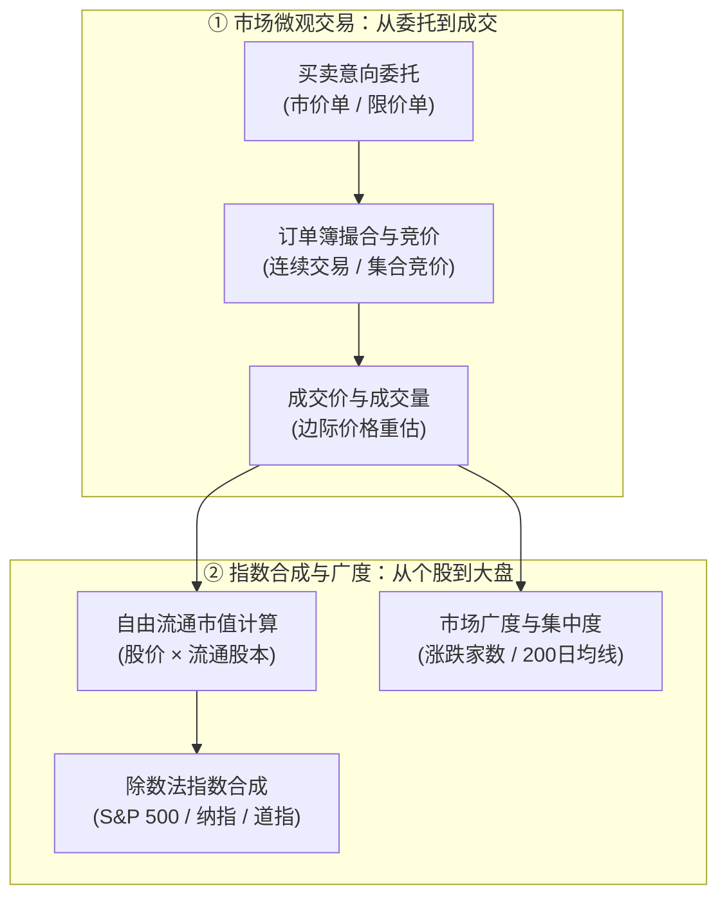
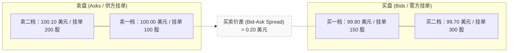
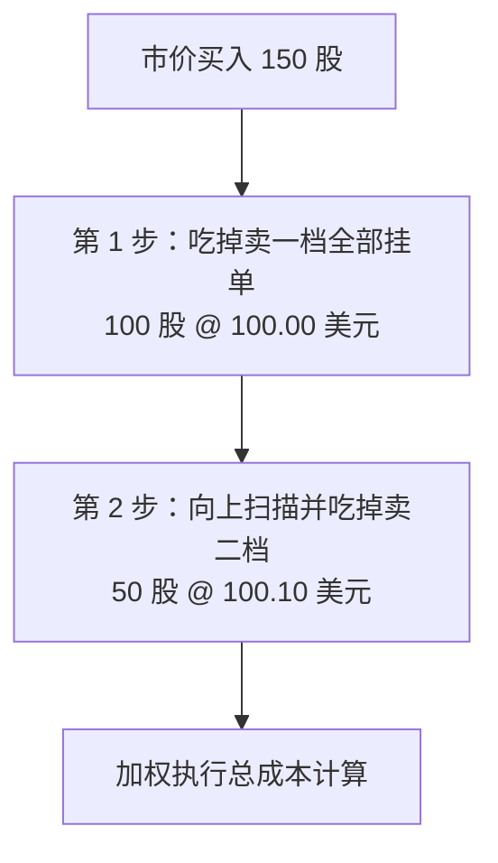
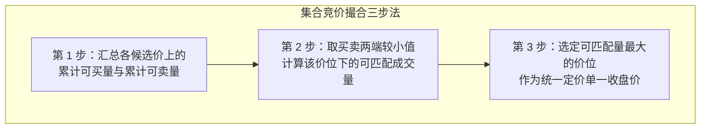
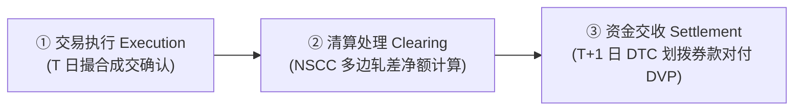
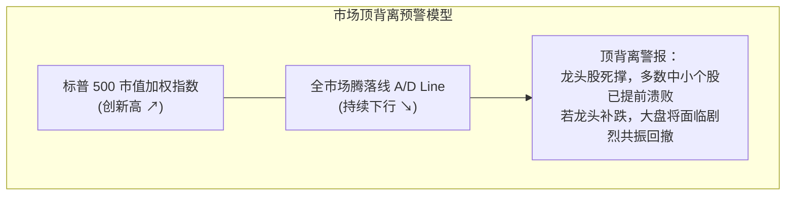
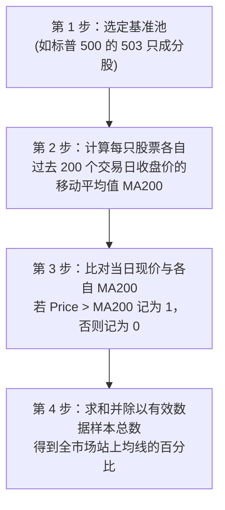
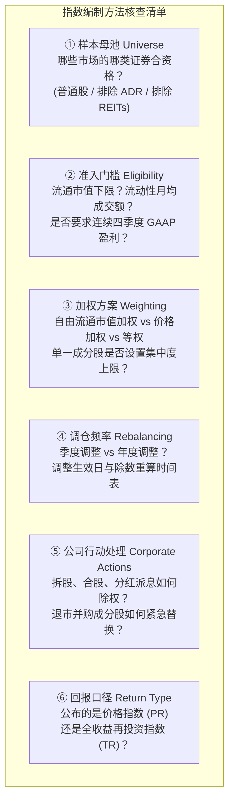
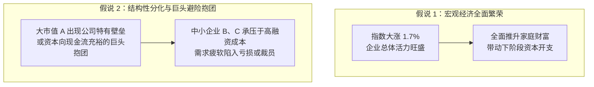
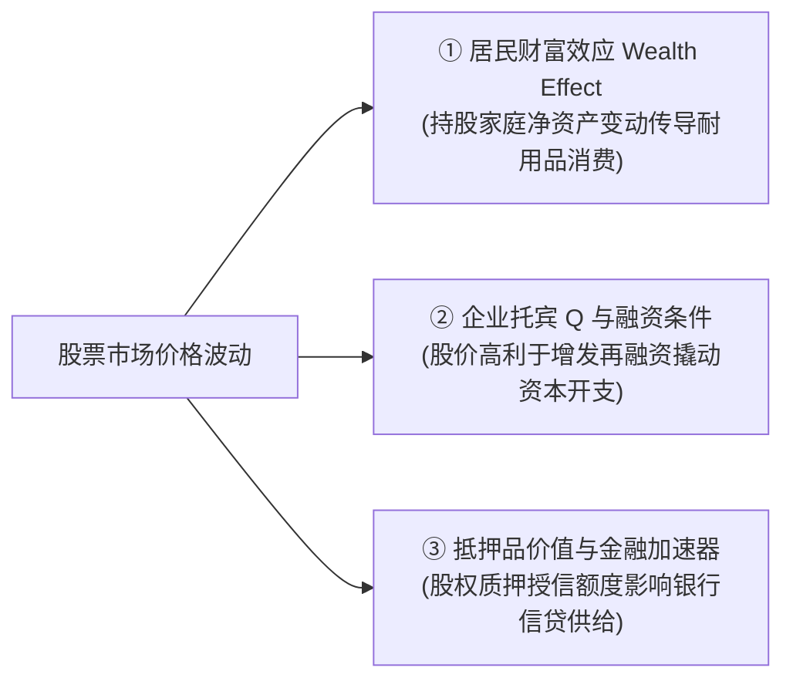

# 30 股票发行、交易与指数

[上一章](29-global-dollar.md) · [目录](./) · [下一章](31-corporate-earnings.md)

## 为什么“美股大涨”时，你的自选股却可能全线飘绿？

设想一个周五下午，你打开财经新闻，头条赫然写着：“标普 500 指数强势上涨 1.7%，创年内新高！”然而当你满心欢喜地打开自己的股票账户时，却愕然发现持仓里的 10 只股票中有 7 只在下跌，账户总资产不增反降。

是新闻播报错了？还是交易所算错了？

两者都没错。新闻里说的是“市值加权指数”，只要市值万亿美元的头部科技巨头大涨，就能凭借庞大的体量拉动整个大盘向上；而你的持仓是等额买入的具体公司，反映的是市场整体的“广度”。

理解股票市场，绝不是背诵几个股票代码，而是弄清屏幕上的数字究竟由怎样的制度与技术过程生成：
- 一笔买卖委托，如何在订单簿中演化为公开成交价？
- 交易所收盘的那一秒，收盘价为何不能随便抓取“最后一笔”？
- 市值加权、等权重与涨跌家数，为什么会向投资者传递截然相反的市场信号？

### 学习目标与前置知识

读完本章，你将能够：
1. 复述从下单委托、订单簿撮合、收盘竞价到 $T+1$ 清算结算的完整微观链条；
2. 读懂限价订单簿（LOB），计算市价单与限价单的实际加权成交均价；
3. 掌握集合竞价的“最大成交量原则”，手工推导竞价均衡价；
4. 区分价格回报与总回报，理解拆股、分红与除数调整如何保护指数连续性；
5. 亲手编制市值加权指数与等权指数，用数学公式分解个股对指数的百分点贡献；
6. 结合涨跌家数比、200 日均线比例与回撤分析，识别市场“虚假繁荣”与“集中抱团”。

本章不要求任何投资学背景，只需掌握简单的代数加减乘除与百分比计算。若需要复习计量口径，可随时回看[第 2 章](02-measurement.md)。

## 1. 股票价格先由交易形成，再由我们解释

### 1.1 买入股票，你到底买到了什么？

普通股（Common Stock）代表对一家公司的所有者权益（Equity），它既不是银行定期存款，也不是承诺固定偿还本息的债务凭证。

作为普通股股东，你拥有：
1. **剩余索偿权（Residual Claim）**：公司赚取的所有利润，在扣除供应商货款、员工薪酬、各项税费和债权人利息之后，剩余的所有价值归全体股东共有；但若公司破产清算，资产变现后必须先全额赔付债权人，普通股股东往往一无所获。
2. **投票权与治理权**：选举董事会、决定重大并购与章程修改。
3. **资本收益与现金分红权利**：公司可以选择将利润以现金股息发放，也可以保留在账上投资新项目，驱动股价上涨带来资本利得。

在纽约证券交易所或纳斯达克敲击键盘买入股票，你的钱给到了谁？
绝大多数情况下，你在**二级市场（Secondary Market）**向另一位想要离场的投资者买入了股份，你的资金流入了对方的银行账户，**上市公司账上一分钱新资金也没有增加**。只有在公司首次公开募股（IPO）或定向增发（SEO）等**一级市场（Primary Market）**发行新股时，资金才真正注入公司国库。

### 1.2 从委托到成交：限价订单簿（LOB）如何撮合价格

股票价格不是任何机构用公式钦定的，而是无数买家与卖家在交易场所中博弈博出来的。投资者向券商提交的委托主要分为两类：
- **市价单（Market Order）**：不限价格，要求“立即、以当前市场上最快可得的最优价格成交”。市价单保障了成交的速度，但不保障成交价格。
- **限价单（Limit Order）**：限定“买入最高不超过 $P$ 元”或“卖出最低不低于 $P$ 元”。限价单锁定了价格上限或下限，但如果市场价格远离你的限价，订单可能部分成交甚至完全无法成交。

所有未成交的限价单按照“价格优先、时间优先”的规则排列在交易所主机内，构成了**限价订单簿（Limit Order Book, LOB）**。

假设某只股票在某一瞬间的限价订单簿如下所示：

此时，如果交易者提交了一笔**以市价买入 150 股**的买单，系统将如何执行？

具体成交与金额对账为：
- 第一档成交：$100 \times 100.00 = 10{,}000\text{ 美元}$
- 第二档成交：$50 \times 100.10 = 5{,}005\text{ 美元}$
- 执行总成本：
  $$\text{总支出} = 10{,}000 + 5{,}005 = 15{,}005\text{ 美元}$$
- 平均成交价：
  $$\bar{P} = \frac{15{,}005}{150} \approx 100.0333\text{ 美元/股}$$

如果你当时看到屏幕上的“最新成交价”是 100.00 美元就误以为自己能以 100.00 美元买到全部 150 股，这就是忽略了流动性深度的代价。这多付出的 0.0333 美元/股，就是大单穿越订单簿带来的**价格冲击（Price Impact / Slippage）**。

### 1.3 市值膨胀，并不等于同等金额的现金“流入股市”

财经媒体常有这类惊悚标题：“某科技巨头市值单日暴增 1000 亿美元，千亿资金汹涌涌入股市！”

这完全是一种会计与统计上的错觉。假设该公司发行在外的总股本为 1 亿股，昨天收盘价为 100 美元（总市值 100 亿美元）。今天早盘开盘第一笔交易，仅有一位买家愿意以 101 美元向卖家买入仅仅 100 股。
此时，交易所系统更新该股票的“最新市场价”为 101 美元。
该公司的理论总市值瞬间变成了：
$$1\text{ 亿股} \times 101\text{ 美元} = 101\text{ 亿美元}$$

市值确实增加了 1 亿美元！但这 1 亿美元是**用边际交易价格对全市场存量股票的账面重估**。实际发生的真实交易金额仅仅是：
$$100\text{ 股} \times 101\text{ 美元} = 10{,}100\text{ 美元}$$

只要卖方惜售、买方迫切，极少量的资金就能撬动庞大的市值重估；反之，若恐慌蔓延，少量抛盘也可以让千百亿“市值”在几秒钟内化为乌有，没有任何同额的现金“流出”。

## 2. 连续成交之外：收盘价怎样形成？

### 2.1 为什么收盘价不能随便取“最后一笔连续成交”？

股票在常规交易时段每时每刻都在撮合，但在下午 4:00 交易钟声敲响的一刻，必须确定一个官方认可的**日终收盘价（Official Closing Price）**。

收盘价至关重要：
- 全球数万亿美元的共同基金与 ETF，需要在收盘后计算份额净值（NAV）；
- 标普 500 等主流指数在收盘后计算基准点位与调仓权重；
- 衍生品交易商以收盘价作为保证金核算与抵押品估值的基准。

如果收盘价简单采用下午 3:59:59 的最后一笔小额撮合成交，极容易被恶意的市场操纵者在收盘前一微秒用一手几十股的微型订单随意拉高或砸盘（Painting the Tape）。为此，纽约证券交易所（NYSE）和纳斯达克均采用严格的**收盘集合竞价（Closing Auction）**机制。

### 2.2 集合竞价机制：最大成交量原则

在常规交易时段结束前的数十分钟内，交易所开始收集专门参与收盘竞价的订单（如收盘市价单 MOC、收盘限价单 LOC），并在临近收盘时定期向市场发布竞价参考价与失衡信息（Imbalance）。在集合竞价撮合时刻，计算机系统只寻找一个单一价格，使得所有买卖委托在该价格下**能够实现最大的可匹配成交量**。

我们用一个规则精炼的简化竞价模型来演示这一机制：
候选价格仅有 99、100、101 美元；没有隐藏单与极端并列。

- 买方订单池：
  - 买单 A：上限 101 美元愿意买 100 股；
  - 买单 B：上限 100 美元愿意买 200 股；
  - 买单 C：上限 99 美元愿意买 100 股。
- 卖方订单池：
  - 卖单甲：下限 99 美元愿意卖 100 股；
  - 卖单乙：下限 100 美元愿意卖 150 股；
  - 卖单丙：下限 101 美元愿意卖 200 股。

系统如何筛选唯一的收盘竞价价格？

| 候选成交价 | 愿意买入的累计股数（买价上限 $\ge P$） | 愿意卖出的累计股数（卖价下限 $\le P$） | 可撮合配对股数 | 市场状态 |
| :--- | :--- | :--- | :--- | :--- |
| **99 美元** | $100 + 200 + 100 = 400$ 股 | $100$ 股 | $\min(400, 100) = \mathbf{100\text{ 股}}$ | 供不应求（买盘过剩 300 股） |
| **100 美元** | $100 + 200 = 300$ 股 | $100 + 150 = 250$ 股 | $\min(300, 250) = \mathbf{250\text{ 股}}$ | **成交量最大！买卖双方达成 250 股** |
| **101 美元** | $100$ 股 | $100 + 150 + 200 = 450$ 股 | $\min(100, 450) = \mathbf{100\text{ 股}}$ | 供过于求（卖盘过剩 350 股） |

竞价系统最终裁定：**官方收盘价定为 100 美元，一次性撮合成交 250 股**。
在 100 美元成交价下，所有愿意以 100 美元及以上买入的委托被满足了 250 股（剩余 50 股买单未满足按排队规则处理）；所有愿意以 100 美元及以下卖出的委托（100 股 + 150 股）全部全额成交。这个价格既不是买卖叫价的算术平均，也不是随意抓取的最后一跳，而是使全市场流动性获得最大释放的福利最大化点。

### 2.3 成交之后：T+1 清算与交收体系

在交易软件上看到“已成交”的绿色提示弹窗，证券交易在法律和资金层面并没有即时终结。

从 2024 年 5 月 28 日起，美国证券交易委员会（SEC）正式实施 **$T+1$ 标准结算周期**（交易日后一个营业日）。完整的生命周期必须经历三个独立环节：

1. **交易执行（Execution）**：买卖双方在交易所达成具有约束力的合同；
2. **清算（Clearing）**：由中央对手方（如美国全国证券清算公司 NSCC）介入，核对所有券商的买卖交易，进行**多边连续净额轧差（Continuous Net Settlement, CNS）**，计算出每家会员券商到底应收应付多少现金与股票净额；
3. **结算（Settlement）**：在 $T+1$ 日，通过存管信托公司（DTC）进行“券款对付”（Delivery versus Payment, DVP），现金与股票在中央存管账户之间完成终局划转。

理解 $T+1$ 的重要性在于：成交锁定了价格，但资金交收有时间差。如果一家高杠杆对冲基金在周一收盘后突遭暴跌面临保证金追缴，它不能等到周二结算之后才筹钱，资金断裂可能在周一盘后就会引爆流动性危机。

## 3. 股价曲线不等于股东财富曲线

### 3.1 拆股与合股：面团切块的游戏

当你看到某只科技巨头一夜之间股价从 1000 美元暴跌到 100 美元，跌幅高达 90%，是不是遭遇了灭顶之灾？

先看公司行动（Corporate Action）：这是发生了一次 1 拆 10（10-for-1 Split）的股票拆分。
- 拆股前：你持有 10 股，每股 1000 美元，持仓总市值 $= 10 \times 1000 = 10{,}000\text{ 美元}$；
- 拆股后：你持有 100 股，每股 100 美元，持仓总市值 $= 100 \times 100 = 10{,}000\text{ 美元}$。

拆股就像把一张 100 美元的大钞换成 10 张 10 美元零钱，或者把一张比萨饼从切 4 块变成切 8 块，公司的经营资产、未来盈利能力和股东总财富没有发生一丝一毫的实质改变。
相反，合股（Reverse Split）则是将多股合并为一股，常见于濒临退市、为了维持最低股价合规门槛（如 1 美元）的困境公司。

### 3.2 现金分红与除息日折价

许多初学者会问：“如果一家公司明天给每股分红 3 美元，我今天收盘前买入，明天拿到 3 美元现金再卖掉，岂不是稳赚无风险的 3 美元利润？”

这种天上掉馅饼的好事并不存在。公司向股东分红发放现金，这笔真金白银来自公司的银行存款。在**除息日（Ex-Dividend Date）**早晨，交易所会自动下调该股票的开盘参考基准价：
$$\text{除息后除息参考价} = \text{前一日收盘价} - \text{每股派息额}$$

假设股票除息前收盘价为 100 美元，派息 3 美元：
- 开盘基准机械调整为 $100 - 3 = 97\text{ 美元}$；
- 股东的财富结构变为：价值 97 美元的股票 + 3 美元应收现金股息 $= 100\text{ 美元}$。

分红不是凭空创造新财富，而是**将企业内留存的资产转化为投资者的现金流动性**。

### 3.3 价格回报与总回报必须分开

在量化回测或长期绩效评价中，混淆两类指数序列是灾难性的：
- **价格回报指数（Price Return Index）**：仅追踪股价变动，直接扣减分红除息。如果一只高股息股票 20 年不涨，但每年稳定派息 5%，其价格指数收益率为 0%；
- **全收益/总回报指数（Total Return Index）**：假设投资者在收到每一笔税后现金分红的当天，立即全额按照当日收盘价再投资买入该股票。

假设某只股票期初买入价为 100 美元，期末股价为 98 美元，期间每股派发现金红利 3 美元：
- 价格回报率（Price Return）：
  $$R_{\text{price}} = \frac{98 - 100}{100} = -2\%$$
- 简单总回报率（Total Return）：
  $$R_{\text{total}} = \frac{98 + 3 - 100}{100} = \frac{101 - 100}{100} = +1\%$$

从价格上看你亏损了 2%，但加上落袋的现金股息，你的实际资本实际上增长了 1%。在评估标普 500 等核心指数的几十年长周期复利表现时，必须严格采用总回报指数（S&P 500 TR），否则分红再投资的滚雪球效应将被完全低估。

## 4. 股票指数编制：大盘上涨不等于多数公司上涨

### 4.1 四类主流指数编制加权方式

指数是一组股票按照特定数学规则聚合而成的“晴雨表”。主流指数的编制规则截然不同：

| 指数类型 | 代表指数 | 加权计算逻辑 | 优缺点与经济特征 |
| :--- | :--- | :--- | :--- |
| **自由流通市值加权 (Float-Adjusted Cap Weighted)** | 标普 500 (S&P 500) 纳斯达克 100 | $w_i = \frac{P_i \times Q_{i, \text{float}}}{\sum P_j \times Q_{j, \text{float}}}$ | **宏观最主流**。反映全市场资本存量的整体损益；但巨头权重过大，可能掩盖中小个股疲弱。 |
| **价格加权 (Price Weighted)** | 道琼斯工业平均 (DJIA) | $w_i = \frac{P_i}{\sum P_j}$ | 历史遗留产物。股价高的公司权重极大，与市值无关；拆股会人为大幅削弱公司在指数中的影响力。 |
| **等权重加权 (Equal Weighted)** | 标普 500 等权 (RSP) | 每一个成分股权重恒定为 $\frac{1}{N}$ | 剔除市值龙头干扰，真实反映中位数企业的景气度；需要定期买跌卖平进行再平衡调仓。 |
| **市值加权但设上限 (Capped Cap Weighted)** | 纳斯达克 100 特殊再平衡 | 单一成分股权重上限（如 4.5% 或 8%） | 避免极端垄断巨头触发共同基金投资多元化合规红线。 |

### 4.2 动手算：用三家公司亲手编制一个指数

为了彻底看清“大盘上涨 1.7%”背后的数学本质，我们使用三家公司的迷你市场进行全程手算（股数单位：百万股，市值单位：百万美元）：

| 公司 | 起点股价 $P_0$ | 总股本 $Q$ | 自由流通比例 $f$ | 自由流通市值 $M_0$ | 组合起点权重 $w_0$ | 当期涨跌幅 $R$ | 期末市值 $M_1$ |
| :--- | :---: | :---: | :---: | :---: | :---: | :---: | :---: |
| **A 公司** | 100 美元 | 600 万股 | 100% | 600 百万美元 | **60%** | **+5%** | 630 百万美元 |
| **B 公司** | 50 美元 | 600 万股 | 50% | 150 百万美元 | **15%** | **-2%** | 147 百万美元 |
| **C 公司** | 25 美元 | 1000 万股 | 100% | 250 百万美元 | **25%** | **-4%** | 240 百万美元 |
| **全市场合计** | — | — | — | **1,000 百万美元** | **100%** | — | **1,017 百万美元** |

每家公司的自由流通市值计算公式为：
$$M_{i, 0} = P_{i, 0} \times Q_i \times f_i$$
总自由流通市值从期初的 $1{,}000$ 增加到期末的 $1{,}017$。

#### 1. 市值加权指数总回报率计算
市值加权指数的当期涨跌幅为：
$$R_{\text{cap}} = \frac{1{,}017 - 1{,}000}{1{,}000} = +1.7\%$$

我们也可以用**起点权重 $\times$ 个股收益率**进行严格贡献度分解（Contribution）：
$$\text{总收益} = \sum_{i} (w_{i, 0} \times R_i)$$
- A 公司的百分点贡献：$60\% \times (+5\%) = \mathbf{+3.0\text{ 个百分点}}$
- B 公司的百分点贡献：$15\% \times (-2\%) = \mathbf{-0.3\text{ 个百分点}}$
- C 公司的百分点贡献：$25\% \times (-4\%) = \mathbf{-1.0\text{ 个百分点}}$
- 合计指数收益：$+3.0\% - 0.3\% - 1.0\% = \mathbf{+1.7\%}$

请仔细端详这个结果：**三家公司中有两家在下跌，上涨公司比例只有 33.3%，但整个指数却大幅上涨了 1.7%！** 因为巨无霸 A 公司凭借 60% 的绝对权重，以一己之力（贡献 +3.0%）完全对冲并碾压了 B 与 C 的跌幅。

#### 2. 等权重指数（Equal Weight）的对照表现
如果投资者在起点将资金等分为三份（各持有 $\frac{1}{3}$）：
$$R_{\text{equal}} = \frac{+5\% + (-2\%) + (-4\%)}{3} = \frac{-1\%}{3} \approx \mathbf{-0.333\%}$$

等权指数的读数是**下跌 0.33%**。
当你同时观察到标普 500 市值加权指数大涨而标普 500 等权指数飘绿时，不用怀疑数据，这正是**市场广度恶化、上涨动能极度集中在极少数万亿级龙头股**的标准预警信号。

### 4.3 指数除数：怎样防止公司行动引起指数“虚假跳水”？

为了让庞大的千百亿市值变成普通人一眼看懂的点位（如 5000 点），指数引入了**除数（Divisor, $D$）**：
$$\text{指数点位 } I = \frac{\sum_{i} \text{自由流通市值}_i}{D}$$

在基期，若总自由流通市值为 $1{,}000$，设定除数 $D = 10$，基期指数为：
$$I_0 = \frac{1{,}000}{10} = 100.00\text{ 点}$$

在当期价格上涨后，总市值变为 $1{,}017$，指数点位变为：
$$I_1 = \frac{1{,}017}{10} = 101.70\text{ 点}$$

现在思考一个制度维护问题：假设周五收盘后，指数委员会宣布进行成分股例行调整，**剔除一家旧公司、纳入一家自由流通市值高出 50 百万美元的新公司**。在周一早盘开盘前，市场上所有股票价格均未发生任何变动，但指数总市值纯粹因为换了一家大公司，从 $1{,}000$ 变成了 $1{,}050$。

如果除数保持 $D = 10$ 不变，周一开盘点位将变为 $\frac{1{,}050}{10} = 105.00$ 点！这会导致指数在没有任何个股涨跌的情况下平白无故暴涨 5%，完全破坏了指数的时间序列连续性。

为了消除非市场交易因素引起的指数跳跃，指数编制机构必须执行**除数动态调整（Divisor Adjustment）**：
让调整前一刻的收盘指数点位，严格等于调整后一刻的理论点位：
$$\frac{\text{旧市值合计}}{D_{\text{旧}}} = I = \frac{\text{新市值合计}}{D_{\text{新}}}$$
$$D_{\text{新}} = \frac{\text{新市值合计}}{I} = \frac{1{,}050}{100} = \mathbf{10.50}$$

除数悄然上调至 10.50 后，周一早盘指数依然精确停留在 100.00 点。除数就像一个精密减速齿轮，将成分股增发、配股、并购退市和成分轮换全部平滑过滤。

## 5. 市场宽度与集中度：谁在推动行情？

### 5.1 涨跌家数比与腾落线（A/D Line）

分析大盘，不能只盯着市值加权指数的单一曲线。**市场宽度（Market Breadth）**回答的是：“这场胜利究竟是一个冲锋军团的普遍推进，还是三两个将军的孤军深入？”

最直观的广度指标是**上涨比例（Advance Ratio）**：
$$\text{上涨家数比例} = \frac{\text{上涨股票只数}}{\text{有效观察股票总只数}}$$

累积**腾落线（Advance-Decline Line, A/D Line）**则是将每日上涨家数减下跌家数的净值进行长期累加：
$$\text{A/D}_{t} = \text{A/D}_{t-1} + (\text{上涨家数}_t - \text{下跌家数}_t)$$

当指数屡创新高，而 A/D 线持续向下倾斜，说明大市值龙头股在掩护资金从大批中小股票中悄然撤退。这种“背离”往往是牛市末期流动性衰减的典型特征。

### 5.2 200 日均线比例的生成逻辑

“站上 200 日均线的股票比例”是宏观与技术策略中衡量中长期趋势健康度的核心工具。它绝不是把大盘指数的走势画一条均线，而是**自下而上对篮子里的每一只股票进行离散状态判定**：

在强劲的全面牛市中，该比例通常维持在 70%—90% 的高位；若大盘指数处于高位横盘，但站上 200 日均线的股票比例从 80% 一路滑落至 40% 以下，意味着过半数的个股已经跌入中期技术性熊市。

## 6. 从收益率到回撤：复利与下行风险的数学

### 6.1 复利的非对称性：跌下去容易，涨回来难

投资中的百分比变化具有先天的非对称性（Asymmetry）：
如果你有 100 美元，第一天上涨 10%，第二天随后下跌 10%：
- 第一天结束：$100 \times (1 + 10\%) = 110\text{ 美元}$；
- 第二天结束：$110 \times (1 - 10\%) = 99\text{ 美元}$！

累计财富不是盈亏相抵为 0，而是实打实**亏损了 1%**。

更严峻的是回本所需的涨幅：
- 亏损 10%，需要上涨 $\frac{100}{90} - 1 \approx +11.11\%$ 才能回本；
- 亏损 25%，需要上涨 $\frac{100}{75} - 1 \approx \mathbf{+33.33\%}$ 才能回本；
- 亏损 50%，需要暴涨 $\frac{100}{50} - 1 = \mathbf{+100\%}$（翻倍）才能回本！

### 6.2 最大回撤（Maximum Drawdown）的严格计算

**当前回撤（Current Drawdown）**衡量当前价格相对历史最高点的跌幅：
$$\text{Drawdown}_t = \frac{P_t}{\max_{\tau \le t} P_\tau} - 1$$

**最大回撤（Maximum Drawdown, MDD）**则是在整个观察窗口 $[0, T]$ 内曾经出现过的最惨烈资金缩水幅度：
$$\text{MDD} = \min_{t \in [0, T]} \left( \frac{P_t}{\max_{\tau \le t} P_\tau} - 1 \right)$$

设某投资组合在过去两年的净值路径为：从 100 点起步，最高冲至 120 点，随后在危机中一路滑落至 90 点，最后反弹至 105 点。
- 相对起点的累计收益率：$\frac{105 - 100}{100} = +5\%$；
- 期间经历的最大回撤点发生在跌至 90 点时：
  $$\text{MDD} = \frac{90 - 120}{120} = \frac{-30}{120} = \mathbf{-25\%}$$
- 经历 25% 的回撤后，从 90 点爬回到 120 点的历史峰值，需要的后续涨幅是：
  $$\text{恢复涨幅} = \frac{120 - 90}{90} = \frac{30}{90} \approx \mathbf{+33.33\%}$$

## 7. 原始资料带读：如何阅读官方指数说明书（Methodology）

不要轻信第三方软件里的花哨代码，学会直接阅读标普道琼斯指数公司（S&P DJI）或纳斯达克的官方编制方法说明书。

查阅一份指数编制说明书，重点穿透以下六大核心要素：

打开 [S&P 500 官方方法手册](https://www.spglobal.com/spdji/en/methodology/article/index-mathematics-methodology/)，你可以看到：标普 500 绝非机械抓取美国市值前 500 大公司的软件排行榜，它设有一个由资深专家组成的指数委员会，要求纳入公司最近四个季度的累计 GAAP 净利润必须为正，且最新单季利润也必须为正。这也是为什么特斯拉在 2020 年满足连续四季度盈利前，即使市值早已超越绝大部分成分股，也一直无法被纳入标普 500 的制度原因。

## 8. 完整案例：大盘上涨 1.7%，能否推导经济全面复苏？

### 8.1 数据事实与计算

沿用第 4 节的教学市场：
- 观察标的：公司 A（权重 60%）、公司 B（权重 15%）、公司 C（权重 25%）；
- 当期收益率：A 公司 $+5\%$，B 公司 $-2\%$，C 公司 $-4\%$；
- 200 日均线数据：A、B、C 现价分别为 105、49、24 美元，而各自的 200 日均线分别为 95、52、26 美元。

**计算结果对账**：
1. 市值加权指数收益率：$60\% \times (+5\%) + 15\% \times (-2\%) + 25\% \times (-4\%) = \mathbf{+1.7\%}$；
2. 等权组合收益率：$\frac{5\% - 2\% - 4\%}{3} \approx \mathbf{-0.333\%}$；
3. 上涨家数比例：$\frac{1}{3} \approx \mathbf{33.3\%}$；
4. 站上各自 200 日均线的股票比例：只有 A（$105 > 95$），B（$49 < 52$）与 C（$24 < 26$）均处于均线下方，比例同样为 $\frac{1}{3} \approx \mathbf{33.3\%}$；
5. A 公司对指数的单一贡献度高达 $+3.0$ 个百分点。

### 8.2 竞争性假设与归因推演

面对这份报告，财经分析师提出了两种截然不同的假说：

哪一种假说更符合证据？
显而易见，假说 1 被数据无情证伪。等权指数飘绿（$-0.33\%$）、三分之二的股票下跌且跌破中期生命线（200 日均线），明确表明当前市场**不是全面繁荣**。涨幅完全是由 A 公司的孤军奋战拉动。

### 8.3 合格的专业分析陈述

> “本期基准市值加权指数上涨 1.7%，但涨势表现出极高的结构集中度：权重占比 60% 的巨头 A 贡献了 +3.0 个百分点的涨幅，掩盖了 B 与 C 的下挫。同成分等权重指数实际收跌 0.33%，全市场仅有 33.3% 的公司维持在 200 日均线上方。当前数据不支持‘宏观总需求普遍回暖’的判断，而更支持‘结构性抱团或大公司垄断利润扩张’的假说。后续需重点跟踪 B、C 所属行业的订单与再融资条件，以及 A 公司业绩指引能否支撑高估值溢价。”

## 9. 股市与宏观经济：互相影响，但绝不能等同

### 9.1 为什么股市不是美国 GDP 的高频版本？

1. **统计口径不同**：GDP 统计的是美国地理疆界内的增加值总和；而标普 500 大公司的收入有近 40% 来自海外跨国业务。海外强、本土弱时，美股依然能大涨。
2. **成分覆盖不同**：美国经济中创造了大量就业的私营中小微企业、市政公共部门均不在股市中上市；股市高度偏向科技、金融与高端制造等轻资产或高毛利行业。
3. **资本与劳动的分配**：GDP 增长如果伴随着劳工薪酬大幅上涨、挤压了资本所有者的利润率，可能出现“宏观 GDP 走强，企业净利润承压，股市大跌”的情境。

### 9.2 股市变动对实体经济的真实反馈渠道

股市虽然不是 GDP 的简单镜像，但股价的剧烈变化会通过以下三条宏观管道反哺实体经济：

## 10. 练习与参考答案

### 练习 1：二级市场交易与公司融资

你在手机交易软件上以每股 50 美元买入 100 股苹果公司股票，共支付 5,000 美元（忽略佣金）。请问这 5,000 美元是否打进了苹果公司的银行账户并支持了其 iPhone 研发？如果是苹果公司股价全线上涨推动总市值增加 100 亿美元，是否等于苹果公司今天成功融到了 100 亿美元现金？

参考答案与推理

**不对**。
你在二级市场上是向另一名卖出股票的外部投资者购买的，你的 5,000 美元直接转入了该卖家的经纪账户，苹果公司的现金流未受任何直接影响，也未向研发部门注资一分钱。
市值增加 100 亿美元是基于最新边际成交价对发行在外全部股本的账面价值重估，绝不等于公司账户获得了 100 亿美元的实际融资。公司要获得真实资金，必须通过增发新股（SEO）等一级市场行为，且增发价格还会受到市场承接力与折价的制约。

### 练习 2：限价订单簿与加权成交价计算

某股票当前限价订单簿如下：
- 卖一档：50.00 美元，挂单 100 股；
- 卖二档：50.20 美元，挂单 100 股。
假设市场无其他挂单变动，你提交了一笔**以市价买入 150 股**的买单。
1. 计算你的实际成交总金额和每股加权平均成交价。
2. 如果你提交的是一张**限价 50.00 美元买入 150 股**的买单，结果会怎样？

参考答案与推理

1. 市价单执行过程：
   - 扫掉卖一档：$100\text{ 股} \times 50.00 = 5{,}000\text{ 美元}$；
   - 扫掉卖二档：$50\text{ 股} \times 50.20 = 2{,}510\text{ 美元}$；
   - 总成本为：$5{,}000 + 2{,}510 = \mathbf{7{,}510\text{ 美元}}$；
   - 平均成交价：$\frac{7{,}510}{150} \approx \mathbf{50.0667\text{ 美元/股}}$。
2. 限价 50.00 美元买入 150 股：
   - 只能在 50.00 美元的价格立即匹配撮合成交卖一档的 100 股；
   - 剩余未满足的 50 股买单无法在 50.20 美元的卖二档成交，将变成挂在买一档（50.00 美元）的未成交委托继续排队等待新的市价卖单。

### 练习 3：收盘集合竞价均衡价手算

采用最大成交量撮合原则，候选成交价格仅有 100、101、102 美元。买卖订单如下：
- 买方委托：上限 102 愿买 100 股；上限 101 愿买 100 股；上限 100 愿买 200 股。
- 卖方委托：下限 100 愿卖 150 股；下限 101 愿卖 100 股；下限 102 愿卖 100 股。
哪一个价格能够成为官方集合竞价收盘价？撮合成交多少股？

参考答案与推理

我们对三个候选价分别计算累计可买量、累计可卖量及可撮合量：
- **候选价 100 美元**：
  - 买方累计（限价 $\ge 100$）：$100 + 100 + 200 = 400$ 股；
  - 卖方累计（限价 $\le 100$）：$150$ 股；
  - 可撮合匹配量：$\min(400, 150) = 150$ 股。
- **候选价 101 美元**：
  - 买方累计（限价 $\ge 101$）：$100 + 100 = 200$ 股；
  - 卖方累计（限价 $\le 101$）：$150 + 100 = 250$ 股；
  - 可撮合匹配量：$\min(200, 250) = \mathbf{200\text{ 股}}$。
- **候选价 102 美元**：
  - 买方累计（限价 $\ge 102$）：$100$ 股；
  - 卖方累计（限价 $\le 102$）：$150 + 100 + 100 = 350$ 股；
  - 可撮合匹配量：$\min(100, 350) = 100$ 股。

**结论**：在 **101 美元** 价格下可撮合 **200 股**（成交量最大），故官方收盘价定为 101 美元。此时所有愿意以 101 及以上买入的买单全部全额成交；卖方在 101 及以下有 250 股挂单，其中 200 股成交，剩余 50 股按排队规则未获满足。

### 练习 4：拆股与价格回报/总回报辨析

1. 你持有某公司股票 10 股，买入价 100 美元。公司执行 1 拆 2，除权后股价机械调整为 50 美元。你的持股数量与总持仓市值发生何种变化？你是否蒙受了 50% 的亏损？
2. 另一只股票期初买入价 100 美元，期末股价为 98 美元，期间每股派发现金股息 3 美元。分别计算其价格回报率和简单持有期总回报率。

参考答案与推理

1. 拆股后持股数变为 $10 \times 2 = 20$ 股，总市值仍为 $20 \times 50 = 1{,}000$ 美元。纯粹的拆分没有改变公司净资产，股东没有蒙受任何经济损失。
2. 收益率计算：
   - 价格回报率：$R_{\text{price}} = \frac{98 - 100}{100} = \mathbf{-2\%}$；
   - 总回报率：$R_{\text{total}} = \frac{98 + 3 - 100}{100} = \mathbf{+1\%}$。

### 练习 5：市值加权与等权指数的背离计算

某微型指数仅由甲、乙两只股票组成，起点权重分别为 80% 和 20%。本期无股息和增减资行动，甲股票上涨 3%，乙股票下跌 8%。
分别计算本期市值加权回报率与起点等权重回报率。这组数据是否矛盾？它揭示了怎样的市场特征？

参考答案与推理

- 市值加权收益率：
  $$R_{\text{cap}} = 0.80 \times (+3\%) + 0.20 \times (-8\%) = +2.4\% - 1.6\% = \mathbf{+0.8\%}$$
- 等权重收益率：
  $$R_{\text{equal}} = \frac{+3\% + (-8\%)}{2} = \mathbf{-2.5\%}$$

**结论**：并不矛盾。市值加权反映大盘存量资本增值（受 80% 高权重的甲股票拉动而收涨 0.8%）；等权反映个股平均表现（平均下跌 2.5%）。这说明市场上涨动能高度脆弱并集中于极少数权重股，中小市值股票处于下跌失血状态。

### 练习 6：指数除数调整计算

指数维护前，自由流通市值合计为 2,000 百万美元，当前除数 $D = 20$，基准点位 $I = 100$ 点。现因成分股优化替换，新纳入一只大市值股票，导致总自由流通市值瞬间变为 2,100 百万美元（成分股价格本身无波动）。
为保持指数连续性，新的除数 $D_{\text{new}}$ 应调整为多少？若不调整，会产生什么虚假失真？

参考答案与推理

根据除数调整规则：
$$D_{\text{new}} = \frac{\text{新市值合计}}{I_{\text{原}}} = \frac{2{,}100}{100} = \mathbf{21.00}$$
若不调整除数而仍沿用 20，指数点位将机械跳升至 $\frac{2{,}100}{20} = 105.00$ 点，造成指数在没有任何市场交易涨幅的情况下凭空虚假暴涨 5%。

### 练习 7：有效观察样本与幸存者偏差

某分析师跟踪 50 只中小市值股票构成的样本池，某日有 5 只股票停牌且无有效价格，剩余 45 只中有 27 只上涨。
1. 该报告应如何披露该样本的上涨比例与数据覆盖率？
2. 为什么不能直接拿今天存活下来的 50 只成功上市公司名单去回溯倒推十年前全市场的上涨广度？

参考答案与推理

1. 有效上涨比例应报告为 $\frac{27}{45} = \mathbf{60\%}$，同时必须明确披露有效覆盖率为 $\frac{45}{50} = \mathbf{90\%}$，并注明 5 只停牌。绝不能将停牌缺失的 5 只股票强行计为“未上涨”而直接汇报 $\frac{27}{50} = 54\%$，除非有明确统计说明。
2. 这是典型的**幸存者偏差（Survivorship Bias）**。今天存活的 50 家成功公司在过去十年必然表现卓越，而过去十年中被破产清算、退市、摘牌的失败公司在今天的样本池中已经被彻底剔除。直接用今天的存续名单回测，会系统性人为拔高历史收益率与上涨广度。

### 练习 8：回撤与回本涨幅计算

某股票指数从 100 点起步，最高攀升至 120 点，随后遭遇熊市下挫至 90 点。
计算：
1. 相对起点的累计收益率；
2. 相对历史峰值的当前回撤幅度；
3. 从 90 点恢复到 120 点历史峰值所需的后续涨幅。
4. 能否根据历史最大回撤为 25%，就断言未来的最大亏损绝不会超过 25%？

参考答案与推理

1. 起点累计收益率：$\frac{90 - 100}{100} = \mathbf{-10\%}$；
2. 相对峰值回撤：$\frac{90 - 120}{120} = \mathbf{-25\%}$；
3. 恢复到峰值所需涨幅：$\frac{120 - 90}{90} = \frac{30}{90} \approx \mathbf{+33.33\%}$；
4. **不能**。历史最大回撤只是所选历史样本期间已经发生过的已实现最差路径，绝不构成未来极端尾部风险的绝对下限。

### 练习 9：阅读主流指数编制方法

对比标普 500、道琼斯工业平均指数（DJIA）与纳斯达克 100 指数：
为什么“股价最高的公司在道指中权重大，但在标普 500 中权重不一定大”？纳斯达克 100 能否等同于“全美科技行业股票”？

参考答案与推理

- 道指是**价格加权指数**，个股权重仅由每股单价决定，单价越高的股票权重越大，不论其总市值大小；而标普 500 是**自由流通市值加权指数**，个股权重取决于“股价 $\times$ 流通股本”。一只股票如果单价极高（如 500 美元）但总股本很少，在道指中名列前茅，在标普 500 中权重可能微不足道。
- 纳斯达克 100 **不能**等同于全美科技股票。首先，它限定在纳斯达克挂牌上市的最大 100 只**非金融公司**，排除了纽交所挂牌的科技龙头；其次，纳斯达克 100 中包含零售（如 Costco）、运输、生物医药等非科技行业；再次，全美大量科技小盘股并不在该指数覆盖范围内。

### 练习 10：撰写结构化市场解读

假定某交易日：标普 500 市值加权指数上涨 1.0%，同成分等权重指数下跌 0.5%，全市场 60% 的个股收跌，且单一龙头股 X 贡献了 +1.4 个百分点。此时宏观利率与企业盈利预期数据尚未发布。
请写一段专业且具备边界感的收盘简评，严禁直接得出“牛市全面繁荣”或“大盘即将崩盘”的极端断言。

参考答案与推理

> “今日大盘呈现极端的结构分化特征：标普 500 市值加权指数收涨 1.0%，但收益几乎完全由龙头股 X 独立支撑（单一贡献达 +1.4 个百分点，抵消了其余成分股合计 -0.4 个百分点的负贡献）。标普等权指数收跌 0.5%，且 60% 的个股录得下跌，表明多数个股表现疲弱。当前涨势不属于全市场广泛参与的系统性行情，投资者切勿基于大盘点位盲目推导宏观基本面全面向好。后续需密切关注龙头 X 的驱动因素（公司特定利好抑或避险资金抱团），并核查明日即将公布的利率与业绩指引对更广泛企业融资成本的传导。”

## 本章小结与下一步

股票市场的理解必须穿透两个世界：
1. **微观现实中**：订单簿里瞬息万变的市价与限价博弈，集合竞价中的最大成交量撮合，以及 $T+1$ 背后中央清算机构的多边净额轧差。
2. **宏观屏幕上**：边际定价带来的市值重估，流通市值加权产生的龙头遮蔽效应，以及指数除数调整所维系的连续性。

看懂了“指数涨跌”的由来，下一步我们要穿透股价背后的基本面支柱：公司如何创造利润？这笔利润又如何在财务报表中被计量并被华尔街分析师赋予预期？
下一章我们将进入[第 31 章：企业盈利、财报与预期](31-corporate-earnings.md)。

[上一章](29-global-dollar.md) · [目录](./) · [下一章](31-corporate-earnings.md)
