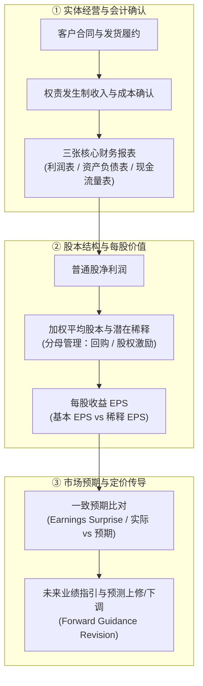
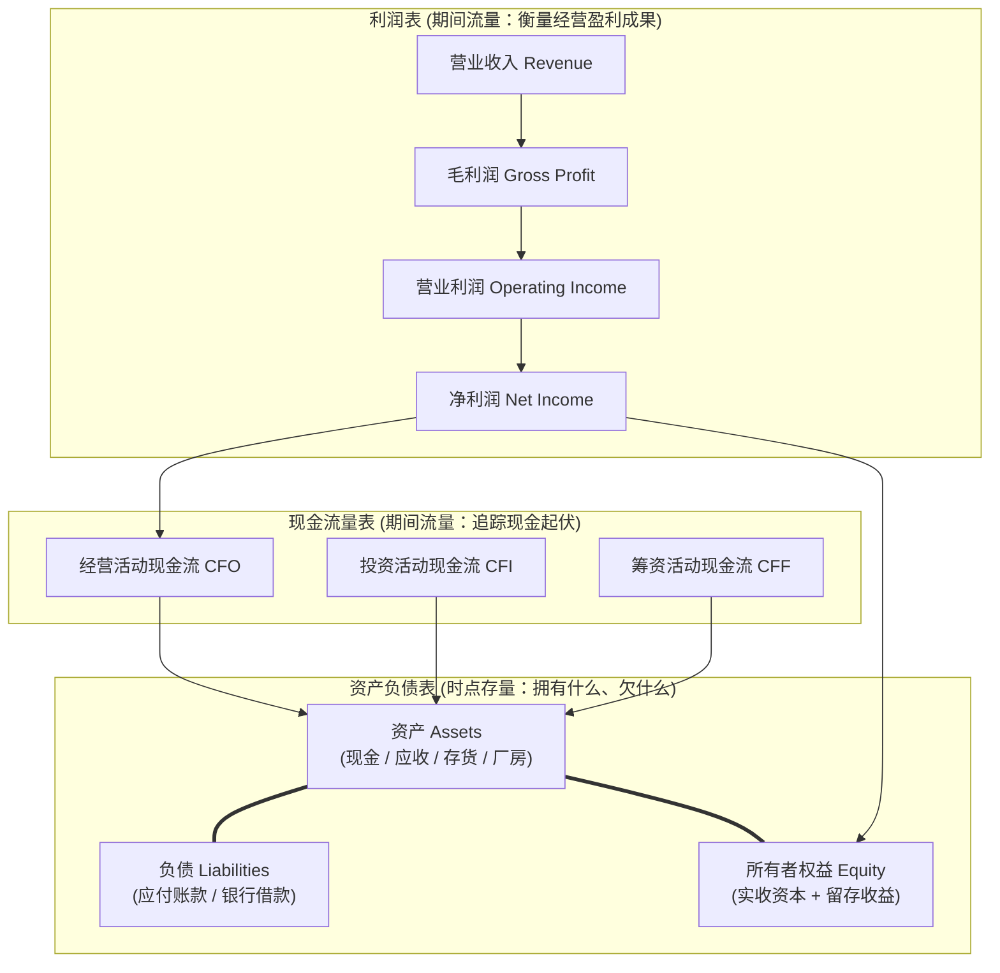
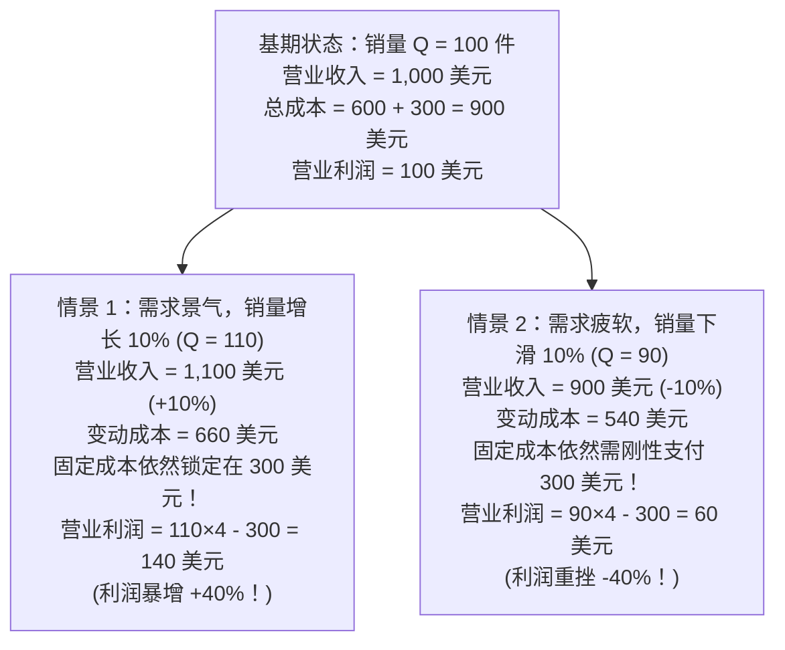
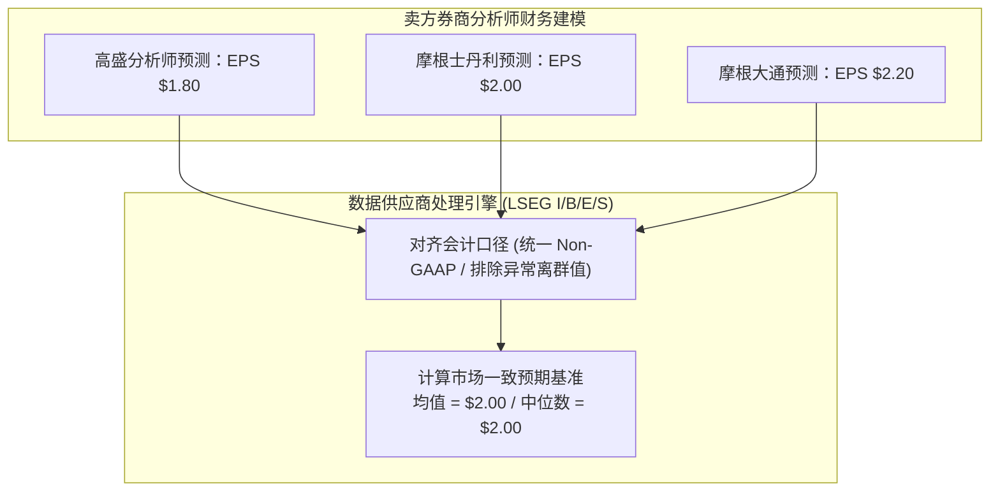
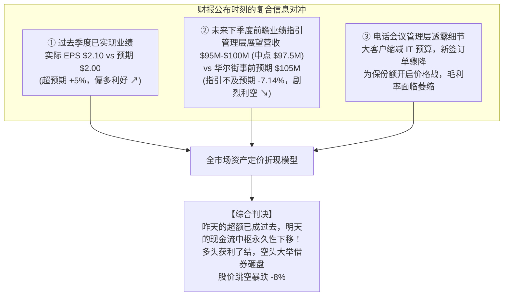

# 31 企业盈利、财报与预期

[上一章](30-equity-market.md) · [目录](./) · [下一章](32-equity-valuation.md)

## 为什么销售大增 20%，股价却可能在第二天闪崩？

设想这样一个真实的财报季戏剧性场景：一家明星科技巨头刚刚发布季报，宣布其营业收入创下历史新高、同比增长 20%，各大新闻媒体纷纷推送“业绩大捷”。然而第二天美股开盘，该股不仅没有高开，反而在短短半小时内暴跌 8%，市值蒸发数千亿美元。

与此形成鲜明对照的是，另一家传统工业企业的季度净利润腰斩断崖式下跌 50%，但股价却在盘前应声大涨 12%。

为什么“好消息”换来暴跌，而“坏消息”却迎来暴涨？

因为在华尔街和专业的资产定价体系中：
1. **销售额不等于净利润**：高歌猛进的营收背后，可能隐藏着原材料与劳动力成本的剧烈攀升，甚至出现“卖得越多、亏得越惨”的增收不增利；
2. **会计净利润不等于真金白银的现金**：根据权责发生制，很多利润以“应收账款”的形式挂在账上，若客户无法按期支付，账面繁荣随时会化为坏账危机；
3. **已实现的过去不等于未来的估值基石**：金融市场是“面向未来贴现”的机器。昨天的利润再耀眼，那已是沉没历史；只要公司在财报电话会上对**下季度或全年的业绩指引（Forward Guidance）**稍有松口，投资者就会毫不留情地下调未来几十年的现金流折现模型。

### 学习目标与前置知识

读完本章，你将能够：
1. 掌握权责发生制原则，区分订单、收入与现金收款三个不同时点；
2. 贯通三张财务报表的勾稽关系，用间接法手算将账面净利润调节为经营活动现金流；
3. 掌握经营杠杆原理，定量推导为什么销量变动 10% 会引发利润变动 40%；
4. 区分加权平均股数、期末股数与稀释股数，复算上市公司年报中的基本 EPS 与稀释 EPS；
5. 读懂华尔街“一致预期”（Consensus Estimates）的生成规则，量化计算超预期幅度（Earnings Surprise）；
6. 结合管理层前瞻指引与分析师预测修订，解释“业绩超预期但股价大跌”的核心机制。

本章不预设读者具备深厚的会计学基础，只需了解基础加减乘除。若需复习时间序列口径，可参考[第 2 章](02-measurement.md)与[第 3 章](03-releases-and-vintages.md)。

## 1. 财报不是问卷：从一笔业务到公开披露

### 1.1 订单、收入与收款是三个不同的时点

理解财报的第一法则，是建立**权责发生制（Accrual Basis Accounting）**的时空观念。

假设一家软件开发企业与客户做生意：
- **12 月**：双方签署一份价值 120,000 美元的软件实施合同；
- **次年 1 月**：企业完成软件交付部署，客户正式验收，满足收入确认标准；
- **次年 3 月**：客户财务部审批完毕，将 120,000 美元转入企业银行账户。

这三个时点的财务记录截然不同：
1. **12 月**仅仅取得了商业订单（Backlog），不能在利润表上记一分钱收入；
2. **1 月**满足履约义务，确立了向客户收取对价的合法权利，此时在利润表确认 120,000 美元收入，同时在资产负债表挂上 120,000 美元的“应收账款”（Accounts Receivable）；
3. **3 月**收到真金白银，银行存款增加，同时冲减应收账款，**绝不能在 3 月再确认一次收入**。

正因为收入按业务实质确认而非以钱是否到账为准，投资者才必须警惕：如果一家公司的营业收入连年猛增，但资产负债表上的应收账款以更夸张的速度膨胀，且经营现金流长期为负，这往往意味着产品可能被客户压货、回款艰难，甚至是财务舞弊的早期征兆。

### 1.2 三张财务报表的内在勾稽网络

任何一家现代化企业的运营脉搏，都被记录在相互咬合的三张报表中：

| 报表名称 | 时间属性 | 回答的核心问题 | 最致命的认知误区 |
| :--- | :--- | :--- | :--- |
| **利润表 (Income Statement)** | 一段会计期间 | 扣除所有发生的成本与费用后，企业赚取了多少会计净收益？ | **误区**：以为净利润就是企业账上多出来的现金。 |
| **资产负债表 (Balance Sheet)** | 某个特定截面时点 | 在这特定一秒，企业控制着什么资产，背负着什么债务，剩余多少股东权益？ | **误区**：以为账面股东权益就等于股票的二级市场总市值。 |
| **现金流量表 (Cash Flow Statement)** | 一段会计期间 | 公司的现金到底从哪个水龙头流进来、从哪个管道流出去？ | **误区**：看到借债拿到 1 亿美元现金，误以为主营业务大卖。 |

资产负债表遵循最根本的会计恒等式：
$$\text{资产 (Assets)} = \text{负债 (Liabilities)} + \text{所有者权益 (Stockholders' Equity)}$$

这条等式衡量的是历史成本与会计账面值，它不会自动把企业的专利商誉、品牌忠诚度或未来增长前景打包算进去。二级市场股票总市值，是全市场投资者对未来所有现金流贴现形成的边际交易总价，它常常数倍于账面所有者权益（表现为高市净率 P/B）。

### 1.3 动手推演：一个小公司的全流程财务对账

为了让这三张表彻底活起来，我们跟踪一家迷你教学公司的完整生命周期（货币单位：美元）：
- **年初状态**：
  - 资产端：现金 100 美元，存货 100 美元（总资产 200 美元）；
  - 负债与权益端：欠供应商货款 50 美元，所有者权益 150 美元（$200 = 50 + 150$）。
- **年内依次发生三桩业务**：
  1. 销售并交付全部存货，合同总金额 150 美元。现场收到客户现金 120 美元，剩余 30 美元允许客户挂账（形成应收账款）；
  2. 以现金支付工人工资 20 美元；
  3. 以现金全额偿还年初欠供应商的应付账款 50 美元。

#### 1. 利润表怎么算？
$$\text{营业收入 } 150 - \text{销货成本 (COGS) } 100 - \text{工资费用 } 20 = \mathbf{\text{净利润 } 30\text{ 美元}}$$
（请注意：销货成本对应的是消耗掉的那批存货的原值，与本期有没有付清供应商货款毫无关系。）

#### 2. 现金流量表（直接法）怎么算？
$$\text{销售收现 } 120 - \text{付现工资 } 20 - \text{付供应商欠款 } 50 = \mathbf{\text{经营现金净流入 } 50\text{ 美元}}$$

#### 3. 期末资产负债表对账
- 现金余额：年初 $100 + 50 = \mathbf{150\text{ 美元}}$；
- 应收账款：客户未付款项 $= \mathbf{30\text{ 美元}}$；
- 存货：已全部卖空 $= \mathbf{0\text{ 美元}}$；
- **资产合计**：$150 + 30 + 0 = \mathbf{180\text{ 美元}}$；
- 应付账款：已全额还清 $= \mathbf{0\text{ 美元}}$；
- **所有者权益**：年初留存 $150 + \text{本年净利润 } 30 = \mathbf{180\text{ 美元}}$；
- 完美平衡：$\text{资产 } 180 = \text{负债 } 0 + \text{权益 } 180$。

#### 4. 间接法：从净利润如何一步步推导出现金流？
上市公司年报中最常用的编制方法是**间接法（Indirect Method）**：以净利润为起点，反向剔除营运资本的增减变动：

$$\begin{aligned}
\text{经营活动现金流 (CFO)} &= \text{净利润} \\
&\quad - \Delta\text{应收账款} \quad \text{（记了收入但没收现，扣减现金）} \\
&\quad + \Delta\text{存货减少} \quad \text{（销售消耗了旧存货，释放现金）} \\
&\quad - \Delta\text{应付账款减少} \quad \text{（归还了旧欠款，消耗现金）}
\end{aligned}$$

代入本例数据核算：
$$\text{CFO} = 30 - 30 + 100 - 50 = \mathbf{50\text{ 美元}}$$

间接法清晰地揭示了净利润（30 美元）与经营现金流（50 美元）产生 20 美元差额的全部秘密：存货大举变现释放了 100 美元现金，但部分被新增的 30 美元应收账款和偿还的 50 美元债务所抵消。

### 1.4 资本开支与自由现金流（FCF）

如果企业花费 100 美元采购了一台预计使用 5 年的高科技机床，这 100 美元为什么不在当年作为费用一次性扣光？
因为机床将在未来 5 年内持续创造产出。根据配比原则，这笔 100 美元支出被称为**资本性支出（Capital Expenditures, CapEx）**，在现金流量表上体现为“投资活动现金流出”，在资产负债表上计入固定资产，然后通过每年的**折旧（Depreciation）**分摊进入利润表：
$$\text{年直线折旧额} = \frac{100}{5} = 20\text{ 美元/年}$$

分析师最看重的指标之一是**自由现金流（Free Cash Flow, FCF）**：
$$\text{自由现金流 (FCF)} = \text{经营活动现金流 (CFO)} - \text{资本开支 (CapEx)}$$

自由现金流代表企业在维护现有运营、购置必要设备之后，真正能够完全自主支配的“自由现金”。它可以用来给股东派发现金股息、在二级市场回购股票，或者提前偿还高息负债。

## 2. 从企业经营到每股收益：EPS 的分母管理

### 2.1 经营杠杆：为什么销售额变动 10%，利润会爆发式增长 40%？

许多初入市场的投资者常常惊讶于科技股或重工企业的利润弹性：为什么收入仅仅微幅增长，利润就能翻倍？

其背后的物理学引擎被称为**经营杠杆（Operating Leverage）**。
企业的总成本结构可以拆解为两部分：
- **固定成本（Fixed Costs, $F$）**：厂房租金、研发折旧、行政管理人员薪资等，在一定产能范围内不随销量增减而变化；
- **变动成本（Variable Costs, $V$）**：每多生产一件产品所需的原材料、计件工人工资等。

企业的营业利润方程为：
$$\pi = Q \times (P - V) - F$$
其中 $Q$ 为销售数量，$P$ 为产品单价，$P - V$ 为单位边际贡献。

我们用一组经典数据来见证杠杆的魔力：
设某企业固定成本 $F = 300\text{ 美元}$，产品售价 $P = 10\text{ 美元}$，单位变动成本 $V = 6\text{ 美元}$（单位边际贡献 $P - V = 4\text{ 美元}$）。

- 当销量从 100 增至 110（增长 10%）时：
  $$\pi = 110 \times 4 - 300 = \mathbf{140\text{ 美元}} \quad (\Delta\pi = +40\%)$$
- 当销量从 100 跌至 90（下滑 10%）时：
  $$\pi = 90 \times 4 - 300 = \mathbf{60\text{ 美元}} \quad (\Delta\pi = -40\%)$$

这种放大效应的倍数被称为**经营杠杆系数（Degree of Operating Leverage, DOL）**：
$$\text{DOL} = \frac{Q(P - V)}{Q(P - V) - F} = \frac{100 \times 4}{100} = 4.0$$

这意味着，在 100 件产销量水平上，销售额每变动 1%，营业利润就会同向放大 4 倍！这解释了为什么重资产制造企业和半导体晶圆厂在周期上行时利润喷薄爆发，而在行业产能过剩时会迅速坠入亏损深渊。

### 2.2 每股收益（EPS）的分母陷阱

作为二级市场的股东，你拥有的不是整家公司，而是其微小的一个份额。因此，分析师最终都会将净利润除以股份数量，折算成**每股收益（Earnings Per Share, EPS）**：

$$\text{基本 EPS} = \frac{\text{可归属于普通股股东的当期净利润}}{\text{当期普通股加权平均发行在外的股数}}$$

请务必注意分母是**加权平均股数（Weighted Average Shares）**，而不是期末那一天的时间截面股数！

假设某公司全年普通股净利润为 1.44 亿美元：
- 上半年（1 月 1 日至 6 月 30 日）：总股本为 1 亿股；
- 7 月 1 日：公司动用账面多余现金，在公开市场上**回购并注销了 1,000 万股**，发行在外的流通股降至 9,000 万股并维持到年底。

全年的加权平均股本应该如何计算？
$$\text{加权平均股数} = 100 \times \frac{6}{12} + 90 \times \frac{6}{12} = \mathbf{95\text{ 百万股}}$$
$$\text{基本 EPS} = \frac{144\text{ 百万美元}}{95\text{ 百万股}} \approx \mathbf{1.5158\text{ 美元/股}}$$

若分析师错误地直接套用期末缩减后的 9,000 万股作为分母，算出的 EPS 将是虚高的 $\frac{144}{90} = 1.60$ 美元。
更重要的是识别管理层的“财技”：如果一家公司的总净利润连续三年停滞不前，但管理层通过借入低息贷款在二级市场疯狂回购股份、注销股票分母，它的 EPS 依然可以年年上涨。这种靠缩减分母催肥的 EPS，没有增加社会总财富，也没有提升企业竞争力，反而可能恶化公司的资产负债率。

### 2.3 真实年报带读：微软（Microsoft）2024 财年两个 EPS 的对账

翻开经独立注册会计师审计的 [微软公司 2024 财年年报 (Form 10-K)](https://www.microsoft.com/investor/reports/ar24/)，找到其“附注 2——每股收益（NOTE 2 — EARNINGS PER SHARE）”：
（注：微软的财年与自然年不同，2024 财年截止日为 **2024 年 6 月 30 日**；金额与股数单位均为百万）

| 10-K 原生财务披露项目 | 2024 财年官方数据 |
| :--- | :---: |
| 普通股股东可享有的净利润 (Net Income Available to Common) | **88,136 百万美元** |
| 基本普通股加权平均股数 (Weighted-average shares outstanding - Basic) | **7,431 百万股** |
| 股权激励等限制性股票奖励的潜在稀释效应 (Dilutive effect of stock-based awards) | **38 百万股** |
| 稀释后用于计算的加权股数 (Weighted-average shares outstanding - Diluted) | **7,469 百万股** |
| **官方披露的基本 EPS (Basic EPS)** | **11.86 美元/股** |
| **官方披露的稀释 EPS (Diluted EPS)** | **11.80 美元/股** |

我们用计算器独立复算验证：
$$\text{基本 EPS} = \frac{88{,}136\text{ 百万美元}}{7{,}431\text{ 百万股}} \approx 11.86058 \implies \mathbf{11.86\text{ 美元/股}}$$
$$\text{稀释 EPS} = \frac{88{,}136\text{ 百万美元}}{7{,}469\text{ 百万股}} \approx 11.80024 \implies \mathbf{11.80\text{ 美元/股}}$$

**稀释 EPS（Diluted EPS）**假设所有已授予高管和员工的股票期权、限制性股票单元（RSU）或可转换债券全部行权转为股票。它向外部投资者亮出了一张安全底牌：即使未来所有潜在股份全额出炉，当期归属于每一股的盈利也至少有 11.80 美元。

## 3. 盈利质量：GAAP 与 Non-GAAP 的“美颜滤镜”

### 3.1 过去盈利、调整后盈利与预测盈利是三个不同的对象

在财经新闻中，你经常会看到两个并存的净利润数据：
- **GAAP 净利润**：严格按照美国通用会计准则出具、经独立会计师事务所出具审计意见的法律认可数字；
- **Non-GAAP（调整后）净利润**：管理层自行剔除某些“他们认为不代表日常核心运营”的支出项目后的调节结果。

常见的 Non-GAAP 剔除项目包括：
1. **股权激励薪酬（Stock-Based Compensation, SBC）**：管理层常辩称“这没有消耗公司现金”，因而在调整后利润中加回；但对于股东而言，持续大额发行的股份会真实摊薄每股净资产与未来投票权；
2. **重组并购费用与无形资产摊销**：一次性搬迁、裁员补偿或收购整合成本。

适度的 Non-GAAP 调节有助于剥离极端异常干扰、观察主业趋势；但如果一家公司年年都有一笔名目繁多的“一次性重组费用”，或者把给员工发工资的刚性支出统统用大额 SBC 替代并将其加回，这种 Non-GAAP 就变成了粉饰亏损的障眼法。

## 4. 从管理层指引到华尔街一致预期

### 4.1 什么是华尔街“一致预期”（Consensus Estimates）？

很多人误以为“市场预期”是全网股民的无记名投票。在现代专业投资界，**一致预期**是指伦敦证券交易所集团（LSEG / 原 Refinitiv I/B/E/S）或彭博（Bloomberg）等专业数据商，对覆盖该公司的所有卖方合资格分析师所提交的独立财务模型预测值，进行统一格式清洗、异常剔除后计算的**算术平均值或中位数**。

### 4.2 亲手计算盈利意外（Earnings Surprise）

假定在财报发布前 10 分钟，数据终端锁定的事前一致预期为每股 $2.00 美元：
公司于美东时间下午 4:05 发布官方季报，同口径实际披露 EPS 为 **$2.10 美元**。
同时，去年同期同季度的实际 EPS 为 **$1.50 美元**。

我们需要计算两个具有完全不同经济含义的指标：
1. **历史同比增速（Year-over-Year Growth, YoY）**：
   $$g_{\text{YoY}} = \frac{2.10 - 1.50}{1.50} = \frac{0.60}{1.50} = \mathbf{+40.0\%}$$
   说明企业的实际盈利规模相比去年同季大幅跃升了 40%。
2. **盈利意外幅度（Earnings Surprise）**：
   $$\text{金额超预期} = \text{实际值} - \text{预期值} = 2.10 - 2.00 = \mathbf{+0.10\text{ 美元/股}}$$
   $$\text{相对超预期比例} = \frac{2.10 - 2.00}{2.00} = \frac{0.10}{2.00} = \mathbf{+5.0\%}$$

股票价格在开盘那一秒的瞬时反应，**主要由相对超预期比例（+5.0%）与未预期到的信息所驱动**。即使同比增长高达 40%，如果华尔街此前预期增长 50%（预期为 2.25 美元），这看似亮眼的 40% 同比增长在市场上将被定性为“暴雷不及预期”（Miss by -6.7%），进而引发惨烈抛售。

## 5. 为什么“业绩超预期”后，股价依然会大跌？

现在，我们可以完整解开本章开头的核心谜题：为什么一家公布了漂亮季度利润、业绩超预期 5% 的公司，股价却能在盘后暴跌 8%？

因为财报新闻稿从来不是一个孤独的 EPS 孤岛，而是一整张信息矩阵：

在估值模型中，公司的内在价值等于**未来所有存续年份自由现金流的折现值总和**：
刚过去的这一季度，在公司长达几十年的生命周期中仅仅贡献了不到 $1\%$ 的权重；而前瞻指引（Guidance）的下修，意味着未来三年、五年甚至十年的现金流基数都要被全线砍低 7%—10%。
两相权衡，未来折现值的惨烈缩水，完全碾压了过去一个季度的微小超额。

## 6. 从微观企业到宏观指数盈利

### 6.1 为什么不能对所有公司的 EPS 求简单算术平均？

在构建标普 500 的总体市盈率与指数每股盈利时，初学者最容易犯的错误是将成分股的 EPS 简单加总求平均。
考虑一个两家公司的极简市场：
- **A 公司**：每股盈利 2 美元，总股本 1 亿股，总净利润 $= 2 \times 1 = \mathbf{2\text{ 亿美元}}$；总市值 20 亿美元（P/E 为 10 倍）；
- **B 公司**：每股盈利 10 美元，总股本 1000 万股（0.1 亿股），总净利润 $= 10 \times 0.1 = \mathbf{1\text{ 亿美元}}$；总市值 10 亿美元（P/E 为 10 倍）。

如果盲目求算术平均：
$$\text{平均 EPS} = \frac{2 + 10}{2} = 6\text{ 美元}$$
这个 6 美元没有任何实际经济意义，因为两家公司的股本规模相差 10 倍。更何况，只要 B 公司明天执行一次 1 拆 10 的拆股，其 EPS 就会从 10 美元降到 1 美元，而全市场的总利润一分钱都没少，算术平均却会瞬间瘫塌为 $\frac{2 + 1}{2} = 1.5$ 美元！

正规的指数编制方法是**将全部成分股的净利润按权重聚合为总利润存量**：
- 两家公司全市场总市值 $= 20 + 10 = \mathbf{30\text{ 亿美元}}$；
- 两家公司全市场总利润 $= 2 + 1 = \mathbf{3\text{ 亿美元}}$；
- 全市场整体市盈率：
  $$\text{P/E} = \frac{30\text{ 亿美元}}{3\text{ 亿美元}} = \mathbf{10.0\text{ 倍}}$$

如果指数基期设定除数 $D = 30$（对应基期指数点位 100 点），则配套的**指数合成盈利点数（Index Operating Earnings Points）**为：
$$\text{指数盈利点数} = \frac{3\text{ 亿美元}}{30} = \mathbf{10.0\text{ 点}}$$
指数点位 100 点除以指数盈利点数 10 点，严格对应 10.0 倍的市盈率。

## 7. 综合实战演练：销售额与 EPS 增长背后的真相

某制造企业发布年报，披露以下经营数据：
- 营业收入从 1,000 百万美元增至 1,100 百万美元（增长 10%）；
- 营业利润从 200 百万美元增至 220 百万美元（增长 10%）；
- 净利息支出等营业外负担从 20 百万美元激增至 40 百万美元；
- 所得税率维持 20% 不变；
- 加权平均普通股本因公司执行借债回购，从 100 百万股缩减至 95 百万股；
- 现金流量表显示：本年经营活动现金流 CFO 为 170 百万美元，资本开支 CapEx 支出 210 百万美元；
- 华尔街对下一财年的可比 EPS 一致预期均值，从 1.80 美元下调至 1.60 美元。

### 7.1 分步量化计算
1. **净利润计算**：
   - 上年税前利润 $= 200 - 20 = 180$，净利润 $= 180 \times (1 - 20\%) = \mathbf{144\text{ 百万美元}}$；
   - 本年税前利润 $= 220 - 40 = 180$，净利润 $= 180 \times (1 - 20\%) = \mathbf{144\text{ 百万美元}}$；
   - **事实**：总净利润**零增长**！主营业务多赚的 20 百万美元经营利润，被利息支出的飙升完全吞噬。
2. **基本 EPS 计算与增速**：
   - 上年 EPS $= \frac{144}{100} = \mathbf{1.440\text{ 美元/股}}$；
   - 本年 EPS $= \frac{144}{95} \approx \mathbf{1.5158\text{ 美元/股}}$；
   - EPS 增长率：$\frac{1.5158 - 1.44}{1.44} \approx \mathbf{+5.26\%}$。
3. **自由现金流（FCF）**：
   $$\text{FCF} = \text{CFO } 170 - \text{CapEx } 210 = \mathbf{-40\text{ 百万美元}}$$
4. **下一财年一致预期变动**：
   $$\Delta\text{Consensus} = \frac{1.60 - 1.80}{1.80} \approx \mathbf{-11.11\%}$$

### 7.2 综合诊断简报

> “本期公司呈现出‘表面增收、分母做增 EPS，但内质承压’的特征：
> 1. 营收增长 10% 带来了经营利润扩张，但受高息负债拖累，利息翻倍导致税后总净利润停滞在 1.44 亿美元；
> 2. EPS 录得 5.26% 的增长完全源于借债回购使加权股本分母人为缩小 5%；
> 3. 自由现金流录得 -4000 万美元净缺口，说明经营内生造血不足以支撑庞大的资本开支；
> 4. 分析师将下一财年盈利预期下调 11.11%，表明高负债与现金流流失正在削弱未来盈利前景。管理层必须警惕再融资断裂风险，防范债务滚续危机。”

## 8. 练习与参考答案

### 练习 1：EPS 增长与净利润脱节辨析

某上市公司连续两年的归母净利润均为 200 百万美元。管理层在此期间实施了大规模股份回购，加权平均股数从 100 百万股降至 80 百万股。
1. 计算两年的 EPS 及百分比增幅。
2. 仅凭该数据，能否得出“公司运营效率与竞争优势显著提升”的结论？评价该回购对股东的真实影响，还需补充哪些核心报表信息？

参考答案与推理

1. 上年 EPS $= \frac{200}{100} = 2.00$ 美元/股；本年 EPS $= \frac{200}{80} = 2.50$ 美元/股；增幅为 $\frac{2.50 - 2.00}{2.00} = \mathbf{+25.0\%}$。
2. **不能**。净利润规模完全零增长，EPS 增长 25% 纯粹是由股本注销缩容带来的数学效应。
   要评估真实股东财富效应，必须核查：
   - 回购的资金来源：是富余经营现金，还是借入的高息有息负债？
   - 回购执行价格：是否在股票严重高估时盲目回购损害了长期股东权益？
   - 资本机会成本：回购资金是否挤占了高投资回报率（ROIC）的核心研发与业务扩张项目？

### 练习 2：微软 2024 财年年报实战复算

参考正文披露的微软 2024 财年数据（普通股净利润 88,136 百万美元，基本加权股数 7,431 百万股，稀释股数 7,469 百万股）：
1. 独立计算基本 EPS 与稀释 EPS，并保留至美分。
2. 为什么不能直接拿 2024 年 6 月 30 日收盘时的期末股数直接计算全年的法定基本 EPS？
3. 仅仅依据这份 10-K 年报，能否断言微软当年的财报公布后股价一定会大涨？

参考答案与推理

1. 基本 EPS $= \frac{88{,}136}{7{,}431} \approx 11.8606 \implies \mathbf{11.86\text{ 美元}}$；稀释 EPS $= \frac{88{,}136}{7{,}469} \approx 11.8002 \implies \mathbf{11.80\text{ 美元}}$。
2. 因为股本在一年内随时会因员工期权行权、二级市场回购、定向增发而动态波动。GAAP 会计准则要求必须采用按时间在途天数加权平均的股本，期末截面股数无法反映全年资本的真实时间价值。
3. **不能**。年报披露的是已实现的过去历史成果；股价涨跌取决于该结果相对于发布前一刻华尔街卖方一致预期的超额程度，以及管理层在电话会上对下一财年的业绩指引。

### 练习 3：间接法经营现金流与自由现金流推导

某公司净利润为 60 百万美元，非现金折旧费用 15 百万美元。资产负债表变动如下：
- 应收账款增加 20 百万美元；
- 存货增加 10 百万美元；
- 应付账款增加 5 百万美元；
- 当期构建固定资产等资本开支（CapEx）现金支出 70 百万美元。
计算公司的经营活动现金流（CFO）与自由现金流（FCF）。在间接法中，“应付账款增加 5 百万美元”为什么要作为加项加回净利润？

参考答案与推理

1. 经营现金流（间接法）：
   $$\text{CFO} = \text{净利润 } 60 + \text{折旧 } 15 - \Delta\text{应收 } 20 - \Delta\text{存货 } 10 + \Delta\text{应付 } 5 = \mathbf{50\text{ 百万美元}}$$
2. 自由现金流：
   $$\text{FCF} = \text{CFO } 50 - \text{CapEx } 70 = \mathbf{-20\text{ 百万美元}}$$
3. **加效应原理**：应付账款增加 5 百万美元，意味着公司在采购原材料或接受服务时，相关成本已经计入了利润表冲减了净利润，但这笔款项实际上尚未以真金白银支付给供应商，公司手中依然扣留着这 5 百万美元现金，因此在从净利润倒推实际现金流时，必须将其重新加回。

### 练习 4：经营杠杆（DOL）在成本通胀下的两极反转

某公司产品售价每件 5 美元，单位变动成本 3 美元，固定成本 300 美元，基期销量 200 件。
1. 若销量增长 10%（变为 220 件），其余要素不变，营业利润增加多少百分比？
2. 若在销量增长 10% 的同时遭遇通胀冲击，单位变动成本上升至 3.2 美元，营业利润会变成多少？说明经营杠杆是一柄“双刃剑”。

参考答案与推理

1. 基期营业利润：
   $$\pi_0 = 200 \times (5 - 3) - 300 = 400 - 300 = \mathbf{100\text{ 美元}}$$
   情景 1：
   $$\pi_1 = 220 \times (5 - 3) - 300 = 440 - 300 = \mathbf{140\text{ 美元}} \quad (\Delta\pi = \mathbf{+40.0\%})$$
2. 情景 2（变动成本升至 3.2 美元）：
   $$\pi_2 = 220 \times (5 - 3.2) - 300 = 220 \times 1.8 - 300 = 396 - 300 = \mathbf{96\text{ 美元}} \quad (\Delta\pi = \mathbf{-4.0\%})$$
3. **双刃剑启示**：经营杠杆放大了销量带来的边际利润，但只要毛利空间（边际贡献）被成本侵蚀，刚性的固定成本依然会把利润迅速向下拖垮。增量不增利甚至亏损在重资产制造行业屡见不鲜。

### 练习 5：识别虚假的“一致预期上调”

某股票下年度 EPS 的卖方预测仅有三家机构，数据分别为 4.00、5.00、6.00 美元（均值 5.00 美元）。
在最新一期统计快照中，发布 4.00 美元预测的机构因行业合规调整退出跟踪，剩余两家机构的预测依然为 5.00 美元和 6.00 美元（均未做任何观点修改）。
1. 数据商计算的最新一致预期均值是多少？
2. 财经自媒体报道“分析师集体上修该股盈利预期 10%”，这一说法是否准确？

参考答案与推理

1. 最新一致预期均值 $= \frac{5.00 + 6.00}{2} = \mathbf{5.50\text{ 美元}}$，数学均值上升了 $\frac{5.50 - 5.00}{5.00} = \mathbf{+10.0\%}$。
2. **完全错误**。在整个过程中，没有任何一位分析师调高了对公司的业绩预测。均值的上升完全是由“样本覆盖池变动（最低样本离场）”所产生的幸存者统计错觉。专业分析师在衡量真实“预期修订（Revision）”时，必须采用固定覆盖样本（Same-Store Analysts）进行严格对齐。

### 练习 6：多重信息博弈与股价倒挂

某公司公布第三季度财报：GAAP 稀释 EPS 录得 2.40 美元，同比增长 20%，超出事前一致预期（2.35 美元）约 2.1%；但管理层在电话会上将全财年收入指引的中点下调了 8%。
请列出两条导致股价可能在公布后下挫 6% 的核心逻辑机制，并指出需要调取哪项一手证据进行核验。

参考答案与推理

1. **逻辑机制一：折现模型中枢下移**。三季度的 2.1% 微幅超额属于过去已实现的一次性利好；而全年指引下修 8%，意味着四季度及后续年度的现金流增长轨迹严重失速。在经营杠杆作用下，8% 的收入放缓可能导致未来经营利润缩水 20% 以上，未来的估值贴现损失远超当季小幅收益。
2. **逻辑机制二：盈利质量存疑**。三季度的“超预期”可能是通过延缓研发投入、突击计入非经营性税收减免或大额资产处置收益等一次性手段粉饰出来的，主营核心盈利动能实际上已经见顶。
3. **需调取的一手证据**：调阅财报新闻稿附表中的 GAAP 至 Non-GAAP 调节分项，核验是否有大额一次性加回；同时比对电话会议记录中大客户订单变动与取消订单（Cancellations）数据。

### 练习 7：真实财报与新闻稿信息提取

查阅某科技巨头季度新闻稿与正式 10-K 年报，记录其季度稀释 EPS 与全财年稀释 EPS，并找出全年经营现金流。为什么不能在撰写行业研究报告时，把单季度的每股收益与全年的每股收益并列作为同等口径的数据进行直接横向比较？

参考答案与推理

单季度 EPS 衡量的是 3 个月经营成果，且通常包含强烈的行业季节性特征（如消费电子在四季度黑五购物季往往占全年利润的 40% 以上）；全财年 EPS 衡量的是 12 个月的平滑累计成果。将季度数据与年度数据混同，相当于拿 100 米冲刺速度去同全马马拉松均速直接对比，完全混淆了时间序列的基础物理维度。

### 练习 8：包含亏损成分股的指数市盈率计算

一个微型指数包含两只股票：
- X 公司：市值 900 百万美元，净利润 90 百万美元；
- Y 公司：市值 600 百万美元，净亏损 30 百万美元。
1. 计算全市场的真实整体市盈率（总市值 / 总净利润）。
2. 如果某商业数据商在计算指数市盈率时，简单粗暴地将所有亏损企业（剔除 Y）直接删掉不计，它算出的市盈率是多少？这种做法会给宏观研判带来什么误导？

参考答案与推理

1. 真实全市场市盈率：
   $$\text{P/E} = \frac{900 + 600}{90 + (-30)} = \frac{1{,}500}{60} = \mathbf{25.0\text{ 倍}}$$
2. 错误剔除亏损企业后的算式：
   $$\text{P/E}_{\text{剔除}} = \frac{900}{90} = \mathbf{10.0\text{ 倍}}$$
3. **宏观误导**：将亏损企业剔除后，指数市盈率从真实的 25.0 倍人为粉饰降低到了 10.0 倍，制造出全市场估值极度廉价的虚假繁荣幻觉，完全抹杀了 Y 公司 3000 万美元真实经济资本亏损的客观现实。

## 本章小结与下一步

在这一章中，我们穿透了财报的面纱：
- 权责发生制建立了商业交易与会计确认的科学框架；
- 经营杠杆揭示了利润超越营收剧烈波动的机械放大效应；
- 股本分母管理告诫我们切勿盲目崇拜回购推升的 EPS 数字；
- 华尔街一致预期与前瞻业绩指引，诠释了资产定价在财报季真正交易的是“未来”。

掌握了企业如何产生利润，下一个核心问题呼之欲出：**华尔街凭什么给同样赚 1 美元利润的公司，有的打 10 倍 P/E，有的却给予 50 倍甚至 100 倍的高估值？** 宏观利率、股权风险补偿与增长预期如何共同定夺股票价格？

下一章我们将进入[第 32 章：股票估值与宏观传导](32-equity-valuation.md)。

[上一章](30-equity-market.md) · [目录](./) · [下一章](32-equity-valuation.md)
