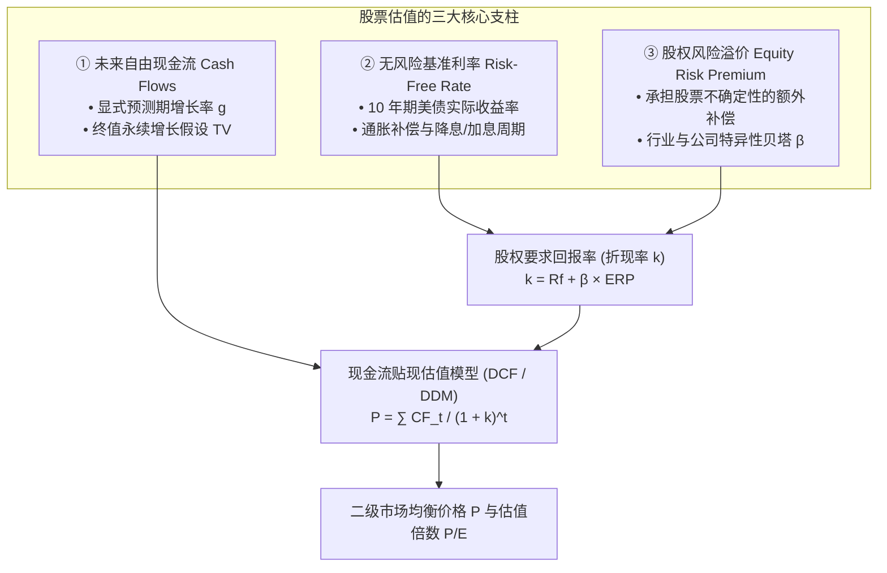
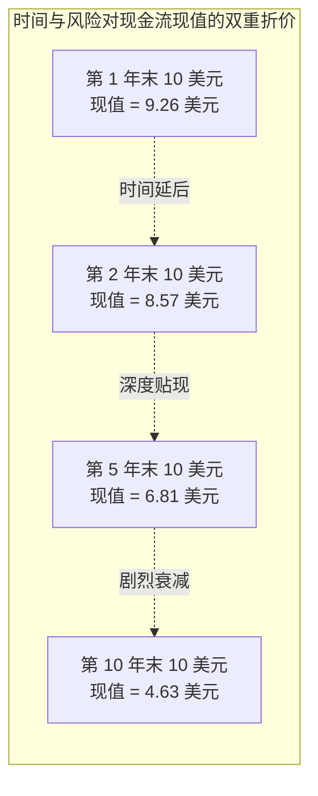
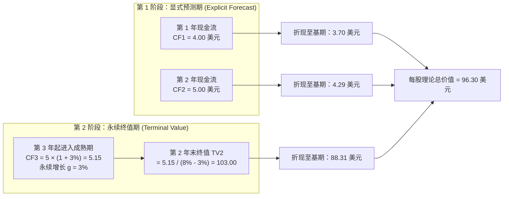
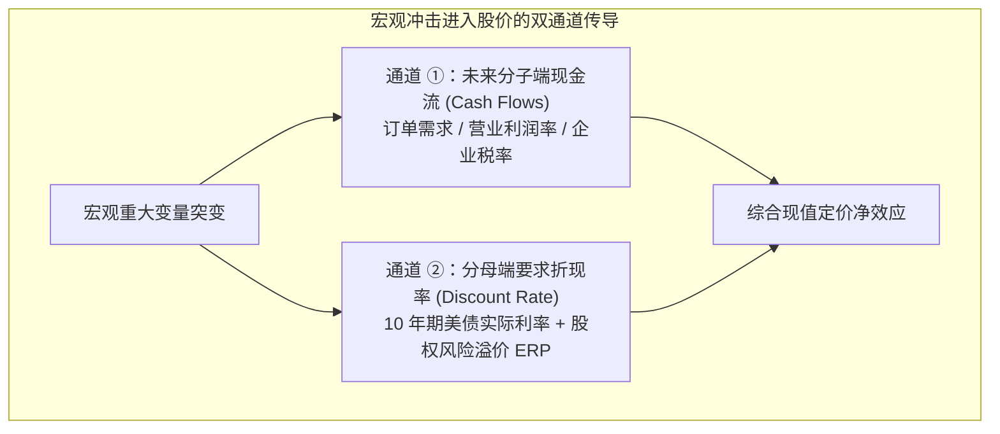

# 32 股票估值与宏观传导

[上一章](31-corporate-earnings.md) · [目录](./) · [下一章](33-shareholder-returns.md)

## 为什么同样赚 1 美元，华尔街给有的公司 10 倍、给有的公司 50 倍？

在资本市场上，经常可以看到这样令人困惑的巨大反差：
两家公司每年都能实打实地净赚 1,000 万美元真金白银。
- 一家是从事传统机械螺丝钉加工的制造厂，在公开市场上总市值只有 1 亿美元（市盈率 P/E 为 10 倍）；
- 另一家是从事企业级云端大模型研发的科技新贵，总市值却高达 5 亿美元（市盈率 P/E 达到惊人的 50 倍）。

为什么同样的 1 美元净利润，在投资者眼里的身价可以相差整整 5 倍？

更有甚者，宏观经济常出现反直觉的异象：美联储宣布紧急降息 50 个基点，理论上“降息降低借贷成本、利好资产价格”，但纳斯达克指数却在当天开盘后直线下坠大跌 4%！

要解开这些谜题，我们必须认识到：
**股票价格既不是会计师用历史账本算出来的，也不是中央银行通过利率红头文件规定的，而是全市场无数投资者在买卖撮合中，对“未来几十年所有自由现金流”在风险与时间维度上进行动态贴现的集中体现。**

### 学习目标与前置知识

读完本章，你将能够：
1. 掌握资金时间价值原理，熟练运用现金流贴现（DCF）与股息贴现模型（DDM）；
2. 严格推导高登永久增长模型（Gordon Growth Model），理解其数学收敛边界；
3. 将股价涨跌幅严格分解为“盈利增长效应”与“估值乘数重估效应”的乘法乘积；
4. 构建两阶段现金流贴现模型，手算终值（Terminal Value）及其高达 80%—90% 的权重占比；
5. 区分企业价值（EV）与股权价值（Equity Value），理清 FCFF 与 FCFE 的口径对齐规则；
6. 深入资本资产定价模型（CAPM），量化测算股权风险溢价（ERP）并理解三大估计路径的局限；
7. 运用宏观对照情景，逻辑自洽地解释“为什么加息时股市可能上涨”以及“为什么降息时股市可能崩盘”。

前置知识为[第 31 章](31-corporate-earnings.md)的每股收益与自由现金流概念，以及[第 17 章](17-bonds-and-curves.md)的债券折现逻辑。

## 1. 估值基石：现金流、折现与市盈率解构

### 1.1 为什么未来的钱一定要折算为今天的现值？

金融学的第一公理：**今天的 1 美元，永远比一年后的 1 美元更值钱**。

因为如果你今天拿到 1 美元，可以存入无风险银行存款或购买国债赚取利息，也可以用来立即消费或者投资。等待未来需要忍受时间延宕的痛苦，更要承担未来资金无法足额兑现的违约风险与通胀贬值风险。

假设你拥有一项资产，确定在一年后能够分配给你 **10 美元**现金。如果你对该项投资要求的年化回报率为 **$8\%$**（即折现率 $k = 8\%$），你今天最多愿意为它支付多少钱？

$$P_0 = \frac{10}{1 + 8\%} = \frac{10}{1.08} \approx \mathbf{9.26\text{ 美元}}$$

如果这笔相同的 10 美元要等到**两年后**才能拿到，它在今天的价值将进一步衰减：
$$P_0 = \frac{10}{(1 + 8\%)^2} = \frac{10}{1.1664} \approx \mathbf{8.57\text{ 美元}}$$

现金流离今天越遥远，时间复利对现值的侵蚀就越剧烈；投资面临的风险越大，投资者要求的补偿折现率 $k$ 就越高，资产的现值也就越低。

### 1.2 高登增长模型（Gordon Growth Model）的严格推导

如果一家成熟公司每年都向股东分配股息，且股息随着宏观经济与生产力发展保持恒定的长期年化复合增长率 $g$，我们该如何评估这家公司的理论总价值？

设：
- 明年预期的第一期股息为 $D_1$；
- 长期永续增长率为 $g$；
- 投资者要求的股权回报率为 $k$（假设 $k > g$）。

未来无限各期的预期股息流为：
- 第 1 年：$D_1$
- 第 2 年：$D_1(1 + g)$
- 第 3 年：$D_1(1 + g)^2$
- 第 $t$ 年：$D_1(1 + g)^{t-1}$

将未来所有期数的股息分别按折现率 $k$ 贴现至今天并求和：
$$P_0 = \sum_{t=1}^{\infty} \frac{D_1 (1 + g)^{t-1}}{(1 + k)^t} = \frac{D_1}{1 + k} \left[ 1 + \left(\frac{1 + g}{1 + k}\right) + \left(\frac{1 + g}{1 + k}\right)^2 + \dots \right]$$

括号内是一个以首项为 1、公比 $q = \frac{1 + g}{1 + k}$ 的无穷等比数列。由于我们严格假定 $k > g$，公比 $q < 1$，根据等比数列无穷项求和公式 $S = \frac{1}{1 - q}$：
$$P_0 = \frac{D_1}{1 + k} \times \frac{1}{1 - \frac{1 + g}{1 + k}} = \frac{D_1}{1 + k} \times \frac{1 + k}{(1 + k) - (1 + g)} = \mathbf{\frac{D_1}{k - g}}$$

这就是金融学中鼎鼎大名的高登模型：
$$P_0 = \frac{D_1}{k - g}$$

#### 动手算：利率上升，为什么股票也可以大涨？
假设某公司明年派息 $D_1 = 5\text{ 美元}$，长期永续增长率 $g = 3\%$，当前基准折现率 $k = 8\%$：
$$P_0 = \frac{5}{8\% - 3\%} = \frac{5}{0.05} = \mathbf{100.00\text{ 美元}}$$

现在，宏观经济遭遇央行加息冲击，折现率 $k$ 从 $8\%$ 飙升至 $9\%$：
1. **若其他一切条件不变**：
   $$P_1 = \frac{5}{9\% - 3\%} = \frac{5}{0.06} \approx \mathbf{83.33\text{ 美元}} \quad (\text{暴跌 } 16.67\%)$$
2. **但如果加息是因为实体经济强劲、技术革命爆发，导致公司的长期增长预期 $g$ 同步从 $3\%$ 上修至 $4\%$**：
   $$P_2 = \frac{5}{9\% - 4\%} = \frac{5}{0.05} = \mathbf{100.00\text{ 美元}} \quad (\text{股价毫发无损！})$$
3. **若公司明年的派息能力还因景气繁荣提升到了 5.5 美元**：
   $$P_3 = \frac{5.5}{9\% - 4\%} = \frac{5.5}{0.05} = \mathbf{110.00\text{ 美元}} \quad (\text{加息周期中股价反而上涨 } 10\%！)$$

**这彻底粉碎了“加息则股市必跌”的机械口诀**：股价是分子（盈利现金流）与分母（折现率减增长率）博弈的合力。只要分子增长跑赢分母上升，股票完全能够在升息环境中高歌猛进。

### 1.3 市盈率（P/E）解构：盈利与估值的乘法乘积

在二级市场上，股价可以写为每股收益（EPS）与市盈率（P/E）的乘积：
$$P = \text{EPS} \times (\text{P/E})$$

当期末相比期初发生变化时，价格变动比例**绝不是两个增长率的简单加减**，而是两个比值的乘法：
$$\frac{P_1}{P_0} = \frac{\text{EPS}_1}{\text{EPS}_0} \times \frac{(\text{P/E})_1}{(\text{P/E})_0}$$

假设期初 EPS 为 10 美元，P/E 为 20 倍，期初股价为：
$$P_0 = 10 \times 20 = 200\text{ 美元}$$
经过一年演化，公司 EPS 增长了 10%（变为 11 美元），但市场估值倍数回落压缩了 10%（P/E 降为 18 倍）：
$$\frac{P_1}{P_0} = (1 + 10\%) \times (1 - 10\%) = 1.10 \times 0.90 = 0.99$$
$$P_1 = 11 \times 18 = \mathbf{198\text{ 美元}} \quad (\text{实际下跌 } 1.0\%)$$

很多初学者想当然认为“盈利涨 10%，估值跌 10%，两者正好抵消，股价不变”，这就是忽略了交叉项（$10\% \times (-10\%) = -1\%$）的数学谬误。

## 2. 现金流贴现估值（DCF）：两阶段模型与终值震撼

### 2.1 两阶段 DCF 模型的完整构建

对于绝大多数具有高增长特征的企业，不可能直接套用单一永久增长率。专业分析师通常构建**两阶段现金流贴现模型（Two-Stage DCF）**：
1. **显式预测期（Stage 1）**：未来 3—5 年，基于详尽的产业链调研，对每一年的销量、价格、利润与现金流进行精细化逐年预测；
2. **永续增长期 / 终值（Stage 2, Terminal Value）**：预测期结束后，假设企业进入与宏观 GDP 增速相仿的稳定永续成熟期。

我们用一个严密的教学算例进行全程手算：
- 显式预测期：第 1 年末每股现金流 $\text{CF}_1 = 4.00\text{ 美元}$；第 2 年末 $\text{CF}_2 = 5.00\text{ 美元}$；
- 永续增长期：从第 3 年开始，现金流按永续年化 $g = 3\%$ 恒定增长；
- 股权要求回报率：$k = 8\%$。

#### 步骤 1：计算第 2 年末的终值（Terminal Value, $\text{TV}_2$）
第 3 年的预期现金流为：
$$\text{CF}_3 = \text{CF}_2 \times (1 + g) = 5.00 \times (1 + 0.03) = \mathbf{5.15\text{ 美元}}$$
利用高登模型，将第 3 年及之后所有无穷期现金流打包折现到**第 2 年末那个截面时点**：
$$\text{TV}_2 = \frac{\text{CF}_3}{k - g} = \frac{5.15}{0.08 - 0.03} = \frac{5.15}{0.05} = \mathbf{103.00\text{ 美元}}$$

#### 步骤 2：将所有现金流贴现回今天（第 0 年）
今天的理论每股价值为：
$$P_0 = \frac{\text{CF}_1}{1 + k} + \frac{\text{CF}_2}{(1 + k)^2} + \frac{\text{TV}_2}{(1 + k)^2}$$
代入数值独立运算：
$$P_0 = \frac{4.00}{1.08} + \frac{5.00}{(1.08)^2} + \frac{103.00}{(1.08)^2}$$
$$P_0 \approx 3.7037 + 4.2867 + 88.3059 = \mathbf{96.2963 \approx 96.30\text{ 美元/股}}$$

#### 终值的致命震撼：
观察各部分占总现值的比重：
$$\text{终值现值占比} = \frac{88.3059}{96.2963} \approx \mathbf{91.70\%}$$
这意味着：你在前两年辛辛苦苦跟踪的排产调研和出货量预测，**在估值模型里只占不到 $9\%$ 的权重**！整只股票超过 $90\%$ 的价值，完全维系在遥远未来的永续增长率 $g$ 与折现率 $k$ 两个假定参数上。

### 2.2 敏感性矩阵：为什么说估值是“精确的模糊”？

由于终值对假定极其敏感，合格的分析师从来不会给出一个冷冰冰的孤立目标价，而是出具**参数敏感性分析矩阵（Sensitivity Analysis）**：

保持前两年的现金流（4 美元、5 美元）完全不变，仅微调永续增长率 $g$ 与要求回报率 $k$，每股内在价值变化如下（单位：美元/股）：

| 股权要求回报率 $k$ \ 永续增长率 $g$ | $g = 2.0\%$ | $g = 3.0\%$ (基准) | $g = 4.0\%$ |
| :---: | :---: | :---: | :---: |
| **$k = 7.0\%$** | 97.20 | 120.56 | 159.50 |
| **$k = 8.0\%$ (基准)** | 80.86 | **96.30** | 119.44 |
| **$k = 9.0\%$** | 69.20 | 80.12 | 95.41 |

当折现率 $k$ 从 8% 微升至 9% 时，基准价值从 96.30 美元下跌至 80.12 美元，跌幅高达：
$$\Delta P = \frac{80.12 - 96.30}{96.30} \approx \mathbf{-16.80\%}$$

看懂了这个矩阵，你就掌握了华尔街投行的最高秘密：**任何分析师只要在模型里将折现率悄悄下调 1 个百分点，或者将永续增长率调高 1 个百分点，就能轻易将目标价“推高” 50% 以上！** 估值的真正作用绝非占卜未来的确切价格，而是检验当前市场价格隐含了多么激进或悲观的假设预期。

### 2.3 股权自由现金流（FCFE）计算公式

不能把会计净利润直接塞入 DCF 模型当成分子。企业为了维持未来的增长，必须追加厂房设备投资，必须为日常运营垫付流动资金。真正能够分给股权投资者的现金是**股权自由现金流（Free Cash Flow to Equity, FCFE）**：

$$\begin{aligned}
\text{FCFE} &= \text{净利润} \\
&\quad + \text{非现金折旧与摊销} \\
&\quad - \text{资本性支出 (CapEx)} \\
&\quad - \Delta\text{经营性营运资本投入} \\
&\quad + \text{净新增借款 (新借有息债 - 偿还有息债本金)}
\end{aligned}$$

设某教学公司：
- 当期会计净利润 $= 100\text{ 美元}$；
- 加上非现金折旧 $= +20\text{ 美元}$；
- 扣减资本开支 $= -50\text{ 美元}$；
- 扣减经营性营运资本增加（应收与存货占用资金）$= -10\text{ 美元}$；
- 加上净新增借款（新借款 15 减偿债 10）$= +5\text{ 美元}$。

可供股东自由支取的现金流仅为：
$$\text{FCFE} = 100 + 20 - 50 - 10 + 5 = \mathbf{65\text{ 美元}}$$

这 65 美元远低于账面净利润 100 美元，因为有 40 美元被资本扩产与流动资金吸纳。脱离资本开支假设空谈高增长，是极其业余的分析硬伤。

### 2.4 企业价值（EV）与股权价值（Equity Value）的桥接

在跨公司比较和并购交易中，分析师常用**企业自由现金流（FCFF）**与**加权平均资本成本（WACC）**折现，先求出**公司整体企业价值（Enterprise Value, EV）**。

企业价值与股东最终享有的股权价值之间存在严格的资产负债桥接逻辑：

$$\text{股权价值 (Equity Value)} = \text{企业价值 (EV)} + \text{非经营性现金} - \text{有息债务} - \text{优先股及少数股东权益}$$

代入基准教学数据：
$$\text{股权价值} = 1{,}000 + 100 - 300 = \mathbf{800\text{ 美元}}$$
若发行在外的普通股为 100 股，则每股理论公允价值为：
$$P = \frac{800}{100} = \mathbf{8.00\text{ 美元/股}}$$

**口径配比铁律**：如果你折现的是属于全体资本所有者的企业现金流（FCFF），折现率必须使用加权平均资本成本（WACC），折出来的结果是 EV，必须扣减净债务才能得到股权价值；如果你折现的是属于股东的现金流（FCFE 或股息），折现率必须使用股权要求回报率 $k$，折出来的结果直接就是股权价值，**严禁再扣除一次有息债务**！

## 3. 股权风险溢价（ERP）：市场恐慌的度量衡

### 3.1 资本资产定价模型（CAPM）的展开

投资者如果把资金借给美国联邦政府购买 10 年期国债，几乎没有违约风险，其收益率被称为**无风险利率（Risk-Free Rate, $r_f$）**。

而买入波动剧烈、随时面临亏损清算的股票，理性投资者必须索要额外的风险补偿，这笔额外超额收益被称为**股权风险溢价（Equity Risk Premium, ERP）**。

根据经典资本资产定价模型（CAPM），个股的股权要求回报率 $k$ 决定于：
$$k = r_f + \beta \times \text{ERP}$$

- **$r_f$（无风险利率）**：通常以 10 年期美国国债收益率作为基准锚（如 $4.0\%$）；
- **$\text{ERP}$（市场整体股权风险溢价）**：全市场股票组合相对于无风险国债所要求的平均超额补偿（如 $5.0\%$）；
- **$\beta$（贝塔系数）**：衡量该股票对宏观大盘波动的系统性敏感度。
  - 若 $\beta = 1.0$：该股票与大盘同频共振；
  - 若 $\beta = 1.2$（高弹性科技股）：大盘涨跌 10%，该股理论上平均涨跌 12%。

代入参数测算个股要求回报率：
$$k = 4.0\% + 1.2 \times 5.0\% = 4.0\% + 6.0\% = \mathbf{10.0\%}$$

### 3.2 ERP 的三大估算流派与其固有缺陷

由于 ERP 是一个存在于全市场投资者大脑信念中的不可直接观测变量，华尔街主要通过三种途径进行近似测量：

| 估算流派 | 形成机制与方法 | 核心缺陷与致命局限 |
| :--- | :--- | :--- |
| **① 历史超额回报法 (Historical Return)** | 选取过去 50 或 100 年标普 500 实际实现的回报率，减去同期国债回报率计算历史均值。 | **严重幸存者偏差**。过去一个世纪美国经济崛起成为全球霸权，历史不代表未来；算术平均与几何平均差异巨大。 |
| **② 调查法 (Survey Method)** | 定期向大学教授、CFO、大型资产管理机构首席投资官发放问卷，询问其未来 10 年所需溢价。 | **知行不合一**。受访者往往受近期股市情绪干扰（熊市悲观、牛市亢奋），回答与实际下单行为严重脱节。 |
| **③ 隐含估值反解法 (Implied ERP)** | **目前机构最主流做法**（如 Damodaran 教授模型）。将当前标普 500 真实点位、全市场分析师一致预测的未来现金流代入 DCF 方程，通过数值迭代**反解出唯一的内部收益率（IRR）**，再减去当前 10 年期国债收益率。 | 高度依赖未来 5 年盈利预测与终值永续增长假设的准确性。 |

#### 用高登模型反解一次隐含 ERP：
设全市场当前指数点位 $P = 100$，明年全市场预期现金回报 $D_1 = 5$，长期经济增长率 $g = 3\%$，当前 10 年期美债收益率 $r_f = 4\%$。
令价格等于理论价值：
$$100 = \frac{5}{k - 3\%} \implies k - 3\% = \frac{5}{100} = 5\% \implies k = 8.0\%$$
由此反解出的全市场隐含股权风险溢价为：
$$\text{隐含 ERP} = k - r_f = 8.0\% - 4.0\% = \mathbf{4.0\%}$$

如果第二天突发地缘政治冲突，大盘在没有下调盈利预测的情况下暴跌至 $P = 90$：
$$90 = \frac{5}{k - 3\%} \implies k = \frac{5}{90} + 3\% \approx 5.56\% + 3\% = 8.56\%$$
$$\text{新隐含 ERP} = 8.56\% - 4.0\% = \mathbf{4.56\%}$$
市场用暴跌 10% 的行动，直白地宣告：面对动荡世界，投资者要求比昨天多出 56 个基点的风险补偿！

## 4. 相对估值：市盈率、市销率与企业价值倍数

除了繁复的现金流建模，实务中最常用的武器是**相对估值倍数（Multiples）**：

| 相对估值指标 | 计算公式 | 最适配的行业与应用场景 | 必须严加防范的陷阱 |
| :--- | :--- | :--- | :--- |
| **市盈率 (P/E)** | $\frac{\text{股票价格 } P}{\text{每股收益 EPS}}$ | 盈利稳定、商业模式成熟的消费与工业公司。 | 周期顶部的假“便宜”：强周期股在繁荣顶点 EPS 暴增导致 P/E 看起来只有 5 倍，但利润随时会暴跌。 |
| **市净率 (P/B)** | $\frac{\text{股票市值}}{\text{普通股账面净资产}}$ | 银行、保险公司等资产主要由高流动性金融资产构成的金融机构。 | 轻资产科技股账面净资产很小甚至因回购变成负数，P/B 完全失去可比意义。 |
| **市销率 (P/S)** | $\frac{\text{股票市值}}{\text{营业收入}}$ | 处于初创期、亏损但高速扩张的 SaaS 软件与生物医药企业。 | 忽略成本结构与负债：增收不增利、毛利率仅 5% 的公司根本不配享有高 P/S。 |
| **企业价值倍数 (EV/EBITDA)** | $\frac{\text{企业价值 EV}}{\text{息税折旧摊销前利润}}$ | 资本密集、折旧庞大或跨国资本结构差异巨大的重工业与电信企业。 | 剥离了资本折旧，忽略了维持产能必需的真金白银资本再投资支出。 |

#### 案例：为什么比较不同负债的公司必须使用 EV/EBITDA 而不能只看 P/E？
- 公司 A：市值 800 美元，账面无任何债务，现金 0 美元；EBITDA 为 100 美元；
- 公司 B：市值 800 美元，但背负了 400 美元有息债务，账面现金 100 美元（净债务 300 美元）；EBITDA 同样为 100 美元。

两家公司的股权市值除以 EBITDA 看起来都是 $\frac{800}{100} = 8.0$ 倍。
但计算企业价值倍数：
- 公司 A 的 $\text{EV} = 800$，$\text{EV/EBITDA} = \frac{800}{100} = \mathbf{8.0\text{ 倍}}$；
- 公司 B 的 $\text{EV} = 800 + 300 = 1{,}100$，$\text{EV/EBITDA} = \frac{1{,}100}{100} = \mathbf{11.0\text{ 倍}}$！

如果买下整家 B 公司，你必须替它承担 300 美元的净负债，它的实际采购总成本比 A 公司贵出了整整 $37.5\%$！只看股权市值倍数，会完全漏掉隐藏在水面下的庞大债务冰山。

## 5. 宏观冲击传导：构建宏观对照情景矩阵

现在我们把宏观变量（利率、通胀、增长、危机）与估值引擎彻底挂钩。

严谨的宏观金融分析拒绝“加息利空、降息利好”式的小白口诀，必须始终坚持**四象限对照矩阵**：

| 典型宏观冲击情景 | 分子端现金流预期 ($g$ / 盈利) | 分母端折现率 ($k = r_f + \text{ERP}$) | 股票市场最终表现净方向 | 经典历史映射案例 |
| :--- | :--- | :--- | :---: | :--- |
| **① 生产率跃升与繁荣复苏 (Productivity Boom)** | 强劲上修 ↗ (技术突破推升订单与利润率) | 利率 $r_f$ 虽上升，但恐慌退潮带动 ERP 显著下行 ↘ | **股债双牛或股涨债跌** (分子端扩张远超分母上行) | 1995—1999 年互联网浪潮初期 2023—2024 年生成式 AI 算力爆发 |
| **② 恶性成本通胀冲击 (Cost-Push Inflation)** | 严重下修 ↘ (企业缺乏提价权，利润率遭挤压) | 央行被迫暴力加息，无风险利率 $r_f$ 狂飙 ↗ | **股债双杀，大盘暴跌** (分子受挤压，分母遭重创) | 1973—1974 年石油危机 2022 年美联储单年加息 425 bp |
| **③ 需求断崖与衰退恐慌 (Recessionary Bust)** | 灾难性下修 ↘ (违约激增，盈利预测断崖崩塌) | 央行虽极速降息($r_f \downarrow$)，但市场极度恐慌推升 ERP 飙升 ↗↗ | **国债大涨，股市惨烈崩盘** (降息根本无法拯救崩塌的现金流) | 2008 年秋雷曼倒闭危机 2001 年互联网泡沫破裂初期 |
| **④ 预防性政策宽松软着陆 (Insurance Rate Cuts)** | 维持稳健韧性 → (经济未衰退，企业维持微增) | 央行顺畅降息降低企业资金成本，$r_f$ 下滑且 ERP 保持稳定 ↘ | **全面大牛市，成长股暴涨** (分子未破损，分母估值全面拔高) | 1995 年美联储格林斯潘预防性降息 2019 年下半年预防性降息周期 |

## 6. 完整案例：盈利预测上调，股价为什么跌了？

### 6.1 数据事实与计算
- 期初状态：基准年度每股收益预测 $\text{EPS}_0 = 8.00\text{ 美元}$，基准股价 $P_0 = 200.00\text{ 美元}$；
  $$\text{期初 P/E} = \frac{200}{8} = \mathbf{25.0\text{ 倍}}$$
- 期末状态：分析师将同口径 EPS 预测上修至 $\text{EPS}_1 = 8.80\text{ 美元}$（增长 10%）；期间每股派发了 4.00 美元现金分红；但二级市场股票收盘价跌至 $P_1 = 198.00\text{ 美元}$；
- 宏观背景：同时间段内，10 年期美债收益率上行 30 个基点，其中实际收益率上行 25 个基点，通胀预期上行 5 个基点；高收益企业债信用利差维持平稳。

**分步量化对账**：
1. **估值倍数变动**：
   $$\text{期末 P/E} = \frac{198}{8.80} = \mathbf{22.5\text{ 倍}}$$
   $$\text{倍数变动幅度} = \frac{22.5 - 25.0}{25.0} = \mathbf{-10.0\%}$$
2. **价格回报率**：
   $$R_{\text{price}} = \frac{198 - 200}{200} = \mathbf{-1.0\%}$$
   利用乘法公式严格检验：
   $$\frac{P_1}{P_0} = (1 + 10\%) \times (1 - 10\%) = 1.10 \times 0.90 = 0.99 \implies -1.0\% \quad (\text{完全吻合！})$$
3. **含分红的持有期总回报率**：
   $$R_{\text{total}} = \frac{198 + 4.00 - 200}{200} = \frac{2.00}{200} = \mathbf{+1.0\%}$$

### 6.2 宏观与基本面归因陈述

> “本期公司呈现出典型的‘盈利超预期消化估值、折现率上行施压价格’的宏观微观交织特征：
> 1. 微观层面：由于主营业务景气，目标年度 EPS 预测上调 10%，为股价提供了坚实的基本面支撑；
> 2. 宏观层面：10 年期美债实际收益率上升 25 个基点，无风险利率的抬升带动股票折现率中枢上移，促使全市场投资者将愿付估值倍数从 25.0 倍下调至 22.5 倍（估值压缩 10%）；
> 3. 净效应：10% 的盈利增长与 10% 的估值杀跌形成乘法共振（$1.10 \times 0.90 = 0.99$），导致纯价格回报录得 -1.0% 的微跌。但得益于 2% 的现金股息回报率，股东的全收益总回报依然锁定为 +1.0% 的正收益。”

## 7. 练习与参考答案

### 练习 1：盈利与估值变动的复合乘法推演

某股票期初 EPS 为 8.00 美元，市盈率 P/E 为 25.0 倍。经过一段时间运营，公司同口径 EPS 增长了 5%，同时市场给予的估值倍数提升了 10%。
1. 计算新的股票价格与精确涨跌幅；
2. 财经新闻称“盈利增长 5% 加估值扩张 10%，合计推动股价上涨 15%”，这种表述在数学与因果逻辑上存在什么缺陷？

参考答案与推理

1. 期初股价：$P_0 = 8.00 \times 25.0 = 200.00$ 美元。
   新 EPS $= 8.00 \times 1.05 = 8.40$ 美元；新 P/E $= 25.0 \times 1.10 = 27.5$ 倍；
   新股价：$P_1 = 8.40 \times 27.5 = \mathbf{231.00\text{ 美元}}$；
   精确涨幅：$\frac{231 - 200}{200} = \frac{31}{200} = \mathbf{+15.5\%}$。
   利用公式检验：$1.05 \times 1.10 - 1 = 1.155 - 1 = +15.5\%$。
2. **数学缺陷**：加法忽略了交叉项（$5\% \times 10\% = +0.5\%$），实际涨幅应为 15.5% 而非 15%。
   **因果缺陷**：P/E 倍数本身只是股价除以 EPS 的结果性数学比值，它不是独立于市场行情的外部物理原因。把 P/E 扩张称为股价上涨的原因，在很大程度上属于同义反复。真正的因果驱动在于宏观利率走低、股权风险溢价回落或投资者对未来长期竞争壁垒信心的重估。

### 练习 2：两阶段 DCF 模型的终值时点与折现

某公司显式预测期为两年：第 1 年末每股现金流 3.00 美元，第 2 年末为 4.00 美元。从第 3 年起，现金流进入永续成熟期，长期年化增长率恒定为 2.0%。投资者要求的股权折现率为 7.0%。
1. 计算第 2 年末的终值（Terminal Value, $\text{TV}_2$）；
2. 计算该股票在今天的每股理论内在价值 $P_0$；
3. 为什么绝不能把算出的终值直接当成今天的股票公允价格？

参考答案与推理

1. 第 3 年预期现金流：$\text{CF}_3 = 4.00 \times (1 + 0.02) = 4.08$ 美元；
   第 2 年末终值：
   $$\text{TV}_2 = \frac{\text{CF}_3}{k - g} = \frac{4.08}{0.07 - 0.02} = \frac{4.08}{0.05} = \mathbf{81.60\text{ 美元}}$$
2. 今天的每股理论价值（折现到第 0 年）：
   $$P_0 = \frac{3.00}{1.07} + \frac{4.00}{(1.07)^2} + \frac{81.60}{(1.07)^2} = \frac{3.00}{1.07} + \frac{85.60}{1.1449} \approx 2.8037 + 74.7664 = \mathbf{77.57\text{ 美元/股}}$$
3. **不能混淆时点**：81.60 美元是**两年后的名义终值**，它必须经历两年的贴现（除以 $1.07^2$）后在今天仅值 71.27 美元；此外，直接取终值完全抹杀了前两年股东实打实收到的 7 美元现金流的时间价值。

### 练习 3：股权自由现金流（FCFE）真实造血测算

某公司净利润为 120 百万美元，非现金折旧费用 20 百万美元，资本性支出 60 百万美元，经营性营运资本增加占用资金 15 百万美元。筹资活动显示：公司本期净偿还了银行借款本金 10 百万美元（净新增借款为 -10 百万美元）。
1. 计算该公司本期的 FCFE；
2. 为什么不能直接拿会计净利润 120 百万美元作为企业派发现金分红的最大合规上限？

参考答案与推理

1. 股权自由现金流计算：
   $$\text{FCFE} = 120 + 20 - 60 - 15 + (-10) = \mathbf{55\text{ 百万美元}}$$
2. **净利润不等于可用现金**：
   净利润 120 百万美元没有扣除维持经营必需的 60 百万资本开支，也没有扣除应收存货占用的 15 百万营运资金，更未包含刚性偿还债权人的 10 百万借款本金。如果强行按照账面利润 120 百万全额分红，公司将面临 65 百万美元的严重现金断裂赤字，只能靠变卖核心资产或高息借债来填补窟窿，极易诱发债务危机。

### 练习 4：盈利收益率差额与真实 ERP 的本质区别

某股票当前交易价格为 120 美元，未来 12 个月预测 EPS 为 6.00 美元，当前 10 年期美国国债收益率为 4.0%。某自媒体大 V 宣称：“该股票的市盈率是 20 倍，盈利收益率 E/P 是 5%，减去 4% 国债利率，说明股权风险溢价 ERP 只有 1%，因此未来投资股票最多比国债多赚 1%”。
请从金融理论与资产属性角度，全面驳斥并纠正这一荒谬论断。

参考答案与推理

该论断在概念定义、公式内涵和收益预期上存在三大严重硬伤：
1. **盈利不等于可分配现金流**：E/P（5%）基于会计净利润计算，企业无法将全部利润分配给股东（还需扣减资本开支与营运资金），实际可支配现金回报率往往不同于 5%；
2. **资产属性不对等**：国债支付的是固定金额的合同息票，本金不随通胀增长；而股票拥有剩余收益索偿权，其未来现金流会随着长期经济增长和通胀而复利复合提升（即高登模型中的 $g$）。直接拿 E/P 减去国债收益率，完全抹杀了股票长期成长性 $g$ 的巨大价值；
3. **事后回报不等于事前溢价**：即便模型测算的隐含 ERP 为 1%，它也仅代表当前边际定价隐含的要求补偿。未来实际实现的股票超额回报取决于未来经济超预期表现、多空资金博弈及估值再膨胀，绝不受这 1% 的数学差额所人为限制。

### 练习 5：从企业价值（EV）穿透至每股股权价值

某科技公司通过 FCFF 模型对经营资产进行贴现，评估出的企业价值（EV）为 900 百万美元。资产负债表显示：
- 账面持有富余非经营性现金及短期国债 80 百万美元；
- 银行长期有息债务 250 百万美元；
- 另有一笔由战略投资者持有的优先股清偿权利要求 30 百万美元；
- 当前发行在外的普通股总股本为 70 百万股。
计算该公司普通股的理论每股公允价值。

参考答案与推理

根据企业价值与股权价值的桥接方程：
$$\begin{aligned}
\text{普通股权益价值} &= \text{企业价值 EV} + \text{现金} - \text{有息负债} - \text{优先股清偿权} \\
&= 900 + 80 - 250 - 30 = \mathbf{700\text{ 百万美元}}
\end{aligned}$$
每股理论公允价值：
$$P = \frac{700\text{ 百万美元}}{70\text{ 百万股}} = \mathbf{10.00\text{ 美元/股}}$$

### 练习 6：降息背景下的股市暴跌机理解析

某公司基准参数为：明年股息 5.00 美元，长期永续增长率 $g = 3.0\%$，折现率 $k = 8.0\%$（理论价值 100 美元）。
现突发严重宏观需求衰退，公司将明年股息下调至 4.50 美元，长期增长率下修至 $g = 2.0\%$。央行紧急降息使无风险利率下行 100 个基点（$-1.0\%$），但市场恐慌蔓延促使股权风险溢价 ERP 飙升 100 个基点（$+1.0\%$），两相抵消后，投资者最终要求的折现率依然停留在 $k = 8.0\%$ 不变。
1. 计算该公司最新的股票理论公允价值及百分比跌幅；
2. 结合本例，向非专业投资者解释“为什么央行宣布重磅降息，股票却依然会暴跌”。

参考答案与推理

1. 最新公允价值：
   $$P_{\text{new}} = \frac{D_1}{k - g} = \frac{4.50}{8.0\% - 2.0\%} = \frac{4.50}{0.06} = \mathbf{75.00\text{ 美元}}$$
   百分比跌幅：
   $$\frac{75.00 - 100.00}{100.00} = \mathbf{-25.0\%}$$
2. **机制解释**：
   央行降息虽然压低了无风险借贷利率，但无法凭空逆转实体经济的冰封衰退。在衰退恐慌中，投资者的避险情绪推动股权风险溢价（ERP）急剧暴涨，完全抵消了降息的好处，导致实际折现率（分母）根本没有下降；而与此同时，企业未来的分红能力（分子）与长期成长动能（$g$）遭遇沉重打击。降息拯救不了失血的分子端，股价自然一溃千里。

### 练习 7：S&P 风格指数编制方法阅读

查阅标普道琼斯指数公司官方发布的《标普美股风格指数编制方法》（S&P U.S. Style Indices Methodology）：
1. 标普在计算“成长得分”（Growth Score）与“价值得分”（Value Score）时，分别引入了哪些核心基本面与价格因子？
2. 为什么“成长风格指数跑赢价值风格指数”绝不等于“所有高科技公司的净利润都上修了”？

参考答案与推理

1. **核心因子构成**：
   - **成长因子 (Growth)**：三年每股收益变化相对股价的比率、三年每股销售额复合增速、过去 12 个月的价格动量（Momentum）；
   - **价值因子 (Value)**：市净率（B/P）、市盈率（E/P）、市销率（S/P）。
2. **逻辑误区驳斥**：
   标普风格指数是基于一组多因子标准化打分规则机械构建的资产篮子。成长指数的表现不仅受科技巨头盈利的影响，还深受其历史价格动量、长期利率下行估值扩张（久期长）以及特定高权重龙头的抱团推动；许多中小科技公司可能在当期遭受严重的盈利下修，但只要市值权重被少数万亿级巨头掩盖，成长指数整体依然能够逆势大涨。不能把一个规则篮子的价格结果盲目等同于全行业的基本面普查。

### 练习 8：撰写具备宏观因果边界的专业短评

某交易日某成长科技股股价收涨 5.0%，同日跟踪该股的华尔街卖方将目标财年 EPS 预测平均上调了 10.0%（期间无派息分红）。
1. 计算该股票当日估值倍数（P/E）的理论变动比例；
2. 针对这组数据，提出一种不同于“单纯利率压低估值”的合理解释，并说明需要调取什么反证数据。

参考答案与推理

1. 估值倍数变动比值：
   $$\frac{(\text{P/E})_1}{(\text{P/E})_0} = \frac{P_1 / P_0}{\text{EPS}_1 / \text{EPS}_0} = \frac{1.05}{1.10} \approx 0.954545$$
   估值倍数实际回落压缩了：
   $$0.954545 - 1 \approx \mathbf{-4.55\%}$$
2. **竞争性解释**：
   虽然分析师将该股近期目标财年的 EPS 上调了 10%，但市场可能担忧其资本开支过度膨胀导致中长期自由现金流转化率走低，或者公司核心客户在远期的饱和风险增大，从而**下修了更远期的永续增长率 $g$**；此外，同行业出现强有力竞争对手引发价格战担忧，促使市场对该股索要的特异性风险溢价（ERP）上升，从而压缩了愿付倍数。
3. **所需反证数据**：
   调取主要卖方机构发布的最新深度研报，核查其两阶段 DCF 模型中对 3 年后远期增长率和终值假定的修改记录；同时比对同行业可比竞争对手当天的股价涨跌与期权隐含波动率变化，以剥离宏观系统性利率干扰。

## 本章小结与下一步

股票估值绝非孤立的数字魔术：
- 现金流贴现模型（DCF）将遥远的未来与今天的资本紧密咬合，揭示了终值占比超 90% 的敏感性本质；
- 股权自由现金流（FCFE）与企业价值（EV）厘清了属于股东与属于债权人的权利边界；
- 资本资产定价模型与隐含 ERP，量化了资本市场面对动荡世界的恐惧与贪婪；
- 宏观四象限情景矩阵打破了机械死板的投资教条，将增长、通胀、利率与风险补偿融会贯通。

然而，决定市场价格短期剧烈波动的，除了基本面估值与宏观利率，还有庞大的**资金交易行为与衍生品衍生反馈**：公司大规模回购如何改变股本？做市商的期权动态对冲如何放大行情？波动率指数（VIX）究竟如何被计算？

下一章我们将进入[第 33 章：股东回报、资金行为与市场波动](33-shareholder-returns.md)。

[上一章](31-corporate-earnings.md) · [目录](./) · [下一章](33-shareholder-returns.md)
