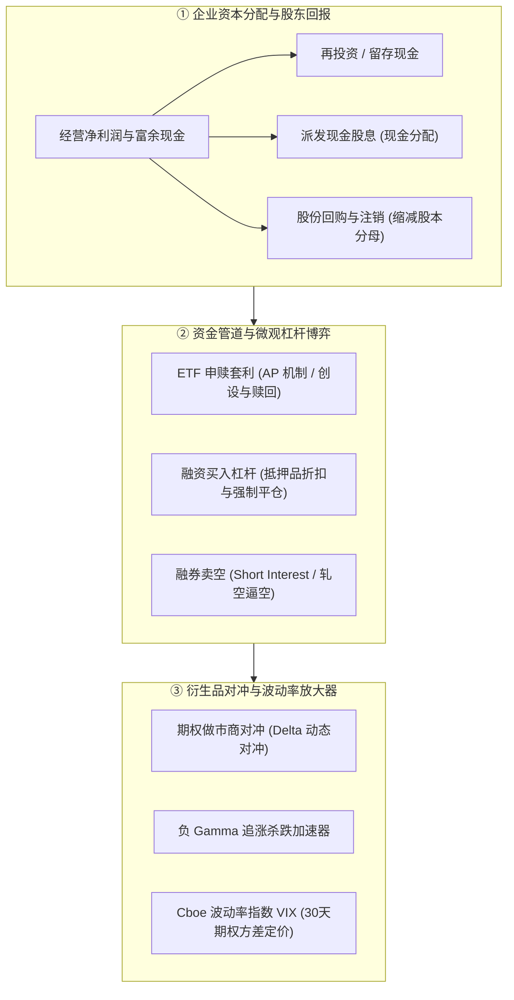
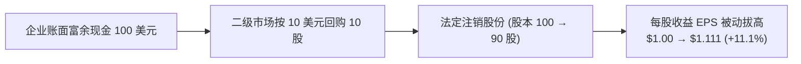
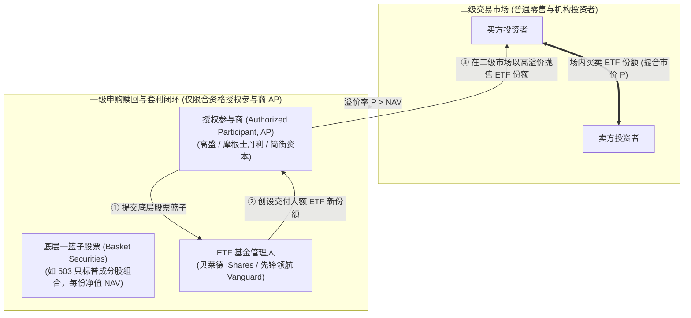
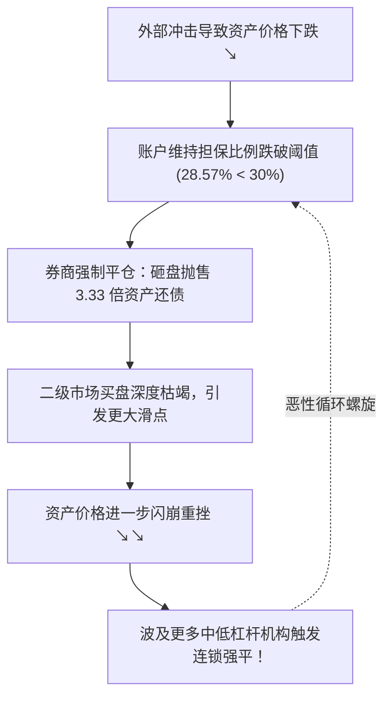
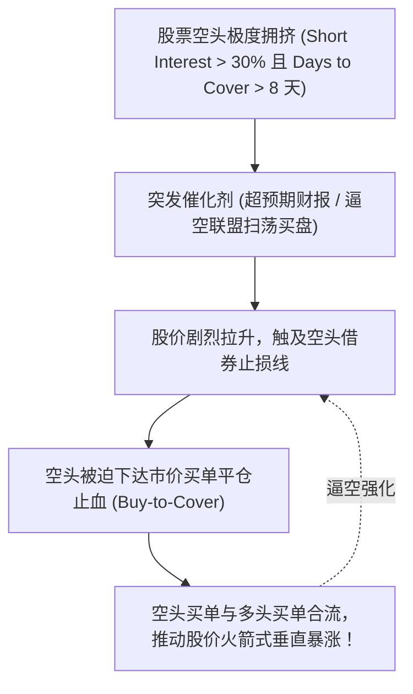
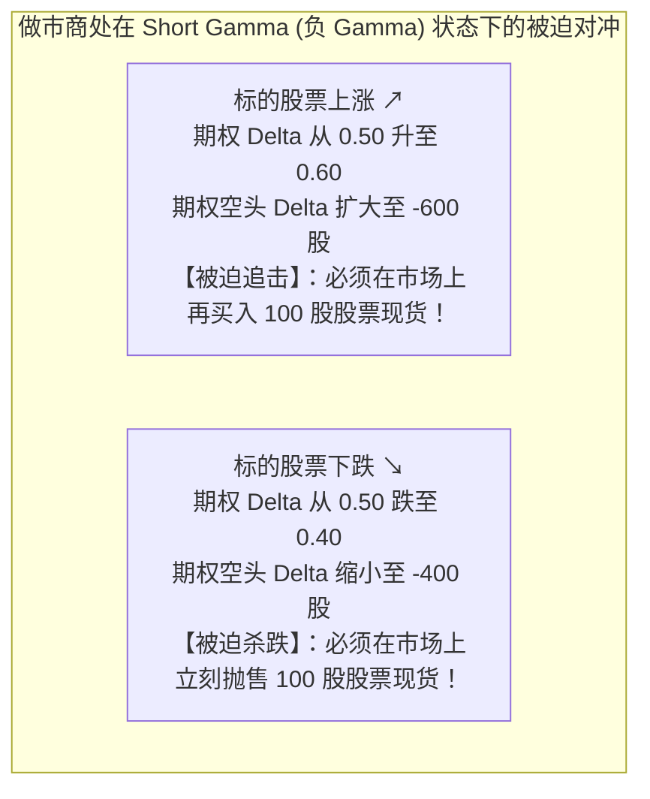

# 33 股东回报、资金行为与市场波动

[上一章](32-equity-valuation.md) · [目录](./) · [下一章](34-commodities.md)

## 为什么不发新产品，股票回购也能让股价十年涨十倍？

设想这样一个资本市场的真实奇迹：
在过去十年里，某消费科技巨头的智能硬件出货量早已见顶，全球总销量几乎没有多大增长，但其股票价格却在二级市场上不可思议地翻了整整十倍，总市值突破数万亿美元。

管理层究竟施展了什么点金术？

翻开其现金流量表，答案跃然纸上：公司将每年赚取的数百亿美元经营现金流，并没有用于盲目建厂或无序并购，而是以惊人的魄力在公开市场上**大规模回购并注销自家股票**。股票总股本被注销了近三分之一，推动每股收益（EPS）以超越营收数倍的速度狂飙突进。

但资本市场的另一面往往充满凶险：
在某些毫无宏观重大利空新闻的下午，美股大盘却可能在短短两小时内毫无征兆地暴跌 5%，并在尾盘引发雪崩般的连锁抛售（Flash Crash）。

这背后的推手究竟是谁？
是高杠杆投资者的**保证金追加清算（Margin Calls）**？是交易所交易基金（ETF）授权参与商的一级赎回拆箱？还是华尔街做市商在期权衍生品市场被迫进行的**动态 Gamma 对冲践踏**？

### 学习目标与前置知识

读完本章，你将能够：
1. 掌握资本分配决策的数学机理，严格计算股份回购注销对 EPS 与净资产的复合影响；
2. 拆解 ETF 的一级市场申赎与二级市场交易，理解授权参与商（AP）的跨市场套利与净申购核算；
3. 掌握融资买入与维持担保比例（Margin Ratio），手算杠杆账户在遭遇追缴时的强平抛售额；
4. 区分卖空成交量（Short Volume）与空头未平仓存量（Short Interest），识别“轧空”（Short Squeeze）前兆；
5. 掌握期权做市商的 Delta 中性对冲逻辑，深入推导“负 Gamma 顺势暴跌反馈链”；
6. 掌握芝加哥期权交易所（Cboe）VIX 指数的编制数学，手算 30 天方差插值与年化波动率转换。

前置知识为[第 30 章](30-equity-market.md)的订单撮合与市值重估、[第 31 章](31-corporate-earnings.md)的加权平均股本，以及[第 32 章](32-equity-valuation.md)的现金流贴现估值。

## 1. 股东回报的起点：资本分配与每股价值

### 1.1 现金分红 vs 股份回购：数学与税收的博弈

企业创造自由现金流后，管理层面临核心的**资本分配（Capital Allocation）**抉择：
1. **留存再投资**：投向高回报的新研发或新产能；
2. **偿还有息债务**：去杠杆、降低破产风险与利息支出；
3. **派发现金股息（Cash Dividends）**：将资金直接转入股东账户；
4. **股份回购（Share Repurchases）**：动用公司现金在二级市场上买回自家股份并予以注销。

我们通过一个标准的教学模型来透视回购对 EPS 的立竿见影效果：
设某公司净利润为 100 美元，发行在外普通股为 100 股，股价为 10 美元/股（市盈率 P/E 为 10 倍）。
$$\text{基期 EPS} = \frac{100\text{ 美元}}{100\text{ 股}} = \mathbf{1.00\text{ 美元/股}}$$

现在，公司动用账面上多余的 100 美元现金，按照当前 10 美元市价在二级市场上回购并注销 10 股股票：
- 注销后流通股本变为：$100 - 10 = \mathbf{90\text{ 股}}$；
- 假定短期内净利润保持 100 美元不变，新的每股收益跃升为：
  $$\text{新 EPS} = \frac{100\text{ 美元}}{90\text{ 股}} \approx \mathbf{1.1111\text{ 美元/股}}$$
  $$\Delta\text{EPS} = \frac{1.1111 - 1.00}{1.00} \approx \mathbf{+11.11\%}$$

净利润一分钱没增，生产效率毫无变化，但由于分母缩小了 10%，每股收益却机械式地暴涨了 11.11%！
如果全市场投资者维持 10 倍的市盈率估值不变，股票价格将上涨至 $1.1111 \times 10 = \mathbf{11.11\text{ 美元}}$。

### 1.2 警惕回购陷阱：授权额度不等于真实执行

投资者在阅读财经新闻时，必须严密警惕管理层的“回购烟雾弹”：
1. **董事会回购授权（Buyback Authorization）并不代表已经下单**：公司宣布“批准一项 100 亿美元回购计划”，这仅仅是一张法律许可执照，管理层有权在未来两三年内按市场情况逐步执行，甚至可以一股不买；
2. **股权激励稀释反噬**：很多硅谷科技公司一边在二级市场上回购了 1,000 万股股票，一边却通过高管薪酬与员工股权激励（RSU）新发行了 800 万股股票！全年的**净减少股本只有 200 万股**。如果分析师盲目把 1,000 万股当成分母削减量，测算出的未来 EPS 将完全失真。

## 2. “资金流入”的真相与 ETF 申赎生态

### 2.1 股票交易不是“钱流进一个不再出来的池子”

财经解盘中最常见的口头禅是：“今天有 500 亿主力资金净流入股市！”

正如我们在[第 30 章](30-equity-market.md)所强调的：在二级市场上，**每一笔买入都必然对应着同等金额的卖出**。
你支付 10,000 美元买入股票，这 10,000 美元立即流向了卖出股票的交易对手方账户，既没有留存在交易所主机里，更没有注入上市公司的金库。软件所谓的“主力净买入”，仅仅是行情终端根据单笔成交是主动吃掉卖盘（挂单成交）还是主动砸向买盘所做出的启发式推测，并不代表有任何凭空多出来的宏观流动性沉淀在股市。

### 2.2 交易所交易基金（ETF）的一级创设与二级套利

全美股票市场目前有超过 30% 的成交量集中在 ETF 上。ETF 的独特之处在于其**双层交易机制（Dual-Layer Architecture）**：

- **普通投资者在二级市场交易**：你在券商账户中买卖 SPY 或 QQQ 基金份额，只是在与其他投资者交换现有的基金代币，基金资产总规模一分钱不动；
- **授权参与商（Authorized Participant, AP）在一级市场申赎**：当全市场散户狂热追捧某只 ETF，导致其二级市场价格（$P$）高于其底层资产的实时净值（$\text{NAV}$）产生**溢价（Premium）**时：
  1. AP 立即在股票市场上按实时市价买入一篮子对应权重的底层股票组合；
  2. AP 将这篮子股票上交给 ETF 基金公司，换取新创设的 ETF 基金大额份额（通常 50,000 份为一个创设单元）；
  3. AP 随即将这些新创设的 ETF 份额在二级市场上以高价卖给狂热的散户。

**这套跨市场实物套利机制（In-Kind Creation/Redemption）是 ETF 的灵魂**：
- 它强行将 ETF 的市价锚定在其底层股票的真实净值附近（消除了封闭式基金动辄 20% 的极端折溢价）；
- 只有 AP 真正向基金公司交付底层股票或赎回销毁份额时，全市场的股票才发生真实维度的净申购（Inflow）与净赎回（Outflow）。

### 2.3 亲手推演：用份额变动计算真实的 ETF 资金流

假设某标普 500 ETF：
- 前日收盘：基金总份额为 100 万份，每份净值 $\text{NAV}_0 = 50.00\text{ 美元}$（总资产 AUM 为 5,000 万美元）；
- 今日收盘：底层股票普涨推升净值至 $\text{NAV}_1 = 51.00\text{ 美元}$；同时，由于强烈的配置需求，AP 在日内净创设申购了 10 万份新份额，期末总份额变为 110 万份。
- 今日收盘总资产：$110\text{ 万份} \times 51.00\text{ 美元} = \mathbf{5{,}610\text{ 万美元}}$。

总资产规模从 5,000 万暴增至 5,610 万美元，激增了 610 万美元。
分析师如何精确拆解这 610 万美元的成因？

$$\begin{aligned}
\Delta\text{AUM} &= \text{原有份额的市场资本利得} + \text{新增申购带来的真实资本流入} \\
&= \left[ 100\text{ 万份} \times (51.00 - 50.00) \right] + \left[ 10\text{ 万份} \times 51.00 \right] \\
&= 100\text{ 万美元 (纯市值浮盈)} + \mathbf{510\text{ 万美元 (真实外部资金净流入)}} \\
&= \mathbf{610\text{ 万美元}}
\end{aligned}$$

如果一家 ETF 当日二级市场成交额高达 1 亿美元，但期末份额一股未增，其真实的净申购资金流就是 **0**！切勿把虚张声势的场内换手成交额误当成实体资产的注入。

## 3. 杠杆买入、追缴保证金与负反馈螺旋

### 3.1 融资融券：杠杆账户的资产负债表

在券商开立融资账户（Margin Account）的投资者，可以借用券商的资金加杠杆买入股票。

设某激进投资者：
- 自有原始本金：50 美元；
- 向券商借入债务（Margin Debt）：50 美元；
- 购入总市值 100 美元的股票组合；
- 初始杠杆率：$\frac{\text{总资产}}{\text{净权益}} = \frac{100}{50} = \mathbf{2.0\text{ 倍}}$。

现在，市场遭遇重击，该股票组合价格暴跌 30%，持仓总市值跌至 **70 美元**。
该投资者的资产负债表发生何种突变？
- 欠券商的 50 美元债务具有刚性清偿索偿权，一分钱不会少；
- 投资者的剩余权益（Equity）瞬间缩水为：
  $$\text{净权益} = \text{资产 } 70 - \text{债务 } 50 = \mathbf{20\text{ 美元}}$$
- 投资者的本金亏损幅度：
  $$\text{本金收益率} = \frac{20 - 50}{50} = \mathbf{-60.0\%} \quad (\text{股票下跌 30%，本金巨亏 60%！})$$

### 3.2 保证金追缴（Margin Call）的严格计算

券商为了防止客户穿仓赖账，设有严格的**维持担保比例（Maintenance Margin Ratio）**门槛。
假定券商合同规定：账户净权益占持仓证券市值的比例不得低于 **$30\%$**。

当前账户的实际维持比例为：
$$\text{当前保证金比例} = \frac{\text{净权益 } 20}{\text{股票市值 } 70} \approx \mathbf{28.57\%} < 30\%$$

账户已正式击穿安全底线！券商风控系统立即触发**追缴保证金（Margin Call）**。
投资者面临两条绝路：

#### 选项 A：从外部存入现金，直接归还券商借款
设存入现金 $c$ 用于偿债，偿还后债务变为 $50 - c$，股票市值仍为 70 美元，净权益增至 $20 + c$：
$$\frac{20 + c}{70} = 30\% \implies 20 + c = 21 \implies c = \mathbf{1.00\text{ 美元}}$$
仅需追加投入 1.00 美元现金，账户即可恢复至合规状态。

#### 选项 B：无现金可补，被迫在二级市场“卖股还债”
设投资者在市场上抛售价值 $x$ 美元的股票，卖得的款项全额归还券商债务。
卖出后，剩余股票市值降为 $70 - x$，债务同步缩减为 $50 - x$；但由于卖出自身并不创造新净资产，投资者的**净权益依然被锁定在 20 美元不变**！
令新的担保比例达标：
$$\frac{20}{70 - x} = 30\% \implies 20 = 0.30 \times (70 - x) \implies 20 = 21 - 0.30x$$
$$0.30x = 1.00 \implies x = \frac{1.00}{0.30} \approx \mathbf{3.3333\text{ 美元}}$$

**触目惊心的结果诞生了**：
为了抹平区区 1.00 美元的权益缺口，如果选择在场内割肉卖股，投资者**必须向市场疯狂砸出 3.33 美元的股票抛盘**（是现金缺口的整整 3.33 倍）！

### 3.3 去杠杆与清算踩踏的负反馈螺旋

当全市场有数以千计的对冲基金和散户同时处于高杠杆状态时，只要最初的火星引爆了第一批脆弱账户的平仓，强平砸盘就会击穿买盘订单簿，引发更大规模的二次暴跌，进而把原本安全的中低杠杆账户拉入水下，酿成不可遏制的**去杠杆流动性黑洞（Liquidity Spiral）**。

## 4. 融券卖空与轧空逼空（Short Squeeze）

### 4.1 卖空成交量（Short Volume）vs 空头未平仓存量（Short Interest）

融券卖空是指投资者向机构借入股票在市场上高价卖出，期待未来股价下跌时以更低价格买回还券，赚取下行差价。

实战中必须厘清两个极其容易混淆的指标：
- **卖空成交量（Short Volume）**：某一交易日内所有被标记为卖空属性的成交总股数。高频做市商在向买方提供流动性时，常常在早盘先“裸卖空”垫付股份，午后随即在低位买回平仓。因此，**单日卖空成交量巨大并不代表空头在积聚**；
- **空头未平仓存量（Short Interest, SI）**：在交易所两周一次的指定截止日（Reporting Date），**全市场尚未买回平仓、依然挂在账上的真实借券空头总股数**。

### 4.2 轧空（Short Squeeze）的引爆机制

衡量空头拥挤度的经典指标是**回补天数（Days to Cover）**：
$$\text{Days to Cover} = \frac{\text{空头未平仓总股数 (Short Interest)}}{\text{该股近期的日均成交量}}$$

若某只股票未平仓空头高达 2,000 万股，而该股平时每天仅成交 200 万股，其回补天数就是整整 10 天！这意味着全市场所有空头如果想买回离场，在不引起大涨的前提下需要连续吃掉 10 个完整交易日的全部市场成交。

当多头主力或散户抱团发起突袭时，空头账户面临无限亏损的风险（股价向上没有物理天花板），被强平的借券人被迫不计成本砸出市价买单回补（Buy-to-Cover）。**昔日做空的看跌者，在这一刻被迫变成了全市场最急迫、出价最高的多头买家**，踩踏式推动股价发生数十倍的火箭喷发（如 2021 年初的游戏驿站 GameStop 世纪逼空大战）。

## 5. 期权做市商的动态对冲与 Gamma 放大器

### 5.1 从 Delta 中性到动态对冲（Delta Hedging）

在现代金融市场中，散户和对冲基金交易的绝大多数股票期权，其交易对手方并不是另一位散户，而是华尔街的专业**期权做市商（Option Market Makers）**（如 Citadel Securities、Susquehanna 等）。

做市商的核心使命是赚取买卖买卖价差（Bid-Ask Spread），他们**极度厌恶并竭力规避方向性裸多或裸空的单边暴跌风险**。
为了抹除方向性风险，做市商必须运用著名的**希腊字母 Delta（$\Delta$）**进行动态股票对冲：

- **看涨期权 Delta（$\Delta_{\text{call}}$）**：介于 0 到 1.0 之间，衡量标的股票每上涨 1 美元，期权价值上涨多少；
- **做市商头寸平衡**：
  若做市商向散户**净卖出了 10 张平价看涨期权（Call）**（每张期权对应 100 股标的股票，期权 $\Delta = 0.50$）：
  $$\text{做市商期权头寸总 Delta} = -10 \times 100 \times 0.50 = \mathbf{-500\text{ 股}}$$
  做市商账上面临着相当于做空 500 股标的股票的巨大裸下行亏损风险！
  为了实现风险中性（$\Delta_{\text{net}} = 0$），做市商必须立即在现货市场上**买入 500 股标的股票现货**：
  $$\text{组合总 Delta} = -500 + 500 = \mathbf{0}$$

### 5.2 致命的 Gamma：追涨杀跌的无情引擎

然而，Delta 绝不是一成不变的静止常数！**Gamma（$\Gamma$）**正是衡量“当标的股票价格变动 1 美元时，Delta 自身会发生多大变化”的二阶导数加速度：
$$\Gamma = \frac{\partial \Delta}{\partial S}$$

我们来看看当做市商处于**净卖出期权（处于负 Gamma 状态，Short Gamma）**时，会发生什么可怕的情景：

1. **若股价上涨**：期权越来越接近实值，$\Delta$ 从 0.50 升到 0.60。做市商的期权空头风险变为 $-600$ 股，为了重新配平为 0，做市商**必须在上涨的高位再追加买入 100 股股票**！
2. **若股价下跌**：期权沦为虚值，$\Delta$ 从 0.50 滑落至 0.40。做市商只需要 400 股对冲，手中多余的 100 股股票**必须立刻在下跌的市场中无情市价抛售**！

**这就是金融工程中最残酷的流动性灾难**：
当散户狂热买入看跌期权（Put）或做市商被动处于深度负 Gamma 区间时，**做市商被其风险管理算法强制锁死在“上涨时推波助澜买入、暴跌时落井下石疯狂砸盘”的恶魔循环中**！
一旦市场突破关键防线，计算机高频算法会在几毫秒内向现货市场倾泻成百上千亿美元的对冲抛单，成为制造盘中大闪崩的最强物理推手。

## 6. Cboe 波动率指数（VIX）：从期权报价到市场恐慌温度计

### 6.1 什么是 VIX？它绝不是散户意见调查表

芝加哥期权交易所（Cboe）编制的 **VIX 指数**（全称 S&P 500 Volatility Index，俗称“恐慌指数”），被公认为全球金融市场最重要的风险风向标。

许多财经自媒体常将 VIX 为 20 误读为“全市场有 20% 的人感到恐慌”或“下个月股票有 20% 的概率会下跌”。
这是彻底的无知。**VIX 指数是直接从标普 500 指数期权（SPX）的全谱买卖挂单报价中，通过完全无模型的方差互换复制积分公式，反解出的全市场对未来 30 个日历日年化隐含波动率（Implied Volatility）的精确度量！**

### 6.2 动手算：VIX 30 天方差插值与指数生成

为了让 VIX 始终锚定在严格的 30 天常量期限，Cboe 选取两个最临近 30 天目标、一前一后的期权到期序列进行加权插值：
- 近月期权序列（Near-Term）：剩余到期时间 $T_1 = 25\text{ 天}$，由全谱期权价格加权算出的年化方差为 $\sigma_1^2 = (20\%)^2 = 0.04$；
- 次月期权序列（Far-Term）：剩余到期时间 $T_2 = 35\text{ 天}$，由全谱期权价格加权算出的年化方差为 $\sigma_2^2 = (30\%)^2 = 0.09$。

30 天恰好位于 25 天与 35 天的严格几何中点，因此两端的插值权重各为 $0.5$。
我们如何计算合成的 30 天基准年化方差 $\sigma_{30}^2$？

$$\sigma_{30}^2 = \frac{1}{30} \left[ 0.5 \times 25 \times (0.20)^2 + 0.5 \times 35 \times (0.30)^2 \right]$$
$$\sigma_{30}^2 = \frac{1}{30} \left[ 0.5 \times 25 \times 0.04 + 0.5 \times 35 \times 0.09 \right] = \frac{0.50 + 1.575}{30} = \frac{2.075}{30} \approx \mathbf{0.0691667}$$

将 30 天基准方差开平方并乘以 100，即得到屏幕上最终呈现的 VIX 点位：
$$\text{年化隐含波动率 } \sigma = \sqrt{0.0691667} \approx 0.2630 = 26.30\%$$
$$\mathbf{\text{官方 VIX 指数点位}} = 100 \times \sigma = 100 \times 0.2630 = \mathbf{26.30\text{ 点}}$$

如果有人草率地将 20% 与 30% 简单取算术平均得到 25.0 点，他不仅违背了复利时间价值，更彻底算错了波动率的真实凸度（Convexity）。

### 6.3 VIX 读数到底代表多大幅度的日常震荡？

当看到 VIX 报出 **20 点**时，它对普通投资者的资产净值究竟意味着什么？
利用著名的**波动率平方根时间法则（Square-Root of Time Rule）**，将一年的年化波动率折算为未来 30 天的典型预期波动区间：

$$\sigma_{30\text{d}} \approx \text{VIX} \times \sqrt{\frac{30}{365}} = 20\% \times \sqrt{0.08219} \approx 20\% \times 0.28669 \approx \mathbf{5.73\%}$$

这意味着在标准正态分布的假定下，期权市场定价隐含着：**未来一个月内，标普 500 指数围绕当前中枢发生 $\pm 5.73\%$ 以内波动的理论置信概率约为 $68\%$（1 个标准差区间）**。
- VIX 在 12 左右：市场处于风平浪静的平静期（预期日均波动不足 0.6%）；
- VIX 飙升至 35 以上：全市场进入极度恐慌的危机对冲模式（单日巨震动辄 2%—3%）；
- 2008 年雷曼倒闭与 2020 年新冠疫情熔断期间，VIX 曾盘中飙升突破 **80 点**！

## 7. 完整案例：闪崩之日，能否妄断“资金出逃与 Gamma 踩踏”？

### 7.1 事件输入与数据事实
在某教学交易日，股票市场遭遇突发下挫：
- 标普 500 市值加权指数收跌 **2.0%**；
- 旗舰标普 ETF：前日份额为 100 万份，$\text{NAV}_0 = 100.00\text{ 美元}$；今日收盘 $\text{NAV}_1 = 98.00\text{ 美元}$；场内全天换手成交了 50 万份；但 AP 的一级申赎数据显示**期末总份额逆势净增加至 102 万份**；
- Cboe VIX 指数由 18.0 点激增至 **24.0 点**（暴涨 6 个指数点，相对增幅高达 $+33.33\%$）；
- 某大型零售券商发布紧急系统公告，将部分热门科技股的融资维持保证金比例由 30% 上调至 40%；
- 此时此刻，监管部门与数据终端**并未公布全市场期权做市商的净 Delta/Gamma 头寸底牌，也未公布全市场强平抛售的确切金额**。

### 7.2 资金与风险对账
1. **ETF 真实资本流向拆解**：
   - 期初净资产：$100\text{ 万份} \times 100 = 10{,}000\text{ 万美元}$；
   - 期末净资产：$102\text{ 万份} \times 98 = 9{,}996\text{ 万美元}$（总 AUM 缩水 4 万美元）；
   - 资产对账：原有份额因价格下跌亏损了 $100\text{ 万} \times (98 - 100) = -200\text{ 万美元}$；但 AP 申购带来了 $2\text{ 万份} \times 98 = \mathbf{+196\text{ 万美元的真金白银净买入流入}}$！
   - **结论**：总资产下降完全是由原有持仓价格下跌造成的浮亏，**ETF 实际上录得 196 万美元的净申购逆势抄底**！财经自媒体所谓的“ETF 资金疯狂流出”，纯属无知妄言。
2. **VIX 飙升的经济内涵**：
   VIX 暴涨 6 点（$+33.3\%$），直观反映出机构投资者在暴跌中不计成本地抢购虚值看跌期权（Put Options）以对冲下行风险，导致期权市场的波动率溢价急剧飙升。

### 7.3 专业审慎的研判陈述

> “今日市场呈现‘指数下挫、期权恐慌溢价飙升、但被动长线资金逆势抄底’的结构特征：
> 1. 指数下跌 2% 伴随 VIX 激增至 24 点，表明场内避险保护需求剧烈井喷；
> 2. 核心 ETF 份额净增 2 万份（带来 196 万美元真实资金净流入），直接证伪了全市场恐慌出逃的假说，反映出中长期配置型资金在借助 AP 机制逢低承接；
> 3. 券商收紧保证金要求确立了‘局部杠杆账户承压’的微观事实，可能在尾盘加剧了流动性磨损；但由于当前缺乏做市商真实未平仓净头寸数据，**不能直接下达‘全市场负 Gamma 踩踏导致崩盘’的武断结论**。后续需重点调取主要期权大单的成交方向与 FINRA 隔夜融资余额变动，以完成最终因果链条的闭环核验。”

## 8. 练习与参考答案

### 练习 1：VIX 的度量单位与时间折算

Cboe VIX 指数由 20.0 点飙升至 25.0 点。
1. 请分别用“指数绝对点数”与“相对百分比”准确报告其变动幅度；
2. 利用平方根时间法则，估算 25.0 点所对应的未来 30 天预期波动尺度；
3. 财经早报播报“VIX 达到 25，意味着下个月美国股市有 25% 的概率发生暴跌”，指出这句播报的常识性错误。

参考答案与推理

1. 绝对点数增加：$25.0 - 20.0 = \mathbf{+5.0\text{ 个指数点}}$；相对变动比例：$\frac{25.0 - 20.0}{20.0} = \mathbf{+25.0\%}$。在撰写研究报告时必须明确区分点数与百分比，严禁含糊写成“增加了 5%”。
2. 未来 30 天波动尺度测算：
   $$\sigma_{30\text{d}} \approx 25\% \times \sqrt{\frac{30}{365}} \approx 25\% \times 0.28669 \approx \mathbf{7.17\%}$$
3. **严重错误驳斥**：VIX 衡量的是未来 30 天年化波动幅度的无模型预期（即波动率 $\sigma$ 的大小），它既不是下行方向的概率（不是 25% 概率），更不预示股票必然下跌 25%。波动率具有对称性，剧烈的暴涨同样会伴随 VIX 的飙升。从波动尺度推导方向性涨跌，必须引入额外的资产收益分布与漂移项假设。

### 练习 2：ETF 规模缩水下的真实资金净流入辨析

某宽基指数 ETF 前日总份额为 200 万份，每份净值 $\text{NAV}_0 = 20.00\text{ 美元}$；今日收盘时底层资产反弹推升净值至 $\text{NAV}_1 = 21.00\text{ 美元}$，但场内出现大额赎回，期末总份额降至 190 万份（假定赎回均按今日收盘 NAV 结算，忽略摩擦费）。
1. 计算该 ETF 前后两日的总资产规模（AUM）；
2. 拆解分析：当期究竟发生了资本净流入还是资本净流出？金额为多少？

参考答案与推理

1. 期初总资产：$200\text{ 万份} \times 20.00 = \mathbf{4{,}000\text{ 万美元}}$；
   期末总资产：$190\text{ 万份} \times 21.00 = \mathbf{3{,}990\text{ 万美元}}$（总规模净缩水 10 万美元）。
2. **资金流量严格拆解**：
   $$\Delta\text{AUM} = \text{存量份额价格重估收益} + \text{净申购赎回金额}$$
   $$-10\text{ 万美元} = \left[ 200\text{ 万份} \times (21.00 - 20.00) \right] + \text{净流量}$$
   $$-10\text{ 万美元} = +200\text{ 万美元 (市值浮盈)} + \text{净流量} \implies \text{净流量} = \mathbf{-210\text{ 万美元}}$$
   **结论**：虽然总资产仅微跌了 10 万美元（表面看似波澜不惊），但实际上基金遭遇了 **210 万美元的真金白银净赎回流出**，只是这笔巨额失血被存量股票上涨带来的 200 万美元账面浮盈所巧妙掩盖。

### 练习 3：回购授权与全年加权股本的测算

某上市公司年初发行在外的普通股总股本为 100 股。4 月 1 日，董事会高调宣布了一项“最高回购 20 股”的授权方案；在接下来的三个季度中，公司实际在公开市场上于 7 月 1 日回购并注销了 10 股；同时在 10 月 1 日因高管股权激励归属新发行了 8 股。
1. 计算该财年 12 月 31 日收盘时的期末法定总股本；
2. 为什么计算全年法定基本 EPS 时，不能直接拿期末股本作为分母？计算全年的加权平均股数。

参考答案与推理

1. 期末实际在外总股本：
   $$Q_{\text{期末}} = 100 - 10 + 8 = \mathbf{98\text{ 股}}$$
   （董事会授权的 20 股中未执行的 10 股绝不能计入扣减）。
2. **加权原因**：股本在年内分批变动，过早注销或过晚发行的股份在年内享有收益索偿权的时间长度完全不同，必须按存续在途时间进行严格加权。
   全年加权平均股数计算：
   $$\begin{aligned}
   \bar{Q} &= 100 \times \frac{6}{12} + (100 - 10) \times \frac{3}{12} + (100 - 10 + 8) \times \frac{3}{12} \\
   &= 100 \times 0.50 + 90 \times 0.25 + 98 \times 0.25 \\
   &= 50 + 22.5 + 24.5 = \mathbf{97.0\text{ 股}}
   \end{aligned}$$
   若直接误用期末 98 股，将人为扭曲基本 EPS 的法定计量。

### 练习 4：杠杆账户强平抛售乘数手算

某杠杆账户持有市值 60 美元的股票，向券商借入债务 40 美元（净权益为 20 美元）。券商规定的最低维持担保比例（净权益 / 股票市值）为 40%。
1. 若投资者无现金追加，券商强制其在市场上抛售股票以偿还债务，该账户必须在二级市场上卖出多少金额的股票？
2. 若允许投资者直接向账户转入现金偿还借款，仅需还款多少现金？说明两种平仓方式在系统性流动性冲击上的天壤之别。

参考答案与推理

1. **卖股还债方式**：
   设卖出股票金额为 $x$。卖股后股票市值变为 $60 - x$，借款缩减为 $40 - x$，净权益依然为 20 美元不变：
   $$\frac{20}{60 - x} = 40\% = 0.40 \implies 20 = 24 - 0.40x \implies 0.40x = 4.0 \implies x = \mathbf{10.0\text{ 美元}}$$
   账户必须向市场强行倾销 **10.0 美元**的股票！
2. **现金还款方式**：
   设投入现金 $c$ 直接还债，还债后债务变为 $40 - c$，股票市值仍为 60 美元，净权益增至 $20 + c$：
   $$\frac{20 + c}{60} = 40\% \implies 20 + c = 24 \implies c = \mathbf{4.0\text{ 美元}}$$
   仅需直接还款 **4.0 美元**现金。
3. **流动性启示**：卖股平仓向本就脆弱的市场砸出了 10 美元的实质抛压，是现金缺口（4 美元）的整整 **2.5 倍**！这就是为什么在流动性紧缩时期，杠杆盘的自发踩踏会以数倍杠杆放大二级市场的跌幅。

### 练习 5：期权做市商在正 Gamma 下的稳定器效应

某期权做市商净买入了 20 张看涨期权（拥有期权多头，处于 Long Gamma / 正 Gamma 状态），每张对应 100 股标的股票，期权初始 $\Delta = 0.40$。
1. 做市商起初应在股票市场上建立何种对冲头寸以实现 Delta 中性？
2. 随后股票价格大幅上涨，推动期权 $\Delta$ 攀升至 0.55，做市商应如何调整股票对冲头寸？说明此时做市商的行为对市场起到的是平抑波动还是放大波动的效果？

参考答案与推理

1. 做市商初始期权多头总 Delta：
   $$\Delta_{\text{options}} = +20 \times 100 \times 0.40 = \mathbf{+800\text{ 股}}$$
   为实现 Delta 中性，做市商必须在现货市场上**融券卖空 800 股标的股票**（$\Delta_{\text{stock}} = -800$）。
2. 当股价上涨导致 $\Delta$ 升至 0.55 时：
   最新期权总 Delta 扩大为 $+20 \times 100 \times 0.55 = +1,100$ 股。
   为了保持总 Delta 为 0，做市商必须将现货空头从 800 股增加到 1,100 股，即**在股价上涨的高位追加卖出 300 股股票**！
3. **市场影响**：
   在 Long Gamma 状态下，股票上涨时做市商卖出压制价格，股票下跌时（$\Delta$ 回落）做市商买入回补托举价格。做市商的动态对冲呈现出经典的“高抛低吸”逆周期特征，**客观上起到了平抑市场震荡、提供流动性缓冲的稳定器作用**。

### 练习 6：卖空成交量与未平仓存量的时空对齐

某热门股票当日总成交量为 100 万股，其中券商系统标记的卖空成交量（Short Volume）高达 60 万股（占比 60%）。股吧舆论一片哗然，纷纷发帖宣称“空头主力今日大举建仓 60 万股，大跌就在眼前”。
请指出这一观点的严重漏洞，并说明如何利用合规数据核查空头的真实存量底牌。

参考答案与推理

1. **概念混淆硬伤**：
   卖空成交量（Short Volume）记录的是日内每一笔带有卖空标识的撮合流水。高频量化机构与做市商在满足买方委托时，常常在日内瞬间进行“借券卖出—随即在低位挂单买回平仓”的超短线做市操作。这 60 万股卖空成交中，绝大部分可能已经在收盘前完成了买回对冲平仓，**根本没有转化为在隔夜持仓的净空头**。
2. **正确核验途径**：
   应直接查询金融业监管局（FINRA）或交易所每半个月官方披露一次的**空头未平仓总量（Short Interest）**。只有比较相邻两期真实的 Short Interest 净增减，结合回补天数（Days to Cover），才能准确判断机构空头究竟是在大举集结还是在悄然撤退。

### 练习 7：离散收益率下的样本实现波动率计算

某投资标的在连续四个交易日内的简单收益率依次为：$+1.0\%$、$-1.0\%$、$+1.0\%$、$-1.0\%$。
1. 计算该样本的日收益率算术均值与无偏样本标准差；
2. 假定美股每年有 252 个交易日，计算其年化实现波动率（Realized Volatility）。

参考答案与推理

1. 均值计算：
   $$\bar{R} = \frac{+0.01 - 0.01 + 0.01 - 0.01}{4} = \mathbf{0.0\%}$$
   离差平方和：
   $$\sum (R_t - \bar{R})^2 = 4 \times (0.01)^2 = 4 \times 0.0001 = 0.0004$$
   自由度为 $N - 1 = 4 - 1 = 3$，样本日方差为：
   $$s^2 = \frac{0.0004}{3} \approx 0.00013333$$
   日标准差：
   $$s = \sqrt{0.00013333} \approx 0.011547 = \mathbf{1.1547\%}$$
2. 年化实现波动率（乘以交易日平方根）：
   $$\sigma_{\text{annual}} = s \times \sqrt{252} \approx 1.1547\% \times 15.8745 \approx \mathbf{18.33\%}$$

### 练习 8：批驳业余市场评论中的因果倒置

审查以下一段典型的财经自媒体晚评：
“美股今日暴跌 3%，总市值蒸发 1.5 万亿美元，说明全美有 1.5 万亿巨额资金从股市全面出逃；与此同时，VIX 指数暴涨 40% 确凿证明期权做市商正在负 Gamma 恶意砸盘；好在上市公司刚刚公布了 500 亿美元回购授权，明天开盘必将有大额资金托底暴涨。”
请运用本章所学知识，逐句挑出其逻辑谬误并给出专业纠正。

参考答案与推理

1. **第一句批驳**：市值蒸发 1.5 万亿美元是基于边际成交价对存量资产的账面价值重估，绝不等于 1.5 万亿美元现金“流出”。二级市场每笔成交资金只是在买卖双方账户间划转，真实资金流需核验全市场 ETF 份额净申赎与共同基金托管流水。
2. **第二句批驳**：VIX 暴涨反映的是投资者买入看跌期权进行下行保护所推升的期权隐含波动率溢价，它直接反映了市场的对冲情绪，但**不能直接推导证明做市商整体处于净负 Gamma 状态**。要坐实 Gamma 踩踏，必须具备全市场未平仓合约分布与做市商净头寸的实证估算模型。
3. **第三句批驳**：回购授权仅是董事会给予管理层的法律额度许可，管理层既未下单，更无在次日执行的法定义务；即便启动回购，每天的购买量也受到 SEC Rule 10b-18 等流动性与限价规则的严密约束，根本无法单枪匹马阻挡由宏观系统性抛售引发的大盘跌势。

## 本章小结与下一步

在这一章中，我们穿透了宏观估值背后的资金与衍生品管道：
- 股份回购以注销分母的数学杠杆重塑了每股价值；
- ETF 的 AP 创设赎回机制构成了连接宏观资金与微观个股的输血动脉；
- 维持保证金比例与杠杆清算展示了去杠杆黑洞的倍数毁灭效应；
- 融券卖空与轧空逼空诠释了博弈论在流动性枯竭时的极端爆发；
- 期权做市商的动态 Delta 对冲与负 Gamma 加速度，揭示了微观算法如何将小震荡放大为系统性闪崩；
- Cboe VIX 指数用严密的期权方差定价体系，将抽象的市场恐慌转化为量化的温度计。

离开纯粹的金融资产世界，真实世界的运转离不开工业血液与终极硬通货——**原油与黄金**。
负油价奇迹究竟如何发生？商品期货的远期升贴水（Contango vs Backwardation）如何连接现货库存与仓储成本？伦敦金的定盘拍卖怎样确立全球基准？

下一章我们将进入[第 34 章：商品市场：原油、黄金、库存与期货曲线](34-commodities.md)。

[上一章](32-equity-valuation.md) · [目录](./) · [下一章](34-commodities.md)
