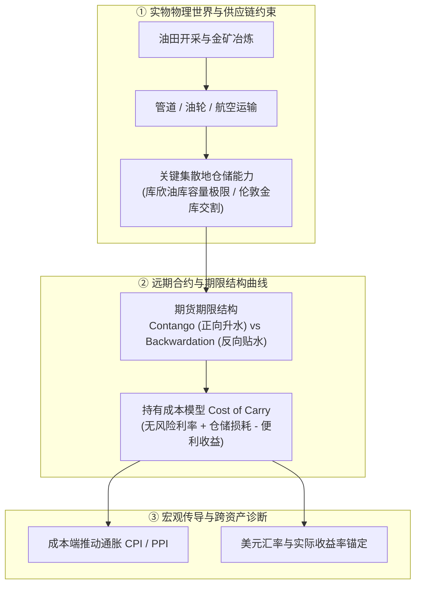
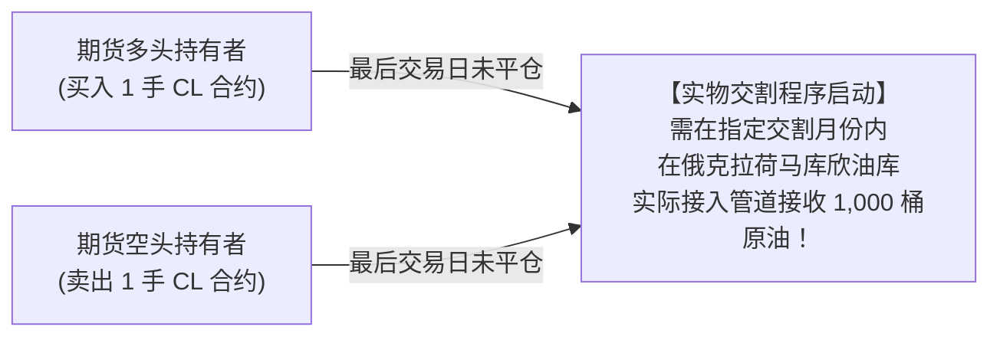
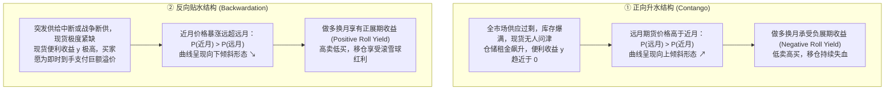
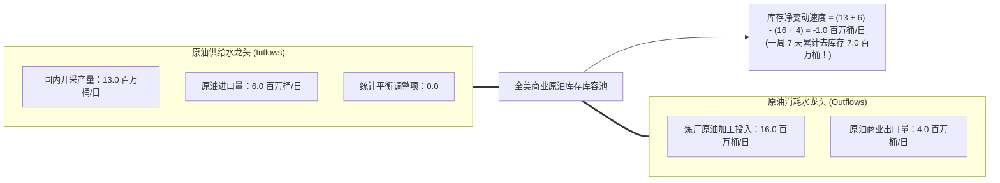
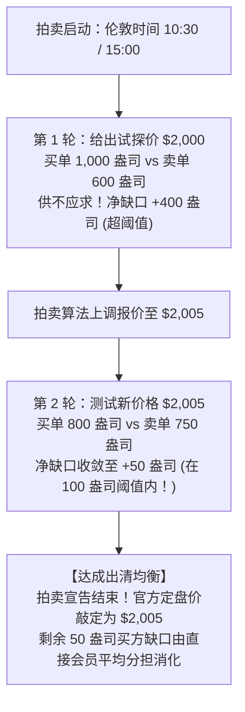
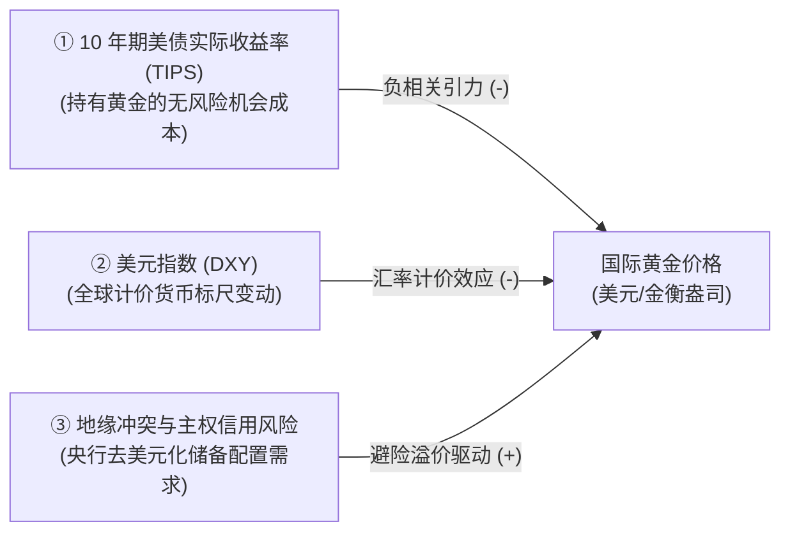

# 34 商品市场：原油、黄金、库存与期货曲线

[上一章](33-shareholder-returns.md) · [目录](./) · [下一章](35-derivative-contracts.md)

## 为什么每桶石油会跌到“-37 美元”，而黄金不生利息却被疯狂疯抢？

2020 年 4 月 20 日，全球现代金融史上最令人瞠目结舌的一幕上演了：
纽约商业交易所（NYMEX）即将到期的 2020 年 5 月 WTI 原油期货合约，在收盘前毫无底线地击穿 0 美元关口，一路自由落体下坠至惊世骇俗的 **每桶 -40.32 美元**，最终收盘定格在 **-37.63 美元/桶**！

这意味着：原油不仅卖不出去一分钱，卖家反而必须为每一桶石油倒贴近 40 美元现金，哀求拥有储油罐的买家把油运走。

难道原油真的一文不值了吗？那天下班开车去加油站加油，加油站真的会倒贴钱给你吗？

而在天平的另一端，黄金既不能当燃料发电，也不能像股票那样每年分红，甚至不提供一分钱固定利息，还需为金库保管支付昂贵保费。然而，人类文明数千年以来，每逢银行暴雷、战争动荡与通胀肆虐，全球最聪明的资本却依然如同潮水般涌向这块沉甸甸的无息金属。

为什么大宗商品的价格波动如此反直觉？

因为与股票等虚拟金融权利不同，**大宗商品深深根植于物理实物世界的刚性约束之中**：
- 它必须在特定地点（如俄克拉荷马州库欣镇）、特定时间、以特定管道和油罐完成物理交付；
- 它的价格曲线直接折射出现货仓储费、资本利息与即时可用的“便利收益”（Convenience Yield）；
- 它的宏观供需被封印在每周公布的库存资产负债表与伦敦金库的集合竞价拍卖之中。

### 学习目标与前置知识

读完本章，你将能够：
1. 理解原油标准化期货合约的实物交割约束，复盘 2020 年“负油价”背后的微观交割与仓储挤兑真相；
2. 掌握期货期限结构（Term Structure），严格推导正向市场（Contango）与反向市场（Backwardation）的持有成本模型；
3. 区分连续合约换月跳空与实际投资损益，识破“伪价格跳涨”陷阱；
4. 读懂美国能源信息署（EIA）周度石油报告（WPSR），手算供需平衡表与表观消费量（Product Supplied）；
5. 掌握伦敦金银市场协会（LBMA）黄金基准价定盘拍卖机制，手算多轮询单撮合与余量分摊；
6. 运用跨资产框架，厘清黄金价格、美债实际收益率与美元指数三者之间的相互约束。

前置知识为[第 19 章](19-yield-decomposition.md)的国债实际收益率、[第 28 章](28-fx-and-dollar.md)的汇率换算，以及[第 30 章](30-equity-market.md)的期货与现货概念。

## 1. 原油：先确定哪桶油、在哪里、何时交付

### 1.1 原油从来不是一个通用的抽象符号

当你谈论“国际油价上涨到 80 美元”时，你指的究竟是哪一桶油？

地球上的原油品质千差万别：
- **API 比重（API Gravity）**：衡量原油是轻质（Light）还是重质（Heavy），轻质油更容易提炼出高价值的汽油和航空煤油；
- **含硫量（Sulfur Content）**：硫含量低于 0.5% 的被称为甜原油（Sweet），含硫量高的被称为酸原油（Sour），酸原油需要昂贵的脱硫设备处理。

国际市场上最核心的两大原油基准是：
1. **西得克萨斯轻质原油（WTI）**：超轻质、低硫甜原油，是北美原油的定价之锚；
2. **布伦特原油（Brent）**：产自北海的轻质低硫原油，是全球超过三分之二海运原油贸易的基准锚。

以纽约商业交易所挂牌的 **WTI 原油期货标准合约（代码：CL）** 为例，其背后是具有法律强制力的标准化契约：
- **交易单位**：每份合约严格对应 **1,000 美制桶（42,000 美制加仑）**；
- **计价单位**：美元及美分/桶；
- **交割地点**：美国俄克拉荷马州库欣镇（Cushing, Oklahoma）的管道或储油设施，必须以实物交付。

如果你在交易所买入 1 手 CL 原油期货，结算价从 75 美元上涨至 76 美元，在未平仓前你的单日持仓盈亏为：
$$\text{多头盈利} = (76.00 - 75.00) \times 1{,}000 = \mathbf{1{,}000\text{ 美元}}$$

如果一家对冲基金只追求投机赚取价差，但在合约到期前忘了将多头头寸平仓或移仓，**交易所将正式启动实物交割程序，要求你在指定日期派油罐车或租用库欣储油罐接收实物原油**！如果你根本没有储油设施，等待你的将是灭顶之灾。

### 1.2 期货期限结构：Contango、Backwardation 与持有成本模型

期货价格与现货价格之间的关系，不是凭空猜测出来的，而是由**持有成本模型（Cost of Carry Model）**严格约束：

$$F_t = S_0 + \text{利息融资成本} + \text{物理仓储与保险费} - \text{便利收益 (Convenience Yield)}$$

- **利息融资成本**：今天借钱买入现货原油锁在仓库里，需要支付的资金利息；
- **仓储与保险费**：租用巨型油罐或油轮必须按月支付的刚性仓储租金与防火防爆保险；
- **便利收益（Convenience Yield, $y$）**：**手中握有实物现货所拥有的商业期权价值**！例如炼油厂手中若有 10 万桶现货库存，当突发飓风导致管道中断时，它可以立刻开工生产高价汽油，而只持有纸面远期合约的企业只能眼睁睁停工停产。

根据利息仓储成本与便利收益的相对强弱，原油期货曲线呈现两种经典的期限结构：

### 1.3 2020 年负油价深度解剖：库欣油库的物理黑洞

现在，我们可以彻底复盘 2020 年 4 月 20 日“负油价”背后的完整链条：

1. **宏观背景**：2020 年初新冠疫情暴发，全球航空全面停摆，数亿人被隔离在家，全球石油需求瞬间暴跌 3,000 万桶/日；与此同时，沙特与俄罗斯开启短暂价格战，全球原油供给如决堤洪水般涌入市场。
2. **物理瓶颈**：过剩的数亿桶原油将全球海上油轮和陆地储罐迅速填满。WTI 期货的唯一交割终点——俄克拉荷马州库欣镇，其储油罐利用率逼近极限，剩余可用库容被大贸易商和炼油厂全部提前预订锁定！全美再也没有任何多余的油罐可以承接新原油。
3. **合约临界点**：4 月 20 日是 2020 年 5 月合约在交易所交易的倒数第二个交易日（最后交易日为 4 月 21 日）。许多被动散户原油 ETF（如著名的 USO）以及缺乏交割能力的境外投机机构，手中依然沉淀着巨额的 5 月多头合约。
4. **致命的无情清算**：如果不平仓，多头必须在 5 月前往库欣镇接收实物原油；但此时整个库欣地区已经没有任何空置油罐！违约将面临交易所无法承受的惩罚性法律起诉。为了避免违约接货的灾难，所有没有储油罐的多头投机者被迫在最后几十分钟内不计成本地下达市价卖单平仓！
5. **流动性枯竭与负定价**：当时市场上唯一拥有闲置库容的大现货贸易商，冷酷地在买方挂出 -10、-20、-37 美元的买单——“想让我帮你处理这 1,000 桶无处安放的原油？没问题，每桶倒贴我 37 美元，我才愿意把油抽进我的空罐里！”

**这就是“负油价”的物理真相**：它不是全球所有石油一文不值，而是**在库欣镇这一特定交割节点、在 4 月 20 日这一特定时点，实物仓储物流资源彻底枯竭所造成的交割逼仓危机**。次日换月后的 6 月合约依然在 20 美元上方交易，普通加油站的汽油更包含提炼、运费与税费，绝不可能倒贴现金给消费者。

### 1.4 展期陷阱：连续期货合约的假跳涨

初学大宗商品的投资者常被看盘软件上的“连续期货价格（如 CL00）”所欺骗。

假设由于市场处于深度的 Contango（正向升水）状态：
- 旧的近月 5 月合约在最后交易日收盘价为 **70 美元**；
- 次月 6 月合约此时的交易价格为 **73 美元**。

在收盘后的那一秒，行情软件自动将主力合约代码从 5 月切换为 6 月：
屏幕上的“最新油价”瞬间从 70 跳到了 73 美元，看似“大涨”了：
$$\frac{73 - 70}{70} \approx \mathbf{+4.286\%}$$

然而，任何一位持有原油基金的投资者在今天**没有赚到一分钱**！
因为如果要将 5 月的多头头寸滚动至 6 月，基金经理必须**以 70 美元的低价卖出 5 月旧合约，同时以 73 美元的高价买入 6 月新合约**。这一“低卖高买”的移仓展期过程，直接导致持有的有效原油桶数被缩减。
长期处于 Contango 结构的商品 ETF，会因持续承受这种**负展期损耗（Negative Roll Yield）**而发生严重的本金永久性损耗。

## 2. 原油实物周报带读：EIA 平衡表与质量守恒定律

### 2.1 物理质量守恒：库存平衡方程

大宗商品的分析从来不是玄学，它必须严格服从物理世界的质量守恒定律。
美国能源信息署（EIA）每周三发布的《周度石油地位报告》（Weekly Petroleum Status Report, WPSR），是全球最权威的供需体检表。

在一个边界闭合的商业原油系统中，所有的流量（单位：百万桶/日）满足严密的动态平衡关系：

$$\text{国内原油产量} + \text{原油净进口} + \text{平衡调整项 (Adjustment)} = \text{炼厂原油加工投入} + \text{出口} + \Delta\text{商业原油库存速度}$$

代入基准教学数据推演：
- 国内开采产量 $= 13.0\text{ 百万桶/日}$；
- 原油进口 $= 6.0\text{ 百万桶/日}$；
- 炼油厂开工加工投入 $= 16.0\text{ 百万桶/日}$；
- 原油商业出口 $= 4.0\text{ 百万桶/日}$；
- 平衡调整项设为 0。

全美商业库存的变化速度为：
$$\Delta\text{Inv} = (13.0 + 6.0 + 0) - (16.0 + 4.0) = 19.0 - 20.0 = \mathbf{-1.0\text{ 百万桶/日}}$$
在持续 7 天的报告周期内，全美商业原油库存累计减少量为：
$$\text{全周库存降幅} = -1.0 \times 7 = \mathbf{-7.0\text{ 百万桶}}$$

如果报告中的统计平衡调整项（Adjustment）为 $+0.2$ 百万桶/日（反映管道在途未报或测量误差），则调整后的日均去库速度变为 $-0.8$ 百万桶/日，全周库存降幅修正为 $-0.8 \times 7 = -5.6$ 百万桶。

### 2.2 表观需求代理指标：Product Supplied

在下游成品油端，消费者去加油站加油的数据不可能被实时安装传感器统计。EIA 采用著名的**表观供应量（Product Supplied）**作为最终消费的代理变量：

$$\text{成品油表观需求 (Product Supplied)} = \text{炼厂净产出} + \text{成品油进口} - \text{成品油出口} - \Delta\text{成品油库存}$$

假设某类成品油（如车用汽油）：
- 炼油厂当周净产出 $= 10.0\text{ 百万桶/日}$；
- 进口 $= 1.0\text{ 百万桶/日}$；
- 出口 $= 2.0\text{ 百万桶/日}$；
- 商业汽油库存增加了 $0.5\text{ 百万桶/日}$。

当周流入下游分销体系与加油站的表观需求量为：
$$\text{Product Supplied} = 10.0 + 1.0 - 2.0 - 0.5 = \mathbf{8.5\text{ 百万桶/日}}$$

看懂了这个等式，你就掌握了穿透 EIA 周报的火眼金睛：**如果原油库存大减 700 万桶，但同期的汽油和馏分油库存暴增了 800 万桶，这根本不代表终端消费景气，而仅仅是炼油厂把原油从储罐里抽出来、加工成了滞销在后道仓库里的汽油而已！**

## 3. 黄金：无息资产背后的多重定价引力

### 3.1 伦敦金银市场协会（LBMA）金价定盘拍卖机制

全世界金融终端上闪烁的伦敦金基准价（LBMA Gold Price），既不是全天交易的平均线，更不是任何机构钦定的指导价。它是由伦敦洲际交易所基准管理机构（ICE Benchmark Administration, IBA）在伦敦时间每天上午 10:30（AM 定盘）和下午 15:00（PM 定盘）各举行一次的**电子多轮交互式定盘拍卖（Electronic Auction）**生成的。

拍卖严格遵循**动态试错出清逻辑**：
1. 拍卖主持人给出一个试探性的初始报价（美元/金衡盎司）；
2. 拥有准入资格的高盛、汇丰、瑞银等直接参与者（Direct Participants），代表自己及背后的全球客户输入在该价格下的买入与卖出意向（以金衡盎司为单位）；
3. 系统自动计算买卖净不平衡量（Imbalance = 累计买入 - 累计卖出）；
4. 若买卖缺口超过了预设的容忍容差阈值（如 100 盎司），系统自动调整价格并进入下一轮重新询单撮合；
5. 直至某一轮买卖缺口收敛至阈值以内，拍卖宣告结束，剩余的微小缺口按规则由直接参与者平均分担消化，形成最终的全球官方定盘价。

#### 动手算：教学拍卖中的余量如何分配？
我们用微型教学数据复现第二轮出清结算：
- 候选价格定格在 2,005 美元/金衡盎司；
- 参与者 A（买方主力）提交原始净买单 300 盎司；
- 参与者 B（卖方主力）提交原始净卖单 250 盎司；
- 净买方缺口为 $300 - 250 = +50\text{ 盎司}$（在 100 盎司法定容差阈值内）。
为了让账面完美借贷平衡，规则要求两家直接参与者各平摊承担 25 盎司的额外卖方交付义务：
- A 最终实际成交净买入：$300 - 25 = \mathbf{275\text{ 盎司}}$；
- B 最终实际成交净卖出：$250 + 25 = \mathbf{275\text{ 盎司}}$。
买卖双方在 2,005 美元价位上以 275 盎司实现精准交收对平！

### 3.2 黄金的宏观引力三叉戟：实际利率、美元与避险信用

黄金由于本身不产生利息，其持有价值受制于三大宏观物理管道：

1. **实际利率是黄金的核心地心引力**：
   如果持有绝对安全的 10 年期美国通胀保值国债（TIPS）能获得高达 **$2.5\%$ 的无风险实际年化收益率**，资金持有无息黄金的机会成本就极其高昂；反之，当实际利率暴跌为负数时，持有黄金不仅没有劣势，反而具有抵抗法币贬值的卓越属性。
2. **汇率换算与本币金价陷阱**：
   国际黄金以美元计价。如果你用人民币、欧元或日元投资黄金，你的本币收益率同时受美元金价与双边汇率的双重影响！

$$\frac{P_{\text{本币}, 1}}{P_{\text{本币}, 0}} = \left( 1 + g_{\text{美元金价}} \right) \times \left( 1 + g_{\text{美元相对本币升值率}} \right)$$

假设美元金价上涨了 $8\%$，但同期本币对美元升值，导致 1 美元能兑换的本币金额下降了 $5\%$（美元相对本币变动为 $-5\%$）：
$$\frac{P_{\text{本币}, 1}}{P_{\text{本币}, 0}} = (1 + 8\%) \times (1 - 5\%) = 1.08 \times 0.95 = \mathbf{1.026}$$
本币计价的黄金实际仅上涨了 **$+2.6\%$**，绝不是两个百分比的简单算术加减！

## 4. 跨资产联合诊断矩阵

构建专业的跨资产全景监测面板，是顶级宏观对冲基金分析师的日常基本功：

| 资产维度 | 起步观察标的 | 核心必填口径 | 必须穿透的底层事实 |
| :--- | :--- | :--- | :--- |
| **股票大盘** | 标普 500、标普等权、纳斯达克 100 | 区分价格指数（PR）与全收益指数（TR） | 上涨是龙头孤勇者推动，还是全市场普涨？ |
| **利率与通胀** | 10 年期美债名义收益率、TIPS 实际收益率 | 拆解盈亏平衡通胀补偿率（BEI） | 收益率走高是经济景气推动，还是通胀恐慌发酵？ |
| **信用利差** | 彭博美高收益债 OAS 利差 | 排除违约垃圾券样本干扰 | 企业借贷违约风险是否在暗中飙升？ |
| **原油与能源** | WTI 原油近月与次月、布伦特原油 | 标注期货合约具体交割月份与基差 | 处于 Contango 还是 Backwardation？库存去化在哪一环？ |
| **黄金与货币** | 现货黄金（XAU/USD）、美元指数（DXY） | 区分美元金价与本币金价折算 | 是实际利率压制主导，还是央行避险增持主导？ |

## 5. 练习与参考答案

### 练习 1：合约换月假跳涨辨析

某数据商终端上，旧的近月原油合约最后交易价为 70.00 美元，新近月合约价格为 73.00 美元（两份合约日内自身均无波动）。数据商今日切换显示新合约代码。
1. 行情软件机械计算出的单日涨幅是多少？
2. 某原油 ETF 投资者看到此涨幅，认定自己账户今天稳赚了该比例收益，这一判断错在哪里？

参考答案与推理

1. 机械涨幅计算：$\frac{73.00 - 70.00}{70.00} \approx \mathbf{+4.286\%}$。
2. **错误批驳**：这 4.286% 的涨幅完全是由数据源切换观察标的产生的虚假价格错觉。在现实展期中，ETF 必须以 70 美元的低价卖出旧合约，并以 73 美元的高价买入新合约，面临高达 4.286% 的负展期损耗（Negative Roll Yield），持仓份额反而被摊薄，账户在当日绝不可能获得哪怕 1 美分的净资本利润。

### 练习 2：纠正“负油价”财经谣言

某自媒体宣称：“2020 年 4 月 20 日全美所有石油都彻底一文不值，所有人去加油站都可以免费加油甚至倒贴现金；而且这纯粹是华尔街在金融纸黄金/纸原油上的投机游戏，跟实物世界没有半点关系。”
请依据本章所学，全面指出这两处断言的严重错误，并还原真实历史口径。

参考答案与推理

1. **第一处错误批驳**：跌入负值的仅仅是**即将在次日（4 月 21 日）停止交易、必须在 5 月份于俄克拉荷马库欣地区实物接货的 2020 年 5 月 WTI 原油期货单份合约**。全球其他产油区以及远月合约依然维持在正价格交易；普通加油站销售的汽油包含了高昂的炼化裂解成本、油罐车运输物流费以及联邦与州级燃油消费税，零售成品油绝不可能免费甚至倒贴。
2. **第二处错误批驳**：这场危机的根源**恰恰是实物物理仓储的绝对瓶颈**！由于库欣油库罐容被全部预订一空，多头如果不平仓将面临无法实物接货的严重违约与法律追责，被迫不计代价在盘中砸盘倒贴平仓。这是实物世界的物理约束对金融纸面合约最无情、最残酷的一次反噬，绝非不接地气的纯金融游戏。

### 练习 3：双重汇率折算下的本币金价收益

国际美元金价在年内上涨了 6.0%，与此同时，由于本国货币对美元贬值，1 美元能兑换的本币数量上涨了 4.0%（即美元相对本币升值 4.0%）。
1. 计算本国投资者以本币计价的黄金实际投资回报率；
2. 若同期 10 年期美债实际收益率（TIPS）上涨了 50 个基点，从传统理论上看黄金理应承压，为什么本例中黄金依然能录得大涨？

参考答案与推理

1. 本币金价回报率计算：
   $$\frac{P_{\text{本币}, 1}}{P_{\text{本币}, 0}} = (1 + 6.0\%) \times (1 + 4.0\%) = 1.06 \times 1.04 = \mathbf{1.1024} \implies \mathbf{+10.24\%}$$
   （绝对不能草率相加为 10.0%）。
2. **反常大涨机理解析**：实际收益率上升确实在边际上推高了持有黄金的机会成本，但这仅仅是多重引力中的一个向量。如果同期全球地缘政治冲突急剧激化、非美国家央行出于去美元化储备安全考虑大举增持实物黄金，或者投资者对主权债务违约的避险需求井喷，避险信用溢价的向上推力完全可以压倒实际利率的下行阻力。

### 练习 4：跨资产对照情景实战推演

分析以下两组典型宏观组合：
- 组合 A：股票全面上涨，高收益企业债信用利差收窄，美债实际收益率快速攀升；
- 组合 B：股票全线下挫，高收益企业债信用利差大幅走阔，美债收益率直线跳水。
请分别指出两组情景最符合哪类宏观经济脉冲，并说明需要调阅什么反证数据以避免误判。

参考答案与推理

1. **组合 A（景气扩张与风险偏好修复）**：符合宏观经济强劲复苏、实体订单充沛、企业盈利向好的繁荣特征。企业违约风险降低使信用利差收窄，资金涌入风险资产推升股市，实体资金需求旺盛推高了实际利率。
   - **需反证核验**：需调取标普等权指数与涨跌家数比，核验上涨是否具有全行业普适性；同时核查盈利上修是实体需求驱动还是大宗商品价格暴涨引起的局部成本抬升。
2. **组合 B（经典衰退恐慌与去杠杆抛售）**：符合经济陷入严重下行萧条、企业信用风险暴露的危机特征。避险资金疯抢无风险国债避险（推动国债收益率暴跌），高收益弱资质企业再融资困难（利差飙升），股票市场遭无情抛售。
   - **需反证核验**：需调阅商业银行信贷标准调查报告（SLOOS）与当周初请失业金人数，区分这是短期特定对冲基金爆仓引起的流动性冲击，还是全美实体经济全面陷入资产负债表衰退。

### 练习 5：EIA 原油平衡表手算

某教学周全美石油系统数据如下（单位均为百万桶/日）：
- 国内原油开采产量：12.0；
- 原油进口量：7.0；
- 炼油厂开工加工投入：16.0；
- 原油出口量：4.0；
- 统计平衡调整项为：$+0.1$。
1. 计算全美商业原油库存的每日净变动速度，以及整周（7 天）的累计库存变动量；
2. 商业原油库存去化了数百万桶，能否直接向媒体宣布“全美居民汽油消费极度繁荣”？

参考答案与推理

1. 每日净变动速度：
   $$\Delta\text{Inv} = (12.0 + 7.0 + 0.1) - (16.0 + 4.0) = 19.1 - 20.0 = \mathbf{-0.9\text{ 百万桶/日}}$$
   整周 7 天累计库存变动：
   $$-0.9 \times 7 = \mathbf{-6.3\text{ 百万桶 (大幅去库存)}}$$
2. **绝不能直接推导**：商业原油库存减少 6.3 百万桶，仅仅说明炼油厂把原油拉进了炼油车间，或者原油出口增加、进口减少。如果同期汽油库存由于居民不开车而在加油站仓库大举积压，这反而预示着下游终端需求的冰冻。必须结合汽油的 Product Supplied 与炼厂裂解开工率共同下达诊断。

### 练习 6：原油基差风险与企业套期保值对冲

某航空公司预计三个月后需要采购 1,000 桶航空煤油。为规避燃料暴涨风险，公司在期货市场上买入 1 手 WTI 原油期货合约，买入价格为 70.00 美元/桶，此时现货航空煤油价格为 80.00 美元/桶（基差为 $+10.00$ 美元）。
三个月后交割日，现货航空煤油因炼化产能紧张飙升至 88.00 美元/桶，而 WTI 原油期货仅上涨至 75.00 美元/桶。
1. 计算期货端套期保值的净盈亏金额；
2. 计算航空公司扣除期货盈利后的实际采购净成本，并说明为什么对冲没有实现完全锁定成本的效果？

参考答案与推理

1. 期货端多头盈利：
   $$\text{期货盈利} = (75.00 - 70.00) \times 1{,}000 = \mathbf{+5{,}000\text{ 美元}}$$
2. 实际采购与对冲净成本：
   $$\text{现货采购支出} = 88.00 \times 1{,}000 = 88{,}000\text{ 美元}$$
   $$\text{净支出成本} = 88{,}000 - 5{,}000 = \mathbf{83{,}000\text{ 美元}}$$
   （比最初预期的 80,000 美元高出了 3,000 美元）。
3. **基差风险（Basis Risk）解析**：WTI 原油与航空煤油属于不同品种，两者之间存在炼化裂解价差（Crack Spread）。在对冲期间，基差从 $+10.00$ 美元扩大至 $88 - 75 = +13.00$ 美元（基差走阔了 3.00 美元/桶）。期货多头有效对冲了原油基准的上涨，但留下了无法对冲的品种间基差走阔风险。

### 练习 7：LBMA 黄金定盘拍卖终轮撮合手算

采用正文教学拍卖规则，法定容许出清阈值为 100 盎司，有 A、B 两家直接结算会员参与。
某轮拍卖主持人报出 2,010 美元/金衡盎司：
- 会员 A 提交客户买单 400 盎司；
- 会员 B 提交客户卖单 340 盎司。
1. 该轮拍卖能否宣告结束？
2. 按照直接会员平摊多余缺口的规则，两家机构最终各自实际交收结算的净交易量为多少？

参考答案与推理

1. 净缺口计算：
   $$\text{Imbalance} = 400 - 340 = \mathbf{+60\text{ 盎司}}$$
   由于 $60 \le 100\text{ 盎司}$（处于法定容差阈值以内），拍卖算法判定满足出清条件，**本轮拍卖宣告结束，官方定盘价敲定为 2,010 美元**！
2. **余量平摊与最终交收**：
   多余的 60 盎司买方缺口，由 A、B 两家直接会员各自承担 30 盎司额外卖方交收义务：
   - 会员 A 最终实际净买入：$400 - 30 = \mathbf{370\text{ 盎司}}$；
   - 会员 B 最终实际净卖出：$340 + 30 = \mathbf{370\text{ 盎司}}$。
   买卖双方在 2,010 美元价格下以 370 盎司精准双向清算平衡！

### 练习 8：撰写专业的大宗商品研究札记

某交易日：WTI 原油期货暴跌 4.0%，布伦特原油仅微跌 0.8%，WTI 近月相对次月贴水幅度大幅走阔（Contango 进一步深化）；同日标普能源板块重挫 3.5%，10 年期美债实际收益率微幅下行。
请写一段不超过 200 字的专业归因简讯，指出最核心的物理与金融线索，并说明次日 EIA 周报需重点核验什么。

参考答案与推理

> “今日美油大幅跑输布油且 Contango 结构显著走阔，直指北美陆上管网与库欣地区遭遇局部交割或仓储物流瓶颈，而非全球海运原油总需求的系统性塌方。能源板块受裂解价差收窄与北美实现油价预期拖累领跌大盘。明日 EIA 周报需严密穿透：库欣商业原油库存是否逼近库容警戒线、管道检修是否阻断原油南下墨西哥湾炼厂，以及汽油表观需求能否承接炼厂负荷，切勿盲目推导全球宏观衰退全面降临。”

## 本章小结与下一步

在这一章中，我们穿透了商品市场的物理与金融双重维度：
- 原油不是纸面代码，品质、库欣交割地点与油罐容积决定了极端交割行情的生死存亡；
- 期限结构 Contango 与 Backwardation 深刻映射出仓储租金与便利收益的微观博弈；
- EIA 周报以严密的质量守恒方程，建立了商业原油与下游成品油供需推演的科学方法；
- 黄金定盘拍卖展示了微观询单撮合如何将避险溢价、实际利率与货币标尺凝聚为全球公允基准。

然而，大宗商品、外汇、国债和股票的风险管理，离不开庞大复杂的**金融衍生品世界**：
远期、期货、利率互换（Swaps）与期权（Options）在法律与现金流底层究竟如何构建？互换合约如何将浮动利息神奇地转化为固定利息？为什么价值数亿美元的衍生品名义本金并不等于同等损失？

下一章我们将进入[第 35 章：衍生品合同：远期、期货、互换与期权](35-derivative-contracts.md)。

[上一章](33-shareholder-returns.md) · [目录](./) · [下一章](35-derivative-contracts.md)
