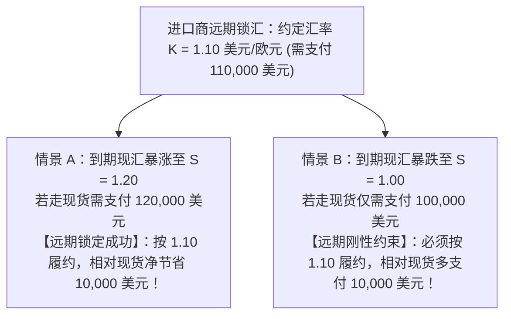
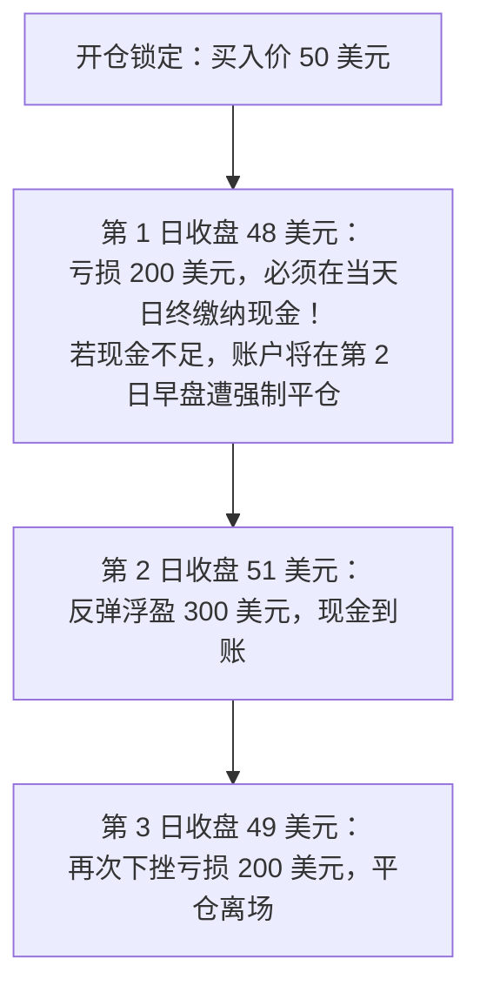
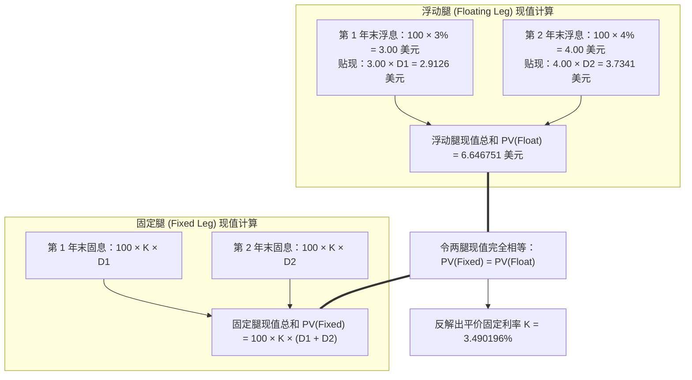
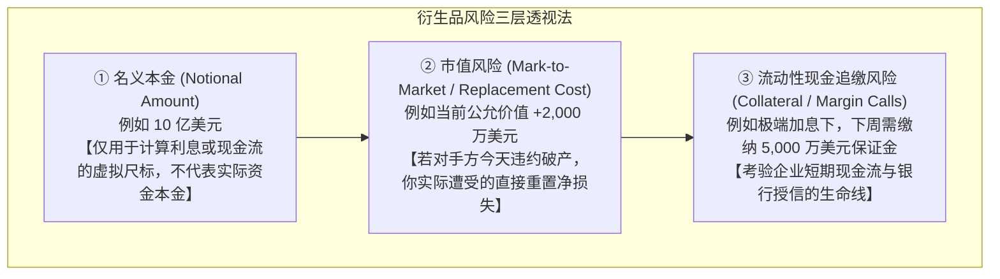

# 35 衍生品合同：远期、期货、互换与期权

[上一章](34-commodities.md) · [目录](./) · [下一章](36-market-infrastructure.md)


## 为什么企业赚了几千万，却可能被一张“对冲合同”逼到破产？

设想这样一个真实的商业风云故事：
你是一家跨国航空公司的首席财务官（CFO）。三个月后，你的机队必须采购 1,000 万加仑航空煤油；或者你是一家向欧洲出口高端半导体的科技公司，90 天后将如期收到 1 亿欧元的货款。

你的心头时刻悬着一把达摩克利斯之剑：
- 如果国际油价从每加仑 2.50 美元飙升至 4.00 美元，你全年的微薄航运利润将在瞬间被燃油成本吞噬殆尽；
- 如果欧元对美元汇率从 1.15 暴跌至 0.95，你辛辛苦苦赚来的 1 亿欧元换回美元后将缩水 2,000 万美元，直接陷入亏损。

你如何才能在剧烈波动的市场中睡个安稳觉？

答案正是**金融衍生品（Derivatives）**。
衍生品并不是凭空捏造的纸上赌博，它的核心价值在于**将资产价格、利率、汇率或违约事件的风险，在具有不同风险承受能力的参与者之间进行重新剥离、定价与转移**。

然而，金融衍生品也是一把双刃剑：在 2008 年金融海啸与 2022 年欧洲能源危机中，许多明明做了“完美对冲”的企业，却因为衍生品每日结算产生的巨额保证金追缴缺口，在黎明到来前因流动性枯竭轰然倒下。


### 学习目标与前置知识

读完本章，你将能够：
1. 掌握远期合约的损益结构，区分实物交割与现金差价结算；
2. 熟练计算期货合约的**逐日盯市（Mark-to-Market, MTM）**现金流，理解“对冲没有亏损但现金断裂”的制度根源；
3. 掌握利率互换（Interest Rate Swap）的对冲原理，手算浮动利率转固定利率的净利息支出；
4. 运用折现因子现金流匹配法，手算**平价互换固定利率（Swap Par Rate）**；
5. 画出看涨期权与看跌期权的到期收益曲线，计算盈亏平衡点与买卖双方的权利义务不对称性；
6. 严格区分衍生品的名义本金（Notional）、市值（Mark-to-Market Value）与潜在流动性现金风险。

前置知识为[第 17 章](17-bonds-and-curves.md)的折现因子计算、[第 28 章](28-fx-and-dollar.md)的外汇远期，以及[第 34 章](34-commodities.md)的商品期货基差。


## 1. 远期合约（Forwards）：锁定确定性，不等于锁定最便宜

### 1.1 远期的法律本质与到期收益方程

远期合约是金融衍生品最质朴的形态：**买卖双方在今天达成具有法律约束力的协议，约定在未来的特定日期（到期日 $T$），按照今天商定的确定价格（远期价格 $K$），买卖特定数量的标的资产**。

假设某美国进口商 3 个月后必须向德国供货商支付 100,000 欧元。为了规避欧元升值风险，进口商今天与花旗银行签订了一份远期合约：约定 3 个月后按每欧元 1.10 美元（$K = 1.10$）买入 100,000 欧元。

到了 3 个月到期日，可能出现两种截然相反的市场情景：



- **若到期现汇 $S_T = 1.20$**：若在现货市场买欧元需要支付 $120{,}000$ 美元，凭借远期合约只需付 $110{,}000$ 美元，相对节省了 $10{,}000$ 美元；
- **若到期现汇 $S_T = 1.00$**：若在现货市场买只需 $100{,}000$ 美元，但远期合约是**刚性双向义务**，进口商必须按照合同支付 $110{,}000$ 美元，相对多支付了 $10{,}000$ 美元。

**远期的核心哲学是“买入确定性，消除未知波动”，绝不是保证事后回看每次都比现货更便宜**。如果企业事后因为汇率下跌而抱怨“对冲亏了”，说明管理层混淆了套期保值与单边投机的根本界限。

### 1.2 现金结算（Cash Settlement）的代数等价性

在实际交易中，双方不一定非要进行繁琐的实物外汇交付，通常采用**现金差价结算（Cash Settlement）**。
对于远期多头（约定买入标的的一方），在到期日收到的净现金流方程为：

$$\text{多头净收款} = Q \times (S_T - K)$$

代入本例数据（$Q = 100{,}000\text{ 欧元}$，$K = 1.10\text{ 美元/欧元}$）：
- 若 $S_T = 1.20$，多头直接从银行账户净收取现金：
  $$\text{净收益} = 100{,}000 \times (1.20 - 1.10) = \mathbf{+10{,}000\text{ 美元}}$$
  随后进口商拿这补偿的 10,000 美元加上原本的 110,000 美元，依然能在现货市场买齐 100,000 欧元。
- 若 $S_T = 1.00$，多头必须向银行转出支付：
  $$\text{净亏损} = 100{,}000 \times (1.00 - 1.10) = \mathbf{-10{,}000\text{ 美元}}$$


## 2. 期货合约（Futures）：逐日盯市与现金流的时空错配

### 2.1 交易所标准化与逐日清算结算（Mark-to-Market）

远期合约是场外交易（OTC），存在两大痛点：一是量身定制难以中途转让，缺乏流动性；二是面临对手方赖账违约的巨大信用风险。

**期货合约（Futures）**通过两大机制彻底解决了这些痛点：
1. **交易所标准化契约**：规定固定的合约大小、计价跳动点与交割月份；
2. **中央对手方（CCP）与逐日盯市（Mark-to-Market, MTM）**：每个交易日收盘后，清算机构按照官方结算价对所有持仓进行盈亏核算，并将当天的盈利即时划入胜者账户，将亏损从败者账户中直接扣除。

我们通过一个标准的教学期货合约，来透视每日现金划转的物理过程：
设某商品期货每份合约严格对应 100 个单位资产。
某投资者在第 0 天以开仓价 **50 美元/单位**买入 1 份期货多头。随后三个交易日的交易所收盘结算价依次为 **48、51、49 美元**，投资者在第 3 天收盘时平仓离场（忽略手续费与利息）：

| 交易日 | 官方结算价 | 多头当日逐日结算损益算式 | 当日实际收付现金 | 累计实现总损益 |
| :---: | :---: | :--- | :---: | :---: |
| **开仓** | 50 美元 | — | 存入初始履约保证金 | 0 美元 |
| **第 1 日** | 48 美元 | $(48 - 50) \times 100 = \mathbf{-200\text{ 美元}}$ | **必须立即划出 200 美元现金！** | -200 美元 |
| **第 2 日** | 51 美元 | $(51 - 48) \times 100 = \mathbf{+300\text{ 美元}}$ | 账面自动划入 300 美元现金 | +100 美元 |
| **第 3 日** | 49 美元 | $(49 - 51) \times 100 = \mathbf{-200\text{ 美元}}$ | **必须再次划出 200 美元现金！** | **-100 美元** |



### 2.2 致命的时间错配：对冲成功为何依然会诱发流动性危机？

请仔细审视上述期货的累计终局损益：
$$\text{累计总损益} = (49 - 50) \times 100 = \mathbf{-100\text{ 美元}}$$
如果这是一份远期合约，投资者只需在第 3 天一次性支付 100 美元即可。
但在期货市场上，**第 1 天你就必须实打实拿出 200 美元的真金白银现金划给清算所**！

这一微观制度差异解释了无数大宗商品巨头的生死之谜：
如果一家大豆压榨企业持有了与现货完美匹配的期货空头对冲，在极端牛市行情中，现货大豆价值虽然每天都在暴增，但这笔钱必须等三个月后大豆卖出才能收到；而期货空头每天产生的几千万美元逐日盯市亏损，清算所**在当天下午 4 点就会强制要求缴纳现金保证金**！
如果企业账面现金缓冲耗尽且无法从银行取得过桥授信，它就会在现货迎来大丰收的前夜，在期货端被券商强行平仓、斩落马下。


## 3. 利率互换（Interest Rate Swaps）：负债结构的变形金刚

### 3.1 什么是利率互换？无需交换本金的利息置换

在所有金融衍生品中，体量最庞大的是场外**利率互换（Interest Rate Swap, IRS）**，全美乃至全球存量名义本金高达数百万亿美元。

最经典的利率互换被称为“香草型”（Plain Vanilla）同币种固定对浮动互换：
**交易双方约定一个名义本金（Notional Principal），在未来的若干个支付周期内，一方定期向另一方支付按照固定利率计算的利息，另一方则向该方支付按照浮动参考利率（如 SOFR）计算的利息；名义本金仅作为计息基数，到期不发生任何实际本金互换。**

### 3.2 浮动转固定：负债端对冲的数学对账

假设某制造企业有一笔总额 **1,000,000 美元**的银行浮动利率商业贷款，贷款合同规定每年支付一次利息，利率为：
$$\text{贷款年利息} = \text{基准浮动利率 } r_{\text{float}} + 2.0\%$$
如果未来央行激进加息，浮动利率一路飙升，企业将不堪重负。
为了锁定融资成本，企业与投资银行订立了一份名义本金同为 1,000,000 美元的 3 年期利率互换协议：
- **企业承诺**：向投行支付每年 **4.0% 的固定利率**；
- **投行承诺**：向企业支付每年等额的 **基准浮动利率 $r_{\text{float}}$**。

```mermaid
flowchart LR
    BankLoan["银行贷款债权人"] <== "支付浮动利息：(r_float + 2%)" === Enterprise["【实体企业】"]
    Enterprise <== "支付固定利息：4.0%" ==> SwapDealer["【互换交易商 (投行)】"]
    SwapDealer <== "支付浮动利息：r_float" ==> Enterprise
```

在任何一个计息周期内，无论基准浮动利率 $r_{\text{float}}$ 暴涨到天上还是跌入地下，企业的综合净融资成本代数表达式为：

$$\begin{aligned}
\text{企业综合净利息支出} &= \text{向贷款银行支付} + \text{向互换投行支付} - \text{从互换投行收取} \\
&= (r_{\text{float}} + 2.0\%) + 4.0\% - r_{\text{float}} \\
&= \mathbf{6.0\% \quad (\text{完全锁死在恒定 6.0\%！})}
\end{aligned}$$

#### 两种极端情景的现金流核算验证：
- **情景 1：央行暴力加息，基准浮动率飙升至 $r_{\text{float}} = 5.0\%$**：
  - 贷款利息支出：$1{,}000{,}000 \times (5\% + 2\%) = 70{,}000\text{ 美元}$；
  - 互换端支付固定：$1{,}000{,}000 \times 4\% = 40{,}000\text{ 美元}$；
  - 互换端收取浮动：$1{,}000{,}000 \times 5\% = 50{,}000\text{ 美元}$（互换端净收款 10,000 美元）；
  - **全口径净支出**：$70{,}000 - 10{,}000 = \mathbf{60{,}000\text{ 美元}} \quad (6.0\%)$。
- **情景 2：央行降息救市，基准浮动率暴跌至 $r_{\text{float}} = 2.0\%$**：
  - 贷款利息支出：$1{,}000{,}000 \times (2\% + 2\%) = 40{,}000\text{ 美元}$；
  - 互换端支付固定：$40{,}000\text{ 美元}$，收取浮动 $20{,}000\text{ 美元}$（互换端净支付 20,000 美元）；
  - **全口径净支出**：$40{,}000 + 20{,}000 = \mathbf{60{,}000\text{ 美元}} \quad (6.0\%)$。

无论利率海啸如何肆虐，企业通过这张互换合约，将浮动债务结构优雅地重构为了年化 6.0% 的刚性固定借贷。


## 4. 互换平价定价（Swap Par Rate）：屏幕上的固定利率如何形成？

交易软件屏幕上的互换固定利率（如 3.49%）从何而来？
在互换签约的那一刻，双方尚未发生实质现金往来，**一份公平合约必须保证：固定腿未来现金流的现值总和，严格等于浮动腿未来现金流的现值总和**（即初始合约价值为 0）。使两腿现值完全相等的固定利率，被称为**平价互换利率（Swap Par Rate, $K$）**。

我们通过一个标准的两年期教学模型来完整推导这一严密的折现过程：
- 名义本金：$N = 100\text{ 美元}$，每年末支付一次利息；
- 市场当前隐含的远期利率预期：第 1 年远期利率为 $f_1 = 3.0\%$，第 2 年远期利率为 $f_2 = 4.0\%$；
- 对应的连续折现因子（Discount Factors）：
  $$D_1 = \frac{1}{1 + 3.0\%} = \frac{1}{1.03} \approx \mathbf{0.97087379}$$
  $$D_2 = \frac{1}{(1 + 3.0\%) \times (1 + 4.0\%)} = \frac{1}{1.03 \times 1.04} \approx \mathbf{0.93353249}$$



#### 步骤 1：计算浮动腿的贴现总现值（$\text{PV}_{\text{float}}$）
$$\begin{aligned}
\text{PV}_{\text{float}} &= 100 \times 3.0\% \times D_1 + 100 \times 4.0\% \times D_2 \\
&= 3.00 \times 0.97087379 + 4.00 \times 0.93353249 \\
&\approx 2.91262137 + 3.73412996 \approx \mathbf{6.64675131\text{ 美元}}
\end{aligned}$$

#### 步骤 2：建立固定腿现值方程并反解 $K$
设待求的固定利率为 $K$，固定腿的贴现总现值为：
$$\text{PV}_{\text{fixed}} = 100 \times K \times D_1 + 100 \times K \times D_2 = 100 \times K \times (D_1 + D_2)$$

折现因子之和为：
$$D_1 + D_2 = 0.97087379 + 0.93353249 = \mathbf{1.90440628}$$

令两端相等：
$$100 \times K \times 1.90440628 = 6.64675131$$
$$K = \frac{6.64675131}{100 \times 1.90440628} \approx 0.03490196 \implies \mathbf{3.490196\%}$$

**结论**：该两年期互换的理论平价固定利率严格定格在 **$3.490196\%$**！
它绝不是第一年 3% 与第二年 4% 的粗糙算术平均（3.50%），而是由复利时间价值加权精算出的公允无套利基准。


## 5. 期权（Options）：非对称的权利与义务

### 5.1 核心定义与非对称性物理图像

如果说远期、期货与互换是“对称的契约”（双方均承担不可推卸的履约义务），那么**期权（Options）**则是金融学中最迷人的“非对称工具”：
- **买方（Holder / Buyer）**：支付一笔不可退还的预付金（**期权费 / 权利金 Premium**），换取在未来按照约定价格购买或出售标的资产的**单向选择权利，但没有任何必须履约的义务**；
- **卖方（Writer / Seller）**：收取买方的权利金，但必须随时无条件听从买方的行权指令，**承担刚性的单向履约义务**。


主要分为两大基本类型：
1. **看涨期权（Call Option）**：赋予买方按照约定行权价（Strike Price, $K$）**买入**标的资产的权利；
2. **看跌期权（Put Option）**：赋予买方按照约定行权价（Strike Price, $K$）**卖出**标的资产的权利。

### 5.2 欧式期权到期到期净损益方程

以在到期日方可行权的欧式期权为例，设合约乘数为 $Q$，行权价为 $K$，到期标的现价为 $S_T$，期权费总额为 $\text{Premium}$：

$$\text{买入看涨 Call 净损益} = \max(S_T - K, 0) \times Q - \text{Premium}$$
$$\text{买入看跌 Put 净损益} = \max(K - S_T, 0) \times Q - \text{Premium}$$
$$\text{卖出看涨 Call 净损益} = -\max(S_T - K, 0) \times Q + \text{Premium}$$
$$\text{卖出看跌 Put 净损益} = -\max(K - S_T, 0) \times Q + \text{Premium}$$

#### 动手算：买入看涨期权的盈亏全景
设某投资者买入 1 份行权价 $K = 50\text{ 美元}$ 的看涨期权，合约对应 $Q = 100\text{ 股}$ 标的股票，每股支付期权费 3 美元（总支出 $\text{Premium} = 300\text{ 美元}$）：
- **情景 1：股票暴涨至 $S_T = 60\text{ 美元}$**：
  $$\text{内在价值} = \max(60 - 50, 0) \times 100 = 10 \times 100 = 1{,}000\text{ 美元}$$
  $$\text{净利润} = 1{,}000 - 300 = \mathbf{+700\text{ 美元}}$$
- **情景 2：股票在平盘附近为 $S_T = 52\text{ 美元}$**：
  $$\text{内在价值} = (52 - 50) \times 100 = 200\text{ 美元}$$
  $$\text{净损益} = 200 - 300 = \mathbf{-100\text{ 美元}} \quad (\text{行权有价值，但总账依然亏损})$$
- **情景 3：股票暴跌至 $S_T = 40\text{ 美元}$**：
  $$\text{内在价值} = \max(40 - 50, 0) = 0$$
  $$\text{净损益} = 0 - 300 = \mathbf{-300\text{ 美元}} \quad (\text{最大亏损严格锁定在已支付的期权费！})$$

该看涨期权的**盈亏平衡点（Breakeven Price）**为：
$$\text{盈亏平衡价} = K + \frac{\text{Premium}}{Q} = 50 + 3 = \mathbf{53.00\text{ 美元}}$$
股票必须涨破 53 美元，买方才能真正赚取净收益。而该期权的裸卖方则面临“赚取 300 美元封顶利润，但承受向上无限爆仓亏损”的极端非对称风险。


## 6. 名义本金很大，是否就有同额损失？

在财经爆料中，经常出现“某某机构签署了名义本金 10 亿美元的掉期协议，面临滔天风险”的耸人听闻标题。

分析师必须穿透三大维度的本质差异：



1. **名义本金（Notional Amount）**：仅仅是用来计算每期现金流的参考尺子，在利率互换中双方根本不交换这笔钱。哪怕名义本金高达 100 亿美元，签约当天的市场价值也严格为 0；
2. **市值重置价值（Mark-to-Market Value）**：如果利率发生了有利于你的变动，你的合同变成了正价值（如 +2000 万美元）。此时真正的信用风险是：**如果交易对手方（如某投资银行）突然倒闭，你将失去这笔价值 2000 万美元的合法应收款项**；
3. **流动性现金风险（Liquidity Risk）**：哪怕长远来看对冲没有发生实际经济亏损，中途因为逐日盯市保证金而必须交出的现金流缺口，才是真正能够置企业于死地的致命暗礁。


## 7. 练习与参考答案

### 练习 1：实物出口商的远期对冲评估

某美国机械出口商预计 3 个月后将从欧洲客户处收到 50,000 欧元应收账款。为防范欧元贬值，公司在今天与银行锁定了 3 个月欧元远期卖出合约，锁定汇率为 $K = 1.08\text{ 美元/欧元}$。
三个月后交割日，现汇汇率实际飙升至 $S_T = 1.15\text{ 美元/欧元}$。
1. 该出口商通过远期合约锁定的美元现金收入是多少？
2. 相对到期直接在现货市场结汇，出口商“少赚”了多少美元？能否据此批评该对冲策略是一次失败的决策？

<details>
<summary>参考答案与推理</summary>

1. 锁定美元收入：$50{,}000 \times 1.08 = \mathbf{54{,}000\text{ 美元}}$。
2. 现货结汇对照：若直接按 1.15 现汇结汇，可换得 $50{,}000 \times 1.15 = 57{,}500$ 美元，相对少赚了 $57{,}500 - 54{,}000 = \mathbf{3{,}500\text{ 美元}}$。
3. **决策评价**：绝不能视为失败！套期保值的唯一使命是在 3 个月前彻底消除未来的不确定性，锁死 54,000 美元的制造毛利。如果当时欧元暴跌至 0.98，没有远期对冲的企业将面临巨亏倒闭。事后的机会成本是消除致命风险所支付的合理商业对价。

</details>

### 练习 2：保护性看跌期权组合（Protective Put）损益手算

某投资者以每股 50.00 美元买入 100 股某股票现货（总投入 5,000 美元），同时为了防止下行崩盘，买入 1 份行权价为 $K = 45.00\text{ 美元}$ 的看跌期权（对应 100 股），每股支付期权费 2.00 美元（总期权费支出 200 美元）。
组合总初始资本投入为 $5{,}000 + 200 = 5{,}200\text{ 美元}$。
在到期日，若股票价格分别变为：① $S_T = 30.00\text{ 美元}$；② $S_T = 60.00\text{ 美元}$。
计算两种情景下投资组合的总终值及相对初始投入的净损益。

<details>
<summary>参考答案与推理</summary>

1. **情景 1：股票崩盘至 $S_T = 30.00\text{ 美元}$**：
   - 股票持仓现值：$100 \times 30 = 3{,}000$ 美元；
   - 看跌期权到期价值：$\max(45 - 30, 0) \times 100 = 15 \times 100 = 1{,}500$ 美元；
   - 组合总资产终值：$3{,}000 + 1{,}500 = \mathbf{4{,}500\text{ 美元}}$；
   - 净损益：$4{,}500 - 5{,}200 = \mathbf{-700\text{ 美元}}$。
   （看跌期权成功将股票从 50 跌到 30 的 2,000 美元暴跌亏损，牢牢截断封死在最大亏损 700 美元以内！）
2. **情景 2：股票大涨至 $S_T = 60.00\text{ 美元}$**：
   - 股票持仓现值：$100 \times 60 = 6{,}000$ 美元；
   - 看跌期权到期价值：$\max(45 - 60, 0) = 0$ 美元；
   - 组合总资产终值：$6{,}000 + 0 = \mathbf{6{,}000\text{ 美元}}$；
   - 净损益：$6{,}000 - 5{,}200 = \mathbf{+800\text{ 美元}}$。
   （保留了股票绝大部分的上行进攻收益）。

</details>

### 练习 3：利率互换名义本金失配风险分析

某企业有一笔总额 1,000,000 美元的银行贷款，承担“基准浮动利率 $+ 2.0\%$”的利息负担。企业订立了一份利率互换协议（支付固定 4.0%，收取浮动率），但由于财务部门疏忽，互换合同的名义本金仅仅签了 **800,000 美元**（敞口未完全覆盖）。
当基准浮动利率从 $2.0\%$ 飙升至 $5.0\%$ 时，计算该企业全年的全口径净利息支出变化，并指出这一对冲结构的隐患。

<details>
<summary>参考答案与推理</summary>

1. **对冲覆盖部分（800,000 美元）**：
   综合利息已被严格锁定在固定：
   $$\text{综合费率} = (r_{\text{float}} + 2.0\%) + 4.0\% - r_{\text{float}} = 6.0\%$$
   年固定利息支出：$800{,}000 \times 6.0\% = \mathbf{48{,}000\text{ 美元}}$（保持不变）。
2. **未对冲敞口部分（200,000 美元）**：
   依然处于完全裸露的浮动状态：
   - 浮动率为 2% 时：$200{,}000 \times (2\% + 2\%) = 200{,}000 \times 4\% = 8{,}000$ 美元，总支出 $= 48{,}000 + 8{,}000 = \mathbf{56{,}000\text{ 美元}}$；
   - 浮动率升至 5% 时：$200{,}000 \times (5\% + 2\%) = 200{,}000 \times 7\% = 14{,}000$ 美元，总支出 $= 48{,}000 + 14{,}000 = \mathbf{62{,}000\text{ 美元}}$。
3. **结论**：净利息支出由 56,000 美元上升至 62,000 美元，激增了 **6,000 美元**。名义本金错配直接导致企业留下了 20% 的裸露利率风险敞口。

</details>


## 本章小结与下一步

在这一章中，我们建立了现代金融衍生品的底层逻辑支柱：
- 远期合约用确定性锁死未来，但承担对手方履约信用风险；
- 期货合约依靠标准化和中央对手方（CCP）消除违约，但每日逐日盯市（MTM）带来了不可忽视的流动性现金时空错配；
- 利率互换以零本金交换的形式，实现了资产负债表久期与利息形态的高效转换；
- 平价定价模型通过折现因子匹配，奠定了无套利固定利率的数学基石；
- 期权用非对称的权利金结构，赋予了投资者锁定极端下行风险的保险工具。

然而，所有衍生品与现货交易在屏幕上撮合完毕后，**究竟如何确保资金与证券不会在中途失踪？中央对手方（CCP）如何化解连环违约？保证金追缴与抵押品折扣（Haircut）如何在危机中引爆流动性踩踏？**

下一章我们将进入[第 36 章：从成交到履约：清算、结算、保证金与抵押品](36-market-infrastructure.md)。

[上一章](34-commodities.md) · [目录](./) · [下一章](36-market-infrastructure.md)
