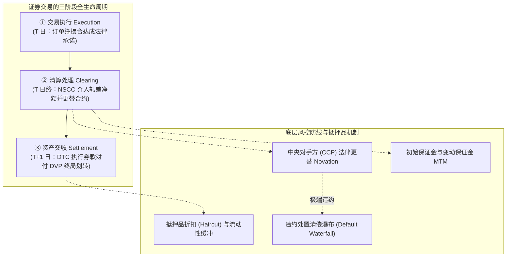
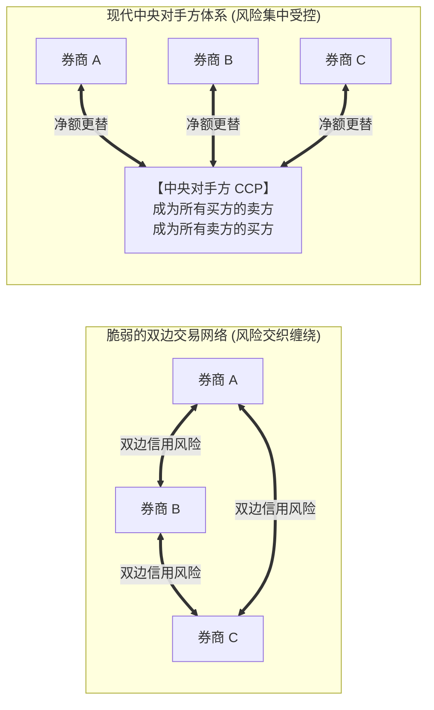
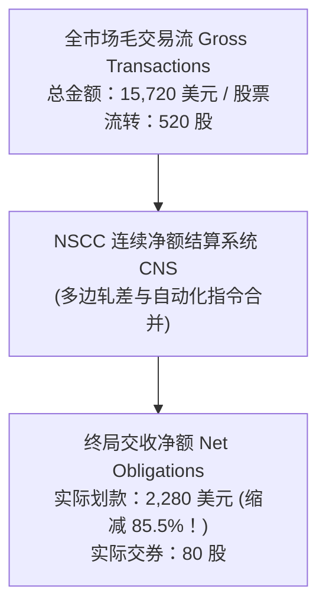
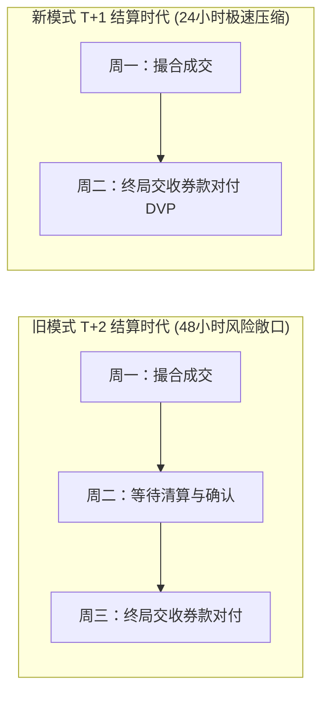
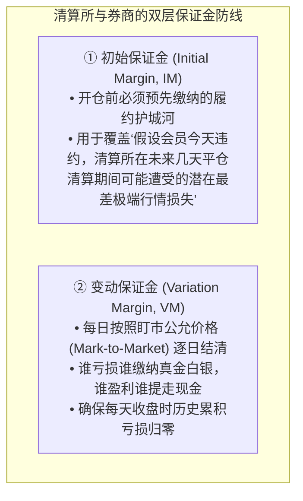
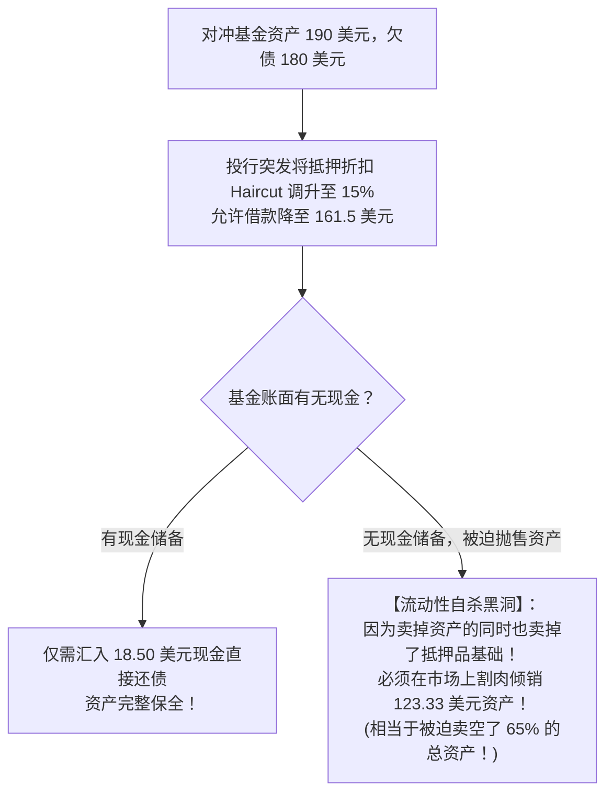
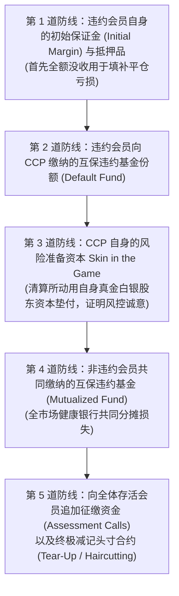

# 36 从成交到履约：清算、结算、保证金与抵押品

[上一章](35-derivative-contracts.md) · [目录](./) · [下一章](37-financial-institutions.md)

## 为什么屏幕显示“已成交”，华尔街的金融水管工却在走钢丝？

在智能手机交易 App 上，你轻轻点击“确认买入 100 股某股票”，屏幕闪过一行欢快的绿字：“订单已成交”。
在绝大多数普通投资者看来，交易在这一秒就已经圆满画上了句号。

然而，在现代金融体系深邃隐秘的底层机房里，一场涉及千亿美元资金调拨、跨越中央存管机构与美联储电汇系统（Fedwire）的高空钢丝表演才刚刚拉开大幕：
- 屏幕撮合仅仅是买卖双方达成了法律口头协议，**真实的股票和现金此时根本没有发生物理划转**；
- 如果卖方券商在交收前夜突发系统故障交不出股票怎么办？
- 如果一家跨国巨头投行在隔夜清算时突然宣告破产，成千上万笔未了结交易会不会引发整个金融体系的连环骨牌坍塌？
- 为什么在流动性紧缩的危机之夜，哪怕你持有的优质抵押品价格没有下跌一分钱，仅仅因为贷款人紧急上调了**抵押品折扣（Haircut）**，你的对冲基金就会在黎明前被强行清算肢解？

理解金融市场，不能只当一个看盘的票友。**清算、结算、中央对手方（CCP）与抵押品管理，是维系全球数万亿美元金融交易生命线的“底层管道物理工程（Financial Plumbing）”**。

### 学习目标与前置知识

读完本章，你将能够：
1. 严格厘清执行（Execution）、清算（Clearing）、交收（Settlement）与托管（Custody）的功能边界；
2. 掌握中央对手方（CCP）的法律合约更替（Novation）机理，理解多边净额轧差（Multilateral Netting）如何压缩交收规模；
3. 理解美国自 2024 年 5 月 28 日正式实施的 **$T+1$ 标准结算周期**对跨国资本流动的严峻挑战；
4. 区分初始保证金与变动保证金，掌握维持担保比例触发后的追缴算式；
5. 深入抵押品折扣（Haircut）模型，手算价格下跌与折扣攀升共振引发的“现金追加 vs 资产强平”悬殊差异；
6. 掌握 CCP 违约处置瀑布流（Default Waterfall）的法定清偿顺序。

前置知识为[第 30 章](30-equity-market.md)的撮合成交基础，以及[第 35 章](35-derivative-contracts.md)的期货逐日盯市机制。

## 1. 从双边交易到中央对手方（CCP）合约更替

### 1.1 双边交易网络的脆弱性：交易对手方信用风险

在原始的金融市场中，交易采用**双边结算网络（Bilateral Network）**：
甲向乙买入股票，甲必须时刻提心吊胆：乙会不会在交割日卷款潜逃或破产赖账？
如果全市场有 1,000 家金融机构互为对手方，将形成多达 $\frac{1000 \times 999}{2} \approx 50\text{ 万条}$ 错综复杂的双边债权债务网络。任何一家关键中介倒下，都会沿着网状管道触发灾难性的连环违约海啸。

### 1.2 现代金融的定海神针：中央对手方（CCP）与合约更替（Novation）

为了终结这种系统性脆弱性，现代金融基础设施引入了**中央对手方（Central Counterparty, CCP）**（如美国全国证券清算公司 NSCC、芝商所清算所 CME Clearing、伦敦清算所 LCH）。

CCP 依靠神圣的法律机制——**合约更替（Novation）**介入市场：
一旦买卖双方在交易所达成撮合成交，原有的双边买卖合同在法律上被瞬间解除并分割，CCP 同时以中介身份切入中间：
**“CCP 成为所有买方的唯一卖方，成为所有卖方的唯一买方！”**

引入 CCP 后：
- 券商 A 不再需要调查券商 B 的财务状况，只要 CCP 屹立不倒，A 的交收就受到制度保障；
- 整个金融网络从杂乱无章的“蛛网图”重构为以 CCP 为核心的“星型辐射网络”，信用风险被有效集中并置于最高级别的监管审视之下。

## 2. 净额结算（Netting）：如何将千亿资金缩减 90%？

### 2.1 连续净额结算系统（CNS）与多边轧差

CCP 带来的一大神奇魔法是**多边净额轧差（Multilateral Netting）**。
美国托管清算公司（DTCC）旗下的 NSCC 运行着著名的**连续净额结算系统（Continuous Net Settlement, CNS）**。

假设某券商会员在某一个交易日内，针对同一只苹果股票进行了四笔交易（假定同一结算日，忽略手续费）：
1. 早盘：买入 100 股，单价 50 美元（毛应付 5,000 美元）；
2. 上午：卖出 70 股，单价 51 美元（毛应收 3,570 美元）；
3. 午后：买入 200 股，单价 20 美元（毛应付 4,000 美元）；
4. 尾盘：卖出 150 股，单价 21 美元（毛应收 3,150 美元）。

如果没有净额结算系统（全额毛额支付），该券商当天必须在银行体系里倒腾调拨总额高达 **$15{,}720\text{ 美元}$** 的巨额毛资金流（$5000 + 3570 + 4000 + 3150$），并逐笔交割 520 股股票。

而在 CNS 系统中，计算机在收盘后自动执行轧差合并：
- **股票交收净额**：
  $$\text{净股票头寸} = (+100 - 70) + (+200 - 150) = +30 + 50 = \mathbf{+80\text{ 股 (券商仅需净接收 80 股)}}$$
- **资金划拨净额**：
  $$\text{净现金支付} = (5{,}000 - 3{,}570) + (4{,}000 - 3{,}150) = 1{,}430 + 850 = \mathbf{2{,}280\text{ 美元}}$$

净额结算将全市场的实际资金与证券交收需求削减了 **$80\%—90\%$ 以上**，极大地节省了银行间支付系统的日间流动性消耗。但切记：**净额只是减少了交付通道的拥堵，并不代表交易风险归零**。如果该券商在交付那 2,280 美元前破产，未平仓的净头寸依然会暴露给 CCP。

## 3. 结算周期革命：美股 T+1 时代的到来

### 3.1 从 T+2 到 T+1：缩短敞口时间窗口

2024 年 5 月 28 日，美国证券交易委员会（SEC）正式推行划时代的改革——**将美股、企业债与市政债的标准结算周期从 $T+2$ 全面压缩至 $T+1$（交易日后一个营业日）**。

结算周期缩短一半，其战略核心在于**消灭在途时间风险**：
在以往的 $T+2$ 模式下，从周一成交到周三正式交收，中间隔了整整 48 小时。在这漫长的两天里，如果市场遭遇突发地缘危机导致股价崩盘，违约风险和对手方暴雷的概率随时间呈非线性激增。压缩至 $T+1$（周一成交、周二交收），直接将交易在途风险敞口腰斩！

### 3.2 T+1 给全球机构带来的“换汇时差与夜间流动性挑战”

然而，天上没有免费的午餐。结算周期的极度压缩，给非美时区的全球基金带来了巨大的操作挑战：
- **跨时区外汇结算错配**：一家位于东京或伦敦的全球资产管理基金，在美东时间周一下午 4:00 买入美股，根据 $T+1$，它必须在美东时间周二上午完成美元资金到位。然而此时亚洲外汇市场早已休市，欧洲正处于深夜！基金必须在收盘后短短几个小时内紧急完成日元/欧元兑换美元并完成跨境电汇，稍有延误就会触发**交收失败（Settlement Fail）**；
- **证券出借召回（Recall）时间极度逼仄**：做空机构若借出股票，必须在几小时内火速追回，否则无法完成清算交割。

## 4. 保证金体系：初始保证金 vs 变动保证金

清算所和券商为了防止参与者中途爆仓跑路，构筑了严密的**保证金双保险体系**：

### 4.1 动手算：保证金追缴（Margin Call）的全流程推演

某对冲基金账户基准状态设定：
- 存入初始保证金：**10,000 美元**；
- 券商设定的最低**维持保证金门槛（Maintenance Margin）**为 **8,000 美元**；
- 合同规定：一旦账户净权益跌破 8,000 美元，**必须立即全额补足恢复至初始保证金 10,000 美元水平**！

某日，市场突发不利波动，该账户持仓发生逐日盯市亏损 **3,000 美元**：
- 账户剩余净权益：$10{,}000 - 3{,}000 = \mathbf{7{,}000\text{ 美元}}$；
- 由于 $7{,}000 < 8{,}000$ 美元，风控系统立即亮起红灯，触发正式的追缴保证金（Margin Call）通知！

此时，该基金需要向券商补充多少现金？
- **绝不是**仅仅补齐到 8,000 美元的 1,000 美元！
- 规则要求必须彻底恢复至初始保证金 10,000 美元，因此必须立即汇入现金：
  $$\text{需追加现金} = 10{,}000 - 7{,}000 = \mathbf{3{,}000\text{ 美元}}$$

如果此时由于宏观市场波动率全面飙升，清算所同时将该资产的**初始保证金要求提升至 12,000 美元**，该基金当天面临的现金追缴账单将瞬间飙升至：
$$\text{新追加现金} = 12{,}000 - 7{,}000 = \mathbf{5{,}000\text{ 美元}}$$
如果当天下午无法调集 5,000 美元现金到位，券商将在次日开盘那一秒，以市价单强行平仓其价值数十万美元的核心头寸！

## 5. 抵押品折扣（Haircut）：价格没变，为何也会逼死基金？

### 5.1 什么是抵押品折扣（Haircut）？

在回购融资（Repo）和场外借贷中，借款人不能把资产按 100% 账面价值质押借钱。贷款人为防范抵押品变现时的滑点损失，要求按低于资产市值的比例发放贷款，这一折价率被称为**抵押品折扣（Haircut, $h$）**：

$$\text{最大可借款金额} = \text{抵押品市值} \times (1 - h)$$

- 若质押 100 万美元的 10 年期美国国债，由于流动性极好，折扣率可能仅为 $h = 2\%$，可借出 $100 \times (1 - 2\%) = \mathbf{98\text{ 万美元}}$；
- 若质押 100 万美元的高收益垃圾企业债，折扣率可能高达 $h = 20\%$，最多只能借出 $\mathbf{80\text{ 万美元}}$。

### 5.2 致命共振：资产缩水与折扣上调的“强平抛售乘数”

我们通过一个极其严密的核心教学算例，见证抵押品收紧如何将一家基金推向深渊（本算例经由测试套件严格复算验证）：

某对冲基金持有市值 **190 美元**的高等级债券资产，此前以此质押借入了 **180 美元**的债务。
此时突发流动性紧缩，市场行情发生两重恶化：
1. 该债券市场价格发生微跌，但依然维持在 **190 美元**高位（资产价格损失较小）；
2. 借款人（华尔街投行风控部门）出于避险恐慌，紧急将该类抵押品的**折扣率（Haircut）由极低水平大幅调高至 $h = 15\%$**！

#### 步骤 1：计算此时该资产允许的最大借款上限与外部现金追缴额
在 $15\%$ 的苛刻折扣下，该 190 美元资产当前合法允许借入的贷款上限坍塌为：
$$\text{允许借款上限} = \text{抵押品市值} \times (1 - h) = 190 \times (1 - 0.15) = 190 \times 0.85 = \mathbf{161.50\text{ 美元}}$$

然而，基金账上实际已经借了 180 美元！
此时借款超过了抵押品支持上限，投行向该基金发出追缴令：
$$\text{需偿还现金缺口} = \text{实际借款} - \text{允许借款} = 180.00 - 161.50 = \mathbf{18.50\text{ 美元}}$$
如果基金手中握有富余流动性，它只需从银行账户汇入 **18.50 美元现金**偿还债务，危机立即解除。

#### 步骤 2：灾难降临——若基金无现金，必须在市场上“卖出该抵押品还债”
设想该基金账面已无任何现金，它被迫在二级市场上直接抛售一部分手中的该债券，拿回笼资金去偿还贷款。
设抛售金额为 $x$ 美元。
卖出后，基金持有的剩余抵押品缩水为 $190 - x$，借款债务同步减少为 $180 - x$。
为了让剩余的借款满足 $15\%$ 折扣的新风控红线：
$$180 - x \le (190 - x) \times (1 - 0.15) = 0.85 \times (190 - x)$$
展开方程：
$$180 - x \le 161.50 - 0.85x$$
$$180 - 161.50 \le x - 0.85x$$
$$18.50 \le 0.15x \implies x \ge \frac{18.50}{0.15} = \frac{18.50 \times 100}{15} = \frac{1850}{15} \approx \mathbf{123.33333333\text{ 美元}}$$

**令人倒吸一口凉气的金融残酷真相**：
现金缺口明明仅仅只有 **18.50 美元**，但如果你被迫通过卖出抵押品自身来还债，**你必须向全市场疯狂抛售整整 123.33 美元的巨额资产（相当于卖光了超过 65% 的总持仓）**！
$$\text{抛售放大乘数} = \frac{1}{h} = \frac{1}{0.15} \approx \mathbf{6.67\text{ 倍}}$$

这就完美解释了 2008 年金融危机与 2020 年流动性挤兑期间，为什么许多原本资产质量极佳的杠杆机构，仅仅因为抵押品折扣被小幅抬高几个百分点，就会在数小时内被迫将半个公司的资产全额打折甩卖，最终在流动性黑洞中窒息身亡。

## 6. 终极大防线：清算所违约处置瀑布流（Default Waterfall）

如果某一天，一家雷曼兄弟级别的巨头会员彻底违约、留下了数十亿美元的未结清亏损，中央对手方（CCP）自己会不会破产？

CCP 绝不是依靠国家财政无底限兜底的福利机构，它依靠严格法律锁定的**违约清偿瀑布流（Default Waterfall）**，逐层构筑起铜墙铁壁：

1. **第一与第二级**：首先榨干爆仓违约者自己的所有保证金与互保基金，**谁惹祸谁买单**；
2. **第三级（Skin in the Game）**：清算所必须拿出自己预先注资的股东资本（通常数亿美元）进行第一顺位兜底，这一机制逼迫清算所管理层必须时刻维持最严苛的风控标准；
3. **第四与第五级（Mutualization）**：如果损失依然无法弥合，全体健康的会员银行按规则共同平摊损失，确保系统性违约在清算所内部被完全封闭消化，绝不向实体经济外溢蔓延。

## 7. 练习与参考答案

### 练习 1：多边净额轧差与结算义务计算

在某一结算日内，某券商会员在 CNS 系统中完成以下同股票交易（单位：股，单价：美元）：
- 买入 200 股，单价 20.00 美元；
- 卖出 150 股，单价 21.00 美元。
1. 计算该券商当天的毛交易金额总和（Gross Amount）；
2. 计算在 CNS 净额结算系统下，该券商最终实际应收/应交的股票净额与现金净划拨金额。

参考答案与推理

1. 毛交易金额总和：
   $$\text{毛金额} = (200 \times 20.00) + (150 \times 21.00) = 4{,}000 + 3{,}150 = \mathbf{7{,}150\text{ 美元}}$$
2. CNS 净额结算对账：
   - 股票净额：$+200 - 150 = \mathbf{+50\text{ 股}}$（该券商净接收 50 股股票）；
   - 现金净划转：应付 4,000 美元减应收 3,150 美元 $= \mathbf{850\text{ 美元}}$（该券商净支付 850 美元现金）。
   **警惕误区**：绝不能拿净支付 850 美元除以净收 50 股得到 $\frac{850}{50} = 17$ 美元，并误以为这是某种神秘的打折成交价！这 850 美元是已经扣除了卖出 150 股所回收的 3,150 美元之后的净轧差资金。

### 练习 2：抵押品折扣攀升与资产强平手算（独立复算验证）

某对冲基金持有市值 200 美元的债券，质押借入 180 美元债务。由于市场震荡，该债券价格下挫至 **190 美元**，同时出借人将抵押品折扣（Haircut）由极低水平大幅提升至 **$15\%$**。
1. 若基金动用外部银行账户现金还款，需要补入多少现金？
2. 若基金账面无任何现金，必须在市场上通过抛售该债券自身回笼资金还债，计算该基金需要抛售的最小资产金额 $x$。
3. 比较这两个数字，说明为什么“现金缓冲（Cash Buffer）”是对冲基金抵御清算危机的最宝贵盾牌？

参考答案与推理

1. **现金还款计算**：
   在 $15\%$ 折扣下，190 美元债券允许借款上限为：
   $$\text{借款上限} = 190 \times (1 - 0.15) = 190 \times 0.85 = \mathbf{161.50\text{ 美元}}$$
   实际已借 180 美元，故需直接补款偿还：
   $$\text{补款金额} = 180.00 - 161.50 = \mathbf{18.50\text{ 美元}}$$
2. **卖股还债方程求解**：
   设抛售债券金额为 $x$。抛售并还款后，剩余借款变为 $180 - x$，剩余抵押品变为 $190 - x$：
   $$180 - x \le (190 - x) \times 0.85 = 161.50 - 0.85x$$
   $$18.50 \le 0.15x \implies x \ge \frac{18.50}{0.15} \approx \mathbf{123.33333333\text{ 美元}}$$
   该基金必须在二级市场上强制抛售 **123.33 美元**的债券！
3. **现金缓冲启示**：
   现金还款仅需 18.50 美元，而割肉资产则需倾销 123.33 美元（抛售乘数高达 $\frac{1}{0.15} \approx 6.67$ 倍）。手里保留 18.50 美元的富余现金，就能挽救高达 123.33 美元的核心资产免遭折价甩卖。现金缓冲不是闲置浪费，而是防范被动去杠杆踩踏的护城河。

### 练习 3：批驳业余金融言论的漏洞

某自媒体在解读市场时称：“今天美股成交量创历史新高，说明市场流动性好得不得了；而且现在的证券交易全部经由中央对手方 CCP 清算，系统绝对安全零违约，机构根本不需要预留现金缓冲。”
请运用本章所学知识，逐条反驳这两句断言的致命破绽，并指出应调取什么专业指标进行反证。

参考答案与推理

1. **第一句批驳（成交量不等于流动性）**：
   在流动性挤兑引发的恐慌践踏中，成交量往往伴随着抛售狂潮而创下天量，但这完全是“单边断崖砸盘”，买盘挂单深度极度匮乏，极小的卖单就会引发数个百分点的巨大价格滑点（Slippage）。衡量真实流动性必须查看限价订单簿深度（Depth）、买卖价差（Bid-Ask Spread）与市场冲击成本，绝不能盲信成交量数字。
2. **第二句批驳（CCP 不消除流动性追缴）**：
   中央对手方（CCP）通过合约更替消除了双边信用赖账风险，但它确保履约的唯一手段就是**严酷无情的逐日盯市保证金制度（VM）与动态抵押品追加（IM/Haircut）**。如果参与者在日终无法按时汇入真金白银现金补足保证金，CCP 会毫不犹豫地没收其抵押品并强行平仓其全部持仓。机构若不预留充足的现金流动性缓冲，极易在日终结算的瞬间被 CCP 强制平仓淘汰出局。

## 本章小结与下一步

在这一章中，我们穿透了现代金融系统的微观物理管道：
- 执行、清算、交收与托管构成了资产流转的完整四步曲；
- 中央对手方（CCP）通过合约更替与多边净额轧差，重塑了全球金融结算网络；
- 美股 $T+1$ 时代在压缩在途风险的同时，重构了跨国资金调拨的微观生态；
- 抵押品折扣（Haircut）与强平抛售乘数，揭示了微观去杠杆放大为全市场流动性黑洞的数学根源；
- 违约处置瀑布流构成了金融防范系统性崩溃的终极熔断机制。

既然我们已经弄清了交易与资产的结算网络，下一个至关重要的问题是：**到底是谁在全市场的大棋盘上持有并调拨这些数以万亿美元计的资产？**
公募基金、ETF、养老金、人寿保险公司与高杠杆对冲基金在负债端承受着怎样的约束？当面对相同的利率暴跌时，为什么有的机构疯狂买入，而有的机构却被迫抛售？

下一章我们将进入[第 37 章：谁在持有资产：基金、保险、养老金与杠杆投资者](37-financial-institutions.md)。

[上一章](35-derivative-contracts.md) · [目录](./) · [下一章](37-financial-institutions.md)
