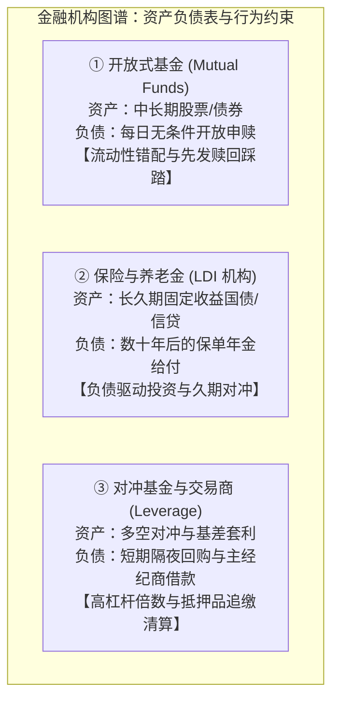
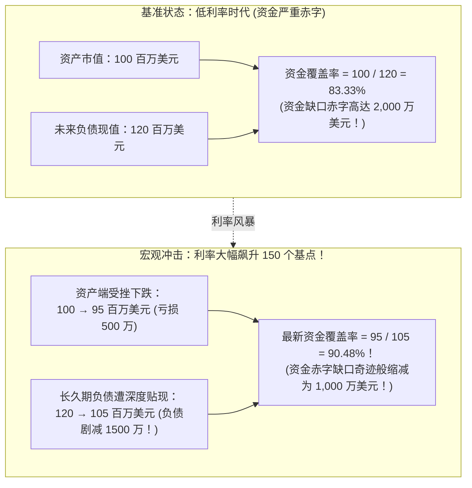
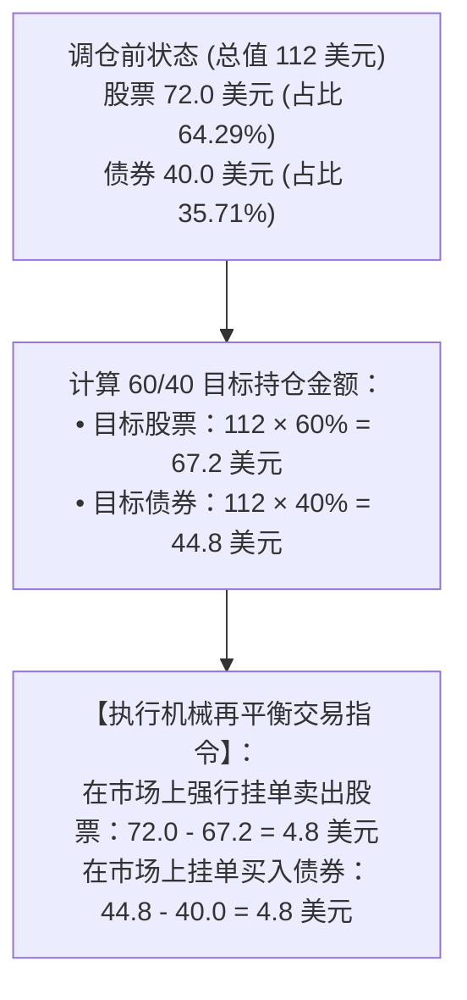
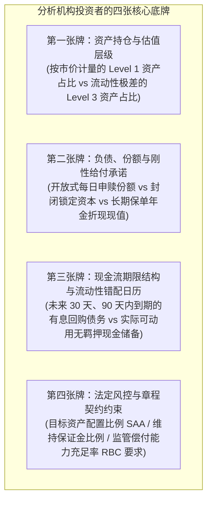

# 37 谁在持有资产：基金、保险、养老金与杠杆投资者

[上一章](36-market-infrastructure.md) · [目录](./) · [下一章](38-joint-diagnosis.md)

## 为什么国债暴跌时，有的机构在慌忙割肉，有的机构却在开香槟？

面对相同的宏观环境——例如 10 年期美国国债收益率突然大幅上行 100 个基点、债券价格出现暴跌，华尔街的金融版图上却上演着冰火两重天的离奇景象：
- 一家规模上百亿美元的开放式公募债券基金，办公室里警报声大作。基民恐慌性赎回的大潮汹涌而至，基金经理不得不以 5% 的严重折价在二级市场上不计成本地甩卖持仓债券，流血变现；
- 而隔壁的一家跨国人寿保险公司与大型企业年金养老金（Pension Fund），其首席投资官却在气定神闲地开香槟庆祝：因为根据精算师的最新评估报告，其资产负债表的**资金健康覆盖率不仅没有因债券亏损而恶化，反而从 83% 跃升到了 90% 以上**！

难道这两家机构生活在不同的平行宇宙吗？还是它们对美联储的货币政策有着截然相反的理解？

两者都不是。
**理解金融机构行为的第一铁律，是“永远不要只看资产端买了什么，必须先看负债端欠了什么、何时要还”！**

资产端决定了账面投资收益，而**负债端的合同属性与流动性约束**，才真正主宰了一家机构在风暴来临那一天到底会成为坚定买入的“压舱石”，还是被迫踩踏出逃的“提款机”。

### 学习目标与前置知识

读完本章，你将能够：
1. 掌握开放式基金的流动性错配机理，手算大额赎回折价变现引发的“先发优势挤兑博弈”；
2. 理解 ETF 与封闭式投资工具的流动性防火墙机制，区分私募股权承诺出资（Commitment）与实际缴款（Called Capital）；
3. 掌握负债驱动投资（LDI）理念，手算折现率上升如何导致养老金“资产亏损但资金覆盖率提升”的会计反直觉现象；
4. 剖析对冲基金基差套利（Basis Trade）的高杠杆脆弱性，推导微小基差变动如何吞噬本金；
5. 掌握机构定期再平衡（Rebalancing）的机械被动交易模型，严格区分“外部新增申赎资金”与“内部资产配置调仓”。

前置知识为[第 17 章](17-bonds-and-curves.md)的债券久期与价格敏感度、[第 33 章](33-shareholder-returns.md)的 ETF AP 申赎机制，以及[第 36 章](36-market-infrastructure.md)的抵押品折扣与强平机制。

## 1. 开放式共同基金：份额净值与流动性挤兑的数学

### 1.1 资产与负债的期限错配

普通的开放式共同基金（Mutual Funds）遵循每日申购赎回制度：
- **资产端**：基金经理将资金配置于需要数天乃至数周才能平稳变现的公司债券或中小盘股票；
- **负债端（份额端）**：基民享有随时以当日收盘净值（NAV）将份额按现金退出的法定权利。

这种“用流动性较差的长期资产，承诺即时兑现的短期现金”的结构，孕育了金融学中最经典的**先发优势（First-Mover Advantage）挤兑博弈**。

### 1.2 动手算：大额赎回如何将交易成本转嫁给留守者？

我们通过一个极其严谨的教学算例，复盘挤兑风暴中留守基民财富被无情稀释的数学全过程（本算例经由测试套件严格复算验证）：

某开放式债券基金基准状态设定：
- **资产端总值**：100 美元（其中现金储备为 5 美元，持仓债券账面价值为 95 美元）；
- **负债端**：无任何有息负债，发行在外的基金总份额为 **100 份**；
- **每份初始净值**：
  $$\text{NAV}_0 = \frac{100\text{ 美元}}{100\text{ 份}} = \mathbf{1.00\text{ 美元/份}}$$

现在，风暴降临，持有 **15 份**的大机构客户突然提交全额赎回申请。
根据合同，基金必须按照已确定的 $1.00$ 美元净值，向该离场者刚性支付 **15 美元现金**！

```mermaid
flowchart TD
    Redeem["机构客户申请赎回 15 份<br/>基金刚性需支付 15 美元现金"] --> UseCash["首先耗尽账面现有现金：5 美元<br/>现金缺口仍差 10 美元！"]
    UseCash --> FireSale["基金被迫在二级市场甩卖债券变现<br/>遭遇 5% 的流动性折价惩罚 (只能按 95% 变现)"]
    FireSale --> CalcLoss["需甩卖账面债券：10 / 0.95 = 10.5263 美元<br/>产生实际折价亏损：0.5263 美元！"]
    CalcLoss --> Dilute["【残酷的博弈结局】：<br/>离场者拿走足额 15.00 美元完好无损！<br/>留守基民的份额净值被动被砍至 0.9938 美元！"]
```

#### 步骤 1：现金不足，被迫折价抛售债券变现
基金账面仅有现金 5 美元，支付给离场者后，依然存在 **10 美元现金缺口**！
基金经理被迫在市场上抛售持仓债券。假定在动荡市场中，大量变现该债券面临 **$5\%$ 的流动性折价（Haircut）**（即每卖出账面面值 1 美元的债券，扣除冲击成本后只能回收 0.95 美元现金）。

为了回收 10 美元现金，基金必须抛售的账面债券价值为：
$$\text{需卖出债券账面价值} = \frac{10\text{ 美元}}{1 - 0.05} = \frac{10}{0.95} \approx \mathbf{10.52631579\text{ 美元}}$$
抛售变现产生的不可逆实际资产亏损为：
$$\text{变现冲击亏损} = 10.52631579 - 10 = \mathbf{0.52631579\text{ 美元}}$$

#### 步骤 2：对账——留守者的净值惨遭稀释！
- 基金剩余的债券资产账面价值：
  $$\text{剩余债券资产} = 95 - 10.52631579 = \mathbf{84.47368421\text{ 美元}}$$
- 基金现金储备已归零（$5 + 10 - 15 = 0$）；
- 基金清算赎回后的最新净资产总额：
  $$\text{最新净资产 AUM} = 84.47368421 + 0 = \mathbf{84.47368421\text{ 美元}}$$
- 发行在外的剩余基金总份额：
  $$\text{剩余总份额} = 100 - 15 = \mathbf{85\text{ 份}}$$
- 留守基民承受的最新每份基金净值：
  $$\text{最新每份净值 NAV}_1 = \frac{84.47368421\text{ 美元}}{85\text{ 份}} \approx \mathbf{0.99380805\text{ 美元/份}}$$

**触目惊心的囚徒困境诞生了**：
抢先在第一天跑路的投资者，成功以 **1.00 美元/份** 的原价全额套现离场；
而由于基金抛售非流动性资产所产生的 0.5263 美元交易冲击成本，**被全额转嫁给了老老实实留守的投资者**，留守者的每份资产直接被动缩水到了 **0.9938 美元**！
这种机制从制度底层奖赏了“抢先跑路者”，惩罚了“长期持有者”，形成了诱发公募基金遭遇踩踏挤兑（Fund Run）的恶性微观动力学。

## 2. 保险公司与养老金：负债驱动投资（LDI）的反直觉世界

### 2.1 什么是负债驱动投资（LDI）？

与追求每年相对排名跑赢大盘的公募基金不同，人寿保险公司和大型企业年金养老金（如确定给付型 DB 计划）信奉的是**负债驱动投资（Liability-Driven Investment, LDI）**哲学。

它们的资产负债表极其特殊：
- **负债端**：是未来 20 年、30 年甚至 50 年后，必须刚性向成千上万退休职工支付的养老金支票或人寿死亡保险理赔金；
- **资产端**：持有数以万亿计的超长期美国国债、机构 MBS 与高信用等级企业债。

对于这类机构而言，**资产单边大涨不一定是好事，资产浮亏也不一定是灾难，核心在于“资产与负债的现金流时点和久期是否精准匹配”**。

### 2.2 动手算：养老金资金覆盖率的“奇迹”改善

我们通过一个标准的独立教学模型，揭开“利率上升，为什么养老金资产亏损却能开香槟”的精算之谜：

设某大型企业确定给付型（DB）养老金计划基准状态：
- **计划资产市场价值（Assets）**：**100 百万美元**（主要持有 30 年期超长久期国债，资产组合久期长达 20 年）；
- **精算负债贴现现值（Liabilities）**：精算师按照当时较低的市场折现率，测算出未来 30 年所有应付退休金在今天的总现值为 **120 百万美元**（负债久期长达 25 年）；
- **资金覆盖率（Funding Ratio）**：
  $$\text{基准资金覆盖率} = \frac{\text{资产}}{\text{负债}} = \frac{100}{120} \approx \mathbf{83.33\%} \quad (\text{面临 2000 万美元巨额资金缺口赤字})$$

现在，宏观经济遭遇央行激进加息，10 年期及 30 年期国债收益率全面暴涨 150 个基点：
1. **资产端的反应**：
   受利率飙升影响，养老金持有的长久期国债市值大跌，总资产从 100 百万美元缩水至 **95 百万美元**（账面实打实亏损了 500 万美元！）；
2. **负债端的反应**：
   精算师必须同步采用更高的新折现率，对未来 30 年的庞大负债现金流重新贴现。由于负债的久期长达 25 年（久期比资产更长！），**分母折现率的上升导致未来负债的贴现现值发生了更剧烈的暴跌——从 120 百万美元断崖式收缩至 105 百万美元**（负债现值蒸发了 1,500 万美元！）。

重新测算加息暴跌后的最新资金覆盖率：
$$\text{最新资金覆盖率} = \frac{\text{新资产}}{\text{新负债}} = \frac{95\text{ 百万美元}}{105\text{ 百万美元}} \approx \mathbf{90.48\%}$$

**令外行人目瞪口呆的精算真理**：
虽然账面资产亏损了 500 万美元，但由于负债缩水了整整 1,500 万美元，**该养老金的偿付缺口从 2,000 万美元奇迹般腰斩至 1,000 万美元，资金健康度实现了翻天覆地的历史性改善！**
这就是为什么在债券大暴跌的年份，退休金主管和人寿保险高管不仅不慌，反而暗自庆幸高利率终于将沉重负债枷锁击碎的宏观根源。

## 3. 对冲基金与交易商：高杠杆相对价值策略的脆弱性

### 3.1 跨市场基差交易（Basis Trade）的微观结构

如果说养老金是追求绝对稳健的巨象，那么华尔街对冲基金则是刀尖舔血的猎豹。
近年来引来美联储高度警惕的**美债基差交易（Treasury Basis Trade）**，是对冲基金极度杠杆化的典型代表：

- **基本原理**：对冲基金发现美国现货国债与国债期货之间，经常存在区区几个基点（如 0.05%）的微小定价偏差；
- **操作手法**：买入被低估的现货国债，同时卖空等额的国债期货进行完美方向性对冲；
- **致命的杠杆倍数**：由于几个基点的收益率甚至无法覆盖交易佣金，对冲基金通过**隔夜回购市场（Repo）以现货国债为质押，借入高达 20 倍乃至 50 倍的杠杆资金**，将年化收益撬动至 15% 以上。

### 3.2 微小基差变动如何吞噬本金？

我们用一个纯净的教学算例来透视高杠杆策略的死穴：
设某宏观对冲基金执行相对价值套利：
- 购入总值 **100 美元**的现券组合；
- 同时利用国债期货建立方向相反的空头头寸，建立“理论市场中性”；
- 资金构成：自有资本金仅为 **5 美元**，向主经纪商（Prime Broker）借入 **95 美元**的回购融资（杠杆率高达 $\frac{100}{5} = \mathbf{20\text{ 倍}}$！）。

某日，市场遭遇极端动荡，现券与期货的相对微观基差发生不利偏离，导致套利组合发生仅占现券规模 **$1\%$ 的微小净亏损（净亏损 1 美元）**：
- 对于 100 美元的总持仓而言，1 美元的浮亏看似微不足道；
- 但欠投行的 95 美元回购借款具有刚性法定偿还义务，一分钱不能少；
- 该基金的自有本金在瞬间从 5 美元缩水至 $5 - 1 = \mathbf{4\text{ 美元}}$：
  $$\text{本金直接亏损幅度} = \frac{1\text{ 美元}}{5\text{ 美元}} = \mathbf{20.0\%}！$$

基差仅仅不利跳动了 1 个百分点，基金五分之一的本金就在一天内化为乌有！
更致命的是，正如[第 36 章](36-market-infrastructure.md)所述，投行风控部门在此时必然会强制上调回购折扣（Haircut）并追加现金保证金，最终逼迫对冲基金在暴风雨中平仓斩仓，将原本微小的基差撕裂为惊天动地的流动性风暴。

## 4. 机构定期再平衡（Rebalancing）：无情驱动的机械买卖

### 4.1 什么是规则再平衡？它不是看多或看空的观点

全球数以万亿美元计的机构资金（如挪威主权财富基金、各州退休基金、60/40 经典配置基金），受到投资章程中严格**目标战略资产配置比例（Strategic Asset Allocation, SAA）**的法定约束。

例如，某大型基金章程规定：股票与债券的基准配置比例必须恒定维持在 **60% : 40%**。
每当季度末或市场偏离容忍带时，基金必须启动**强制再平衡调仓（Rebalancing）**：
- 卖出涨幅过大、权重超标的资产；
- 买入相对滞后、权重缩水的资产。

这种买卖完全由数学算法和契约章程驱动，**绝不代表基金经理对被买入的资产突然产生了宏观乐观预期**！

### 4.2 动手算：独立复现经典 60/40 组合的机械调仓

我们通过标准教学模型完整推演再平衡的资金账本（本算例经由测试套件严格复算验证）：

基金基准状态设定：
- **初始资产总值**：**100 美元**；
- **配置目标权重**：股票 60%（持有价值 60 美元），债券 40%（持有价值 40 美元）；
- **期间市场行情变动**：
  - 股市迎来一波大涨，股票持仓上涨 **20%**，市值变为：
    $$\text{新股票市值} = 60 \times (1 + 20\%) = \mathbf{72.0\text{ 美元}}$$
  - 同期债券市场平盘无波动，债券市值依然维持在 **40.0 美元**不变；
  - 基金总资产膨胀至：$72.0 + 40.0 = \mathbf{112.0\text{ 美元}}$；
- 此时股票在组合中的实际权重被动飙升为：
  $$w_{\text{stock}} = \frac{72.0}{112.0} \approx \mathbf{64.2857\%} > 60\%$$

基金已严重背离 60% 的风控红线！在季度末再平衡那一天，基金必须如何交易以精准恢复 60/40 目标？

#### 严格计算两类资产的调仓金额：
1. **目标股票持仓市值**：
   $$\text{目标股票市值} = 112.0 \times 60\% = \mathbf{67.2\text{ 美元}}$$
   当前实际持有 72.0 美元，因此基金**必须在二级市场上挂单卖出股票**：
   $$\text{股票卖出额} = 72.0 - 112.0 \times 0.60 = 72.0 - 67.2 = \mathbf{4.8\text{ 美元}}$$
2. **目标债券持仓市值**：
   $$\text{目标债券市值} = 112.0 \times 40\% = \mathbf{44.8\text{ 美元}}$$
   当前实际持有 40.0 美元，因此基金**必须在二级市场上买入债券**：
   $$\text{债券买入额} = 44.8 - 40.0 = \mathbf{4.8\text{ 美元}}$$

**透视资金真相**：
在这场调仓中，**基金没有任何外部新增申购资金入场（净申购为 0）**！
然而，股票市场上却实打实地承受了来自该基金的 **4.8 美元净卖盘抛压**，债券市场迎来了 **4.8 美元的净买入支撑**。
如果分析师在季末看到万亿机构大举买入债券，就误以为华尔街在为经济衰退避险而抢购国债，这就完全将由机械再平衡规则驱动的被动调仓，与基本面主动观点混为一谈。

## 5. 跨机构分析方法：读懂机构报告的四张底牌

要穿透任何一家大型投资机构的真实风险画像，不能盲信其 PR 新闻稿，必须严格收集以下**四张核心资产负债表底牌**：

## 6. 练习与参考答案

### 练习 1：退休基金折现率变动与资产负债匹配

某企业年金退休计划基准资产市值为 90 百万美元，精算师按既定折现率计算出的未来退休给付负债总现值为 100 百万美元（资金覆盖率为 90%）。
随后宏观利率走高，经过重新评估：
- 资产市值因债券下挫降至 85 百万美元；
- 负债现值在更高折现率下压缩至 90 百万美元。
1. 计算最新评估下的资金覆盖率（Funding Ratio）与资金净缺口金额；
2. 结合本例，向非专业投资者解释“为什么资产亏损了 500 万美元，该养老金计划的财务健康状况反而改善了”。

参考答案与推理

1. 最新资金覆盖率：
   $$\text{新覆盖率} = \frac{85\text{ 百万美元}}{90\text{ 百万美元}} \approx \mathbf{94.44\%}$$
   （原覆盖率为 $\frac{90}{100} = 90.0\%$，改善了 4.44 个百分点！）。
   资金缺口净额从原来的 $100 - 90 = 10\text{ 百万美元}$，大幅收窄至 $90 - 85 = \mathbf{5\text{ 百万美元}}$。
2. **机制解释**：
   养老金不仅要看资产账面赚不赚钱，更要看赚的钱够不够赔付未来的负债。由于负债的现金流分布在极其遥远的未来（久期更长），折现率上升对负债现值的削减效应（负债缩水 1,000 万）远大于对资产市值的冲击（资产缩水 500 万）。负债的消失速度超过了资产的损失速度，养老金最终需要填补的真实缺口减少了一半。

### 练习 2：资产配置再平衡调仓严格推导

某宏观平衡型基金的目标资产配置规则严格设定为：股票 50%、债券 50%。
期初该基金总资产为 200 美元（股票 100 美元，债券 100 美元）。
在随后的一个季度中，遭遇股债跷跷板行情：股票下跌 10%，债券上涨 10%（期间无外部资金申购与赎回）。
为恢复 50/50 的既定目标权重，基金在季度末必须如何执行调仓？

参考答案与推理

1. 季度末调仓前各资产持仓市值：
   - 股票市值：$100 \times (1 - 10\%) = \mathbf{90.0\text{ 美元}}$；
   - 债券市值：$100 \times (1 + 10\%) = \mathbf{110.0\text{ 美元}}$；
   - 基金总资产规模：$90.0 + 110.0 = \mathbf{200.0\text{ 美元}}$（总规模恰好维持不变）。
2. 目标持仓金额计算：
   - 目标股票持仓：$200.0 \times 50\% = \mathbf{100.0\text{ 美元}}$；
   - 目标债券持仓：$200.0 \times 50\% = \mathbf{100.0\text{ 美元}}$。
3. **调仓指令执行**：
   - 基金必须在二级市场上**挂单买入股票 10.0 美元**（$100.0 - 90.0 = 10.0$）；
   - 基金必须在二级市场上**挂单卖出债券 10.0 美元**（$110.0 - 100.0 = 10.0$）。
   这一“买入跌落的股票、卖出上涨的债券”操作纯属被动的规则驱动，绝不代表基金经理在宏观上开始看多经济复苏。

### 练习 3：撰写有因果边界的专业市场解读

某知名高收益企业债公募基金管理规模（AUM）在过去一个月内从 100 亿美元滑落至 95 亿美元，期间并未对外公开披露基民份额的净变动数据。同期全美高收益债券二级市场价格平均下跌了约 4.0%。某自媒体大 V 宣称：“规模暴跌 5 亿，确凿证明机构资金正在从该债券基金发生 5 亿美元的大规模恐慌出逃！”
请指出该言论的重大逻辑缺陷，并列出最少需要补充核验的两个核心财务字段。

参考答案与推理

1. **逻辑缺陷批驳**：
   基金管理规模（AUM）的变化由“存量资产价格变动”与“外部实际净申赎流量”两部分共同决定。
   若该基金资产端持有的债券价格跟随大盘平均下跌了 4.0%，仅存量价格重估就会导致其资产自然缩水约 $100 \times 4\% = 4\text{ 亿美元}$！
   真实的外部净赎回可能仅仅只有 $5 - 4 = 1\text{ 亿美元}$，甚至在极端情况下，若该基金实际表现好于行业（如仅跌 2%），它甚至可能获得了微弱的净申购！直接拿 5 亿美元 AUM 缩水等同于资金出逃，完全混淆了市值波动与资本流动。
2. **最少需补充核验的核心字段**：
   - 该基金在此期间**发行在外的基金总份额数（Shares Outstanding）变动**；
   - 该基金在期间内的**分红派息记录（Distributions）与每份资产净值（NAV）走势**。

## 本章小结与下一步

在这一章中，我们穿透了金融资产持有者的大脑与资产负债表：
- 开放式公募基金的期限错配与流动性折价，揭示了先发赎回优势如何引爆恶性挤兑；
- 负债驱动投资（LDI）颠覆了单一资产盈利的传统偏见，诠释了养老金在加息周期中“资产亏损但覆盖率改善”的精算真相；
- 对冲基金的基差交易揭示了高杠杆倍数如何将微小的基差摆动放大为毁灭性的本金吞噬；
- 机构定期再平衡展示了万亿美元被动资本如何在不添加新资金的情况下，制造出庞大的跨资产买卖洪流。

至此，我们已经完成了宏观经济、货币政策、利率债券、外汇美元、股票估值、大宗商品、金融衍生品与金融机构的全部微观与宏观拼图！
面对错综复杂、充斥着矛盾信号的现实市场，**我们如何将所有线索拼装成一张具有实战诊断力的宏观全景地图？面对通胀、增长与金融风险的互相撕扯，如何做出有理有据、可验证可证伪的终极联合诊断？**

下一章我们将进入宏观与金融决策的高级殿堂——[第 38 章：宏观与市场联合诊断：竞争性解释与证据组合](38-joint-diagnosis.md)。

[上一章](36-market-infrastructure.md) · [目录](./) · [下一章](38-joint-diagnosis.md)
