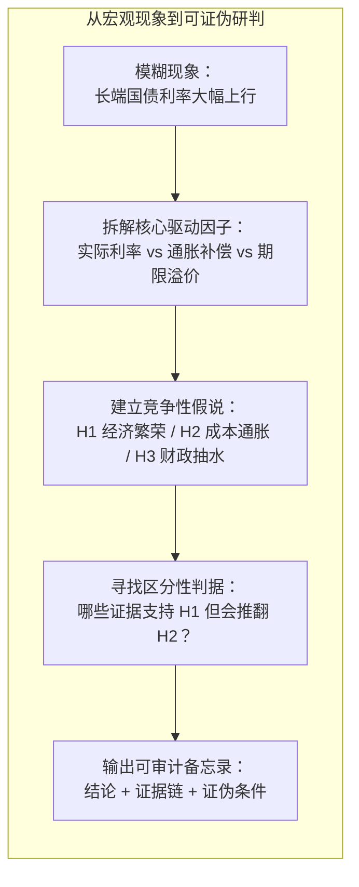
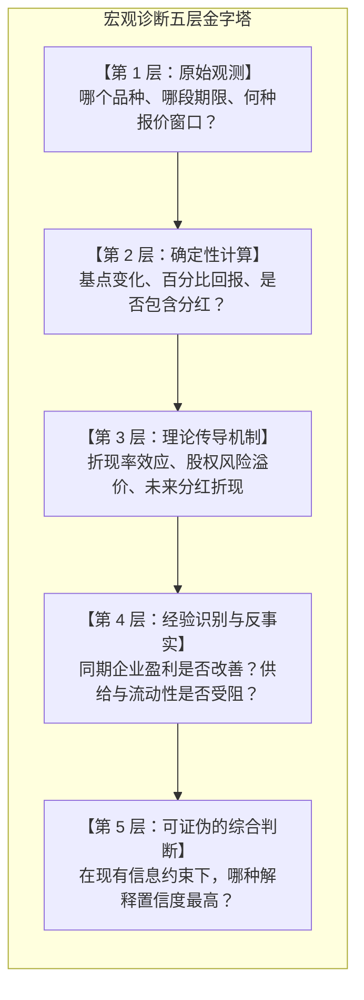
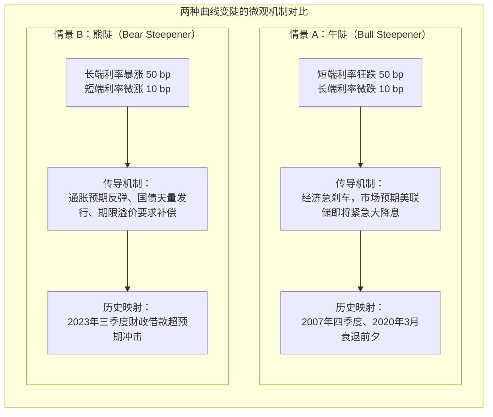
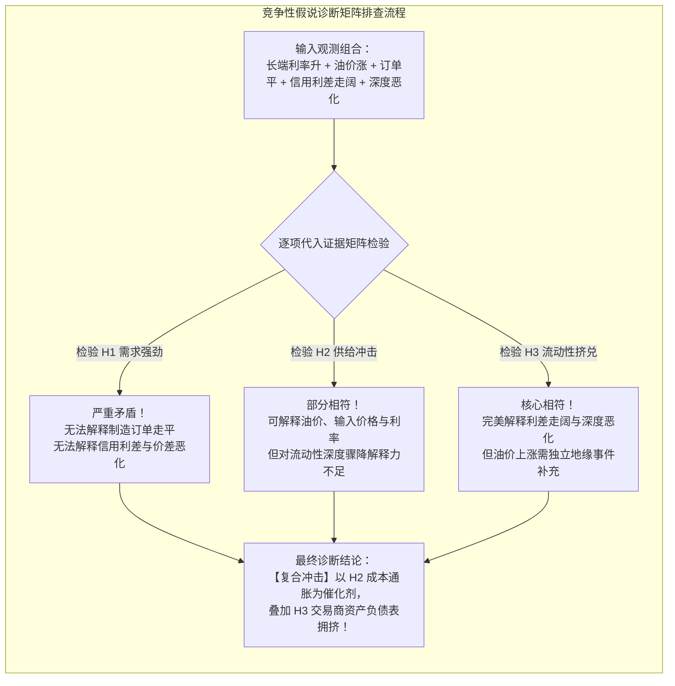
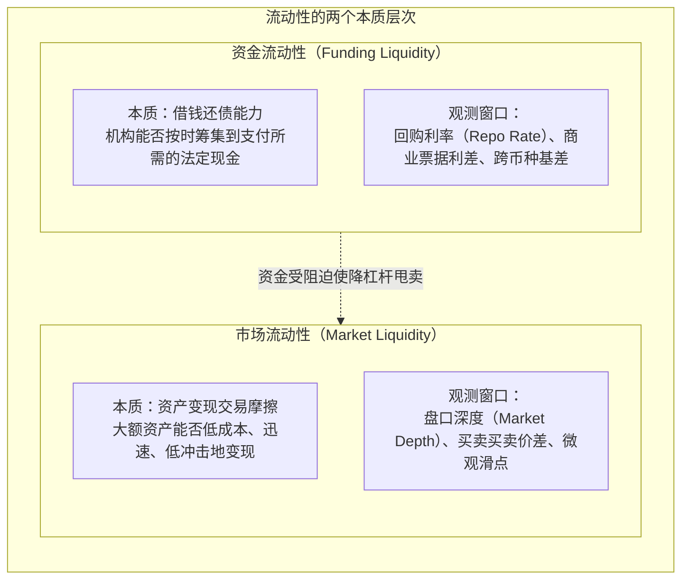
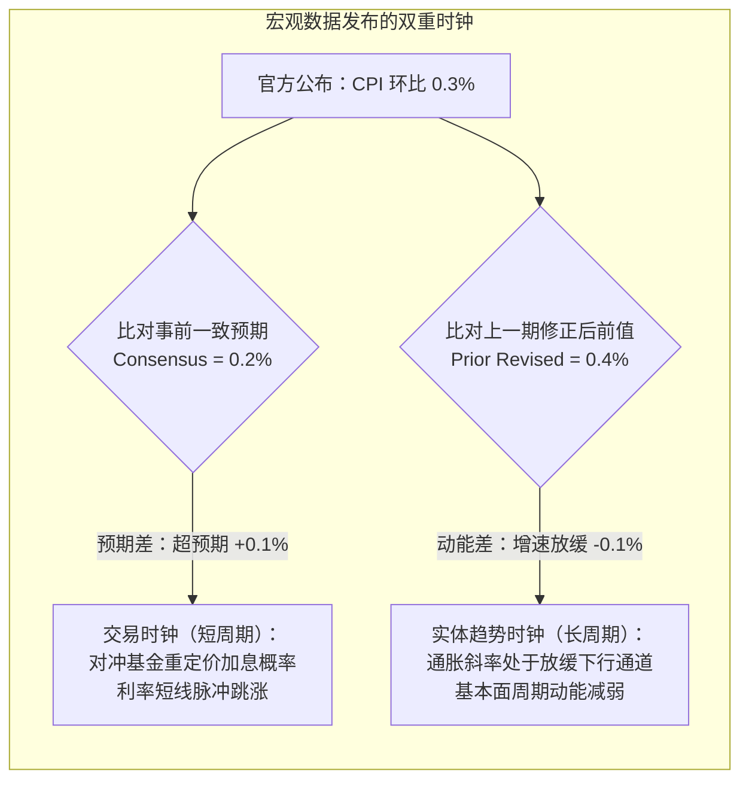

# 38 宏观与市场联合诊断：竞争性解释与证据组合

[上一章](37-financial-institutions.md) · [目录](./) · [下一章](39-historical-research.md)

> 作为宏观分析师，当你打开交易终端，满屏跳动着红绿数字：国债收益率飙升、标普指数跳水、原油大涨、美元走强……新手往往急于寻找一个简单粗暴的“爆款标题”（比如“油价暴涨引发滞胀恐慌，美股崩盘”）。但真正的专业分析师更像探案现场的福尔摩斯：**市场永远不会只有单一声音，每一笔资产报价都是多方力量博弈后留下的现场指纹。** 本章将带你搭建一套严谨的“竞争性假设排查法”，把零散数据串联为逻辑自洽、能够经受现实证伪的专业研判。

---

## 1. 像福尔摩斯一样思考：从宽泛议题到可证伪假说

宏观研究最忌讳的一个开局问题是：“今天经济到底怎么样？”

这个问题过于宽泛，就像侦探冲进现场问“今天有谁干了坏事”。其结果通常是：你在财经门户网站上浏览了一百条互相矛盾的快讯，最后挑了一篇最顺眼的故事交差。

一个可研究、可落地的专业问题必须具备**具体性、机制性与可证伪性**：
- **坏问题**：“十年期美债利率破 4.5%，美股是不是要崩了？”
- **专业问题**：“近期十年期美债收益率上升 50 个基点，究竟是源于**实际增长预期改善**、**通胀补偿（Breakeven）上升**，还是**国债供给洪峰引发的期限溢价与融资压力**？”

联合诊断的核心不是把经济数据、股市走势、汇率表现各打一个主观分数然后算平均分。宏观数据之间存在深层的会计恒等式与资金流动闭环，统计机构公布的历史数据有其观察时滞，而金融资产报价则早已打入了投资者的前瞻预期。

我们的目标是产出一份严谨的**宏观联合诊断备忘录（Diagnostic Memo）**：
1. **界定核心问题与时点**（明确数据截点，杜绝信息穿越）；
2. **客观事实与数学转换**（区分名义变动、基点差值与真实复合增速）；
3. **列出竞争性假说**（至少给出两到三种可自圆其说的逻辑路径）；
4. **比对排他性证据**（寻找能够“一票否决”某个假说的硬指标）；
5. **设定观点撤回条件**（明确什么反面证据出现时必须承认自己看错了）。

---

## 2. 五层诊断金字塔：拆解市场流行口诀

在财经评论中，你经常能听到类似这样的断言：“收益率上升导致股市下跌。”

作为受过严格训练的研究员，你必须像切片解剖一样，把这样一句口诀拆分为**五个互不混淆的认知层次**：

### 逐层剖析示范：
1. **第 1 层（观测）：** 到底是 2 年期国债活跃券（On-the-run）在美东下午 3 点收益率上行 10 个基点，还是 30 年期国债因财政部拍卖疲软上行 5 个基点？标普 500 下跌是等权重成分股普跌，还是少数超大市值科技股因前期估值过高领跌？
2. **第 2 层（计算）：** 收益率从 $4.00\%$ 变动到 $4.25\%$ 是上升了 $25\text{ bp}$（即 $0.25$ 个百分点），标普指数从 5,000 点跌到 4,900 点是下跌了 $-2.0\%$。两者的计算端点必须严格对齐。
3. **第 3 层（机制）：** 根据现金流折现模型（DCF），股票理论价格为未来现金流以无风险利率加上股权风险溢价（ERP）折现之和：
   $$P_0 = \sum_{t=1}^{\infty} \frac{E(D_t)}{(1 + r_f + \text{ERP})^t}$$
   若无风险折现率 $r_f$ 飙升而未来现金流预期 $E(D_t)$ 未变，股票现值必然承压。
4. **第 4 层（识别）：** 现实中利率上升往往伴随着强劲的名义经济增长！如果利率上升是由于企业资本回报率和订单需求暴增，分红预期 $E(D_t)$ 的上调完全可能抵消折现率 $r_f$ 的负面冲击（如 1990 年代中期的“强繁荣”行情）。此时“利率升导致股市跌”的单一机制就被证伪了。
5. **第 5 层（判断）：** 只有同时观测到“长端实际利率（TIPS）大幅拉升、企业盈利预期未出现上修、高收益信用利差走阔”，我们才能以高置信度认定：**本次美股下跌的主导元凶确实是无风险金融条件的骤然收紧**。

---

## 3. 完整算例：收益率曲线“变陡”背后的冰与火之歌

许多初学者容易背诵机械口诀：“收益率曲线倒挂代表衰退，倒挂解除（变陡）代表经济复苏开始。”

这是一个极度危险的误区！让我们用真实严谨的数学算例，演示两种截然相反的“曲线陡峭化”。

### 3.1 初始状态与两种情景定义
设某日美债基准利率初始值为：
- 2 年期收益率 $y_{\text{2Y}} = 4.50\%$
- 10 年期收益率 $y_{\text{10Y}} = 4.00\%$
- 期限利差：
  $$\text{Spread}_{10-2} = y_{\text{10Y}} - y_{\text{2Y}} = 4.00\% - 4.50\% = -0.50\% = -50\text{ bp}$$
此时曲线深度倒挂 $50\text{ bp}$。

经过一个月，市场迎来了两种完全独立的演化情景：

| 项目指标 | 初始状态 | 情景 A（牛市陡峭化） | 情景 B（熊市陡峭化） |
| :--- | :---: | :---: | :---: |
| **2 年期收益率 ($y_{\text{2Y}}$)** | $4.50\%$ | $4.00\%$ ($\Delta = -50\text{ bp}$) | $4.60\%$ ($\Delta = +10\text{ bp}$) |
| **10 年期收益率 ($y_{\text{10Y}}$)** | $4.00\%$ | $3.90\%$ ($\Delta = -10\text{ bp}$) | $4.50\%$ ($\Delta = +50\text{ bp}$) |
| **期限利差 ($\text{Spread}_{10-2}$)** | $-50\text{ bp}$ | $-10\text{ bp}$ ($\Delta = +40\text{ bp}$) | $-10\text{ bp}$ ($\Delta = +40\text{ bp}$) |
| **全收益率水平平均位移** | 基准 | 短端长端全线下跌（重心下移） | 短端长端全线上扬（重心上移） |

### 3.2 诊断深度解析
注意看利差变动的代数结果：
- 在情景 A 中，利差从 $-50\text{ bp}$ 变为 $-10\text{ bp}$，利差走阔 $+40\text{ bp}$；
- 在情景 B 中，利差同样从 $-50\text{ bp}$ 变为 $-10\text{ bp}$，利差同样走阔 $+40\text{ bp}$！

如果你只看汇总指标“利差走阔 $40\text{ bp}$，倒挂明显修复”，从而草率得出“经济正在健康复苏”的结论，你就会在情景 A 中遭遇灭顶之灾：
- **情景 A（牛市陡峭化，Bull Steepener）：** 短端利率领先暴跌，说明市场嗅到了经济衰退、企业违约或金融体系局部爆雷的气味，正在激进押注美联储即将展开降息救援。这不仅不是好消息，反而是衰退即将正式落地的**警报信号**！
- **情景 B（熊市陡峭化，Bear Steepener）：** 短端按兵不动，长端利率被庞大的国债赤字供给或通胀粘性预期推高。市场对长期国债要求更高的期限溢价（Term Premium），实体经济面临长期融资成本飙升的“无声紧缩”。

---

## 4. 竞争性假说排查法（ACH）：撕破单一叙事

面对复杂交织的多重市场信号，顶尖宏观团队普遍采用中央情报局（CIA）开发的方法——**竞争性假说分析法（Analysis of Competing Hypotheses, ACH）**。

假设某周你观察到以下六项宏观事实：
1. **$O_1$：** 十年期美债名义收益率跳升 $20\text{ bp}$；
2. **$O_2$：** WTI 原油期货主力合约单周上涨 $+8\%$；
3. **$O_3$：** ISM 制造业新订单分项指数基本持平，但供应商交付分项走高；
4. **$O_4$：** 核心生产者价格指数（PPI）输入成本大幅上升；
5. **$O_5$：** 高收益公司债信用利差（HY OAS）单周走阔 $35\text{ bp}$；
6. **$O_6$：** 国债现券买卖买卖价差（Bid-Ask Spread）显著拉大，市场深度下降。

### 设立三个竞争性假说：
- **假说 1（$H_1$，经济强劲繁荣）：** 实体需求旺盛，拉动原油需求与资本回报率上升；
- **假说 2（$H_2$，外生供给冲击）：** 地缘政治导致原油供给中断，输入型成本通胀推高物价与折现率；
- **假说 3（$H_3$，金融体系流动性挤兑）：** 融资中介资产负债表受限，交易商承接国债意愿受挫，信用风险放大。

### 证据评估矩阵表：

| 观测证据 | 假说 1 ($H_1$)：需求繁荣 | 假说 2 ($H_2$)：供给成本冲击 | 假说 3 ($H_3$)：流动性挤兑 | 区分价值分析 |
| :--- | :---: | :---: | :---: | :--- |
| **$O_1$ 十年美债升** | 相符 ($+$) | 相符 ($+$) | 相符 ($+$) | 无法区分三个假说（三者皆可推高利率） |
| **$O_2$ 油价大涨** | 相符 ($+$) | **高度相符 ($++$)** | 中性/无关 ($0$) | 有利于推翻单纯的 $H_3$ |
| **$O_3$ 订单平/交货慢** | **矛盾 ($-$)** | 相符 ($+$) | 中性 ($0$) | **一票否决 $H_1$**（需求旺盛必伴随订单爆发） |
| **$O_4$ 输入成本走高** | 相符 ($+$) | **高度相符 ($++$)** | 中性 ($0$) | 支持成本推动假说 |
| **$O_5$ 信用利差走阔** | **严重矛盾 ($--$)** | 部分相符 ($+$) | **高度相符 ($++$)** | **再次重创 $H_1$**（经济繁荣期信用利差收窄） |
| **$O_6$ 买卖价差扩大** | **矛盾 ($-$)** | 中性 ($0$) | **极度相符 ($+++$)** | **强力确认 $H_3$ 存在**（市场流动性承压） |

> **福尔摩斯的推论准则：** 剔除所有不可能的假设，剩下的不管看起来多么复杂，就是事实的真相。通过矩阵排查，纯粹的“需求扩张故事（$H_1$）”被彻底否定。实际情况是一个**复合型冲击**：供给端推高油价（$H_2$），同时国债供给与交易商资金压力（$H_3$）引发了资产端折价与信用抛售。

---

## 5. 资金流动性 vs 市场流动性：别把两件事混为一谈

在宏观与市场联合诊断中，“流动性”是全市场被滥用最严重的一个词汇。宏观分析师必须在脑海中将其严格划分为两个截然不同的物理层次：

### 独立教学情景：为什么“准备金充足”时市场依然会冻结？
很多评论家看到美联储准备金账户里躺着数万亿美元，就断言“市场流动性极其泛滥”。

这是典型的总量误区！请设想这样一个真实传导情境：
1. **总量层面：** 商业银行存放在美联储的准备金余额（Reserve Balances）非常充裕；
2. **制度约束：** 华尔街一级交易商（Primary Dealers）受到**补充杠杆率（SLR）**与内部**风险价值（VaR）**限额的刚性监管。哪怕央行放了水，交易商用自己的资产负债表吞下天量国债的能力也是有物理天花板的；
3. **微观传导：** 当高频量化基金或对冲基金在国债基差交易（Basis Trade）中遭遇保证金追加时，交易商由于资产负债表耗尽，拒绝以合理价差融出隔夜现金；
4. **结果爆发：** 尽管美联储总账上的准备金总量稳定，特定国债现货的**买卖价差暴拉数倍、盘口深度归零**，资产被迫大打折扣抛售。

**诊断准则：** 永远沿着资金结算链追踪：**谁在急需现金？何时需要完成结算？手里握有什么抵押品？谁有资产负债表额度为其融资？** 离开交易对手微观约束去谈“宏观流动性”，如同脱离电网管道空谈发电总量。

---

## 6. 预期差 vs 动能变化：市场在为什么而定价？

很多初涉宏观的同学经常看不懂市场反应：“为什么今天公布的非农就业明明比上个月多，美股却暴跌了？”

原因在于：**成熟金融市场早已把‘已知信息’和‘普遍预期’消化在当下的价格里；资产价格跳变（Price Jump）是对‘预期意外（Surprise）’的再定价，而不是对‘历史事实’的被动复读。**

$$\text{数据意外（Surprise）} = \text{实际公布初值（Actual）} - \text{彭博/路孚特一致预期（Consensus）}$$

### 严格区分两个维度：
1. **横向比较（相对预期差）：** 
   若某月核心 CPI 环比实际公布为 $0.3\%$，而彭博采集的华尔街经济学家一致预期为 $0.2\%$，这便是**超预期 $+0.1$ 个百分点**的通胀上行意外。高频算法交易系统会在发布后 500 毫秒内打入“美联储更鹰派”的定价，短端利率瞬间跳涨。
2. **纵向比较（相对前值与修订）：**
   若该数据上一期公布为 $0.4\%$，但发布本日同时将上月前值向下修正为 $0.3\%$。那么从实体基本面动能来看，通胀实际上是从 $0.4\% \rightarrow 0.3\% \rightarrow 0.3\%$，呈现**见顶放缓的减速趋势**。

**专业纪律：** 如果你的数据库或手头资料**没有可靠的、在数据发布前截留的时间戳一致预期**，请老老实实写“相比上月增长放缓”，严禁事后看图说话胡乱套用“大幅超预期”的轻浮字眼！

---

## 7. 实战演练：写一份经得起审计的一页诊断备忘录

现在，让我们模拟顶级买方宏观研究部每周例会的要求，根据前述第 3 节的“情景 A”数据，结合同期劳动力市场与信用环境，撰写一份结构化、可审计的专业诊断备忘录。

### 事实输入：
- 2 年期国债收益率由 $4.50\%$ 跌至 $4.00\%$（$-50\text{ bp}$）；
- 10 年期国债收益率由 $4.00\%$ 跌至 $3.90\%$（$-10\text{ bp}$）；
- 期限利差 $\text{Spread}_{10-2}$ 由 $-50\text{ bp}$ 走阔至 $-10\text{ bp}$（牛市陡峭化）；
- 连续三个月非农就业新增岗位均值放缓至 12 万，初请失业金人数突破 24 万上升通道；
- 高收益公司债利差走阔 $40\text{ bp}$；
- 暂缺最新核心 PCE 细项及事前隔夜掉期（OIS）完整隐含路径。

---

### 示范备忘录

> **【宏观联合诊断研判备忘录】**  
> **研究员：** 宏观策略组  
> **数据截点：** 2026 年教学基准日 美东 16:30  
>
> **1. 核心结论与状态定性**  
> 当前利率体系呈现典型的**牛市陡峭化（Bull Steepening）**特征：短端 2 年期收益率单月跳水 $50\text{ bp}$，主导了利差 $40\text{ bp}$ 的走阔（从 $-50\text{ bp}$ 修复至 $-10\text{ bp}$）。结合劳动力新增动能放缓与信用利差走阔，当前宏观环境**高度符合“经济由放缓滑向衰退、市场提前计入激进降息救援”的基本面特征**。严正提示投资委员会：**切勿将本次收益率倒挂的缓和误判为经济繁荣复苏的看多信号！**
>
> **2. 竞争性假说排查与证据链**  
> - **排除假说（经济韧性复苏）：** 若倒挂解除源于增长复苏，应表现为长端利率在资本开支驱动下领涨的熊陡，且高收益债利差应同步收窄。当前高收益债利差反向走阔 $40\text{ bp}$，完全否定了繁荣叙事。
> - **基准支持假说（衰退防御与降息抢跑）：** 2 年期利率暴跌反映市场资金强力买入短债锁定安全收益，并预期基准利率将快速下调；初请失业金趋势上升印证了就业边际松动。
>
> **3. 当前信息盲区与缺口**  
> 尚缺核心 PCE 细项（无法排除服务业黏性反弹对降息空间的掣肘）以及回购市场微观流动性指标（无法确认是否存在对冲基金因基差回撤被迫平仓导致的异常技术性买盘）。
>
> **4. 证伪条件与跟踪事项**  
> 若未来公布的非农就业深度上修、高收益利差重新收缩至 $300\text{ bp}$ 以内，则本报告结论的置信度将显著下调，需重新评估软着陆概率。

---

## 8. 练习与思考题

### 练习一：收益率曲线旋转计算
两年期国债收益率从 $4.00\%$ 下降至 $3.80\%$，十年期国债收益率从 $4.20\%$ 上升至 $4.30\%$。
1. 计算 $10\text{y}-2\text{y}$ 期限利差的变化量（以基点表示）；
2. 解释为什么在向宏观投资总监汇报时，绝对不能简单用一句“市场利率走低”来概括这组变化？

参考答案

1. **计算利差：**
   - 初始利差：$\text{Spread}_{\text{initial}} = 4.20\% - 4.00\% = +0.20\% = +20\text{ bp}$；
   - 变化后利差：$\text{Spread}_{\text{new}} = 4.30\% - 3.80\% = +0.50\% = +50\text{ bp}$；
   - 利差变化量：$\Delta \text{Spread} = +50\text{ bp} - (+20\text{ bp}) = +30\text{ bp}$（利差走阔 30 个基点）。
2. **专业解释：**
   短端 2 年期利率下降了 $20\text{ bp}$，而长端 10 年期利率反而上升了 $10\text{ bp}$。这是典型的**曲线顺时针旋转（Curve Twist）与陡峭化**。如果笼统归结为“利率走低”，不仅完全忽略了长端融资成本（如 30 年期居民房贷利率与企业长期发债基准）不降反升的事实，更掩盖了不同期限资产背后反映的宏观驱动力差异：短端计入了政策宽松预期，长端却可能正在计入更长期的财政赤字膨胀或期限溢价抬升。必须区分期限，不能用简单平均掩盖结构变动。

### 练习二：事实、机制与因果推断
某财经自媒体发文称：“今日纳斯达克暴跌 $2\%$，居民家庭财富大幅缩水，预计下季度美国居民消费支出将必然同步崩跌 $2\%$。”
请运用五层诊断框架，指出其在事实界定、传导机制与统计逻辑上的核心漏洞。

参考答案

1. **事实界定缺陷：** 仅提出单一指数跌幅，未界定股票持仓资产净值的实际变化规模，混淆了金融资产波动与实体可支配收入流量。
2. **传导机制断裂：** 股票下跌传导至实际消费依赖“财富效应（Wealth Effect）”，该机制不仅存在数个季度的长时滞，且弹性远非 $1:1$。美国股票资产高度集中于高收入阶层，这部分群体的边际消费倾向（MPC）通常较低；只要普通工薪家庭的实际工资与可支配收入保持健康增长，股市短线回调对总体消费大盘的抑制非常有限。
3. **推断逻辑谬误：** 将可能的风险因子上升为“必然”发生，缺乏对储蓄率变动、就业状态及超额流动性缓冲的综合验证，属于典型的把局部相关性机械等同于全局因果的草率论断。

### 练习三：反向证据与排他性假说
当市场出现“全美商业银行对工商业贷款（C&I Loans）规模连续两季度收缩”时，流行观点通常解释为：“这证明实体企业对未来前景悲观，投资借贷意愿大幅萎缩。”
请作为反方分析师，提出**两种完全不同的替代解释**，并分别指出你需要寻找哪项独立证据来验证你的替代解释。

参考答案

- **替代解释 1（银行供给端信贷配给 / 顺周期惜贷）：** 并非企业不想借，而是银行在资本充足率压力或坏账担忧下主动收紧了放贷标准，抬高了抵押门槛（信贷供给收缩）。
  - **验证证据：** 查阅美联储高级贷款官意见调查（SLOOS）。如果调查显示“报告提高贷款审批标准的商业银行净比例大幅飙升”，而借款企业主反馈“信贷可得性恶化”，即可有力证实此解释。
- **替代解释 2（直接融资渠道替代 / 借新还旧）：** 企业由于信用评级优良，选择绕开商业银行中介，直接在公开债券市场以更优惠的票面利率发行企业债或商业票据，并用募集资金置换了银行贷款。
  - **验证证据：** 统计同期投资级（IG）公司债的净发行规模与资金流向。如果公司债净发行量创同期新高且募集说明书中“还贷与置换”占主体，即可证实信贷总量并未收缩，只是融资渠道由间接融资转移到了直接融资。

---

[上一章](37-financial-institutions.md) · [目录](./) · [下一章](39-historical-research.md)
