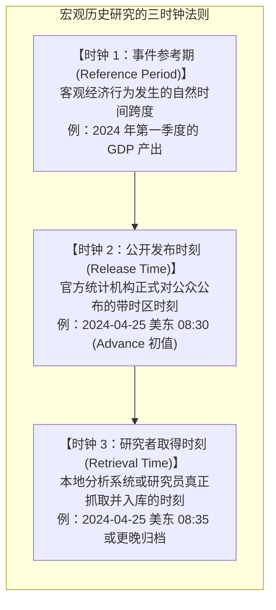
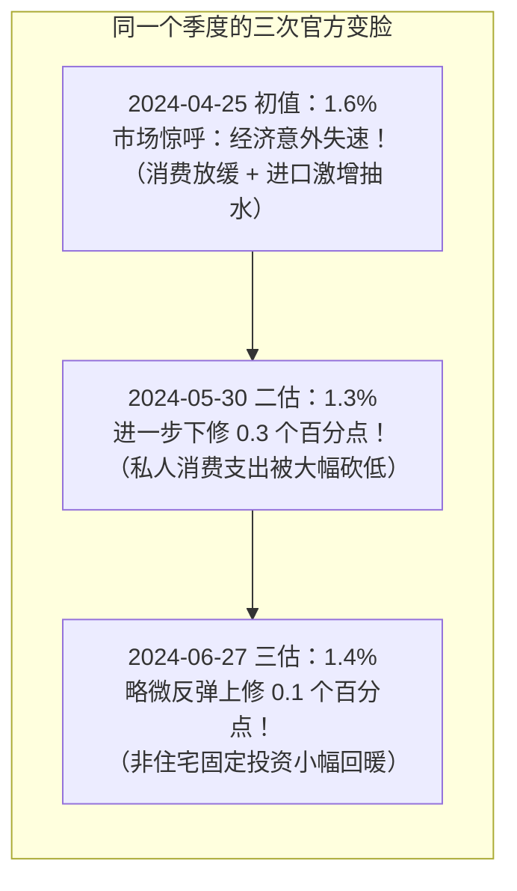
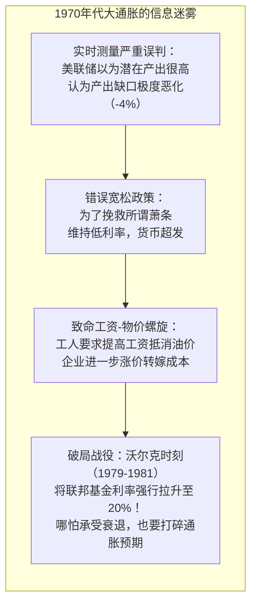
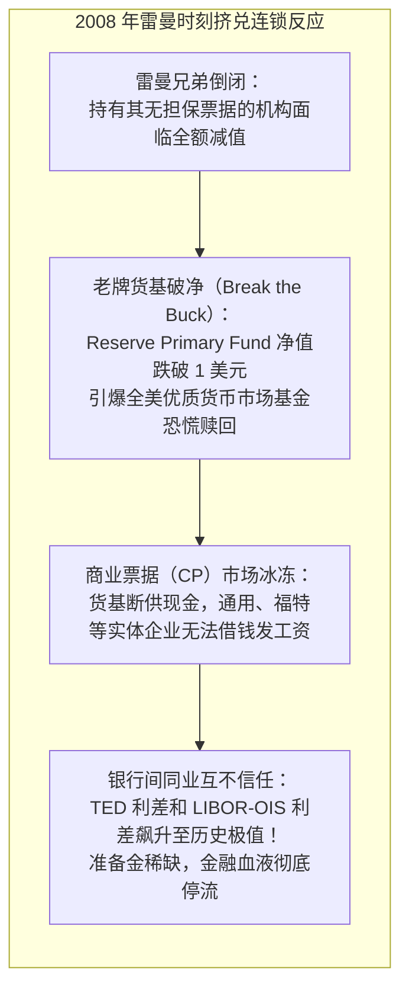
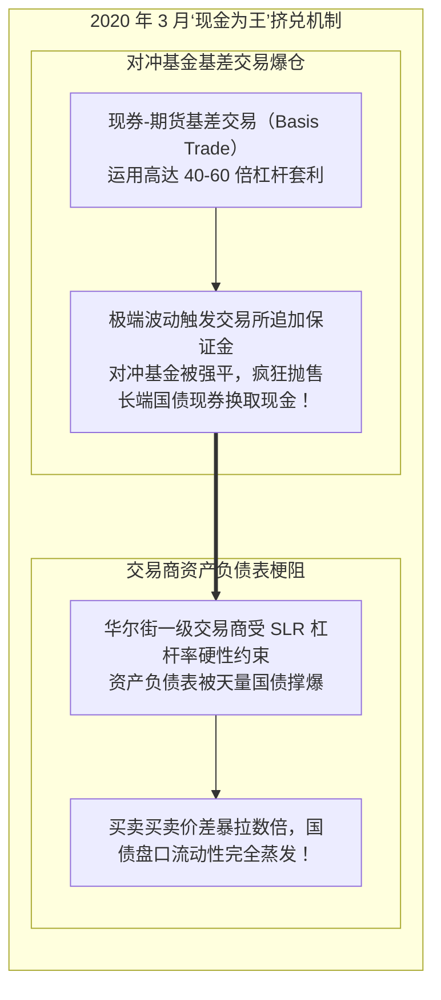
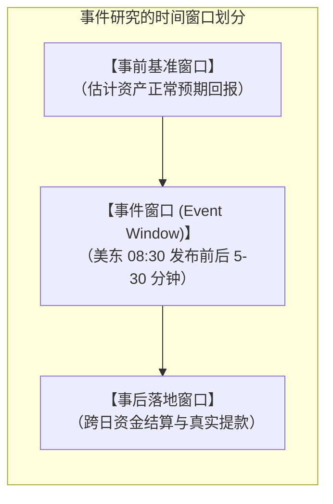

# 39 历史事件研究：重建当时可得的信息

[上一章](38-joint-diagnosis.md) · [目录](./) · [下一章](40-data-workflow.md)

> 当你打开今天的宏观经济数据库，调出数十年前的 GDP 或通胀走势，图表往往平滑而清晰。新手很容易产生一种上帝视角的幻觉：“历史上的决策者怎么这么迟钝？危机明明迫在眉睫，为什么他们当时不果断行动？”然而，真正的宏观历史研究是一场**对抗‘后见之明偏差（Hindsight Bias）’的信息逆向工程**。本章将带你化身“宏观时空侦探”，还原决策者与市场交易员在案发现场当时当地唯一能掌握的残缺拼图，并深度复盘现代宏观史上最具震撼力的三大经典战役：**1970 年代大通胀**、**2008 年雷曼时刻**以及 **2020 年 3 月‘现金为王’流动性踩踏**。

---

## 1. 历史图表最容易掩盖什么？（三时钟法则）

现代数据库给你的历史序列，往往是经过数年甚至数十年统计基准调整、全面基期修订后的“完美版本”。

然而，真实的宏观决策与资产定价是在**浓重的信息迷雾**中进行的。要科学地评估任何历史事件，你必须在脑海中建立三个独立运转的“时钟”：

### 为什么混淆时钟会导致灾难性的研究错误？
- **后见之明（Look-ahead Bias）：** 如果你用 2026 年最新修订的 2008 年 GDP 序列去回测当时的投资策略，你会发现自己的模型能“神奇地”提前三个月预测雷曼破产——但这纯粹是使用了当时所有人都不可能知道的“未来数据”。
- **时区与分钟级截点：** 宏观数据发布通常精确到秒（如美东夏令时 08:30，对应 UTC 12:30）。在事件研究中，哪怕只错位了 5 分钟，把 08:35 已经跳升的国债利率当作 08:29 的事前变量输入，整个因果推断就会彻底颠倒。

---

## 2. 案例一：2024 年第一季度 GDP 的三次“罗生门”

让我们看一个真实的近例。下表展示了美国经济分析局（BEA）对 **2024 年第一季度（2024 Q1）实际 GDP 季环比折年率（SAAR）** 在不同时点公布的三份官方报告：

| 发布官方日期与时间（美东 08:30） | 版本性质（Vintage） | 2024 Q1 实际 GDP 官方读数 | 官方新闻稿链接入口 |
| :--- | :--- | :---: | :--- |
| **2024-04-25** | 初值报告（Advance Estimate） | **$1.6\%$** | [BEA 初值新闻发布](https://www.bea.gov/news/2024/gross-domestic-product-first-quarter-2024-advance-estimate) |
| **2024-05-30** | 第二次估计（Second Estimate） | **$1.3\%$** | [BEA 二次估计发布](https://www.bea.gov/news/2024/gross-domestic-product-first-quarter-2024-second-estimate-and-corporate-profits) |
| **2024-06-27** | 第三次估计（Third Estimate） | **$1.4\%$** | [BEA 三次估计发布](https://www.bea.gov/news/2024/gross-domestic-product-third-estimate-corporate-profits-revised-estimate-and-gdp-industry) |

### 2.1 构造严格的 As-Of 信息截止线
假设你受命为投资委员会复盘“2024 年 5 月 1 日对冲基金对美国经济的基本面判断”。
- 在 2024-05-01 这一天，全市场**唯一合法可得**的官方 GDP 数据只有初值的 **$1.6\%$**。
- 绝不能因为我们今天已经知道了 5 月 30 日会下修到 $1.3\%$，就在 5 月 1 日的报告中指责当天的交易员“盲目乐观”。在时钟 2 的限制下，$1.3\%$ 是不可见的未来信息。

### 2.2 复合折年率转换的数学细节
美国公布的季度 GDP 是**季环比折年率**，其与真实非年化单季环比增速 $g_q$ 的转换公式为严格的复利指数关系：
$$g_{\text{annualized}} = (1 + g_q)^4 - 1 \implies g_q = (1 + g_{\text{annualized}})^{1/4} - 1$$

将初值 $1.6\%$（即 $0.016$）代入计算单季实际环比变动：
$$g_q = (1 + 0.016)^{1/4} - 1 \approx 1.003976 - 1 \approx 0.398\%$$

> **严禁粗暴除以 4：** 虽然 $1.6\% \div 4 = 0.40\%$ 与 $0.398\%$ 在数值上接近，但在万亿美元级别的国家经济核算与复利滚动中，这种近似会放大微观误差。更重要的是：初值 $1.6\%$ 到二估 $1.3\%$ 是对**同一个时间段**度量精度的修正，绝对不能把 $1.6\% \rightarrow 1.3\% \rightarrow 1.4\%$ 误认为是三个连续季度的经济下行与回升！

---

## 3. 还原历史经典战役：三大危机的案发现场

宏观经济学的重大理论突破与央行政策工具箱的革新，几乎全是由危机逼出来的。让我们穿越回当时当刻，站在决策者与交易员的视角解剖三大经典战役。

### 战役一：1970 年代大通胀与“实时产出缺口之谜”
- **历史案发现场：** 1970 年代，第四次中东战争与伊朗革命接连引爆两次石油危机，原油价格暴涨四倍。美国经历了痛苦的“停滞性通货膨胀（Stagflation）”——CPI 飙升破 $12\%$，失业率高企在 $8\%$ 以上。
- **当时的决策困境（Orphanides 效应）：** 为什么当时的伯恩斯（Arthur Burns）美联储迟迟不敢坚决收紧货币？经济学家阿萨纳西奥斯·奥芬尼德斯（Athanasios Orphanides）在 2001 年的划时代研究中发现：**实时数据彻底误导了美联储！**

当时的经济学家低估了 1970 年代生产率增长放缓的严重程度，以为潜在产出（Potential GDP）依然很高，计算出的“实时负产出缺口”大得吓人。美联储误以为经济处于巨大的资源闲置状态，因而不敢下重手，最终放任“工资-物价螺旋”彻底失控。直到 1979 年沃尔克（Paul Volcker）上任，不惜以两次深度衰退为代价将政策利率推升至惊人的 $20\%$，才最终驯服了通胀猛兽。

---

### 战役二：2008 年雷曼时刻——信用冻结与准备金紧缺
- **历史案发现场：** 2008 年 9 月 15 日凌晨，拥有 158 年历史的华尔街第四大投资银行雷曼兄弟（Lehman Brothers）宣布申请破产保护。
- **连锁挤兑雪崩：** 雷曼破产不再是一次普通的机构清算，它瞬间引爆了现代影子银行体系的“多米诺骨牌”：

在 2008 年之前，美联储实行的是**稀缺准备金框架（Scarce Reserves Framework）**，银行体系内的准备金总共只有几百亿美元。雷曼倒闭后，没有任何一家银行敢向交易对手融出隔夜资金，TED 利差（3 个月美元 LIBOR 与 3 个月美债利率之差）瞬间暴拉至史无前例的 $460\text{ bp}$！
这场浩劫迫使美联储推出了划时代的政策创新：开启第一轮量化宽松（QE1），并经国会授权开始对准备金余额支付利息（IOR），人类金融历史自此迈入超额准备金时代。

---

### 战役三：2020 年 3 月疫情流动性挤兑（Dash for Cash）
- **历史案发现场：** 2020 年 3 月上旬，新冠疫情在全球快速蔓延，全球金融市场遭遇史诗级抛售。但这一次，市场展现出一种让所有传统教科书大跌眼镜的异象：**作为终极避险资产的美国长期国债，竟然和美股一起暴跌！**

- **官方行动时间线拆解：**
  - **2020-03-15（周日紧急降息）：** 美联储在非例行会议宣布[支持信贷流动的紧急措施](https://www.federalreserve.gov/newsevents/pressreleases/monetary20200315b.htm)，一口气将联邦基金利率目标区间砍至 $0\%-0.25\%$，启动 7,000 亿美元购债计划并降低贴现窗口利率。然而，市场周一开盘依然熔断，因为当时最缺的不是名义利率宽松，而是**美元现钞与可流通资产负债表**！
  - **2020-03-23（掀桌式无限量救市）：** 美联储发布震撼全球的[全面救市扩展措施公告](https://www.federalreserve.gov/newsevents/pressreleases/monetary20200323b.htm)，宣布开启**无限量 QE**，并首次祭出直接购买企业债的特设工具（PMCCF、SMCCF）、商业票据融资便利（CPFF）与货币市场流动性便利（MMLF）。流动性冰封在央行直接下场充当“终极做市商”后才得以解冻。

---

## 4. 事件研究法（Event Study）：测度政策净冲击

在宏观与金融研究中，我们如何科学测度一项重磅政策发布对金融市场的真实冲击？

最常用的学术与业界工具是**事件研究法（Event Study）**：

### 4.1 超额异常回报（Abnormal Return）计算
设在特定事件窗口内：
- 某风险资产（如高收益债券 ETF）的实际回报率为 $R_{\text{asset}} = -2.0\%$；
- 选定的大盘基准回报率为 $R_{\text{benchmark}} = -1.0\%$；
- 则在最简假设下，该资产相对于基准的异常回报为：
  $$R_{\text{abnormal}} = R_{\text{asset}} - R_{\text{benchmark}} = -2.0\% - (-1.0\%) = -1.0\%$$

### 4.2 因果推断的四大陷阱
1. **混杂变量污染（Confounding News）：** 若美联储在下午 2:00 公布议息决议，而在下午 2:15 刚好爆发了国际局部地缘冲突，切不可将 2:00—2:30 的全部资产波动单方面归罪于鲍威尔的讲话。
2. **反向因果（Endogeneity）：** 央行往往在经济最危险时出台最激进的降息政策。如果降息公布后股市继续下跌，不能草率下结论说“因为美联储降息，所以导致了经济衰退”。
3. **宣布与落地的裂谷：** 宣布设立 5,000 亿美元的融资便利工具，绝不等于当天已经有 5,000 亿真金白银注入了市场。必须严格区分**政策授权额度、申请金额、批准放贷与实际提款余额**。
4. **周日公告的时间戳陷阱：** 美联储多次在周日傍晚发布重大政策（如 2008 年救市与 2020 年 3 月 15 日降息）。此时全球现货股票市场闭市，分析师必须使用周日夜盘的美指期货、离岸外汇与股指期货作为第一反应窗口，不能粗暴对比周五收盘与周一收盘。

---

## 5. 宏观历史研究的数据包归档标准

一个合格的宏观研究员在完成任何历史复盘时，必须为团队留下**可随时供外部审计查验的证据档案包（Data Dossier）**。

| 必备模块 | 核心内容与字段 | 常见伪造/不规范操作 |
| :--- | :--- | :--- |
| **原始文件存证** | 官方原始发布 PDF、HTML 网页离线镜像或永久快照 | 仅记录二手新闻媒体的碎片化转述截屏 |
| **精确时间戳元数据** | 带夏令时时区的 ISO 8601 时间（如 `2024-04-25T08:30:00-04:00`） | 仅在表格中随手写一个日期 `2024-04-25` |
| **版本性质（Vintage）** | 明确标注初值（Advance）、二估（Second）还是三估（Third） | 把三个不同版本排成连续的三个月份/季度数据 |
| **事前市场一致预期** | 严格限定在发布前 15 分钟以前锁定的彭博中位数 | 事后从分析师早报中摘抄带有后见之明的“市场预期” |
| **高频市场行情标的** | 指定成交活跃券（CUSIP 码）、分钟级收盘价与基准成交量 | 使用无成交量支撑的报价商模糊估值模型 |

---

## 6. 练习与思考题

### 练习一：截止时刻与信息集判断
在 2024-05-30 美东时间 **08:29** 和 **08:31** 这两个时刻，公众信息集中可用的 2024 Q1 实际 GDP 官方读数分别是什么？如果某机构的研究数据库直到次日清晨才完成数据爬取入库，这两种“信息可得性”在策略回测中该如何客观表述？

参考答案

1. **时钟截点判定：**
   - 在 2024-05-30 美东 08:29，由于第二次估计尚未正式公布，公众可得信息集中的 2024 Q1 读数仍为 2024-04-25 发布的**初值 $1.6\%$**；
   - 在 08:31，官方新闻稿准时解禁，公众信息集中的最新官方估计更新为**第二次估计 $1.3\%$**。
2. **专业回测表述：**
   必须严格区分**公众可得集（Publicly Available）**与**本地实际可得集（Locally Retrieved）**：
   - 可以在历史复盘中说明“在美东 08:31，公众理论上已可依据 $1.3\%$ 进行定价”；
   - 但在真实策略回测中，必须诚实记录“本地交易系统直到次日才完成数据抓取与入库（Retrieval Time）”。若系统在 5 月 30 日日内产生根据 $1.3\%$ 作出的交易信号，应判定为前瞻未来信息泄漏，必须予以剔除。

### 练习二：纠正后见之明叙事
某实习分析师在周报中写道：“2024 年一季度 GDP 初值公布时为 $1.6\%$，当时全市场都在恐慌经济衰退；然而在 6 月底的三次估计中，该数据被上修到了 $1.4\%$，企业固定投资也很稳健。这充分证明 4 月底看空市场的投资者是完全不理性的。”
请你作为带教导师，指出这段分析在宏观方法论上的根本错误。

参考答案

这段分析犯了典型的**后见之明偏差（Hindsight Bias）与生存者叙事错误**：
1. **评价历史决策必须基于决策当时的信息集：** 4 月底的投资者面对的是 $1.6\%$ 的失速初值，以及当时可得的消费骤降数据。基于当时信息采取防御性避险是符合风险管理纪律的理性行为；不能用 6 月底才公布的第三次估计去倒推指责 4 月底的决策。
2. **混淆了估计误差与客观事实：** BEA 的数据修订恰恰证明了宏观初值存在不可忽视的统计测量误差。一个成熟的研究员应该指出“4 月底单凭一个初值过度外推衰退存在过度反应风险，应当留存修订敞口”，而不是站在未来时点嘲笑当时的审慎判断。

### 练习三：独立历史事件时间线整理
请查阅美联储与财政部公开历史资料，为 **2020 年 3 月流动性冲击** 梳理一份结构化事件表：
1. 标明 2020-03-15 与 2020-03-23 两次关键救市公告的发布时刻与核心工具；
2. 说明“宣布设立（Announced）”与“实际放贷操作（Operational）”的时间差异；
3. 阐述为什么 3 月 15 日宣布降息到 0% 之后，国债市场流动性依然经历了一周的极度恶化？

参考答案与评分标准

1. **时间线与工具梳理：**
   - **2020-03-15（周日）：** 紧急降息 100 bp 至 $0\%-0.25\%$，启动 7,000 亿美债及 MBS 购买，贴现窗口利率调降至 0.25%。
   - **2020-03-23（周一）：** 宣布开启无限量 QE，宣布动用《联邦储备法》第 13(3) 条款设立 PMCCF（一级市场企业信贷便利）、SMCCF（二级市场企业信贷便利）及 TALF。
2. **宣布与落地的时滞：**
   虽然 3 月 23 日宣布了企业债购买工具，但财政部注资到位与纽约联储遴选特设机构（SPV）投资管理人（如贝莱德）耗费了数周时间。SMCCF 实际上直到 2020 年 5 月中旬才开始正式购入企业债 ETF，6 月才开始购买个券。市场信心的修复主要源于央行“不惜代价提供流动性后盾”的强势预期锚定，而非当天真金白银的资产交付。
3. **流动性恶化的机制解析：**
   降息到 0% 解决的是借贷利息成本，但无法解决当时交易商（Dealer）面临的**监管资产负债表刚性约束（SLR）**以及对冲基金在美债基差交易中因保证金追加而发生的无差别甩卖。在 3 月 15 日至 23 日期间，市场急需的是央行无上限吞下国债资产以解放交易商资产负债表，以及直接面向实体信用市场的定向流动性支持。只有当美联储在 3 月 23 日宣布“购债不限量”并将信贷支持穿透至非银机构后，流动性挤兑的恶性循环才被终结。

---

[上一章](38-joint-diagnosis.md) · [目录](./) · [下一章](40-data-workflow.md)
