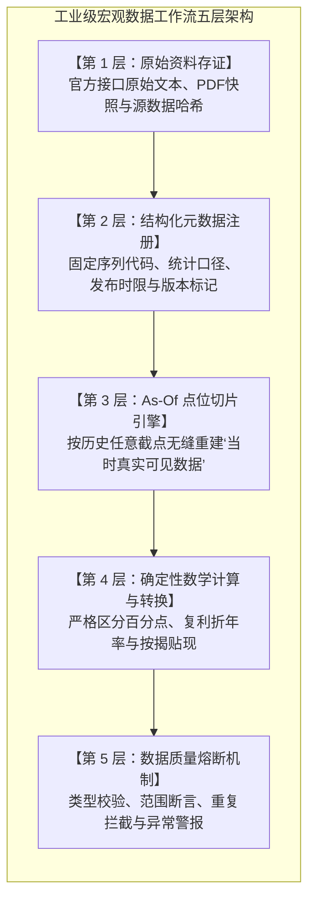
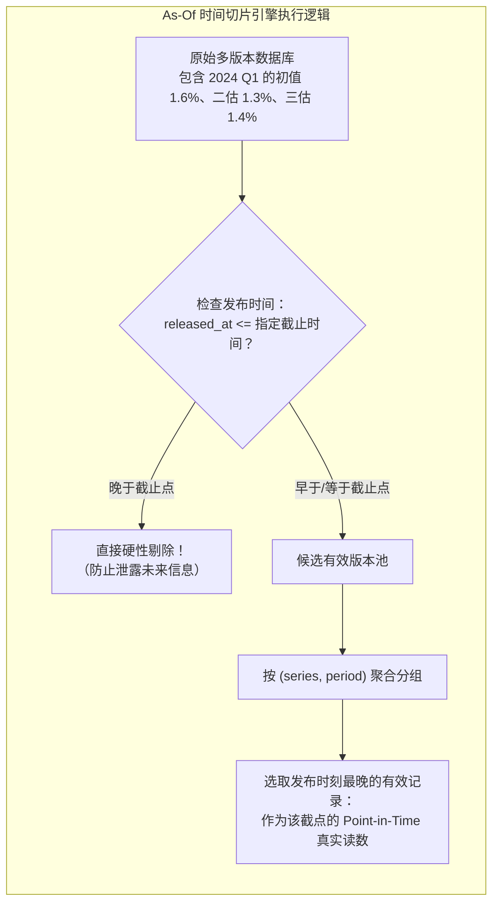
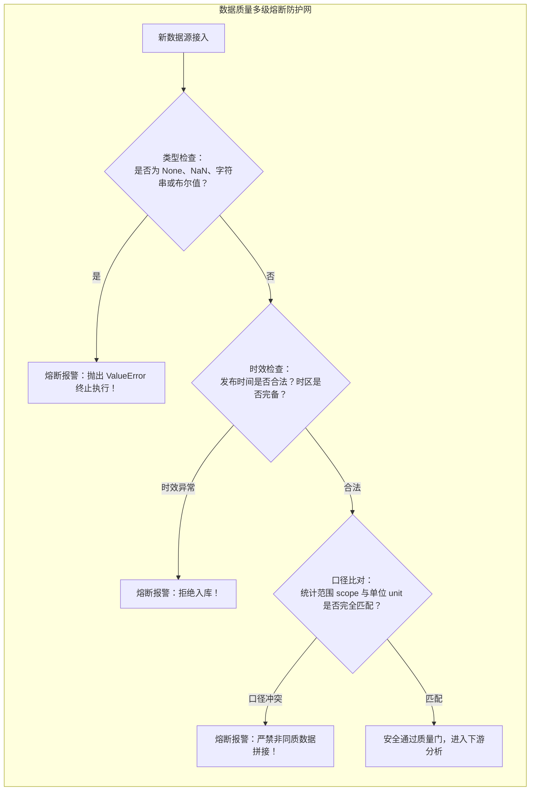
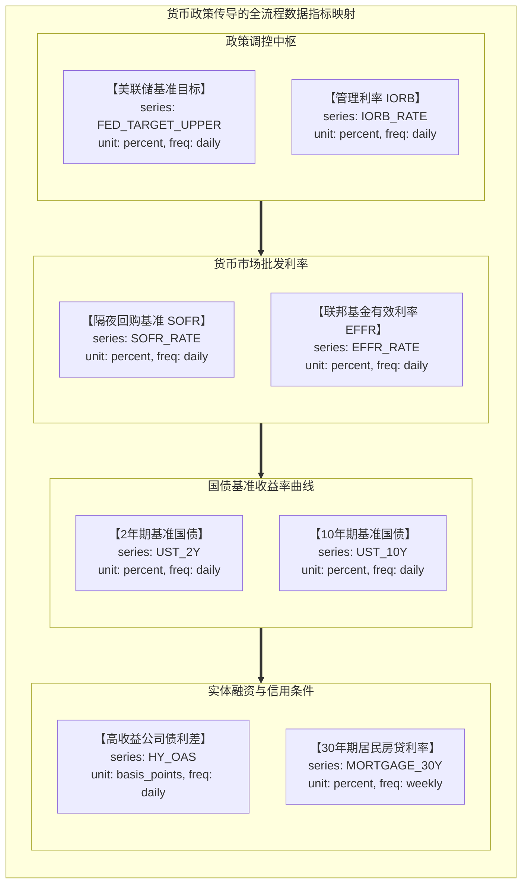

# 40 数据工作流：指标注册、版本、转换与质量检查

[上一章](39-historical-research.md) · [目录](./) · [下一章](41-research-reports.md)

> 在量化对冲基金或投行宏观组，最昂贵、也最致命的灾难往往不是模型算法不够深奥，而是底层数据管道的“隐性污染”——一个没有对齐的时区、一段把百分比增速误当百分点差值的计算、或者一条在回测中悄悄泄露的未来修订值。**“垃圾进，垃圾出（Garbage in, Garbage out）”是宏观量化研究的铁律。** 本章我们将从零搭建一套工业级的数据工作流，建立不可篡改的指标元数据注册规范、严密的 As-Of 版本切片引擎，以及坚固的质量熔断机制。

---

## 1. 自动化的前提是严谨的元数据契约

许多初学 Python 数据分析的同学，习惯将宏观数据随手存成一个简单的两列 CSV 文件：`date, value`。

这种简陋的数据格式在真实的宏观研究中极其危险，几乎必然引发一系列无法溯源的混乱：
- **日期歧义：** 表格里的 `2024-04-01` 究竟是指**经济行为实际发生的统计月份**（如 4 月份工业产出），还是官方机构在 4 月 1 日**公开发布的某个历史报告**？
- **量纲混淆：** 这个数值 `1.6` 究竟是绝对指数点位、季环比折年率（SAAR）、同比百分比，还是未经通胀平减的名义美元金额？
- **修订覆写：** 当数据库出现两个对应 2024 Q1 的 GDP 数字时，自动化程序是把它当成了重复脏数据粗暴去重，还是科学地识别为初值（Advance）与修正值（Second）的版本迭代？



我们的工程目标不是写一个每天自动抓取海量新闻并生成大堆废话的黑箱脚本，而是**让所有的口径假设显性化，让任何潜在的数据污染在进入分析之前被硬性阻断**。

---

## 2. 宏观观测记录的元数据规范（Schema）

在仓库自带的离线数据包 `data/research-observations.json` 中，每一条合格的宏观数据记录都严格遵守以下 11 项元数据契约：

| 字段名称 | 类型 | 核心含义与业务规范 | 为什么不可或缺？ |
| :--- | :---: | :--- | :--- |
| `series` | `string` | 全局唯一的固定口径序列代号 | 防止同名但统计方法截然不同的指标被非法拼接 |
| `period` | `string` | 统计观察期（如 `2024-Q1` 或 `2025-01`） | 必须与公开发布时刻严格解耦 |
| `released_at` | `string` | 官方带有时区的发布时刻（ISO 8601） | 建立回测时间防火墙，彻底杜绝未来信息穿越 |
| `retrieved_at` | `string` | 本地数据库实际抓取或记账时刻 | 区分全网公众可得与本地系统实际可用 |
| `vintage` | `string` | 数据版本标签（`advance`、`second`、`third`） | 明确记录数据统计成熟度与修订轨迹 |
| `unit` | `string` | 统计单位（`percent`、`index`、`usd`） | 防止将指数差值与百分比变动混同运算 |
| `frequency` | `string` | 统计频率（`quarterly`、`monthly`、`daily`） | 跨频率数据对齐与复利转化的前置约束 |
| `adjustment` | `string` | 季节调整与年化标记（如 `saar`、`nsa`） | 防止未季调数据与季调后数据发生错误比较 |
| `scope` | `string` | 统计范围描述（如 `real_gdp`、`teaching`） | 覆盖范围变更时强制切断连续性 |
| `value` | `float` | 观测数值（必须为有限浮点数） | 严禁布尔值、字符串或空值混入 |
| `kind` | `string` | 数据属性（`historical` 真实 / `teaching` 教学） | 建立防火墙，防止教学试算污染生产报表 |

> **口径断点管理：** 如果某官方机构全面修改了物价指数的权重基期或覆盖范围，分析师必须在系统中为新数据注册全新的 `series` 标识符，并建立显式的跨期拼接映射字典，绝不能直接向旧序列追加数值。

---

## 3. 案例数据：从 BEA 原文到结构化实体

在离线练习包中，我们收录了 BEA 对 2024 Q1 实际 GDP 的三轮估计：
- **初值（Advance Estimate）：** $1.6\%$（发布于 `2024-04-25T12:30:00Z`）
- **二次估计（Second Estimate）：** $1.3\%$（发布于 `2024-05-30T12:30:00Z`）
- **三次估计（Third Estimate）：** $1.4\%$（发布于 `2024-06-27T12:30:00Z`）

三项记录均标明：
- `unit`: `"percent"`
- `frequency`: `"quarterly"`
- `adjustment`: `"saar"`（季环比折年率）
- `scope`: `"real_gdp"`
- `kind`: `"historical"`

同时，数据包中还包含两条虚构的教学物价指数 `TEACH_PRICE_INDEX`（分别为 100 与 100.3），用于演示确定性点数与百分比差值的计算。其 `kind` 显式标明为 `"teaching"`，防止教学数据混入真实宏观研判。

---

## 4. 动手实战：As-Of 点位切片引擎

现在，请打开终端，在项目根目录下运行我们为你编写的标准宏观数据检验工具 `tools/research_lab.py`：

```sh
# 1. 运行全局元数据规范校验
python3 tools/research_lab.py validate

# 2. 截取 2024 年 5 月 1 日可见的宏观数据状态
python3 tools/research_lab.py asof --at 2024-05-01T00:00:00Z
```

### 运行机制深度拆解：
1. **指令 1（validate）：** 系统会扫描 `data/research-observations.json` 中的所有条目，依据元数据契约逐一核对字段类型、时区有效性、时序单调性与数据范围。全部合格则输出校验通过。
2. **指令 2（asof）：** 系统在底层执行严格的时间截点过滤算法：
   - 第一步：剔除所有 `released_at > 2024-05-01T00:00:00Z` 的未来记录；
   - 第二步：按 `(series, period)` 组合进行唯一分组；
   - 第三步：在每个分组内，挑选在截止时间之前**发布时间最晚（Latest Released）**的一条有效版本。



在 2024-05-01 这个截点，二估（5月30日）和三估（6月27日）尚未公开发布，因此系统**唯一返回且必须返回**的是初值 $1.6\%$。

试着切换不同的截止时间观察系统的切片输出：
- 输入 `--at 2024-06-01T00:00:00Z`：系统自动升级输出二估 **$1.3\%$**；
- 输入 `--at 2024-07-01T00:00:00Z`：系统精准输出三估 **$1.4\%$**。

再执行以下命令：
```sh
python3 tools/research_lab.py asof --at 2024-07-01T00:00:00Z --availability local
```
你会发现返回结果为空！这是因为数据包中的 `retrieved_at`（本地系统实际记账时间）统一记录为 2026 年教学整理日。
- `public` 模式：模拟当时全人类公共可得的信息总集；
- `local` 模式：严苛模拟本地机构服务器内部真正落地入库的信息。
在严密的回测中，如果你的本地爬虫晚了三天入库，回测模型就绝对不能在三天前擅自生成交易指令。

---

## 5. 确定性计算层：严禁无量纲的粗暴运算

数据切片提取完成后，进入计算转换层。运行价格指数比较命令：

```sh
python3 tools/research_lab.py compare --at 2025-04-01T00:00:00Z --series TEACH_PRICE_INDEX --earlier 2025-01 --later 2025-02
```

程序输出：
- 观察期点数绝对差（Point Difference）：$100.3 - 100.0 = +0.3$
- 区间百分比增长率（Interval Growth Percent）：
  $$\Delta \% = \left(\frac{100.3}{100.0} - 1\right) \times 100\% = +0.3\%$$

### 计算层三大铁律：
1. **百分点与百分比严禁混淆：**
   若两个输入本身的单位就是百分比（如两个时期的失业率分别为 $4.0\%$ 与 $4.3\%$），计算层只允许计算**百分点差（Percentage Points）**：$4.3\% - 4.0\% = +0.3\text{ pp}$（即 $+30\text{ bp}$），严禁将其随意表述为“失业率上升了 7.5%”。
2. **修订（Revision）不是跨期增长（Growth）：**
   同一观察期 `2024-Q1` 的二估与初值之差（$1.3\% - 1.6\% = -0.3\text{ pp}$）是**统计度量精度的修正**，程序会严厉拒绝调用跨期增长函数。
3. **复合年化公式的精确执行：**
   若需要将年化增速 $g_{\text{annualized}} = 1.6\%$ 转化为真实的季度单期增速：
   $$g_q = \left(1 + \frac{1.6}{100}\right)^{1/4} - 1 \approx 0.398\%$$
   固定利率抵押贷款的每月等额还款额（Monthly Mortgage Payment）计算采用严格的精算公式：
   $$M = P \cdot \frac{r(1+r)^n}{(1+r)^n - 1}$$
   当借款本金 $P = \$400,000$、年名义利率 $6\%$（月利率 $r = 0.06 / 12 = 0.005$）、还款期数 $n = 360$ 个月时，每月精确还款额为：
   $$M = 400000 \cdot \frac{0.005 \times (1.005)^{360}}{(1.005)^{360} - 1} \approx \$2,398.202100611$$
   在系统自动化测试中，浮点数精度必须通过单元测试严格守护。

---

## 6. 构建数据质量熔断机制（Circuit Breakers）

在自动化数据处理中，最可怕的不是程序直接崩溃，而是程序在遇到非法数据时“自作聪明地做平滑修补”（例如将 `null` 默认为 0，或将布尔值 `True` 强行转为数值 1）。

在终端中执行测试套件：
```sh
python3 -m unittest discover -s tests -v
```

你会看到一套全面的单元测试用例（`test_research_lab.py`），它们测试了数据管道在面对各种攻击与污染时的熔断能力：



### 典型防护案例：
- **布尔值混淆拦截：** 在 Python 中 `isinstance(True, int)` 为真，许多简陋代码会将 `True` 自动当成数值 1.0 进行加总。我们的校验引擎显式拦截 `type(value) is bool`，彻底封死此类漏洞。
- **缺失与非有限数拦截：** 显式拦截 `None` 与 `math.isnan(value)`。宏观数据缺失必须显式挂起，严禁静默填充为 0。
- **范围与跨期约束：** 严厉拒绝将非法月份（如 `2025-13`）写入观察期，拒绝同一序列在不同版本中私自更改 `scope` 统计范围。

---

## 7. 跟踪政策传导链路的自动化建模

让我们把上述数据工程规范，应用到整套**货币政策传导链路（Policy Transmission Pipeline）**的注册与跟踪中：



通过将传导链上的每一个节点统一注册为具备严格元数据的机器可读对象，宏观分析师可以编写自动化脚本，每日定时比对利差传导损耗：
$$\text{SOFR 传导基差} = \text{SOFR} - \text{IORB}$$
$$\text{企业信用溢价} = y_{\text{Corp}} - y_{\text{Treasury}} = \text{OAS}$$

若传导链路某一环出现断裂（如政策利率下调，但企业发债利差 OAS 反向暴涨），监控仪表盘将立刻发出告警，引导研究员迅速切入深层原因排查。

---

## 8. 练习与思考题

### 练习一：As-Of 时间切片推演
请查阅本章描述的 `research-observations.json` 数据规则，回答下列问题：
1. 若系统运行 `asof --at 2024-04-25T12:29:59Z`，系统会返回哪一条 2024 Q1 GDP 记录？
2. 若系统运行 `asof --at 2024-04-25T12:30:00Z`，系统会返回哪一条记录？数值是多少？
3. 如果一个高频回测程序在美东夏令时 08:29:59 就根据初值 1.6% 触发了国债期货买入指令，在审计中应被如何定性？

<details><summary>参考答案</summary>

1. **截点 12:29:59 结果：** 返回为空（`[]`）。因为官方解禁时刻为严格的 12:30:00Z，在此之前 1 秒，初值记录在法律与规则层面上均尚未公开发布。
2. **截点 12:30:00 结果：** 返回初值（`advance`）记录，数值为 **`1.6%`**。
3. **审计定性：** 该交易行为构成了典型的**利用未来信息进行非法抢跑（Look-ahead Leakage）**。在真实合规审计中，此类回测表现被视为无效伪造收益，必须予以撤销并追究数据时间戳缺失的责任。

</details>

### 练习二：口径冲突与熔断逻辑设计
某量化分析员试图编写一个跨国对比脚本，将美国的实际 GDP 季环比折年率（SAAR，数值约 $2.5\%$）与德国公布的季度实际 GDP 未年化环比增速（非年化，数值约 $0.6\%$）直接进行大小比较并计算差值：
$$\text{利差} = 2.5 - 0.6 = 1.9$$
请指出此计算的重大逻辑漏洞，并使用伪代码或文字设计一个数据质量熔断规则（Circuit Breaker）以阻断此类非法操作。

<details><summary>参考答案</summary>

1. **重大逻辑漏洞：**
   美国数据为季环比折年率（即经过四次方复利放大的数值），而欧洲/德国通常公布非年化当季真实环比增速。两者在量纲与复利维度上根本不具备可比性。直接相加减会严重高估美国相对于德国的经济动能差异（真实的年化差异应将德国 $0.6\%$ 折年化：$(1+0.006)^4 - 1 \approx 2.42\%$，两者实际非常接近！）。
2. **熔断规则设计：**
   在比较函数入口处设置强制断言：
   ```python
   def safe_compare(series_a, series_b):
       if series_a.adjustment != series_b.adjustment:
           raise ValueError(
               f"口径年化属性冲突：{series_a.adjustment} vs {series_b.adjustment}！"
               "必须先通过复合公式统一转化为同等口径后方可比较。"
           )
       if series_a.unit != series_b.unit:
           raise ValueError(f"单位量纲冲突：{series_a.unit} vs {series_b.unit}！")
   ```

</details>

### 练习三：按揭贷款复利计算复核
运用本章给出的固定利率按揭月供公式：
$$M = P \cdot \frac{r(1+r)^n}{(1+r)^n - 1}$$
设某居民申请了一笔本金 $P = \$300,000$ 的 30 年期（$n = 360$ 个月）固定利率住房按揭贷款。
1. 若合同年名义利率为 $6.0\%$（即月利率 $r = 0.06 / 12 = 0.005$），请计算其每月需支付的月供 $M$；
2. 若美联储大幅加息，导致 30 年期新发按揭利率飙升至 $7.2\%$（即月利率 $r = 0.072 / 12 = 0.006$），请计算新的月供额，并计算加息导致的月供金额绝对增幅与百分比增幅。

<details><summary>参考答案</summary>

1. **利率 6.0% 的月供计算：**
   - 月利率 $r = 0.005$；
   - $(1 + 0.005)^{360} \approx 6.022575$；
   - $$M = 300000 \cdot \frac{0.005 \times 6.022575}{6.022575 - 1} = 300000 \cdot \frac{0.030113}{5.022575} \approx \$1,798.65$$
2. **利率 7.2% 的月供计算：**
   - 月利率 $r = 0.006$；
   - $(1 + 0.006)^{360} \approx 8.571436$；
   - $$M' = 300000 \cdot \frac{0.006 \times 8.571436}{8.571436 - 1} = 300000 \cdot \frac{0.051429}{7.571436} \approx \$2,037.54$$
3. **增幅对比：**
   - 每月需多支付的绝对差额为：$\$2,037.54 - \$1,798.65 = +\$238.89$；
   - 百分比增幅为：$(\$2,037.54 / \$1,798.65 - 1) \times 100\% \approx +13.28\%$。
   利率虽然仅上调了 $1.2$ 个百分点（$120\text{ bp}$），但在 30 年复利杠杆放大下，家庭每月的刚性负债现金流支出激增了 $13.28\%$，这清晰展示了货币政策传导至实体居民资产负债表时的巨大紧缩压力。

</details>

---

[上一章](39-historical-research.md) · [目录](./) · [下一章](41-research-reports.md)
