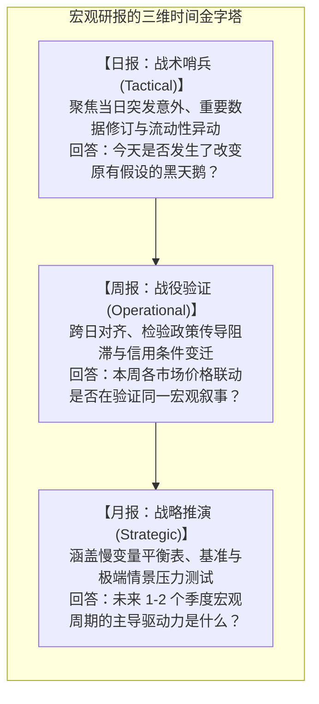
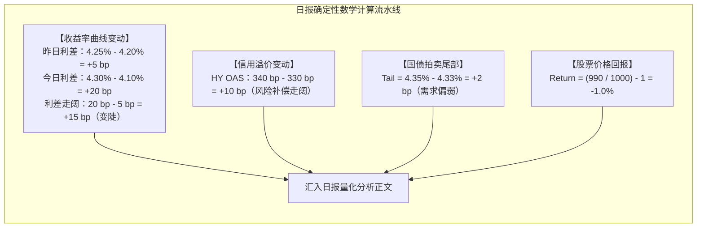
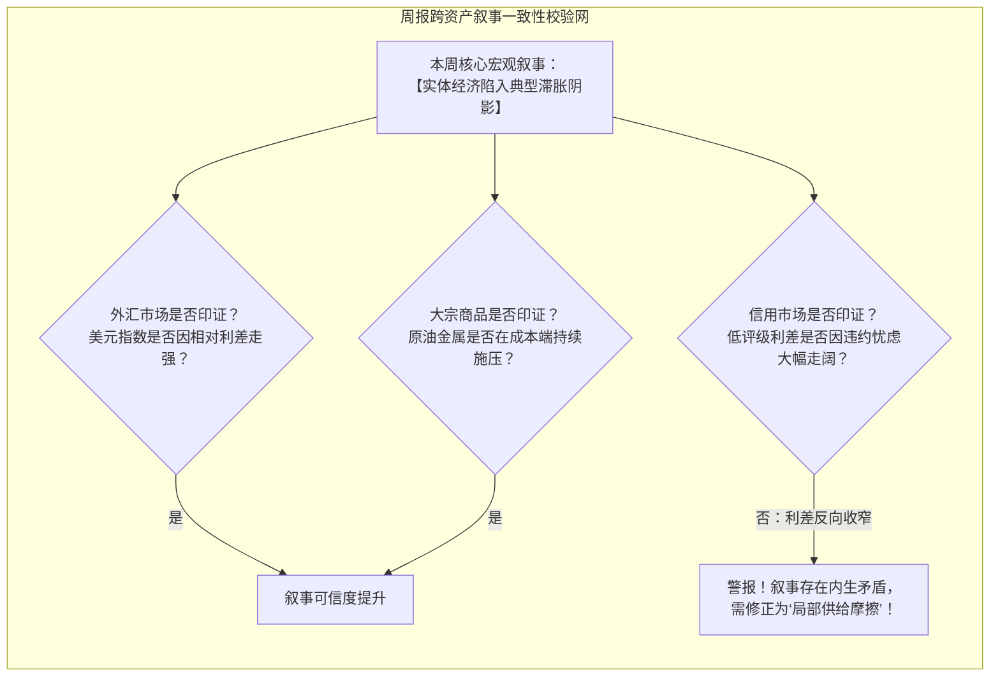
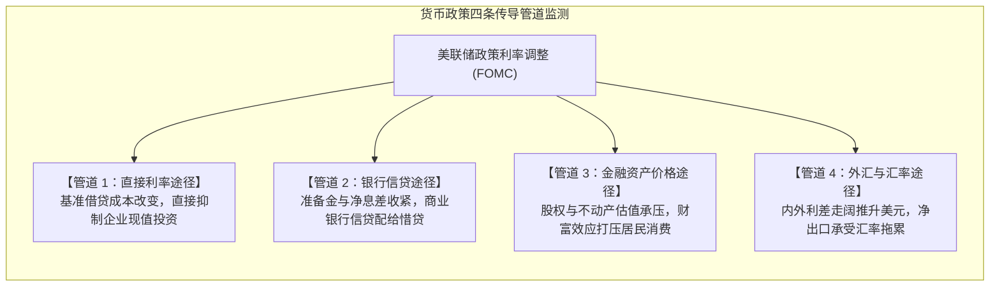

# 41 日报、周报与月报：从观测到判断

[上一章](40-data-workflow.md) · [目录](./) · [下一章](42-capstone-report.md)

> 很多初入行的新人常常把写宏观研报当成“每天报菜名”：把财经终端上的红绿涨跌数字用文字抄写一遍，堆砌一大堆“今日大盘冲高回落、某板块强势震荡”的流水账。**这种没有观点、没有因果机制、不可审计的文字，在专业买方机构被统称为‘数据废话’。** 真正的宏观研究部有着严密的节奏与分工：日报捕捉意外与异常，周报验证跨资产传导与政策时滞，月报则统领宏观大势、推演情景压力测试。本章将带你掌握专业研报的生产全流程，将零散高频观测淬炼为扎实的前瞻性战略判断。

---

## 1. 研报的三种节奏：战术、战役与战略

宏观分析师笔下的文字，必须严格匹配读者的决策时间尺度：

### 严禁跨周期的逻辑错配：
- **别在日报里轻易反转周期：** 不能因为周二早晨公布的一项采购经理人指数（PMI）微跌了 0.2 个点，就挥毫写下“美国经济陷入全面大萧条”；
- **别在月报里复读单日噪音：** 月报需要调动的是国民经济核算、居民与企业资产负债表、长期通胀预期等“慢变量”，不能把五天前某只个券的盘中跳水当成核心战略依据；
- **维护同一套证据纪律：** 不管写哪种报告，涉及历史版本、一致预期与口径对比时，必须严格执行上一章建立的数据契约。

---

## 2. 先锁定报告边界：避免“无源之水”

在动笔撰写任何专业报告的第一行，必须清清楚楚标明**研究边界与元数据**：

| 必备规范字段 | 报告中的具体写法示例 | 核心防御价值 |
| :--- | :--- | :--- |
| **数据截止时刻** | `截点：2026-10-23 美东夏令时 16:30` | 锁定信息集，防止事后混入盘后公告 |
| **观察窗口对齐** | `收盘至收盘（前日 16:00 至本日 16:00）` | 防止用发布后 5 分钟脉冲冒充全天收盘 |
| **基准一致预期** | `彭博一致预期（共 54 位经济学家中位数）` | 杜绝用事后新闻里的模糊评论冒充事前预期 |
| **缺失重要变量** | `注：本期核心 PCE 分项尚未解禁，暂缺 TIPS 期限溢价更新` | 坦诚告知决策者当前判断的置信度边界 |

在重要性排序上，永远遵循：**“是否改变基准假设 > 是否引发跨市场传染 > 是否存在异常背离”**。例如，国债拍卖罕见的尾部暴拉（Tail）、隔夜回购基差异常走阔，即使大众财经媒体只字不提，在宏观分析师眼里其战略重要性也远超某只热门概念股的单日涨跌。

---

## 3. 完整教学事件表与确定性计算

假设我们正在撰写教学基准日（Day D）下午 17:00 的宏观策略日报。以下是当天美东 16:30 闭市前经过系统校验的完整市场与数据输入表：

| 变量代号与类别 | 今日最新观测值 | 对照基准（前日/前值） | 数据属性与已知边界 |
| :--- | :---: | :---: | :--- |
| **$I_1$ 核心物价月环比** | **$0.3\%$** | 前月原报 $0.4\%$，本日修订为 $0.3\%$ | 未取得可靠事前一致预期 |
| **$Y_1$ 2 年期国债收益率** | **$4.10\%$** | 昨日收盘 $4.20\%$ | 纽约收盘活跃券中价 |
| **$Y_2$ 10 年期国债收益率** | **$4.30\%$** | 昨日收盘 $4.25\%$ | 纽约收盘活跃券中价 |
| **$S_1$ 高收益公司债利差** | **$340\text{ bp}$** | 昨日收盘 $330\text{ bp}$ | 彭博 HY OAS 指数口径 |
| **$A_1$ 某期国债拍卖中标利率** | **$4.35\%$** | 拍卖截标前发行前交易（WI）$4.33\%$ | 虚构教学输入，缺历史分布 |
| **$P_1$ 股票综合价格指数** | **$990$** | 昨日收盘 $1,000$ | 不含现金分红的总价格指数 |

### 核心计算复核：
1. **收益率曲线利差变化：**
   - 昨日利差：$\text{Spread}_{\text{old}} = 4.25\% - 4.20\% = +0.05\% = +5\text{ bp}$；
   - 今日利差：$\text{Spread}_{\text{new}} = 4.30\% - 4.10\% = +0.20\% = +20\text{ bp}$；
   - 利差变化：$\Delta \text{Spread} = \text{Spread}_{\text{new}} - \text{Spread}_{\text{old}} = 20\text{ bp} - 5\text{ bp} = +15\text{ bp}$。
   曲线大幅变陡 $15\text{ bp}$，且表现为**短端大跌 $10\text{ bp}$、长端微涨 $5\text{ bp}$ 的旋转变陡**。
2. **拍卖尾部（Tail）：**
   $$\text{Tail} = (y_{\text{high}} - y_{\text{WI}}) \times 100 = (4.35\% - 4.33\%) \times 100 = +2\text{ bp}$$
   中标收益率高于发行前交易（WI）价格，说明一级市场认购需求边际偏冷，承销团必须降价清盘。
3. **股票日度回报：**
   $$R_E = \frac{990}{1000} - 1 = -1.0\%$$
4. **物价修订认知：**
   最新月份环比为 $0.3\%$，与修订后的上月持平。虽然相比上月原报值（$0.4\%$）有所回落，但由于缺乏事前一致预期，绝不能主观臆造“通胀大幅不及预期”的结论。

---

## 4. 日报示范正文：从干瘪数据到立体研判

依据上述计算事实，一份专业宏观对冲基金的晨会日报示范如下：

> **【宏观与跨资产每日策略快报】**  
> **数据截点：** 教学日 D 美东 17:00  
>
> **1. 核心研判摘要**  
> 今日公布的核心价格指数环比为 $0.3\%$，与修订后的前月持平，显示核心通胀黏性犹存，尚无充分证据确认物价已开启断崖式下行通道。资产价格呈现**典型的避险与融资成本分化**：短端利率骤降伴随长端微升（曲线变陡 $15\text{ bp}$）、信用利差走阔 $10\text{ bp}$、美股回调 $-1.0\%$。目前市场更倾向于在定价“增长动能边际放缓，同时财政赤字与长端发债供给对无风险久期构成持续压制”。
>
> **2. 利率、信用与微观拍卖追踪**  
> - **曲线形态：** 2 年期国债收益率下行 $10\text{ bp}$ 至 $4.10\%$，体现市场对政策降息的防御性预期；然而 10 年期收益率反常上行 $5\text{ bp}$ 至 $4.30\%$，导致 $10\text{y}-2\text{y}$ 利差由昨日的 $+5\text{ bp}$ 走阔至 $+20\text{ bp}$（陡峭化 $+15\text{ bp}$）。
> - **一级拍卖与信用传导：** 今日国债拍卖出现 $+2\text{ bp}$ 正尾部（中标 $4.35\%$ vs WI $4.33\%$），证实长端债券在大额供给面前吸收意愿偏弱；高收益债利差走阔 $10\text{ bp}$ 至 $340\text{ bp}$，配合股市 $-1.0\%$ 的回调，表明风险溢价（Risk Premium）要求抬升。
>
> **3. 跟踪缺口与撤回触发条件**  
> 当前研报结论的薄弱环节在于缺乏 TIPS 细项（无法拆解长端收益率上升是通胀预期还是实际利率驱动）。若明日公布的劳动力市场数据超预期强韧、且国债二级市场流动性深度迅速恢复，则“增长放缓”假说的置信度将显著下调。

---

## 5. 周报整合术：多期复利与跨资产校验

许多分析师到了周末写周报时，最爱做的事就是把周一到周五的五篇日报直接“剪切粘贴”。

这是严重的失职！周报的核心使命是**过滤单日白噪声，校验宏观叙事在跨日复利累积中的一致性**：

### 5.1 收益率复利的几何严谨性
设某资产在周一上涨 $+2.0\%$，周二下跌 $-2.0\%$。许多非专业评论员会随口说：“涨跌相抵，这周收益基本归零。”
让我们用标准数学公式进行复算：
$$R_{\text{cumulative}} = (1 + r_1)(1 + r_2) - 1 = (1 + 0.02) \times (1 - 0.02) - 1 = 1.02 \times 0.98 - 1 = 0.9996 - 1 = -0.04\%$$
在复利世界里，先涨 $2\%$ 再跌 $2\%$ 的累计结果是净亏损 $-0.04\%$（$-4\text{ bp}$）！在杠杆基金与大资金运作中，这种“波动率损耗（Volatility Drag）”绝不可被忽略。

---

## 6. 月报战略推演：情景压力测试与政策传导路径

月报是宏观研究员的“年度/季度战略底牌”。在月报中，单纯给出一个“我预测下个月经济必然如何”的单点预测不仅幼稚，而且极其脆弱。

成熟的宏观月报必须构建**三维情景压力测试矩阵（Scenario Stress Testing Matrix）**，并清晰勾勒货币政策传导机制：

### 宏观情景压力测试模板表：

| 情景类型 | 宏观宏观演化假说 | 触发核心指标阈值 | 利率与曲线形态演化 | 跨资产表现预案 |
| :--- | :--- | :--- | :--- | :--- |
| **基准情景 （软着陆，概率 55%）** | 通胀稳步下行至 $2.5\%$，非农就业维持在 15 万中枢，消费韧性适度 | 核心 PCE 环比连续 3 个月 $\le 0.2\%$，失业率维持在 $4.0\%-4.2\%$ | 收益率曲线重心温和下移，短端降幅略大于长端，牛陡微弱扩散 | 标普 500 估值平稳，盈利小幅上修；投资级公司债回报稳健 |
| **压力情景 A （滞胀反扑，概率 30%）** | 地缘冲突推升油价破 100 美元，输入性成本引爆二次通胀，降息落空 | 核心 CPI 环比跳升 $\ge 0.4\%$，密歇根大学长期通胀预期 $> 3.3\%$ | 曲线暴烈呈现**熊平（Bear Flattening）**，2 年期收益率飙涨破 $5.0\%$ | 股票估值杀跌，成长股与无现金流科技股领跌；高收益利差快速走阔 |
| **压力情景 B （信用冰冻，概率 15%）** | 商业地产与中小银行坏账连锁爆发，非银影子银行遭遇回购挤兑 | 商业票据利差走阔 $> 50\text{ bp}$，HY OAS 突破 $500\text{ bp}$ | 曲线暴烈呈现**牛陡（Bull Steepener）**，紧急降息计入 150 bp | 黄金与现钞美元暴涨；风险资产出现无差别流动性抛售（Dash for Cash） |

---

## 7. 研报纠错实录：把“武断口诀”重构为“专业分析”

在日常训练中，导师最常做的工作就是批改新手的“病态研报”。以下是一段典型的错误原文与修改示范：

> ❌ **病态原文（满纸口诀与宿命论）：**  
> “通胀环比回落，美联储必须在下个月紧急降息！国债收益率曲线今日大幅变陡，充分确认了美国经济正迎来新一轮强劲大繁荣！美股今日大跌，显然是资金从股市全面流向了债市！此外，国债拍卖出现尾部，充分证明美国国债已经无人问津，财政即将彻底破产违约！”

### 导师的手术刀修改示范：
1. **通胀与政策：** 核心环比虽然由原报 $0.4\%$ 修正为 $0.3\%$，但绝对水平依然高于央行 $2\%$ 年化目标对应的合理环比区间（约 $0.17\%$）。政策制定是基于多期趋势与双重使命的风险权衡，绝非单月孤立数值的机械映射；
2. **曲线变陡：** 今日利差走阔 $15\text{ bp}$，但其微观驱动为“短端降、长端升”，属于防御性旋转，伴随信用利差扩大，与“经济强劲繁荣”的逻辑完全背道而驰；
3. **资金流向：** 资产价格涨跌是供求在边际上的撮合结果，股市下跌而长债收益率上行（长债价格下跌）恰恰说明资金并未全额涌入长债；
4. **拍卖尾部：** $+2\text{ bp}$ 的正尾部仅说明当期拍卖在指定发行量下的边际认购成本略高于发行前交易中价，距离“拍卖流标”相去甚远，更绝非国家财政违约的证据。

---

## 8. 练习与思考题

### 练习一：没有重大新闻的一天
假设今日全天没有任何官方宏观数据解禁，全球地缘局势平静，国债收益率全期限波动幅度均在 $1\text{ bp}$ 以内，标普指数收盘微涨 $+0.05\%$。
请问：作为负责撰写每日研报的分析师，你应该如何撰写今天的日报？是应该胡编一个宏观故事来充实篇幅，还是有更专业的处理方式？

参考答案

**专业处理原则是：如实记录信息的平静，杜绝强行编造因果。**
1. **明确标注信息真空：** 明确报告今日无新增重磅宏观发布，市场交投清淡，全天价格波动处于统计白噪声区间（波动小于 $1\text{ bp}$）；
2. **更新慢变量与观察表：** 借平静期整理当前宏观周期的基准假设、下周重大事件日历（如即将公布的非农或议息决议前瞻），并检查历史序列的修订动态；
3. **简洁交差：** 优秀的分析师必须具备“敢于在没有新闻时交付简短报告”的专业自信，这远比强行摘抄一条无关痛痒的杂音新闻并夸大其宏观影响要专业得多。

### 练习二：日报量化指标复算
请利用本章第 3 节的事件表数据，独立完成下列计算并撰写一段不超过 150 字、严格剔除“必然”、“肯定”字眼的客观评述：
1. 拍卖尾部（Tail）的具体基点数值；
2. 收益率曲线 $10\text{y}-2\text{y}$ 利差的走阔基点；
3. 标普指数的价格变动回报率。

参考答案与计算规范

- **计算结果：**
  1. 拍卖尾部：$(4.35\% - 4.33\%) \times 100 = +2\text{ bp}$；
  2. 曲线利差变化：$(4.30\% - 4.10\%) - (4.25\% - 4.20\%) = 20\text{ bp} - 5\text{ bp} = +15\text{ bp}$（利差走阔）；
  3. 股票回报：$990 / 1000 - 1 = -1.0\%$。
- **专业评述示范：**
  今日 2 年期与 10 年期收益率分别变动 $-10\text{ bp}$ 和 $+5\text{ bp}$，驱动 $10\text{y}-2\text{y}$ 利差走阔 $15\text{ bp}$。结合高收益债利差走阔 $10\text{ bp}$、股市回调 $-1.0\%$ 以及国债拍卖呈现 $+2\text{ bp}$ 弱尾部，市场信号初步与“增长预期放缓、风险溢价要求上升”假说相容。因缺乏事前一致预期与 TIPS 期限溢价细项，当前判断需待明日劳动力数据进一步校验。

### 练习三：周报跨期复利计算
某宏观对冲基金持仓的一篮子商品组合在连续四个交易日内的日回报率依次为：$+3.0\%$、$-2.0\%$、$+1.5\%$、$-2.5\%$。
1. 计算这四个交易日累计的几何总回报率；
2. 计算若按算术简单相加得出的错误回报率；
3. 指出二者之间的偏差，并解释为什么长期宏观头寸管理必须采用几何复利？

参考答案

1. **几何总回报率：**
   $$R_{\text{geom}} = (1 + 0.03) \times (1 - 0.02) \times (1 + 0.015) \times (1 - 0.025) - 1$$
   $$R_{\text{geom}} = 1.03 \times 0.98 \times 1.015 \times 0.975 - 1 \approx 1.024545 \times 0.975 - 1 \approx 0.998931 - 1 \approx -0.1069\%$$
2. **算术简单相加回报率：**
   $$R_{\text{arith}} = (+3.0\%) + (-2.0\%) + (+1.5\%) + (-2.5\%) = 0.00\%$$
3. **偏差分析与管理价值：**
   简单算术相加得出收益归零的虚假结论，而真实的几何投资组合实际上承受了约 $-0.11\%$ 的亏损（$-10.7\text{ bp}$）。这种差异来自多次不对称涨跌造成的波动率拖累（下跌需要更大的涨幅才能回本，例如资产跌 $50\%$ 需要涨 $100\%$ 才能打平）。宏观资产负债表与基金资本金管理必须严格依据几何复利计算实际净资产，否则会导致对风险资本消耗的严重误判。

---

[上一章](40-data-workflow.md) · [目录](./) · [下一章](42-capstone-report.md)
