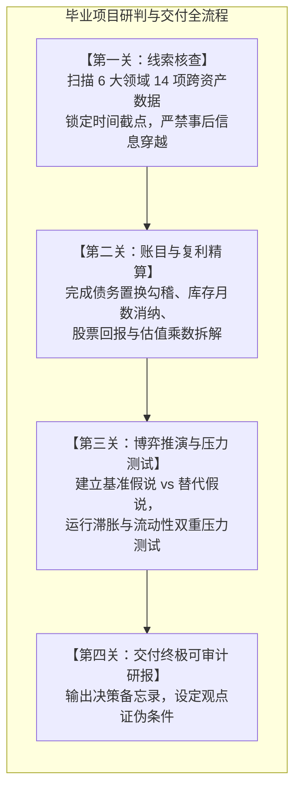
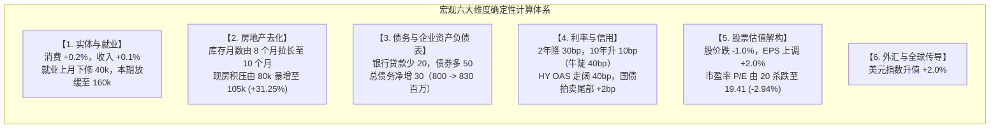
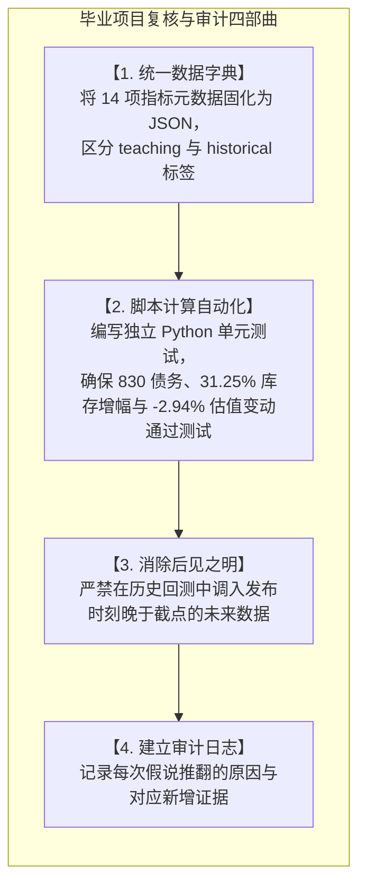

# 42 毕业项目：完成一份可复核的宏观金融报告

[上一章](41-research-reports.md) · [目录](./)

> 恭喜你一路过关斩将，完成了从国民经济核算、央行利率走廊、货币市场回购，到债券、股票、大宗商品与衍生品清算的完整知识长征！现在，你迎来了整个宏观金融课程的**终极大考与毕业实战（Capstone Defense）**。在真实世界中，投资委员会从不考核名词填空，他们只看你面对一堆互相撕扯、真假莫辨的宏观线索时，能否像老练的首席策略师一样：**穿透六大犯罪现场，完成无懈可击的确定性账目核算，在两难博弈中构建情景压力测试，并交付一份经得起历史审计的专业宏观研报。**

---

## 1. 项目任务书与终极防御考核准则

你现在是一家全球宏观多策略基金的资深研究员。在教学月份（M 月）闭市后，宏观经济与金融市场的全部最新月度数据均已解禁。投资决策委员会要求你在明天上午 08:30 开盘前，提交一份**《月度宏观与跨资产战略诊断报告》**。

你的毕业项目必须交付四项硬核产物：
1. **标准化宏观线索输入表（带元数据时钟与口径）**；
2. **确定性数学与资产负债表勾稽复算底稿**；
3. **800 至 1,500 字的高层决策研报正文**（包含主线假说、替代假说、情景压力测试与撤回阈值）；
4. **反面证据与数据漏洞审计清单**。

> **考核红线：** 严禁无中生有！未提供事前一致预期的指标，绝不能擅自脑补“大幅超预期”；未提供具体分行或个券数据的资产，绝不能武断下达全局确定性结论。

---

## 2. 教学综合资料包（案发现场的 14 份证据）

以下是 M 月结束时系统归档的完整数据集。所有指数基期已标准化，同比与环比严格区分。除明确注明者外，本期无例行修订。期间代号 **A 代表上一期**，**B 代表本期最新公布值**：

| 证据编号 | 核心经济指标与统计口径 | 上期记录 (A) | 本期记录 (B) | 统计维度与特殊说明 |
| :---: | :--- | :---: | :---: | :--- |
| **R1** | 月度实际个人消费支出（PCE）指数，季调 | $100.0$ | **$100.2$** | 实际实物与服务消费体量 |
| **R2** | 月度实际个人可支配收入（DPI）指数，季调 | $100.0$ | **$100.1$** | 扣除税收与通胀后的购买力 |
| **R3** | 月度非农新增就业岗位（千人） | 原报 220，本日修正为 **180** | **160**（初值） | 机构调查口径，包含上月下修 |
| **P1** | 核心价格指数月环比，季调 | $0.3\%$ | **$0.3\%$** | 剔除食品与能源的通胀动能 |
| **H1** | 新建单户住宅待售库存（千套），季调 | $400$ | **$420$** | 房企手中的待售存货总量 |
| **H2** | 新房合同签约销售年化速度（千套），季调 | $600$ | **$504$** | SAAR 签约年化跑道速度 |
| **H3** | 同口径已竣工待售房屋占总库存比例 | $20\%$ | **$25\%$** | 物理现房积压比例 |
| **C1** | 监测样本企业商业银行贷款本金（百万美元） | $500$ | **$480$** | 银行间接信贷存量余额 |
| **C2** | 相同监测样本企业公司债券本金（百万美元） | $300$ | **$350$** | 公开市场直接债务存量余额 |
| **M1** | 2 年期基准国债收益率（期末纽约收盘） | $4.5\%$ | **$4.2\%$** | 短端无风险政策利率预期 |
| **M2** | 10 年期基准国债收益率（期末纽约收盘） | $4.0\%$ | **$4.1\%$** | 长端无风险经济与久期溢价 |
| **M3** | 彭博高收益公司债利差（HY OAS），期末 | $300\text{ bp}$ | **$340\text{ bp}$** | 企业信用违约与流动性溢价 |
| **E1** | 标普固定样本组合未来一年预期 EPS | $10.0$ | **$10.2$** | 华尔街自下而上盈利预测 |
| **E2** | 与上述盈利对应的股票价格指数 | $200.0$ | **$198.0$** | 股票市场现货综合收盘点位 |
| **F1** | 美联储广义名义美元指数（期末） | $100.0$ | **$102.0$** | 贸易加权汇率综合水平 |

### 关键补充事实与微观约束：
1. **企业融资明细：** C1 与 C2 涉及的样本企业本期无破产核销、无跨境汇率折算与分类变更。本期企业新发行债券总额为 80 百万美元，到期偿还旧债 30 百万美元。新募资金中：$20\text{ 百万}$用于提前归还银行贷款，$30\text{ 百万}$偿还到期债券，$30\text{ 百万}$暂存活期存款账户准备下季度支付进口设备尾款。
2. **股票分红约束：** 股票样本组合本期无现金分红，无指数调仓剔除。
3. **国债拍卖微观：** 本期财政部新发某期基准国债拍卖，最终最高中标收益率为 $4.15\%$，截标前 5 分钟二级市场发行前交易（WI）中价为 $4.13\%$。
4. **政策与缺失项：** 美联储本月维持联邦基金利率目标区间不变；银行高级贷款官调查（SLOOS）显示对大中型企业放贷标准净收紧，但未提供企业贷款申请意愿细分；暂缺事前一致预期中位数，暂缺逆回购与交易商资产负债表微观深度。

---

## 3. 第一关：确定性数学计算与资产负债表勾稽

面对上述 14 份证据，绝不能直接跳到“我觉得经济要衰退”的主观臆断。你必须首先完成六个维度的量化账目勾稽。

点击展开：查看逐步推导与精算标准答案

### 1. 实体消费与劳动力市场
- **消费与收入：** 实际消费指数由 $100.0$ 升至 $100.2$（增长 $+0.2\%$），实际可支配收入指数由 $100.0$ 升至 $100.1$（增长 $+0.1\%$）。收入与消费均在扩张，但消费扩张斜率略快于收入。注意：不能仅凭两个标准化指数推算绝对储蓄率，因为缺乏名义基数与税费明细。
- **就业修订与净增量：** 上月（A 月）初值原报 220 千人，本日大幅下修 40 千人至 180 千人；本期（B 月）新增 160 千人。对比修订后的基数，本期新增岗位环比减少了 20 千人（$160 - 180 = -20$ 千人），而非减少 60 千人！更重要的是，**新增 160 千人依然代表实体劳动力在净吸纳扩张**，绝非总就业人数萎缩。

### 2. 房地产去化周期与存货品质
- **去化周期（Months of Supply）：**
  去化月数等于期末待售库存除以月化销售速度（即年化签约速度除以 12）：
  $$\text{去化月数}_A = \frac{400}{600 / 12} = \frac{400}{50} = 8.0\text{ 个月}$$
  $$\text{去化月数}_B = \frac{420}{504 / 12} = \frac{420}{42} = 10.0\text{ 个月}$$
  去化月数由 8 个月急剧攀升至 10 个月（突破 6 个月的供求平衡分界线），显示新房市场面临巨大的出清压力。
- **现房成品积压增幅：**
  期初已竣工待售套数：$400 \times 20\% = 80\text{ 千套}$；
  期末已竣工待售套数：$420 \times 25\% = 105\text{ 千套}$；
  现房库存绝对净增 25 千套，其百分比增速为：
  $$\Delta \% = \left(\frac{105}{80} - 1\right) \times 100\% = +31.25\%$$
  现房积压激增逾三成，直接对房企资金周转构成流动性占压。

### 3. 企业信用债务与资产负债表重构
- **债务存量与渠道替代：**
  期初总债务：$500 + 300 = 800\text{ 百万美元}$；
  期末总债务：$480 + 350 = 830\text{ 百万美元}$；
  企业总负债不但没有收缩，反而**净增加了 30 百万美元**（$830 - 800 = +30$ 百万美元）。
- **资金去向勾稽：** 企业发行了 80 百万新债，其中 50 百万用于借新还旧（20 百万还银行，30 百万还到期债券），仅有 30 百万以活期存款沉淀在账上等待设备支付。绝不能将 80 百万发债总额误报为企业已完成的固定资产投资！这表明信贷总量稳健，但企业正主动从商业银行信贷转向债券公开市场（直接融资替代间接融资）。

### 4. 利率曲线、信用利差与拍卖尾部
- **期限利差走阔：**
  初始利差：$\text{Spread}_A = 4.0\% - 4.5\% = -50\text{ bp}$；
  期末利差：$\text{Spread}_B = 4.1\% - 4.2\% = -10\text{ bp}$；
  利差变化：$-10\text{ bp} - (-50\text{ bp}) = +40\text{ bp}$。
  曲线大幅变陡 $40\text{ bp}$，且由 2 年期暴跌 $30\text{ bp}$ 主导，属于教科书式的**牛市陡峭化（Bull Steepener）**。
- **信用与微观拍卖：**
  高收益债 OAS 利差走阔 $40\text{ bp}$（从 $300\text{ bp}$ 至 $340\text{ bp}$）；国债拍卖尾部为：
  $$\text{Tail} = (4.15\% - 4.13\%) \times 100 = +2\text{ bp}$$
  显示一级市场国债承接意愿偏弱。

### 5. 股票资产定价与估值乘数拆解
根据市盈率定义式 $P = \text{EPS} \times (P/E)$：
- 期初估值倍数：$(P/E)_A = \frac{200.0}{10.0} = 20.00$；
- 期末股价为 198.0，预期 EPS 为 10.2，期末估值倍数：
  $$(P/E)_B = \frac{198.0}{10.2} = \frac{99}{5.1} \approx 19.41176471$$
- 估值倍数（估值乘数）变动百分比：
  $$\Delta \%_{P/E} = \left(\frac{19.41176471}{20.0} - 1\right) \times 100\% \approx -2.94117647\%$$
- 股票回报率完美勾稽：
  $$1 + R_P = (1 + g_{\text{EPS}}) \times (1 + g_{P/E}) = (1 + 0.02) \times (1 - 0.0294117647) = 1.02 \times 0.970588235 = 0.99$$
  $$R_P = -1.0\%$$
  **重大诊断洞察：** 股票价格下跌 $-1.0\%$ 绝非源于基本面盈利恶化（EPS 预期反而上调了 $+2\%$），而纯粹是由于金融条件收紧、信用利差走阔导致的**股权估值倍数遭到压制（杀估值 $-2.94\%$）**！

### 6. 外汇升值
- 美元指数由 100 攀升至 102，整体名义升值 $+2.0\%$。

---

## 4. 第二关：博弈推演与情景压力测试（两大竞争性解释）

在动笔写正文之前，合格的分析师必须摆出两套可以自圆其说的逻辑假说，并运用压力测试工具检验其对组合资产的潜在杀伤力。

### 情景压力测试推演（Scenario Stress Testing）：

| 宏观测试情景 | 假想冲击条件 | 利率曲线演化预测 | 股票组合表现推演 | 企业信用违约压力 | 投资组合防御预案 |
| :--- | :--- | :--- | :--- | :--- | :--- |
| **基准情景 （中度放缓，概率 60%）** | 本月数据趋势延续，就业月增 14-16 万，核心通胀维持 $0.3\%$ | 曲线维持在 $-10\text{ bp}$ 附近平稳牛陡，10年期稳定在 $4.0\%-4.1\%$ | EPS 盈利稳健吸收估值收缩，指数在 195-200 点箱体震荡 | 优质企业顺畅发债，低评级利差稳定在 $340\text{ bp}$ | 超配高评级投资级公司债（IG），标普配置防御性高股息公用事业股 |
| **压力测试 A （成本滞胀，概率 25%）** | 核心价格指数跳升至 $0.4\%$，美元进一步飙涨抑制出口 | 2 年期利率报复性反弹至 $4.6\%$，利差重返 $-50\text{ bp}$ 深度熊平 | 估值遭遇无风险利率二次绞杀，标普指数回撤破 185 点 | 融资成本全面抬升，HY OAS 突破 $400\text{ bp}$ | 削减组合股票总仓位，买入大宗商品挂钩资产与 TIPS 通胀保值国债 |
| **压力测试 B （信用踩踏，概率 15%）** | 房企降价引发断供，银行全面收紧信贷，无法发债企业违约爆发 | 2 年期降至 $3.5\%$，10年期降至 $3.8\%$，利差拉正至 $+30\text{ bp}$（恐慌牛陡） | 盈利预期 EPS 骤降 $-10\%$，股市经历业绩与估值双杀暴跌破 170 | 信用利差暴拉至 $550\text{ bp}$ 以上，一级债券发行完全冻结 | 启动现金归集（Dash for Cash），买入极短期限国库券（T-Bills）与黄金 |

---

## 5. 第三关：标准毕业报告范文（高管答辩级交付成果）

以下是一份可以直接呈递给基金投资决策委员会的专业示范报告：

---

### 【月度宏观经济与全球跨资产战略研判报告】

**呈递对象：** 宏观投资决策委员会  
**报告执笔：** 宏观策略高级研究员  
**数据时钟：** 教学基准月 M 闭市（美东 17:00 截点）  
**涉密等级：** 内部研讨，可审计级别

#### 一、 战略总判断与核心结论
本期全部解禁数据清晰勾勒出当前经济处于**“增长动能边际放缓、信贷渠道双轨分化、金融条件隐性收紧”**的中期演化阶段。我们建议投资委员会：**切勿将近期收益率倒挂的缓和（利差走阔 $40\text{ bp}$）误判为经济顺周期繁荣的启动信号；当前曲线变陡完全由短端降息抢跑主导，配合信用利差拉大与地产库存积压，资产配置应坚决贯彻防御性策略。**

#### 二、 实体经济与价格动能：温和扩张下的冷暖分化
1. **消费与收入：** 实际消费指数环比增长 $+0.2\%$，实际可支配收入环比增长 $+0.1\%$，二者均在正增长区间，表明私人部门资产负债表短期内尚无崩塌风险，消费韧性仍在托底大盘。
2. **就业边际减速：** 新增非农岗位录得 160 千人初值，虽然上月数据遭遇大幅下修（由 220 千人削至 180 千人），但本期数据依然维持在 15 万人的中枢之上，并未出现断崖式失业。
3. **通胀黏性未退：** 核心物价环比连续两月维持在 $0.3\%$ 的平台，折年率仍在 $3.6\%$ 以上，缺乏事前一致预期支撑下，目前绝无证据证明美联储具备立刻开启连续大幅宽松的通胀环境。

#### 三、 房地产市场：去化塞车与成品存货预警
新房签约销售年化速度由 600 千套骤降至 504 千套，拉动待售库存由 400 千套被动增至 420 千套，**市场去化周期由 8.0 个月急剧拉长至 10.0 个月**，已越过健康去化红线。更严峻的是，同口径已竣工的物理现房库存由 80 千套激增至 105 千套，**单月增幅高达 $+31.25\%$**。这表明房企前期大规模开工的楼盘正在集中竣工交付，但下游接盘购买力明显衰竭，房企即将面临严重的流动性沉淀压力与降价去库潮。

#### 四、 企业融资与信用传导：间接融资收缩与直接发债替代
监测样本企业的总债务非但没有萎缩，反而由 800 百万美元净增至 830 百万美元。其核心微观结构呈现显著的**渠道替代特征**：银行信贷受制于授信收紧减少了 20 百万美元，而大型企业通过公开市场成功发行 80 百万公司债，不仅置换了到期债务，更直接替换了高成本银行贷款，并储备了 30 百万美元流动性。然而，高收益债利差走阔 $40\text{ bp}$ 至 $340\text{ bp}$，预示着**无法依靠债券市场直接融资的中小企业正在面临严峻的银行信贷紧缩**。

#### 五、 跨资产定价：股票杀估值与汇率压制
1. **股权资产解构：** 标普组合价格指数下跌 $-1.0\%$，而同期分析师盈利预期 EPS 上调 $+2.0\%$，根据完全分解模型，价格下跌完全由估值乘数压缩（$P/E$ 从 20 倍降至 19.41 倍，杀估值 $-2.94\%$）所解释，与信用利差走阔体现的风险厌恶高度吻合。
2. **国债与汇率：** 收益率曲线呈现 $40\text{ bp}$ 牛市陡峭化，国债拍卖出现 $+2\text{ bp}$ 尾部，显示长端供给消化略有阻滞；美元指数上涨 $+2.0\%$，在收紧全球离岸美元流动性的同时，将对跨国企业海外汇兑利润构成持续压制。

#### 六、 观点反证条件与动态跟踪清单
本研报结论成立依赖于现有数据。若未来 30 天内出现以下反面证据，本报告建议将下调防御级别：
- **反证 1：** 若下月非农大幅向上修正超 20 万人，且房地产去化月数回落至 8 个月以下；
- **反证 2：** 若高收益债信用利差反向收窄至 $300\text{ bp}$ 以内，证实信贷分化只是短期脉冲；
- **反证 3：** 若隔夜回购基差（SOFR-IORB）维持在健康平稳区间，消除流动性梗阻隐患。

---

## 6. 第四关：把项目沉淀为可复核的科研级成果

一份能打满分的毕业项目，最后必须经受住**科学复现性（Reproducibility）**的检验：

在日常研究中，当你使用真实历史数据替换上述教学数据时，切记：
- 找不到事前一致预期，就坦诚写“未取得一致预期”，绝不凭个人印象主观编造；
- 官方报告存在多次修订时，保留每一次的快照，绝不直接将最新的终值强行覆写到一年前的历史底稿中。

---

## 7. 终极评审标准（答辩评分细则）

宏观研究部主管在评审一份 Capstone 报告时，采用以下 100 分制评分量表：

| 考核维度 | 权重分值 | 优秀标准 (A 档，90-100) | 常见挂科雷区 (C/D 档，< 70) |
| :--- | :---: | :--- | :--- |
| **数据源、时点与口径严谨性** | 25 分 | 严格标明截点时区，精准区分初值与下修，无未来数据泄露 | 把上月下修误算为本月失业，随意脑补“超预期” |
| **数学推导与资产负债表勾稽** | 25 分 | 准确计算库存去化月数、债务置换、股票收益率与估值乘数拆解 | 年化销售未折月直接除、债券发行误当全部实体投资 |
| **竞争性假说与传导机制分析** | 25 分 | 能列举两种互斥假说，逻辑自洽，深刻剖析信贷与估值传导 | 满纸“利好、利空、必然”口诀，把相关性直接当因果 |
| **情景压力测试与证伪反思** | 25 分 | 提供清晰的多情景压力测试矩阵，给出明确具体的撤回条件 | 坚信自己的预测绝对正确，不留任何纠错与证伪余地 |

---

## 8. 练习与全书结业思考题

### 练习一：综合估值拆解推演
请根据本章第 3 节给出的数据与公式，独立回答下列问题：
1. 若某股票组合期初股价为 $150$ 美元，预期 EPS 为 $6.0$ 美元；一年后股价上涨至 $165$ 美元，预期 EPS 修正为 $6.3$ 美元。请计算该期间股价总回报率、EPS 增速以及市盈率估值倍数（$P/E$）的百分比变化量；
2. 验证公式 $(1 + R_P) = (1 + g_{\text{EPS}}) \times (1 + g_{P/E})$ 是否严格成立。

参考答案

1. **计算步骤：**
   - 股价总回报率：$R_P = 165 / 150 - 1 = +10.0\%$；
   - EPS 增速：$g_{\text{EPS}} = 6.3 / 6.0 - 1 = +5.0\%$；
   - 期初市盈率：$(P/E)_0 = 150 / 6 = 25.0$ 倍；
   - 期末市盈率：$(P/E)_1 = 165 / 6.3 \approx 26.190476$ 倍；
   - 市盈率变动百分比：
     $$g_{P/E} = \left(\frac{26.190476}{25.0} - 1\right) \times 100\% = \left(\frac{1.1}{1.05} - 1\right) \times 100\% \approx +4.761905\%$$
2. **复利连乘验证：**
   $$(1 + g_{\text{EPS}}) \times (1 + g_{P/E}) = (1 + 0.05) \times (1 + 0.04761905) = 1.05 \times 1.04761905 = 1.1000 = 1 + 10.0\%$$
   等式两边完全相等，严格吻合！

### 练习二：反常情景辩论（高管答辩实录）
在投资委员会上，一位合伙人向你发难：
> “你报告里说新房待售库存从 400 千套增加到 420 千套，去化月数上升到 10 个月，因此断定房地产市场需求疲软。但是，这难道不能单纯解释为‘上个月天气转好、建筑工人加班加点赶工，导致供给竣工端单月脉冲放量’吗？你凭什么说是需求出了问题？”

请组织一段 150 字左右的专业答辩，用资料包中的硬核事实有力反驳这位合伙人的质疑。

参考答案

> “合伙人先生，竣工赶工确实解释了已竣工现房积压比例从 $20\%$ 飙升至 $25\%$（增加 25 千套）的供给端现象；但它**绝对无法解释去化月数分母端的断崖式下跌**：
> 本月新房签约销售年化跑道速度由 600 千套暴跌至 504 千套，单月签约骤降 $-16\%$！如果需求旺盛，供给放量应伴随合同签约放量，去化月数理应维持平稳；唯有当下游签约购买力断档、同时上游现房集中交付入市时，去化月数才会从 8 个月暴拉至 10 个月。分母端签约的萎缩是无可辩驳的需求疲软铁证。”

### 练习三：全书终极结业寄语与挑战
回顾你在全书 42 章中探索过的宏观经济学地图：从 GDP 的三方核算，到美联储资产负债表上的准备金与逆回购，再到回购微观微观流动性、信用违约瀑布与跨资产衍生品清算。
请合上书本，尝试为你自己或你的团队写下**三条你未来从事宏观分析与投资决策时绝不可违背的“底线纪律”**。

分析师职业底线参考范式

1. **第一纪律：尊重时钟，绝不利用后见之明作弊。** 历史复盘与策略回测必须严格锁定当时的 As-Of 信息集，诚实面对未知，不将事后修订的数据当成事前英明判断。
2. **第二纪律：拆解机制，绝不依赖单一因果口诀。** 收益率变动必看期限结构，股票涨跌必拆盈利与估值，流动性紧缩必追资金中介资产负债表。永远寻找两到三种竞争性假说并用排他性证据进行证伪。
3. **第三纪律：严守量纲，绝不交付未经复核的数据。** 区分百分比与百分点，区分折年率与单季环比，区分债务借新还旧与真实固定资产投资。让所有假设显性化，交付经得起外部审计的专业成果。

---

[上一章](41-research-reports.md) · [目录](./)
